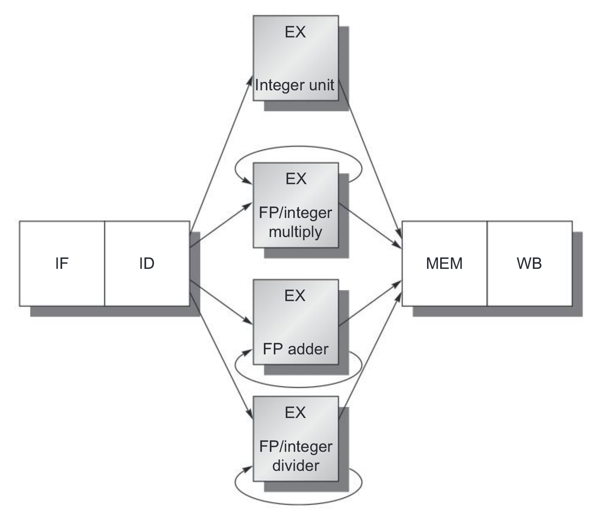

[图 C.26　用五个类别确定各类异常需要采取的动作。必须允许恢复执行的异常标为「恢复」，不过软件常常会选择终止程序。最难实现的是发生在指令内部、可以恢复的同步强制异常。人们可能以为违反存储保护的访问总会导致程序终止；但现代操作系统要利用存储保护来检测某些事件，例如第一次使用某一页、第一次写某一页。因此，处理器应当能在这类异常之后恢复执行。]{#fig-c-26 .caption}

| 异常类型 | 同步还是异步 | 用户请求还是强制 | 用户可屏蔽还是不可屏蔽 | 指令内还是指令间 | 恢复还是终止 |
|---|---|---|---|---|---|
| I/O 设备请求 | 异步 | 强制 | 不可屏蔽 | 指令间 | 恢复 |
| 调用操作系统 | 同步 | 用户请求 | 不可屏蔽 | 指令间 | 恢复 |
| 跟踪指令执行 | 同步 | 用户请求 | 用户可屏蔽 | 指令间 | 恢复 |
| 断点 | 同步 | 用户请求 | 用户可屏蔽 | 指令间 | 恢复 |
| 整数算术溢出 | 同步 | 强制 | 用户可屏蔽 | 指令内 | 恢复 |
| 浮点算术上溢或下溢 | 同步 | 强制 | 用户可屏蔽 | 指令内 | 恢复 |
| 缺页 | 同步 | 强制 | 不可屏蔽 | 指令内 | 恢复 |
| 访存地址未对齐 | 同步 | 强制 | 用户可屏蔽 | 指令内 | 恢复 |
| 违反存储保护 | 同步 | 强制 | 不可屏蔽 | 指令内 | 恢复 |
| 使用未定义的指令 | 同步 | 强制 | 不可屏蔽 | 指令内 | 终止 |
| 硬件故障 | 异步 | 强制 | 不可屏蔽 | 指令内 | 终止 |
| 电源故障 | 异步 | 强制 | 不可屏蔽 | 指令内 | 终止 |

#### 停止与重新启动执行 {-}

和非流水线实现一样，最难处理的异常有两个特点：一是发生在指令内部，也就是在指令执行的中途，对应于 EX 或 MEM 流水段；二是必须可以重新启动。以我们的 RISC-V 流水线为例，取数据引起的虚拟存储缺页，要到指令 MEM 段的某个时刻才会发生，而发现缺页时，已经有好几条其他指令在执行了。缺页必须可以重新启动，还需要另一个进程（例如操作系统）介入处理。因此，必须安全地关闭流水线并保存状态，让这条指令能在正确的状态下重新启动。通常的做法是保存重新开始执行的那条指令的 PC。如果重新启动的指令不是转移指令，就接着取它顺序的后继指令，按正常方式开始执行；如果是转移指令，就重新计算转移条件，然后从转移目标或顺序的下一条指令开始取指。发生异常时，流水线控制可以按以下步骤安全地保存流水线状态：

1. 在下一个 IF 段向流水线强行插入一条陷阱（trap）指令。
2. 在陷阱生效之前，关闭出错指令及流水线中所有后续指令的写操作。办法是从产生异常的那条指令开始，把流水线中各条指令的流水线锁存器置零，它前面的指令则不动。这样，异常处理之前不会完成的指令就不会改变任何状态。
3. 操作系统的异常处理程序获得控制后，立即保存出错指令的 PC，以后从异常返回时要用到这个值。

异常处理完毕后，由专门的指令重新装入 PC、重新启动指令流，让处理器从异常返回（RISC-V 用的是异常返回指令）。如果流水线停下来时，出错指令之前的指令都已完成，出错指令之后的指令可以从头重新开始，就称这条流水线具有*精确异常*（precise exception）。

理想情况下，出错指令不应改变状态，正确处理有些异常也确实要求出错指令不产生任何效果。但对另一些异常，例如浮点异常，有些处理器上的出错指令在异常得到处理之前就写入了结果。这时，即使目的寄存器与某个源寄存器相同，硬件也必须能够找回源操作数。浮点操作可能要执行很多个周期，其间源操作数很可能已经被其他指令改写（下一节会看到，浮点操作常常乱序完成）。为了解决这个问题，近年来许多高性能处理器设置了两种工作模式：一种具有精确异常，另一种（快速模式或性能模式）没有。精确异常模式当然要慢一些，因为浮点指令之间能够重叠的程度较低。

在许多系统中，精确异常是必须支持的；在另一些系统中，它「只是」有价值，因为它能简化操作系统的接口。至少，凡是采用请求调页或带有 IEEE 算术陷阱处理程序的处理器，都必须做到精确异常，可以由硬件实现，也可以借助一定的软件支持。整数流水线实现精确异常比较容易，而支持虚拟存储又要求访存操作必须有精确异常。因此在实践中，设计者和体系结构设计师总是为整数流水线提供精确异常。本节介绍怎样为 RISC-V 整数流水线实现精确异常；浮点流水线带来的更复杂的问题，处理方法留到 [C.5 节](#sec-c-5)介绍。

#### RISC-V 中的异常 {-}

[图 C.27](#fig-c-27) 列出了 RISC-V 的各个流水段以及每段可能发生哪些异常。采用流水线之后，由于同时有多条指令在执行，同一个时钟周期里可能发生多个异常。例如下面这个指令序列：

| 指令 | | | | | | |
|---|---|---|---|---|---|---|
| `ld` | IF | ID | EX | MEM | WB | |
| `add` | | IF | ID | EX | MEM | WB |

此时 `ld` 处在 MEM 段，`add` 处在 EX 段，因此这两条指令可能同时引起一个数据缺页和一个算术异常。处理办法是只处理数据缺页，然后重新开始执行。第二个异常会再次发生（如果软件正确，第一个异常不会再发生），到时再单独处理即可。

[图 C.27　RISC-V 流水线中可能发生的异常。在 8 种情形中，有 6 种是由取指或访问数据存储器引起的]{#fig-c-27 .caption}

| 流水段 | 可能发生的异常 |
|---|---|
| IF | 取指缺页；访存地址未对齐；违反存储保护 |
| ID | 未定义或非法的操作码 |
| EX | 算术异常 |
| MEM | 取数据缺页；访存地址未对齐；违反存储保护 |
| WB | 无 |

实际情况并不像这个简单的例子那样直截了当。异常可能乱序发生，也就是说，一条指令可能先于它前面的指令引起异常。还是看前面 `ld` 后跟 `add` 的指令序列。`ld` 可能发生数据缺页，要到它处于 MEM 段时才会发现；`add` 可能发生指令缺页，在它处于 IF 段时就会发现。于是，指令缺页虽然由后一条指令引起，却反而先发生！

由于我们实现的是精确异常，流水线必须先处理 `ld` 指令引起的异常。为了说明这是怎样做到的，把处在 `ld` 位置的指令称为指令 $i$，处在 `add` 位置的指令称为指令 $i+1$。流水线不能简单地在异常发生的时刻就去处理它，因为那样一来，异常的发生顺序就会与非流水线执行的顺序不同。正确的做法是：硬件把一条指令引起的所有异常都登记在与它相关联的状态向量中，这个异常状态向量随指令沿流水线一起前进。异常状态向量中一旦设置了某个异常标志，就关闭所有可能导致写入数据值的控制信号，包括写寄存器和写存储器。store 指令可能在 MEM 段引起异常，因此硬件必须做好准备，一旦 store 引发异常，就阻止它完成。

指令进入 WB 段时（或者说即将离开 MEM 段时），检查它的异常状态向量。如果登记了异常，就按照它们在非流水线处理器上发生的时间顺序处理：最早的指令对应的异常（通常也是这条指令最早的流水段对应的异常）最先处理。这样就保证了指令 $i$ 的所有异常都先于指令 $i+1$ 的任何异常得到处理。指令 $i$ 在前面各流水段中所做的操作当然可能是无效的，但写寄存器堆和写存储器都已禁止，所以不会改变任何状态。[C.5 节](#sec-c-5)会讲到，浮点操作要维持这种精确模型困难得多。

下一小节介绍：处理器的指令功能更强、执行时间更长时，在流水线中实现异常会遇到哪些问题。

### 指令系统带来的复杂性 {-}

RISC-V 的指令都只有一个结果，而我们的 RISC-V 流水线只在指令执行结束时才写入这个结果。一条指令确保能够完成时，就称它已经*提交*（committed）。在 RISC-V 整数流水线中，所有指令都在到达 MEM 段末尾（或 WB 段开始）时提交，在此之前没有任何指令更新状态。因此，实现精确异常很简单。但有些处理器的指令会在执行中途改变状态，这时这条指令及其前面的指令都还不能确保完成。例如，IA-32 体系结构的自动增量寻址方式会在指令执行中途更新寄存器。这时如果指令因异常而中止，处理器状态就已经改动了。虽然知道是哪条指令引起了异常，但这条指令只完成了一半，没有额外的硬件支持，这个异常就是非精确的。发生这样的非精确异常之后，很难重新启动指令流。另一种办法是在指令提交之前不更新状态，但这样做可能很困难，代价也可能很高，因为后续操作可能依赖于更新后的状态，例如 VAX 有的指令会对同一个寄存器多次自动增量。因此，为了维持精确异常模型，有这类指令的处理器大多能够撤销指令提交之前所做的状态改变。一旦发生异常，处理器就利用这种能力，把状态恢复到被中断的指令开始执行之前的值。下一节会看到，功能更强的 RISC-V 浮点流水线也会带来类似的问题；[C.7 节](#sec-c-7)介绍的技术则会使异常处理复杂得多。

与此相关的另一类困难来自在执行过程中更新存储器状态的指令，例如 Intel 体系结构或 IBM 360 上的字符串复制操作（见[附录 K](#app-k)）。为了能够中断并重新启动这些指令，指令系统规定它们使用通用寄存器作为工作寄存器。这样，部分完成的指令的状态总是保存在寄存器中；发生异常时保存这些寄存器，异常处理完后再恢复，指令就能接着执行。

还有一类困难来自一些零散的状态位，它们可能带来额外的流水线冒险，或者需要额外的硬件来保存和恢复。条件码就是一个很好的例子。许多处理器在执行指令时隐式地设置条件码。这种做法有好处，因为条件码把条件的计算与转移本身分开了。但是，隐式设置的条件码给调度带来困难：设置条件码与转移之间如果有流水线延迟，很难安排指令去填补，因为大多数指令都会设置条件码，不能放进条件计算与转移之间的延迟槽中。

另外，使用条件码的处理器必须判断转移条件何时确定下来，也就是要找出转移之前最后一次设置条件码的时刻。大多数隐式设置条件码的处理器的做法是推迟转移条件的计算，等前面所有指令都有机会设置条件码之后再计算。显式设置条件码的体系结构可以调度条件测试与转移之间的延迟；但流水线控制仍然必须跟踪最后一条设置条件码的指令，才能知道转移条件何时确定。实际上，条件码必须当作一个操作数，对它与转移指令之间的 RAW 冒险做冒险检测，就像 RISC-V 对寄存器所做的那样。

流水线中最后一个棘手的问题是多周期操作。设想要把下面这样一段 x86 指令流水化：

```
mov      BX, AX         ; 在寄存器之间传送
add      42(BX+SI),BX   ; 把存储器内容与寄存器相加
                        ; 结果写回同一存储单元
sub      BX,AX          ; 寄存器相减
rep movsb               ; 传送一个字符串，
                        ; 长度由寄存器 CX 给出
```

这几条指令都不算特别长（一条 x86 指令最长可达 15 字节），但需要的时钟周期数相差极大，少的只要 1 个时钟周期，多的要几百个。它们访问数据存储器的次数也各不相同，从零次到可能几百次。数据冒险非常复杂，既可能发生在指令之间，也可能发生在指令内部（没有什么能阻止 movsb 的源和目的相互重叠！）。让所有指令都执行相同的时钟周期数，这种简单的办法不可接受，因为它会引入大量的冒险和旁路条件，流水线也会变得极长。在指令一级把 x86 流水化很困难，但人们找到了一个巧妙的办法，与 VAX 用过的办法类似：把*微指令*（microinstruction）的执行流水化。微指令是一种简单的指令，若干条微指令组成序列，用来实现更复杂的指令系统。微指令很简单（看起来很像 RISC-V 指令），流水线控制因此容易得多。从 1995 年起，Intel 所有的 IA-32 微处理器都采用这种策略：先把 IA-32 指令转换成微操作，再把微操作流水化。事实上，ARM 体系结构中一些较复杂的指令甚至也采用了这种办法。

相比之下，load-store 处理器的操作简单，各操作的工作量相近，因此更容易流水化。体系结构设计师如果认识到指令系统设计与流水线之间的关系，就能设计出便于高效流水化的体系结构。下一节介绍 RISC-V 流水线怎样处理执行时间较长的指令，具体来说就是浮点操作。

多年来，人们一直认为指令系统与实现之间的相互影响很小，设计指令系统时，实现问题并不是主要的关注点。20 世纪 80 年代，人们清楚地认识到，复杂的指令系统会使流水化更难、效率更低。到了 20 世纪 90 年代，所有公司都转向了更简单的指令系统，以降低激进实现的复杂度。

## 扩展 RISC-V 整数流水线以处理多周期操作 {#sec-c-5}

下面我们探讨怎样扩展 RISC-V 流水线，让它能够处理浮点操作。本节集中讨论基本方法和各种设计选择，最后给出 RISC-V 浮点流水线的一些性能测量结果。

要求 RISC-V 的所有浮点操作都在 1 个时钟周期内完成，甚至在 2 个时钟周期内完成，都不现实。那样做要么得接受较慢的时钟，要么得在浮点部件中使用大量逻辑，或者两者兼有。因此，浮点流水线允许操作有较长的延迟。不妨这样理解：浮点指令与整数指令使用相同的流水线，只有两点重要的改变。一是 EX 周期可以根据完成操作的需要重复任意多次，不同操作的重复次数可以不同。二是可以有多个浮点功能部件。如果要发射的指令会在它所用的功能部件上引起结构冒险，或者会引起数据冒险，就会出现停顿。

本节假定我们的 RISC-V 实现中有四个独立的功能部件：

1. 主整数部件，处理 load 和 store、整数 ALU 操作以及转移；
2. 浮点和整数乘法器；
3. 浮点加法器，处理浮点加、减和类型转换；
4. 浮点和整数除法器。

再假定这些功能部件的执行段都不是流水的，得到的流水线结构如[图 C.28](#fig-c-28) 所示。EX 不是流水的，因此前一条指令离开 EX 之前，使用同一功能部件的其他指令都不能发射。此外，一条指令如果不能进入 EX 段，它后面的整条流水线都要停顿。

{#fig-c-28 width=70%}

实际上，中间结果大概不会像[图 C.28](#fig-c-28) 画的那样绕着 EX 部件循环，而是 EX 流水段本身有若干个时钟周期的延迟，大于 1。我们可以推广[图 C.28](#fig-c-28) 的浮点流水线结构，让其中一些段流水化，允许多个操作同时进行。描述这样的流水线，必须定义功能部件的*延迟*和*启动间隔*（initiation interval，也称*重复间隔*，repeat interval）。延迟的定义与前面相同，即产生结果的指令与使用该结果的指令之间相隔的周期数。启动间隔（重复间隔）是发射两个同类操作之间必须间隔的周期数。例如，下面将采用[图 C.29](#fig-c-29) 所示的延迟和启动间隔。

[图 C.29　各功能部件的延迟和启动间隔]{#fig-c-29 .caption}

| 功能部件 | 延迟 | 启动间隔 |
|---|---|---|
| 整数 ALU | 0 | 1 |
| 数据存储器（整数和浮点 load） | 1 | 1 |
| 浮点加 | 3 | 1 |
| 浮点乘（也用于整数乘） | 6 | 1 |
| 浮点除（也用于整数除） | 24 | 25 |

按照这个定义，整数 ALU 操作的延迟是 0，因为它的结果在下一个时钟周期就可以使用；load 的延迟是 1，因为它的结果要隔一个周期才能使用。大多数操作在 EX 开始时使用操作数，因此延迟通常就是指令在 EX 之后再经过多少段产生结果，例如 ALU 操作是零段，load 是一段。主要的例外是 store，它要晚一个周期才使用被存储的值。因此，对 store 的被存储值（而不是基址寄存器）来说，延迟要少一个周期。流水线延迟基本上等于执行流水线的深度减 1，执行流水线的深度是指从 EX 段到产生结果的那一段共有多少段。因此，在前面的示例流水线中，浮点加有 4 段，浮点乘有 7 段。要提高时钟频率，设计者就得减少每个流水段中的逻辑级数，于是较复杂的操作需要更多的流水段。可见，时钟频率提高的代价是操作的延迟变长。

[图 C.30](#fig-c-30) 中的示例流水线结构最多允许同时有 4 个未完成的浮点加、7 个未完成的浮点/整数乘和 1 个浮点除。[图 C.30](#fig-c-30) 说明怎样在[图 C.28](#fig-c-28) 的基础上画出这条流水线。[图 C.30](#fig-c-30) 用增加流水段的办法实现重复间隔，新增的段之间用新增的流水线寄存器隔开。各个部件相互独立，所以各段分别命名。需要多个时钟周期的流水段（例如除法部件）又进一步细分，以表示这些段的延迟；它们不是完整的段，所以其中只能有一个操作在进行。这种流水线结构也可以用本附录前面熟悉的那种图来表示，[图 C.31](#fig-c-31) 画的就是一组相互独立的浮点操作以及浮点 load、store。浮点操作的延迟变长，RAW 冒险及其引起的停顿自然会更加频繁，本节后面会看到这一点。

{#fig-c-30 width=90%}

[图 C.30](#fig-c-30) 的流水线结构要求增加流水线寄存器（例如 A1/A2、A2/A3、A3/A4），并修改与这些寄存器的连接。ID/EX 寄存器必须扩展，把 ID 连到 EX、DIV、M1 和 A1；这个寄存器中与后面某一段相关联的部分，可以分别记作 ID/EX、ID/DIV、ID/M1 或 ID/A1。ID 与其他各段之间的流水线寄存器在逻辑上可以看作几个独立的寄存器，实际上也可以用独立的寄存器来实现。一个流水段中每次只能有一个操作，所以控制信息可以与这一段入口处的寄存器关联在一起。

[图 C.31　一组相互独立的浮点操作的流水线时序。斜体的段表示需要数据的位置，粗体的段表示结果可用的位置。浮点 load 和 store 使用 64 位的访存通路，因此它们的流水线时序与整数 load、store 完全一样]{#fig-c-31 .caption}

| 指令 | | | | | | | | | | | |
|---|---|---|---|---|---|---|---|---|---|---|---|
| `fmul.d` | IF | ID | *M1* | M2 | M3 | M4 | M5 | M6 | **M7** | MEM | WB |
| `fadd.d` | | IF | ID | *A1* | A2 | A3 | **A4** | **MEM** | WB | | |
| `fadd.d` | | | IF | ID | *EX* | **MEM** | WB | | | | |
| `fsd` | | | | IF | ID | *EX* | **MEM** | WB | | | |

### 长延迟流水线中的冒险与前递 {-}

像[图 C.30](#fig-c-30) 这样的流水线，冒险检测和前递有以下几个方面的问题：

1. 由于除法部件不是全流水的，可能发生结构冒险。必须检测这类冒险，并使要发射的指令停顿。
2. 各条指令的执行时间不同，一个周期内需要写寄存器的次数可能大于 1。
3. 指令不再按顺序到达 WB，因此可能发生写后写（WAW）冒险。注意，读后写（WAR）冒险不可能发生，因为读寄存器总是在 ID 段进行。
4. 指令完成的顺序可能与发射的顺序不同，这会给异常处理带来问题，下一小节讨论这个问题。
5. 操作的延迟变长，RAW 冒险引起的停顿会更加频繁。

操作延迟变长导致停顿增多，这一点与整数流水线本质上相同。在介绍这条浮点流水线的新问题及其解决办法之前，先看看 RAW 冒险可能造成的影响。[图 C.32](#fig-c-32) 给出了一段典型的浮点代码以及由此引起的停顿。本节最后还要考察这条浮点流水线在我们的 SPEC 子集上的性能。

再来看前面列表第 (2)、(3) 项所说的写操作引起的问题。假定浮点寄存器堆只有一个写端口，那么一串浮点操作，或者一条浮点 load 与若干浮点操作，都可能争用寄存器写端口。以[图 C.33](#fig-c-33) 所示的流水线序列为例：在第 11 个时钟周期，三条指令都会到达 WB 段，都要写寄存器堆。寄存器堆只有一个写端口，处理器只能让这几条指令依次完成，这个唯一的写端口就构成了结构冒险。增加写端口可以解决这个问题，但这个办法未必可取，因为新增的写端口很少会用到：在稳态下，最多只需要 1 个写端口。因此，我们选择把对写端口的访问当作结构冒险来检测和处理。
