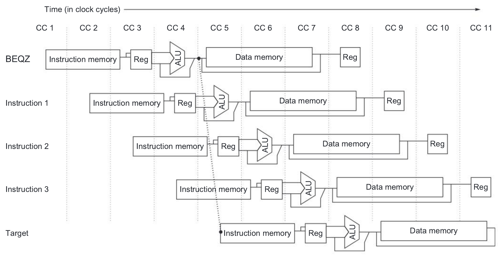

[图 C.32　一段典型的浮点代码及其中 RAW 冒险引起的停顿。与较浅的整数流水线相比，较长的流水线中停顿要频繁得多。这段代码中每条指令都与前一条指令相关，数据一旦可用就继续执行，这里假定流水线具备完整的旁路和前递。fsd 必须多停顿一个周期，它的 MEM 才不会与 fadd.d 的 MEM 冲突。增加一些硬件就能轻松处理这种情况。]{#fig-c-32 .caption}

| 指令 | 1 | 2 | 3 | 4 | 5 | 6 | 7 | 8 | 9 | 10 | 11 | 12 | 13 | 14 | 15 | 16 | 17 |
|---|---|---|---|---|---|---|---|---|---|---|---|---|---|---|---|---|---|
| `fld f4,0(x2)` | IF | ID | EX | MEM | WB | | | | | | | | | | | | |
| `fmul.d f0,f4,f6` | | IF | ID | 停顿 | M1 | M2 | M3 | M4 | M5 | M6 | M7 | MEM | WB | | | | |
| `fadd.d f2,f0,f8` | | | IF | 停顿 | ID | 停顿 | 停顿 | 停顿 | 停顿 | 停顿 | 停顿 | A1 | A2 | A3 | A4 | MEM | WB |
| `fsd f2,0(x2)` | | | | | IF | 停顿 | 停顿 | 停顿 | 停顿 | 停顿 | 停顿 | ID | EX | 停顿 | 停顿 | 停顿 | MEM |

[图 C.33　三条指令都要在第 11 个时钟周期写回浮点寄存器堆。这还*不是*最坏的情况，因为浮点部件中更早的一条除法指令也可能在同一个时钟周期结束。注意，第 10 个时钟周期里 fmul.d、fadd.d 和 fld 都处在 MEM 段，但真正访问存储器的只有 fld，所以 MEM 段不存在结构冒险。]{#fig-c-33 .caption}

| 指令 | 1 | 2 | 3 | 4 | 5 | 6 | 7 | 8 | 9 | 10 | 11 |
|---|---|---|---|---|---|---|---|---|---|---|---|
| `fmul.d f0,f4,f6` | IF | ID | M1 | M2 | M3 | M4 | M5 | M6 | M7 | MEM | WB |
| … | | IF | ID | EX | MEM | WB | | | | | |
| … | | | IF | ID | EX | MEM | WB | | | | |
| `fadd.d f2,f4,f6` | | | | IF | ID | A1 | A2 | A3 | A4 | MEM | WB |
| … | | | | | IF | ID | EX | MEM | WB | | |
| … | | | | | | IF | ID | EX | MEM | WB | |
| `fld f2,0(x2)` | | | | | | | IF | ID | EX | MEM | WB |

表中 1～11 为时钟周期号。

这种互锁有两种实现方法。

第一种方法是在 ID 段跟踪写端口的使用情况，在指令发射之前就让它停顿，和处理其他结构冒险一样。跟踪可以用一个移位寄存器完成，它记录已发射的指令将在什么时候使用寄存器堆。如果 ID 段中的指令要和某条已发射的指令同时使用寄存器堆，ID 段中的这条指令就停顿一个周期。这个预约寄存器（reservation register）每个时钟周期移位 1 位。这种方法的好处是保持了一个性质：所有的互锁检测和停顿插入都在 ID 段完成；代价是要增加移位寄存器和写冲突逻辑。本节其余部分都假定采用这种方法。

另一种方法是等发生冲突的指令要进入 MEM 段或 WB 段时，再让它停顿。这时可以在冲突的两条指令中任选一条停顿。一种简单的启发式策略是让延迟最长的功能部件优先，因为它最有可能已经让别的指令因 RAW 冒险而停顿，不过这种策略有时并不是最优的。这种方法的好处是，冲突要到进入 MEM 段或 WB 段时才需要检测，而在那里冲突很容易看出来；缺点是停顿现在可能来自两个地方，流水线控制因此变复杂。注意，在进入 MEM 段之前停顿，会让 EX、A4 或 M7 段一直被占用，停顿可能因此沿流水线向后逐级传递。同样，在进入 WB 段之前停顿，会让 MEM 段堵住。

另一个问题是可能出现 WAW 冒险。[图 C.33](#fig-c-33) 的例子说明这类冒险确实存在：如果 fld 提前一个周期发射，目的寄存器又是 f2，它就会比 fadd.d 早一个周期写 f2，从而产生 WAW 冒险。注意，只有 fadd.d 的结果*没有*被任何指令用过就被覆盖时，才会出现这种冒险！如果 fadd.d 和 fld 之间有指令使用 f2，流水线就要因 RAW 冒险而停顿，fld 要等 fadd.d 完成以后才能发射。可以说，在这条流水线中，只有执行了无用的指令才会出现 WAW 冒险；但我们仍然必须检测这类冒险，并保证最后留在 f2 中的是 fld 的结果。（[C.8 节](#sec-c-8)会看到，合理的代码中有时*确实*会出现这样的指令序列。）

处理这种 WAW 冒险有两种办法：一是推迟 load 指令的发射，直到 fadd.d 进入 MEM 段；二是检测到冒险后修改控制，不让 fadd.d 写回，也就是把它的结果作废，这样 fld 就可以立即发射。这种冒险很少出现，所以两种办法都完全可行，哪种实现起来简单就用哪种。无论用哪种办法，都可以在 fld 发射时于 ID 段检测这种冒险，让 fld 停顿或把 fadd.d 变成空操作也都很容易。难的是判断 fld 可能先于 fadd.d 完成，因为这需要知道流水线的长度和 fadd.d 当前所处的位置。好在这样的代码序列（两次写之间没有读）非常少见，因此可以用一个简单的办法：如果 ID 段中的指令要写的寄存器与某条已发射的指令相同，就不把它发射到 EX 段。[C.7 节](#sec-c-7)会介绍怎样增加硬件来消除这类冒险引起的停顿。下面先把浮点流水线中冒险检测和发射逻辑的各个部分组合起来。

检测冒险时，既要考虑浮点指令之间的冒险，也要考虑浮点指令与整数指令之间的冒险。除了浮点 load/store 和浮点-整数寄存器传送指令以外，浮点寄存器和整数寄存器是彼此分开的：整数指令只操作整数寄存器，浮点操作也只操作浮点寄存器。因此，检测浮点指令与整数指令之间的冒险时，只需要考虑浮点 load/store 和浮点寄存器传送指令。可见，整数数据和浮点数据分设寄存器堆，还有简化流水线控制这一好处。（主要的好处有两个：一是寄存器数目翻了一番，而每组寄存器都不必做大；二是带宽提高了，而每组寄存器都不必增加端口。主要的缺点，除了要多一个寄存器堆以外，是两组寄存器之间偶尔要传送数据，带来少量开销。）假定流水线在 ID 段完成全部冒险检测，那么一条指令发射之前必须做以下三项检查：

1. *检查结构冒险*：等到所需的功能部件不忙（在这条流水线中，只有除法需要这项检查），并确认到需要写寄存器时写端口可用。
2. *检查 RAW 数据冒险*：有些流水线寄存器中的结果，到本指令需要时还不能得到；要等到源寄存器不再作为待写的目的寄存器出现在这些流水线寄存器中。这里要做多项检查，具体取决于两条指令：一是产生结果的源指令，它决定结果什么时候可用；二是使用结果的目标指令，它决定什么时候需要这个值。例如，ID 段中的指令是一个浮点操作，源寄存器为 f2，那么 f2 就不能作为目的寄存器出现在 ID/A1、A1/A2 或 A2/A3 中，因为这些流水线寄存器对应的浮点加法指令，到 ID 段中的指令需要结果时还不能完成。（ID/A1 是 ID 段输出寄存器中送往 A1 的那一部分。）如果要让除法的最后几个周期与其他指令重叠，除法就要麻烦一些，因为除法快结束时的情况需要特殊处理。实际设计中，设计者可能放弃这项优化，换取更简单的发射检测。
3. *检查 WAW 数据冒险*：判断 A1，…，A4，D，M1，…，M7 中是否有指令的目的寄存器与本指令相同。如果有，就暂停发射 ID 段中的指令。

多周期浮点操作的冒险检测虽然更复杂，但概念与 RISC-V 整数流水线相同，前递逻辑也是这样。实现前递时，检查 EX/MEM、A4/MEM、M7/MEM、D/MEM 和 MEM/WB 寄存器，看其中有没有哪个目的寄存器是某条浮点指令的源寄存器。如果有，就使能相应的输入多路选择器，选取前递过来的数据。读者可以在习题中写出 RAW 冒险检测、WAW 冒险检测以及前递的逻辑。

多周期浮点操作还会给异常机制带来问题，下面就来讨论。

### 保持精确异常 {-}

这些长时间运行的指令还会带来另一个问题，可以用下面的代码序列说明：

```
fdiv.d   f0,f2,f4
fadd.d   f10,f10,f8
fsub.d   f12,f12,f14
```

这段代码看起来很简单，指令之间没有相关。问题在于，先发射的指令可能比后发射的指令晚完成。在这个例子中，fadd.d 和 fsub.d 很可能在 fdiv.d *之前*完成。这称为*乱序完成*，在含有长时间运行操作的流水线中很常见（见 [C.7 节](#sec-c-7)）。冒险检测能保证指令之间的相关不被破坏，那么乱序完成为什么还是问题呢？假设 fsub.d 引起了浮点算术异常，而此时 fadd.d 已经完成，fdiv.d 还没有完成，结果就是一个非精确异常，这正是我们要避免的。看起来，可以像整数流水线那样，让浮点流水线排空来解决这个问题；但异常发生的位置可能让这种办法行不通。例如，fdiv.d 在加法完成之后才确定要发生浮点算术异常，这时在硬件层面就无法得到精确异常。事实上，fadd.d 改写了它的一个操作数，因此即使借助软件，也无法把状态恢复到 fdiv.d 之前的样子。

这个问题的根源是指令完成的顺序与发射的顺序不同。处理乱序完成有四种可能的办法。

第一种办法是不理会这个问题，接受非精确异常。20 世纪 60 年代和 70 年代初采用的就是这种办法。过去十五年里，一些超级计算机仍在使用它，这些机器不允许某些类型的异常发生，或者由硬件处理这些异常而不停止流水线。如今制造的大多数处理器很难采用这种办法，因为虚拟存储、IEEE 浮点标准等特性实际上都要求由硬件和软件配合实现精确异常。前面提到过，最近一些处理器引入了两种执行模式来解决这个问题：一种速度快，但可能不精确；另一种速度较慢，但是精确。较慢的精确模式可以通过模式切换实现，也可以通过插入专门检测浮点异常的指令实现。无论哪种实现，浮点流水线中允许的重叠和重排都受到很大限制，实际上同一时刻只有一条浮点指令在执行。DEC Alpha 21064 和 21164、IBM Power1 和 Power2，以及 MIPS R8000 都采用了这种办法。

第二种办法是把一个操作的结果缓冲起来，直到在它之前发射的操作全部完成。确实有一些处理器采用这种办法。但各操作的运行时间相差很大时，需要缓冲的结果会很多，代价就很高。此外，在等待长指令期间，为了继续发射指令，必须从队列中旁路出结果，这需要大量比较器和一个非常大的多路选择器。

这种基本办法有两种可行的变体。一种是 CYBER 180/990 采用的*历史文件*（history file），它记录寄存器原来的值。发生异常时，如果状态必须回滚到某条乱序完成的指令之前，就从历史文件中恢复寄存器原来的值。VAX 等处理器的自增和自减寻址也采用了类似的技术。另一种是 Smith and Pleszkun (1988) 提出的*未来文件*（future file），它保存寄存器较新的值；前面的指令全部完成以后，再用未来文件更新主寄存器堆。这样，发生异常时，主寄存器堆中就是被中断状态的精确值。第 3 章还会介绍另一种办法，它是支持推测所必需的。所谓推测，就是在知道前面转移的结果之前就执行指令。

第三种在用的技术是允许异常在一定程度上不精确，但保留足够的信息，让陷阱处理程序能够为异常构造出一个精确的序列。也就是说，要知道流水线中有哪些操作，以及它们的 PC。这样，处理完异常以后，软件把最后完成的那条指令之前的所有指令执行完，指令序列就可以重新开始。考虑下面这个最坏情况下的代码序列：

- $\text{指令}_1$：一条长时间运行的指令，最终中断了执行。
- $\text{指令}_2, \ldots, \text{指令}_{n-1}$：一串尚未完成的指令。
- $\text{指令}_n$：一条已经完成的指令。

给定流水线中所有指令的 PC 和异常返回 PC，软件就能确定 $\text{指令}_1$ 和 $\text{指令}_n$ 的状态。由于 $\text{指令}_n$ 已经完成，我们希望从 $\text{指令}_{n+1}$ 处重新开始执行。处理完异常以后，软件必须先模拟执行 $\text{指令}_1, \ldots, \text{指令}_{n-1}$，然后才能从异常返回，从 $\text{指令}_{n+1}$ 处重新开始。这种方案的主要难点是，异常处理程序要正确执行这些指令，实现起来很复杂。

类似 RISC-V 的简单流水线有一个重要的简化：如果 $\text{指令}_2, \ldots, \text{指令}_n$ 都是整数指令，那么只要 $\text{指令}_n$ 已经完成，$\text{指令}_2, \ldots, \text{指令}_{n-1}$ 也一定都已完成，因此只需要处理浮点操作。为了让这种方案易于实现，可以限制能够重叠执行的浮点指令数。例如，只允许两条指令重叠时，软件只需要完成引起中断的那条指令。但浮点流水线很深，或者浮点功能部件很多时，这一限制可能降低潜在的吞吐率。SPARC 的一些实现采用这种办法，让浮点操作能与整数操作重叠执行。

最后一种技术是混合方案：只有确定正在发射的指令之前的所有指令都能完成而不引起异常，才允许继续发射。这样就能保证，发生异常时，引起中断的指令之后的指令都不会完成，而它之前的指令都能完成。为了保持精确异常，有时就要让处理器停顿。要让这种方案行得通，浮点功能部件必须在 EX 段的早期（在 RISC-V 流水线中是前 3 个时钟周期）判断出是否可能发生异常，以便阻止后面的指令完成。MIPS R2000/3000、R4000 和 Intel Pentium 都采用了这种方案，[附录 J](#app-j) 对它有进一步的讨论。

### 简单 RISC-V 浮点流水线的性能 {-}

[图 C.30](#fig-c-30) 所示的 RISC-V 浮点流水线有两类停顿：一是除法部件引起的结构停顿，二是 RAW 冒险引起的停顿（它也可能出现 WAW 冒险，但实际中很少发生）。[图 C.34](#fig-c-34) 给出了各类浮点操作每次操作的停顿周期数（例如，每个浮点基准测试程序的第一根柱，是每次浮点加法、减法或转换的浮点结果停顿数）。和预料的一样，每次操作的停顿周期数随浮点操作的延迟而变化，为功能部件延迟的 46%～59%。

{#fig-c-34 width=75%}

[图 C.35](#fig-c-35) 给出了 5 个 SPECfp 基准测试程序的整数停顿和浮点停顿的完整分类。图中列出了四类停顿：浮点结果停顿、浮点比较停顿、load 和转移延迟，以及浮点结构延迟。转移延迟引起的停顿没有计入；转移延迟为一个周期时，即使只配一个很普通的转移预测器，这部分停顿也会很少。每条指令的总停顿数在 0.65 到 1.21 之间。

{#fig-c-35 width=75%}

## 融会贯通：MIPS R4000 流水线 {#sec-c-6}

本节介绍 MIPS R4000 处理器系列（包括 4400）的流水线结构和性能。MIPS 体系结构与 RISC-V 非常相似，只有少数指令不同，其中包括 MIPS ISA 中的延迟转移。R4000 实现的是 MIPS64，无论对整数程序还是浮点程序，它的流水线都比我们的五段设计更深。R4000 把五段整数流水线分解成八段，靠更深的流水线达到更高的时钟频率。Cache 访问对时间的要求特别紧，所以多出来的流水段都来自对访存的分解。这种更深的流水线有时称为*超流水线*（superpipelining）。

[图 C.36](#fig-c-36) 用抽象的数据通路画出了八段流水线的结构，[图 C.37](#fig-c-37) 给出了相继指令在流水线中的重叠情况。注意，指令存储器和数据存储器虽然要占用多个周期，但都是完全流水化的，所以每个时钟周期都能开始一条新指令。事实上，Cache 命中检测还没完成，流水线就已经在使用数据了；第 3 章会更详细地讨论怎样做到这一点。

各段的功能如下：

- IF：取指的前半部分。PC 选择实际上就发生在这一段，指令 Cache 访问也在这一段开始。
- IS：取指的后半部分，完成指令 Cache 访问。
- RF：指令译码和读寄存器、冒险检查，以及指令 Cache 命中检测。
- EX：执行，包括有效地址计算、ALU 操作，以及转移目标计算和条件判断。
- DF：取数据，数据 Cache 访问的前半部分。
- DS：取数据的后半部分，完成数据 Cache 访问。
- TC：tag 检查，判断数据 Cache 访问是否命中。
- WB：load 和寄存器-寄存器操作的写回。

{#fig-c-36 width=90%}

流水线的延迟变长以后，需要的前递大大增加，load 延迟和转移延迟也随之增加。从[图 C.37](#fig-c-37) 可以看出，load 延迟为 2 个周期，因为数据要到 DS 段末尾才能得到。[图 C.38](#fig-c-38) 是 load 之后紧跟着使用其结果的指令时的简化流水线时序，从中可以看出，load 指令的结果需要前递给 3 个或 4 个周期之后的目标。

{#fig-c-37 width=90%}

[图 C.38　load 指令之后紧跟着使用其结果的指令，会引起 2 个周期的停顿。两个周期以后就可以使用普通的前递通路，因此 add 和 sub 在停顿之后通过前递得到这个值；or 指令则从寄存器堆中读取这个值。load 之后的两条指令可能与它无关，也就不必停顿，因此旁路的目标可能是 load 之后第 3 个或第 4 个周期的指令。]{#fig-c-38 .caption}

| 指令 | 1 | 2 | 3 | 4 | 5 | 6 | 7 | 8 | 9 |
|---|---|---|---|---|---|---|---|---|---|
| `ld x1,...` | IF | IS | RF | EX | DF | DS | TC | WB | |
| `add x2,x1,...` | | IF | IS | RF | 停顿 | 停顿 | EX | DF | DS |
| `sub x3,x1,...` | | | IF | IS | 停顿 | 停顿 | RF | EX | DF |
| `or x4,x1,...` | | | | IF | 停顿 | 停顿 | IS | RF | EX |

表中 1～9 为时钟周期号。

从[图 C.39](#fig-c-39) 可以看出，基本的转移延迟为 3 个周期，因为转移条件要到 EX 段才能算出。MIPS 体系结构采用单周期的延迟转移；对转移延迟剩下的 2 个周期，R4000 采用预测不转移的策略。如[图 C.40](#fig-c-40) 所示，不转移的转移指令就是单周期延迟转移；转移成功的转移指令则在一个周期的延迟槽之后还有两个空闲周期。指令系统中提供了前面介绍过的「可能转移」（branch-likely）指令，它有助于填充转移延迟槽。转移成功时 2 个周期的转移停顿，以及使用 load 结果引起的数据冒险停顿，都由流水线互锁来保证。R4000 之后，MIPS 处理器的所有实现都采用了动态转移预测。

{#fig-c-39 width=90%}

流水线加深以后，不仅 load 和转移的停顿增加了，ALU 操作的前递级数也增加了。在我们的 RISC-V 五段流水线中，两条寄存器-寄存器 ALU 指令之间的前递可以来自 EX/MEM 或 MEM/WB 寄存器。在 R4000 流水线中，ALU 旁路有四个可能的来源：EX/DF、DF/DS、DS/TC 和 TC/WB。
