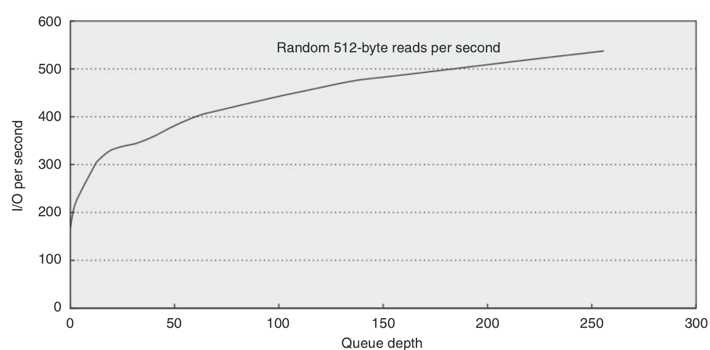

# 存储系统 {#app-d}

> 我认为硅谷这个名字起错了。回顾过去十年的产品销售额就会发现，磁盘带来的收入比硅还多。这个地方应该改名叫氧化铁谷。
>
> ——Al Hoagland，磁盘的先驱之一（1982）

> 带宽与存储相结合……让人们能够迅速、可靠地访问不断膨胀的内容宝库，这些内容存放在数量激增的磁盘和……互联网的各种存储库中。……各类存储阵列的容量都在飞速增长，速度超过了计算机性能的提高。
>
> ——George Gilder，《末日将近》（"The End Is Drawing Nigh"），*Forbes ASAP*（2000 年 4 月 4 日）

## 引言 {#sec-d-1}

搜索引擎、拍卖等互联网服务普及以后，I/O 对计算机更加重要，因为谁也不会要一台上不了网的台式计算机。从人们给不同时代起的名字上，就能看出 I/O 地位的上升：20 世纪 60 年代到 80 年代称为「计算革命」时期；1990 年以后称为「信息时代」，人们关心的是信息技术的进步，而不是单纯的计算能力。互联网服务依赖两样东西：一是海量存储，这是本附录的主题；二是网络，这是[附录 F](#app-f) 的主题。

关注的重点从计算转向信息的通信和存储以后，可靠性、可扩展性和性价比一样受到重视。程序崩溃固然让人恼火，丢了数据却会让人惊慌失措，因此存储系统可信性的标准通常比计算机其他部分更高。可信性是存储的基石，但存储也有自己一套丰富的性能理论，即排队论，用来在吞吐率和响应时间之间取得平衡。在处理器方面，决定用到哪些处理器特性的软件是编译器；在存储方面，这个角色由操作系统担当。

由此可见，存储的文化与处理器不同，涉及的方面也多，但它仍然属于体系结构的范畴。磁盘是当今台式计算机和服务器中占主导地位的存储设备，所以我们从磁盘的进展讲起。我们假定读者已经熟悉存储设备的基础知识，其中一部分在第 1 章介绍过。

## 磁盘存储的高级专题 {#sec-d-2}

一直以来，磁盘行业的重点都是提高磁盘容量。容量的提高习惯上用*面密度*的提高来表示，面密度的单位是每平方英寸的位数：

$$
\text{面密度} = \frac{\text{磁道数}}{\text{英寸}}\ \text{（盘面上）} \times \frac{\text{位数}}{\text{英寸}}\ \text{（磁道上）}
$$

大约 1988 年以前，面密度每年提高 29%，每 3 年翻一番。此后到 1996 年前后，提高速度加快到每年 60%，每 3 年变为原来的 4 倍，与 DRAM 传统的增长速度相当。1997 年到 2003 年前后，速度进一步加快到每年 100%，即每年翻一番。促成这次复兴的创新基本用尽以后，近年来提高速度又降到每年 30% 左右。2011 年，商用产品的最高面密度是每平方英寸 4000 亿位。每 GB 成本下降得至少与面密度提高得一样快，其中起主要作用的是直径较小的驱动器。1983 年到 2011 年间，每 GB 成本降到原来的将近 1/1,000,000。

磁盘在二级存储中的霸主地位多次受到挑战。[图 D.1](#fig-d-1) 给出了其中一个原因：磁盘与 DRAM 之间那道著名的*访问时间鸿沟*。DRAM 的延迟只有磁盘的大约 1/100,000；为了这一性能优势，DRAM 每 GB 要付出磁盘 30～150 倍的价格。

带宽方面的差距要复杂一些。例如，2011 年一块快速磁盘容量 600 GB，从盘片介质读取数据的速率是 200 MB/s，价格约 400 美元；同年一条 4 GB 的 DRAM 内存条价格约 200 美元，传输速率可达 16,000 MB/s（见第 2 章），带宽约为这块磁盘的 80 倍。但是按每 GB 计算，DRAM 的带宽是磁盘的 12,000 倍；按每美元计算，是磁盘的 160 倍。

许多人试图发明比 DRAM 便宜、比磁盘快的技术来填补这道鸿沟，但迄今都失败了。原因是挑战者的产品始终没能在合适的时机上市：等到新产品发货时，DRAM 和磁盘已经如预期那样进步，成本也相应下降，新产品一上市就过时了。

{#fig-d-1 width=90%}

最接近成功的挑战者是 Flash 存储器。这种半导体存储器与磁盘一样是非易失的，带宽与磁盘大致相同，但延迟只有磁盘的 1/1000～1/100。2011 年，Flash 每 GB 的价格只有 DRAM 的 1/20～1/15。Flash 每 GB 的成本是磁盘的 15～25 倍，但它可以做成小得多的容量，而且比磁盘更节能，因此在手机中很受欢迎。与磁盘和 DRAM 不同，Flash 存储器的位会磨损，通常最多只能写 100 万次，因此在台式计算机和服务器中并不流行。

在可以预见的将来，磁盘仍会继续使用，但传统的「扇区—磁道—柱面」模型已经不再适用。这个模型有三个假设：相邻的块在同一磁道上；同一柱面上的块不需要寻道，访问时间较短；有些磁道之间的距离比另一些近。

首先，磁盘内部装了微处理器以后，开始提供 ATA、SCSI 这类更高层次的智能接口。为了加快顺序传输，这些高层接口把磁盘组织得更像磁带，而不像随机访问设备：逻辑块在单个盘面上按蛇形顺序排列，尽量把以同一位密度记录的扇区都排在一起。（磁盘之所以改变记录密度，是因为外圈磁道上的块转得快得多，电子电路很难跟上，降低线密度可以简化这一任务。）因此，顺序的块可能位于不同的磁道上。后面的[图 D.22](#fig-d-22) 将说明：对现代磁盘仍按传统的「扇区—磁道」模型来考虑是一个谬误。

其次，磁盘内部出现微处理器后不久，就加入了缓冲区，在计算机准备好接收之前暂存数据；后来又加入了 Cache，以免去一些读访问。再后来又加入了命令队列，由磁盘自己决定按什么顺序执行命令，在保证行为正确的前提下使性能最高。从[图 D.2](#fig-d-2) 可以看出，队列深度为 50 时，访问调度得更好，随机 I/O 的每秒 I/O 次数可以翻一番。实际系统的队列中不太可能真有 256 条命令，但如果有，每秒 I/O 次数可以达到原来的 3 倍。有了缓冲区、Cache 和乱序访问，真实磁盘的精确性能模型就比「扇区—磁道—柱面」模型复杂得多。

{#fig-d-2 width=90%}

最后，盘片数从过去的 12 张减少到现在的 4 张甚至 1 张，一个柱面上的数据占总数据的比例小得多，因此柱面也就不像以前那么重要了。

### 磁盘的功耗 {-}

与处理器一样，磁盘的功耗也越来越受关注。2011 年一块典型的 ATA 磁盘，空闲时功耗约 9 W，读写时约 11 W，寻道时约 13 W。转动质量较小的盘片效率更高，因此直径较小的磁盘可以节省功耗。下面这个公式［Gurumurthi et al. 2005］表明，转速和盘片尺寸对磁盘电机的功耗影响很大：

$$
\text{功耗} \approx \text{直径}^{4.6} \times \text{RPM}^{2.8} \times \text{盘片数}
$$

可见，盘片小、转速低、盘片少，都有助于降低磁盘电机的功耗，而磁盘的功耗大部分在电机上。

[图 D.3](#fig-d-3) 列出了 2011 年两种 3.5 英寸磁盘的规格。*串行 ATA*（SATA）磁盘追求大容量和最低的每 GB 成本，因此 2000 GB 的驱动器每 GB 不到 0.05 美元。SATA 磁盘采用这种外形规格所能容纳的最宽的盘片，装四五张；但转速只有 5900 RPM，寻道也比较慢，这样才能采用较高的面密度并降低功耗。与之对应的*串行连接 SCSI*（SAS）驱动器以性能为目标，因此转速达 15,000 RPM，寻道也快得多。为了能以这么高的转速旋转，SAS 驱动器采用较低的面密度；为了降低功耗，盘片比外形规格窄得多。两方面合在一起，SAS 驱动器的容量就降到了 600 GB。

按每 GB 成本计算，SATA 驱动器约为 SAS 的 1/5；反过来，按每秒每次 I/O 或每秒每传输 1 MB 的成本计算，SAS 驱动器约为 SATA 的 1/5。SAS 磁盘的盘片更小、数量也少得多，但转速高得多、寻道快得多，因此功耗是 SATA 驱动器的 2 倍。

[图 D.3　2011 年 3.5 英寸外形规格的串行 ATA（SATA）驱动器与串行连接 SCSI（SAS）驱动器。每秒 I/O 次数按平均寻道时间、半圈旋转时间与传输一个 512 字节扇区的时间之和计算。]{#fig-d-3 .caption}

| | 容量（GB） | 价格 | 盘片数 | RPM | 直径（英寸） | 平均寻道（ms） | 功耗（W） | 每秒 I/O 次数 | 磁盘带宽（MB/s） | 缓冲区带宽（MB/s） | 缓冲区容量（MB） | MTTF（小时） |
|---|---|---|---|---|---|---|---|---|---|---|---|---|
| SATA | 2000 | \$85 | 4 | 5900 | 3.7 | 16 | 12 | 47 | 45～95 | 300 | 32 | 0.6 M |
| SAS | 600 | \$400 | 4 | 15,000 | 2.6 | 3～4 | 16 | 285 | 122～204 | 750 | 16 | 1.6 M |

### 磁盘阵列的高级专题 {-}

磁盘阵列是存储系统的一项创新，既提高可信性，又提高性能。支持阵列的一个理由是：用许多磁盘驱动器（因而有许多磁头臂）代替少数几个大驱动器，可以提高潜在的吞吐率。只要把数据分散存放到多个磁盘上，即所谓*条带化*（striping），访问大文件时就必然会同时访问多个磁盘。（阵列虽然提高了吞吐率，但不一定能降低延迟。）第 1 章讲过，阵列的缺点是设备多了，可信性就下降：$N$ 个设备的可靠性一般只有单个设备的 $1/N$。

如果每块磁盘的可靠性相同，磁盘阵列出现的故障就会比数量较少的几块大磁盘多。但是，在阵列中加入冗余磁盘来容忍故障，就可以提高可信性：一块磁盘失效时，用冗余信息重建丢失的信息。唯一的危险是在平均修复时间（MTTR）内又有一块磁盘失效。磁盘的平均无故障时间（MTTF）长达数十年，而 MTTR 以小时计，因此有了冗余，多块磁盘的实测可靠性可以远高于单块磁盘。

这种冗余磁盘阵列后来以缩写 RAID 著称。RAID 原来是 redundant array of inexpensive disks（廉价磁盘冗余阵列）的缩写，不过有人更愿意把 I 解释为 independent（独立）。RAID 一是能够从失效中恢复，二是吞吐率更高（无论按每秒 MB 数还是按每秒 I/O 次数衡量），因此很有吸引力。再加上小直径驱动器体积小、功耗低，RAID 如今已经在大规模存储系统中占据主导地位。

[图 D.4](#fig-d-4) 总结了五种标准 RAID 级别：每个级别下，8 块存放用户数据的磁盘需要另配多少块冗余盘（校验盘），以及各级别的优缺点。标准 RAID 级别已经有大量文献介绍，这里只简单回顾，重点深入讨论高级的级别。

* *RAID 0*。没有冗余，有时戏称为 JBOD（just a bunch of disks，「就是一堆磁盘」），不过数据可以在阵列的各磁盘上条带化存放。列出这一级别，一般是为了在成本、性能和可信性方面给其他 RAID 级别提供一个比较基准。
* *RAID 1*。也称*镜像*（mirroring）或*影子*（shadowing），每份数据都有两个副本。这是最简单、最古老的磁盘冗余方案，但成本也最高。有些阵列控制器为了优化读性能，让镜像的两块盘各自独立地响应读请求；但这样一来，镜像写可能要更长时间才能完成。
* *RAID 2*。这种组织方式的思路来自把存储器式的纠错码（ECC）用到磁盘上。之所以列出它，是因为最初提出 RAID 的论文发表时有这样的磁盘阵列产品；此后其他 RAID 组织方式更有吸引力，就再也没有出现这样的产品。

[图 D.4　各 RAID 级别及其容错能力和冗余盘开销。提出 RAID 这一术语的论文［Patterson, Gibson, and Katz 1987］采用了数字分类法，这种分类后来流行开来。实际上，无冗余的磁盘阵列常称为 *RAID 0*，表示数据在多块磁盘上条带化存放，但没有冗余。注意，这里的镜像（RAID 1）最多可以承受 8 块磁盘失效，前提是每个镜像对中只有一块磁盘失效；最坏情况是一个镜像对中的两块磁盘都失效。2011 年，RAID 2 可能已经没有商业实现；其余级别在各种产品中广泛使用。RAID 0+1、1+0、01、10 和 6 在正文中讨论。]{#fig-d-4 .caption}

| RAID 级别 | | 可容忍的磁盘失效数、8 块数据盘的校验空间开销 | 优点 | 缺点 | 采用的公司产品 |
|---|---|---|---|---|---|
| 0 | 无冗余条带化 | 0 次失效，0 块校验盘 | 没有空间开销 | 没有保护 | 广泛使用 |
| 1 | 镜像 | 1 次失效，8 块校验盘 | 不需要计算奇偶校验；恢复快；小写比更高级别的 RAID 快；读快 | 校验存储开销最大 | EMC、HP（Tandem）、IBM |
| 2 | 存储器式 ECC | 1 次失效，4 块校验盘 | 不依赖失效盘的自我诊断 | 校验存储开销约为 Log 2 | 未使用 |
| 3 | 位交叉奇偶校验 | 1 次失效，1 块校验盘 | 校验开销小；大读写的带宽高 | 不支持小的随机读写 | Storage Concepts |
| 4 | 块交叉奇偶校验 | 1 次失效，1 块校验盘 | 校验开销小；小读的带宽较高 | 奇偶校验盘是小写的瓶颈 | Network Appliance |
| 5 | 块交叉分布式奇偶校验 | 1 次失效，1 块校验盘 | 校验开销小；小读和小写的带宽较高 | 小写需要 4 次磁盘访问 | 广泛使用 |
| 6 | 行-对角线奇偶校验、EVEN-ODD | 2 次失效，2 块校验盘 | 可防护 2 块磁盘失效 | 小写需要 6 次磁盘访问；校验开销加倍 | Network Appliance |

* *RAID 3*。高层磁盘接口了解磁盘的健康状况，因此很容易判断是哪块磁盘失效了。设计者认识到，只要另加一块磁盘，存放各数据盘中信息的奇偶校验，一块磁盘失效时就能靠它恢复数据。数据按条带组织，每个条带有 $N$ 个数据块和一个奇偶校验块。发生失效时，只要从完好的块中「减去」完好的数据，剩下的就是丢失的数据。（无论失效的是数据盘还是奇偶校验盘，这个办法都行得通。）RAID 3 假定每次读写的数据都分布在所有磁盘上，这种做法适合读写大量数据。
* *RAID 4*。许多应用以小访问为主。每个扇区都有自己的检错信息，因此可以放心地让每块磁盘独立执行读操作，提高每秒读的次数。写似乎仍然很慢，因为要读出每块磁盘才能算出奇偶校验。为了提高每秒写的次数，可以换一种只涉及两块磁盘的做法：阵列先读出即将覆盖的旧数据，在写入新数据之前算出哪些位会改变；然后读出校验盘上奇偶校验的旧值，按改变的位更新奇偶校验，再把奇偶校验的新值写回校验盘。这种所谓的「小写」要访问 4 次磁盘，因此仍然比小读慢，但比每次写都读所有磁盘快。RAID 4 的校验盘开销与 RAID 3 一样小，大读写与 RAID 3 一样快，此外还能做小读和小写，只是控制更复杂。
* *RAID 5*。RAID 4 的小写有一个性能缺陷：所有小写都要读写同一块校验盘，于是这块盘成了性能瓶颈。RAID 5 的做法很简单，就是把奇偶校验信息分布到阵列的所有磁盘上，从而消除这个瓶颈。各条带的奇偶校验块轮换存放，奇偶校验就均匀地分布在所有磁盘上。于是，阵列控制器在写某个块时，必须先算出这个块的奇偶校验在哪块磁盘上，不过计算很简单。RAID 5 的校验盘开销与 RAID 3、RAID 4 一样小，既能做 RAID 3 的大读写，也能做 RAID 4 的小读，而小写带宽比 RAID 4 高。但是，在经典的 RAID 级别中，RAID 5 需要的控制器最复杂。

经典 RAID 级别回顾完了，下面看两个在 RAID 提出以后流行起来的级别。

### RAID 10 与 RAID 01（RAID 1+0 与 RAID 0+1） {-}

RAID 1 的镜像与条带化怎样组合，RAID 文献并不总是讨论。假设要存储 4 块磁盘的数据，可用的物理磁盘有 8 块。一种做法是组成 4 对磁盘，每对按 RAID 1 组织，再把数据条带化地分布到这 4 个 RAID 1 盘对上；另一种做法是组成两组磁盘，每组 4 块，按 RAID 0 组织，再把写操作镜像到两个 RAID 0 组上。RAID 术语后来把前者称为 RAID 1+0 或 RAID 10（「条带化的镜像」），把后者称为 RAID 0+1 或 RAID 01（「镜像的条带」）。

### RAID 6：容忍多于一块磁盘的失效 {-}

RAID 1 到 RAID 5 这些基于奇偶校验的方案，只能防护单个能够自我识别的失效。如果处理失效时操作员不小心换错了磁盘，磁盘阵列就会遇到两个失效，数据也就丢了。另一个问题是，磁盘带宽的增长比容量慢，因此 RAID 系统中一块磁盘的 MTTR 越来越长，出现第二次失效的机会随之增加。例如，假定没有干扰，顺序读完一块 500 GB 的 SATA 磁盘大约需要 3 小时。而受损的 RAID 很可能还要继续提供数据服务，重建时间可能因此大大延长，MTTR 随之增加。除了重建时间延长，还有一个问题：重建时要读出多得多的数据，出现不可纠正的介质失效的机会也就更大，而这会导致数据丢失。担心多个失效同时发生，还有两个理由：一是阵列中的磁盘越来越多；二是采用了 ATA 磁盘，它比 SCSI 磁盘更慢、容量更大。

因此，多年来人们对防护多于一个失效越来越感兴趣。例如，Network Appliance（NetApp）公司起初制造的是 RAID 4 文件服务器。双重失效逐渐成为客户面临的危险以后，NetApp 设计了一种更可靠的数据保护方案，称为*行-对角线奇偶校验*（row-diagonal parity）或 *RAID-DP*［Corbett et al. 2004］。与标准 RAID 方案一样，行-对角线奇偶校验按条带计算奇偶校验，冗余空间用来存放计算结果。由于要防护双重失效，它给每个数据条带增加两个校验块。假设总共有 $p+1$ 块磁盘，其中 $p-1$ 块存放数据。[图 D.5](#fig-d-5) 给出了 $p=5$ 的情形。

行奇偶校验盘与 RAID 4 中的校验盘一样，存放所在条带中其他 4 个数据块的偶校验。对角线奇偶校验盘的每个块存放同一条对角线上各块的偶校验。注意，每条对角线都有一块磁盘不覆盖，例如对角线 0 不覆盖磁盘 1。因此，保护 $p$ 块磁盘只需要 $p-1$ 条对角线，[图 D.5](#fig-d-5) 的对角线奇偶校验盘上也就只有对角线 0 到 3。

下面假设[图 D.5](#fig-d-5) 中的数据盘 1 和 3 失效，看看行-对角线奇偶校验怎样工作。第一行缺了磁盘 1 和磁盘 3 上的两个数据块，因此无法用行奇偶校验做标准的 RAID 恢复。但是对角线 0 只缺磁盘 3 上的那个数据块，所以可以恢复。因此在这个例子中，行-对角线奇偶校验先用对角线奇偶校验恢复失效磁盘上 4 个块中的一个。每条对角线都漏掉一块磁盘，而且各条对角线漏掉的磁盘各不相同，所以有两条对角线只缺一个块。在这个例子中是对角线 0 和 2，于是接下来恢复失效磁盘 1 上属于对角线 2 的块。这些块的数据恢复以后，就可以用标准的 RAID 恢复方案，在标准的 RAID 4 条带 0 和 2 中再恢复两个块；有了这两个块，我们又能恢复更多的对角线。这个过程一直进行下去，直到两块失效磁盘完全恢复。

{#fig-d-5 width=90%}

IBM 的研究人员更早提出的 EVEN-ODD 方案与行-对角线奇偶校验类似，但运行和恢复时的计算量稍多一些［Blaum 1995］。更近的一些论文介绍了怎样扩展 EVEN-ODD，让它能够防护三个失效［Blaum, Bruck, and Vardy 1996；Blaum et al. 2001］。

## 真实故障与失效的定义和实例 {#sec-d-3}

计算机偶尔崩溃、所有程序都得重新启动，人们也许还能忍受；但他们坚持自己的信息永远不能丢失。因此，存储的首要原则就是：无论发生什么，都要记住信息。

第 1 章介绍了可信性的基础知识，本节在此基础上给出失效的标准定义和实例。

第一步是澄清术语上的混乱。*故障*（fault）、*错误*（error）和*失效*（failure）这几个词常常混用，但在可信性文献中，它们的含义各不相同。例如，一个编程错误算故障、错误还是失效？我们说的是设计时还是程序运行时，这有没有关系？如果运行中的程序没有执行到这个错误，它还算故障、错误或失效吗？再举一个例子。假设一个 α 粒子击中了 DRAM 的一个存储单元。如果它没有改变存储的值，算不算故障、错误或失效？如果存储器没有访问那个被改变的位，算不算？如果存储器有纠错功能，把纠正后的值送给了 CPU，是否仍然发生了故障、错误或失效？困难在哪里，读者大概已经明白了。要把这些事件讨论清楚，必须有精确的定义。

为了避免这种含糊，本小节采用 Laprie［1985］以及 Gray 和 Siewiorek［1991］使用的术语，这套术语得到了 IFIP 第 10.4 工作组和 IEEE 计算机学会容错技术委员会的认可。我们把系统当作单个模块来讨论，但这些术语可以递归地用于各级子模块。先给出*可信性*的定义：

> 计算机系统的**可信性**是所提供服务的一种品质，有了这种品质，人们就有正当的理由信赖这项服务。系统所提供的**服务**，是这个系统可观察到的**实际行为**，由与系统用户交互的其他系统感知。每个模块还有理想的**规定行为**，**服务规范**就是对预期行为的一致认可的描述。实际行为偏离规定行为时，就发生了系统失效。失效的原因是错误，即该模块中的一个缺陷。错误的原因是故障。
