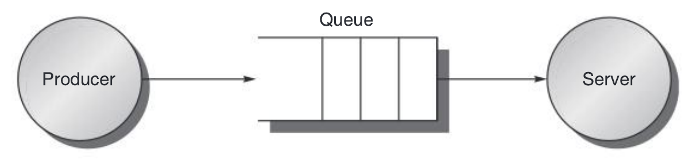

> 故障发生时，会产生一个**潜在错误**；潜在错误被激活后，就成为**有效错误**；错误真正影响到所提供的服务时，就发生了失效。从错误出现到由它引起失效，这段时间称为**错误延迟**。因此，错误是故障在*系统中*的表现，失效是错误在*服务上*的表现。［第 3 页］

回到前面引出问题的那几个例子。编程错误是一个*故障*，它在软件中留下一个*错误*（或*潜在错误*）。这个错误被激活以后，就成为*有效*错误。有效错误产生了错误的数据，并且影响到所提供的服务，就发生了*失效*。

α 粒子击中 DRAM，可以看作一个故障。如果它改变了存储器的内容，就产生了一个错误。受影响的存储字被读出之前，这个错误一直是潜在的。如果这个字的有效错误影响了所提供的服务，就发生了失效；如果 ECC 纠正了这个错误，就不会发生失效。

操作人员的失误是一个故障，被改动的数据是一个错误。这个错误被激活之前是潜在的，此后的过程与前面相同。

概括起来，故障、错误和失效之间的关系如下：

* 一个故障会产生一个或多个潜在错误。
* 错误有三条性质：一是潜在错误一经激活就成为有效错误；二是错误可以在潜在和有效两种状态之间反复转换；三是有效错误常常从一个部件传播到另一个部件，从而产生新的错误。因此，一个部件中的有效错误有两种来源：要么是这个部件中原来的潜在错误，要么是由这个部件中的另一个错误或别处的错误传播而来。
* 错误影响到所提供的服务时，就发生了部件失效。
* 这些性质是递归的，适用于系统中的任何部件。

Gray 和 Siewiorek 按起因把故障分成四类：

1. *硬件故障*：器件失效，例如可能是 α 粒子击中了存储单元。
2. *设计故障*：软件设计（通常）和硬件设计（偶尔）中的故障。
3. *操作故障*：操作和维护人员的失误。
4. *环境故障*：火灾、水灾、地震、断电和人为破坏。

故障还可以按持续时间分为瞬时故障、间歇故障和永久故障［Nelson 1990］。*瞬时故障*只存在一段有限的时间，而且不会重复出现。*间歇故障*使系统在有故障和无故障两种状态之间来回摆动。*永久故障*不会随时间推移自行消失。

区分了故障、错误和失效，下面就可以看一些真实的例子。公开发表的真实错误率数据很少，原因有两个：一是学术界很少有足够多的硬件资源可供测量；二是业界的研究人员很少获准发表失效数据，因为公司担心竞争对手会在市场上用这些数据攻击自己。下面是少数几个例外。

### 伯克利的 Tertiary Disk {-}

2000 年，加州大学的 Tertiary Disk 项目为旧金山美术博物馆建了一台艺术图像服务器。数据库收录了 70,000 多件艺术品的高质量图像［Talagala et al., 2000］，存放在一个集群上。这个集群由 20 台 PC 组成，PC 之间用交换式以太网连接，共有 368 块磁盘，占用 7 个 7 英尺高的机架。

[图 D.6](#fig-d-6) 给出了 Tertiary Disk 各种部件的故障率。建造系统之前，设计者预计最不可靠的是 SCSI 数据盘，因为它们既是机械部件，数量又多；其次是 IDE 磁盘，因为它们数量少一些；再次是电源；然后是集成电路。他们还认为，电缆这类无源器件几乎不会出故障。

[图 D.6　Tertiary Disk 运行 18 个月期间各部件的失效情况。对每类部件，表中列出了系统中的总数、失效的个数和失效百分比。磁盘机箱在表中占两行，因为它出过两类问题：背板完整性失效和电源失效。每个机箱有两个电源，因此一个电源失效并不影响可用性。这个集群由 20 台 PC 组成，装在 7 个 7 英尺高、19 英寸宽的机架中，共有 368 块 8.4 GB、7200 RPM 的 3.5 英寸 IBM 磁盘。每台 PC 是 P6-200 MHz，配 96 MB DRAM，运行 FreeBSD 3.0，主机之间用 100 Mbit/s 交换式以太网连接。为了支持 RAID 1，所有 SCSI 磁盘都通过双端 SCSI 链连接到两台 PC 上。主要应用叫作 Zoom 项目，1998 年它是世界上最大的艺术图像数据库，有 72,000 幅图像。见 Talagala 等［2000b］。]{#fig-d-6 .caption}

| 部件 | 系统中的总数 | 失效个数 | 失效百分比 |
|---|--:|--:|--:|
| SCSI 控制器 | 44 | 1 | 2.3% |
| SCSI 电缆 | 39 | 1 | 2.6% |
| SCSI 磁盘 | 368 | 7 | 1.9% |
| IDE/ATA 磁盘 | 24 | 6 | 25.0% |
| 磁盘机箱：背板 | 46 | 13 | 28.3% |
| 磁盘机箱：电源 | 92 | 3 | 3.3% |
| 以太网控制器 | 20 | 1 | 5.0% |
| 以太网交换机 | 2 | 1 | 50.0% |
| 以太网电缆 | 42 | 1 | 2.3% |
| CPU/主板 | 20 | 0 | 0% |

[图 D.6](#fig-d-6) 推翻了其中一些预计。设计者听从磁盘厂商的建议，保证磁盘机箱减振、散热良好，因此数据盘非常可靠。装 IDE/ATA 磁盘的 PC 机箱则没有同样的环境控制。（IDE/ATA 磁盘不存数据，只用于帮助应用程序和操作系统引导 PC。）从[图 D.6](#fig-d-6) 可以看出，SCSI 背板、SCSI 电缆和以太网电缆并不比数据盘本身更可靠！

Tertiary Disk 是一个大系统，冗余部件很多，因此经受住了这么多种失效。部件的连接方式和镜像图像的放置方式，保证了任何单个失效都不会使任何一幅图像无法访问。这种策略起初看来有些过度，后来证明至关重要。

这次经历还显示了瞬时故障和硬故障的区别。[图 D.6](#fig-d-6) 中几乎所有失效最初都表现为瞬时故障。部件表现差到必须更换，还是可以继续使用，由操作人员决定。实际上，项目组不用「失效」这个词，而是借用了处理问题员工的说法：由操作人员决定一个出问题的部件该不该「解雇」。

### Tandem {-}

下一个例子来自业界。Gray［1990］收集了 Tandem Computers 公司的故障数据。Tandem 是容错计算的先驱公司之一，它的系统主要用于数据库。[图 D.7](#fig-d-7) 画出了 1985 年到 1989 年间引起系统失效的故障，一幅按每个系统的故障绝对数给出，一幅按各类故障所占的百分比给出。数据显示，硬件和维护的可靠性明显提高。1985 年的磁盘需要 Tandem 每年维护一次，后来换成了不需要定期维护的磁盘。每个系统中的芯片和连接器越来越少，软件又能容忍硬件故障，因此到 1989 年，硬件引起的失效只占 7%。而且即使是硬件出了故障，罪魁祸首也常常是嵌在硬件设备中的软件，即固件。数据表明，1989 年报告的停机主要由软件引起（62%），其次是系统操作（15%）。

{#fig-d-7 width=80%}

这类统计都有一个问题：数据只反映报告上来的情况。例如，客户认为断电是本地的问题，因此断电引起的环境失效没有报告给 Tandem。操作故障的数据极难收集，因为操作人员必须报告自己的失误，这可能影响上级对他们的看法，进而影响他们的工作保障和加薪。Gray 认为，环境故障和操作人员故障都存在少报的情况。他的研究得出结论：要提高可用性，就要提高软件质量和软件容错能力，简化操作，并能容忍操作故障。

### 其他关于操作人员对可信性影响的研究 {-}

Tertiary Disk 和 Tandem 都是面向存储的可信性研究。要更好地测量人在失效中的作用，还得看存储以外的研究。Murphy 和 Gent［1995］为了让操作人员故障的数据更准确，让系统每次引导时自动提示操作人员输入这次重新引导的原因。他们把同一故障引起的连续崩溃归为操作人员故障，并把直接导致崩溃的操作也计算在内，例如参数设了错误的值、配置错误、应用程序安装错误等。他们认为操作人员错误仍有少报，但他们得到的信息确实比 Gray 的更准确，因为 Gray 依靠的是由操作人员填写、再沿管理层层上报的表格。在 VAX 系统中，硬件和操作系统引起的失效所占比例从 1985 年的 70% 降到 1993 年的 28%；同一时期，操作人员引起的失效从 15% 升到 52%。Murphy 和 Gent 预计，系统管理将成为今后可信性的主要挑战。

最后一组数据来自政府。美国联邦通信委员会（FCC）规定，电话公司发生影响至少 30,000 人或持续 30 分钟的停机时，都必须提交说明。这些详细的中断报告由调查人员而不是设备操作人员确定停机原因，因此不存在前面那些数据的自报问题。Kuhn［1997］研究了 1992 年到 1994 年间停机的原因，Enriquez［2001］又对 2001 年上半年做了后续研究。这些年里，网络过载引起的失效大为减少，人为原因引起的失效却增加了，在客户停机分钟数中所占的比例从大约三分之一升到三分之二。

这四个例子以及其他一些例子表明，今天大型系统失效的主要原因是操作人员的故障。系统中的芯片和连接器都在减少，因此硬件故障减少了。存储器 ECC 和 RAID 这类容错技术也提高了硬件的可信性。至少有一些操作系统在增加新功能之前会考虑它对可靠性的影响，因此到 2011 年，失效大多发生在别的地方。

失效虽然可能由操作人员的故障引发，但维护和升级过程这样容易出错，说明系统的技术水平还不够好。如今大多数存储厂商都说，客户在存储的整个使用期内花在管理上的钱，比购买存储的钱多得多。因此，未来的可信存储系统面临的挑战是：要么容忍操作人员的故障，要么简化系统管理任务，从而避免操作人员出故障。注意，即使操作人员误换了一块好盘，RAID 6 也能让存储系统继续工作。

至此，我们讨论了可信性这个根本问题，给出了它的定义、案例研究和提高可信性的技术。存储之旅的下一站是性能。

## I/O 性能、可靠性度量和基准测试程序 {#sec-d-4}

I/O 性能有一些度量在设计中找不到对应物。一是*多样性*：哪些 I/O 设备可以连接到计算机系统上？二是*容量*：一个计算机系统可以连接多少台 I/O 设备？

{#fig-d-8 width=70%}

除了这些独有的度量，传统的性能度量，即响应时间和吞吐率，也适用于 I/O。（I/O 吞吐率有时称为 *I/O 带宽*，响应时间有时称为*延迟*。）下面两幅图说明响应时间和吞吐率怎样此消彼长。[图 D.8](#fig-d-8) 是简单的生产者-服务器模型：生产者产生要执行的任务，放进缓冲区；服务器从这个先进先出的缓冲区中取出任务并执行。

*响应时间*定义为一个任务从放进缓冲区到服务器完成它所经历的时间。*吞吐率*就是服务器在一段时间内平均完成的任务数。要得到尽可能高的吞吐率，服务器就不能空闲，因此缓冲区永远不能为空。但响应时间包括任务在缓冲区中等待的时间，缓冲区为空，响应时间才会缩短。

I/O 性能的另一项度量是 I/O 对处理器执行的干扰。传输数据可能干扰另一个进程的执行，处理 I/O 中断也有开销。这里我们关心的是：因为要为另一个进程做 I/O，一个进程的执行时间会延长多少。

### 吞吐率与响应时间 {-}

[图 D.9](#fig-d-9) 画出了一个典型 I/O 系统的吞吐率与响应时间（即延迟）的关系。在曲线的拐点区域，吞吐率稍微提高一点，响应时间就会长很多；反过来，响应时间稍微缩短一点，吞吐率就会低很多。

{#fig-d-9 width=65%}

这两个要求相互冲突，体系结构设计者怎样权衡呢？如果计算机要与人交互，[图 D.10](#fig-d-10) 给出了一个答案。人与计算机的一次交互称为一次*事务*，分成三部分：

1. *输入时间*：用户输入命令的时间。
2. *系统响应时间*：从用户输入命令到完整的响应显示出来之间的时间。
3. *思考时间*：从收到响应到用户开始输入下一条命令之间的时间。

![图 D.10　传统系统和图形系统中，用户与交互式计算机的一次事务分成输入时间、系统响应时间和用户思考时间。输入时间与系统响应时间无关，两种响应时间下相同：传统系统为 4 秒，图形系统为 0.25 秒。缩短响应时间，事务时间实际减少的量比响应时间本身减少的量还多。（引自 Brady［1986］。）图内标注：Workload，工作负载；Conventional interactive workload (1.0 / 0.3 sec system response time)，传统交互式工作负载（系统响应时间 1.0 / 0.3 秒）；High-function graphics workload (1.0 / 0.3 sec system response time)，高功能图形工作负载（系统响应时间 1.0 / 0.3 秒）；−34% total (−70% think)，总时间减少 34%（思考时间减少 70%）；−70% total (−81% think)，总时间减少 70%（思考时间减少 81%）；Time (sec)，时间（秒）；Entry time，输入时间；System response time，系统响应时间；Think time，思考时间。](images/appd/fig-d-10.png){#fig-d-10 width=80%}

这三部分之和称为*事务时间*。有几项研究报告，用户的工作效率与事务时间成反比。[图 D.10](#fig-d-10) 的结果表明，系统响应时间缩短 0.7 秒，传统事务就能节省 4.9 秒（34%），图形事务能节省 2.0 秒（70%）。这个结果看似不可能，原因在于人的天性：响应越快，人需要的思考时间就越短。这项研究虽然已有 20 年，处理器也已经快到原来的 1000 倍，但响应时间常常仍远远超过 1 秒。例如，台式 PC 启动应用程序时要做许多次磁盘 I/O，点击 Web 链接时有网络延迟，都会造成很长的等待。

响应时间对用户工作效率很重要，因此 I/O 基准测试程序也考虑响应时间与吞吐率之间的权衡。[图 D.11](#fig-d-11) 列出了三个 I/O 基准测试程序的响应时间限制。它们报告的都是满足限制条件时的最大吞吐率，限制条件要么是 90% 的响应时间小于某个界限，要么是平均响应时间小于某个界限。

[图 D.11　三个 I/O 基准测试程序的响应时间限制]{#fig-d-11 .caption}

| I/O 基准测试程序 | 响应时间限制 | 吞吐率度量 |
|---|---|---|
| TPC-C：复杂查询 OLTP | ≥90% 的事务必须满足响应时间限制；大多数类型的事务为 5 秒 | 每分钟新订单事务数 |
| TPC-W：事务型 Web 基准测试 | ≥90% 的 Web 交互必须满足响应时间限制；大多数类型的 Web 交互为 3 秒 | 每秒 Web 交互数 |
| SPECsfs97 | 平均响应时间 ≤40 ms | 每秒 NFS 操作数 |

下面进一步介绍这几个基准测试程序。

### 事务处理基准测试程序 {-}

*事务处理*（TP，也称联机事务处理 OLTP）主要关心 *I/O 速率*（每秒的磁盘访问次数），而不是*数据速率*（以每秒传输的数据字节数衡量）。TP 通常要从许多终端修改大量的共享信息，并且 TP 系统要保证出现失效时行为正确。例如，假设顾客在 ATM 上取钱时，银行的计算机发生了失效，TP 系统要保证：如果顾客拿到了钱，账户就扣款；*而且*，如果顾客没拿到钱，账户就保持不变。航空订票系统和银行一样，都是 TP 的传统用户。

第 1 章讲过，TP 界的二十几位人士联手为业界制定了一个基准测试程序。为了避免各自公司法务部门的追究，他们匿名发表了这份报告［Anon. et al. 1985］。这份报告促成了*事务处理委员会*（TPC）的成立，TPC 成立以来已经推出了八个基准测试程序。[图 D.12](#fig-d-12) 归纳了这些基准测试程序。

下面以 TPC-C 为例，让读者对这些基准测试程序有个大致的印象。TPC-C 用一个数据库模拟批发供应商的订单录入环境，包括录入和配送订单、记录付款、查询订单状态，以及监控各仓库的库存水平。它同时运行五种复杂程度不同的事务；数据库包括九张表，记录数和客户数都可以按比例扩展。TPC-C 的度量有两项：一是每分钟事务数（tpmC），二是系统价格，包括硬件、软件和三年的维护支持。第 1 章的图 1.17 介绍了 TPC-C 性能和性价比最高的系统。

TPC 基准测试程序最先具备下面这些不寻常的特点，有的特点至今仍只有它们具备：

* *基准测试结果中包括价格。* 提交的结果要包括硬件、软件和维护协议的费用，因此既可以按高性能来评价，也可以按性价比来评价。
* *数据集的规模通常必须随吞吐率的提高而扩大。* 这些基准测试程序力图模拟真实的系统，而在真实系统中，系统承受的需求和其中存储的数据量是一起增长的。例如，每分钟有成千上万人访问几百个银行账户，这是不合情理的。
* *基准测试结果要经过审计。* 结果提交之前，必须经过 TPC 认证的审计员批准。审计员执行 TPC 的规则，力求只让公正的结果提交上来。结果可以受到质疑，争议提交 TPC 裁决。
* *性能度量是吞吐率，但响应时间受限。* 例如，TPC-C 要求 90% 的新订单事务响应时间小于 5 秒。
* *基准测试程序由一个独立的组织维护。* TPC 用收取的会费支付管理机构的开支，管理机构包括一个首席运营办公室。这个组织负责裁决争议、以通信投票的方式批准基准测试程序的修改、召开理事会会议，等等。

[图 D.12　事务处理委员会的基准测试程序。汇总结果既包括性能指标，也包括该指标的性价比。TPC-A、TPC-B、TPC-D 和 TPC-R 已经停用。]{#fig-d-12 .caption}

| 基准测试程序 | 数据规模（GB） | 性能指标 | 首次发布结果的日期 |
|---|---|---|---|
| A：借记贷记（已停用） | 0.1～10 | 每秒事务数 | 1990 年 7 月 |
| B：批处理借记贷记（已停用） | 0.1～10 | 每秒事务数 | 1991 年 7 月 |
| C：复杂查询 OLTP | 100～3000（最小 0.07 × TPM） | 每分钟新订单事务数（TPM） | 1992 年 9 月 |
| D：决策支持（已停用） | 100、300、1000 | 每小时查询数 | 1995 年 12 月 |
| H：即席决策支持 | 100、300、1000 | 每小时查询数 | 1999 年 10 月 |
| R：业务报表决策支持（已停用） | 1000 | 每小时查询数 | 1999 年 8 月 |
| W：事务型 Web 基准测试 | ≈50、500 | 每秒 Web 交互数 | 2000 年 7 月 |
| App：应用服务器与 Web 服务基准测试 | ≈2500 | 每秒 Web 服务交互数（SIPS） | 2005 年 6 月 |

### SPEC 系统级文件服务器、邮件和 Web 基准测试程序 {-}

SPEC 的基准测试工作以刻画处理器性能最为出名，但它也推出了文件服务器、邮件服务器和 Web 服务器的基准测试程序。

七家公司商定了一个合成基准测试程序，称为 SFS，用来评测运行 Sun Microsystems 网络文件服务（NFS）的系统。这个基准测试程序后来升级为 SFS 3.0（也称 SPEC SFS97_R1），改进有三点：一是支持 NFS 第 3 版；二是除 UDP 外也用 TCP 作传输协议；三是操作的组合更符合实际。SFS 中读、写和文件操作的合成组合来自对 NFS 系统的测量。SFS 还提供了用于比较性能的默认参数。例如，写操作一半以 8 KB 的整块进行，另一半以 1 KB、2 KB 或 4 KB 的部分块进行；读操作中，整块占 85%，部分块占 15%。

与 TPC-C 一样，SFS 也按报告的吞吐率扩大存储的数据量：每秒的 NFS 操作每增加 100 次，容量就必须增加 1 GB。SFS 还限制平均响应时间，限值为 40 ms。[图 D.13](#fig-d-13) 给出了两种 NetApp 系统的平均响应时间与吞吐率的关系。遗憾的是，SFS 不像 TPC 基准测试程序那样按不同的价格配置作归一化。

SPECMail 是用来帮助评测互联网服务提供商邮件服务器性能的基准测试程序。SPECMail2001 基于标准的互联网协议 SMTP 和 POP3，在用户数从 10,000 扩大到 1,000,000 的过程中测量吞吐率和用户响应时间。

SPECWeb 是评测万维网服务器性能的基准测试程序，度量的是同时进行的用户会话数。SPECWeb2005 的工作负载模拟对一家 Web 服务提供商的访问，该服务器为若干个机构提供主页。它有三种工作负载：银行（HTTPS）、电子商务（HTTP 和 HTTPS）和技术支持（HTTP）。

### 可信性基准测试的例子 {-}

TPC-C 基准测试程序其实有一项可信性要求：被测系统必须能够处理单块磁盘的失效。这实际上意味着，所有提交结果的厂商都在存储系统中采用了某种 RAID 组织。
