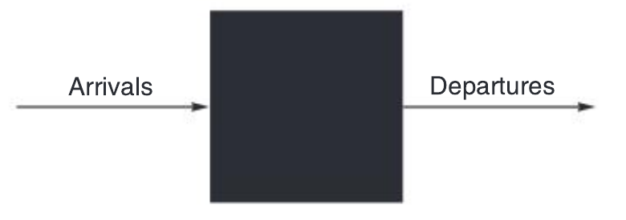
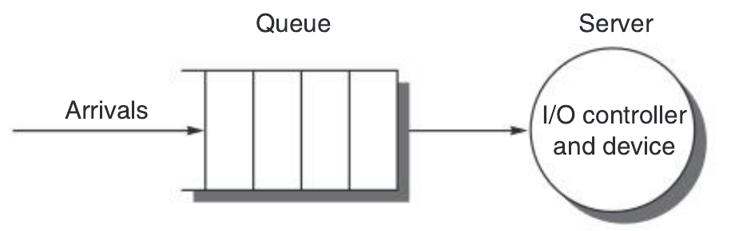

{#fig-d-13 width=90%}

近年来的研究转向考察系统容错的实际效果。Brown 和 Patterson [2000] 提出了一种衡量可用性的方法：向系统中注入故障，观察系统服务质量指标随时间的变化。以 Web 服务器为例，最直接的指标有两个：一是性能，用每秒完成的请求数来衡量；二是容错能力，用存储子系统、网络连接拓扑等能够容忍的故障数来衡量。

最初的实验只注入一个故障（例如磁盘扇区写错误），然后通过服务质量指标记录系统的行为。实验比较了 Linux、Solaris 和 Windows 2000 Server 提供的软件 RAID 实现，用 SPECWeb99 产生负载并测量性能。为了注入故障，实验把软件 RAID 卷中的一块 SCSI 磁盘换成了一个模拟磁盘。这个模拟磁盘其实是一台 PC，它运行的软件通过一块 SCSI 控制器工作，在 SCSI 总线上的其他设备看来就是一块磁盘。借助这个磁盘模拟器，就可以向系统中注入故障。注入的故障既有各种瞬时磁盘故障，如可纠正的读错误；也有永久故障，如写操作时的磁盘介质失效。

[图 D.14](#fig-d-14) 给出了各个系统在不同故障下的行为，上面两幅图分别是 Linux（左）和 Solaris（右）。RAID 系统如果在重建完成之前又坏了第二块磁盘，就可能丢失数据，因此重建时间（MTTR）越长，可用性越低。但是，重建越快，应用程序的性能下降得越多，因为重建要占用正在运行的应用程序的 I/O 资源。因此，策略上只能二选一：要么在重建期间承受性能损失，要么延长易损窗口，从而降低预计的 MTTF。

{#fig-d-14 width=90%}

除了源代码，接受测试的系统都没有用文档说明自己的重建策略，但只注入一次故障，就足以看出这些策略的特点。实验发现，当一块工作中的磁盘因故障停用时，Linux 和 Solaris 都会自动在热备盘上重建 RAID 卷。Windows 虽然也支持 RAID 重建，但必须手动启动。因此，如果没有人工干预，Windows 系统在第一次故障后不会重建，仍然可能遭受第二次故障，易损窗口随之变长。不过，一旦接到指令，Windows 的修复速度很快。

故障注入实验还揭示了 Linux、Solaris 和 Windows 2000 在其他可用性策略上的做法，涉及自动启用备用盘、重建速率、瞬时错误等方面。同样，这些系统都没有用文档说明这些策略。

故障注入实验表明，在处理瞬时故障时，Linux 的软件 RAID 实现与 Solaris、Windows 的 RAID 实现做法截然相反。Linux 的实现非常谨慎，一出现错误就以受控的方式关闭磁盘，而不是等着看这个错误是不是瞬时的。Solaris 和 Windows 则宽容得多，它们忽略大多数瞬时故障，认为这些故障不会再次发生。因此，这两个系统承受瞬时故障的能力比 Linux 强得多。不过，Windows 和 Solaris 都会把瞬时故障记入日志，所以即使不作处理，错误也会报告出来。遇到永久故障时，几个系统的行为差不多。

## 排队论初步 {#sec-d-5}

在处理器设计中，我们可以用第 1 章的 CPI 公式对性能作简单的粗略估算，也可以用完整的模拟得到更准确的结果，只是代价更高。I/O 系统也一样，既可以用最佳情况分析作粗略估算，也可以用完整的模拟预测性能，后者准确得多，但工作量也大得多。

不过，I/O 系统还有一种数学工具可以指导设计。它比最佳情况分析多费一些工夫，但准确得多；比完整的模拟又省事得多。由于 I/O 事件具有概率性，而且 I/O 资源是共享的，我们可以给出一组简单的定理，用来计算整个 I/O 系统的响应时间和吞吐率。这一有用的领域称为*排队论*。关于排队论的书和课程很多，本节只作初步介绍，但即使是这一点点知识，也有助于更好地设计 I/O 系统。

我们先把 I/O 系统看成一个黑盒，如[图 D.15](#fig-d-15) 所示。在这个例子中，处理器发出 I/O 请求，请求到达 I/O 设备；I/O 设备完成请求后，请求就「离开」。

我们通常关心的是系统的长期状态，即*稳态*，而不是系统刚启动时的初始状态。假如我们关心的是初始状态，虽然有数学工具（马尔可夫链）可以帮忙，但除少数情况外，得到的方程只能用模拟来求解。本节的目的是介绍一种比粗略估算稍难、但比模拟简单的方法，所以这里不讨论这类分析（详见[附录 M](#app-m) 中的参考文献）。

{#fig-d-15 width=60%}

因此，本节作一个简化假设：所评估的系统有多个相互独立的 I/O 服务请求，并且处于平衡状态，即输入速率必须等于输出速率。我们还假定任务的供给是稳定的，不受任务等待服务时间长短的影响。许多实际系统（如 TPC-C）的任务消耗速率由系统的其他特性（如内存容量）决定。

由此可以得到 *Little 定律*。它把系统中的平均任务数、新任务的平均到达率和完成一个任务的平均时间联系起来：

$$
\text{系统中的平均任务数} = \text{到达率} \times \text{平均响应时间}
$$

只要黑盒内部不产生新任务、也不消灭任务，Little 定律就适用于任何处于平衡状态的系统。注意，到达率和响应时间必须使用相同的时间单位，时间单位不一致是常见的出错原因。

下面推导 Little 定律。假定我们对一个系统观察了 $\text{Time}_\text{observe}$ 分钟，观察期间记录每个任务得到服务所用的时间，再把这些时间加起来。设 $\text{Time}_\text{observe}$ 期间完成的任务数为 $\text{Number}_\text{tasks}$，各任务在系统中停留时间的总和为 $\text{Time}_\text{accumulated}$。由于各任务在时间上可以重叠，所以 $\text{Time}_\text{accumulated} \ge \text{Time}_\text{observe}$。于是

$$
\begin{aligned}
\text{系统中的平均任务数} &= \frac{\text{Time}_\text{accumulated}}{\text{Time}_\text{observe}} \\[4pt]
\text{平均响应时间} &= \frac{\text{Time}_\text{accumulated}}{\text{Number}_\text{tasks}} \\[4pt]
\text{到达率} &= \frac{\text{Number}_\text{tasks}}{\text{Time}_\text{observe}}
\end{aligned}
$$

{#fig-d-16 width=70%}

用代数方法可以把第一个式子拆开：

$$
\frac{\text{Time}_\text{accumulated}}{\text{Time}_\text{observe}} = \frac{\text{Time}_\text{accumulated}}{\text{Number}_\text{tasks}} \times \frac{\text{Number}_\text{tasks}}{\text{Time}_\text{observe}}
$$

把上面三个定义代入这个式子，再交换右边两项的位置，就得到 Little 定律：

$$
\text{系统中的平均任务数} = \text{到达率} \times \text{平均响应时间}
$$

后面会看到，这个简单的方程用处出奇地大。

打开黑盒，就看到[图 D.16](#fig-d-16)。任务在其中积压、等待服务的地方称为*队列*（queue），也叫*等待线*（waiting line）；执行所请求服务的设备称为*服务器*（server）。在本节最后两页之前，我们都假定只有一个服务器。

由 Little 定律和下面一组定义，可以导出几个有用的公式：

* $\text{Time}_\text{server}$：服务一个任务的平均时间。平均服务速率是 $1/\text{Time}_\text{server}$，在许多排队论教材中习惯用符号 $\mu$ 表示。
* $\text{Time}_\text{queue}$：每个任务在队列中的平均时间。
* $\text{Time}_\text{system}$：每个任务在系统中的平均时间，也就是响应时间，等于 $\text{Time}_\text{queue}$ 与 $\text{Time}_\text{server}$ 之和。
* 到达率：平均每秒到达的任务数，在许多排队论教材中习惯用符号 $\lambda$ 表示。
* $\text{Length}_\text{server}$：正在接受服务的平均任务数。
* $\text{Length}_\text{queue}$：队列的平均长度。
* $\text{Length}_\text{system}$：系统中的平均任务数，等于 $\text{Length}_\text{queue}$ 与 $\text{Length}_\text{server}$ 之和。

借助这些定义，可以澄清一个常见的误解：问的究竟是任务在开始服务之前要在队列中等多久（$\text{Time}_\text{queue}$），还是任务从进入到完成一共要多久（$\text{Time}_\text{system}$）。我们所说的响应时间指后者，两者的关系是 $\text{Time}_\text{system} = \text{Time}_\text{queue} + \text{Time}_\text{server}$。

正在接受服务的平均任务数（$\text{Length}_\text{server}$）就等于到达率 $\times\ \text{Time}_\text{server}$，这正是 Little 定律。服务器利用率就是正在接受服务的平均任务数除以服务速率。单服务器的服务速率是 $1/\text{Time}_\text{server}$，因此服务器利用率（在单服务器情形下，也就是每个服务器的平均任务数）为：

$$
\text{服务器利用率} = \text{到达率} \times \text{Time}_\text{server}
$$

利用率必须介于 0 和 1 之间，否则到达的任务就会多于能够服务的任务，这就违背了系统处于平衡状态的假设。注意，这个公式只是 Little 定律的另一种写法。利用率也称为*业务强度*（traffic intensity），在许多排队论教材中用符号 $\rho$ 表示。

**例题**　某 I/O 系统只有一块磁盘，平均每秒收到 50 个 I/O 请求。假定磁盘服务一个 I/O 请求的平均时间为 10 ms，这个 I/O 系统的利用率是多少？

**解答**　把 10 ms 写成 0.01 秒，代入上面的公式，得到：

$$
\text{服务器利用率} = \text{到达率} \times \text{Time}_\text{server} = \frac{50}{\text{秒}} \times 0.01\ \text{秒} = 0.50
$$

因此，这个 I/O 系统的利用率是 0.5。

队列把任务交给服务器的方式称为*排队规则*（queue discipline）。最简单、也最常用的规则是先进先出（FIFO）。假定采用 FIFO，就可以把任务在队列中的等待时间与队列中的平均任务数联系起来：

$$
\text{Time}_\text{queue} = \text{Length}_\text{queue} \times \text{Time}_\text{server} + \text{新任务到达时若服务器忙，完成当前任务服务的平均时间}
$$

也就是说，任务在队列中的时间等于队列中的任务数乘以平均服务时间，再加上新任务到达时服务器完成手头正在服务的那个任务所需的时间。（对任务的到达还有一条限制，后面再作说明。）

公式的最后一项并不像初看起来那么简单。新任务可能在任意时刻到达，所以我们无从知道正在服务的那个任务已经在服务器上待了多久。这类请求虽然是随机事件，但只要对事件的分布有所了解，就能预测性能。

### 随机变量的泊松分布 {-}

要估算公式的最后一项，需要了解一点随机变量的分布。如果一个变量以给定的概率取给定集合中的某个值，它就是*随机变量*。也就是说，我们无法确切知道它的下一个值是多少，但可以知道所有可能取值的概率。

I/O 系统收到的服务请求可以用随机变量来建模，因为操作系统通常在几个进程之间切换，而这些进程各自独立地产生 I/O 请求。磁盘的寻道延迟和旋转延迟具有概率性，所以 I/O 服务时间也用随机变量来建模。

描述离散随机变量取值分布的一种方法是*直方图*。直方图把最小值到最大值之间的范围划分为若干子区间，称为*桶*（bucket），再把每个桶中的数目画成柱子。

直方图适合描述离散值的分布，例如 I/O 请求的个数。非离散值的分布（如等待 I/O 请求的时间）则有两种选择：要么用一条曲线画出整个范围内的取值，从而准确地估计数值；要么采用非常细的时间单位，得到非常多的桶，从而准确地估计时间。例如，磁盘服务时间实际上是连续的，但可以按 10 μs 的间隔测量，画成直方图。

因此，要求解前面公式的最后一项，需要刻画这个随机变量的分布。刻画这一分布，有平均时间和某种方差度量就够了。

第一项用*加权算术平均时间*。假定测得任务 $i$ 出现的次数为 $n_i$，就可以算出任务 $i$ 出现的频率：

$$
f_i = \frac{n_i}{\left(\sum\limits_{i=1}^{n} n_i\right)}
$$

于是加权算术平均为

$$
\text{加权算术平均时间} = f_1 \times T_1 + f_2 \times T_2 + \cdots + f_n \times T_n
$$

其中 $T_i$ 是任务 $i$ 的时间，$f_i$ 是任务 $i$ 出现的频率。

刻画数值在平均值附近的波动，很多人用标准差。这里我们改用*方差*，它就是标准差的平方，用它来刻画概率分布更方便。已知加权算术平均后，方差可以这样计算：

$$
\text{方差} = \left(f_1 \times T_1^2 + f_2 \times T_2^2 + \cdots + f_n \times T_n^2\right) - \text{加权算术平均时间}^2
$$

计算方差时一定要记住单位。假定这是时间的分布，时间大约为 100 毫秒，那么它的平方就是 10,000 平方毫秒。这种单位显然很不常见，用一个无量纲的度量会方便得多。

为了避免单位问题，我们使用*方差系数的平方*（squared coefficient of variance），习惯上记作 C^2^：

$$
C^2 = \frac{\text{方差}}{\text{加权算术平均时间}^2}
$$

由此可以解出*方差系数* C：

$$
C = \frac{\sqrt{\text{方差}}}{\text{加权算术平均时间}} = \frac{\text{标准差}}{\text{加权算术平均时间}}
$$

我们要刻画的是随机事件，但为了预测性能，需要一种在数学上易于处理的随机事件分布。这类分布中最常用的是*指数分布*，其 C 值为 1。

注意，这里用一个常数来刻画数值在平均值附近的波动。C 不随时间变化，反映出这样一个性质：过去发生的事件不影响事件现在发生的概率。这种「健忘」的性质称为*无记忆性*（memoryless）。无记忆性是用这些模型预测系统行为时的一个重要假设。（假如没有无记忆性，我们就得考虑各个请求到达的确切时间先后，数学处理会困难得多！）

最常用的指数分布之一是*泊松分布*，它以数学家 Siméon Poisson 的名字命名。泊松分布用来刻画给定时间间隔内的随机事件，具有几个很好的数学性质。泊松分布由下面的方程（称为概率质量函数）描述：

$$
\text{Probability}(k) = \frac{e^{-a} \times a^k}{k!}
$$

其中 $a = \text{事件速率} \times \text{经过的时间}$。如果到达间隔时间服从指数分布，并以前面的到达率作为事件速率，那么时间间隔 $t$ 内的到达数就是一个*泊松过程*，它服从 $a = \text{到达率} \times t$ 的泊松分布。前面提到，$\text{Time}_\text{queue}$ 的公式对任务到达还有一条限制：它只对泊松过程成立。

最后，我们可以回答前面的问题：新任务要等多久，服务器才能完成手头的任务？这段时间称为*平均剩余服务时间*（average residual service time），这里同样假定到达服从泊松分布：

$$
\text{平均剩余服务时间} = 1/2 \times \text{算术平均值} \times \left(1 + C^2\right)
$$

这个公式我们不作推导，但可以凭直觉理解。如果分布不是随机的，所有可能的取值都等于平均值，那么标准差为 0，C 也为 0，平均剩余服务时间正好是平均服务时间的一半，与预期相符。如果分布是随机的，而且是泊松分布，那么 C 为 1，平均剩余服务时间就等于加权算术平均时间。

**例题**　利用上面的定义和公式，用平均服务时间（$\text{Time}_\text{server}$）和服务器利用率推导出队列中的平均等待时间（$\text{Time}_\text{queue}$）。

**解答**　新任务前面排在队列中的所有任务（$\text{Length}_\text{queue}$ 个）都要完成，新任务才能得到服务，每个任务平均需要 $\text{Time}_\text{server}$。如果服务器上正有一个任务，完成它需要平均剩余服务时间。服务器忙的概率就是*服务器利用率*，所以这部分服务时间的期望是服务器利用率 × 平均剩余服务时间。由此得到前面那个公式：

$$
\begin{aligned}
\text{Time}_\text{queue} = {} & \text{Length}_\text{queue} \times \text{Time}_\text{server} \\
& + \text{服务器利用率} \times \text{平均剩余服务时间}
\end{aligned}
$$

用定义替换平均剩余服务时间，并把 $\text{Length}_\text{queue}$ 换成 到达率 $\times\ \text{Time}_\text{queue}$，得到

$$
\begin{aligned}
\text{Time}_\text{queue} = {} & \text{服务器利用率} \times \left[1/2 \times \text{Time}_\text{server} \times \left(1 + C^2\right)\right] \\
& + \left(\text{到达率} \times \text{Time}_\text{queue}\right) \times \text{Time}_\text{server}
\end{aligned}
$$

本节讨论的是指数分布，C^2^ 为 1，因此

$$
\text{Time}_\text{queue} = \text{服务器利用率} \times \text{Time}_\text{server} + \left(\text{到达率} \times \text{Time}_\text{queue}\right) \times \text{Time}_\text{server}
$$

把最后一项重新组合，用服务器利用率替换 到达率 $\times\ \text{Time}_\text{server}$：

$$
\begin{aligned}
\text{Time}_\text{queue} &= \text{服务器利用率} \times \text{Time}_\text{server} + \left(\text{到达率} \times \text{Time}_\text{server}\right) \times \text{Time}_\text{queue} \\
&= \text{服务器利用率} \times \text{Time}_\text{server} + \text{服务器利用率} \times \text{Time}_\text{queue}
\end{aligned}
$$

移项并化简，就得到所求的公式：

$$
\begin{aligned}
\text{Time}_\text{queue} &= \text{服务器利用率} \times \text{Time}_\text{server} + \text{服务器利用率} \times \text{Time}_\text{queue} \\
\text{Time}_\text{queue} - \text{服务器利用率} \times \text{Time}_\text{queue} &= \text{服务器利用率} \times \text{Time}_\text{server} \\
\text{Time}_\text{queue} \times (1 - \text{服务器利用率}) &= \text{服务器利用率} \times \text{Time}_\text{server} \\
\text{Time}_\text{queue} &= \text{Time}_\text{server} \times \frac{\text{服务器利用率}}{(1 - \text{服务器利用率})}
\end{aligned}
$$

黑盒的各个组成部分也必须处于平衡状态，因此 Little 定律同样适用于它们：

$$
\text{Length}_\text{queue} = \text{到达率} \times \text{Time}_\text{queue}
$$

把上面得到的 $\text{Time}_\text{queue}$ 代入，得到：

$$
\text{Length}_\text{queue} = \text{到达率} \times \text{Time}_\text{server} \times \frac{\text{服务器利用率}}{(1 - \text{服务器利用率})}
$$

由于 到达率 $\times\ \text{Time}_\text{server} = \text{服务器利用率}$，可以进一步化简：

$$
\text{Length}_\text{queue} = \text{服务器利用率} \times \frac{\text{服务器利用率}}{(1 - \text{服务器利用率})} = \frac{\text{服务器利用率}^2}{(1 - \text{服务器利用率})}
$$

这个公式把队列中的任务数与利用率联系了起来。

**例题**　前面计算利用率的例题中的系统，服务器利用率为 0.5，队列中平均有多少个 I/O 请求？

**解答**　由上面的公式，

$$
\text{Length}_\text{queue} = \frac{\text{服务器利用率}^2}{(1 - \text{服务器利用率})} = \frac{0.5^2}{(1 - 0.5)} = \frac{0.25}{0.50} = 0.5
$$

因此，队列中平均有 0.5 个请求。

前面说过，这些公式和本节内容都以应用数学的一个分支，即*排队论*为基础。排队论给出的公式可以预测这类随机变量的行为。实际系统过于复杂，排队论无法给出精确的分析，因此它最适合只需要近似答案的场合。

排队论严格区分过去的事件和未来的事件：过去的事件可以通过测量、用简单的算术来刻画；未来的事件则要靠预测，需要更复杂的数学。在计算机系统中，我们常常根据过去预测未来，LRU 块替换就是一例（见第 2 章）。因此，测量和预测分布之间的界线常常是模糊的：先用测量结果验证分布的类型，此后就依靠这个分布。

下面回顾一下排队模型的各项假设：

* 系统处于平衡状态。
* 相继到达的两个请求之间的时间称为*到达间隔时间*（interarrival time），它服从指数分布，这就刻画了前面所说的到达率。
* 请求源的数目没有限制。（这在排队论中称为*无限总体模型*；如果到达率随系统中已有作业数的多少而变化，就要用有限总体模型。）
* 服务器完成上一个作业后，可以立即开始下一个作业。
