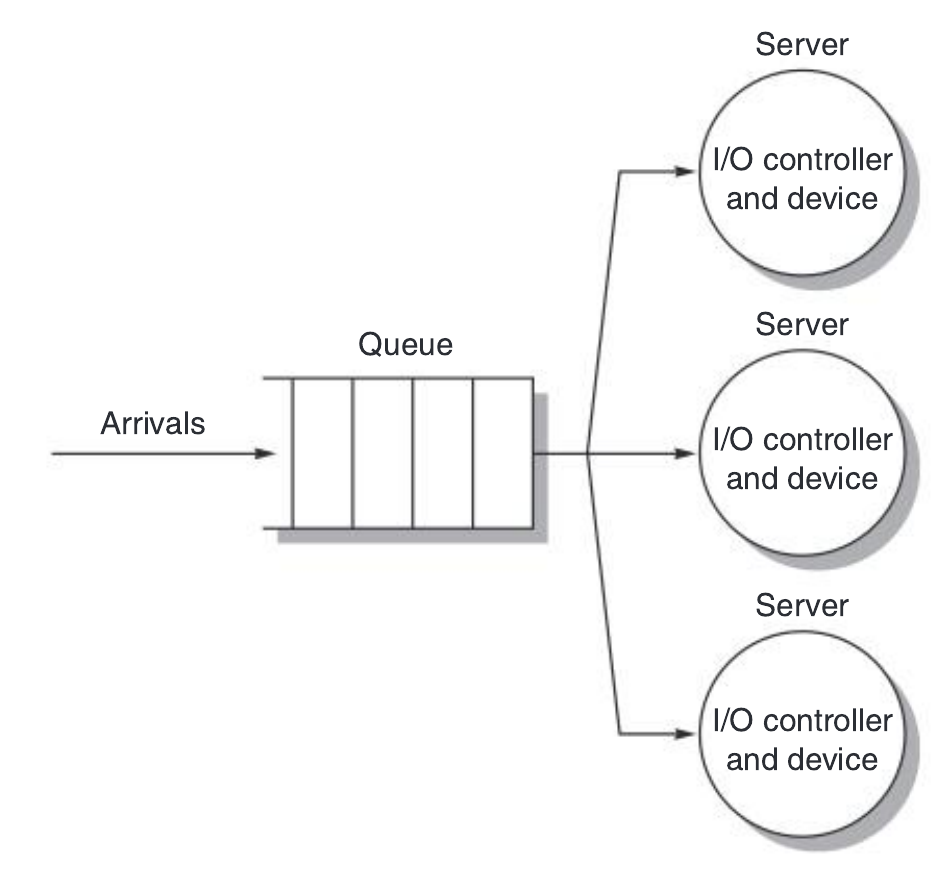
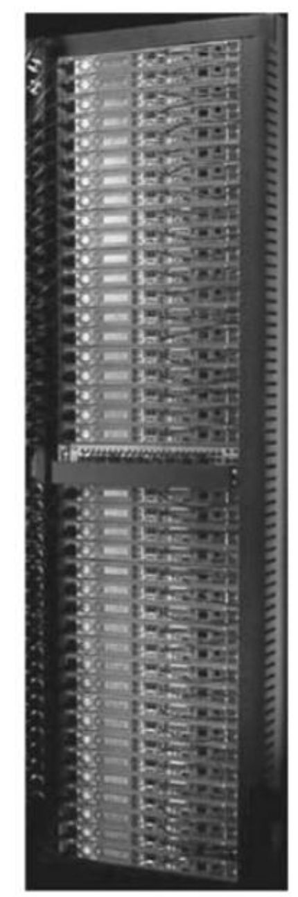

* 队列长度没有限制，并遵循先进先出（FIFO）的次序，因此排在队列中的任务都必须完成。
* 只有一个服务器。

这样的队列称为 *M/M/1*，三个符号的含义是：

* 第一个 M 表示请求按指数分布随机到达（$C^2 = 1$）。M 取自 A. A. Markov，这位数学家定义并分析了前面提到的无记忆过程；
* 第二个 M 表示服务时间按指数分布随机变化（$C^2 = 1$），M 同样取自 Markov；
* 1 表示只有一个服务器。

M/M/1 模型简单，用得也很广。

排队论的例子之所以普遍假定指数分布，原因有三条：一条好的，一条尚可的，一条不好的。好的原因是：许多任意分布叠加在一起，表现就像指数分布。在计算机系统中，某种行为很多时候是许多部件相互作用的结果，因此用指数分布描述到达间隔时间是合适的。尚可的原因是：在不清楚变化程度的时候，假定变化程度居中（$C = 1$）的指数分布，比假定变化很小（$C \approx 0$）或变化很大（$C$ 很大）更稳妥。不好的原因是：假定指数分布，数学推导更简单。

下面通过几个例子来运用排队论。

**例题**　假定处理器每秒发出 40 次磁盘 I/O，这些请求服从指数分布，一个老式磁盘的平均服务时间为 20 ms。回答下列问题：

1. 磁盘的平均利用率是多少？
2. 在队列中的平均等待时间是多少？
3. 一次磁盘请求的平均响应时间（包括排队时间和磁盘服务时间）是多少？

**解答**　先把已知条件重新列一下：

> 平均每秒到达的任务数为 40。
>
> 磁盘服务一个任务的平均时间为 20 ms（0.02 s）。

于是服务器利用率为

$$
\text{服务器利用率} = \text{到达率} \times \text{Time}_{\text{server}} = 40 \times 0.02 = 0.8
$$

由于服务时间服从指数分布，可以用简化公式计算在队列中的平均等待时间：

$$
\begin{aligned}
\text{Time}_{\text{queue}} &= \text{Time}_{\text{server}} \times \frac{\text{服务器利用率}}{(1 - \text{服务器利用率})} \\
&= 20\ \text{ms} \times \frac{0.8}{1 - 0.8} = 20 \times \frac{0.8}{0.2} = 20 \times 4 = 80\ \text{ms}
\end{aligned}
$$

平均响应时间为

$$
\text{Time}_{\text{system}} = \text{Time}_{\text{queue}} + \text{Time}_{\text{server}} = 80 + 20\ \text{ms} = 100\ \text{ms}
$$

可见平均有 80% 的时间花在队列中等待！

**例题**　假定换上一个新的、更快的磁盘，磁盘服务时间为 10 ms。重新计算上面几个问题的答案。

**解答**　这时磁盘利用率为

$$
\text{服务器利用率} = \text{到达率} \times \text{Time}_{\text{server}} = 40 \times 0.01 = 0.4
$$

在队列中的平均等待时间为

$$
\begin{aligned}
\text{Time}_{\text{queue}} &= \text{Time}_{\text{server}} \times \frac{\text{服务器利用率}}{(1 - \text{服务器利用率})} \\
&= 10\ \text{ms} \times \frac{0.4}{1 - 0.4} = 10 \times \frac{0.4}{0.6} = 10 \times \frac{2}{3} = 6.7\ \text{ms}
\end{aligned}
$$

平均响应时间为 10 + 6.7 ms，即 16.7 ms。服务时间只降为原来的 1/2.0，响应时间却降为原来的 1/6.0。

到目前为止，我们一直假定只有一个服务器，比如一个磁盘。许多实际系统有多个磁盘，因而可以使用多个服务器，如[图 D.17](#fig-d-17) 所示。这样的系统在排队论中称为 *M/M/m* 模型。

{#fig-d-17 width=60%}

下面给出 M/M/m 队列的同一组公式，用 $\text{N}_{\text{servers}}$ 表示服务器的个数。前两个公式很简单：

$$
\begin{aligned}
\text{利用率} &= \frac{\text{到达率} \times \text{Time}_{\text{server}}}{\text{N}_{\text{servers}}} \\
\text{Length}_{\text{queue}} &= \text{到达率} \times \text{Time}_{\text{queue}}
\end{aligned}
$$

在队列中的等待时间为

$$
\text{Time}_{\text{queue}} = \text{Time}_{\text{server}} \times \frac{\text{P}_{\text{tasks} \ge \text{N}_{\text{servers}}}}{\text{N}_{\text{servers}} \times (1 - \text{利用率})}
$$

这个公式和 M/M/1 的公式相近，区别有两点：一是单个服务器的利用率换成了任务需要排队（而不是立即得到服务）的概率，二是队列中的时间要除以服务器个数。

但是，有 $\text{N}_{\text{servers}}$ 个服务器时，任务处于队列中的概率计算起来要复杂得多。首先，系统中没有任务的概率为

$$
\text{Prob}_{0\ \text{tasks}} = \left[1 + \frac{(\text{N}_{\text{servers}} \times \text{利用率})^{\text{N}_{\text{servers}}}}{\text{N}_{\text{servers}}! \times (1 - \text{利用率})} + \sum_{n=1}^{\text{N}_{\text{servers}}-1} \frac{(\text{N}_{\text{servers}} \times \text{利用率})^n}{n!}\right]^{-1}
$$

然后，系统中任务数大于等于服务器个数的概率为

$$
\text{Prob}_{\text{tasks} \ge \text{N}_{\text{servers}}} = \frac{\text{N}_{\text{servers}} \times \text{利用率}^{\text{N}_{\text{servers}}}}{\text{N}_{\text{servers}}! \times (1 - \text{利用率})} \times \text{Prob}_{0\ \text{tasks}}
$$

注意，$\text{N}_{\text{servers}}$ 为 1 时，$\text{Prob}_{\text{tasks} \ge \text{N}_{\text{servers}}}$ 化简后就是利用率，得到的公式与 M/M/1 相同。下面来看一个例子。

**例题**　不换新的快速磁盘，而是再加一个慢速磁盘，并把数据复制一份，这样读请求由哪个磁盘服务都可以。假定所有请求都是读请求。这次用 M/M/m 队列重新计算前面几个问题的答案。

**解答**　两个磁盘的平均利用率为

$$
\text{服务器利用率} = \frac{\text{到达率} \times \text{Time}_{\text{server}}}{\text{N}_{\text{servers}}} = \frac{40 \times 0.02}{2} = 0.4
$$

先计算队列中没有任务的概率：

$$
\begin{aligned}
\text{Prob}_{0\ \text{tasks}} &= \left[1 + \frac{(2 \times \text{利用率})^2}{2! \times (1 - \text{利用率})} + \sum_{n=1}^{1} \frac{(2 \times \text{利用率})^n}{n!}\right]^{-1} \\
&= \left[1 + \frac{(2 \times 0.4)^2}{2 \times (1 - 0.4)} + (2 \times 0.4)\right]^{-1} = \left[1 + \frac{0.640}{1.2} + 0.800\right]^{-1} \\
&= [1 + 0.533 + 0.800]^{-1} = 2.333^{-1}
\end{aligned}
$$

再用这个结果计算任务需要排队的概率：

$$
\begin{aligned}
\text{Prob}_{\text{tasks} \ge \text{N}_{\text{servers}}} &= \frac{2 \times \text{利用率}^2}{2! \times (1 - \text{利用率})} \times \text{Prob}_{0\ \text{tasks}} \\
&= \frac{(2 \times 0.4)^2}{2 \times (1 - 0.4)} \times 2.333^{-1} = \frac{0.640}{1.2} \times 2.333^{-1} \\
&= 0.533 / 2.333 = 0.229
\end{aligned}
$$

最后计算在队列中的等待时间：

$$
\begin{aligned}
\text{Time}_{\text{queue}} &= \text{Time}_{\text{server}} \times \frac{\text{Prob}_{\text{tasks} \ge \text{N}_{\text{servers}}}}{\text{N}_{\text{servers}} \times (1 - \text{利用率})} \\
&= 0.020 \times \frac{0.229}{2 \times (1 - 0.4)} = 0.020 \times \frac{0.229}{1.2} \\
&= 0.020 \times 0.190 = 0.0038
\end{aligned}
$$

平均响应时间为 20 + 3.8 ms，即 23.8 ms。在这个负载下，两个磁盘的排队等待时间降为单个慢速磁盘的 1/21、单个快速磁盘的 1/1.75。不过，单个快速磁盘系统的平均服务时间仍然只有双磁盘系统的 1/1.4，因为快速磁盘的服务时间只有慢速磁盘的 1/2.0。

如果能把 M/M/m 模型推广到多个队列、多个服务器，那就再好不过了，因为这样更接近实际情况。遗憾的是，这类模型很难求解，也很难使用，所以这里不作介绍。

## 交叉问题 {#sec-d-6}

### 点到点链路和交换机取代总线 {-}

摩尔定律不断降低元件的成本，点到点链路和交换机因此越来越普及。一方面，处理器、磁盘和局域网都越来越快，对 I/O 带宽的要求越来越高；另一方面，总线的成本优势在缩小。因此，台式计算机和服务器中的总线已经时日无多。这一趋势在本书上一版时就已出现在高性能计算机中，到 2011 年已经扩展到整个存储领域。[图 D.18](#fig-d-18) 列出了原来基于总线的标准和取代它们的新标准。

新一代标准的位数和带宽都是按单个方向计算的，双向合计要乘以 2。由于这些新设计使用的导线少得多，提高带宽的常用办法是推出导线数和带宽成倍增加的版本。

[图 D.18　并行 I/O 总线及取代它们的点到点链路。注意，带宽和导线数都是按单个方向计算的，因此双向同时传送时带宽加倍。]{#fig-d-18 .caption}

| 标准 | 宽度（位） | 长度（米） | 时钟频率 | MB/s | 最大 I/O 设备数 |
|---|---:|---:|---:|---:|---:|
| （并行）ATA | 8 | 0.5 | 133 MHz | 133 | 2 |
| 串行 ATA | 2 | 2 | 3 GHz | 300 | ? |
| SCSI | 16 | 12 | 80 MHz | 320 | 15 |
| 串行 SCSI（Serial Attach SCSI） | 1 | 10 | （DDR） | 375 | 16,256 |
| PCI | 32/64 | 0.5 | 33/66 MHz | 533 | ? |
| PCI Express | 2 | 0.5 | 3 GHz | 250 | ? |

### 块服务器与文件服务器 {-}

到目前为止，我们基本上没有考虑操作系统在存储中的作用。硬件实现了多种 I/O 技术，实际用到哪些由操作系统决定，这和编译器决定怎样使用指令集类似。操作系统通常在磁盘上存放的块之上提供文件这一抽象。*逻辑单元*（logical unit）、*逻辑卷*（logical volume）和*物理卷*（physical volume）是 Microsoft 和 UNIX 系统中使用的几个相关术语，都指磁盘块的某个子集。

逻辑单元是磁盘阵列对外提供的存储单元，通常由阵列中的一部分磁盘构成。在服务器看来，一个逻辑单元就是一个虚拟「磁盘」。在 RAID 磁盘阵列中，逻辑单元配置成某种特定的 RAID 布局，如 RAID 5。物理卷是文件系统访问逻辑单元时使用的设备文件。逻辑卷提供一层虚拟化，文件系统借助它可以把一个物理卷分成多块，也可以把数据条带化地分布到多个物理卷上。概括地说，逻辑单元是对磁盘阵列的抽象，它向操作系统呈现一个虚拟磁盘；物理卷和逻辑卷则是操作系统使用的抽象，用来把这些虚拟磁盘划分成更小的、相互独立的文件系统。

介绍了块集合的几个术语之后，现在要问：文件这一假象应当在哪里维护，是在服务器上，还是在存储区域网络的另一端？

传统的答案是在服务器上。服务器以磁盘块的形式访问存储，并维护元数据。大多数文件系统使用文件 Cache，因此服务器必须维护文件访问的一致性。磁盘可以直接连接（装在服务器内部，接在 I/O 总线上），也可以通过存储区域网络连接，但无论哪种方式，服务器向存储子系统传送的都是数据块。

另一种答案是由磁盘子系统自己维护文件抽象，服务器用文件系统协议与存储通信。这类协议的例子有 UNIX 系统的网络文件系统（NFS）和 Windows 系统的通用 Internet 文件系统（CIFS）。这样的设备称为*网络附加存储*（network attached storage，NAS）设备，因为存储没有必要直接连到服务器上。这个名字有点名不副实，因为 FC-AL 这样的存储区域网络也可以用来连接块服务器。*文件服务器*（filer）一词常用来指只提供文件服务和文件存储的 NAS 设备。Network Appliance 是最早生产文件服务器的公司之一。

把存储放到网络上，主要是为了让许多计算机更容易共享信息，也让运维人员更容易维护共享的系统。

### 异步 I/O 与操作系统 {-}

磁盘花在机械延迟上的时间通常比传送数据的时间多得多。因此，提高 I/O 性能的一条自然途径是并行，即设法让许多磁盘同时为一个程序存取数据。

最直接的 I/O 方式是请求数据，然后开始使用数据。请求发出后，操作系统切换到另一个进程，直到所需的数据到达，再切换回发出请求的进程。这种方式称为*同步 I/O*：进程一直等到数据从磁盘读出来为止。

另一种模式是进程发出请求后继续执行，直到试图读取所请求的数据时才阻塞。这种*异步 I/O* 让进程可以不断发出请求，于是许多 I/O 请求可以同时进行。异步 I/O 的思路与乱序 CPU 中的 Cache 相同：后者也是靠同时有多个未完成的事件来获得更高的带宽。

## 设计和评估 I/O 系统——Internet Archive 集群 {#sec-d-7}

设计 I/O 系统的要领，是找到这样一种设计：既满足成本、可信性和设备种类方面的目标，又避免 I/O 性能和可信性上的瓶颈。要避免瓶颈，主存到 I/O 设备之间的各个部件就必须相互均衡，因为性能和可信性（因而实际的性价比或成本—可信性比）取决于 I/O 链中最薄弱的一环，不会比它更好。体系结构设计者还必须为扩展留有余地，让客户能够按自己的应用定制 I/O。这种可扩展性，无论是 I/O 设备数量上的还是种类上的，都要付出代价：I/O 总线和网络要更长，为 I/O 设备供电的电源要更大，机柜也要更大。

设计 I/O 系统时，我们要换用不同的 I/O 连接方案和不同数量的各类 I/O 设备，分析性能、成本、容量和可用性。下面给出设计 I/O 系统可以遵循的一套步骤。每一步的答案可能由市场需求决定，也可能只由成本、性能和可用性目标决定。

1. 列出要连接到机器上的各类 I/O 设备，或者列出机器要支持的标准总线和网络。
2. 列出每种 I/O 设备的物理要求，包括尺寸、功率、连接器、总线插槽、扩展机柜等。
3. 列出每种 I/O 设备的成本，包括该设备所需控制器的那部分成本。
4. 列出每种 I/O 设备的可靠性。
5. 记录每种 I/O 设备对处理器资源的需求。这份清单应当包括：
   * 启动一次 I/O、支持 I/O 设备运行（如处理中断）以及完成 I/O 所用指令的时钟周期数；
   * 处理器等待 I/O 用完存储器、总线或 Cache 而产生的时钟停顿；
   * 从 I/O 活动（如 Cache 刷新）中恢复所需的处理器时钟周期数。
6. 列出每种 I/O 设备对存储器和 I/O 总线资源的需求。即使处理器不使用存储器，主存和 I/O 连接的带宽也是有限的。
7. 最后一步是评估组织这些 I/O 设备的各种方式的性能和可用性。在成本允许时，尽量避免单点故障。性能只有用模拟才能准确评估，不过可以用排队论来估算。假定 I/O 设备的故障相互独立、无故障时间服从指数分布，就可以计算可靠性。估算出各设备的 MTTF，再考虑从故障到修复的时间，就可以由可靠性算出可用性。

然后，根据成本、性能和可用性目标，选出最好的组织方式。

性价比目标影响 I/O 方案的选择和物理设计。根据应用的需要，性能可以用每秒兆字节数衡量，也可以用每秒 I/O 次数衡量。追求高性能时，限制因素应当只有 I/O 设备的速度、I/O 设备的数量以及存储器和处理器的速度。追求低成本时，大部分成本应当花在 I/O 设备本身上。可用性目标在一定程度上取决于不可用给一个机构带来的代价。

下面不作纸面设计，而是评估一个真实的系统。

### Internet Archive 集群 {-}

为了把这些想法讲清楚，下面估算 Internet Archive（互联网档案馆）一个面向存储的大型集群的成本、性能和可用性。Internet Archive 创建于 1996 年，目标是记录 Internet 随时间变化的历史。用户可以通过 Internet Archive 的 Wayback Machine 界面「穿越时间」，查看某个 URL 对应的网站在过去某个时候的样子。Internet Archive 存有超过 1 PB（10^15^ 字节）的数据，而且每月新增 20 TB（10^12^ 字节），因此存储必须可扩展。除了保存历史记录，同一套硬件还用来每隔几个月爬取一遍 Web，获得 Internet 的快照。

用局域网连接起来的计算机集群，已经成为一种非常经济的计算引擎，对某些应用效果很好。集群在 Google 搜索引擎这样的 Internet 服务中也发挥着重要作用。这类服务更看重存储而不是计算，这里的情况也是如此。

多年来 Internet Archive 用过多种硬件，现在正转向一个新的集群，以便在功耗和占地面积上更高效。这个集群的基本构件是 Capricorn Technologies 公司的 1U 存储节点 PetaBox GB2000。2006 年，PetaBox GB2000 使用 4 个 500 GB 的并行 ATA（PATA）磁盘驱动器、512 MB 的 DDR266 DRAM、1 个 10/100/1000 以太网接口，以及 1 个 VIA 公司的 1 GHz C3 处理器（执行 80x86 指令集）。在典型配置下，这个节点的功耗约为 80 W。

[图 D.19](#fig-d-19) 是装在标准 VME 机架里的集群。一个标准 VME 机架可以装 40 台 GB2000，原始容量为 80 TB。40 个节点用一台 48 端口的 10/100 或 10/100/1000 交换机连在一起，整个机架功耗约 3 kW。计算机机房通常限定每个机架 10 kW，因此完全在规定范围之内。

1 PB 需要 12 个这样的机架。每个机架的交换机引出千兆链路，再由一台更高一级的交换机把这些链路连接起来。

{#fig-d-19 width=30%}

### 估算 Internet Archive 集群的性能、可信性和成本 {-}

为了说明怎样评估一个 I/O 系统，下面对这个集群各部件的成本、性能和可靠性作一些推测。成本和性能方面的假定如下：

* VIA 处理器、512 MB 的 DDR266 DRAM、ATA 磁盘控制器、电源、风扇和机箱合计 500 美元。
* 4 个 7200 RPM 的并行 ATA 驱动器，每个容量 500 GB，平均寻道时间 8.5 ms，从磁盘传送数据的速率为 50 MB/s，价格 375 美元。PATA 链路的速率为 133 MB/s。
* 一个机架的 48 端口 10/100/1000 以太网交换机和所有线缆合计 3000 美元。
* VIA 处理器的性能为 1000 MIPS。
* ATA 控制器执行一次磁盘 I/O 要增加 0.1 ms 的开销。
* 操作系统执行一次磁盘 I/O 要用 50,000 条 CPU 指令。
* 网络协议栈在集群和外部世界之间传送一个数据块要用 100,000 条 CPU 指令。
* 通过 Wayback 界面访问历史记录时，平均 I/O 大小为 16 KB；采集新快照时为 50 KB。

**例题**　计算 80 TB 机架每 IOPS（每秒 I/O 次数）的成本。假定每次磁盘 I/O 都需要一次平均寻道和平均旋转延迟，负载在所有磁盘之间均匀分配，并且所有设备都能用到 100% 的能力，也就是说，系统只受最薄弱一环的限制，而这一环可以在 100% 的利用率下工作。两种平均 I/O 大小都要计算。

**解答**　I/O 性能受链中最薄弱一环的限制。因此，对每种组织方式，我们计算 I/O 链中每一环的最高性能，由此确定这种组织方式的最高性能。

先计算一台 GB2000 中 CPU、主存和 I/O 总线各自的最大 IOPS。CPU 的 I/O 性能取决于 CPU 的速度，以及执行一次磁盘 I/O 并经网络发送出去所需的指令数：

$$
\begin{aligned}
\text{Maximum IOPS for CPU} &= \frac{1000\ \text{MIPS}}{50{,}000\ \text{instructions per I/O} + 100{,}000\ \text{instructions per message}} \\
&= 6667\ \text{IOPS}
\end{aligned}
$$

存储系统的最高性能取决于存储器带宽和 I/O 传送的大小：

$$
\begin{aligned}
\text{Maximum IOPS for main memory} &= \frac{266 \times 8}{16\ \text{KB per I/O}} \approx 133{,}000\ \text{IOPS} \\
\text{Maximum IOPS for main memory} &= \frac{266 \times 8}{50\ \text{KB per I/O}} \approx 42{,}500\ \text{IOPS}
\end{aligned}
$$

并行 ATA 链路的性能受带宽和 I/O 大小的限制：

$$
\begin{aligned}
\text{Maximum IOPS for the I/O bus} &= \frac{133\ \text{MB/sec}}{16\ \text{KB per I/O}} \approx 8300\ \text{IOPS} \\
\text{Maximum IOPS for the I/O bus} &= \frac{133\ \text{MB/sec}}{50\ \text{KB per I/O}} \approx 2700\ \text{IOPS}
\end{aligned}
$$

每台机器有两条总线，因此 I/O 总线把最高性能限制在：16 KB 块不超过 18,600 IOPS，50 KB 块不超过 5400 IOPS。

接下来看 I/O 链中的下一环：ATA 控制器。通过 PATA 通道传送一个块的时间为

$$
\begin{aligned}
\text{Parallel ATA transfer time} &= \frac{16\ \text{KB}}{133\ \text{MB/sec}} \approx 0.1\ \text{ms} \\
\text{Parallel ATA transfer time} &= \frac{50\ \text{KB}}{133\ \text{MB/sec}} \approx 0.4\ \text{ms}
\end{aligned}
$$

加上 0.1 ms 的 ATA 控制器开销，每次 I/O 需要 0.2～0.5 ms，因此每个控制器的最高速率为

$$
\begin{aligned}
\text{Maximum IOPS per ATA controller} &= \frac{1}{0.2\ \text{ms}} = 5000\ \text{IOPS} \\
\text{Maximum IOPS per ATA controller} &= \frac{1}{0.5\ \text{ms}} = 2000\ \text{IOPS}
\end{aligned}
$$
