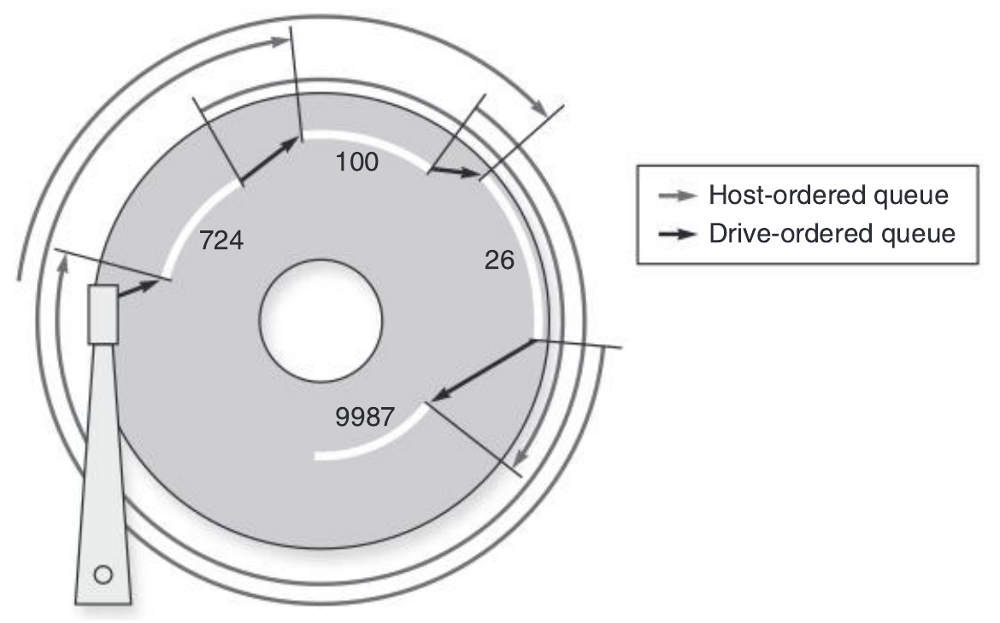
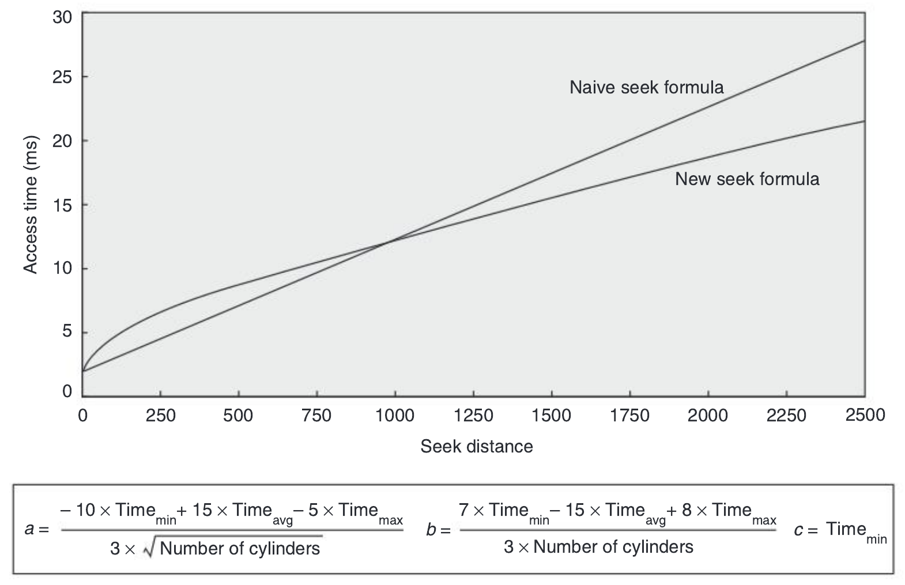

I/O 链的下一环是磁盘本身。平均一次磁盘 I/O 的时间为

$$
\begin{aligned}
\text{I/O time} &= 8.5\ \text{ms} + \frac{0.5}{7200\ \text{RPM}} + \frac{16\ \text{KB}}{50\ \text{MB/sec}} = 8.5 + 4.2 + 0.3 = 13.0\ \text{ms} \\
\text{I/O time} &= 8.5\ \text{ms} + \frac{0.5}{7200\ \text{RPM}} + \frac{50\ \text{KB}}{50\ \text{MB/sec}} = 8.5 + 4.2 + 1.0 = 13.7\ \text{ms}
\end{aligned}
$$

因此磁盘的性能为

$$
\begin{aligned}
\text{Maximum IOPS (using average seeks) per disk} &= \frac{1}{13.0\ \text{ms}} \approx 77\ \text{IOPS} \\
\text{Maximum IOPS (using average seeks) per disk} &= \frac{1}{13.7\ \text{ms}} \approx 73\ \text{IOPS}
\end{aligned}
$$

4 块磁盘合计为 292～308 IOPS。

链的最后一环是网络，它把这些计算机与外部世界连起来。网络的上限由链路速率决定：

$$
\begin{aligned}
\text{Maximum IOPS per 1000 Mbit Ethernet link} &= \frac{1000\ \text{Mbit}}{16\ \text{K} \times 8} = 7812\ \text{IOPS} \\
\text{Maximum IOPS per 1000 Mbit Ethernet link} &= \frac{1000\ \text{Mbit}}{50\ \text{K} \times 8} = 2500\ \text{IOPS}
\end{aligned}
$$

GB2000 的性能瓶颈显然在磁盘。整个机架的 IOPS 在 40 × 292 = 11,680 IOPS 到 40 × 308 = 12,320 IOPS 之间。网络交换机要不成为瓶颈，16 KB 块时必须能支持 12,320 × 16 K × 8，即 1.6 Gbit/s；50 KB 块时必须能支持 11,680 × 50 K × 8，即 4.7 Gbit/s。我们假定 48 端口交换机多出来的 8 个千兆端口把机架连到外部世界，这样交换机就能承受机架中全部 160 块磁盘的总 IOPS。

按这些假定，一个 80 TB 机架的成本是 40 × (500 + 4 × 375) + 3000 + 1500 = 84,500 美元，其中磁盘本身占了将近 60%。每 TB 的成本接近 1000 美元，大约只有本书上一版（2001 年）中存储集群的 1/15～1/10。每 IOPS 的成本约为 7 美元。

### 计算 TB-80 集群的 MTTF {-}

Google 这样的 Internet 服务靠在应用层保存多份数据副本来保证可信性。这些副本往往分放在不同的地理位置，既防硬件故障，也防环境故障。Internet Archive 也是这样做的：它在旧金山、阿姆斯特丹和埃及的亚历山大设有站点，每个站点都保存两份数据，其中高价值的内容（音乐、图书、电影和视频）保存两份，历史上的 Web 爬取数据只保存一份。为了压低成本，80 TB 机架内部不设任何冗余。

**例题**　求这样配置的机架的平均无故障时间。磁盘的 MTTF 不用制造商给出的 600,000 小时，而用最近一项磁盘驱动器调查的数据［Gray and van Ingen 2005］。第 1 章提到，ATA 驱动器每年约有 3%～7% 发生故障，相当于 MTTF 约为 125,000～300,000 小时。作如下假定，仍然假设寿命服从指数分布：

* CPU/内存/机箱的 MTTF 为 1,000,000 小时。
* PATA 磁盘的 MTTF 为 125,000 小时。
* PATA 控制器的 MTTF 为 500,000 小时。
* 以太网交换机的 MTTF 为 500,000 小时。
* 电源的 MTTF 为 200,000 小时。
* 风扇的 MTTF 为 200,000 小时。
* PATA 线缆的 MTTF 为 1,000,000 小时。

**解答**　把各部件汇总起来，算出故障率：

$$
\begin{aligned}
\text{故障率} &= \frac{40}{1{,}000{,}000} + \frac{160}{125{,}000} + \frac{40}{500{,}000} + \frac{1}{500{,}000} + \frac{40}{200{,}000} + \frac{40}{200{,}000} + \frac{80}{1{,}000{,}000} \\[4pt]
&= \frac{40 + 1280 + 80 + 2 + 200 + 200 + 80}{1{,}000{,}000\ \text{小时}} \\[4pt]
&= \frac{1882}{1{,}000{,}000\ \text{小时}}
\end{aligned}
$$

系统的 MTTF 就是故障率的倒数：

$$
\text{MTTF} = \frac{1}{\text{故障率}} = \frac{1{,}000{,}000\ \text{小时}}{1882} = 531\ \text{小时}
$$

也就是说，按上面对各部件 MTTF 的假定，一个机架平均每 3 周就有某个部件发生故障，其中约 70% 是磁盘故障，约 20% 是风扇或电源故障。

## 融会贯通：NetApp FAS6000 文件服务器 {#sec-d-8}

Network Appliance 公司于 1992 年进入存储市场，目标是提供一种容易操作的文件服务器（filer）：运行 NFS，使用公司自己的日志结构文件系统和 RAID 4 磁盘阵列。后来公司又加入了对 Windows CIFS 文件系统的支持，以及一种称为*行-对角线奇偶校验*（row-diagonal parity）或 *RAID-DP* 的 RAID 6 方案（见第 D-8 页）。有些应用（如数据库系统）希望直接访问原始数据块，而不承担文件系统的开销。为了支持这类应用，NetApp 文件服务器可以通过标准的光纤通道（Fibre Channel）接口提供数据块。NetApp 还支持 *iSCSI*，让 SCSI 命令在 TCP/IP 网络上传送。这样就可以用以太网等标准网络设备把服务器连到存储上，连接距离也可以更远。

NetApp 最新的硬件产品是 FAS6000。它是一台多处理器，由若干个 AMD Opteron 微处理器通过 HyperTransport 链路连接而成。这些微处理器运行 NetApp 的软件栈，包括 NFS、CIFS、RAID-DP、SCSI 等。FAS6000 有双处理器（FAS6030）和四处理器（FAS6070）两种型号。第 5 章讲过，Opteron 的 DRAM 分布在各个微处理器上。FAS6000 给每个 Opteron 连接 8 GB 的 DDR2700，因此 FAS6030 共有 16 GB，FAS6070 共有 32 GB。第 4 章讲过，DRAM 总线宽 128 位，另外还有供 SEC/DED 存储器使用的附加位。两种型号都有 4 条 HyperTransport 链路专门用于 I/O。

作为文件服务器，FAS6000 既要连接磁盘，又要连接服务器，因此需要大量 I/O。集成的 I/O 包括：

* 8 个光纤通道（FC）控制器及端口；
* 6 条千兆以太网链路；
* 6 个 x8（2 GB/s）PCI Express 卡插槽；
* 3 个 PCI-X 133 MHz、64 位卡插槽；
* IDE、USB 和 32 位 PCI 等标准 I/O 选项。

8 个光纤通道控制器每个都可以连接 6 个磁盘架，每个磁盘架装 14 块 3.5 英寸 FC 磁盘，因此集成 I/O 最多可连接 8 × 6 × 14 = 672 块磁盘。在选件插槽中加装 FC 控制器，可以把驱动器数增加到最多 1008 块，也可以减少每个 FC 网络上的驱动器数以降低争用，等等。每块 FC 驱动器的容量为 500 GB。假定每个 RAID RDP 组由 14 块数据盘和 2 块校验盘组成，那么 672 块磁盘的可用数据容量为 294 TB，1008 块磁盘为 441 TB。

FAS6000 还可以通过光纤通道到 SATA 的桥接控制器连接串行 ATA 磁盘。顾名思义，这种桥接控制器让 FC 和 SATA 能够互相通信。

6 条千兆以太网链路连接服务器。运行 NTFS 或 CIFS 时，FAS6000 在服务器看来是一台文件服务器；运行 iSCSI 时，它看起来是一台块服务器。

为了提高可信性，FAS6000 文件服务器可以成对使用，一台出故障时由另一台接管。这种集群故障切换（clustered failover）要求两台文件服务器都能通过 FC 互连访问这一对中的所有磁盘。借助这一互连，每台文件服务器还可以在另一台的 NVRAM 中保存一份日志数据，并让两台的时钟保持同步。系统持续监控两台文件服务器的健康状况，故障切换自动进行。切换后，健康的那台保留自己的网络身份和主要功能，同时接过故障那台的网络身份，并通过一个虚拟文件服务器处理发给故障机的全部数据请求，直到管理员把数据服务恢复原状。

## 谬误与陷阱 {#sec-d-9}

**谬误**　*部件发生故障时会立即停止工作。*

容错方面的大量文献都基于一个简化的假设：部件一直完美地工作，直到某个潜在错误发作，随即发生失效，部件停止工作。

Tertiary Disk 项目的经历恰恰相反。许多部件在失效之前很久就开始行为异常，是否宣布某个部件已经失效，一般要由系统操作员决定。在操作员「终止」它之前，这个部件一般会继续工作下去，尽管它的行为已经违反了服务协议。

[图 D.20](#fig-d-20) 列出了 4 块被终止的驱动器的记录，以及每块从开始行为异常到被更换经过的小时数。

[图 D.20　Tertiary Disk 的 368 块磁盘中，18 个月内被更换的 4 块磁盘在系统日志中的记录。见 Talagala 和 Patterson［1999］。这些消息符合 SCSI 规范，由设备驱动程序写入系统日志。最早的消息在其中一块驱动器被操作员更换之前一周就开始出现。第三条和第四条消息表明，驱动器的失效预测机制已经检测到并预报了即将发生的失效，但操作员仍然过了好几个小时才更换驱动器。表中的消息照录英文原文，意思依次为：硬件失效（现场可更换单元的外设写故障）；未就绪（诊断失败：ASCQ = 现场可更换单元的部件 ID）；已恢复错误（现场可更换单元超出失效预测阈值）；同上。]{#fig-d-20 .caption}

| 故障磁盘在系统日志中的消息 | 日志消息数 | 持续时间（小时） |
|---|---:|---:|
| Hardware Failure (Peripheral device write fault [for] Field Replaceable Unit) | 1763 | 186 |
| Not Ready (Diagnostic failure: ASCQ = Component ID [of] Field Replaceable Unit) | 1460 | 90 |
| Recovered Error (Failure Prediction Threshold Exceeded [for] Field Replaceable Unit) | 1313 | 5 |
| Recovered Error (Failure Prediction Threshold Exceeded [for] Field Replaceable Unit) | 431 | 17 |

**谬误**　*计算机系统能像广告说的那样，达到 99.999% 的可用性（「五个 9」）。*

服务器厂商的市场部门开始大肆宣扬自家硬件的可用性。用[图 D.21](#fig-d-21) 的说法，它们声称可用性达到 99.999%，俗称*五个 9*。就连操作系统公司的市场部门也想给人留下这样的印象。

[图 D.21　达到各可用性等级所允许的每年不可用分钟数（引自 Gray 和 Siewiorek［1991］）。注意，五个 9 意味着每年不可用 5 分钟。]{#fig-d-21 .caption}

| 不可用时间（分钟/年） | 可用性（百分比） | 可用性等级（「9 的个数」） |
|---:|---|---:|
| 50,000 | 90% | 1 |
| 5000 | 99% | 2 |
| 500 | 99.9% | 3 |
| 50 | 99.99% | 4 |
| 5 | 99.999% | 5 |
| 0.5 | 99.9999% | 6 |
| 0.05 | 99.99999% | 7 |

每年只有 5 分钟不可用，当然令人印象深刻；但对照调查收集到的故障数据，这个数字很难让人相信。例如，惠普公司（Hewlett-Packard）声称，HP-9000 服务器硬件加上 HP-UX 操作系统，「在某些预先定义、预先测试过的客户环境中」可以保证 99.999% 的可用性（见 Hewlett-Packard［1998］）。这一保证不包括操作员故障、应用故障和环境故障造成的失效，而这几类很可能正是当今最主要的故障；也不包括计划内的停机时间。此外，系统达不到保证的指标时，厂商要承担什么经济赔偿，也不清楚。

微软也开展过「五个 9」的营销活动。2001 年 1 月，www.microsoft.com 有 22 小时无法访问。微软网站要达到 99.999% 的可用性，此后 250 年都不能再出任何差错。

实际上，管理良好的服务器一般能达到 99%～99.9% 的可用性，与市场宣传给人的印象并不相同。

**陷阱**　*功能在哪一层实现，会影响它的可靠性。*

理论上，把 RAID 功能移到软件中没有什么问题；实际上，很难让它可靠地工作。

软件文化一般靠发布一系列版本和补丁，最终达到正确。软件 RAID 也很难与其他软件层隔离开。例如，软件能否正确运行，往往取决于操作系统的版本和补丁是否合适。因此，许多使用软件 RAID 系统的客户，因为软件错误或环境不兼容而丢失了数据。

硬件系统当然也免不了出错，但硬件文化往往更重视在首次发布时就把正确性测试好。此外，硬件一般更不依赖操作系统的版本。

**谬误**　*调度磁盘访问的最佳位置是操作系统。*

ATA 和 SCSI 等较高层的接口向主机操作系统提供的是逻辑块地址。面对这样高层的抽象，操作系统至多只能把逻辑块地址按递增顺序排列。逻辑地址怎样映射到扇区、磁道和盘面的物理几何结构上，只有磁盘知道，因此只有磁盘才能减少旋转延迟和寻道延迟。

例如，假设负载是 4 次读操作［Anderson 2003］：

| 操作 | 起始 LBA | 长度 |
|---|---:|---:|
| Read | 724 | 8 |
| Read | 100 | 16 |
| Read | 9987 | 1 |
| Read | 26 | 128 |

主机可能把这 4 次读按逻辑块顺序重新排列：

| 操作 | 起始 LBA | 长度 |
|---|---:|---:|
| Read | 26 | 128 |
| Read | 100 | 16 |
| Read | 724 | 8 |
| Read | 9987 | 1 |

但视数据在磁盘上的相对位置而定，这样重排反而可能更糟，如[图 D.22](#fig-d-22) 所示：由磁盘调度时，这几次读在磁盘转 3/4 圈之内就能完成；由操作系统调度时，则要转 3 圈。

{#fig-d-22 width=60%}

**谬误**　*计算机系统中磁盘的平均寻道时间，就是寻道经过 1/3 柱面数的时间。*

这一谬误有两个来源：一是把制造商推销磁盘的说法当成了实际能得到的性能，二是误以为寻道时间与距离成线性关系。「1/3 距离」这条经验法则的算法是：计算从一个随机位置寻道到另一个随机位置的距离，不计当前磁道，并假定磁道数很多，所得结果就是 1/3。过去，制造商列出的是寻道这一距离所需的时间，为比较提供一个统一的基准。（现在，制造商把所有寻道都计时，再除以寻道次数，得出「平均」寻道时间。）如果（错误地）假定寻道时间与距离成线性关系，再用上制造商给出的最小寻道时间和「平均」寻道时间，就得到一种常用的寻道时间预测公式：

$$
\text{Time}_\text{seek} = \text{Time}_\text{minimum} + \frac{\text{Distance}}{\text{Distance}_\text{average}} \times \left(\text{Time}_\text{average} - \text{Time}_\text{minimum}\right)
$$

这一谬误错在两处。第一，寻道时间与距离*不*成线性关系。磁头臂先要加速以克服惯性，达到最大移动速度，接近目标位置时减速，然后还要等磁头臂停止振动（这段时间称为*稳定时间*）。此外，磁头臂有时还必须停顿下来，以抑制振动。Chen 和 Lee［1995］对柱面数超过 200 的磁盘建立的寻道时间模型为：

$$
\text{Seek time}(\text{Distance}) = a \times \sqrt{\text{Distance} - 1} + b \times (\text{Distance} - 1) + c
$$

其中 a、b、c 针对具体磁盘选取，使公式在 Distance = 1、Distance = max 和 Distance = 1/3 max 时与标称时间相符。[图 D.23](#fig-d-23) 把这个公式和前面的谬误公式画在一起作比较。与第一个公式不同，这里用距离的平方根反映加速和减速。

第二，产品规格中的平均值只有在磁盘活动没有局部性时才成立。好在磁盘活动既有时间局部性，也有空间局部性（见[附录 B](#app-b) 第 B-2 页）。例如，[图 D.24](#fig-d-24) 给出了 UNIX 分时负载和商业处理负载下寻道距离的测量样本。可以看到，两种负载下访问同一柱面（图中标为距离 0）的磁盘访问都占很高的比例。因此，这一谬误的误导性再大不过了。

{#fig-d-23 width=80%}

![图 D.24　两个系统寻道距离的测量样本。左图是在一个 UNIX 分时系统上测得的；右图取自一个商业处理应用，这个应用对磁盘寻道活动作了调度以提高吞吐率。寻道距离为 0 表示访问的是同一柱面。其余数字表示纵轴上相邻两个数之间各距离的累计百分比。例如，商业处理图中标为 16 的条是 11%，表示寻道距离在 1～16 个柱面之间的寻道占 11%。UNIX 的测量只统计到 1000 个柱面中的前 200 个，但已覆盖了 85% 的访问。商业处理的测量覆盖了磁盘全部 816 个柱面。图中没有列出、但占寻道次数 1% 以上的寻道距离只有：224（占 4%），以及 304、336、512 和 624（各占 1%）。总计为 94%，与 100% 的差额是其他类别中很小但不为零的距离。测量数据由 Seagate 公司的 Dave Anderson 提供。图内标注：Seek distance，寻道距离；Percentage of seeks (UNIX time-sharing workload)，寻道次数百分比（UNIX 分时负载）；Percentage of seeks (business workload)，寻道次数百分比（商业负载）。](images/appd/fig-d-24.png){#fig-d-24 width=100%}

## 结束语 {#sec-d-10}

> 存储是那种我们往往习以为常的技术。然而，如果看看今天的真实状况，存储才是王者。甚至可以说，已经成为普通商品的服务器，正在变成存储设备的外设。IBM 的一些估计更说明了这一点：IBM 预计，今后两年内存储的销售额将超过服务器。
>
> ——Michael Vizard，*Infoworld* 主编（2001 年 8 月 11 日）

存储系统的价值日益明显，因此成了创新和投资的对象。

今天存储系统面临的挑战是可信性和可维护性。用户不仅希望数据永不丢失（可靠性），如今的应用还越来越要求数据随时都能访问（可用性）。硬件和软件的可靠性和容错能力虽然都有所提高，但这类系统维护起来很麻烦，既影响成本，也影响可用性。一个常被引用的统计数字是：客户每花 1 美元购买存储系统，就要再花 6～8 美元来运行它。如果靠在系统较高层次保存许多冗余副本来解决可信性问题（搜索就是这样做的），那么超大规模的系统对存储部件的性价比就会很敏感。

今天，I/O 面临的挑战主要来自存储的可信性和可维护性。

## 历史回顾与参考文献 {#sec-d-11}

M.9 节（在线提供，见[附录 M](#app-m)）介绍存储设备和技术的发展，包括磁盘是谁发明的、RAID 背后的故事，以及操作系统和数据库的历史，并给出了供进一步阅读的参考文献。

## 案例研究与习题（Andrea C. Arpaci-Dusseau、Remzi H. Arpaci-Dusseau） {- #sec-d-exercises}

### 案例研究 1：解构一块磁盘 {-}

*本案例研究涉及的概念*

* 性能特征
* 微基准测试程序

存储系统的内部细节往往隐藏在一个简单的接口后面，即一个线性的块数组。所有存储系统共用一种接口有很多好处：操作系统不用修改就能使用任何存储系统，存储系统也可以在接口后面自由创新。例如，一块磁盘可以按性能最好的方式，把内部的〈扇区，磁道，盘面〉几何结构映射到线性数组上；同样，多磁盘的 RAID 系统也可以把任意多块磁盘上的块映射到这个线性数组上。不过，这种固定的接口也有一些缺点。特别是，操作系统不知道自己的块在底层存储系统中的确切布局，因此无法做某些性能、可靠性和安全方面的优化。

在这个案例研究中，我们探讨怎样用软件揭示存储系统藏在块接口后面的内部结构。基本思路是给存储系统*采集指纹*：在存储系统上运行一个明确定义的负载，测量各种请求所需的时间，就能推断出底层系统的大量细节，其数量之多出人意料。

Skippy 算法出自加州大学伯克利分校 Nisha Talagala 及其同事的工作，用来揭示单块磁盘的参数。算法的关键是排除磁盘旋转的影响，办法是连续寻道到一个个扇区，相邻两次访问的扇区地址之差线性增加（依次为 1、2、3，等等）。因此，基本算法在磁盘上跳跃前进，每次写之前把寻道距离增加一个扇区，并输出每次写的距离和时间。算法使用裸设备接口，以避开文件系统的优化。`SECTOR_SIZE` 设为一次能从磁盘读出的最小数据量（例如 512 字节）。（Talagala 和 Patterson［1999］对 Skippy 有更详细的描述。）

```c
fd = open("raw disk device");
for (i = 0; i < measurements; i++) {
    begin_time = gettime();
    lseek(fd, i*SECTOR_SIZE, SEEK_CUR);
    write(fd, buffer, SECTOR_SIZE);
    interval_time = gettime() -begin_time;
    printf("Stride: %d Time: %d\n", i, interval_time);
}
close(fd);
```

以寻道距离为横坐标，画出每次写所需的时间，就能推断出最小传输时间（不含寻道延迟和旋转延迟）、磁头切换时间、柱面切换时间、旋转延迟，以及磁盘的磁头数。典型的图上有四条截然分开的直线，斜率相同，偏移量不同。最高和最低两条线对应的请求，旋转延迟各不相同，但都没有柱面切换或磁头切换的开销，两条线之差就是磁盘的旋转延迟。倒数第二条线对应的请求，除了逐渐增加的旋转延迟，还有一次磁头切换。最后，第三条线对应的请求，除了旋转延迟，还有一次柱面切换。

D.1　[10/10/10/10/10] <D.2> 在一块假想的磁盘（Disk Alpha）上运行 Skippy 的结果见[图 D.25](#fig-d-25)。

a.　[10] <D.2> 最小传输时间是多少？
