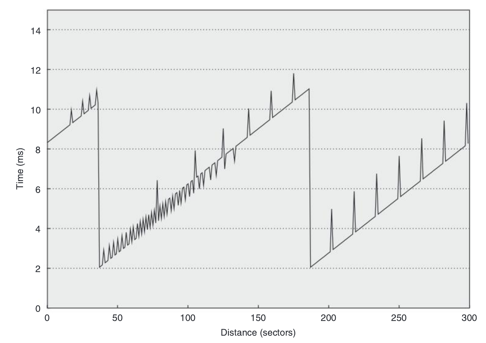
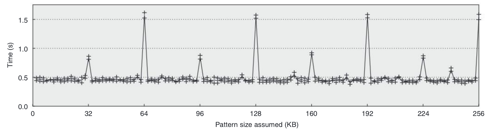
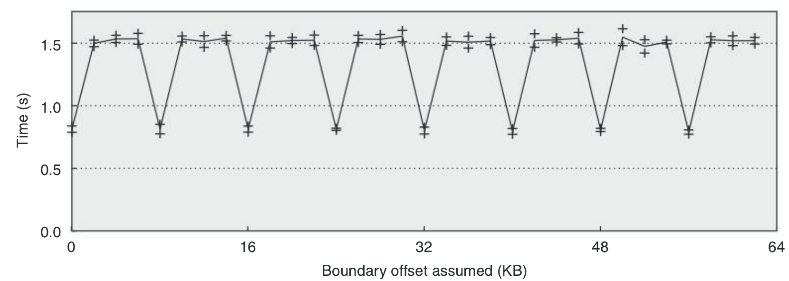
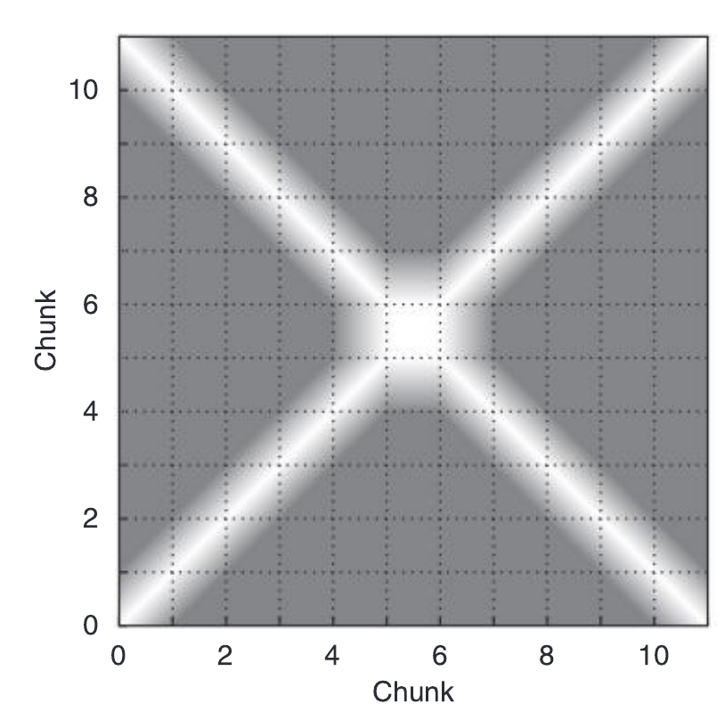
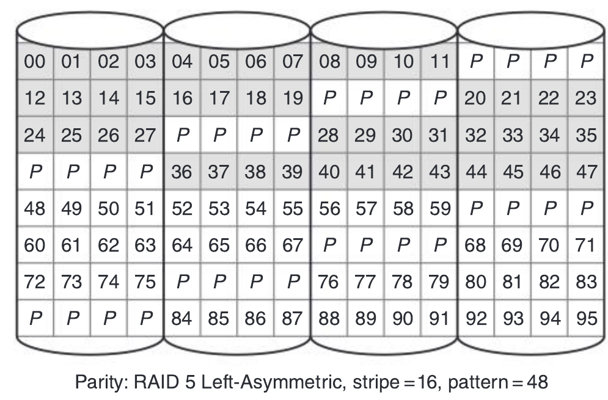

b.　[10] <D.2> 旋转延迟是多少？

c.　[10] <D.2> 磁头切换时间是多少？

d.　[10] <D.2> 柱面切换时间是多少？

e.　[10] <D.2> 磁头数是多少？

{#fig-d-25 width=80%}

D.2　[25] <D.2> Disk Beta 是一块具有下列参数的磁盘。在 Disk Beta 上运行 Skippy，画出所得曲线的大致形状。

* 最小传输时间：2.0 ms
* 旋转延迟：6.0 ms
* 磁头切换时间：1.0 ms
* 柱面切换时间：1.5 ms
* 磁头数：4
* 每道扇区数：100

D.3　[10/10/10/10/10/10/10] <D.2> 自选一块磁盘驱动器，实现并运行 Skippy 算法。

a.　[10] <D.2> 把运行 Skippy 的结果画成曲线，并写明磁盘的生产厂商和型号。

b.　[10] <D.2> 最小传输时间是多少？

c.　[10] <D.2> 旋转延迟是多少？

d.　[10] <D.2> 磁头切换时间是多少？

e.　[10] <D.2> 柱面切换时间是多少？

f.　[10] <D.2> 磁头数是多少？

g.　[10] <D.2> 在真实磁盘上运行 Skippy 的结果，与假想磁盘的结果相比，在性质上有没有不同？

### 案例研究 2：解析磁盘阵列 {-}

*本案例研究涉及的概念*

* 性能特征
* 微基准测试程序

Shear 算法用来探明 RAID 系统的参数，出自威斯康星大学 Timothy Denehy 等人的工作［Denehy et al. 2004］。基本思路是：向 RAID 阵列发出一组请求并计时，看哪几组请求用时较长，就能推断出哪些块分配在同一块磁盘上。

先定义 RAID 的几个属性。RAID 以块为单位把数据分配到各磁盘上。所谓*块*，就是文件系统从存储系统读写数据的最小单位，因此块的大小对文件系统和指纹识别软件都是已知的。*条块*（chunk）是在一块磁盘内连续分配的一组块。*条带*由分布在 $D$ 块数据盘上的各一个条块组成。最后，*模式*（pattern）是满足下面条件的最短数据块序列：模式内偏移为 $i$ 的块总是位于磁盘 $j$ 上。

D.4　[20/20] <D.2> 下面的代码可以探明模式的大小。为了避开文件系统的优化，代码直接访问裸设备。所有 Shear 算法的关键都是使用随机请求，以免触发 RAID 内部或单块磁盘内部的任何预取或缓存机制。这段代码的基本思路是：在 RAID 阵列中以固定间隔 $p$ 访问 $N$ 个随机块，测出每种间隔下的完成时间。

```c
for (p = BLOCKSIZE; p <= testsize; p += BLOCKSIZE) {
    for (i = 0; i < N; i++) {
        request[i] = random()*p;
    }
    begin_time = gettime();
    issues all request[N] to raw device in parallel;
    wait for all request[N] to complete;
    interval_time = gettime() - begin_time;
    printf("PatternSize: %d Time: %d\n", p,
        interval_time);
}
```

在 RAID 阵列上运行这段代码，把 $N$ 个请求的实测时间画成随 $p$ 变化的曲线，就会看到：$N$ 个请求全部落在同一块磁盘上时，时间最长。因此，时间最长处的 $p$ 值就对应 RAID 的模式大小。

{#fig-d-26 width=95%}

a.　[20] <D.2> [图 D.26](#fig-d-26) 是在一个未知 RAID 系统上运行模式大小算法的结果。

* 这个存储系统的模式大小是多少？
* 实测时间 0.4 秒、0.8 秒和 1.6 秒在这个存储系统中各对应什么情况？
* 如果这是一个 RAID 0 阵列，那么它有几块磁盘？
* 如果这是一个 RAID 0 阵列，那么条块大小是多少？

b.　[20] <D.2> 在具有下列特征的存储系统上运行这段 Shear 代码，画出所得的曲线：

* 请求数 $N=1000$
* 磁盘上一次随机读的时间：5 ms
* RAID 级别：RAID 0
* 磁盘数：4
* 条块大小：8 KB

D.5　[20/20] <D.2> 下面的代码可以探明条块的大小。基本思路是：从随机选取的 $N$ 个模式中读数据，但读的总是模式内两个受控的偏移位置 $c$ 和 $c-1$。

```c
for (c = 0; c < patternsize; c += BLOCKSIZE) {
    for (i = 0; i < N; i++) {
        requestA[i] = random()*patternsize + c;
        requestB[i] = random()*patternsize +
            (c-1)%patternsize;
    }
    begin_time = gettime();
    issue all requestA[N] and requestB[N] to raw device
        in parallel;
    wait for requestA[N] and requestB[N] to complete;
    interval_time = gettime() - begin_time;
    printf("ChunkSize: %d Time: %d\n", c,
        interval_time);
}
```

{#fig-d-27 width=85%}

运行这段代码，把实测时间画成随 $c$ 变化的曲线，就会看到：*requestA* 和 *requestB* 两组读落在两块不同的磁盘上时，实测时间最短。因此，时间较短处的 $c$ 值就对应 RAID 中磁盘之间的条块边界。

a.　[20] <D.2> [图 D.27](#fig-d-27) 是在一个未知 RAID 系统上运行条块大小算法的结果。

* 这个存储系统的条块大小是多少？
* 实测时间 0.75 秒和 1.5 秒在这个存储系统中各对应什么情况？

b.　[20] <D.2> 在具有下列特征的存储系统上运行这段 Shear 代码，画出所得的曲线：

* 请求数 $N=1000$
* 磁盘上一次随机读的时间：5 ms
* RAID 级别：RAID 0
* 磁盘数：8
* 条块大小：12 KB

D.6　[10/10/10/10] <D.2> 最后，下面的代码可以确定条块在各磁盘上的布局。基本思路是：随机选取 $N$ 个模式，穷举模式内条块的所有两两组合，每次把一对条块放在一起读。

```c
for (a = 0; a < numchunks; a += chunksize) {
    for (b = a; b < numchunks; b += chunksize) {
        for (i = 0; i < N; i++) {
            requestA[i] = random()*patternsize + a;
            requestB[i] = random()*patternsize + b;
        }
        begin_time = gettime();
        issue all requestA[N] and requestB[N] to raw device
            in parallel;
        wait for all requestA[N] and requestB[N] to
            complete;
        interval_time = gettime() - begin_time;
        printf("A: %d B: %d Time: %d\n", a, b,
            interval_time);
    }
}
```

运行这段代码后，可以给出实测时间随 $a$ 和 $b$ 变化的结果。最简单的画法是做一张以 $a$ 和 $b$ 为两个参数的二维表，把时间换算成灰度：时间较短用较深的颜色，时间较长用较浅的颜色。因此，颜色浅说明模式内的两个偏移 $a$ 和 $b$ 落在同一块磁盘上。

已知某存储系统的模式大小为 384 KB，条块大小为 32 KB。[图 D.28](#fig-d-28) 是在这个存储系统上运行布局算法的结果。

a.　[20] <D.2> 一个模式中有多少个条块？

b.　[20] <D.2> 每个模式中，哪些条块看来分配在同一块磁盘上？

c.　[20] <D.2> 这个存储系统看来有几块磁盘？

d.　[20] <D.2> 画出各块在磁盘上可能的布局。

D.7　[20] <D.2> 在[图 D.29](#fig-d-29) 所示的存储系统上运行布局算法，画出所得的图。这个存储系统有四块磁盘，条块大小为 4 个 4 KB 的块（16 KB），采用 RAID 5 Left-Asymmetric 布局。

{#fig-d-28 width=55%}

{#fig-d-29 width=70%}

### 案例研究 3：RAID 重建 {-}

*本案例研究涉及的概念*

* RAID 系统
* RAID 重建
* 平均无故障时间（MTTF）
* 平均数据丢失时间（MTDL）
* 性能可用性
* 双重失效

RAID 系统能保证一块磁盘失效时数据不丢失。因此，RAID 的一项关键职责是：某块磁盘失效后，把它上面原有的数据重新构造出来。这个过程称为*重建*（reconstruction），本案例研究就来探讨它。我们既要考虑能容忍一块磁盘失效的 RAID 系统，也要考虑能容忍两块磁盘失效的 RAID-DP。

重建通常有两种做法。*离线重建*时，RAID 把全部资源都用于重建，不响应负载的任何请求。*在线重建*时，RAID 一边重建，一边继续响应负载的请求，重建过程通常只允许使用 RAID 系统总带宽的一部分。

重建的方式既影响系统的*可靠性*，也影响系统的*性能可用性*（performability）。在 RAID 5 中，如果第一块失效磁盘的数据还没有恢复，第二块磁盘又失效了，数据就会丢失；因此，重建时间（MTTR）越长，可靠性越低，也就是*平均数据丢失时间*（MTDL）越短。性能可用性是一个兼顾系统性能和可用性的指标，定义为系统在某一状态下的性能乘以系统处于这一状态的概率。RAID 阵列可能的状态包括：没有磁盘失效时正常运行，一块磁盘失效时进入重建，多块磁盘失效时停机。

做以下习题时，假定你构建了一个由六块磁盘组成的 RAID 系统，另有足够数量的热备盘。假定每块磁盘都是[图 D.3](#fig-d-3) 中的 37 GB SCSI 磁盘，顺序读的峰值速率为 142 MB/s，顺序写的峰值速率为 85 MB/s。磁盘连接在一条 Ultra320 SCSI 总线上，总线的总传输能力为 320 MB/s。可以假定各磁盘的失效相互独立，并忽略系统中其他可能的失效。重建时，可以假定 XOR 计算和内存复制的开销都忽略不计。在线重建时，假定重建过程最多只能使用 RAID 系统总计 10 MB/s 的带宽。

D.8　[10] <D.2> 假定你有一个由六块磁盘组成的 RAID 4 系统。画一张简图，表示这个 RAID 系统中各块在磁盘上的布局。

D.9　[10] <D.2, D.4> RAID 4 系统在一块磁盘失效时执行重建。预计要过多长时间才需要重建一次？

D.10　[10/10/10] <D.2, D.4> 假定 RAID 4 阵列的重建在时刻 $t$ 开始。

a.　[10] <D.2, D.4> 重建需要哪些读操作和写操作？

b.　[10] <D.2, D.4> 采用离线重建，重建过程何时完成？

c.　[10] <D.2, D.4> 采用在线重建，重建过程何时完成？

D.11　[10/10/10/10] <D.2, D.4> 本题研究平均数据丢失时间（MTDL）。在 RAID 4 中，只有在第一块失效磁盘修复之前第二块磁盘又失效，数据才会丢失。

a.　[10] <D.2, D.4> 离线重建期间发生第二次失效的可能性有多大？

b.　[10] <D.2, D.4> 已知重建期间发生第二次失效的可能性如上，离线重建的 MTDL 是多少？

c.　[10] <D.2, D.4> 在线重建期间发生第二次失效的可能性有多大？

d.　[10] <D.2, D.4> 已知重建期间发生第二次失效的可能性如上，在线重建的 MTDL 是多少？

D.12　[10] <D.2, D.4> 采用离线重建时，RAID 4 阵列的性能可用性是多少？假定负载是只读的随机访问，均匀分布在 RAID 4 阵列的各磁盘上，用 IOPS 计算性能可用性。

D.13　[10] <D.2, D.4> 采用在线重建时，RAID 4 阵列的性能可用性是多少？可以假定在线修复期间 IOPS 降为峰值的 70%。离线重建和在线重建，哪一种的性能可用性更好？

D.14　[10] <D.2, D.4> RAID 6 用来容忍最多两块磁盘同时失效。假定你有一个基于行-对角线奇偶校验（即 RAID-DP）的 RAID 6 系统，共六块磁盘，以 RAID 4 为基础，$p=5$，如[图 D.5](#fig-d-5) 所示。如果数据盘 0 和数据盘 3 失效，怎样重建这两块磁盘？写出计算前四个条带中缺失块所需的步骤序列。

### 案例研究 4：RAID 的性能预测 {-}

*本案例研究涉及的概念*

* RAID 级别
* 排队论
* 负载的影响
* 磁盘布局的影响

本案例研究探讨怎样用简单的排队论预测 I/O 系统的性能。我们将考察存储系统配置和负载怎样影响服务时间、磁盘利用率和平均响应时间。

存储系统的配置对性能影响很大。不同的 RAID 级别要用排队论以不同的方式建模。例如，含 $N$ 块磁盘的 RAID 0 阵列，只要请求在 $N$ 块磁盘上分布得当，就可以建模为 $N$ 个独立的 M/M/1 队列系统。RAID 1 阵列的行为取决于负载：读操作可以发给任意一个镜像，写操作则必须发给两块磁盘。因此，对只读负载，两盘 RAID 1 阵列可以建模为一个 M/M/2 队列；对只写负载，则可以建模为一个 M/M/1 队列。含 $N$ 块磁盘的 RAID 4 阵列的行为同样取决于负载：读操作发给某一块数据盘；写操作则都要更新校验盘，于是校验盘成了系统的瓶颈。因此，对只读负载，RAID 4 可以建模为 $N-1$ 个独立的系统；对只写负载，则可以建模为一个 M/M/1 队列。

块在存储系统中的布局对性能也可能有很大影响。考虑一块容量为 40 GB 的磁盘。如果负载随机访问 40 GB 数据，这些块在磁盘上怎样布局对性能影响不大。但是，如果负载只随机访问磁盘容量的一半（即这块磁盘上的 20 GB 数据），布局就有影响了：为了缩短寻道时间，可以把这 20 GB 数据紧凑地存放在 20 GB 的连续磁道上，而不是均匀地分散在整个 40 GB 容量上。

本题用一个相当简化的模型估算磁盘的服务时间。在这个基本模型中，一个小的随机请求的平均定位与传输时间，是寻道距离的线性函数。对本题中的 40 GB 磁盘，假定服务时间为 5 ms × 空间利用率。因此，如果整块 40 GB 磁盘都在使用，随机请求的平均定位与传输时间为 5 ms；如果只用磁盘的前 20 GB，平均定位与传输时间为 2.5 ms。

在整个案例研究中，可以假定处理器每秒发出 167 个小的随机磁盘请求，这些请求服从指数分布。可以假定请求大小等于块大小，即 8 KB。系统中每块磁盘的容量为 40 GB。无论存储系统怎样配置，负载访问的数据总量都是 40 GB；你应当以最高效的方式把这 40 GB 数据分配到系统中的各磁盘上。

D.15　[10/10/10/10/10] <D.5> 首先假定存储系统只有一块 40 GB 磁盘。

a.　[10] <D.5> 对这种负载和存储系统，平均服务时间是多少？

b.　[10] <D.5> 磁盘的平均利用率是多少？

c.　[10] <D.5> 每个请求平均要花多少时间等待磁盘？

d.　[10] <D.5> 队列中的平均请求数是多少？

e.　[10] <D.5> 最后，磁盘请求的平均响应时间是多少？

D.16　[10/10/10/10/10/10] <D.2, D.5> 设想存储系统现在配置成由两块 40 GB 磁盘组成的 RAID 0 阵列，也就是数据以 8 KB 的块为单位均匀地条带化分布在两块磁盘上，没有冗余。

a.　[10] <D.2, D.5> 40 GB 数据怎样分配到两块磁盘上？对总计 40 GB 范围内的随机请求负载，每个请求的预期服务时间是多少？

b.　[10] <D.2, D.5> 怎样用排队论为这个存储系统建模？

c.　[10] <D.2, D.5> 每块磁盘的平均利用率是多少？

d.　[10] <D.2, D.5> 每个请求平均要花多少时间等待磁盘？

e.　[10] <D.2, D.5> 每个队列中的平均请求数是多少？

f.　[10] <D.2, D.5> 最后，磁盘请求的平均响应时间是多少？

D.17　[20/20/20/20/20] <D.2, D.5> 再设想存储系统配置成由两块 40 GB 磁盘组成的 RAID 1 阵列，也就是数据在两块磁盘上互为镜像。对只读负载，用排队论为这个系统建模。

a.　[20] <D.2, D.5> 40 GB 数据怎样分配到两块磁盘上？对总计 40 GB 范围内的随机请求负载，每个请求的预期服务时间是多少？

b.　[20] <D.2, D.5> 怎样用排队论为这个存储系统建模？

c.　[20] <D.2, D.5> 每块磁盘的平均利用率是多少？

d.　[20] <D.2, D.5> 每个请求平均要花多少时间等待磁盘？

e.　[20] <D.2, D.5> 最后，磁盘请求的平均响应时间是多少？

D.18　[10/10] <D.2, D.5> 设想 RAID 1 阵列上的负载不再是只读的，而是只写的。

a.　[10] <D.2, D.5> 说明怎样用排队论为这个系统和负载建模。

b.　[10] <D.2, D.5> 对这个系统和负载，平均利用率、平均等待时间和平均响应时间各是多少？

### 案例研究 5：I/O 子系统设计 {-}

*本案例研究涉及的概念*

* RAID 系统
* 平均无故障时间（MTTF）
* 性能与可靠性的权衡

在本案例研究中，你要在给定的资金预算内设计一个 I/O 子系统。系统有最低容量要求，优化目标可以是性能、可靠性，或两者兼顾。只要不超出预算，磁盘和控制器想用多少都可以。

可用的部件如下：

* 一个 10,000 MIPS 的 CPU，价格 1000 美元，MTTF 为 1,000,000 小时。
* 一条 1000 MB/s 的 I/O 总线，可以容纳 20 条 Ultra320 SCSI 总线及其控制器。
* Ultra320 SCSI 总线，传输能力为 320 MB/s，每条总线最多支持 15 块磁盘（这种总线也称为 SCSI 串）。SCSI 电缆的 MTTF 为 1,000,000 小时。
