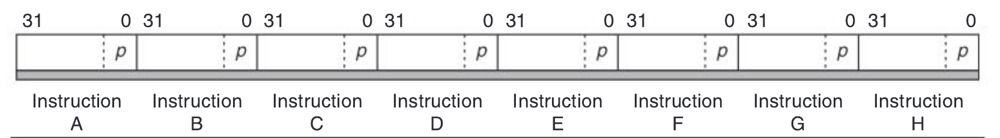

# 嵌入式系统 {#app-e}

本附录作者：Thomas M. Conte，北卡罗来纳州立大学。

> ENIAC 上的一台计算器装有 18,000 个真空管，重 30 吨；将来的计算机也许只要 1000 个真空管，重量或许只有 1.5 吨。
>
> ——《大众机械》（*Popular Mechanics*），1949 年 3 月

## 引言 {#sec-e-1}

嵌入式计算机系统是计算机市场中增长最快的部分。所谓嵌入式计算机系统，就是装在其他设备里、让人一眼看不出其中有计算机的系统。装有嵌入式计算机的设备种类很多：一是日常使用的机器，大多数微波炉、洗衣机，以及打印机、网络交换机和汽车，都装有从简单到非常先进的嵌入式微处理器；二是手持数字设备，如 PDA、手机和音乐播放器；三是视频游戏机和数字机顶盒。有些应用（如 PDA）中的计算机是可编程的；但在许多嵌入式应用中，只有首次装入应用程序代码、以后升级应用软件时才涉及编程。因此，应用程序要针对处理器和系统仔细调优，有时还在关键循环中少量使用汇编语言。不过，产品有上市时间的压力，良好的软件工程实践也有要求，所以用汇编语言编写的只占应用的一小部分。

与桌面系统和服务器系统相比，嵌入式系统的处理能力和成本跨度要大得多：低端的系统采用 8 位、16 位处理器，价格可能不到 1 美元；中间的系统采用完整的 32 位微处理器，能达到 500 MIPS 左右，价格约 10 美元；高端的系统采用高端嵌入式处理器，价格达数百美元，每秒能执行几十亿条指令。嵌入式市场的计算能力跨度虽然很大，但设计这一领域的计算机时，价格是关键因素。性能要求当然也有，但首要目标往往是以最低的价格满足性能需要，而不是花更多的钱换取更高的性能。

嵌入式系统处理信息的方式常常与通用处理器大不相同。这类应用通常带有截止时间约束，即所谓*实时约束*：某项计算必须在规定的时刻之前完成，否则系统就会发生故障。（还有其他一些约束也属于实时约束，下一小节讨论。）

嵌入式应用通常以*信号*的形式处理信息。一般人说到「信号」，往往想到无线电传输，某些嵌入式系统（如手机）处理的确实是这种信号。但信号也可以是一幅图像、由一系列图像组成的一段活动影像、一次控制传感器的测量值，等等。信号处理需要特定的计算，许多嵌入式处理器正是针对这类计算优化的，下文将深入讨论。基准测试的要求也是多种多样：有的只要求能运行规模有限的短小代码段，有的则要求在几万到几十万行代码的应用上表现良好。

许多嵌入式应用还有两个重要特点：一是要尽量减少存储器，二是要尽量降低功耗。在许多嵌入式应用中，存储器占系统成本的相当一部分，这时就要优化存储器容量。有时要求应用程序全部放进处理器芯片上的存储器，有时要求它全部放进一块容量不大的片外存储器。无论哪种情况，数据规模都由应用决定，因此重视存储器容量，落到实处就是重视代码规模。有些体系结构在指令系统中专门提供了缩减代码规模的功能。存储器越大，功耗也越高，而优化功耗在嵌入式应用中往往至关重要。强调低功耗，常常是因为设备用电池供电；此外，要使用更便宜的封装（塑料而不是陶瓷），又不装散热风扇，也必须限制总功耗。本附录后面还会更详细地讨论功耗问题。

嵌入式系统的另一个重要趋势是把处理器核与专用电路结合起来，即所谓「核加 ASIC」或片上系统（SOC），也可以把它看作专用多处理器（见 [E.4 节](#sec-e-4)）。应用的功能和性能要求，常常靠定制硬件加软件来满足：软件运行在标准化的嵌入式处理器核上，这种处理器核在设计时就考虑了与这类专用硬件对接。实践中，嵌入式问题通常用以下三种办法之一来解决：

1. 设计者采用软硬件结合的方案：一部分是定制硬件，另一部分是与定制硬件集成在一起的嵌入式处理器核，两者常常在同一块芯片上。
2. 设计者在现成的嵌入式处理器上运行定制软件。
3. 设计者采用数字信号处理器，并为它编写定制软件。数字信号处理器是专为信号处理应用定制的处理器。下文将讨论数字信号处理器与通用嵌入式处理器之间的一些重要区别。

[图 E.1](#fig-e-1) 归纳了三类计算环境及其重要特点。

[图 E.1　三类计算机及其系统特点。注意，服务器和嵌入式系统的系统价格跨度很大。服务器的价格跨度来自高端事务处理和 Web 服务器应用，它们需要规模非常大的多处理器系统。嵌入式系统的一个重要高端应用是网络路由器，它可能包含多个处理器，以及大量存储器和其他电子器件。如果把 8 位和 16 位微处理器计算在内，2000 年售出的嵌入式处理器总数估计超过 10 亿片。事实上，有史以来销量最大的微处理器是 Intel 出售的一款 8 位微控制器！服务器市场的低端与桌面市场很难划清界限，因为低端服务器，尤其是价格低于 5000 美元的低端服务器，与桌面 PC 基本没有区别。因此，PC 中可能有多达几百万台实际上是服务器。]{#fig-e-1 .caption}

| 特点 | 桌面 | 服务器 | 嵌入式 |
|---|---|---|---|
| 系统价格 | \$1000～\$10,000 | \$10,000～\$10,000,000 | \$10～\$100,000（高端包括网络路由器） |
| 微处理器模块价格 | \$100～\$1000 | \$200～\$2000（每个处理器） | \$0.20～\$200（每个处理器） |
| 每年售出的微处理器数（2000 年估计值） | 150,000,000 | 4,000,000 | 300,000,000（只计 32 位和 64 位处理器） |
| 关键的系统设计问题 | 性价比，图形性能 | 吞吐率，可用性，可扩展性 | 价格，功耗，面向具体应用的性能 |

### 实时处理 {-}

嵌入式应用的性能要求常常是实时要求。所谓实时性能要求，是指应用中的某一段有一个绝对的最长允许执行时间。例如，数字机顶盒处理每一帧视频的时间是有限的，因为处理器必须在下一帧到达之前接收并处理完当前这一帧。这样的系统通常称为*硬实时*系统。有些应用的要求更复杂一些：既约束某项任务的平均时间，也约束超过某个最长时间的次数。这种要求通常称为*软实时*，适用于偶尔错过某个事件的时间约束也无妨、只要错过的次数不太多的场合。实时性能往往与具体应用密切相关，通常用核心程序来衡量，核心程序取自应用本身或标准化的基准测试程序（见 [E.3 节](#sec-e-3)）。

构造硬实时系统涉及三个关键变量。第一个是某项任务必须以多高的频率执行，与之相关的是达到这一实时频率所需的硬件和软件。在桌面系统上非常有利的结构，往往是硬实时分析的大敌。例如，转移推测、Cache 等都会给代码带来*不确定性*：同一段代码执行得非常高效还是非常低效，取决于硬件的转移预测器和 Cache 是否「尽职」。工程师必须按*最坏情况执行时间*（WCET）来分析代码。在传统的微处理器硬件上，如果假定*所有转移都预测错误*、*所有 Cache 访问都失效*，得出的 WCET 就过于悲观。于是，系统设计者为了达到给定的 WCET，最终可能过度设计，而实际上便宜得多的系统就已足够。

处理器的设计方式可以改变，既应对硬实时系统的难题，又照样利用转移行为、访存局部性这些众所周知的体系结构特性。以转移预测为例：大家知道，动态转移预测比在转移指令中加静态「提示位」准确得多，但静态提示的行为要好预测得多。同样，Cache 的性能虽然比软件管理的片上存储器好，但软件管理的片上存储器访存延迟可以预测。有些嵌入式处理器可以用*行锁定*把 Cache 变成软件管理的片上存储器，即把一个 Cache 行锁定在 Cache 中，解锁之前这一行不会被替换。

## 信号处理与嵌入式应用：数字信号处理器 {#sec-e-2}

数字信号处理器（DSP）是为执行数字信号处理算法而优化的专用处理器。时域滤波（如无限冲激响应滤波和有限冲激响应滤波）、卷积、各种变换（如快速傅里叶变换、离散余弦变换），乃至前向纠错（FEC）编码，这些算法大多以同一种运算为核心，即乘累加运算。例如，离散傅里叶变换的形式为：

$$
X(k) = \sum_{n=0}^{N-1} x(n) W_N^{kn} \qquad \text{其中}\quad W_N^{kn} = e^{j\frac{2\pi kn}{N}} = \cos\left(2\pi \frac{kn}{N}\right) + j\sin\left(2\pi \frac{kn}{N}\right)
$$

离散余弦变换不需要复数运算，因此常用来代替离散傅里叶变换。两种变换的核心都是*乘积之和*。为了加速这种运算，DSP 通常设有专门执行*乘累加*（MAC）的硬件。MAC 指令「MAC A,B,C」的语义是「A = A + B * C」。有些场合这一运算的性能极为关键，为应用选 DSP 时只看 MAC 运算的吞吐率。

DSP 常常采用*定点*运算。如果把整数看成二进制小数点位于最低有效位的右边，那么定点数的二进制小数点就紧挨在符号位的右边。因此，定点数据是介于 −1 和 +1 之间的小数。

**例题**　下面是三个简单的 16 位二进制串：

```
0100 0000 0000 0000
0000 1000 0000 0000
0100 1000 0000 1000
```

把它们看作二进制补码整数，分别表示什么值？看作定点数呢？

**解答**　由数的表示法可知，二进制小数点左边第 *i* 位表示 $2^{i-1}$，右边第 *i* 位表示 $2^{-i}$。先把这三个串看作整数，这时二进制小数点在最右边，因此它们分别表示 $2^{14}$、$2^{11}$ 和 $(2^{14} + 2^{11} + 2^{3})$，即 16,384、2048 和 18,440。

定点数的二进制小数点紧挨在符号位右边，因此作为定点数，这三个串分别表示 $2^{-1}$、$2^{-4}$ 和 $(2^{-1} + 2^{-4} + 2^{-12})$。对应的分数是 1/2、1/16 和 (2048 + 256 + 1)/4096，即 2305/4096，约等于 0.50000、0.06250 和 0.56274。另一种算法是：对于 *n* 位二进制补码定点数，只要把它的整数表示除以 $2^{n-1}$，就能得到同样的结果：

$$
16{,}384/32{,}768 = 1/2,\quad 2048/32{,}768 = 1/16,\quad 18{,}440/32{,}768 = 2305/4096
$$

定点数可以看作低成本的浮点数。它不在每个字中保存阶码，也没有自动对阶和规格化操作数的硬件，这些工作交给 DSP 程序员：程序员把阶码单独存放在一个变量里，并保证每个结果都经过左移或右移，与这个变量对齐。这个阶码变量常常由一组定点变量共用，一组变量有一个公共的阶码，所以这种运算方式也称为*块浮点*。

为了支持这种手工计算，DSP 通常有一些更宽的寄存器来防止舍入误差，就像浮点部件内部设有额外的保护位一样。[图 E.2](#fig-e-2) 列出了四代 DSP 的数据宽度和累加寄存器宽度。注意，DSP 的设计者在字长上并不拘泥于 2 的幂。[图 E.3](#fig-e-3) 给出了 TI TMS320C55 DSP 数据操作数的大小分布。

[图 E.2　四代 DSP 的数据宽度，以及用来减少舍入误差的寄存器的宽度]{#fig-e-2 .caption}

| 代 | 年份 | DSP 实例 | 数据宽度 | 累加器宽度 |
|---|---|---|---|---|
| 1 | 1982 | TI TMS32010 | 16 位 | 32 位 |
| 2 | 1987 | Motorola DSP56001 | 24 位 | 56 位 |
| 3 | 1995 | Motorola DSP56301 | 24 位 | 56 位 |
| 4 | 1998 | TI TMS320C6201 | 16 位 | 40 位 |

[图 E.3　TMS320C55 DSP 数据操作数的大小。约 90% 的操作数是 16 位的。这款 DSP 有两个 40 位累加器。它和许多 DSP 一样没有浮点运算，因此这些数据全都是定点整数。]{#fig-e-3 .caption}

| 数据大小 | 运算中的存储器操作数 | 数据传送中的存储器操作数 |
|---|---|---|
| 16 位 | 89.3% | 89.0% |
| 32 位 | 10.7% | 11.0% |

除了 MAC 运算，DSP 往往还提供一些加速通信算法某些部分的运算。通信算法中有重要的一类，内容是*前向纠错码*的编码和解码。所谓前向纠错码，就是在数字位流中加入额外信息、以防传输出错的码。码率为 *m*/*n* 的码，对应 (*m* + *n*) 个校验位有 *m* 个信息位。例如，1/2 码率的码每 2 位中有 1 个信息位。这类码常称为*网格码*（trellis code），因为描述它的编码过程有一种流行的图形流程图，样子很像花园里的格子棚架。网格码的一种常用解码算法由 Viterbi 提出，它要做一连串比较和选择，才能恢复传送的位的真实值。因此，DSP 常常设有比较—选择运算，用来支持 FEC 码的 Viterbi 解码。

为了更好地说明 DSP，下面详细考察德州仪器（TI）的两款 DSP。TMS320C55 系列是面向电池供电嵌入式应用的 DSP 系列。与它形成鲜明对比的是 TMS VelociTI 320C6x 系列，这是一系列功能强大的 8 发射 VLIW 处理器，面向的应用范围更广，对功耗可能不那么敏感。

### TI 320C55 {-}

TI 320C55 体系结构位于 DSP 谱系的一端。C55 针对低功耗嵌入式应用优化，总体结构见[图 E.4](#fig-e-4)。C55 的核心是一个 7 级流水线 CPU，各级如下：

- *取指级*：把程序数据从存储器读入指令缓冲队列。
- *译码级*：对指令译码，把任务分派给其他主要功能部件。
- *地址级*：计算数据访问的地址，以及程序不连续处（转移）的转移地址。
- *访问 1 / 访问 2 级*：把数据读地址送往存储器。
- *读级*：在 B 总线、C 总线和 D 总线上传送操作数数据。
- *执行级*：在 A 部件和 D 部件中执行运算，并在 E 总线和 F 总线上写数据。

![图 E.4　TMS320C55 DSP 的体系结构。C55 是一款 7 级流水线处理器，有一些独特的指令执行机制。（德州仪器公司提供。）图内标注：Data read buses BB, CB, DB (3 x 16)，数据读总线 BB、CB、DB（3 × 16）；Data read address buses BAB, CAB, DAB (3 x 24)，数据读地址总线 BAB、CAB、DAB（3 × 24）；Program address bus PAB (24)，程序地址总线 PAB（24）；Program read bus PB (32)，程序读总线 PB（32）；Instruction buffer unit (IU)，指令缓冲部件（IU）；Program flow unit (PU)，程序流部件（PU）；Address data flow unit (AU)，地址数据流部件（AU）；Data computation unit (DU)，数据计算部件（DU）；Data write address buses EAB, FAB (2 x 24)，数据写地址总线 EAB、FAB（2 × 24）；Data write buses EB, FB (2 x 16)，数据写总线 EB、FB（2 × 16）。](images/appe/fig-e-4.png){#fig-e-4 width=90%}

C55 的流水线能检测流水线冒险，遇到读后写（WAR）冒险和写后读（RAW）冒险时会停顿。

C55 有一个 24 KB 的指令 Cache，可以按不同的负载配置成两路组相联、直接映射或「ramset」。ramset 模式用来支持硬实时应用，在这种模式下，Cache 中的块不能被替换。

C55 还有先进的功耗管理功能，可以用软件可编程的「空闲域」做动态功耗管理。芯片上的电路块划分成若干个空闲域，每个域既可以正常工作，也可以置于低功耗的空闲状态。空闲控制寄存器（ICR）可由程序员访问，它决定执行下一条 IDLE 指令时把哪些域置为空闲状态。六个域分别是 CPU、直接存储器访问（DMA）、外设、时钟发生器、指令 Cache 和外部存储器接口。一个域处于空闲状态时，这个域的功能就不能使用。不过，在外设域中，每个外设都有一个空闲使能（Idle Enable）位，控制该外设是否响应空闲状态的变化。因此，外设域进入空闲时，可以逐个配置各个外设是进入空闲还是保持活动。

C55 既然是 DSP，最核心的部分就是 MAC 部件。C55 有两个 MAC 部件，每个由一个 17 位 × 17 位乘法器和一个专用的 40 位加法器组成。每个 MAC 部件在一个周期内完成工作，因此流水线满负荷运行时，C55 每个周期能执行两次 MAC。这种能力是高效执行信号处理应用的关键。C55 还有一个比较、选择和存储部件（CSSU），用于 Viterbi 解码器中的加法/比较部分。

### TI 320C6x {-}

与 C55 DSP 系列形成鲜明对比的，是德州仪器的高端 VelociTI 320C6x 处理器系列。C6x 处理器更接近传统的超长指令字（VLIW）处理器，因为许多信号处理算法有大量指令级并行（ILP），C6x 要挖掘这些 ILP。在嵌入式领域，用 VLIW 挖掘 ILP 的并非只有德州仪器一家，其他 VLIW DSP 厂商还有 Ceva、StarCore、Philips/TriMedia 和 STMicroelectronics。这些厂商为什么偏爱 VLIW 而不是超标量呢？一方面，在嵌入式领域，代码兼容性不那么成问题，新的应用可以手工调优，也可以针对最新一代处理器重新编译。另一方面，超标量在桌面上占优的另一个原因，是编译器无法在编译时预测访存延迟；而在嵌入式领域，访存延迟往往要好预测得多。事实上，硬实时约束迫使访存延迟必须能静态预测。当然，在有这些约束的环境中，超标量处理器的性能也会很好；但动态调度指令要额外的硬件，既浪费宝贵的芯片面积，又浪费功耗。因此，VLIW 自然成为高性能嵌入式处理器的选择。

C6x 系列的流水线深度因型号而异。以 C64x 为例，它的流水线有 11 级：前 4 级取指，接着 2 级译码，最后 4 级执行。C64x 的总体结构见[图 E.5](#fig-e-5)。

C6x 系列的执行级分成两半，左边是「1」侧，右边是「2」侧。L1 和 L2 部件执行逻辑运算和算术运算。D 部件则只执行逻辑运算和算术运算的一个子集，但还负责访存（load 和 store）。两个 M 部件执行乘法及相关运算（如移位）。S 部件执行比较、转移和一些 SIMD 运算（SIMD 运算的详细说明见下一小节）。每一侧有自己的寄存器堆，含 32 个 32 位寄存器：1 侧是 A 寄存器堆，2 侧是 B 寄存器堆。一侧可以访问另一侧的寄存器，但要多花 1 个周期。例如，在 1 侧执行的指令可以访问 B5，但执行时要因此多用 1 个周期。

![图 E.5　TMS320C64x 系列 DSP 的体系结构。C6x 是一款 8 发射的传统 VLIW 处理器。（德州仪器公司提供。）图内标注：Program cache/program memory, 32-bit address, 256-bit data，程序 Cache/程序存储器，32 位地址，256 位数据；C6000 CPU，C6000 CPU；Power down，掉电；Program fetch，取程序；Instruction dispatch，指令分派；Instruction decode，指令译码；Control registers，控制寄存器；Control logic，控制逻辑；Test，测试；Emulation，仿真；Interrupts，中断；EDMA, EMIF，EDMA、EMIF；Data path A / B，数据通路 A / B；Register file A / B，寄存器堆 A / B；Data cache/data memory, 32-bit address, 8-, 16-, 32-, 64-bit data，数据 Cache/数据存储器，32 位地址，8、16、32、64 位数据；Additional peripherals: timers, serial ports, etc.，其他外设：定时器、串口等。](images/appe/fig-e-5.png){#fig-e-5 width=90%}

{#fig-e-6 width=90%}

VLIW 在代码规模上历来表现很差，这与嵌入式系统的需求背道而驰。C6x 系列则对指令做了「压缩」，VLIW 代码的密度因此能与等价的 RISC（精简指令系统计算机）代码相同。具体做法是以「指令包」为单位取指，见[图 E.6](#fig-e-6)。每条指令都有一个 *p* 位，指明这条指令属于当前 VLIW 字还是下一个 VLIW 字（详见图注）。这样，VLIW 编码就不再需要 NOP 了。

软件流水是 VLIW 获得高性能的一项重要技术。但软件流水要求循环的每次迭代都与其他所有迭代有相同的调度，而条件转移指令会打乱这种规律。因此，C6x 系列提供了用*谓词*条件执行指令的手段。采用谓词执行时，指令照常完成它的工作，执行完毕再检查一个附加的寄存器，例如 A1：A1 为零，指令就不写回结果；A1 不为零，指令就正常完成。这样，简单的 if-then 和 if-then-else 结构就能合并成直线代码，便于做软件流水。

### 媒体扩展 {-}

介于 DSP 和微控制器之间的，是*媒体扩展*。媒体扩展以比较低的成本，给微控制器体系结构加上类似 DSP 的能力。媒体处理的效果由人的感知来评判，因此多媒体运算的数据往往比现代桌面和服务器处理器的 64 位数据字窄得多。例如，图形中的浮点运算一般用单精度而不是双精度，精度还常常低于 IEEE 754 的要求。在处理 32 位、16 位甚至 8 位整数时，与其浪费 64 位的算术逻辑部件（ALU），不如让多媒体指令同时处理几个较窄的数据项。于是，用 64 位 ALU 对 16 位数据做*分段加法*，一个时钟周期就能完成 4 次 16 位加法。额外的硬件开销只是用来阻断 ALU 中 4 个 16 位分段之间的进位。例如，这类指令可以用来对像素做图形运算。这类运算通常称为*单指令流多数据流*（SIMD）指令或*向量*指令。
