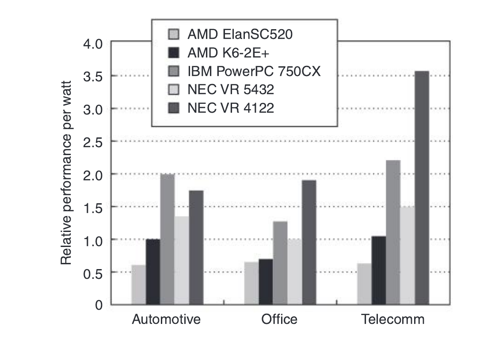
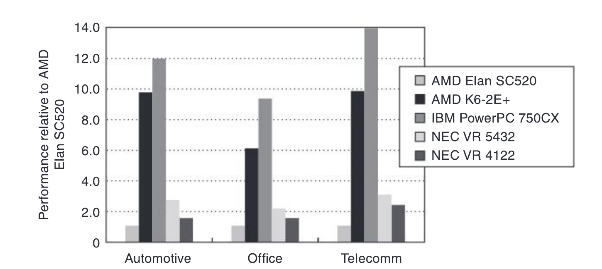
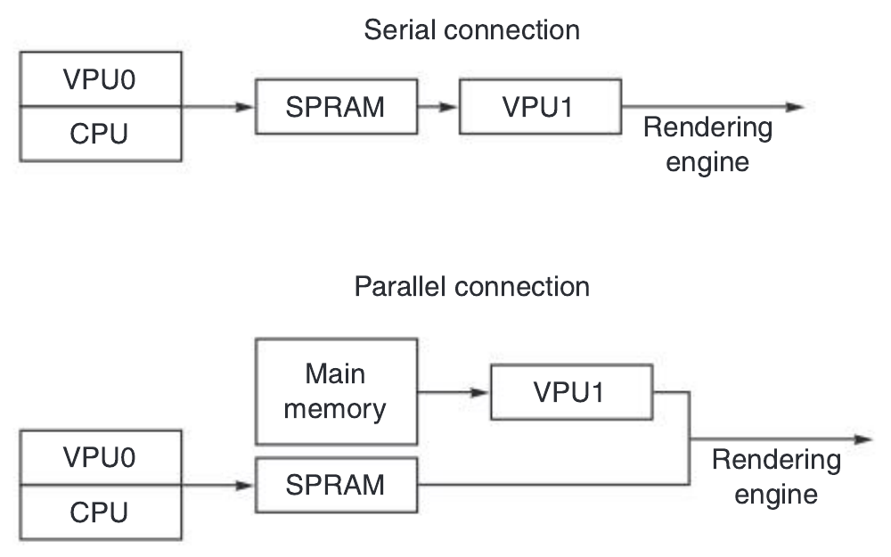

大多数图形多媒体应用使用 32 位浮点运算。有些计算机能把单精度浮点运算的峰值性能提高到原来的 2 倍：一条指令同时启动两个 32 位运算，两个操作数并排存放在同一个双精度寄存器中。寄存器的两部分必须相互隔离，以免一半的运算影响另一半。这样的浮点运算称为*成对单精度运算*（paired single operation），例如可用于图形中的顶点变换。性能翻倍通常要靠把浮点部件的数目增加一倍，因此代价比仅在整数加法器中阻断进位要高。

[图 E.7](#fig-e-7) 汇总了近期几种计算机中的 SIMD 多媒体指令。

[图 E.7　桌面处理器的多媒体支持汇总。可以看出，各种体系结构的支持差别很大，五种体系结构之间很少有共同之处。所有运算都是定宽运算，在 64 位或 128 位 ALU 上同时完成多个窄运算。B 表示字节（8 位），H 表示半字（16 位），W 表示字（32 位），因此 8B 表示一条指令对 8 个字节进行运算。注意，AltiVec 假定 ALU 为 128 位，其余假定为 64 位。打包和解包用 2\*2W 这样的记法，表示 2 个操作数、每个操作数含 2 个字。这张表是对完整多媒体体系结构的简化，省略了许多细节。例如，HP MAX2 有一条求平均值的指令，SPARC VIS 有把寄存器置为常数的指令。此外，表中也没有包括 AltiVec、MAX 和 VIS 的存储器对齐操作。]{#fig-e-7 .caption}

| 指令类别 | Alpha MAX | HP PA-RISC MAX2 | Intel Pentium MMX | PowerPC AltiVec | SPARC VIS |
|---|---|---|---|---|---|
| 加/减 | | 4H | 8B, 4H, 2W | 16B, 8H, 4W | 4H, 2W |
| 饱和加/减 | | 4H | 8B, 4H | 16B, 8H, 4W | |
| 乘 | | | 4H | 16B, 8H | |
| 比较 | 8B (>=) | | 8B, 4H, 2W (=, >) | 16B, 8H, 4W (=, >, >=, <, <=) | 4H, 2W (=, ≠, >, <=) |
| 右移/左移 | | 4H | 4H, 2W | 16B, 8H, 4W | |
| 算术右移 | | 4H | | 16B, 8H, 4W | |
| 乘加 | | | | 8H | |
| 移位并加（饱和） | | 4H | | | |
| AND/OR/XOR | 8B, 4H, 2W | 8B, 4H, 2W | 8B, 4H, 2W | 16B, 8H, 4W | 8B, 4H, 2W |
| 差的绝对值 | 8B | | | 16B, 8H, 4W | 8B |
| 最大值/最小值 | 8B, 4W | | | 16B, 8H, 4W | |
| 打包（2*n* 位 → *n* 位） | 2W → 2B, 4H → 4B | 2\*4H → 8B | 4H → 4B, 2W → 2H | 4W → 4B, 8H → 8B | 2W → 2H, 2W → 2B, 4H → 4B |
| 解包/合并 | 2B → 2W, 4B → 4H | | 2B → 2W, 4B → 4H | 4B → 4W, 8B → 8H | 4B → 4H, 2\*4B → 8B |
| 置换/混洗 | | 4H | | 16B, 8H, 4W | |

DSP 也提供[图 E.7](#fig-e-7) 前三行中的运算，只是语义稍有不同。首先，DSP 常用于实时应用，不能选择在算术溢出时引发异常（否则可能错过某个事件），因此不论输入是什么，运算结果都照常使用。为了适应这种毫无回旋余地的环境，DSP 体系结构采用*饱和运算*：结果太大、无法表示时，就按结果的符号把它置为可以表示的最大数。相比之下，二进制补码运算可以把一个小正数加到一个大正数上。

## 嵌入式基准测试程序 {#sec-e-3}

就在几年前，嵌入式市场上还有许多厂商拿 Dhrystone 的性能做宣传，而桌面系统早在 20 多年前就因这个基准测试程序饱受批评而把它弃用了！前面说过，嵌入式应用种类极多，性能要求也各不相同（硬实时、软实时、总体性价比），因此只用一套基准测试程序并不现实。实际上，许多嵌入式系统设计者会自己编写反映本身应用的基准测试程序，形式可以是核心程序（kernel），也可以是整个应用的独立版本。

有些嵌入式应用的性能可以用核心程序很好地刻画。对这类应用来说，最好的标准化基准测试程序集似乎是新出现的一套：EDN 嵌入式微处理器基准测试联盟（EDN Embedded Microprocessor Benchmark Consortium，简称 EEMBC，读作「embassy」）的基准测试程序。EEMBC 基准测试程序分为六类（EEMBC 称之为「分委员会」）：汽车/工业、消费电子、电信、数字娱乐、网络（目前是第 2 版）和办公自动化（这个分委员会也是第 2 版）。[图 E.8](#fig-e-8) 列出了这六类应用，共 50 个基准测试程序。

许多嵌入式应用对小型核心程序的性能很敏感，但要记住，整个应用（可能有几千行）的总体性能往往同样关键。因此对许多嵌入式系统来说，EEMBC 基准测试程序只能部分地评估性能。

### 以功耗和效率为衡量指标 {-}

在嵌入式市场上，成本和功耗往往至少和性能同样重要。嵌入式系统中，除了处理器模块（包括所需的接口芯片），存储器往往是成本第二高的部分。与桌面系统和服务器不同，大多数嵌入式系统没有二级存储，整个应用必须驻留在 FLASH 或 DRAM 中。PDA、手机等许多嵌入式系统既受成本限制，又受物理尺寸限制，因此应用需要多少存储器至关重要。同样，功耗往往是选择处理器的决定性因素，电池供电的系统尤其如此。

[图 E.8　EEMBC 基准测试程序集，共 50 个核心程序，分为六类。有关这些基准测试程序和成绩的更多信息，见 www.eembc.org。]{#fig-e-8 .caption}

| 基准测试程序类型（「分委员会」） | 核心程序数 | 基准测试程序举例 |
|---|---|---|
| 汽车/工业 | 16 | 6 个微基准测试程序（算术运算、指针追踪、存储器性能、矩阵运算、查表、位操作），5 个汽车控制基准测试程序，5 个滤波或 FFT 基准测试程序 |
| 消费电子 | 5 | 5 个多媒体基准测试程序（JPEG 压缩/解压缩、滤波、RGB 转换） |
| 电信 | 5 | 滤波和 DSP 基准测试程序（自相关、FFT、解码器、编码器） |
| 数字娱乐 | 12 | MP3 解码，MPEG-2 和 MPEG-4 编码和解码（各用于 5 个不同的数据集），MPEG 浮点编码，4 个针对常用加密标准和算法的基准测试程序（AES、DES、RSA，以及用于数据解压缩的 Huffman 解码），增强型 JPEG 和色彩空间转换测试 |
| 网络第 2 版 | 6 | IP 包检查（取自 RFC1812 标准）、IP 重组、IP 网络地址转换（NAT）、路由查找、OSPF、服务质量（QOS）、TCP |
| 办公自动化第 2 版 | 6 | Ghostscript、文本解析、图像旋转、抖动、Bézier 曲线 |

EEMBC EnergyBench 给出处理器运行 EEMBC 性能基准测试程序时消耗的能量。经 EEMBC 认证的 Energymark 成绩是一项可选指标：设备制造商在提供经认证的设备性能成绩时，可以选择一并提供，用来表明处理器使用功率和能量的效率。EEMBC 统一采用 National Instruments 公司的 LabVIEW 图形化开发环境和数据采集硬件来实现 EnergyBench。

[图 E.9](#fig-e-9) 给出了按典型工作功耗计算的相对每瓦性能，[图 E.10](#fig-e-10) 给出的是原始性能，两相比较可以发现结果大不相同。NEC VR 4122 的每瓦性能明显领先，原始性能却是倒数第二！从功耗的角度看，专为电池供电系统设计的 NEC VR 4122 是大赢家。IBM PowerPC 能高效地利用功率获得高性能，但典型功耗达 6 W，恐怕不适合大多数电池供电设备。

{#fig-e-9 width=70%}

{#fig-e-10 width=80%}

## 嵌入式多处理器 {#sec-e-4}

多处理器在服务器环境中已经很常见，Sun、Compaq、苹果等厂商也推出了几种桌面多处理器。嵌入式领域也有一些专用设计采用了定制的多处理器，索尼 PlayStation 2 就是其中之一（见 [E.5 节](#sec-e-5)）。

许多专用嵌入式设计由一个通用可编程处理器或 DSP，加上若干用于流式 I/O 的专用有限状态机构成。从计算机图形、媒体处理到电信，越来越多的应用采用这种专用多处理器。这类设计中处理器之间的交互非常规整，也比较简单，主要就是一条简单的通信信道。但设计的很大一部分要固化到硅片上，因此保证输入/输出处理器与通用处理器之间的通信协议正确无误，是这类设计的一大难题。

最近，我们看到嵌入式领域首次出现了由几个通用处理器构成的嵌入式多处理器。这些多处理器主要面向高端电信和网络市场，这个市场对可扩展性的要求至关重要。empowerTel Networks 公司为 IP 语音（voice-over-IP）系统设计的 MXP 处理器就是一例，它由四个主要部分组成：

* 串行语音流接口，支持抖动处理；
* 对快速包路由和信道查找的支持；
* 完整的以太网接口，包括 MAC 层；
* 4 个 MIPS32 R4000 级的处理器，每个处理器有自己的 Cache（共 48 KB，即每个处理器 12 KB）。

MIPS 处理器运行维护 IP 语音信道的代码，包括保证服务质量、回声消除、简单压缩和包编码。设计目标是同时运行尽可能多的独立语音流，所以多处理器是理想的方案。MIPS 核很小，因此整个芯片只用了 1350 万个晶体管。下一代芯片预计能处理更多语音信道，还能完成更复杂的回声消除、话音活动检测和更复杂的压缩。

多处理器在嵌入式计算领域日益普及，主要原因有两个。一是困扰桌面系统和服务器的二进制软件兼容问题，在嵌入式领域关系不大：嵌入式应用的软件往往是为某个应用从头编写的，或者经过了大幅修改（这也是嵌入式领域利用指令级并行时偏爱 VLIW 而不是超标量的原因）。二是这些应用往往具有天然的并行性，在嵌入式领域的高端尤其如此，机顶盒、网络交换机、手机（见 [E.7 节](#sec-e-7)）、游戏机（见 [E.5 节](#sec-e-5)）中这样的例子比比皆是。一方面，使用线程级并行的门槛较低；另一方面，嵌入式领域对晶片成本（因而对硅片的高效利用）更加敏感。随着应用对性能的要求越来越高，这两方面共同推动多处理器在嵌入式领域得到广泛采用。

## 案例研究：索尼 PlayStation 2 的 Emotion Engine {#sec-e-5}

桌面计算机和服务器依靠存储层次来缩短访问相对静态数据的平均时间。但有些嵌入式应用的数据常常是连续不断的数据流，这类应用中仍有空间局部性，时间局部性却有限得多。

为了跳出桌面系统、从另一个角度考察存储器性能，本节分析索尼 PlayStation 2 的核心微处理器。电子游戏需要源源不断的图形和音频数据，于是存储器设计采取了不同的思路：用许多专用的独立存储器提供高带宽。

[图 E.11](#fig-e-11) 是索尼 PlayStation 2（PS2）的框图。作为游戏机，它有视频、声音和 DVD 播放器的接口，这在意料之中。出人意料的是，它还有两种标准的计算机 I/O 总线（USB 和 IEEE 1394）、一个便携式 PC 上常见的 PCMCIA 插槽，以及一个调制解调器。这些附加部分说明，索尼对 PS2 的规划不止于传统游戏。I/O 处理器（IOP）看上去只管理 I/O 设备和游戏机，实际上它包含一个 34 MHz 的 MIPS 处理器，这个处理器还兼作仿真计算机，用来运行索尼前几代 PlayStation 的游戏。IOP 还连接一块标准的 PC 声卡，为游戏提供声音。

）。向量部件 0 主要是 CPU 的一个类似 DSP 的协处理器（见 [E.2 节](#sec-e-2)），能以 SIMD 方式对 128 位寄存器进行运算，每个字 8 位到 32 位。它有 4 KB 的指令存储器和 4 KB 的数据存储器。向量部件 1 的功能与 VPU0 相似，但它通常独立于 CPU 工作，有 16 KB 的指令存储器和 16 KB 的数据存储器。三个部件都可以通过 128 位系统总线通信，另外 CPU 与 VPU0 之间、VPU1 与图形接口之间还各有一条 128 位的专用通路。VPU0 和 VPU1 的微结构完全相同，但存储器容量不同，直接相连的部件也不同，因此它们在游戏中承担的角色不同。Emotion Engine 芯片采用 0.25 微米线宽，有 1350 万个晶体管，面积为 225 mm^2^；Graphics Synthesizer 的面积为 279 mm^2^。作为对比，0.25 微米工艺的 Alpha 21264 微处理器面积约为 160 mm^2^，有 1500 万个晶体管。（本图根据《Microprocessor Report》13:5 上「Sony's Emotionally Charged Chip」一文的图 1 绘制。）图内标注：300 MHz Superscalar CPU Core w/128-bit SIMD，带 128 位 SIMD 的 300 MHz 超标量 CPU 核；Vector Unit 0 (VPU~0~)、Vector Unit 1 (VPU~1~)，向量部件 0（VPU~0~）、向量部件 1（VPU~1~）；Graphics I/F，图形接口；128-bit/150-MHz bus，128 位/150 MHz 总线；Memory control，存储控制；10-channel DMA，10 通道 DMA；IPU (MPEG decoder)，IPU（MPEG 解码器）；I/O I/F，I/O 接口；64-bit 150 MHz，64 位、150 MHz；16 parallel pixel processors (150 MHz)，16 个并行像素处理器（150 MHz）；Video memory (4 MB multiported embedded DRAM)，视频存储器（4 MB 多端口嵌入式 DRAM）；1024-bit、512，1024 位、512 位；NTSC, PAL, DTV, VESA，视频输出制式；400 MHz、16-bit，400 MHz、16 位；Main memory 32 MB DRDRAM，主存 32 MB DRDRAM；32-bit、37.5 MHz，32 位、37.5 MHz；I/O processor，I/O 处理器；34 MHz MIPS CPU (PlayStation compatible)，34 MHz MIPS CPU（兼容 PlayStation）；I/O circuits，I/O 电路；48-channel sound chip，48 通道声音芯片；Local bus，局部总线；Modem，调制解调器。](images/appe/fig-e-11.png){#fig-e-11 width=90%}

因此，这个嵌入式应用的存储系统面临的一个难题，是要为大量 I/O 设备充当数据源或数据目的地。PS2 的设计者采用两片 PC800（400 MHz）DRDRAM 芯片、两个通道来解决这个难题，提供 32 MB 的存储容量和 3.2 GB/s 的峰值存储带宽。

图中剩下的基本上是两块大芯片：Graphics Synthesizer 和 Emotion Engine。

Graphics Synthesizer 从 Emotion Engine 接收渲染命令，这些命令通常称为*显示列表*。显示列表由一串 32 位命令组成，告诉渲染器用什么形状、放在哪里，以及用什么颜色和纹理填充。

存储系统中带宽最高的部分也在这块芯片上。Graphics Synthesizer 采用嵌入式 DRAM，把完整的视频缓冲放在芯片内，接口宽 2048 位，因此像素填充不会成为瓶颈。嵌入式 DRAM 大大降低了对 DRDRAM 的带宽需求。这是嵌入式应用中的一种常用技术：为各项功能配置专用的独立存储器，以较低的成本提高整个系统的存储带宽。

剩下的另一块大芯片是 Emotion Engine。它接收来自 IOP 的输入，生成电子游戏的显示列表，使三维视频变换能够实时完成。Emotion Engine 的设计源于一个重要的观察：一般来说，在赛车游戏中，前景物体不断变化，背景物体随事件变化较少，尽管背景可能占据屏幕的大部分。设计者据此对任务做了划分。

CPU 与 VPU0 配合工作，VPU0 是 CPU 的紧耦合协处理器：每条 VPU0 指令都是标准的 MIPS 协处理器指令，地址由 MIPS CPU 生成。VPU0 虽然称为向量处理器，但与几种桌面处理器中面向多媒体的 128 位 SIMD 扩展相似（见 [E.2 节](#sec-e-2)）。

VPU1 则不同，它自己取指令和数据，与 CPU/VPU0 并行工作，更像传统的向量部件。这样划分之后，更灵活的 CPU/VPU0 负责前景动作，VPU1 负责背景。两者都把生成的显示列表放入图形接口，再由图形接口送往 Graphics Synthesizer。

因此，Emotion Engine 的程序员编写程序时有三组处理器可选：一是包括浮点部件在内的传统 64 位 MIPS 体系结构，二是扩展了多媒体指令的 MIPS 体系结构（VPU0），三是独立的向量处理器（VPU1）。此外还有一个协处理器（图像处理部件，Image Processing Unit）用来加速 MPEG 解码，它可以独立于另外两者工作。

功能这样划分之后，问题就变成：部件之间如何连接，数据如何在部件之间流动，如何为所有这些部件提供所需的存储带宽。前面说过，Emotion Engine 的设计者选择了许多专用存储器。CPU 除了 16 KB 的指令 Cache 和 8 KB 的数据 Cache，还有 16 KB 的便笺存储器（SPRAM）。VPU0 有 4 KB 的指令存储器和 4 KB 的数据存储器，VPU1 有 16 KB 的指令存储器和 16 KB 的数据存储器。注意，这 4 个是*存储器*，而不是别处某个更大存储器的 Cache。每个存储器的延迟都只有 1 个时钟周期。VPU1 的存储器比 VPU0 多，一是因为大部分显示列表由它生成，二是因为它基本上独立工作。

程序员把所有存储器组织成两组双缓冲：一对用于输入的 DMA 数据，一对用于输出的 DMA 数据。然后，程序员用各个处理器把数据从输入缓冲变换到输出缓冲。为了让数据在各部件之间持续流动，程序员接着设置 10 个 DMA 通道，并注意满足实时时限，保证逼真的动画达到每秒 15 帧。

[图 E.12](#fig-e-12) 表明，这种组织方式支持两种主要的工作模式。一种是串行模式：CPU/VPU0 充当预处理器，决定交给 VPU1 哪些数据，再由 VPU1 为图形接口生成显示列表，便笺存储器用作缓冲。另一种是并行模式：CPU/VPU0 和 VPU1 都生成显示列表。显示列表和 Graphics Synthesizer 都有多个上下文标识符，用来区分并行的显示列表，从而生成一幅连贯的最终图像。

Emotion Engine 的所有部件都连在一条共用的 150 MHz、128 位宽的总线上。为了提供更高的带宽，另有两条专用总线：一条是 CPU 与 VPU0 之间的 128 位通路，另一条是 VPU1 与图形接口之间的 128 位通路。程序员设置 DMA 通道时，还要选定使用哪条总线。

{#fig-e-12 width=60%}

从全局看，如果把这个问题交给面向服务器的设计者，我们可能会看到一条共用总线，配上许多局部 Cache，再用 Cache 一致性机制保持数据一致。PlayStation 2 则沿袭了嵌入式设计者的传统，至少有 9 个各自独立的存储模块。为了让数据实时地从存储器流向显示器，PS2 采用了专用存储器、专用总线和 DMA 通道。一致性由程序员负责。数据从主存连续不断地流向图形接口，又有实时要求，因此对这个应用来说，由程序员控制一致性效果很好。

## 案例研究：三洋 VPC-SX500 数码相机 {#sec-e-6}

数码相机是另一种大家非常熟悉的嵌入式系统，这里以三洋 VPC-SX500 为例。相机通电后，微处理器先诊断所有部件，并把错误信息显示在相机背面的液晶显示器（LCD）上。这款相机使用 1.8 英寸的低温多晶硅薄膜晶体管（TFT）彩色 LCD。拍照时，摄影者先把快门按下一半，让微处理器测光。随后微处理器让快门保持打开，以获得所需的光线；电荷耦合器件（CCD）把光线捕获为红、绿、蓝像素。这款相机的 CCD 是一块 1/2 英寸、1360 × 1024 像素的逐行扫描芯片。像素逐行扫描输出，经过白平衡、色彩和抗混叠校正等例程处理后，存入 4 MB 的帧缓冲。下一步是把图像压缩成 JPEG 之类的标准格式，存入可移动的 Flash 存储器。压缩方式由摄影者选择，这款相机分为「精细」和「普通」两种，压缩比为 10～20 倍。一块 512 MB 的 Flash 存储器至少能存 1200 幅精细质量的压缩图像，或大约 2000 幅普通质量的压缩图像。最后，微处理器更新 LCD 显示，表明还能拍摄的照片数少了一张。

上面只讲了数码相机的基本功能，实际上它还有许多其他功能：在彩色 LCD 上显示已拍摄的图像；用睡眠模式延长电池使用时间；监视电池电量；缓冲图像，以便快速连续记录未压缩的图像；这款相机还能用 MPEG 格式录像，用 WAV 格式录音。

这款相机的「电子大脑」是一台嵌入式计算机，芯片上集成了几项专用功能 [Okada et al. 1999]。[图 E.13](#fig-e-13) 是一款与这台相机中芯片相似的芯片的框图。[E.1 节](#sec-e-1)说过，这样的芯片称为片上系统（SOC），因为它基本上把过去一块小印制电路板上的全部部件都集成到了一块芯片上。与集成度较低的方案相比，SOC 一般能缩小尺寸、降低功耗。三洋声称，采用这种 SOC 后，相机所需的电池数只有竞争对手相机的一半，外形也更小巧。为了提高性能，这块芯片设有两条总线。16 位总线连接许多较慢的 I/O 设备：SmartMedia 接口、程序和数据存储器，以及 DMA。32 位总线连接 SDRAM、信号处理器（与 CCD 相连）、Motion JPEG 编码器和 NTSC/PAL 编码器（与 LCD 相连）。注意，与桌面微处理器不同，这块芯片必须集成种类繁多的 I/O 总线。32 位 RISC MPU 是专有设计，工作频率为 28.8 MHz，与总线的时钟频率相同。这块芯片功耗 700 mW，晶片尺寸为 10.5 mm × 10.5 mm，集成了 180 万个晶体管，采用 0.35 微米工艺制造。

![图 E.13　三洋数码相机中的片上系统（SOC）。这张框图取自 Okada et al. [1999]，是正文所述相机中 SOC 的前一代产品。后一代 SOC 称为 *Super Advanced IC*，用三条总线代替两条，工作频率为 60 MHz，功耗 800 mW，在 10.2 mm × 10.2 mm 的晶片上集成了 310 万个晶体管，采用 0.35 微米工艺。注意，这个嵌入式系统的晶体管数是 1990 年最先进的高性能微处理器的 2 倍！图中的 SOC 最多只能处理 1024 × 768 像素，而它的后继产品支持 1360 × 1024 像素。图内标注：10 bits、16 bits、32 bits，10 位、16 位、32 位；Signal processor，信号处理器；SDRAM controller，SDRAM 控制器；2-channel video D/A，2 通道视频 D/A；NTSC/PAL encoder，NTSC/PAL 编码器；Signal bus，信号总线；Bus bridge，总线桥；SSFDC controller，SSFDC 控制器；Flash (program)，Flash（程序）；DRAM controller，DRAM 控制器；PCMCIA controller，PCMCIA 控制器；DMA controller，DMA 控制器；CPU bus，CPU 总线；Audio D/A, A/D，音频 D/A、A/D；MIC，麦克风；Speaker，扬声器；IrDA port，IrDA 端口；PCMCIA card，PCMCIA 卡；Others，其他。](images/appe/fig-e-13.png){#fig-e-13 width=90%}

## 案例研究：手机内部 {#sec-e-7}

游戏机和数码相机都是大家熟悉的嵌入式系统，但今天人们最熟悉的嵌入式系统是手机。1999 年，美国有 7600 万蜂窝电话用户，比前一年增长 25%。全世界的增长率接近每年 35%，因为发展中国家发现，建设蜂窝基站比铺设铜线基础设施便宜得多。因此在许多国家，在用手机的数量已经超过了在用有线电话的数量。
