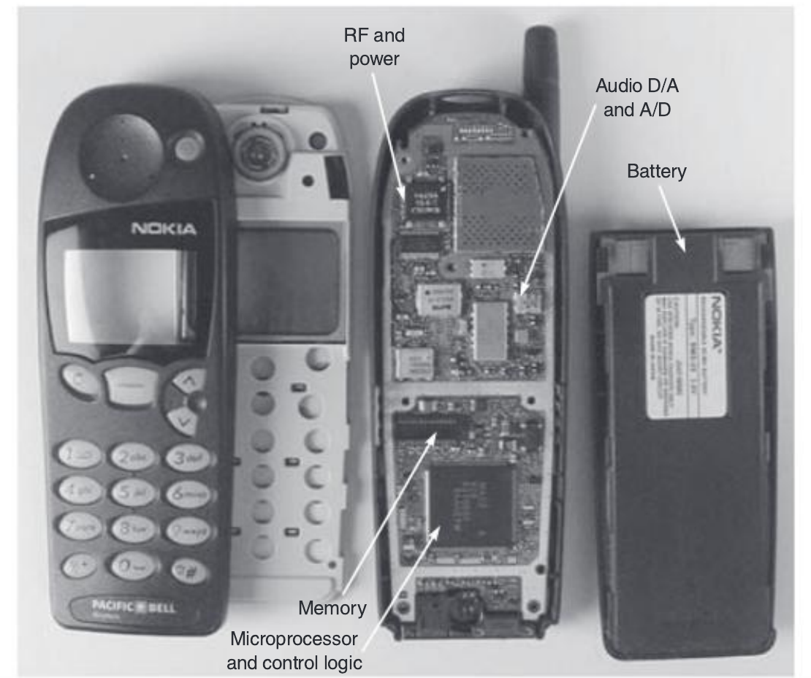

手机市场每年增长 35%，这并不奇怪。1999 年，全世界售出约 2.8 亿部手机，而同一年个人计算机的销量是 1.2 亿台。因此，可以投入手机改进的工程资源非常多；按每立方英寸的工程创新来算，手机很可能居于领先地位 [Grice and Kanellos 2000]。

剖析手机的构造之前，我们先简单介绍无线技术。

### 无线网络的背景知识 {-}

网络既可以用铜线和光纤搭建，也可以「凭空」搭建，后者就是无线网络。本节内容大多取自美国国家研究委员会（National Research Council）的一份报告 [1997]。

*无线电波*是由天线发射、传播的电磁波。无线电波要经过*调制*：把声音信号叠加到较强的无线电波上，由这个无线电波承载声音信号，因此它称为*载波信号*。每种无线电波都有特定的波长或频率，波长指一个完整波的长度，频率指每秒的波数。长波频率低，短波频率高。调频（FM）广播电台在 88 MHz 到 108 MHz 的频段上发射，用频率调制来记录声音信号。

无线电接收机调谐到不同的频率，就能收到特定的信号。除 AM 和 FM 广播外，还有一些频率留给民用波段电台、电视、寻呼机、空中交通管制雷达、全球定位系统等使用。在美国，哪些频率由谁使用、用于什么目的，由联邦通信委员会（Federal Communications Commission）决定。

无线链路的*误码率*（BER）取决于四个因素：接收到的信号功率，接收机硬件干扰造成的噪声，来自其他信号源的干扰，以及信道特性。噪声通常与射频带宽成正比。衡量无线链路的一个关键指标，是达到给定 BER 所需的*信噪比*（SNR）。[图 E.14](#fig-e-14) 列出了无线通信面临的更多挑战。

[图 E.14　无线通信面临的挑战]{#fig-e-14 .caption}

| 挑战 | 说明 | 影响 |
|---|---|---|
| 路径损耗 | 接收功率除以发射功率；无线电必须克服干扰噪声，保证足够的信噪比（SNR）。距离超过 100 米时，路径损耗随距离呈指数增长，并取决于干扰情况 | 发射功率 1 W、发射频率 1 GHz、数据率 1 Mbit/s、BER 为 10^−7^ 时，无线电之间的距离在自由空间中可达 728 米，在茂密的丛林中只有 4 米 |
| 阴影衰落 | 接收信号被物体遮挡，室外是建筑物，室内是墙壁；需要提高功率来改善接收 SNR。阴影衰落取决于物体的数量及其介电特性 | 如果发射机在移动，就需要调整发射功率，保证该区域内的接收 SNR |
| 多径衰落 | 信号的多个副本在不同时刻到达，相互干扰；干扰程度取决于最快信号与最慢信号的时间差相对于信号带宽的大小 | 发射频率为 900 MHz 时，信号功率每隔 30 cm 就会变化 |
| 干扰 | 频率复用、相邻信道、窄带干扰 | 需要滤波器和扩频技术 |

选择无线通信，通常是因为通信设备在移动，或者布线不方便。因此，无线网络必须能够动态地重新组织，而这种重组让路由更加困难。第二个挑战是无线信号不受保护，彼此会相互干扰，设备移动时尤其如此。功耗也是一个挑战：一方面，设备往往靠电池供电；另一方面，天线靠辐射功率来通信，辐射出去的功率只有很少一部分能到达接收方。结果，无线链路的原始误码率通常是铜线的一千倍到一百万倍。

无线网络主要有两种体系结构：*基站*结构和*点对点*结构。在基站结构中，基站之间用有线线路连接，承担较长距离的通信，每台移动设备只与本地的一个基站通信。在点对点结构中，移动设备之间可以直接通信，消息从一台设备跳到下一台设备，直到送达目的设备。点对点结构更容易重新配置；基站结构往往更可靠，因为设备和基站之间只有一跳。最常见的无线网络是*蜂窝电话*，它采用的就是带基站的无线电通信。

路径损耗随距离呈指数增长。蜂窝系统利用这一特点，在空间上相隔足够远的地方复用同一频率，从而大大增加可服务的用户数。具体做法是把一座城市划分成互不重叠的六边形*蜂窝*（cell，即小区），相邻的蜂窝使用不同的频率；只有两个蜂窝相距足够远、相互干扰可以接受时，才复用同一频率。

每三个六边形蜂窝的交点处设有一个基站，配有发射机和天线。基站连接到交换局，交换局负责两件事：一是在移动设备从一个蜂窝进入另一个蜂窝时协调*越区切换*，二是通过有线线路接通呼入和呼出的电话。典型蜂窝的半径为 2 到 10 英里，具体取决于地形、人口等因素。

### 手机 {-}

手机的核心是无线电收发机，[图 E.15](#fig-e-15) 给出了它的组成部分。无线电信号先由天线接收，经过放大，通过混频器，再经过滤波和解调，最后解码。天线是无线电波的传播介质与发射机或接收机电子电路之间的接口。天线可以设计成在某些特定方向上工作得最好，于是发射和接收都带有方向性。调制把信息编码到信号的幅度、相位或频率中，让信号在恶劣条件下更不容易出错。无线电发射机经过同样的步骤，只是顺序相反。

{#fig-e-15 width=90%}

最初，所有部件都是模拟的；后来大多数换成了数字部件，于是需要把无线电信号从模拟形式转换成数字形式。为了灵活支持不同数量的无线电频段，其中一部分功能改由可编程芯片（如数字信号处理器）上的软件程序完成。这类处理器通常用在移动设备中，因此设计时看重三项指标：每焦耳的性能，用来延长电池寿命；每平方毫米硅片的性能，用来减小尺寸、降低成本；每个任务所需的字节数，用来减小存储器容量。

[图 E.16](#fig-e-16) 是手机电子电路的通用框图，DSP 负责信号处理，微控制器负责其余任务。手机本质上是一台充当无线电的移动计算机。它带有标准的 I/O 设备，即键盘和 LCD 显示屏，另外还有麦克风、扬声器和用于无线联网的天线。电池效率影响手机的销量，一是等待来电时的待机功耗，二是可以通话的分钟数。

 中的信号处理步骤，微控制器负责用户界面、电池管理和呼叫建立。（根据 Groe and Larson [2000] 的图 1.3 绘制。）图内标注：Antenna，天线；RF receiver (Rx)，射频接收机（Rx）；RF transmitter (Tx)，射频发射机（Tx）；Micro-controller，微控制器；Speaker，扬声器；Microphone，麦克风；Display，显示屏；Keyboard，键盘。](images/appe/fig-e-16.png){#fig-e-16 width=80%}

手机开机后的第一项任务是寻找蜂窝：扫描整个频带，找出最强的信号。手机要能在行驶的车辆中使用，因此每隔 7 秒，或者信号强度下降时，都要重新扫描。接着，手机选取一个空闲的无线电信道。本地交换局为手机登记，记下它的电话号码和电子序列号，并为通话分配一个话音信道。为了确认手机用的是正确的信道，基站在这个信道上发出一个特殊的音调，手机再把它发回作为确认。手机如果 5 秒内没有听到这个监测音，就会超时，从头重来。信号强度减弱时，原来的基站向即将接手的基站发出越区切换请求。

要通过无线电双向通话，必须为每个方向各留出一个频段，两个频段组成一个频率对，称为*信道*。最初的蜂窝基站在 869.04～893.97 MHz 发射，称为*前向路径*；手机在 824.04～848.97 MHz 发射，称为*反向路径*。两者之间留有频率间隔，以免相互干扰。一个蜂窝可能有 4～80 个信道，分为两类：用于呼叫建立的建立信道，以及承载数据或话音业务的话音信道。

通信和调制解调器一样以数字方式进行，速率为 9600 位/秒。无线是一种有损介质，在行驶的车辆中尤其如此，因此手机把每条消息发送 5 遍。为了节省电池，最初的手机通常根据到蜂窝基站的距离，在两种信号强度中选一种发射：0.6 W 或 3.0 W。功率较低，电池就可以做得更小，手机也随之变小；同时还有助于频率复用，而频率复用正是蜂窝电话的关键。

[图 E.17](#fig-e-17) 是一部诺基亚数字手机的电路板，图中标出了各个部件。这块电路板上有两个处理器：一是 Z-80 微控制器，负责控制电路板的各项功能，处理键盘和显示屏的 I/O，并与基站协调；二是 DSP，负责全部信号的压缩和解压缩。此外还有若干专用芯片，分别负责模数转换和数模转换、放大、电源管理以及射频接口。

{#fig-e-17 width=70%}

2001 年，一部手机大约有 10 块集成电路，其中既有用砷化镓、锗硅等特殊工艺制造的器件，也有标准 CMOS 器件。出于成本考虑，也为了更加灵活，芯片数量后来减少到只有几块。不过，这些 SOC 中仍然有独立的微控制器和 DSP，前面介绍的许多功能都由它们上面运行的代码完成。

### 手机标准及其演进 {-}

为了提高手机的通信速率，人们制定了多种标准，*码分多址*（CDMA）就是常见的一种。最初的手机采用*高级移动电话服务*（AMPS），这基本上是一种模拟系统。与 AMPS 相比，CDMA 的一条路径占用更宽的射频频带。频带更宽，信号就更难被阻断，这种技术称为*扩频*。其他标准还有*时分多址*（TDMA）和*全球移动通信系统*（GSM）。CDMA、GSM 和 TDMA 都属于第二代标准，基本上都是数字的。

CDMA 最大的不同在于所有通话者共用同一个信道。这个信道的速率高得多，系统给每路通话分配一个唯一的编码，以此区分不同的通话。每路 CDMA 通话起初是 9600 位/秒，经过编码，再以 1.25 Mbit/s 的速率作为大小相等的消息发送出去。AMPS 把每个信号发送 5 遍；CDMA 则把每一位展宽，使它占用最小频率的 11 倍，这样既能容忍干扰，又能成功传输。基站收到这些消息后，把它们分离成每路通话各自的 9600 位/秒数据流。

为了增强保密性，CDMA 的伪随机序列取自一组 64 个预定义的编码。手机和基站必须同步，才能选出相同的伪随机种子，为此 CDMA 借助全球定位系统的时钟，全球定位系统持续发送精确的时间信号。编码经过精心选择，因此共享信道上的业务在收听者听来就像随机噪声。于是，共享一个信道的用户越多，噪声就越大，信噪比逐渐下降。所以，CDMA 系统的容量是一个「口味」问题，取决于收听者对背景噪声有多敏感。

此外，CDMA 还采用语音压缩，并根据通话的活跃程度改变数据传输速率。这两项技术都能节省带宽，从而让每个蜂窝容纳更多的通话。CDMA 必须仔细调节功率，使靠近基站铁塔的信号不至于压过远处的信号，目标是让所有信号到达铁塔时的强度大致相同。附带的好处是 CDMA 手机的发射功率较低，既有利于延长电池寿命，又能在用户靠近铁塔时提高容量。

因此，与 AMPS 相比，CDMA 能把系统容量最多提高一个数量级，通话质量更好，电池寿命更长，用户的保密性也更强。经过一番激烈的商业竞争，出现了新的第三代标准，即国际移动通信 2000（IMT-2000），它主要基于两种相互竞争的 CDMA 版本和一种 TDMA。有了这个标准，手机有可能在世界上任何地方都能使用。

## 结束语 {#sec-e-8}

嵌入式系统是一个非常宽泛的计算设备类别，本附录只介绍了它的一些方面。例如，TI 320C55 DSP 是一种比较「类 RISC」的处理器，专为嵌入式应用设计，功能调校得非常精细。另一个极端是 TI 320C64x，这是一种性能很高的 8 发射 VLIW 处理器，用于要求非常苛刻的任务。有些处理器只能靠电池供电，有些则可以奢侈地接入市电。这些处理器的共同点是：嵌入式应用都需要一定程度的信号处理。媒体扩展试图把 DSP 和一些更通用的处理能力结合起来，让这些处理器能够用于信号处理应用。我们考察了索尼 PlayStation 2、数码相机和手机等几个案例。PS2 完成精细的三维图形处理，手机则按复杂的通信标准对信号编码和解码，但两者的系统结构都与通用的桌面或服务器平台大不相同。一般来说，在通用应用中看来很实用的体系结构决策，比如多级 Cache、乱序超标量执行，在嵌入式应用中远没有那么可取，原因是芯片面积、成本、功耗和实时性的约束。这些系统提供的编程模型，要求程序员和编译器在提取并行性上承担更多的工作。
