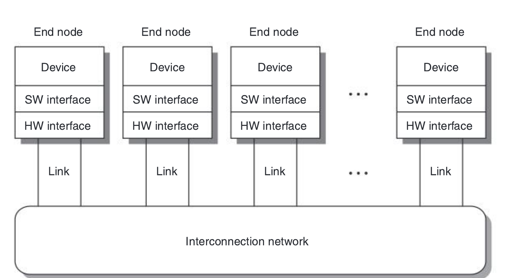
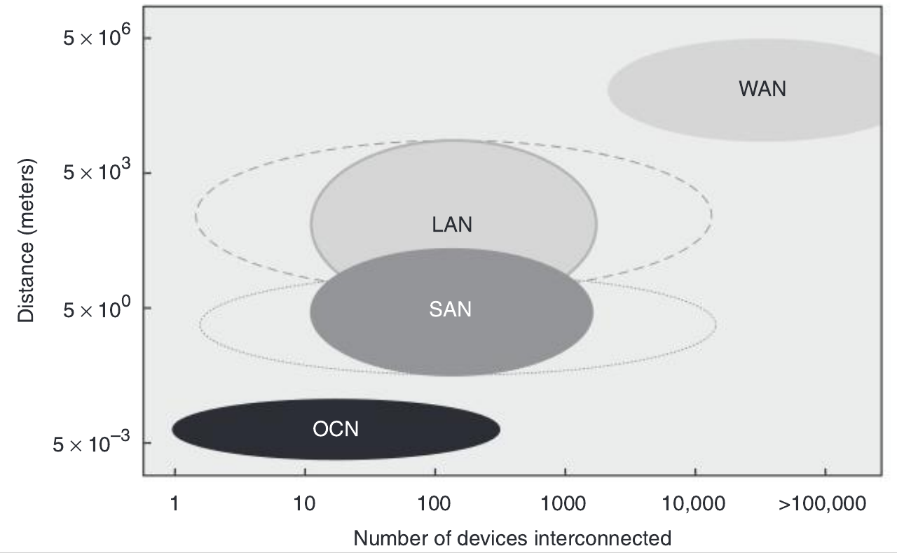
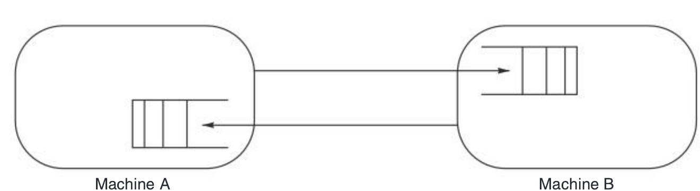
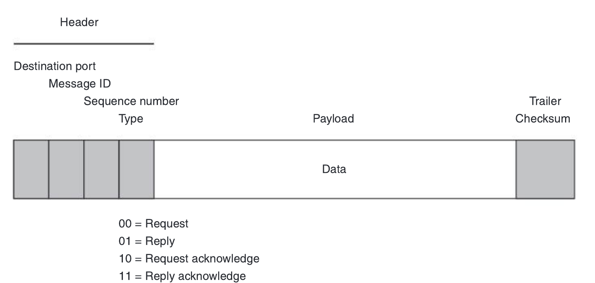

# 互连网络 {#app-f}

*修订：Timothy M. Pinkston（南加州大学）；José Duato（瓦伦西亚理工大学，Simula）*

> 「媒介即讯息」，因为正是媒介塑造并控制着人类交往和行动的范围与形式。
>
> ——Marshall McLuhan，《理解媒介》（*Understanding Media*，1964）

> 电影、广播和电视的奇迹，都是单向通信的奇迹，而单向通信根本算不上通信。
>
> ——Milton Mayer，《论通信的渺茫可能》（*On the Remote Possibility of Communication*，1967）

> 互连网络是并行体系结构的心脏。
>
> ——Chuan-Lin Wu 和 Tse-Yun Feng，《并行与分布式处理中的互连网络》（*Interconnection Networks for Parallel and Distributed Processing*，1984）

> 事实上，随着系统的复杂度和集成度不断提高，许多设计者发现，路由的对象应当是包，而不是导线，这样效率更高。
>
> ——Bill Dally，《互连网络原理与实践》（*Principles and Practices of Interconnection Networks*，2004）

## 引言 {#sec-f-1}

前面各章和各附录讲的是单台计算机的各个部件，很少讨论这些部件之间怎样互连，也很少讨论多个计算机系统之间怎样互连。近年来，计算机体系结构的这些方面变得越来越重要。本附录讨论怎样把一个个设备连接起来，组成一个相互通信的设备群体。这里的*设备*是泛称，可以是计算机内部的一个或一组部件，也可以是一台计算机，乃至一个计算机系统。[图 F.1](#fig-f-1) 画出了这个群体的组成：一是端节点，由设备及其硬件接口和软件接口组成；二是从端节点连到互连网络的链路；三是互连网络本身。互连网络也称为*网络*、*通信子网*或*通信子系统*。多个网络之间的互连称为*网络互连*（internetworking），它依靠通信标准把信息从一种网络转换到另一种网络，因特网就是一例。

计算机体系结构设计者应当重视互连网络，原因有以下几点。网络除了提供对外连接，还常用来在单台计算机内部的多个层次上连接各个部件，处理器微结构也不例外。大型机很早就使用网络；如今，为了提供更强的计算能力和更大的存储容量，对通信带宽的需求很高，个人计算机中也能见到这类设计。在计算机之间、I/O 设备之间、电路板之间、芯片之间，甚至芯片内部的模块之间，交换网络正在取代总线，成为常规的通信方式。计算机体系结构设计者必须了解互连的问题和解决办法，才能更有效地设计和评价计算机系统。

{#fig-f-1 width=90%}

互连网络覆盖的应用领域很宽，正如存储层次覆盖很宽的速度和容量范围。在处理器芯片和系统内部实现的网络，往往与处理器和存储器有许多共同特点：较多依靠高速硬件，较少依靠灵活的软件栈。跨系统实现的网络往往与存储和 I/O 有许多共同之处：较多依靠操作系统和软件协议，较少依靠高速硬件。不过，如今两类网络正在趋于融合。在各个领域中，性能都包括延迟和有效带宽两方面；评价性能时，除了模拟技术，排队论也是很有用的分析工具。

这个题目范围很广，[图 F.1](#fig-f-1) 中的一部分内容就足以写成整本书、开成整门大学课程。本附录的目标是为计算机体系结构设计者概述网络的问题和解决办法：对关键概念和思想作入门性的讲解，介绍互连网络的技术和方法对体系结构的影响，并给出可供深入阅读的参考文献。本附录还提供一个评价各类互连网络的统一框架，用同一套术语描述基本的设计选择。许多类型的网络有共同的首选方案，但另一些网络的最佳方案却大不相同；跨越不同的网络领域时，这些差别就表现得非常明显。

### 互连网络的领域 {-}

互连网络用在计算机系统内部和计算机系统之间的不同层次上，满足各应用领域的运行需求，如高性能计算、存储 I/O、集群/工作组/企业系统、网络互连等。按所连设备的数量和设备之间的距离，可以把互连网络分成四大网络领域：

* **片上网络（OCN）。** 这类网络也称为*片上网络*（network-on-chip，NoC），用于在芯片或多芯片模块内部连接微结构的功能部件、寄存器堆、Cache、计算 tile 以及处理器核和 IP 核。目前和近期的 OCN 可以连接几十到几百个这样的设备，最大互连距离在厘米量级。工艺尺寸不断缩小、晶体管集成度不断提高，跨芯片的导线延迟随之成为问题。为了缓解这一问题，高性能芯片中的 OCN 大多采用定制设计；不过也有一些专有设计正得到越来越广泛的应用，如 IBM 的 CoreConnect、ARM 的 AMBA 和 Sonic 的 Smart Interconnect。当前 OCN 的例子有：Intel Teraflops 处理器芯片［Hoskote07］中的 OCN，连接 80 个简单核；Intel 单芯片云计算机（SCCC）［Howard10］中的 OCN，连接 48 个 IA-32 体系结构的核；Tilera 的 TILE-Gx 系列处理器［TILE-GX］中的 OCN，2011 年第 4 季度采用 TSMC 的 40 nm 工艺连接 100 个处理核，计划 2013 年采用 TSMC 的 28 nm 工艺连接 200 个核（代号「Stratton」）。两款 Intel 原型芯片的网络峰值带宽都是 256 GBps，TILE-Gx100 处理器的网络峰值带宽最高可达 200 Tbps。OCN 的详细介绍见 Flich［2010］。
* **系统/存储区域网络（SAN）。** 这类网络用于多处理器和多计算机系统内部的处理器间互连和处理器–存储器互连，也用于在服务器和数据中心环境中连接存储部件和 I/O 部件。SAN 通常可以连接几百个这样的设备，不过有些超级计算机的 SAN 能连接成千上万个设备，如 IBM Blue Gene/L 超级计算机。SAN 的最大互连距离覆盖的范围相对较小，通常在几十米量级，但也有一些 SAN 的跨度达到几百米。例如，InfiniBand 是 2000 年年底推出的一种流行的 SAN 标准，用于系统互连和存储 I/O 互连，在 300 m 的距离上速率最高可达 120 Gbps。
* **局域网（LAN）。** 这类网络用于连接分布在一个机房、一栋楼或一个园区内的自治计算机系统，集群中 PC 的互连就是一个典型例子。LAN 最初最多只能连接一百个设备，借助网桥，现在可以连接多达几千个设备。LAN 的最大互连距离通常为几千米，但有些 LAN 的跨度达到几十千米。例如，以太网是最流行、生命力最长久的 LAN，它的 10 Gbps 标准版本可以在 40 km 的距离上保持最高性能。
* **广域网（WAN）。** 这类网络也称为*长途网络*，连接分布在全球各地的计算机系统，因此需要网络互连的支持。WAN 在数千千米的距离尺度上连接数以百万计的计算机。异步传输模式（ATM）就是一种 WAN。

[图 F.2](#fig-f-2) 按所连设备的数量和距离尺度，大致画出了这几个网络领域之间的关系。有些网络在一个或两个维度上相互重叠，于是产品之间形成竞争。有些网络方案已经成为商业标准，另一些则仍是专有方案。由于设计要求不同，各互连网络领域的首选方案可能差别很大，但各领域要解决的网络问题和解决问题所用的概念却非常相似。无论面向哪个领域，都不应让网络成为系统性能和成本效益的瓶颈。因此，计算机体系结构设计者的最终目标是：以尽可能低的成本设计出互连网络，让它在尽可能短的时间内传送尽可能多的信息。

{#fig-f-2 width=90%}

### 本附录的讲法和组织 {-}

理解互连网络的一个好办法是自顶向下，逐层揭示设计互连网络所涉及的概念和复杂性。我们先把网络看成一个不透明的「黑盒」，它以简单、理想的方式完成某些必要的功能；然后有步骤地逐层打开黑盒，让更复杂的概念和非理想的网络行为显露出来。

我们先讨论只连接两个设备的情形（[F.2 节](#sec-f-2)），这时黑盒网络可以看作简单的*专用链路*网络，也就是在两个设备之间双向布设的导线或导线组。接着讨论连接两个以上设备的情形（[F.3 节](#sec-f-3)），这时黑盒网络可以看作*共享链路*网络，或者看作连接各设备的*交换式点对点*网络。然后继续剥开黑盒的其他各层，更详细地讨论网络拓扑（[F.4 节](#sec-f-4)），路由、仲裁和交换（[F.5 节](#sec-f-5)），以及交换机微结构（[F.6 节](#sec-f-6)）。[F.7 节](#sec-f-7)讨论商用网络的实际问题，[F.8 节](#sec-f-8)用实例说明各类网络的权衡。[F.9 节](#sec-f-9)简要讨论网络互连，[F.10 节](#sec-f-10)介绍互连网络的其他交叉问题。[F.11 节](#sec-f-11)给出与互连网络有关的一些常见谬误和陷阱，[F.12 节](#sec-f-12)是结束语。最后，[F.13 节](#sec-f-13)简要回顾历史，并推荐一些阅读材料。

## 两个设备的互连 {#sec-f-2}

本节介绍理解两个联网设备之间如何通信所需的基本概念，其中包括两类情况的处理：一是接收方可能还没准备好处理发送方发来的数据，二是传输中可能出错。为了便于理解，这里先把黑盒网络设想成一个理想网络，它的行为就像两个设备之间的简单专用链路。[图 F.3](#fig-f-3) 画出了这种情形：单向导线从设备 A 连到设备 B，另有单向导线从 B 连到 A，每个端节点都有一个缓冲区存放数据。无论网络多复杂、是不是专用链路，每个端节点设备都有一条连到网络的连接，用来向网络注入信息、从网络接收信息。下面先介绍端节点为开始和完成通信必须完成的基本功能，再讨论网络介质以及网络为完成通信必须完成的基本功能，然后给出一个简单的性能模型，并用几个例子说明关键网络参数的影响。

{#fig-f-3 width=90%}

### 网络接口的功能：组装和处理消息 {-}

假设我们要让两个联网的设备互相读取对方存储器中的一个字。发送或接收的信息单位称为*消息*。为了取得所需的数据，两个设备首先都要组装并发送一种*请求*消息，其中包含所需数据在对方设备中的地址。接收方根据这个地址（即存储器位置或操作数位置）找到所请求的信息。处理完请求后，每个设备再组装并发送另一种消息，即包含数据的*应答*。地址和数据信息通常称为消息的*有效载荷*（payload）。

除了有效载荷，每条消息还带有一些控制位，网络靠它们投递消息，接收方靠它们处理消息。最典型的控制位有两类：一类区分不同类型的消息，如请求、应答、请求确认和应答确认；另一类让网络能把信息正确地送到目的地。这些附加的控制位按照相对于有效载荷的位置，编码在消息的*头部*和/或*尾部*。例如，[图 F.4](#fig-f-4) 给出了[图 F.3](#fig-f-3) 中简单专用链路网络的消息格式。这个例子的有效载荷只有一个字，但有些互连网络的消息可以包含几千个字。

消息在网络上传输之前要先组装好；同样，从网络收到消息后也要处理。这些功能以及下面介绍的其他功能，都由端节点上的*网络接口*（也称*通道适配器*）承担。网络接口用某种直接存储器访问（DMA）引擎和链路驱动器向网络发送消息、从网络接收消息，还可能用一些专用存储器或寄存器缓冲发出和收到的消息。网络接口硬件的形态取决于网络领域和网络的设计规格：可能就是通信设备本身，别无他物（如 OCN 和某些 SAN）；也可能是一块单独的卡，上面集成了若干嵌入式处理器、DMA 引擎和几千 MB 的 RAM（如许多 SAN 以及大多数 LAN 和 WAN）。

除了硬件，网络接口还可以包括完成所需操作的软件或固件。即使是[图 F.3](#fig-f-3) 这样简单的例子，也可能要调用消息传递软件，把请求和应答转换成带有相应头部的消息。这样，用户应用程序就不必操心消息的组装和处理，这些工作可以在较低层次上自动完成。应用程序通常与操作系统或运行时系统配合收发消息。每个设备上可能有许多进程同时运行、共享网络，操作系统不能让发给一个进程的消息被另一个进程收到。因此，消息传递软件必须有区分不同进程的保护机制。一种做法是扩展头部，加入一个发送进程和目标接收进程都知道的*端口*号。

{#fig-f-4 width=90%}

除了组装和处理消息，端节点还要完成其他一些功能，才能在通信设备之间建立通信。硬件支持可以减少工作量，但有些工作可以由软件完成。例如，大多数网络都规定了一次可以传送的最大信息量，即*最大传输单元*，以便合理确定网络缓冲区的大小。长于最大传输单元的消息要分成较小的单元在网络上传输，这些单元称为*包*（或*数据报*）。包到达目的端节点后，先重新装配成消息，再交给应用程序。在包头中加一个消息 ID 字段，就能把同一条消息的包与其他包区分开来。如果包乱序到达目的地，装配成消息时还要重新排序，为此包头中通常另设一个序号字段。

端节点在网络上开始和完成一次通信所遵循的一系列步骤，称为*通信协议*。发送和接收的步骤一般是对称的，只是次序相反。为了加快执行速度，通信协议由软件和硬件共同实现。例如，许多网络接口卡都有硬件定时器，并在硬件上支持以下工作：把消息拆分成包并重新装配、计算循环冗余校验（CRC）校验和、处理虚拟存储地址，等等。

有些网络接口带有额外的硬件，把协议处理工作从主机上卸载下来，如 LAN 和 WAN 中的 TCP 卸载引擎。但 SAN 这类互连网络要求低延迟，即使采用较轻量的通信协议（如消息传递接口 MPI），这样做可能也还不够。绕过操作系统（OS）可以进一步提高通信性能。实现 OS 旁路的办法是直接在网络接口的存储器中分配消息缓冲区，让应用程序直接读写这些缓冲区，从而避免额外的存储器到存储器复制。这类协议称为*零拷贝协议*或*用户级通信协议*。这种做法仍然可以提供保护：初始化时调用 OS 分配这些缓冲区，再由硬件阻止未经授权的访存。

一般来说，端节点设备通过网络发送一条消息，需要以下部分或全部步骤：

1. 应用程序执行一个系统调用，把要发送的数据复制到操作系统缓冲区或网络接口缓冲区中，（必要时）把消息分成若干个包，并为各个包组装头部和尾部。
2. 计算校验和，并把它放进包的头部或尾部。
3. 启动定时器，由网络接口硬件把包发送出去。

接收消息的步骤次序相反：

3. 网络接口硬件接收各个包，把它们放进自己的缓冲区或操作系统缓冲区。
2. 为每个包计算校验和。如果与发送方的校验和一致，接收方就向包的发送方回送一个确认；如果不一致，就删除这个包，并认为发送方会在相应的定时器超时后重发这个包。
1. 所有包都通过检验以后，系统把消息重新装配起来，把数据复制到用户地址空间，并通知相应的应用程序。

发送方还必须对包的确认作出反应：

* 发送方收到确认后，从缓冲区中释放相应包的副本。
* 如果发送方没有收到确认，而是等到了超时，就重发这个包，并重新启动定时器。

端节点上要实现协议来支持通信；同样，网络结构中的物理层、数据链路层和网络层也要使用协议。这几层主要负责包传输、流量控制、差错处理以及下面介绍的其他功能。

### 网络的基本结构和功能：介质与外形规格、包传输、流量控制和差错处理 {-}

包在源端准备好以后，由网络接口中的专用硬件注入网络。这些硬件包括一些收发器电路，用来驱动物理网络介质，介质可以是电的，也可以是光的。介质的类型和外形规格在很大程度上取决于互连距离，即要在多远的距离上维持一定的信号速率（如传输速度）。

* 芯片或多芯片模块上，距离在 1 cm 以内时，通常可以用中上层的铜金属层做互连，每根线的信号速率可达数 Gbps。
* 电路板、中板和背板上印制的十几层或更多层铜走线，可以在大约 1 m 的距离上达到 Gbps 级的差分对信号速率。
* 5E 类非屏蔽双绞铜线可以在 100 m 的距离上达到 0.25 Gbps 的传输速度。
* 同轴铜缆可以在千米级距离上提供 10 Mbps 的速率。

在这些导体线路上，通常可以牺牲距离来换取更高的传输速度，但只能换到一定程度。光介质则能在千米级距离上提供更高的传输速度：多模光纤可以在几千米的距离上支持 100 Mbps 的传输速率；更贵的单模光纤可以在数千米的距离上支持 Gbps 级的传输速度。波分复用能把光纤的带宽提高到原来的若干倍，倍数等于所用的波长数。

驱动网络链路的硬件中可能还有一些编码器，把信号编码成适合给定传输距离的非二进制格式。编码技术可以采用多电平、冗余、数据与控制的轮换（如 4b5b 编码），和/或保证单位时间内有最少次数的信号跳变，以便接收方恢复时钟。信号在接收端解码，包存入相应的缓冲区。这些操作都在网络的物理层完成，细节不在本附录的讨论范围之内，好在我们不必操心这些细节。从数据链路层及更高层次看，物理层可以看作一条很长的、不分级的线性流水线，信号以波的形式在网络传输介质中传播。以上这些功能一般统称为*包传输*。

除了包传输，网络硬件和软件还要在数据链路层和网络协议层共同保证包的可靠投递。这包括两项职责：一是防止发送方发包的速率超过接收方的处理速度；二是保证包在传输中既不损坏，也不丢失。第一项职责有两种办法：一种是接收方缓冲区满时丢弃收到的包，之后再通知发送方重发；另一种是缓冲区满时通知发送方停止发包，等缓冲区有空间容纳更多的包时再通知它恢复。后一种策略一般称为*流量控制*。

除了发送方和接收方之间的简单握手，实现流量控制还有几种常用的有趣技术，比较流行的是 Xon/Xoff（也称 Stop & Go）和*基于信用*（credit-based）的流量控制。

* **Xon/Xoff。** 缓冲区占用量达到高水位时，接收方通知发送方停止发包；降到低水位时，通知发送方恢复发包。两个水位之间留有一定的迟滞，以减少通知次数。通知以「停」（stop）和「行」（go）信号的形式发送，可以通过附加的控制线传送，也可以编码在控制包中。
* **基于信用的流量控制。** 通常在发送方设一个信用计数器，初值等于接收方的缓冲区数。发送方每发出一个包，就把信用计数器减 1。接收方每从缓冲区中取走一个包，就以控制包的形式向发送方送回一个信用；发送方收到信用后，把计数器加 1。

这些技术实质上都是在控制包流入网络：接收方达到低水位标志时，或者发送方的信用用完时，就抑制发送方注入包。

Xon/Xoff 产生的控制流量通常比基于信用的流量控制少得多，因为只在缓冲区占用量越过高水位或低水位时才发送通知。另一方面，基于信用的流量控制所需的缓冲区还不到 Xon/Xoff 的一半。Xon/Xoff 的缓冲区必须足够大，保证在「停」信号到达发送方之前不会溢出；基于信用的流量控制则不会溢出，因为发送方用完信用就会停止发送。无论哪种方案，只有缓冲区相对于通信距离足够大，才能充分利用链路带宽。

下面用一个简单的例子比较两种流量控制技术对缓冲区的需求，例子覆盖了各个互连网络领域。

**例题**　一个专用链路网络连接两个设备，每条链路每个方向的原始数据带宽为 8 Gbps。一个设备连续不断地向另一个设备发送 100 字节（含头部）的包，以充分利用网络带宽。如果只考虑链路传播延迟，互连距离分别为 1 cm、1 m、100 m 和 10 km 时，基于信用的流量控制至少需要多少信用和多少缓冲空间？与 Xon/Xoff 相比，这一最小缓冲空间如何？

**解答**　开始时，接收方缓冲区为空，发送方的信用数等于缓冲区容量。发送方每发出一个包就消耗一个信用。要让发送方以网络速度持续发包，第一个送回的信用必须在发送方用完信用之前到达。收到第一个信用之后，发送方收回信用的速率就与发包的速率相同。由于只考虑链路上的传播延迟，不考虑其他延迟或开销，因此假定发送方和接收方的处理时间为零。从发送方开始发送第一个包，到第一个信用回到发送方，所需时间等于往返传播延迟，即发往接收方的包的传播延迟加上送回发送方的信用的传播延迟。这个时间必须小于等于包的发送时间乘以初始信用数：

$$
\text{包传播延迟} + \text{信用传播延迟} \le \frac{\text{包长}}{\text{带宽}} \times \text{信用数}
$$

光速约为 300,000 km/s，假设在导体中能达到光速的 66%。于是，各距离所需的最小信用数由下式给出：

$$
\left( \frac{\text{距离}}{2/3 \times 300{,}000\ \text{km/s}} \right) \times 2 \le \frac{100\ \text{字节}}{8\ \text{Gbit/s}} \times \text{信用数}
$$

每个信用代表一个包大小的缓冲区项，因此每个设备所需的最小信用数（相应地也是最小缓冲空间）为：1 cm 和 1 m 时为 1，100 m 时为 10，10 km 时为 1000 个包。Xon/Xoff 的这一最小缓冲区对应两段：一段从高水位到缓冲区顶部，另一段从低水位到缓冲区底部。再加上两个水位之间为减少通知而设的迟滞，Xon/Xoff 的最小缓冲空间就超过了基于信用的流量控制的两倍。
