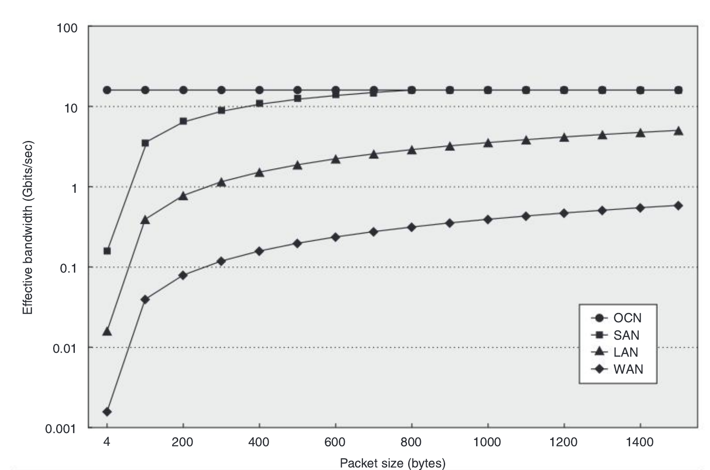

实现了流量控制的网络不需要丢包，有时称为*无损网络*；会丢包的网络有时称为*有损网络*。两种网络处理包的方式只有这一点不同，却大大限制了路由、拥塞、死锁、可靠性等其他相关网络问题能够采用的解决方案，本附录后面会看到这一点。这一差别对性能的影响也很大：丢弃的包必须重传，既要多占链路带宽，又要承受额外的延迟。正是行为和性能上的这些差别，最终决定了某些解决方案只适用于某些互连网络域。例如，在较短距离上传送包的网络（如 OCN 和 SAN）大多实现流量控制，而在较长距离上传送包的网络（如 LAN 和 WAN）大多设计成会丢包。原因在于，距离较短时，把流量控制信息传回发送方的延迟可以忽略不计，距离较长时则不然。通常运行的应用类型也会影响无损网络与有损网络的选择。例如，Web 浏览器这类因特网客户端发出的包被丢弃，只影响相应用户看到的延迟；但并行应用中某个进程发出的包如果被丢弃，而这个包的延迟又处在关键路径上，应用的总执行时间就可能大大增加。

第二项职责是保证包在传送途中既不出错也不丢失，办法是实现一些机制，检测传输错误并从中恢复。在包格式中加入校验和或其他检错字段（如[图 F.4](#fig-f-4) 所示），接收方就能检测出错误：发送包时计算这一冗余信息，收到包时加以检查。包通过检查后，接收方以控制包的形式发回一个确认。注意，这个确认控制包可以同时携带流量控制信息（如一个 credit 或一个停止信号），从而减少控制包的开销。前面讲过，最常用的错误恢复办法是用定时器记下每个包的发送时间；如果确认到达之前定时器已经超时，就认为这个包已丢失或传错，于是重发这个包。

除了包传送、流量控制和可靠性，跨越网络及其端节点的通信协议还要处理许多其他问题。例如，来自不同厂商的两台设备，在一个字内的字节顺序可能不同（大端与小端字节序），协议必须在交付过程中把每个字的字节顺序颠倒过来。延迟的包可能在卡住一段时间后又继续传送，因此协议还必须防止出现重复包。根据系统需求，协议可能还要让各项操作流水进行，以提高性能。最后，连接的设备多于两台时，协议可能还要处理网络拥塞，防止性能下降，这一点在 [F.7 节](#sec-f-7)讨论。

### 性能刻画：延迟与有效带宽 {-}

前面讲了两台设备之间收发消息的基本步骤，下面讨论性能。我们先讨论传送单个包的延迟，再讨论有效带宽（也称吞吐率），即在包一级把多个包的传输在网络上流水进行时所能达到的带宽。

[图 F.5](#fig-f-5) 给出了单个包延迟的基本组成部分。后面几节揭开「黑盒」网络的内部之后，其中一些延迟成分还会进一步细分。[图 F.5](#fig-f-5) 中的时间参数适用于许多互连网络域：芯片内部、电路板上的芯片之间、机箱内的电路板之间、计算机内的机箱之间、集群内的计算机之间、集群之间，等等。各项的数值可能变化，但延迟的组成部分不变。

{#fig-f-5 width=90%}

下面这些术语常常用得很随意，容易造成混淆，因此我们在这里给出更准确的定义：

* **带宽**　严格地说，传输介质的*带宽*是指一段频率范围，在这段范围内，该介质引入的每单位长度衰减低于某个阈值。带宽必须与*传输速率*区分开，传输速率是单位时间内经介质传送的信息量。例如，20 世纪 90 年代末，电话线语音信道提供的带宽固定为 3 KHz，调制解调器通过编码更多的电压电平，让每个信号周期携带更多的位，成功地提高了传输速率。不过，为了与更通行的含义一致，我们用「带宽」指信息能够传送的最大速率，这里的信息包括包头、有效载荷和包尾。带宽的单位传统上是位每秒，有时也用字节每秒。「带宽」也用来指介质（即网络链路）的实测速率。*聚合带宽*指网络提供的总数据带宽；*有效带宽*或*吞吐率*指聚合带宽中由网络交付给应用的那一部分。
* **飞行时间**　包的第一位到达接收方所需的时间，包括链路上的传播延迟，以及链路中继器、网络交换机等网络中其他硬件造成的延迟。飞行时间的量级，WAN 可以是毫秒，LAN 是微秒，SAN 是纳秒，OCN 是皮秒。
* **传输时间**　包通过网络所需的时间，不包括飞行时间。一种测量办法是取包的第一位与最后一位到达接收方的时间差。按定义，传输时间等于包的大小除以网络链路的数据带宽。这一度量假定没有其他包争用这一带宽，即网络是零负载（无负载）的。
* **传送延迟**　飞行时间与传输时间之和，也就是包在互连网络中停留的时间。换句话说，传送延迟是从包的第一位注入网络到最后一位到达接收方之间的时间。它不包括发送方准备包的开销，也不包括包到达接收方后的处理开销。
* **发送开销**　端节点准备好包（注意是包，不是消息）并把它注入网络所需的时间，包括硬件和软件两部分。端节点在这段时间里一直处于忙碌状态，所以称为「开销」。端节点空闲下来之后，任何延迟都算作传送延迟的一部分。我们假定开销由一个常数项加一个随包大小变化的可变项组成。常数项包括存储分配、准备包头、设置 DMA 设备等；可变项主要来自缓冲区之间的复制，对很短的包通常可以忽略不计。
* **接收开销**　端节点处理收到的包所需的时间，包括硬件和软件两部分。这里同样假定开销由一个常数项加一个随包大小变化的可变项组成。一般来说，接收开销大于发送开销，例如接收方可能要承担中断的代价，或者要把包重新排序、重组成消息。

包的总延迟可以用下面的代数式表示：

$$
\text{延迟} = \text{发送开销} + \text{飞行时间} + \frac{\text{包大小}}{\text{带宽}} + \text{接收开销}
$$

下面看一看，从 OCN 到 SAN、LAN 再到 WAN，跨越各个互连网络域时，传送延迟的各个成分以及发送开销、接收开销的重要性怎样变化。

**例题**　假设在 OCN、SAN、LAN 或 WAN 中，用一个专用链路网络互连两台设备，每条链路每个方向的数据带宽为 8 Gbps。两台设备之间要传送 100 字节的包（包括包头）。端节点每个包的发送开销为 $x + 0.05\ \text{ns/字节}$，接收开销为 $4/3(x) + 0.05\ \text{ns/字节}$，其中 $x$ 取这几类网络的典型值：OCN 为 0 μs，SAN 为 0.3 μs，LAN 为 3 μs，WAN 为 30 μs。设互连距离分别为 0.5 cm、5 m、5000 m 和 5000 km，并假定飞行时间只包括链路传播延迟（即没有交换或其他延迟来源），计算从一台设备向另一台设备发送包的总延迟。

**解答**　利用上面的表达式和上一个例题中导体传播延迟的算法，代入各网络的参数，就能求出各自的包总延迟。OCN 的情形为：

$$
\begin{aligned}
\text{延迟} &= \text{发送开销} + \text{飞行时间} + \frac{\text{包大小}}{\text{带宽}} + \text{接收开销}\\
&= 5\ \text{ns} + \frac{0.5\ \text{cm}}{2/3 \times 300{,}000\ \text{km/s}} + \frac{100\ \text{字节}}{8\ \text{Gbit/s}} + 5\ \text{ns}
\end{aligned}
$$

把各项都换算成纳秒（ns），OCN 的结果为：

$$
\begin{aligned}
\text{总延迟（OCN）} &= 5\ \text{ns} + \frac{0.5\ \text{cm}}{2/3 \times 300{,}000\ \text{km/s}} + \frac{100 \times 8}{8}\ \text{ns} + 5\ \text{ns}\\
&= 5\ \text{ns} + 0.025\ \text{ns} + 100\ \text{ns} + 5\ \text{ns}\\
&= 110.025\ \text{ns}
\end{aligned}
$$

代入 SAN 的相应数值，得到的延迟为：

$$
\begin{aligned}
\text{总延迟（SAN）} &= 0.305\ \mu\text{s} + \frac{5\ \text{m}}{2/3 \times 300{,}000\ \text{km/s}} + \frac{100\ \text{字节}}{8\ \text{Gbit/s}} + 0.405\ \mu\text{s}\\
&= 0.305\ \mu\text{s} + 0.025\ \mu\text{s} + 0.1\ \mu\text{s} + 0.405\ \mu\text{s}\\
&= 0.835\ \mu\text{s}
\end{aligned}
$$

代入 LAN 的相应数值，得到的延迟为：

$$
\begin{aligned}
\text{总延迟（LAN）} &= 3.005\ \mu\text{s} + \frac{5\ \text{km}}{2/3 \times 300{,}000\ \text{km/s}} + \frac{100\ \text{字节}}{8\ \text{Gbit/s}} + 4.005\ \mu\text{s}\\
&= 3.005\ \mu\text{s} + 25\ \mu\text{s} + 0.1\ \mu\text{s} + 4.005\ \mu\text{s}\\
&= 32.11\ \mu\text{s}
\end{aligned}
$$

代入 WAN 的相应数值，得到的延迟为：

$$
\begin{aligned}
\text{总延迟（WAN）} &= 30.005\ \mu\text{s} + \frac{5000\ \text{km}}{2/3 \times 300{,}000\ \text{km/s}} + \frac{100\ \text{字节}}{8\ \text{Gbit/s}} + 40.005\ \mu\text{s}\\
&= 30.005\ \mu\text{s} + 25000\ \mu\text{s} + 0.1\ \mu\text{s} + 40.005\ \mu\text{s}\\
&= 25.07\ \text{ms}
\end{aligned}
$$

距离越长，飞行时间在延迟中所占的比例越大，出错的可能性也越大。WAN 和 LAN 采用更复杂、更费时的通信协议，部分原因就在这里，而这些协议又增大了发送开销和接收开销。另一个原因是标准化的需要。此外，设备数从几十台到几百台、几千台，再到成千上万台，各互连网络域上运行的典型应用对协议提出的要求不同，协议也随之更加复杂。后面几节讨论连接两台以上的设备时，我们再考虑这一点。从上面的例题可以看出，WAN 和某些 LAN 中，飞行时间里的传播延迟成分非常大，其他延迟成分（包括发送开销和接收开销）实际上都可以忽略。SAN 和 OCN 则不然，它们的传播延迟与开销和传输延迟相比微不足道。还要记住，上面的例题只计入了链路本身的传播延迟，忽略了飞行时间中由交换机和网络中其他硬件造成的延迟。在不拥塞的网络中，WAN 和 LAN 的交换机延迟一般比开销和链路传播延迟小；但多处理器 SAN 和多核 OCN 中未必如此，后面几节会看到这一点。

到目前为止，我们讨论的是单个包的传送，并算出了相应的端到端包总延迟。要计算两台联网设备之间的有效带宽，就必须考虑它们之间传送的连续包流。要记住，任何网络在给定的成本和功耗目标下优化时，除了要尽量减小包延迟，目标还在于用尽可能短的时间传送尽可能多的信息，衡量标准就是网络交付的有效带宽。如果应用发送下一个包之前不需要等待响应，发送方就可以把后面包的发送开销与前面包的传送延迟和接收开销重叠起来。这实际上是让包在网络上流水传输，也称为*链路流水*。好在本书前面几章讲过，许多应用领域中，多个应用或同一应用多个线程的通信可以并发进行（例如，一台 Web 服务器同时为数千个客户请求或流媒体提供服务），于是设备可以连续发送一串包，不必等待确认或回复。此外，长消息在传送之前通常分成若干个最大尺寸的包，这时也会有一串包相继注入网络。如果不能这样重叠，每个包都要等前面的包得到确认后才能发送，性能就会大大下降。

以流水方式传送的包，确认起来相当简单：源端为所有已发送但尚未确认的包各保留一份副本，并记录返回的确认与缓冲区中所存包之间的对应关系。发送方收到某个包的确认后，就把这个包从缓冲区中删除。为此，可以在包的确认中带上该包所属的消息 ID 和包序号。此外，每个缓冲的包都必须配一个单独的定时器，相应的超时时间一到，就重发这个包。

在网络上流水地传送包，与在处理器内流水地执行计算有许多相似之处，但也有一些不同，其中之一是网络流水不需要任何级间锁存器：信息只是以一串信号波的形式沿网络链路传播。因此，可以把网络看成一条逻辑流水线，级数按需要设置，多少级都可以，从而飞行时间不会影响所能达到的有效带宽。一个包可以在前一个包传输完毕后立即开始传输，于是一个包的发送开销与前面包的传送延迟和接收延迟重叠起来。如果发送开销小于传输时间，包就一个紧接一个地发出，连续发送时有效带宽接近链路的原始带宽。反之，如果发送开销大于传输时间，注入点的有效带宽就会远低于链路的原始带宽。向网络注入连续包流时，每条链路的链路注入带宽 $BW_{\text{LinkInjection}}$ 由下式计算：

$$
BW_{\text{LinkInjection}} = \frac{\text{包大小}}{\max(\text{发送开销},\ \text{传输时间})}
$$

我们还必须考虑接收方处理包的速率跟不上包到达的速率时会发生什么。如果接收开销大于发送开销，接收方处理收到的包就不够快，从而出现这种情况。这时，网络每条接收链路的链路接收带宽 $BW_{\text{LinkReception}}$ 小于链路注入带宽，由下式求得：

$$
BW_{\text{LinkReception}} = \frac{\text{包大小}}{\max(\text{接收开销},\ \text{传输时间})}
$$

两台设备由专用链路互连时，一台设备发出的所有包都由另一台接收。如果接收方处理包不够快，接收缓冲区就会填满，流量控制随之抑制发送方的传输。这种情况由网络以外的原因造成，这里不再讨论。另外，如果接收开销大于发送开销，接收缓冲区同样会填满，流量控制同样会抑制发送方的传输。这时从平均效果看，流量控制的作用相当于用接收开销代替发送开销。假定网络是理想的，表现得就像两台设备之间以全链路带宽反向运行的两条专用链路，这与我们到目前为止把网络看作黑盒的观点一致。于是，有效带宽取注入带宽的两倍（因为有两条注入链路，每台设备一条）和接收带宽的两倍中较小的一个，由此得到有效带宽的表达式：

$$
\text{有效带宽} = \min\left(2 \times BW_{\text{LinkInjection}},\ 2 \times BW_{\text{LinkReception}}\right) = \frac{2 \times \text{包大小}}{\max(\text{开销},\ \text{传输时间})}
$$

其中，开销 = max(发送开销, 接收开销)。再结合传输时间的表达式，显然，传输时间大于开销时，网络交付的有效带宽就等于网络的聚合带宽。因此，只要网络行为理想（即为基于 credit 的流量控制和 Xon/Xoff 流量控制提供了足够的 credit 和缓冲区），无论飞行时间是多少，也就是无论包传送的距离有多远，网络都能得到充分利用。这一分析假定发送方和接收方的网络接口一次只能处理一个包。如果能并行处理多个包（IBM 的 Federation 网络接口就是这样做的），这些包的开销就可以重叠，有效带宽便按重叠的倍数提高，但以传输时间所决定的值为上限。

下面用前面的公式，考察在 OCN、SAN、LAN、WAN 等不同网络域中，包大小、传输时间和开销对 $BW_{\text{LinkInjection}}$、$BW_{\text{LinkReception}}$ 和有效带宽的影响。

**例题**　与上一个例题一样，假设在 OCN、SAN、LAN 或 WAN 中，用一个专用链路网络互连两台设备，每条链路每个方向的数据带宽为 8 Gbps。包大小从 4 字节（即一个 32 位字）到 1500 字节（即以太网的最大传输单元），端节点每个包的发送开销和接收开销与前面相同，分别为 $x + 0.05\ \text{ns/字节}$ 和 $4/3(x) + 0.05\ \text{ns/字节}$，其中 $x$ 对 OCN 为 0 μs，对 SAN 为 0.3 μs，对 LAN 为 3 μs，对 WAN 为 30 μs。画出每类网络的有效带宽随包大小变化的曲线。是什么限制了有效带宽？包多大时，有效带宽与网络聚合带宽相差不超过 10%？

**解答**　[图 F.6](#fig-f-6) 用上面给出的简单公式和参数，画出了四个网络域的有效带宽随包大小变化的曲线。OCN 中，无论包多大，传输时间都大于开销（无论发送开销还是接收开销），因此聚合带宽能够得到充分利用。聚合带宽为 16 Gbps，即注入链路（或接收链路）带宽的 2 倍，因为两台设备各有一条。SAN 中，包小于约 800 字节时，开销（具体说是接收开销）大于传输时间；因此，包要达到 655 字节及以上，才能利用 90% 或更多的聚合带宽。LAN 和 WAN 中，链路带宽大部分没有得到利用，因为在这个例子里，无论包多大，开销都是传输时间的许多倍。

{#fig-f-6 width=90%}

这个例子说明，要让网络交付的有效带宽最大，就必须减小发送开销和接收开销，使它们相对于包的传输时间尽量小。

上面的分析表明，分析包经过的路径、找出瓶颈所在，就能给出有效带宽的某种上界。这一思路可以推广到网络接口以外：建立一个模型，把整个网络从一端到另一端看成一根管道，找出管道最窄的一段。这根管道中有三个部分值得关注：一是所有网络注入链路的总和，对应网络注入带宽（$BW_{\text{NetworkInjection}}$）；二是所有网络接收链路的总和，对应网络接收带宽（$BW_{\text{NetworkReception}}$）；三是所有网络链路的总和，对应网络带宽（$BW_{\text{Network}}$）。后面几节会一层层剥开网络的黑盒，届时再给出它们的表达式。

到目前为止，我们一直假定：只互连两台设备时，黑盒网络的行为是理想的，网络带宽等于网络的聚合原始带宽。后面几节会看到，实际的网络带宽可能远小于聚合带宽。一般来说，网络端到端交付给应用的有效带宽，以这三个潜在瓶颈中的最小值为上界：

$$
\text{有效带宽} = \min\left(BW_{\text{NetworkInjection}},\ BW_{\text{Network}},\ BW_{\text{NetworkReception}}\right)
$$

后面几节会进一步介绍互连网络，并考虑互连两台以上设备这一更一般的情形，届时还会把这个表达式进一步展开。

本附录有些节会用高端商用产品的实例，说明该节介绍的概念怎样落到实处。[图 F.7](#fig-f-7) 列出了几种商用计算机，它们在各自存在期间的某个时候，都曾是世界上同类系统中性能最高的系统之一。这些系统虽然能互连两台以上的设备，但实现的是只互连两台设备时所需的基本功能。本节讨论的问题不仅适用于这些系统所用的 SAN，也适用于从 OCN 到 WAN 的其他互连网络域。

[图 F.7　商用高性能计算机系统中互连网络的基本特性]{#fig-f-7 .caption}

| 公司 | 系统［网络］名称 | 推出年份 | 最大计算节点数［× CPU 数］ | 最大配置下的系统占地 | 包［包头］最大尺寸（字节） | 注入［接收］节点带宽（MB/s） | 最小发送/接收开销 | 最大铜缆链路长度；流量控制；检错 |
|---|---|---|---|---|---|---|---|---|
| Intel | ASCI Red Paragon | 2001 | 4510［×2］ | 2500 ft^2^ | 1984［4］ | 400［400］ | 几 μs | 握手；CRC + 奇偶校验 |
| IBM | ASCI White SP Power3［Colony］ | 2001 | 512［×16］ | 10,000 ft^2^ | 1024［6］ | 500［500］ | ~3 μs | 25 m；基于 credit；CRC |
| Intel | Thunder Itanium2 Tiger4［QsNet^II^］ | 2004 | 1024［×4］ | 120 m^2^ | 2048［14］ | 928［928］ | 0.240 μs | 13 m；基于 credit；链路级和目的端 CRC |
| Cray | XT3［SeaStar］ | 2004 | 30,508［×1］ | 263.8 m^2^ | 80［16］ | 3200［3200］ | 几 μs | 7 m；基于 credit；CRC |
| Cray | X1E | 2004 | 1024［×1］ | 27 m^2^ | 32［16］ | 1600［1600］ | 0（直接 LD/ST 访问） | 5 m；基于 credit；CRC |
| IBM | ASC Purple pSeries 575［Federation］ | 2005 | >1280［×8］ | 6720 ft^2^ | 2048［7］ | 2000［2000］ | ~1 μs，最多可并行处理 4 个包 | 25 m；基于 credit；CRC |
| IBM | Blue Gene/L eServer Sol.［Torus Net.］ | 2005 | 65,536［×2］ | 2500 ft^2^（0.9 × 0.9 × 1.9 m^3^/1K 节点机柜） | 256［8］ | 612.5［1050］ | ~3 μs（2300 个周期） | 8.6 m；基于 credit；CRC（包头/包） |

## 连接两台以上的设备 {#sec-f-3}

到目前为止，我们只考虑了两台设备的连接，它们通过一个看作黑盒的网络通信。但互连网络真正有意思的地方，在于它能把数百台甚至成千上万台设备连在一起；也正因为如此，构建互连网络更具挑战性。要连接两台以上的设备，网络必须具备合适的结构，并支持更多的功能。本节继续采用黑盒方法，在概念层面介绍互连两台以上设备时网络必须支持的附加结构和功能，这些问题的细节在 [F.4 节](#sec-f-4)至 [F.7 节](#sec-f-7)展开。在适当的地方，我们会把这些附加的结构和功能与上一节介绍的网络介质、流量控制等基础知识联系起来。本节还按连接结构把网络分为*共享介质*网络和*交换介质*网络两大类，并加以比较。最后给出刻画网络性能的扩展表达式，并举一个例子。

### 附加的网络结构和功能：拓扑、路由、仲裁与交换 {-}

互连两台以上设备的网络，需要一些机制在物理上把包的源端和目的端连接起来，才能传送包并把它交付到正确的目的地。这些机制有不同的实现方式，在不同的互连网络域中差别也很大；但无论在哪个域，这些机制提供的网络结构和执行的功能在类型上都大体相同。

用网络互连多台设备时，设备之间往往不能用专用链路建立固定的连接。原因有两个：一是可能限制太大，因为某个源端的所有包都只能去往同一个目的端，不能去往其他目的端；二是可能成本高得无法承受，因为每个源端到每个目的端都需要一条专用链路（下一节会进一步评估这一点）。因此，网络通常让不同的设备对共享路径，而路径怎样共享，由网络的连接结构决定，这种连接结构通常称为*网络拓扑*。拓扑回答的是一个重要问题：「包可能走哪些路径？」这样包才能到达预定的目的地。

每个互连两台以上设备的网络，还需要某种机制把每个包交付到正确的目的地。相应的功能称为*路由*，定义为：为算出一条从包的源端到其目的端的有效路径而必须执行的一组操作。路由回答的重要问题是：「在可能的路径中，包可以（有效地）走哪些？」这样包才能到达预定的目的地。根据网络的不同，路由功能可以在包的源端执行，算出整条路径；也可以在某些中间设备上执行，即时算出路径的片段；甚至可以在每个可能的目的设备上执行，检查该设备是不是这个包的预定目的地。通常要扩展[图 F.4](#fig-f-4) 所示的包头，以容纳必要的路由信息。

一般来说，网络中不同的设备对之间往往共享路径或部分路径，因此包可能会请求某些共享资源。几个包同时请求同一资源时，需要用*仲裁*功能来解决冲突。仲裁与流量控制一起回答一个重要问题：「包什么时候可以使用路径？」每次仲裁都有一个胜出者，还可能有若干个失败者。失败者得不到所请求的资源，通常被缓冲起来。上一节讲过，可以实现流量控制来防止缓冲区溢出。胜出者获准使用的资源接通后，就为包提供了一条前进的路径，胜出者随即向目的地前进。这一功能称为*交换*。交换回答的重要问题是：「怎样为包分配路径？」为了更好地利用现有的通信资源，大多数网络并不一次建立整条端到端路径，而是如 [F.5 节](#sec-f-5)所述，通常每次只建立路径的一个片段。
