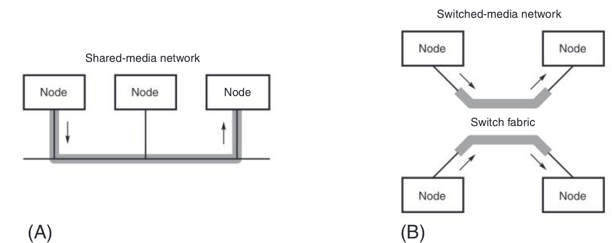
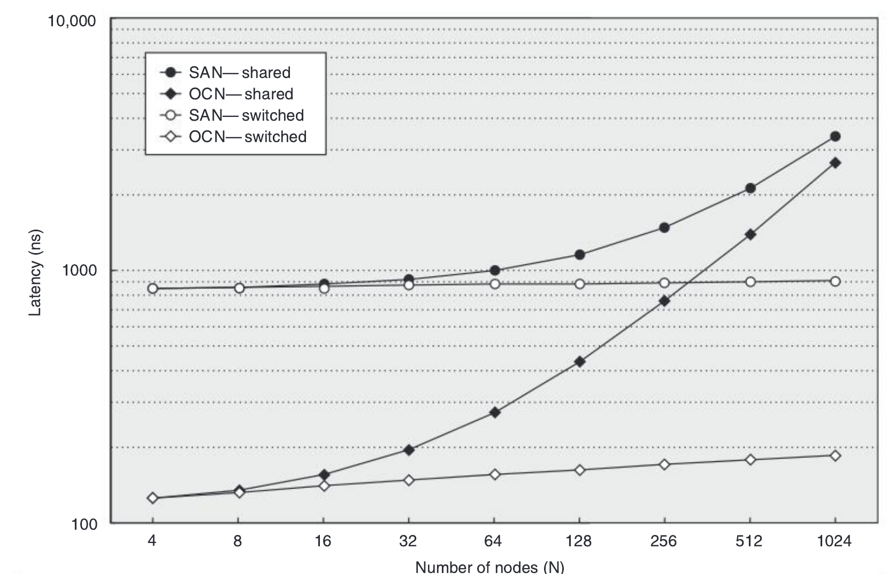
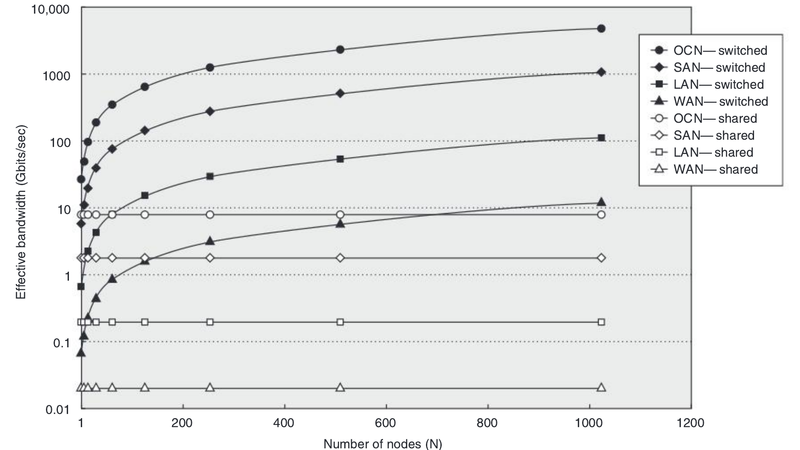
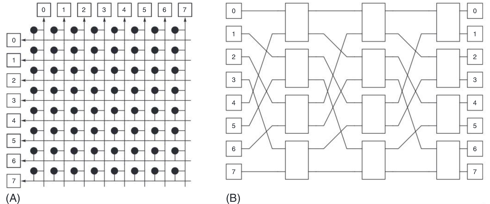

路由、仲裁和交换这三项网络功能，是在上一节所讲的基本功能之外另加的。只要网络连接的设备超过两台，不论拓扑采取什么形式，这三项功能都必须实现；但它们有多复杂、按什么顺序执行，要看网络拓扑属于哪一类，下面会分别讨论。一般来说，网络拓扑提供了多条可能的路径，路由、仲裁和交换的任务，就是从中建立一条从源端到目的端的有效路径。路径建立以后，再由前面讲过的包传送功能把包可靠地发送出去，并在相应的目的端接收。如果实现了流量控制，流量控制会抑制发送方，以防缓冲区溢出。流量控制可以在端到端一级实现，也可以在网络内部的链路一级实现，或者两级都实现。

### 共享介质网络 {-}

连接多台设备最简单的办法，是让它们共享网络介质，如[图 F.8](#fig-f-8)(a) 中的总线。这是互连设备的传统方式。共享介质有两种工作方式：

* *半双工*：数据可以沿介质的任一方向传送，但同一台设备不能同时发送和接收；
* *全双工*：数据可以同时沿两个方向传送，同一台设备也可以同时发送和接收。

直到不久以前，大多数系统中的 I/O 设备通常还共享一条 I/O 总线，早期的片上系统（SoC）设计也用共享总线互连片上部件。最流行的局域网以太网，最初就实现为一条半双工总线，最多由上百台计算机共享，不过现在也有了交换介质的版本。

{#fig-f-8 width=90%}

介质既然是共享的，就必须有一种机制来协调和仲裁介质的使用，保证每次只发送一个包。如果网络设备之间的物理距离很短，可以设一个集中仲裁器，由它授予发送包的许可，网络节点则通过专用的控制线与仲裁器相连。但节点数量多、分布距离远时，集中仲裁并不现实，因此也采用分布式的仲裁方式。最初的以太网共享介质 LAN 就是这样做的。

共享介质分布式仲裁的第一步是「先看后跳」：节点先检查网络，以免在别的包已经在网络上传送时还试图发送。这种在传输之前先监听、以避免冲突的做法，称为*载波侦听*。互连空闲时，节点就尝试发送。但先看一眼并不能保证发送成功，因为别的节点可能在同一时刻也决定发送。两个节点同时发送，就发生了*冲突*。假定网络接口能检测到由此产生的冲突，办法是监听线路上的数据有没有被同时出现的其他数据搅乱。这种通过监听来检测冲突的做法，称为*冲突检测*，它是分布式仲裁的第二步。

问题到这里还没有解决。检测到冲突后，如果网络上每个节点都等待完全相同的时间，监听确认没有流量，再次尝试发送，那么这些节点仍然是同步的，会一再撞在一起。为了避免反复迎头相撞，包被搅乱的每个节点都要等待一段随机长的时间再重发，这称为*退避*。随机化打破了同步。如果再次发生冲突，两次重传之间的间隔就按指数增长，以免加重网络的负担。

这种办法控制住了共享介质上的拥塞，却不能保证公平：发生冲突的节点还在等待时，后来的某个节点可能先发送出去。网络上没有许多节点同时大量发送时，这种简单的办法效果很好；但在高利用率下，由于介质是共享的，又不能保证公平，性能就会下降。另一种能够支持公平性的分布式仲裁办法，是在节点之间传递*令牌*。拿到令牌的节点就获得了使用网络的权利。如果令牌在各节点之间轮流循环传递，仲裁过程就有了一定程度的公平性。

仲裁完成、某台设备获准使用共享介质以后，交换功能就很简单了：获准的设备只要把自己连到共享介质上，就建立了通往每个可能目的地的路径。路由也很容易实现。介质是共享的，连着所有设备，每台设备都会看到每个包，所以每台设备只需检查一个包是不是发给自己的。这种做法还带来一个好处：一台设备只需一次传输，就能把一个包发给连在共享介质上的所有设备。这种通信方式称为*广播*；与之相对的是*单播*，即每个包只发给一台设备。在共享介质上，无论把一个包广播给所有设备，还是只发给其中一部分设备（称为*组播*），都很容易。

### 交换介质网络 {-}

另一种办法不是让所有连接的节点同时共享整个网络介质，而是把介质分成互不相交的若干部分，由节点分享，在这些部分之间切换。这些部分是无源的点到点链路，链路连接着有源的交换部件，由交换部件为若干源–目的对动态地建立通信。无源部件和有源部件合起来，称为*网络交换结构*或*网络结构*，端节点就连在它上面。[图 F.8](#fig-f-8)(b) 从概念上画出了这种办法。[F.4 节](#sec-f-4)至 [F.7 节](#sec-f-7)会更详细地介绍交换结构，逐层揭开交换介质网络的各个黑盒。不过，从[图 F.8](#fig-f-8)(b) 的高层视图已经可以看出交换介质网络在带宽上可能具有的优势：它的聚合带宽可以是共享介质网络的许多倍，因而有可能获得更高的有效带宽。在共享介质上，即使在最好的情况下，一次也只能有一个节点发送包；而在交换介质网络上，所有连接的节点都有可能同时发送。

交换介质网络和共享介质网络一样，也必须实现前面提到的三项附加功能：路由、仲裁和交换。包每次进入网络，都要先经过路由，从拓扑提供的路径中选出一条通往目的地的路径。包所请求的路径必须由某个集中式或分布式仲裁器批准，仲裁器负责解决同一路径上并发的资源请求之间的冲突。请求的资源获准后，网络「接通」所需的连接，建立路径，让包向目的地转发；资源得不到批准时，包通常像前面说的那样被缓冲起来。在交换网络中，路由、仲裁和交换通常按这个顺序执行；而在共享介质网络中，路由一般是最后执行的功能。

### 共享介质网络与交换介质网络的比较 {-}

一般来说，共享介质网络的优点是成本低，但也正因为如此，它的网络聚合带宽完全不随互连设备的增多而扩展。它还有几方面的缺点：

* 需要一个全局仲裁机制来解决相互冲突的请求，这可能形成另一种瓶颈，同样限制可扩展性；
* 每连上一台设备，共享介质上电导体的寄生电容就增加一些，飞行时间中的传播延迟随之增加，时钟周期也可能变长；
* 共享介质要不断地轮流授予不同的请求设备使用，包在网络上的传输因此更难流水化。

交换介质网络的主要优点是，网络资源的数量随连接设备的数量扩展，网络聚合带宽也随之增加。这类网络允许多对节点同时通信，因此有效网络带宽比共享介质网络高得多。交换介质网络还能让系统扩展到非常多的节点，这是共享介质做不到的。但正因为如此，如果网络资源超线性增长，这一扩展上的优点同时也可能成为缺点：网络的成本超线性增长，而它提供的有效网络带宽随互连设备数量只是亚线性增长，对许多应用和互连网络域来说，这样的设计是低效的。

### 性能刻画：延迟与有效带宽 {-}

上面讲的路由、交换和仲裁功能，给包的传送延迟增加了一些成分，计算包总延迟时必须把它们考虑进去。假设网络资源没有争用（网络空载时就是这样），包总延迟为：

$$
\text{延迟} = \text{发送开销} + \left(T_{\text{TotalProp}} + T_{\text{R}} + T_{\text{A}} + T_{\text{S}}\right) + \frac{\text{包大小}}{\text{带宽}} + \text{接收开销}
$$

其中 $T_{\text{R}}$、$T_{\text{A}}$ 和 $T_{\text{S}}$ 分别是包经历的总路由时间、总仲裁时间和总交换时间，可以是实测值，也可以是由更细致的分析推算出来的值。这三项加上穿过各条网络链路的总传播延迟 $T_{\text{TotalProp}}$，就是包的总飞行时间。

上面的表达式没有计入资源争用可能带来的额外延迟，因此只是包总延迟的下界。网络负载很重时，几个包可能同时请求相同的网络资源，由此产生争用，使性能下降。仲裁失败的包必须缓冲起来等待，包延迟因此增加一段等待时间，称为*争用延迟*，上面的表达式不包括这一项。当整个网络或网络的一部分接近饱和时，争用延迟可能比零负载甚至轻负载下的包总延迟大几个数量级。遗憾的是，网络负载超过中等程度以后，包总延迟很难用解析方法算出。这时，更好、更准确的办法是用周期精确的模拟器运行详细的网络模型，测出这些量，以此估计包延迟。尽管如此，上面的表达式仍可用来计算包延迟在最好情况下的下界。

出于类似的原因，有效带宽也不容易精确计算，但我们可以把上一节末尾的模型适当推广，估计它在最好情况下的上界。做法是找出端到端网络管道中最窄的一段，为此要对互连这些设备的整个网络求出三个量：网络注入带宽（$BW_{\text{NetworkInjection}}$）、网络接收带宽（$BW_{\text{NetworkReception}}$）和网络带宽（$BW_{\text{Network}}$）。

**网络注入带宽。** $BW_{\text{NetworkInjection}}$ 很容易计算，把链路注入带宽 $BW_{\text{LinkInjection}}$ 的表达式乘以网络注入链路的总数即可。

**网络接收带宽。** $BW_{\text{NetworkReception}}$ 用 $BW_{\text{LinkReception}}$ 按同样的方法计算，但还要乘上一个反映应用流量及其他特性的系数。互连设备超过两台时，分析流量控制对链路接收带宽的影响，就不能再假定源端和目的端一一对应。例如，应用具有多对一的流量特性时，来自不同注入链路的几个包可能同时到达同一条接收链路，在接收链路上引起争用。这一影响用参数*平均接收因子* $\sigma$ 来计入，它可以是实测值，也可以是由细致分析推算出来的值。$\sigma$ 定义为到达接收链路的包中能被接收的平均比例（或百分比）。只有这部分包能立即交付，因此网络接收带宽要按这个系数打折扣。这种折扣由应用的行为造成，与网络的内部特性无关。

**网络带宽。** $BW_{\text{Network}}$ 反映网络的内部特性，包括争用。后面几节会逐步揭示黑盒互连网络内部的更多细节，我们也会随之逐步推导出计算 $BW_{\text{Network}}$ 的表达式。

总之，网络端到端交付给应用的有效带宽，由上述三段中最小的一段决定：

$$
\begin{aligned}
\text{有效带宽} &= \min\left(BW_{\text{NetworkInjection}},\ BW_{\text{Network}},\ \sigma \times BW_{\text{NetworkReception}}\right)\\
&= \min\left(N \times BW_{\text{LinkInjection}},\ BW_{\text{Network}},\ \sigma \times N \times BW_{\text{LinkReception}}\right)
\end{aligned}
$$

下面用这些表达式，在 OCN、SAN、LAN 和 WAN 这四个互连网络域中，比较共享介质网络与交换介质网络的延迟和有效带宽。

**例题**　对于共享介质和交换介质的 OCN、SAN、LAN 和 WAN，画出互连节点数 $N$ 从 4 增加到 1024 时，包总延迟和有效带宽的变化曲线。假设所有网络链路（包括节点上的注入链路和接收链路）的数据带宽都是 8 Gbps，传送的是 100 字节的单播包。共享介质网络共享一条链路，交换介质网络的网络链路数至少与节点数一样多。两种网络都忽略网络内部争用对延迟和带宽的影响。端节点每个包的发送开销为 $x + 0.05\ \text{ns/字节}$，接收开销为 $4/3(x) + 0.05\ \text{ns/字节}$，其中 $x$ 对 OCN 为 0 μs，对 SAN 为 0.3 μs，对 LAN 为 3 μs，对 WAN 为 30 μs；互连距离分别为 0.5 cm、5 m、5000 m 和 5000 km。再假设总路由时间、总仲裁时间和总交换时间是常数或互连节点数的函数：共享介质网络为 $T_{\text{R}} = 2.5\ \text{ns}$、$T_{\text{A}} = 2.5(N)\ \text{ns}$、$T_{\text{S}} = 2.5\ \text{ns}$；交换介质网络为 $T_{\text{R}} = T_{\text{A}} = T_{\text{S}} = 2.5(\log_2 N)\ \text{ns}$。最后，考虑到这种网络结构下的应用流量特性，假设平均接收因子 $\sigma$ 对共享介质为 $N^{-1}$，对交换介质为多重对数形式 $(\log_2 N)^{-1/4}$。

**解答**　包总延迟的各个成分都与上一节的例题相同，只有飞行时间不同，现在它多了路由、仲裁和交换延迟。这些额外延迟在共享介质网络中合计 $5 + 2.5(N)\ \text{ns}$，在交换介质网络中合计 $7.5(\log_2 N)\ \text{ns}$。OCN 和 SAN 的结果更值得关注，所以[图 F.9](#fig-f-9) 只画出了这两类网络的延迟。

* OCN：节点数为中等到较多时，$T_{\text{R}}$、$T_{\text{A}}$ 和 $T_{\text{S}}$ 合起来在飞行时间中占主导地位，并且远大于其他每一个延迟成分，共享介质网络尤其如此。由于两者的仲裁延迟不同，共享介质网络的延迟随节点数增加得比交换介质网络剧烈得多。
* SAN：在大多数网络规模下，$T_{\text{R}}$、$T_{\text{A}}$ 和 $T_{\text{S}}$ 在飞行时间中占主导地位。但在共享介质网络中，只有网络规模很大时，它们才大于其他每一个延迟成分；在交换介质网络中，它们小于其他延迟成分，但也不能忽略。
* LAN 和 WAN：飞行时间以传播延迟为主，而上一节已经算过，传播延迟又在其他延迟成分中占主导地位。因此，无论共享介质还是交换介质，$T_{\text{R}}$、$T_{\text{A}}$ 和 $T_{\text{S}}$ 都可以忽略。

[图 F.10](#fig-f-10) 画出了四个网络域的有效带宽随互连节点数的变化。所有共享介质网络的有效带宽都不随网络规模变化，因为在全部网络接收链路上，一次只能接收一个单播包；除 OCN 以外，有效带宽还要进一步受到各网络接收开销的限制。所有交换介质网络的有效带宽都随互连节点数的增加而增加，但要按平均接收因子打折扣；同样，除 OCN 以外，接收开销会进一步限制有效带宽。

{#fig-f-9 width=80%}

交换网络的优点这么明显，为什么不是一直都用它呢？原因有两个。一是早期的计算机慢得多，共享网络介质对性能的影响很小。二是早期 LAN 和 WAN 的交换机要占好几块大电路板，差不多和一整台计算机一样大。由于摩尔定律，交换机的尺寸已经大大缩小，而系统对高性能通信的需求也大得多了。采用交换网络，通信也能像处理器和主存一样，从硅工艺的快速进步中受益。电信公司的交换机曾经有大型机那么大，而今天已经有了单芯片交换机，甚至整个交换网络都可以做在一块芯片里。因此，今天的工艺趋势和应用趋势都有利于交换网络。单芯片处理器出现以后，在数量惊人的场合取代了逻辑电路；同样，单芯片交换机和片上交换网络也在若干应用领域中越来越多地取代共享介质网络（即总线）。例如，2005 年推出的交换网络 PCI-Express（PCIe），就是用来取代个人计算机主板上传统的 PCI-X 总线的。

上面的例题还说明，在 OCN 和 SAN 中，优化路由、仲裁和交换功能很重要。这两个网络域的互连距离和开销通常都很小，延迟和有效带宽对这些功能实现得好坏因此敏感得多，大规模网络尤其如此。所以，这两个域大多以速度较快的硬件方案为主来实现。而在 LAN 和 WAN 中，性能主要由其他因素决定，速度较慢但更灵活的软件方案就够用了。在 OCN 和 SAN 域中，交换介质网络的拓扑设计对网络能在多大程度上接近延迟的下界和有效带宽的上界，也起着重要作用。

{#fig-f-10 width=90%}

接下来三节讨论交换网络中的这些重要问题，下一节先讲拓扑。

## 网络拓扑 {#sec-f-4}

在交换介质网络中，设备数量足够少时，用一个交换机就能把它们互连起来。但*交换机端口*的数量受到现有超大规模集成电路（VLSI）工艺、成本、功耗等因素的限制。所需的*网络端口*数超过单个交换机所能支持的端口数时，就需要由多个交换机互连而成的交换结构。网络必须具备完全可达性（即连通性），为此，网络交换结构必须为每台端节点设备提供通往其他每台设备的路径。所有连到网络交换结构的连接，以及交换结构内部交换机之间的连接，用的都是点到点链路，而不是共享链路。所谓点到点链路，就是每一端都只连着一个交换机或一台端节点设备的链路。交换机、链路、端节点设备等所有部件之间的互连结构，称为*网络拓扑*。

文献中描述过的网络拓扑多得难以计数，但商业上用过的不过十来种。20 世纪 70 年代和 80 年代初，研究人员竞相提出新的拓扑，力图减少包必须经过的交换机个数，这个数称为*跳数*。到了 20 世纪 90 年代，流水式的传输和交换技术得到采用，跳数就不那么关键了。尽管如此，拓扑在今天仍然很重要，对 OCN 和 SAN 尤其如此。原因是拓扑与其他影响性能的网络设计参数之间存在微妙的关系，端节点数非常多（例如 Blue Gene/L 超级计算机有 64 K 个节点）或者延迟至关重要（例如多核处理器芯片）时更是这样。拓扑对网络的实现成本也有很大影响。

并行超级计算机 SAN 的拓扑最引人注目，也最富想象力，通常都归结为结构规整的拓扑，以便简化路由和封装，也便于扩展。LAN 和 WAN 的拓扑则往往比较随意，或者是临时拼凑的，更多地取决于长距离传输或跨越不同通信子网连接所带来的难题。基于交换机的 OCN 拓扑最近才出现，但正在迅速流行。

本节介绍商业产品中较常用的拓扑，并简要讨论它们的优缺点和限制条件。

### 集中式交换网络 {-}

前面讲过，交换机端口数等于或多于设备数时，用一个交换机就能互连这组设备。这种简单的网络通常称为*交叉开关*（crossbar）或*交叉开关交换机*。如[图 F.11](#fig-f-11)(a) 所示，交叉开关内部交叉点开关的复杂度随端口数按平方增长。因此，当需要互连的设备数超出实现工艺所能支持的规模时，就需要更便宜的方案。

解决交叉开关扩展问题的一种常见办法，是把大的交叉开关拆成几级较小的交换机，并按一定方式把它们互连起来，使包只需穿过交换结构一次，就能从任何源端到达任何目的端。这样组织的拓扑通常称为*多级互连网络*或*多级交换结构*，它的复杂度一般与 $N \log N$ 成正比。多级互连网络（MIN）最初是在 20 世纪 50 年代为电话交换局提出的，此后一直用来构建并行超级计算机、对称多处理器、多计算机集群以及 IP 路由器交换结构的通信主干。

MIN 各级之间的互连模式是一些置换，在数学上可以用一组函数表示，每一级一个函数。[图 F.11](#fig-f-11)(b) 是一种著名的 MIN 拓扑，称为 *Omega* 网络。Omega 网络每一级都以完全混洗置换作为互连模式，后面接交换开关，于是每一级构成一个*完全混洗交换*。在这个例子中，8 个输入–输出端口由三级 $2 \times 2$ 交换机互连。很容易看出，穿过这三级一次，就能从任何输入端口到达任何输出端口。一般来说，用 $k \times k$ 交换机构成有 $N$ 个输入–输出端口的 MIN，至少需要 $\log_k N$ 级，每级 $N/k$ 个交换机，共 $N/k\,(\log_k N)$ 个交换机。

MIN 内部虽然有结构，但仍可以看作集中式的交换结构，端节点设备连在网络的外围，因此称为*集中式交换网络*。换一个角度看，MIN 是通过一组交换机来互连节点的，这些交换机上可能没有直接连接任何节点，因此集中式交换网络还有另一个常用的名称：*间接网络*。

{#fig-f-11 width=90%}

**例题**　计算用一个交叉开关互连 4096 个节点的成本，与分别用 $2 \times 2$、$4 \times 4$ 和 $16 \times 16$ 交换机构成的 MIN 互连的成本之比。单向链路的相对成本和交换机的相对成本分开考虑。假设对 $k \times k$ 交换机，交换机成本随输入（或输出）端口数 $k$ 按平方增长。

**解答**　用单个交叉开关时，网络的交换机成本与 $4096^2$ 成正比；单向链路成本为 8192，包括从端节点到交叉开关的一组链路，以及从交叉开关回到端节点的一组链路。用 $k \times k$ 交换机构成 MIN 时，每个交换机的成本与 $k^2$ 成正比，但交换机共有 $4096/k\,(\log_k 4096)$ 个。链路方面，交换机引出的单向链路共 $\log_k 4096$ 级、每级 $N$ 条，另外还有从端节点到 MIN 的 $N$ 条链路。因此，交叉开关相对于各种 MIN 的相对成本为：

$$
\begin{aligned}
\text{相对成本}(2 \times 2)_{\text{交换机}} &= 4096^2 / \left(2^2 \times 4096/2 \times \log_2 4096\right) = 170\\
\text{相对成本}(4 \times 4)_{\text{交换机}} &= 4096^2 / \left(4^2 \times 4096/4 \times \log_4 4096\right) = 170\\
\text{相对成本}(16 \times 16)_{\text{交换机}} &= 4096^2 / \left(16^2 \times 4096/16 \times \log_{16} 4096\right) = 85\\
\text{相对成本}(2 \times 2)_{\text{链路}} &= 8192 / \left(4096 \times (\log_2 4096 + 1)\right) = 2/13 = 0.1538\\
\text{相对成本}(4 \times 4)_{\text{链路}} &= 8192 / \left(4096 \times (\log_4 4096 + 1)\right) = 2/7 = 0.2857\\
\text{相对成本}(16 \times 16)_{\text{链路}} &= 8192 / \left(4096 \times (\log_{16} 4096 + 1)\right) = 2/4 = 0.5
\end{aligned}
$$

在所有情况下，单个交叉开关的交换机成本都比 MIN 高得多。由尺寸最小、数量最多的交换机构成的 MIN，成本降低得最多；但有意思的是，用 $2 \times 2$ 和 $4 \times 4$ 交换机构成的 MIN，交换机相对成本相同。交叉开关的链路相对成本比 MIN 低，但在所有情况下低得都不到一个数量级。必须记住，端节点链路与交换机之间的链路长度不同，封装要求也不同，因此成本通常也不同。尽管链路成本较低，交叉开关的总体相对成本仍然较高。

MIN 降低了交换机成本，代价是性能：网络链路上更容易发生争用，性能因此下降。从不同源端到不同目的端的路径同时共享一条或多条链路时，就会出现争用，表现为包在网络中*阻塞*。网络中争用的多少取决于通信流量的行为。例如，在[图 F.11](#fig-f-11)(b) 所示的 Omega 网络中，从端口 0 发往端口 1 的包要等待从端口 4 发往端口 0 的包，因而在第一级交换机处阻塞。交叉开关中去往不同目的端的路径不共享链路，不会发生这种阻塞，因此交叉开关是*无阻塞*的。当然，如果两个节点试图向同一个目的端发送包，即使是交叉开关网络，接收链路上也会发生阻塞。如上一节末尾所述，分析性能时，这种情况由平均接收因子参数（$\sigma$）来计入。
