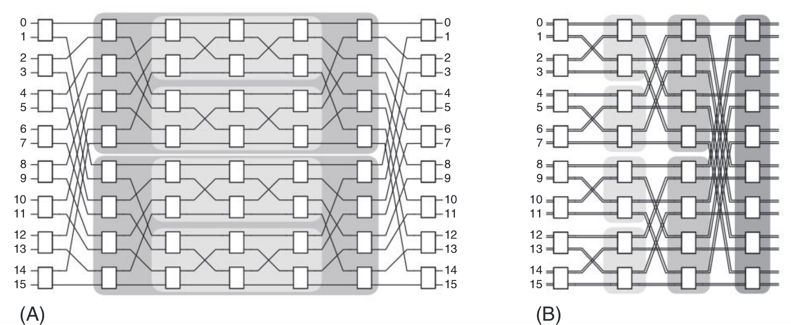
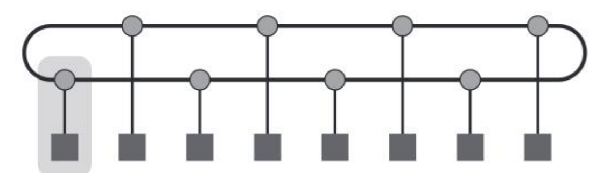

要减少 MIN 中的阻塞，就必须增加交换机，或者改用更大的交换机，为每个源到每个目的地提供备选路径。常用的办法有两种。第一种是给 MIN 增加至少 $\log_k N - 1$ 级额外的交换机，新增的各级与原有拓扑互为镜像。这样得到的网络是*可重排无阻塞*（rearrangeably nonblocking）的：新的源–目的对之间能够建立互不冲突的路径；代价是跳数加倍，而且可能要在某种集中控制下，重新安排一些正在通信的源–目的对的路径。第二种办法不增加交换机的级数，而是在另外两级交换机之间放置更大的交换机（需要的话，大交换机本身也可以用多级实现）。中间级交换机提供了足够多的备选路径，第一级和最后一级之间就总能建立互不冲突的路径。这种办法最著名的例子是 Clos 网络，它是无阻塞的。三级 Clos 拓扑的多路径性质可以递归地用到中间级交换机上：假定第一级和最后一级本来就用 $2 \times 2$ 交换机，递归下去就能把所有交换机都缩小到 $2 \times 2$。这样得到的是 Beneš 拓扑，共 $2(\log_2 N) - 1$ 级，是可重排无阻塞的。[图 F.12](#fig-f-12)(a) 同时画出了这两种拓扑，其中除第一级和最后一级以外的所有交换机，（递归地）构成 Clos 网络的中间级交换机。

前面介绍的 MIN 都使用单向网络链路。对 Clos、Beneš 这样的对称网络，只要对折一下，就很容易得到双向的形式：重叠在一起的单向链路方向相反，合成双向链路；重叠在一起的交换机合并成一个端口数加倍的交换机（即 $4 \times 4$ 交换机）。[图 F.12](#fig-f-12)(b) 就是这样得到的折叠 Beneš 拓扑，不过这里端节点连在原 Beneš 网络最内一级的交换机上。网络另一侧的端口空闲着，以后可以用来把网络扩展到更大的规模。这类网络称为*双向多级互连网络*。它们有许多有用的性质：一是模块化；二是能够利用通信的局部性，包不必穿过网络的所有级；三是结构规整，路由的复杂度因此降低；四是有多条路径，流量可以更均匀地分布到网络资源上，网络也能容忍故障。

{#fig-f-12 width=90%}

构造具有无阻塞（可重排）性质的双向 MIN，还有一种办法：构造一棵平衡树，端节点设备位于树叶，交换机位于树的内部顶点。树的每一层都要提供足够多的链路，使各层的链路总带宽保持不变。此外，除根以外，每个顶点的交换机端口数一般按 $k^i \times k^i$ 增长，$i$ 是树的层次。做法是每个顶点总共使用 $k^{i-1}$ 个交换机，每个交换机有 $k$ 个输入端口和 $k$ 个输出端口，即 $k$ 个双向端口（$k \times k$ 个输入–输出端口）。具有这种拓扑的网络称为*胖树*（fat tree）网络。每个方向只用到 $k$ 个双向端口中的一半，因此每一级需要 $2N/k$ 个交换机，整个胖树共有 $2N/k\,(\log_{k/2} N)$ 个交换机。根这一级不需要向上的链路，交换机数可以减半，交换机总数于是减少 $N/k$。[图 F.12](#fig-f-12)(b) 就是一个由 $4 \times 4$ 交换机构成的胖树，可以看出，它与折叠 Beneš 网络完全相同。

在采用多级互连网络的商用系统中，大多数在很宽的规模范围内都首选胖树拓扑。多计算机机群使用的 SAN 大多基于胖树，最强大的超级计算机中也有许多采用胖树。Myrinet、Mellanox 和 Quadrics 提供的商用通信子系统，也都是用胖树构建的。

### 分布式交换网络 {-}

前面讲过，交换介质网络为设计通信子系统提供了非常灵活的框架，这类子系统位于需要通信的设备之外。但在有些场合，把端节点设备和供它们通信的网络资源更紧密地集成在一起会更方便。这时交换结构不再集中在一个外部子系统中，而是把网络交换机分布到各个端节点上，端节点于是成为*网络节点*，简称*节点*，得到的网络称为*分布式交换网络*。这样，每个网络交换机都直接连着一个或多个端节点设备，两者合起来构成一个网络节点。节点之间直接相连，不必经过某个外部交换机，因此这类网络还有一个常用的名字：*直接网络*。

分布式交换网络与集中式交换网络的拓扑形式大不相同：端节点分布在整个交换结构上，而不只是连在交换结构外围的一两条边上。因此，系统中的交换机数等于节点总数。连接各节点最直接的办法，是在每个节点与网络中其他每个节点之间都连一条专用链路。这种*全连接*拓扑的连通性最好（实际上是完全连通），但成本比交叉开关网络还高，下面的例题说明了这一点。

**例题**　分别用全连接拓扑和交叉开关拓扑互连 $N$ 个节点，计算前者相对于后者的成本。单向链路的相对成本和交换机的相对成本分开考虑。假定 $k \times k$ 交换机的成本随单向端口数按平方增长，而 $1 \times k$ 交换机的成本只随端口数线性增长。

**解答**　交叉开关拓扑需要一个 $N \times N$ 交换机，交换机成本与 $N^2$ 成正比。链路成本为 $2N$，包括从端节点到集中式交叉开关的单向链路和反方向的单向链路。全连接拓扑中，$N$ 个节点每个都要用两组 $1 \times (N-1)$ 交换机（也可以合并成一组），把本节点直接连到其他所有节点，并接收其他所有节点的连接。因此，全部 $N$ 个节点的交换机总成本与 $2N(N-1)$ 成正比。链路方面，每个节点的端节点设备与本地交换机之间需要两条方向相反的单向链路；此外，每个节点的本地交换机还有 $N-1$ 条单向链路，连到分布在其他所有端节点上的交换机。因此，全部 $N$ 个节点的单向链路总数是 $2N + N(N-1)$，即 $N(N+1)$。于是，全连接拓扑相对于交叉开关的成本为：

$$
\text{相对成本}_{\text{交换机}} = 2N(N-1)/N^2 = 2(N-1)/N = 2(1 - 1/N)
$$

$$
\text{相对成本}_{\text{链路}} = N(N+1)/2N = (N+1)/2
$$

互连的设备越多，全连接拓扑的交换机成本就越接近交叉开关的 2 倍，而两者都很高（按平方增长）。全连接拓扑的相对链路成本也总是更高，并随节点数线性增长。这里再提醒一次：端节点链路与交换机之间的链路在长度和封装上都不一样，直接网络尤其如此，所以两者的成本通常也不同。全连接拓扑成本更高，但两者都是无阻塞的，它与交叉开关相比并没有额外的性能好处。因此，实际中通常使用交叉开关网络，而不用全连接网络。

比全连接成本低的一种办法，是沿着*环*拓扑把节点依次直接相连，如[图 F.13](#fig-f-13) 所示。在双向环中，$N$ 个节点每个只用一个 $3 \times 3$ 交换机和两条双向网络链路（由相邻节点共享），总共是 $N$ 个交换机和 $N$ 条双向网络链路。这一线性成本不包括节点内部所需的 $N$ 条注入–接收双向链路。

{#fig-f-13 width=60%}

与共享介质网络不同，环允许多个传输同时进行：第一个节点向第二个节点发送的同时，第二个节点可以向第三个节点发送，依此类推。但逻辑上不相邻的节点之间没有专用链路，包必须经过中间节点逐跳转发才能到达目的地，传输延迟因此增加。在双向环中，包可以沿任一方向传送，通常选择到目的地的最短路径。这时包平均要经过 $N/4$ 跳网络交换机，再算上源节点的本地交换机，交换机跳数总共还要加 1。在途中，其他包可能同时争用相同的资源，包因此可能在网络资源上阻塞。

全连接网络和环网络是分布式交换拓扑的两个极端，对于给定的成本–性能要求，两者之间还有许多值得考虑的选择。一般来说，理想的交换介质拓扑应当成本接近环，性能接近全连接拓扑。[图 F.14](#fig-f-14) 画出了三种流行的直接网络拓扑，从低成本到高性能的各类系统都常用它们。这三种拓扑都由沿多个维度排列的节点组成，节点之间按规则的模式互连，可以用数学式表达。在*网格*（mesh 或 grid）拓扑中，每一维上的所有节点构成一个线性阵列；在*环面*（torus）拓扑中，每一维上的所有节点构成一个环。这两种拓扑都让相邻节点直接通信，目的是让包在网络中经过的跳数比环少。具体做法是增加维数来提高连通性，商用系统中一般不超过三维。*超立方体*（hypercube，又称 *n-立方体*）拓扑是网格的一个特例：每一维上只互连两个节点，因此维数 $n$ 必须足够大，才能互连系统中的全部 $N$ 个节点（即 $n = \log_2 N$）。超立方体的连通性比网格和环面好，代价是链路成本和交换机成本更高（按每个节点的链路数和端口数计）。

{#fig-f-14 width=70%}

**例题**　分别用环面拓扑和胖树拓扑互连 $N$ 个设备，计算前者相对于后者的成本。双向链路的相对成本和交换机的相对成本分开考虑，假定交换机成本随双向端口数按平方增长。另外给出交换机大小相近时的近似表达式。

**解答**　使用 $k \times k$ 交换机，并假定最后一级（根）的交换机数与其他各级相同，胖树需要 $2N/k\,(\log_{k/2} N)$ 个交换机。每个交换机有 $k$ 个双向端口（$k \times k$ 交换机有 $k$ 个输入端口和 $k$ 个输出端口），交换机成本随端口数按平方增长，因此网络的交换机总成本与 $2kN \log_{k/2} N$ 成正比。$\log_{k/2} N$ 级中每一级都需要 $N$ 条双向链路（包括设备与胖树之间的链路），所以链路成本为 $N \log_{k/2} N$。环面需要的交换机数与节点数相同，每个交换机有 $2n+1$ 个双向端口（包括连接通信设备的端口），$n$ 是维数。因此，环面的交换机总成本为 $(2n+1)^2 N$。每个环面节点需要 $2n+1$ 条双向链路，分别用于 $n$ 个不同的维度和连接本节点的端节点设备；但各维的链路由两个节点共享，所以全部 $N$ 个节点的双向链路总数为 $(2n/2 + 1)N = (n+1)N$。于是，环面拓扑相对于胖树的成本为：

$$
\text{相对成本}_{\text{交换机}} = (2n+1)^2 N / 2kN \log_{k/2} N = (2n+1)^2 / 2k \log_{k/2} N
$$

$$
\text{相对成本}_{\text{链路}} = (n+1)N / N \log_{k/2} N = (n+1)/\log_{k/2} N
$$

交换机大小相近时，$2n+1 \approx k$，这时相对成本为：

$$
\text{相对成本}_{\text{交换机}} = (2n+1)^2 / 2k \log_{k/2} N = (2n+1)/2\log_{k/2} N = k/2\log_{k/2} N
$$

交换机的端口数（也称*交换机度数*）较小时，环面的成本较低，维数少时尤其如此；$N$ 很大时，这一性质特别有用。反过来，如果使用较大的交换机，或者环面的维数较高，胖树的成本就更低，因而更可取。例如，互连 256 个节点时，若使用 $4 \times 4$ 交换机，按交换机成本和链路成本计算，胖树的成本是环面的 4 倍；不过平均而言，胖树的网络争用较少，可以弥补这一较高的成本。若使用 $8 \times 8$ 交换机（例如互连 256 个节点），胖树与环面的成本相当。交换机再大，环面的成本就高于胖树，因为环面的每个节点都包含一个交换机。让每个交换机连接多个端节点设备，可以分摊这部分成本，这种做法称为 *bristling*。

[图 F.14](#fig-f-14) 中的拓扑有一个有趣的共同特点：网络链路规则地排列在若干个相互正交的维度上。实际上，这些拓扑都是一大类直接网络拓扑的特例，这一大类拓扑称为 *k 元 n 立方体*（k-ary n-cube），$k$ 是 $n$ 个维度中每一维上互连的节点数。这些拓扑对称、规则，网络的实现（即封装）和包的路由都因此简化：包沿某一维移动时，它在其他任一维上距目的地剩余的跳数不变。下一节将会看到，简单的路由算法就能直接利用这一拓扑性质。

与间接网络一样，直接网络中同时请求同一条路径（或路径的一部分）的包之间也可能发生阻塞，唯一的例外是全连接网络。间接网络可以用更大的交换机减少级数和交换机跳数；同样，直接网络可以提高交换机度数、增加拓扑的维数，从而减少跳数。

对于一定规模和交换机成本的系统，似乎总是让维数尽可能多才好，但事实并不一定如此。大多数电子系统是在我们这个三维（3D）世界里，用集成电路芯片、印制电路板、背板等平面（2D）封装技术构建的。不超过三维的直接网络，在这个三维空间中可以用比较短的链路实现，与系统规模无关；维数更高的网络，链路就需要越来越长的导线或光纤。链路长度随系统规模增长，这也是 MIN（包括胖树）的特点：MIN 要么所有级都需要长链路，要么每增加一级，链路就更长一些。[F.2 节](#sec-f-2)的第一个例题讲过，带流量控制的缓冲区随链路长度成正比增大，需要的硅片面积也就更大。2005 年计算节点数最多的超级计算机 IBM Blue Gene/L 采用三维环面网络实现处理器间通信，这就是原因之一。如果用胖树，就需要长得多的链路，64K 个节点的系统也就更难实现。由此可见，为系统选择满足要求的网络拓扑非常重要。

除了链路长度，实现拓扑时还有其他约束，也可能限制拓扑能够扩展的程度，这就是可用的引脚数和可实现的对分带宽。引脚数是一种局部限制，它限制芯片、印制电路板、背板（或机箱）连接器的带宽。在把处理器核与交换机集成在同一芯片或多芯片模块上的直接网络中，引脚带宽既要用于连接主存，又要用于实现节点链路。这时，引脚数有限，就可能减少交换机端口数或每条链路的位线数。在间接网络中，交换机与处理器核分开实现，大部分引脚可以专用于通信带宽。但交换机要成组地装到电路板上，对于给定的拓扑，一块板上交换结构所有输入–输出链路的总和，不能超过板上连接器的引脚数。

对分带宽是一种更全局的限制，它反映了某种实现（封装）技术所能达到的互连密度和带宽。互连密度与时钟频率相互关联：导线排得越密，串扰和寄生电容就越大，通常只能降低时钟频率。例如，金属层的数量和间距限制了片上网络的布线密度和频率，铜走线密度限制了印制电路板上的布线密度和频率。网络拓扑要能够实现，就不能超出实现技术可提供的对分带宽。迄今实现的大多数网络，受引脚数的限制比受对分带宽的限制更大，近来转向刀片式系统以后尤其如此。尽管如此，对分带宽仍然在很大程度上影响性能。

对于给定的拓扑，对分带宽 $\text{BW}_{\text{Bisection}}$ 这样计算：把网络分成大致相等的两部分，每部分各有一半节点，然后把穿过这条假想分界线的各条链路的带宽相加。对于不对称的拓扑，对分带宽取网络所有等分方式中的最小值。全连接网络的对分带宽与 $N^2/2$ 条单向链路（或 $N^2/4$ 条双向链路）成正比，$N$ 为节点数。总线的对分带宽就是那一条共享半双工链路的带宽。其他拓扑的值介于这两个极端之间。网络注入和接收的对分带宽常用作参考值：网络分别有 $N$ 条注入链路和 $N$ 条接收链路时，这个值是 $N/2$。凡是能提供这一对分带宽的网络拓扑，都称为具有*全对分带宽*。

[图 F.15](#fig-f-15) 汇总了本节讨论的几种拓扑在互连 64 个节点时的各项指标：所需的交换机数和链路数、相应的交换机大小、节点间最大和平均的交换机跳距，以及以链路数表示的对分带宽。

### 拓扑对网络性能的影响 {-}

在交换网络拓扑中，包要经过一跳或多跳才能到达目的地，每一跳是指包穿过一个交换机及其一条对应链路。有趣的是，每个交换机及其对应链路都可以看作上一节所说的、连接两个以上设备的黑盒网络，只是这里的「设备」指端节点或其他交换机。区别只有两点：一是经过交换机时，发送开销和接收开销为零；二是路由、交换和仲裁延迟不是累计的总延迟，而是每个交换机各自的延迟。

[图 F.15　64 个节点时几种网络拓扑的性能和成本。总线是标准参照，其网络链路成本和对分带宽为单位值。数值均按双向链路和双向端口计。跳数包括一个交换机及其输出链路，但不包括端节点的注入链路。除总线外，网络链路数和链路总数都包括端节点设备与网络之间的注入/接收链路。]{#fig-f-15 .caption}

| 评价类别 | 总线 | 环 | 二维网格 | 二维环面 | 超立方体 | 胖树 | 全连接 |
|---|---:|---:|---:|---:|---:|---:|---:|
| **性能** | | | | | | | |
| 以链路数计的 BW~Bisection~ | 1 | 2 | 8 | 16 | 32 | 32 | 1024 |
| 最大（平均）跳数 | 1 (1) | 32 (16) | 14 (7) | 8 (4) | 6 (3) | 11 (9) | 1 (1) |
| **成本** | | | | | | | |
| 每个交换机的 I/O 端口数 | NA | 3 | 5 | 5 | 7 | 4 | 64 |
| 交换机数 | NA | 64 | 64 | 64 | 64 | 192 | 64 |
| 网络链路数 | 1 | 64 | 112 | 128 | 192 | 320 | 2016 |
| 链路总数 | 1 | 128 | 176 | 192 | 256 | 384 | 2080 |

由此可知，如果平均每个包要经过 $d$ 跳才能到达目的地，那么 $T_R + T_A + T_S = (T_r + T_a + T_s) \times d$，其中 $T_r$、$T_a$、$T_s$ 分别是一个交换机的路由延迟、仲裁延迟和交换延迟。假定网络上的流水以包为单位在每一跳上分段进行（下一节将对这一假设提出质疑），传输延迟也要乘以跳数。最后再作一个简化假设：所有通往第一个交换机（或第一级交换机）的注入链路，以及所有从交换机出发的链路（包括接收链路），长度和延迟都大致相同。这样，网络的总传播延迟 $T_{\text{TotalProp}}$ 就等于单条链路的传播延迟 $T_{\text{LinkProp}}$ 乘以 $d+1$，即跳数再加上注入链路的 1。因此，网络中包的平均延迟在最好情况下的下界（即没有争用时的延迟）为：

$$
\begin{aligned}
\text{延迟} = {} & \text{发送开销} + T_{\text{LinkProp}} \times (d+1) + (T_r + T_a + T_s) \times d \\
& + \frac{\text{包大小}}{\text{带宽}} \times (d+1) + \text{接收开销}
\end{aligned}
$$

再说明一次，第 F-40 页上的这个表达式假定交换机能够以包为单位流水地传输包。

按照前面介绍的方法，找出端到端网络管道中最窄的一段，就能估计出有效带宽在最好情况下的上界。只看这条管道在网络内部的部分，网络带宽由拓扑的阻塞特性决定。要做到无阻塞，只能在每个源–目的对之间提供许多条备选路径，这样网络的总带宽就是网络总注入带宽或总接收带宽的许多倍，代价相当高。这种方案通常贵得无法承受，因此大多数网络都有不同程度的阻塞，拓扑提供的总带宽的利用率随之降低。这同样有代价，只不过不是性能上的代价。

网络中阻塞的程度取决于拓扑和流量分布。如果一种拓扑的对分带宽 $\text{BW}_{\text{Bisection}}$ 是可以实现的（通常如此），就可以用它作为衡量网络最大阻塞程度的一个常量。理想情况下，不管流量行为如何，网络总能达到全对分带宽，瓶颈于是转移到注入链路或接收链路上。但是，发往网络另一半的包必须穿过对分链路，这些链路就成了潜在的瓶颈，可能使网络带宽降到全对分带宽以下。所幸并非所有流量都必须穿过网络的对分界面，拓扑提供的总网络带宽因此能更多地得到利用。另外，对分链路越多的拓扑，到达目的地的备选路径越多，阻塞往往越少，总网络带宽的利用率也就越高。如果只有一部分流量必须穿过网络的对分界面，并用*对分流量比例*参数 $\gamma$（$0 < \gamma \le 1$）表示这一比例，那么只要流量分布使对分链路的平均负载至少与其他网络链路一样重，对分界面处的网络管道实际上就加宽为原来的 $1/\gamma$ 倍。由此得到可达到的网络带宽 $\text{BW}_{\text{Network}}$ 的上限：

$$
\text{BW}_{\text{Network}} = \frac{\text{BW}_{\text{Bisection}}}{\gamma}
$$

于是，考虑网络拓扑以后，有效带宽的表达式变为：

$$
\text{有效带宽} = \min\left(N \times \text{BW}_{\text{LinkInjection}},\ \frac{\text{BW}_{\text{Bisection}}}{\gamma},\ \sigma \times N \times \text{BW}_{\text{LinkReception}}\right)
$$

要特别注意，$\gamma$ 在很大程度上取决于应用程序产生的流量模式，它要靠测量得到，或者通过详细的流量分析算出。

**例题**　科学计算程序中有一种常见的通信模式：二维数组中最近相邻的元素沿某个给定方向通信。这种模式有时称为 *NEWS 通信*，NEWS 代表罗盘上的四个方向：北（north）、东（east）、西（west）、南（south）。把一个 $8 \times 8$ 的元素数组一一映射到 64 个端节点设备上，这些设备分别用以下拓扑互连：总线、环、二维网格、二维环面、超立方体、全连接和胖树。假定包可以使用拓扑提供的任何一条最短路径，在最好情况下，每个节点向它北面的相邻节点发送一条消息、再向东面的相邻节点发送一条消息，需要多长时间？相应的有效带宽是多少？没有北面或东面相邻节点的元素不考虑。为了简化分析，假定所有网络中包每经过一个网络跳的传输时间都是一个单位时间，即每一跳的 $T_{\text{LinkProp}}$、$T_r$、$T_a$、$T_s$ 和包传输时间之和为 1。还假定注入链路的延迟已包括在这个单位时间内，发送开销和接收开销为零。

**解答**　这种通信模式总共要发送 $2 \times (64 - 8)$ 即 112 个包，北向和东向两个通信阶段各 56 个。包经过的跳数取决于拓扑。源与目的地之间是一对一通信，所以 $\sigma$ 为 100%。注入带宽和接收带宽把有效带宽限制在最多 64 个 BW 单位（尽管这种通信模式只需要 56 个 BW 单位）。但这个最大值还可能因可达到的网络带宽而打折扣，网络带宽由对分带宽和穿过对分界面的流量比例 $\gamma$ 决定，两者都与拓扑有关。下面分情况讨论：

* *总线*　$8 \times 8$ 数组元素怎样映射到节点，对总线没有区别，因为所有节点之间的距离都一样，都是一跳。但 112 次传输只能依次进行，总共需要 112 个单位时间。对分带宽为 1，$\gamma$ 为 100%，因此有效带宽只有 1 个 BW 单位。
* *环*　假定数组的第一行映射到节点 0～7，第二行映射到节点 8～15，依此类推。所有节点同时向东面的相邻节点发送（即从节点 $i$ 发往节点 $i+1$），只需要一个单位时间。在这种映射下，每个节点北面的相邻节点恰好在 8 跳之外，因此需要 8 个单位时间，同样是所有节点并行进行。总通信时间因此为 9 个单位时间。对分带宽为 2 条双向链路（假定是双向环），低于 32 条双向链路的全对分带宽。东向通信时，最坏情况下 56 个东向包中只有 2 个必须穿过对分界面，所以对分链路不会成为瓶颈。北向通信时，56 个包中有 8 个必须穿过这两条对分链路，得出 $\gamma = 10/112 = 8.93\%$。因此，网络带宽为 $2/0.0893 = 22.4$ 个 BW 单位，有效带宽也被限制在 22.4 个 BW 单位，不到这种通信模式所需带宽的一半。
* *二维网格*　我们这个 64 节点的网格有 8 行 8 列，与 NEWS 通信完全吻合。所有节点先同时向北面的相邻节点发送，再同时向东面的相邻节点发送，总共只需要 2 个单位时间。对分带宽为 8 条双向链路，低于全对分带宽。但这种最近邻通信模式与这种拓扑完全吻合，所以仍能达到最大有效带宽。东向通信时，最坏情况下 56 个包中有 8 个必须穿过对分界面，没有超过对分带宽。北向通信则没有一个包穿过同一个网络对分界面，得出 $\gamma = 8/112 = 7.14\%$，网络带宽为 $8/0.0714 = 112$ 个 BW 单位。因此，有效带宽受通信模式的限制，为 56 个 BW 单位，而不是受网格网络的限制。
* *二维环面*　这种通信模式用不到环面的回绕链路，所以环面的映射和性能与网格相同。
* *超立方体*　超立方体由 8 个 3-立方体组成。假定每一行的元素都映射到各个 3-立方体中的同一位置，并使同一行中相邻的元素映射到只相距一跳的节点上。北面的相邻节点也可以类似地映射到在另一个正交维度上只相距一跳的节点。因此，这种通信模式只需要 2 个单位时间。超立方体提供 32 条链路的全对分带宽，但 112 个包中最多只有 8 个必须穿过对分界面。因此，有效带宽只受通信模式的限制，为 56 个 BW 单位，不受超立方体网络的限制。
* *全连接*　这时不管怎样映射，所有节点之间的距离都一样，都是一跳。如果注入链路和接收链路每次能发出和接收两个包，北向和东向的包并行传输只需要 1 个单位时间。但实际并非如此，所以需要 2 个单位时间。有效带宽受通信模式的限制，为 56 个 BW 单位，因此网络的 1024 条对分链路大部分没有得到充分利用。
