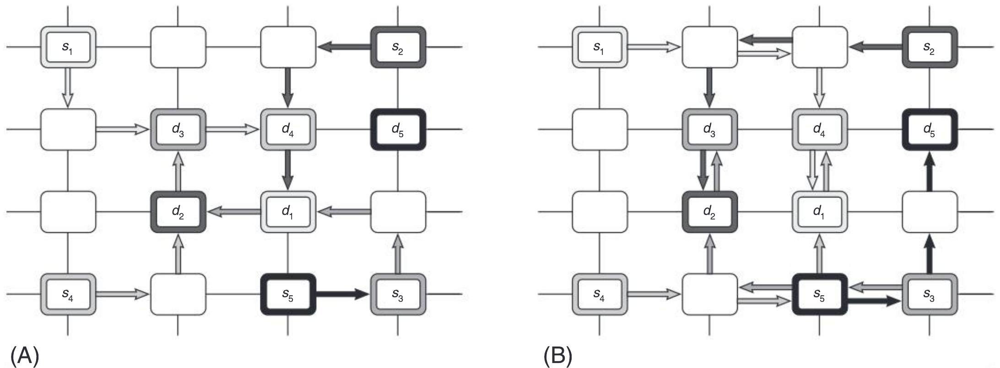
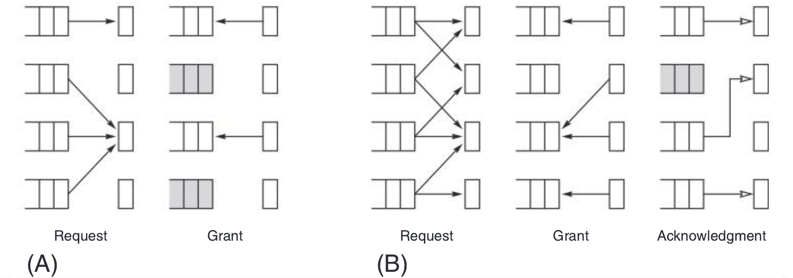

* **胖树。** 假定元素到节点的映射与环相同，交换机有 8 个双向端口。节点分成 8 组，每组 8 个节点由 3 个双向级互连，因此所有节点可以同时向东邻居通信，最多经过 3 跳，即 3 个时间单位。每个节点的北邻居在相邻的那一组里，需要 5 跳，即 5 个时间单位。于是，胖树上总共需要 8 个时间单位。胖树提供完全的对分带宽，所以在最坏情况下，即一半流量要穿过对分界面时，只要连续不断地注入包，有效带宽仍能达到 56 个 BW 单位。这一数值受限于通信模式，而不是受限于胖树网络。

不要因为上面这个例题就错误地认为：网格与环面、超立方体、胖树以及其他对分带宽更高的网络一样好。为了便于分析，例题作了一些简化假设，这些假设对低对分带宽的网络有利。实际上，包一般比链路宽度大，占用链路的时间远远不止一个网络周期。许多通信模式也不能这样整齐地映射到二维网格拓扑上，它们通常更具全局性，也更不规则。这些因素和其他因素合在一起，使包在低对分带宽网络中更容易阻塞，于是延迟增加，有效带宽下降。

[图 F.16](#fig-f-16) 列出了商用高性能计算机所用拓扑的各种属性，可以把以上对拓扑的讨论放到更大的背景中来看。

[图 F.16　商用高性能计算机所用互连网络的拓扑特性]{#fig-f-16 .caption}

| 公司 | 系统［网络］名称 | 最大节点数［× 每节点 CPU 数］ | 基本网络拓扑 | 注入［接收］节点带宽（MB/s） | 每条链路每个方向的数据位数 | 每个方向的原始网络链路带宽（MB/s） | 原始网络对分带宽（双向，GB/s） |
|---|---|---|---|---|---|---|---|
| Intel | ASCI Red Paragon | 4816［×2］ | 二维网格 64 × 64 | 400［400］ | 16 位 | 400 | 51.2 |
| IBM | ASCI White SP Power3［Colony］ | 512［×16］ | 由 8 端口双向交换机构成的双向 MIN（通常为胖树或 Omega） | 500［500］ | 8 位（另加 1 位控制） | 500 | 256 |
| Intel | Thunder Itanium2 Tiger4［QsNet^II^］ | 1024［×4］ | 由 8 端口双向交换机构成的胖树 | 928［928］ | 8 位（另加 2 位控制，用于 4b/5b 编码） | 1333 | 1365 |
| Cray | XT3［SeaStar］ | 30,508［×1］ | 三维环面 40 × 32 × 24 | 3200［3200］ | 12 位 | 3800 | 5836.8 |
| Cray | X1E | 1024［×1］ | 4 路 bristled 二维环面（约 23 × 11），带快速链路 | 1600［1600］ | 16 位 | 1600 | 51.2 |
| IBM | ASC Purple pSeries 575［Federation］ | >1280［×8］ | 由 8 端口双向交换机构成的双向 MIN（通常为胖树或 Omega） | 2000［2000］ | 8 位（另加 2 位控制，用于新型 5b/6b 编码方案） | 2000 | 2560 |
| IBM | Blue Gene/L eServer Sol.［Torus Net.］ | 65,536［×2］ | 三维环面 32 × 32 × 64 | 612.5［1050］ | 1 位（位串行） | 175 | 358.4 |

## 网络路由、仲裁和交换 {#sec-f-5}

在交换介质网络中，不论拓扑是什么，包所经路径上的每台交换机都要完成路由、仲裁和交换。文献中提出过许多有意思的技术来完成这些功能。本节着重介绍商用系统在较常用的拓扑上采用的一些有代表性的方法，并说明它们对性能的影响。

### 路由 {-}

*路由算法*规定每个包可以走哪一条或哪几条网络路径。理想情况下，路由算法为所有包提供最短路径，并让流量负载均匀地分布在各条链路上，从而把竞争降到最低。但是，为了保证不论流量怎样变化，所有包都能送达，拓扑提供的某些路径可能不能使用。例如，如果允许包从源节点出发走无限多个非最短跳，包就可能永远到不了目的节点，这种情况称为*活锁*。同样，有些路径会使一组包在网络中永远阻塞：每个包都只是在等待同组其他包占用的网络资源（链路或与链路关联的缓冲区），结果谁也到不了目的节点，这种情况称为*死锁*。死锁源于网络资源有限，因此网络流量越大、可用资源越少，发生死锁的概率就越高。死锁有多种形式，例如路由死锁、请求-应答（协议）死锁、故障引起的（重配置）死锁等。网络要正常工作，路由算法就必须防止这类异常。同时，网络要提供尽可能高的性能，路由算法又必须高效：在最好的情况下，拓扑提供多少条路径，就允许包有多少种路由选择。

防止活锁最简单的办法是限制路由，只允许走从源节点到目的节点的最短路径；限制宽松一些的，则只允许有限个非最短跳。最严格的限制还有一个好处，即消耗的网络带宽最少；但最短路径上出现竞争或故障时，包也无法改走其他非最短路径。

防止死锁要难一些。实际中常用两种策略：避免和恢复。所谓*死锁避免*，就是路由算法只允许包走那些能使整个网络状态保持无死锁的路径。常用的做法是：先在一组资源之间建立顺序，这组资源是支持网络完全访问所需的最小资源集；再按某种全序或偏序把这些资源分配给包，使这些资源上不会形成循环依赖。这样，不论包处在网络中什么位置，总有一条逃逸路径可供它使用，因此不会进入死锁状态。*死锁恢复*则在分配资源时不考虑避免死锁。既然可能发生死锁，就要用某种机制检测是否可能已经出现死锁。检测到死锁后，把一个或多个包从死锁集合的资源上移走，办法可以是退行式地丢弃这些包，也可以是进行式地把它们转到专门的死锁恢复资源上。腾出来的网络资源再分配给需要它们的其他包，死锁就解除了。

下面考虑为分布式交换网络设计的路由算法。[图 F.17](#fig-f-17)(a) 画出了二维网格网络某个区域内包的一种死锁格局，可能的死锁格局还有很多。如果路由算法只允许使用按某种全序依次穿过各个维度的最短路径，就能避免所有这类死锁（以及活锁）。具体地说，只有当包为了到达目的节点不再需要前面各维中的任何链路时，路由算法才把某一维的链路提供给它。[图 F.17](#fig-f-17)(b) 说明了这一点，图中按 XY 维序穿过各个维度。所有包都必须按同样的顺序穿过各维，只有在某一维中不再需要链路时，才能离开这一维。这就是著名的*维序路由*（DOR），在超立方体中称为 *e-cube 路由*。许多用分布式交换网络构建的商用系统以及片上网络都采用这种算法。它对给定的源-目的节点对总是提供同一条路径，因此是一种*确定性路由*算法。

{#fig-f-17 width=90%}

在支持网络完全访问所需的某个最小资源集上按顺序穿过各维，可以避免网格和超立方体中的死锁。但是，带回绕链路的分布式交换拓扑（如环和环面）如果要满负荷使用资源，还需要在每一维内部的某个最小资源集上建立全序。另一种办法是在各维中留出一些空资源，即*气泡*（bubble），使资源保持在满负荷以下，从而避免死锁。为了允许完全访问，要么复制物理链路，要么复制每条链路关联的逻辑缓冲区，分别得到*物理通道*或*虚通道*，顺序就建立在这些通道上。避免死锁并不需要给所有网络资源排序，只需要给支持网络完全访问所需的某个最小资源集（即某个*逃逸资源集*）排序。这种技术称为 Duato 协议。基于它定义的路由算法，对给定的源-目的节点对，除了逃逸资源集，还允许使用拓扑提供的其他路径。包必须从允许的路径中选一条，最好选效率最高的一条。根据当时的网络流量状况调整路径，可以更好地利用网络的总带宽，并减少竞争。这种路由能力称为*自适应路由*，许多商用系统都采用了它。

**例题**　在 n 维网格网络上，维序路由消除了多少种可能的维间转向？在保持连通性和无死锁的前提下，实际最少需要消除多少种转向？用二维网格网络说明。

**解答**　维序路由恰好消除了一半可能的维间转向。这一点很容易证明：从任何低序维转入任何高序维的转向都是允许的，反过来则不允许。例如，[图 F.17](#fig-f-17) 所示的二维网格中共有 8 种可能的转向，其中 X+ 到 Y+、X+ 到 Y−、X− 到 Y+、X− 到 Y− 这 4 种转向是允许的，符号（+ 或 −）表示在某一维内的行进方向；Y+ 到 X+、Y+ 到 X−、Y− 到 X+、Y− 到 X− 这 4 种转向是不允许的。消除这些转向可以防止形成任何形式的环，从而避免死锁，同时保持网络连通。但代价是路由完全没有自适应性。

转向模型（Turn Model）路由算法证明：为了防止形成环并保持连通，最少要消除四分之一的可能转向，但要消除的那一组转向必须选对。只有消除某些特定的转向组，才能同时满足这两个要求。如果选错了这四分之一，允许的转向组合起来就可能模拟出被消除的转向（从而形成环和死锁），或者网络不再连通。以二维网格为例，可以只消除最终朝西的两种转向（即 Y+ 到 X− 和 Y− 到 X−），同时要求需要向西走的包一开始就向西走，以保持连通。这种路由称为*西向优先*路由，二维网格上与它类似的还有*负向优先*路由和*北向最后*路由。这些算法比维序路由多允许四分之一的转向，因而有了部分自适应性，属于自适应路由算法。

集中式交换网络同样可以按某种全序或偏序限制资源的使用，以此定义避免死锁的路由算法。在胖树中，可以沿着从输入叶子级向上到根、再向下回到输出叶子级的路径，给资源建立全序。路由算法允许包按递增的偏序使用资源：先沿树向上，到达源节点和目的节点的某个*最小公共祖先*（LCA），再沿树向下，直到目的节点。一个给定的目的节点有许多个最小公共祖先，向上走时就有多条路径可选，因此这种路由算法是自适应的。但是，在胖树拓扑中，从一个最小公共祖先到目的节点只有一条确定的路径。许多 MIN 都有这种自路由性质，而且很容易利用：每一级交换机的输出端口只需把目的节点地址移位就能得到。

更一般地，可以把一个树形图映射到任何拓扑上，不论是直接网络还是间接网络。同一树层上节点之间的链路也可以使用，办法是给它们指定方向：「上」表示朝树根走，「下」表示离开树根。这样，在任何拓扑上都可以定义通用的 *up\*/down\* 路由*：包到达目的节点所走的路径（可能是自适应选择的）由零条或多条上行链路后接零条或多条下行链路组成。上/下顺序可以防止形成环，从而避免死锁。自配置的交换式 LAN Autonet 和早期的 Myrinet SAN 都使用了这种路由技术。

实际实现路由算法时，要把两部分结合起来：一是源节点放在包头部中的路由信息，二是交换机中的路由控制机制。在*源路由*中，源节点预先算好整条路径（可能通过查表），放在包头部中。路由信息通常是预定路径上每台交换机的一个或多个输出端口，每台交换机的路由控制机制可以把属于自己的那部分剥掉。头部中还可以加一个位字段，表示是否允许自适应路由（即所给的输出端口中任何一个都可以用）。在*分布式路由*中，路由信息通常就是目的地址。路径上每台交换机的路由控制机制根据目的地址确定下一个输出端口，办法有两种：一是用有限状态机计算，二是查本地路由表（即转发表）。与分布式路由相比，源路由简化了交换机内部的路由控制机制，但每个包头部需要更多的路由位，头部开销因此增大。

### 仲裁 {-}

*仲裁算法*决定包所请求的网络路径什么时候可以使用。理想情况下，仲裁器让空闲的网络资源与请求这些资源的包尽可能多地配对。具体到一台交换机，就是让空闲的输出端口与输入端口中请求这些输出端口的包尽可能多地配对。如果所有请求不能同时得到满足，交换机仲裁器就要公平地把输出端口授予包，以此解决冲突，防止某些包始终得不到所请求的资源，即发生*饥饿*。例如，采用服务最长队列（SLQ）方案时，较短队列中的包就可能饥饿。对于优先级相同的包，简单的轮转（RR）方案或基于包龄的方案已经足够公平，实现也很简单。

仲裁可以分布开来，以避免集中式瓶颈。一种简单的技术分两个阶段：请求阶段和授权阶段。假定交换机的每个输入端口都有一个队列，存放到来的包；每个输出端口都有一个本地仲裁器，采用轮转策略。[图 F.18](#fig-f-18)(a) 给出了一台 4 端口交换机上可能的一组请求。在*请求阶段*，每个输入端口队首的包向所请求的输出端口的仲裁器发出一个请求。然后，各输出端口仲裁器独立地在收到的请求中仲裁，只选出一个。在*授权阶段*，每个仲裁器把所请求的输出端口授予选中的那个请求。如图所示，来自不同输入端口的两个包请求同一个输出端口时，只有一个能得到授权。结果，尽管所有输入队列都有包要发送，仍有一部分输出端口带宽没有用上。

{#fig-f-18 width=80%}

这种简单的两阶段技术可以改进：允许每个输入端口同时发出几个请求，这些请求可能来自不同的虚通道，也可能来自多种自适应路由选择，发往不同的输出端口仲裁器。每个输入端口提交不止一个请求，配对成功的概率就会提高。这时仲裁需要三个阶段：请求、授权和确认。[图 F.18](#fig-f-18)(b) 给出了每个输入端口的包最多可以发出两个请求的情形。在请求阶段，请求提交给输出端口仲裁器，这些仲裁器和两阶段仲裁一样，从收到的请求中选出一个。在授权阶段，同样把授权发给被选中请求的请求者。一个输入端口可以提交不止一个请求，因此可能收到不止一个授权，这时它用某种仲裁策略（如轮转）从中选一个。在确认阶段，输入端口把选中的授权确认给相应的输出端口仲裁器。

从[图 F.18](#fig-f-18)(b) 可以看出，可能出现这样的情况：某个输入端口提交了几个请求，却一个授权也没得到，而它所请求的端口中有些仍然空闲。因此，再做一轮仲裁迭代可以提高配对成功的概率。这一轮只提交尚未配对的输入端口和输出端口之间的请求。迭代仲裁器允许每个输入端口发出多个请求，能够提高交换机输出端口的利用率，从而提高网络链路带宽的利用率。但代价是仲裁器更复杂、仲裁延迟更长；如果仲裁处在关键路径上，路由器的时钟周期可能因此变长。

### 交换 {-}

*交换技术*规定网络中怎样建立连接。理想情况下，从时间和空间两方面看，网络资源之间的连接只在真正需要时才建立（即「接通」），恰好在资源准备就绪、需要使用的那一刻接通，并且只保持到不再需要为止。这样，相互竞争的流量能够高效地利用可用的网络带宽，延迟也最小。路由算法允许、仲裁算法授权的路径上，每一跳的连接有三种基本的建立时机：一是在包到达之前，即*电路交换*；二是在收到整个包之后，即*存储转发*包交换；三是只收到包的一部分时，这部分不小于包头部，即*直通*（cut-through）包交换。

*电路交换*事先建立一条电路，在整条源-目的路径上为包的传输分配网络带宽。在路径的每一跳设置缓存级，包就可以在电路上流水传输，这种技术称为*流水电路交换*。由于一个或多个包只需做一次路由、仲裁和交换，包头部中不需要路由位，延迟和开销因此降低。如果电路建立以后，设备之间在这条电路上连续不断地传送信息，这种方式的效率可以很高。但是，网络带宽从共享资源池中拿出来预先分配，不管源节点是否需要使用，因此电路交换也可能效率很低，严重浪费带宽。

包断断续续地传送是更常见的情况，这时*包交换*可以让网络带宽得到共享，利用得更有效。包交换主要有两种：存储转发交换和直通交换。两者都以包或更小的信息单位为粒度多路复用链路带宽，因此来自不同源节点的包能更好地共享带宽。但是，共享的粒度越细，交换所需的开销也越大：每个包都要做路由、仲裁和交换；如果使用流量控制，每个包还需要路由位和流量控制位。

*存储转发*包交换的做法是：包先完整地存放（缓存）在接收方交换机中，然后才沿源-目的路径转发到下一跳。由于包在发送之前已经完整地存放在每台交换机中，各条链路完全解耦，即使链路带宽差别很大，也能充分利用每条链路的带宽。这一性质在 WAN 中非常重要，代价则是包延迟：总的路由、仲裁和交换延迟与跳数是相乘关系。[F.4 节](#sec-f-4)按这一假定分析性能时，我们已经看到了这一点。

*直通*包交换的做法是：只要包的头部（或者跟在头部后面的同等数量的有效载荷）已经缓存在接收方交换机中，包就可以流水式地「直通」交换机。也就是说，不必等包的其余部分到达，就可以接通所授予的资源。这样，路由、仲裁和交换延迟与跳数是相加关系，而不是相乘关系，包的总延迟因此降低。直通交换有两种，主要区别在于实施流量控制的信息单位大小不同，对交换机缓冲区的要求也因此不同。*虚拟直通*（virtual cut-through）交换在包一级实施流量控制；*虫孔交换*（wormhole switching）则在流量控制单位（即 *flit*）上实施流量控制，flit 比最大包长小，但通常至少与包头部一样大。虫孔交换机只需要能存放包的一小部分，因此在网络中阻塞的包可能横跨几台交换机，进而使其他包阻塞在它所占用的链路上，导致网络过早饱和、有效带宽下降。解决办法是在交换机内部用某种集中式缓冲区存放这些包，这种技术称为*带缓冲的虫孔交换*。按目前的工艺，芯片可以实现较大的缓冲区，因此虚拟直通是更常用的交换技术。不过，在以尽量节省硅资源为目标设计的 OCN 中，可能仍然首选虫孔交换。

虫孔交换造成的网络过早饱和可以缓解，办法是在 flit 一级做时分复用交换，让几个包同时共享一条链路的物理带宽。这要求物理链路两端各有一组虚通道（即前面提到的逻辑缓冲区），包被交换到这些虚通道中。前面我们看到，虚通道可以把物理链路带宽与缓存的包解耦，从而避免死锁。这里虚通道的多路复用方式是：即使一个包和前面某个阻塞的包共用某些链路，带宽也能接通给这个包的 flit 使用，让它继续前进。这同样使网络带宽利用得更有效，平均包延迟随之降低。

### 对网络性能的影响 {-}

路由、仲裁和交换能减少包遇到的竞争延迟，从而影响有负载网络中的包延迟。在没有竞争的空载网络中，路由算法和仲裁算法对延迟没有其他影响，只决定交换机实现这些功能所需的延迟；交换机芯片从引脚到引脚的延迟一般是几十纳秒。上一节给出的最好情况包延迟表达式中，唯一要改的部分来自交换技术。前面假定的是存储转发包交换，整个包的传输延迟在全部 d 跳上都要经历一次，在源节点上还要再经历一次。直通包交换则以包头部而不是整个包为粒度，在包所经的各条链路上流水地完成传输。因此，这一延迟分量减小了，包延迟的下界如下式所示：

$$
\begin{aligned}
\text{延迟} = {} & \text{发送开销} + T_{\text{LinkProp}} \times (d + 1) + (T_{\text{r}} + \tau_{\text{a}} + T_{\text{S}}) \times d \\
& + \frac{\text{包长} + (d \times \text{头部长})}{\text{带宽}} + \text{接收开销}
\end{aligned}
$$

有效带宽取决于路由、仲裁和交换能让网络带宽利用得多高效。路由算法可以让流量在有负载的网络中分布得更均匀，提高拓扑所提供总带宽的利用率，特别是对分链路的利用率。仲裁算法可以使接收包的交换机输出端口数最多，同样能提高网络带宽的利用率。交换技术可以提高包对资源的共享程度，进一步提高带宽利用率。这些因素合在一起，通过*效率因子* $\rho$（$0 < \rho \le 1$）影响网络带宽 $BW_{\text{Network}}$：

$$
BW_{\text{Network}} = \rho \times \frac{BW_{\text{Bisection}}}{\gamma}
$$

效率因子 $\rho$ 很难计算，除了模拟，也很难用其他办法定量确定。尽管如此，有了这个参数，就可以用下面的表达式估计最好情况下有效带宽的上界，这个表达式考虑了路由、仲裁和交换的影响：

$$
\text{有效带宽} = \min\left(N \times BW_{\text{LinkInjection}},\ \rho \times \frac{BW_{\text{Bisection}}}{\gamma},\ \sigma \times N \times BW_{\text{LinkReception}}\right)
$$

$\rho$ 还取决于网络能否很好地处理应用程序产生的流量。例如，如果一对源-目的节点之间连续不断地传送大量的包流，电路交换的 $\rho$ 可能比直通交换高；如果包是断断续续地传送的，情况可能正好相反。

**例题**　在互连 4096 个节点的三维环面网络上，比较确定性路由和自适应路由的性能。要求画出延迟随施加负载变化的曲线和吞吐率随施加负载变化的曲线，并比较这些网络中最好的和最差的网络的效率。假定实现了虚拟直通交换、三阶段仲裁和虚通道。分别考虑 2 个虚通道和 4 个虚通道的情况。假定其中一个虚通道按维序使用气泡流量控制，以避免死锁；其他虚通道或者按维序使用（确定性路由），或者沿最短路径以最短方式使用（自适应路由），IBM Blue Gene/L 的环面网络就是这样做的。

**解答**　路由算法的行为取决于若干个网络设计参数，这些参数之间又有复杂的相互依赖关系，因此很难用解析方法算出路由算法的性能。设计者通常借助周期精确的模拟器来评价性能。要评价某个设计决策的影响，一种办法是在一系列网络负载下运行多组模拟，每次只改变一个关心的设计参数，其余参数保持不变。这类评价经常使用合成的流量负载，因为它能让网络稳定在某个工作点上，便于详细分析网络的行为。这里采用的就是这种方法（也可以用踪迹驱动或执行驱动的模拟）。

[图 F.19](#fig-f-19) 给出了典型的互连网络性能曲线。左图是平均包延迟（以网络周期为单位）随施加负载（流量产生率）变化的曲线，两种路由算法各取 2 个和 4 个虚通道；右图以同样方式画出吞吐率（流量交付率）。施加负载用网络节点数归一化（即每个节点每个周期的字节数）。模拟假定流量均匀分布，包长 256 字节，flit 为 1 字节；每一跳的路由、仲裁和交换延迟之和为 1 个网络周期，每条链路上的飞行时间延迟为 10 个周期；链路带宽为每周期 1 字节，因此结果与网络时钟频率无关。

{#fig-f-19 width=90%}
