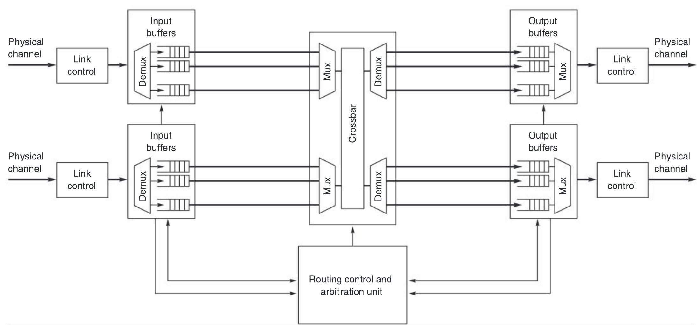
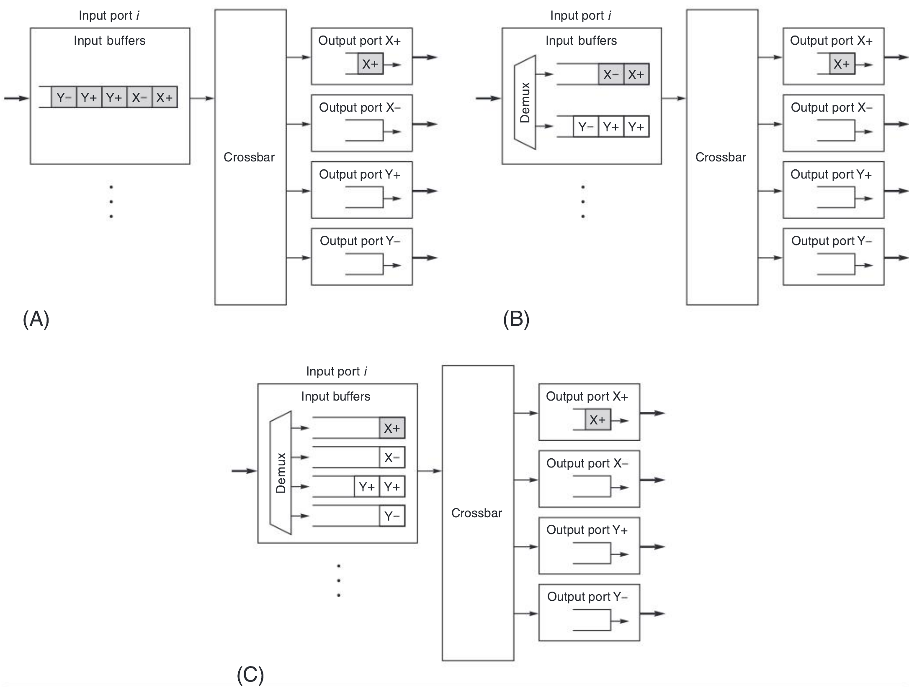
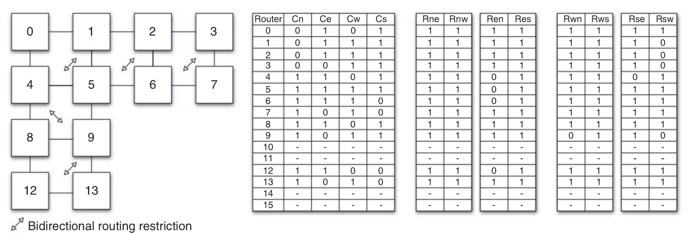
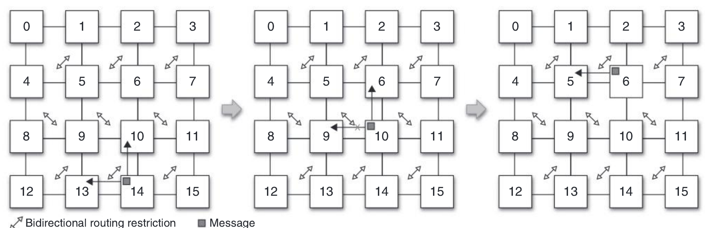

从图中可以看出，同一幅图中的几条曲线形状相似，只是数值不同。先看延迟图。所有曲线都从零负载延迟起步，起点与前面延迟表达式的预测一致。流量负载增加后，网络资源的争用加剧，延迟随之略有上升。施加负载再高，延迟就呈指数增长，网络逐渐接近饱和点：网络已经吸收不了施加的负载，包只能在源节点排队等待注入。在这些模拟中，队列随时间不断变长，因此延迟趋于无穷大。但在实际系统中，队列达到容量上限后会让应用程序停止产生新的包，或者应用程序自己放慢速度，等待已发出的包返回确认或应答。即便如此，自适应路由的延迟仍然增长得慢一些，因为包遇到拥塞的资源时，自适应路由能为它提供其他路径。

出于同样的原因，在虚通道数相同时，自适应路由能使网络达到比确定性路由更高的峰值吞吐率。负载未饱和时，吞吐率随施加负载近似线性增长。但网络一旦到达饱和点，交付流量的速率就跟不上流量产生的速率。因此，饱和点对应可以达到的最大吞吐率，即「峰值」吞吐率，它不会超过前面有效带宽表达式的预测值。越过饱和点以后，整个网络中出现大量的队头阻塞（[F.6 节](#sec-f-6)将进一步解释），吞吐率往往随之下降，这和上下班高峰时汽车走得更慢十分相似。吞吐率图中的这一段很重要，它说明：如果拥塞管理技术（[F.7 节](#sec-f-7)简要讨论）运用不当，路由算法可能造成多大的性能下降。在这个例子中，以饱和后的持续吞吐率衡量，自适应路由饱和后性能下降得比确定性路由更多。

两种路由算法都是虚通道多（4 个）时峰值吞吐率更高，虚通道少（2 个）时更低，因为虚通道多了，包越过前面被阻塞的包的能力就更强。采用自适应路由和 4 个虚通道时，峰值吞吐率为 0.43 字节/周期/节点，接近效率为 100%（即 $\rho = 100\%$）时可以得到的最大值 0.5 字节/周期/节点。这个最大值假定注入带宽和接收带宽足够大，网络的瓶颈在对分处。这时，按照前面的表达式，网络带宽就等于 100% 乘以网络对分带宽（$BW_{\text{Bisection}}$），再除以穿过对分的流量比例（$\gamma$）。对分把环面分成大小相等的两半，在均匀流量下，注入的流量只有一半去往对分另一侧的节点，因此 $\gamma$ 等于 0.5。4096 个节点的三维环面网络，$BW_{\text{Bisection}}$ 等于 16 × 16 × 4 条单向链路乘以链路带宽（即 1 字节/周期）。和前面处理网络带宽一样，把对分带宽除以节点数作归一化，得到 $BW_{\text{Bisection}}$ 为 0.25 字节/周期/节点。再除以 $\gamma$，就得到理想情况下网络可以达到的最大带宽 0.5 字节/周期/节点。

用测得的峰值吞吐率除以理想吞吐率，就能求出模拟网络的效率因子 $\rho$。采用完全自适应路由和 4 个虚通道的网络，效率因子为 0.43/(0.25/0.5) = 86%；采用确定性路由和 2 个虚通道的网络，效率因子为 0.37/(0.25/0.5) = 74%。两者的效率相差 12%。此外，如果路由、仲裁、交换和虚通道的设计更好，效率还可能再提高 14%。

为了从整体上看待前面关于路由、仲裁和交换的讨论，[图 F.20](#fig-f-20) 列出了为商用高性能计算机设计的 SAN 所采用的技术。本节讨论的问题不仅适用于图中所列的 SAN，也适用于从 OCN 到 WAN 的其他互连域。

[图 F.20　商用计算机中互连网络的路由、仲裁和交换特征]{#fig-f-20 .caption}

| 公司 | 系统［网络］名称 | 最大节点数［× 每节点 CPU 数］ | 基本网络拓扑 | 交换机排队（缓冲） | 网络路由算法 | 交换机仲裁技术 | 网络交换技术 |
|---|---|---|---|---|---|---|---|
| Intel | ASCI Red Paragon | 4510［×2］ | 二维网格（64 × 64） | 输入缓冲（1 个 flit） | 分布式维序路由 | 两阶段 RR，分布在整个交换机中 | 虫孔交换，无虚通道 |
| IBM | ASCI White SP Power3［Colony］ | 512［×16］ | 由 8 端口双向交换机构成的双向 MIN（通常为胖树或 Omega 网络） | 输入缓冲加中央缓冲，带输出排队（8 路加速） | 基于源路由的 LCA 自适应最短路径路由，以及基于表的多播路由 | 两阶段 RR，集中式，旁路路径在输出端分布式仲裁 | 带缓冲的虫孔交换，多播用虚拟直通，无虚通道 |
| Intel | Thunder Itanium2 Tiger4［QsNet^II^］ | 1024［×4］ | 由 8 端口双向交换机构成的胖树 | 输入缓冲 | 基于源路由的 LCA 自适应最短路径路由 | 两阶段 RR，优先级，老化，在输出端口分布式仲裁 | 虫孔交换，2 个虚通道 |
| Cray | XT3［SeaStar］ | 30,508［×1］ | 三维环面（40 × 32 × 24） | 输入缓冲，带输出暂存 | 分布式、基于表的维序路由 | 两阶段 RR，在输出端口分布式仲裁 | 虚拟直通，4 个虚通道 |
| Cray | X1E | 1024［×1］ | 4 路 bristled 二维环面（约 23 × 11），带快捷链路 | 输入缓冲，带虚拟输出排队 | 分布式、基于表的维序路由 | 两阶段波前（流水化）全局仲裁器 | 虚拟直通，4 个虚通道 |
| IBM | ASC Purple pSeries 575［Federation］ | >1280［×8］ | 由 8 端口双向交换机构成的双向 MIN（通常为胖树或 Omega 网络） | 输入缓冲加中央缓冲，带输出排队（8 路加速） | 源路由和分布式、基于表的 LCA 自适应最短路径路由，以及多播 | 两阶段 RR，集中式，旁路路径在输出端分布式仲裁 | 带缓冲的虫孔交换，多播用虚拟直通，8 个虚通道 |
| IBM | Blue Gene/L eServer Solution［Torus Net.］ | 65,536［×2］ | 三维环面（32 × 32 × 64） | 输入-输出缓冲 | 分布式自适应路由，带气泡逃逸虚通道 | 两阶段 SLQ，在输入端和输出端分布式仲裁 | 虚拟直通，4 个虚通道 |

## 交换机微结构 {#sec-f-6}

在交换介质网络中，路由、仲裁和交换功能都由网络交换机完成。交换机还负责缓冲区管理；在无损网络中，还要完成相应的流量控制。有些网络的交换机还承担一部分网络管理功能，在系统启动和发生故障时探测、配置和重新配置网络拓扑。本节先介绍一种基本的交换机微结构，再介绍适合前面各种路由、仲裁和交换技术的几种变体，以此说明网络交换机的内部结构。

### 基本的交换机微结构 {-}

交换机的内部数据通路负责连通输入端口和输出端口。这条通路可以用共享总线或多端口中央存储器构成，但交换机所需的聚合带宽较高时，共享总线带宽不够，多端口中央存储器又太贵。因此，大多数高性能交换机内部采用交叉开关，提供无阻塞的连接，允许多对输入-输出端口同时连通。被阻塞的包可以缓存在先进先出（FIFO）队列或循环队列中。这些队列可以在静态 RAM 中实现为*动态可分配多队列*（dynamically allocatable multi-queue，DAMQ），容量大，也比较灵活。队列可以放在输入端口（即*输入缓冲交换机*），可以放在输出端口（即*输出缓冲交换机*），可以集中放在交换机内部（即*集中缓冲交换机*），也可以在输入端口和输出端口都放（即*输入-输出缓冲交换机*）。[图 F.21](#fig-f-21) 是输入-输出缓冲交换机的框图。

{#fig-f-21 width=90%}

路由可以在交换机的路由控制单元中用有限状态机实现，也可以用转发表实现。

* 用有限状态机实现时，有限状态机按照路由算法处理包头中的路由信息，确定允许使用的交换机输出端口（自适应路由可能有多个）。路由信息用过以后，路由控制单元通常会去掉或修改其中一部分，以简化路径上下一个交换机的处理。
* 用转发表实现时，以包头中的路由信息为地址访问转发表，读出的表项就是路由算法给出的、允许使用的交换机输出端口。转发表必须在网络开始运行时预先装入交换机。

还有一些混合方法，把转发表压缩成一小组路由位，再配上一个小的逻辑块。路由控制单元根据这些路由位判断哪些路径是允许的，并决定包要走哪个输出端口。这类方法的目标是做出既灵活又紧凑的路由控制单元，省去大型转发表浪费的面积和功耗，因此适合 OCN。

路由控制单元通常是一个集中的资源，不过也可以在每个输入端口各放一份，以免成为瓶颈。实际上，每个包只需路由一次，而包通常足够长，流过交换机要好几个周期，因此集中的路由控制单元很少成为瓶颈。[图 F.21](#fig-f-21) 假定交换机内部只有一个集中的路由控制单元。

上一节讲过，两个或更多的包同时请求同一个输出端口时，就需要仲裁。交换机仲裁可以是集中式的，也可以是分布式的。集中式仲裁把所有请求和状态信息都送到中央的交换机仲裁单元；分布式仲裁则把仲裁器分散在交换机各处，通常放在输入端口和（或）输出端口上。一个包可能要经过多次仲裁，每个输入端口又可能有多个队列，于是需要处理的仲裁请求增多。因此，许多实现采用分级仲裁：先在每个输入端口本地仲裁，从该端口的包和队列中只选出一个请求；再做全局仲裁，处理各输入端口本地仲裁器提交的请求。[图 F.21](#fig-f-21) 假定交换机内部只有一个集中的仲裁单元。

[图 F.21](#fig-f-21) 所示的基本交换机微结构按如下方式工作：

1. 包开始到达交换机的输入端口时，链路控制器对输入信号译码，生成位序列。如果内部数据通路与外部链路的宽度不同，还可能要把数据解串行，以适应内部数据通路的宽度。
2. 从包头或链路控制信号中提取信息，确定这个包应当缓存到哪个队列。
3. 在接收和缓存包的过程中（或者等整个包缓存好之后，取决于交换技术），把包头送给路由单元。路由单元向仲裁单元请求一个或多个输出端口。
4. 如果所请求的输出端口空闲，并且有足够的空间缓存整个包或一个 flit（取决于交换技术），对这个端口的仲裁就成功。如果采用带虚通道的虫孔交换，每个 flit 的传输可能还需要额外的仲裁和分配步骤。
5. 资源分配好以后，如果前面没有别的包，链路也空闲，包就经过内部交叉开关传到相应的输出缓冲区和链路。

链路控制器实现链路级流量控制，防止链路另一端相邻交换机的输入队列溢出。如果采用虚通道交换，几个包可以以 flit 为单位在链路上分时复用。各个输入端口和输出端口独立工作，因此没有争用时，可以同时处理多个到达的包。

### 缓冲组织 {-}

前面说过，队列可以放在交换机的输入侧、输出侧，或者两侧都放。

**输出缓冲。** 输出缓冲交换机的优点是能完全消除*队头阻塞*（head-of-line blocking）。所谓队头（HOL）阻塞，是指一个队列中缓存了两个或更多的包，队头的包被阻塞，挡住了队列中的其他包，而这些包如果排在队头，本来是可以前进的。输出缓冲交换机中不会发生 HOL 阻塞，因为同一个队列中的包状态相同，都要去同一个输出端口。但是，交换机的所有输入端口有可能同时收到去往同一个输出端口的包。输入侧没有缓冲区，所以输出缓冲区必须能同时存下所有这些包。这就要求输出队列具有 $k$ 倍的交换机内部*加速比*（speedup），即输出队列的写带宽必须是链路带宽的 $k$ 倍，其中 $k$ 是交换机的端口数。这样做往往太贵，因此无损网络很少单独采用这种方案。同时收到许多去往同一输出端口的包，概率通常很小，因此采用输出缓冲交换机的商用系统一般只实现适度的交换机加速比，偶尔缓冲区溢出时就丢弃包。

**输入缓冲。** 缓冲区放在输入侧的交换机，不需要任何加速比就能接收包；但是，输入端口队列中可能发生 HOL 阻塞，如[图 F.22](#fig-f-22)(a) 所示。即使包的目的地均匀分布，HOL 阻塞也可能使交换机输出端口的利用率降到 60% 以下。从[图 F.22](#fig-f-22)(b) 可以看出，使用虚通道（这里是 2 个）可以缓解 HOL 阻塞，但不能消除它。更有效的办法是把输入队列组织成*虚拟输出队列*（virtual output queue，VOQ），如[图 F.22](#fig-f-22)(c) 所示。这时每个输入端口设置的队列数与输出端口数相同，去往不同输出端口的包各有独立的缓冲区。这种技术很流行，广泛用于 ATM 交换机和 IP 路由器。不过，VOQ 的主要缺点是成本高、可扩展性差：VOQ 的个数随交换机端口数的平方增长。此外，VOQ 虽然消除了交换机内部的 HOL 阻塞，却解决不了网络一级端到端的 HOL 阻塞。当然，也可以设计在网络一级支持 VOQ 的交换机，即每个交换机输入端口设置的队列数与整个网络的输出端口数相同，但这样做极其昂贵。另一种办法是动态地只分配一部分队列，专门用来单独存放（缓存）去往拥塞目的地的包。

{#fig-f-22 width=90%}

**输入-输出缓冲。** 输入-输出组合缓冲交换机在输出侧有足够的缓冲空间时，可以把 HOL 阻塞减到最少；由于输入侧也有缓冲区，所需的交换机加速比也可以减到最小。这种方案还有一个好处：包经过交换机内部交叉开关的传输，与经过外部链路的传输可以相互解耦。使用虚通道的直通交换实现中，flit 在链路上分时复用传输，因此这一点对这类实现特别有用。商用系统中的许多设计都采用输入-输出缓冲交换机。

### 路由算法的实现 {-}

路由算法和路由算法的实现必须区分开。路由算法规定包在网络中怎样转发，影响包延迟和网络吞吐率；路由算法的实现则影响包到达一个节点时要经历的延迟、所需的硅片面积，以及路由计算的功耗。人们已经提出好几种技术，用来预先计算路由算法和（或）隐藏路由计算的延迟。但是，如何在不明显影响路由灵活性的前提下减少硅片面积和功耗，研究得要少得多。这两个问题都已变得非常重要，对 OCN 尤其如此。现有的许多设计用比较简单的路由算法来应对这两个问题。但是，工艺不断缩小，制造缺陷越来越多，工艺参数波动越来越大，还会带来其他种种问题（下面简要讨论），因此将来很可能需要更复杂的路由算法。

前面一节讲过，按照路由算法在什么地方计算，路由有两种基本形式：源路由和分布式路由。

* 源路由把实现的复杂性转移到端节点。端节点要把路径存放在表中，按目的端节点的标识符为每个包选择路径。
* 分布式路由则把复杂性转移到交换机。包沿路径每走一跳，交换机都要为它选择一个输出端口。

分布式路由有两种基本实现方法。第一种是用逻辑块实现针对某种特定拓扑的固定路由算法，最常见的例子是维序路由，它按规定的顺序逐维消除偏移量。第二种是用转发表实现，表中每一项对应一个目的节点，记录去往该节点要使用的输出端口。因此在最坏情况下，表项数与目的节点数一样多。

两种实现方法各有利弊。基于逻辑的路由计算延迟很短，通常只需很小的硅片面积，功耗也低；但它必须针对某种特定的拓扑来设计，因此只能用于这种拓扑。基于表的分布式路由相当灵活，可以支持任何拓扑和任何路由算法，只需按所采用的路由算法往表中填入合适的内容（例如，up\*/down\* 路由算法可以针对任何不规则拓扑来定义）。但它的缺点是面积和功耗代价不可忽略。此外，基于表的方案可扩展性也有问题：在最坏情况下，一个有 $N$ 个端节点（和交换机）的系统需要多达 $N$ 张表，每张表有 $N$ 项，成本随 $N$ 的平方增长。

哪种方案更合适，取决于网络所在的域。例如，SAN 中常见基于表的方案，InfiniBand 就是这样。而在 OCN 等环境中，由于前面说的功耗和硅片面积代价，要避免基于表的实现，宜采用基于逻辑的实现。OCN 设计者面临的一些挑战正在于此。器件不断小型化，工艺持续缩小，带来了一系列问题：一是制造缺陷增多；二是故障率（无论瞬时故障还是永久故障）升高；三是工艺参数波动明显（晶体管的行为与设计规格不符）；四是需要划分不同的时钟频率域和电压域；五是功耗和能耗预算很紧。这些挑战归结起来，就是要求网络支持异构性。部件出现故障，交换机和链路断电，部件（因性能波动超出可接受范围）被禁用，诸如此类，都会使网络中形成各不相同、可能不规则的区域。因此，同构的设计可能产生出异构的系统。在这种情况下，路由算法要设计得足够灵活，以应对这些新挑战，而高效地实现这样的路由算法非常重要。

*区间路由*（interval routing）［Leeuwen 1987］是一种众所周知的方案，它为每个输出端口规定一个目的节点范围，有一定的灵活性，又比传统的基于表的方法紧凑得多。区间路由的灵活性还不够，但它为应对新出现的挑战提供了思路。一种较新的方法给出了一个可行的实现设计点，介于基于逻辑的实现（效率高）和基于表的实现（灵活性好）之间，这就是*基于逻辑的分布式路由*（Logic-Based Distributed Routing，LBDR）。LBDR 是一种混合方法：它以规则的二维网格为参照，但允许制造缺陷、故障和其他异常改变拓扑，从二维网格派生出不规则的网络。有了出故障的、被禁用的和断电的部件，网络的规则性就遭到破坏，维序路由算法不能再用。为了支持这样的拓扑，LBDR 在每个交换机中定义了一组配置位：

* 一是连通位。每个交换机用 4 个连通位指明它与拓扑中相邻交换机是否连通，每个端口一位。例如，可以用连通位禁用通往故障部件的输出端口。
* 二是路由位。每个交换机另外用 8 个路由位定义可用的路由选择，每个输出端口两位。路由位的值在加电时设置，根据网络要实现的路由算法计算得到。简单地说，某个路由位置位，就表示包可以经相应的输出端口离开本交换机，并且允许在下一个交换机处做某种转弯。

从这个意义上说，LBDR 与区间路由相似，只不过它定义的是地理区域，而不是目的节点范围。[图 F.23](#fig-f-23) 是一个例子：在一个不规则拓扑上用 LBDR 实现一种与拓扑无关的路由算法，图中给出了计算出的配置位。

{#fig-f-23 width=90%}

路由算法由连通位和路由位来实现，为此只需用一小组逻辑门配合这些配置位。简单地说，LBDR 以初始拓扑（二维网格）为参照，根据当前路由器的坐标、目的路由器的坐标和配置位作出路由决策。[图 F.24](#fig-f-24) 给出了所需的逻辑，[图 F.25](#fig-f-25) 举例说明一个包如何借助配置位从源节点转发到目的节点。从图中可以看出，路由限制是靠禁止使用交换机 10 的西端口来实施的。

{#fig-f-24 width=90%}

{#fig-f-25 width=90%}

LBDR 是在 OCN 中高效实现路由的一种方法。这种机制最近已经扩展到支持非最短路径、集合通信操作和流量隔离。这些改进都只用一小组配置位，实现仍然紧凑、高效。LBDR 及其扩展的详细介绍，以及 OCN 的最新研究情况，可参阅 Flich［2010］。

### 交换机微结构的流水化 {-}

把交换机微结构流水化，可以提高性能。交换机流水处理包，与向量处理器流水执行指令有相似之处。在向量流水线中，一条指令规定对所有向量元素施加什么操作，这些元素以流水方式执行。与此类似，在交换机流水线中，一个包头规定怎样处理这个包的全部内部数据通路物理传输单元（即 *phit*），这些 phit 以流水方式处理。此外，不同输入端口上的包互不相关，因此可以并行处理，就像多条相互独立的指令或多个流水执行的指令线程可以并行执行一样。

分析交换机内部完成的基本功能，把它们组织成若干个流水段，就可以把交换机微结构流水化。[图 F.26](#fig-f-26) 是把[图 F.21](#fig-f-21) 中的基本交换机微结构组织成五段流水线后的框图，这里假定采用直通交换，并用转发表实现路由。各段的工作如下：

1. 第一段接收包的头部。
2. 第二段用路由信息（即目的地址）在转发表中查找允许使用的路由选择。与此同时，第一段继续接收包的其他部分，缓存到输入端口队列中。
3. 第三段完成仲裁。
4. 第四段配置交叉开关，把已获准使用的输出端口分配给这个包。
5. 第五段把包头缓存到交换机输出端口，准备经外部链路发送。

只有包头使用第二段和第三段；包的有效载荷和尾部只使用其中三段，也就是交换机内部数据通路建立以后，数据直接流过的那几段。

虚通道交换机通常还要增加一段，用于虚通道分配。此外，每个 flit 经过交叉开关传输之前都需要仲裁。最后，根据路由算法和仲裁算法的复杂程度，这些操作可能需要好几个时钟周期。

### 其他交换机微结构改进 {-}

前面说过，有时会采用交换机内部加速，以提高交换机输出端口的利用率。加速通常靠提高交换机的时钟频率和（或）内部数据通路宽度（即 phit 大小）来实现。另一种办法是在每个输入端口的那组队列与各输出端口之间设置几条并行的数据通路。做法之一是增加交叉开关的输入端口数。如果每个输入端口设有多个物理队列，就可以为每个输入队列分配一个单独的交叉开关端口。例如，IBM Blue Gene/L 的每个交换机输入端口设有两个交叉开关访问端口和两个读端口。
