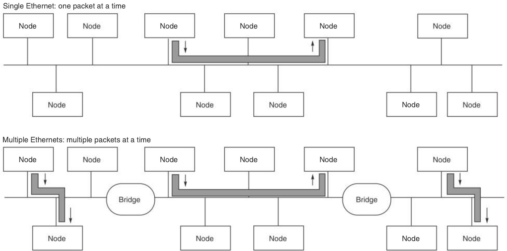
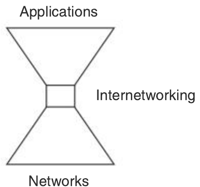
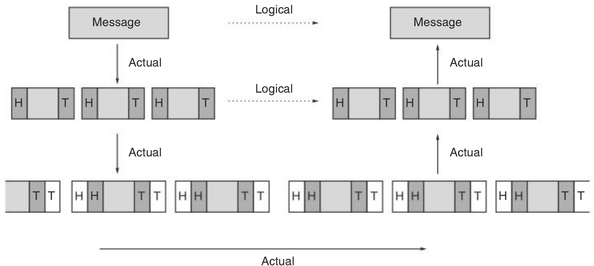

主互连网络是一个专有的 32 × 32 × 64 三维环面 SAN，把全部 64 K 个节点连接起来。每个节点交换机有六条 350 MB/s 的双向链路，连到环面上相邻的节点；从本节点两个处理器注入网络的带宽为 612.5 MB/s，向两个处理器接收的带宽为 1050 MB/s。来自网络的接收带宽等于交换机所有端口的入站带宽之和，因此接收链路不会成为网络性能的瓶颈。由于接收链路的带宽更高，每个目的节点可以同时接收多个包。

两个节点做在一块 2 × 1 × 1 的计算卡上；16 块计算卡和 2 块 I/O 卡做在一块 4 × 4 × 2 的节点板上；16 块节点板组成一个 8 × 8 × 8 的中板；2 个中板构成一个 1024 节点的机柜，物理尺寸为 0.9 × 0.9 × 1.9 立方米。链路的物理长度最长为 8.6 米，因此用不多的缓冲就能实现高效的链路级流量控制。低延迟靠三项措施实现：一是采用虚拟直通交换；二是把仲裁分布到交换机的输入端口和输出端口；三是用有限状态机在上一个交换机中预先计算当前的路由路径，从而把一部分路由延迟移出交换机的关键路径。高有效带宽同样靠三项措施实现：一是采用带两个读端口的输入缓冲交换机；二是采用带四个虚通道的虚拟直通交换；三是采用基于气泡流量控制（bubble flow control）的完全自适应无死锁路由。

容错是这种规模网络的一项关键特性。Blue Gene/L 采用相对较低的 700 MHz 链路时钟频率（与处理器时钟相同），并且时钟的上升沿和下降沿都用来传输数据（即每条位串行网络链路在每个方向上支持 1.4 Gbps，也就是 175 MB/s 的传输速率），以此降低故障率。但网络中仍然可能出现故障。一旦出现故障，就关断含有故障的中板节点板，并把它们旁路掉，以隔离故障，然后从最近一个检查点恢复计算。旁路由每个中板配备的独立旁路交换板完成，这些旁路交换板是在环面节点板之外另加的。每块旁路交换板可以配置成连接中板节点板中的对应链路，也可以配置成连接下一块旁路板，后一种配置实际上就去掉了相应的一组中板节点板。虽然在某些网络维度上处理节点会减少一些，但整台机器仍然保持原来的拓扑结构和路由算法。

栅障同步、广播/多播、归约等一些集合通信操作在三维环面上执行效果不好，因为网络会被流量淹没。为了解决这个问题，Blue Gene/L 另外使用两个单链路带宽更高的独立树网络，更高效地实现集合操作和合并操作。除了高效支持同步和广播/多播，硬件还能高效地完成一些算术归约操作（例如对一组值求和或求最大值，每个处理节点提供其中一个值）。除了三维环面和两个树网络，Blue Gene/L 还有一个 I/O 千兆以太网，以及一个带宽较低的控制系统快速以太网，用于并行 I/O、配置、调试和维护。

### 系统/存储区域网络：InfiniBand {-}

InfiniBand 是业界通行的事实网络标准。2000 年 10 月，InfiniBand 行业协会（InfiniBand Trade Association）的成员公司组成联盟，制定了这一标准。InfiniBand 既可以用作处理器间通信的系统区域网络，也可以用作服务器 I/O 的存储区域网络。它是一种基于交换机的互连技术，拓扑、路由算法和仲裁技术都可以由厂商和用户灵活选择。InfiniBand 支持在 300 米的距离上，每条链路每个方向 2～120 Gbp 的数据传输率。它采用直通交换、16 个虚通道和服务级别、基于 credit 的链路级流量控制、加权轮转公平调度，并实现了可编程的转发表。它还包括一些有助于提高可靠性和系统可用性的功能，例如通信子网管理、端到端路径建立和虚拟目的地命名。[图 F.30](#fig-f-30) 把 InfiniBand 的包格式与 LAN 和 WAN 领域的另外两种网络标准并列对照。[图 F.31](#fig-f-31) 把 InfiniBand 标准的各项特性与研究和商用高性能计算机系统中广泛使用的两种专有系统区域网络作了比较。

InfiniBand 提供两种支持用户级通信的基本机制：send/receive 和远程 DMA（RDMA）。采用 send/receive 时，接收方必须先显式地登记一个接收缓冲区（即在它的通道适配器网络接口中分配空间），发送方才能发送数据。采用 RDMA 时，发送方可以通过远程 DMA 把数据直接写入接收设备的内存。例如，在连接 3.4 GHz Intel Xeon 主机的 Mellanox MHEA28-XT 通道适配器上测量，标称包大小为 4 字节时，send/receive 机制的发送开销和接收开销分别为 0.946 ms 和 1.423 ms，RDMA 机制则分别为 0.910 ms 和 0.323 ms。

[图 F.29　近期研究型和商用处理器中实现的片上网络的特性。有些处理器实现了多个片上网络（表中没有全部列出），例如 MIT Raw 有两个，TRIP Edge 有八个。]{#fig-f-29 .caption}

| 机构和处理器［网络］名称 | 建成年份 | 网络端口数［核或 tile + 其他端口］ | 基本网络拓扑 | 每条链路每个方向的数据位数 | 链路带宽［链路时钟频率］ | 路由；仲裁；交换 | 芯片金属层数；流量控制；虚通道数 |
|---|---|---|---|---|---|---|---|
| MIT Raw［General Dynamic Network］ | 2002 | 16 个端口［16 个 tile］ | 二维网格（4 × 4） | 32 位 | 0.9 GB/s［225 MHz，与处理器同频］ | XY DOR，请求-应答死锁恢复；RR 仲裁；虫孔交换 | 6 层；基于 credit；无虚通道 |
| IBM Power5 | 2004 | 7 个端口［2 个 PE 核 + 5 个其他端口］ | 交叉开关 | 取指 256 位；store 64 位；load 256 位 | ［1.9 GHz，与处理器同频］ | 最短路径；无阻塞；电路交换 | 7 层；握手；无虚通道 |
| U.T. Austin TRIP Edge［Operand Network］ | 2005 | 25 个端口［25 个执行单元 tile］ | 二维网格（5 × 5） | 110 位 | 5.86 GB/s［533 MHz 时钟，按 80% 折算］ | YX DOR；分布式 RR 仲裁；虫孔交换 | 7 层；开/关流量控制；无虚通道 |
| U.T. Austin TRIP Edge［On-Chip Network］ | 2005 | 40 个端口［16 个 L2 tile + 24 个网络接口 tile］ | 二维网格（10 × 4） | 128 位 | 6.8 GB/s［533 MHz 时钟，按 80% 折算］ | YX DOR；分布式 RR 仲裁；VCT 交换 | 7 层；基于 credit 的流量控制；4 个虚通道 |
| Sony、IBM、Toshiba Cell BE［Element Interconnect Bus］ | 2005 | 12 个端口［1 个 PPE 和 8 个 SPE + 3 个用于存储器和 I/O 接口的其他端口］ | 环（共 4 个，每个方向 2 个） | 128 位数据（+16 位 tag） | 25.6 GB/s［1.6 GHz，处理器频率的一半］ | 最短路径；基于树的 RR 仲裁（集中式）；流水化电路交换 | 8 层；基于 credit 的流量控制；无虚通道 |
| Sun UltraSPARC T1 处理器 | 2005 | 最多 13 个端口［8 个 PE 核 + 4 个 L2 存储体 + 1 个共享 I/O］ | 交叉开关 | 8 个核与 4 个 L2 存储体之间双向都是 128 位 | 19.2 GB/s［1.2 GHz，与处理器同频］ | 最短路径；按等待时间（age）仲裁；VCT 交换 | 9 层；握手；无虚通道 |

![图 F.30　InfiniBand、以太网和 ATM 的包格式。ATM 把它的消息称为「信元」（cell）而不是包，所以准确的名称是 ATM 信元格式。每幅格式图的宽度都是 32 位。三种格式都有目的地址字段，但各自的编码方式不同。三种格式也都有校验和字段，用来发现传输错误；不过 ATM 的校验和只对包头计算，数据中的错误要靠更高层的协议来发现。InfiniBand 和以太网都有长度字段，因为它们的包所含数据量可变；前者以 32 位字计数，后者以字节计数。InfiniBand 和 ATM 的包头有一个类型字段（T），给出包的类型。以太网的其余字段是：前导码，让接收方能从以太网使用的自同步码中恢复时钟；源地址；填充字段，保证最小的包（包括包头）为 64 字节。InfiniBand 还有一个表示协议版本的版本字段、一个保证按序交付的序号、一个选择目的队列的字段，以及一个分区键字段。InfiniBand 还有许多没有画出的小字段和许多其他包格式，上图只是简化的示意。ATM 的包短而固定，很适合数字语音的实时性要求。图内标注：Version，版本；Destination，目的地址；Length，长度；Source，源地址；Partition key，分区键；Destination queue，目的队列；Sequence number，序号；Data，数据（括号内为字节数）；Checksum，校验和；Preamble，前导码；Type，类型；Pad，填充；32 bits，32 位。](images/appf/fig-f-30.png){#fig-f-30 width=80%}

[图 F.31　2005 年排名前 10 位的若干超级计算机集群中实现的系统区域网络的特性]{#fig-f-31 .caption}

| 网络名称［厂商］ | 使用该网络的 2005 年前 10 位超级计算机集群 | 节点数 | 基本网络拓扑 | 链路原始双向带宽 | 路由算法 | 仲裁技术 | 交换技术；流量控制 |
|---|---|---|---|---|---|---|---|
| InfiniBand［Mellanox、Voltair］ | SGI Altrix 和 Dell Poweredge Thunderbird | 数百万以上（2^128^ 个 GUID 地址，与 IPv6 类似） | 完全可配置（任意） | 4～240 Gbps | 任意（表驱动），通常为 up\*/down\* | 加权 RR 公平调度（2 级优先级） | 直通交换，16 个虚通道（15 个用于数据）；基于 credit |
| Myrinet-2000［Myricom］ | 西班牙巴塞罗那超级计算中心 | 8192 个节点 | 由 16 端口双向交换机构成的双向 MIN（Clos 网络） | 4 Gbps | 基于源的分散式（自适应）最小路由 | 轮转仲裁 | 直通交换，无虚通道；Xon/Xoff 流量控制 |
| QsNet^II^［Quadrics］ | Intel Thunder Itanium2 Tiger4 | 数万以上 | 由 8 端口双向交换机构成的胖树 | 21.3 Gbps | 基于源的 LCA 自适应最短路径路由 | 两阶段 RR、优先级、老化，分布在输出端口 | 虫孔交换，2 个虚通道；基于 credit |

[F.2 节](#sec-f-2)讲过，包的大小对能否充分利用网络带宽很重要。有人会问：「消息的自然大小是多少？」[图 F.32](#fig-f-32)(a) 给出了一个商用流体动力学模拟应用 Fluent 的消息大小分布，数据由俄亥俄州立大学基于网络的计算机实验室在一个 InfiniBand 网络上采集。一条曲线按发送的消息数累计，另一条按发送的数据字节数累计。图中的消息是消息传递接口（MPI）的信息单位，每条消息再划分成 InfiniBand 的最大传输单元（包），在网络上传输。从图中可以看出，最大的消息超过 512 KB，但大约 90% 的消息小于 512 字节。2 KB 的消息约占传输字节数的 50%。此外，对 NAS 并行基准测试程序集中整数排序（Integer Sort）应用核心的测量表明，它大约 75% 的消息小于 512 字节（图中没有画出）。许多应用发送的小消息远多于大消息，尤其是因为请求和确认比数据响应和块写入更频繁。

![图 F.32　D.K. Panda、S. Sur 和 L. Chai（2005）在俄亥俄州立大学基于网络的计算实验室采集的数据。(a) Fluent 应用（www.fluent.com）中，消息数和传输数据量的累计百分比随消息大小的变化。x 轴上每一项包括从上一项到这一项的所有字节数，例如 128 表示 1 字节到 128 字节。大约 90% 的消息小于 512 字节，这些消息约占传输总字节数的 40%。(b) 在运行 MVAPICH（http://nowlab.cse.ohio-state.edu/projects/mpi-iba）的 SDR 和 DDR InfiniBand 网络上测得的有效带宽随消息大小的变化，分为使用 OS 旁路（native）和不使用 OS 旁路（IPoIB）两种情况。图内标注：Percentage，百分比；Message size (bytes)，消息大小（字节）；Number of messages，消息数；Data volume，数据量；Measured effective bandwidth (MB/sec)，测得的有效带宽（MB/s）；MVAPICH native DDR/SDR，MVAPICH 原生方式，DDR/SDR；MVAPICH 1PoIB SDR/DDR，MVAPICH IPoIB 方式，SDR/DDR。](images/appf/fig-f-32.png){#fig-f-32 width=95%}

InfiniBand 允许把协议处理从主机卸载到 InfiniBand 网络接口卡上的控制器，从而减少协议处理开销。[图 F.32](#fig-f-32)(b) 以 MVAPICH 为例说明了协议卸载和绕过操作系统带来的好处。MVAPICH 是 MPI 在 InfiniBand 上的一种广泛使用的实现。图中画出了 MVAPICH 在两种模式、两种网络速率下有效带宽随消息大小的变化。一种模式运行 IPoIB，这时 InfiniBand 通信由主机操作系统实现的 IP 层处理（即没有 OS 旁路）。另一种模式让 MVAPICH 直接运行在 VAPI 上。VAPI 是 Mellanox 的原生 InfiniBand 接口，它把传输协议处理卸载到通道适配器硬件上（即使用 OS 旁路）。图中给出了 10 Gbps 单数据率（SDR）和 20 Gbps 双数据率（DDR）两种 InfiniBand 网络的结果。结果清楚地表明，卸载协议处理并绕过操作系统，可以大幅减少发送开销和接收开销，使有效带宽接近线速。

### 以太网：局域网 {-}

以太网作为 LAN 取得了极大的成功：从 1978 年提出、今天几乎处处都在使用的 10 Mbit/s 标准，到很可能得到广泛使用的较新的 10 Gbit/s 标准。许多类别的计算机都把以太网作为标准的通信接口。以太网的标准编号为 IEEE 802.3，它是一种包交换网络，按目的地址路由包。以太网最初是为同轴电缆设计的，今天主要使用 Cat5E 铜线，更长的距离和更高的带宽则用光纤。它甚至还有无线版本（802.11），这也说明以太网无处不在。

20 年间，计算机的速度提高到 1978 年的几千倍，共享介质的以太网却一直没有变。于是，在更快、带宽更高的网络出现之前，工程师不得不发明一些临时的解决办法。一种办法是用多个以太网把机器连接起来，再用网络互连设备把这些以太网连在一起，按需要把流量从一个以太网转送到另一个以太网。这样，各个以太网可以并行工作，一组计算机的聚合互连带宽也就提高了。实际上，这些设备的作用与前面讲过的点对点网络中的交换机类似。

[图 F.33](#fig-f-33) 给出了由此可以获得的并行性。这些设备按照转送流量的方式和能够连接的互连种类，有不同的名称：

* *网桥*。网桥把多个 LAN 连在一起，根据包中的地址把流量从一侧转送到另一侧。网桥工作在以太网协议这一层，通常比下面要讲的路由器简单、便宜。用下一节介绍的 OSI 模型的说法（见第 F-85 页的[图 F.36](#fig-f-36)），网桥工作在第 2 层，即数据链路层。
* 路由器，或称*网关*。这类设备把 LAN 连到 WAN，或者把 WAN 连到 WAN，并解决地址不兼容的问题。它们一般比网桥慢，工作在 OSI 第 3 层，即网络层。WAN 路由器把网络划分成若干个独立的较小子网，这样既便于管理，又提高了安全性。

最后一种网络互连设备是*集线器*，但它只是把多个网段扩展成一个 LAN。由于一次只能传输一条消息，集线器对性能没有帮助。集线器工作在 OSI 第 1 层，称为物理层。这些设备都不是作为以太网标准的一部分规划出来的，它们各行其是，增加了维护 LAN 的难度和成本。

到 2011 年，以太网的链路速率有 10、100、10,000 和 100,000 Mbit/s 几种。10 Mbit/s 和 100 Mbit/s 以太网由多个设备共享介质，1000 Mbit/s 及以上的以太网则依靠点对点链路和交换机。以太网交换机通常采用某种形式的存储转发。

{#fig-f-33 width=90%}

以太网从最初的版本起就没有真正的流量控制。它最初用带指数退避的载波侦听（见第 F-23 页）来仲裁共享介质的使用权。有些交换机试图借用这个接口加装自己的流量控制，但流量控制并不是以太网标准的一部分。

{#fig-f-34 width=90%}

{#fig-f-35 width=35%}

[图 F.36　OSI 模型的各层。依据 www.geocities.com/SiliconValley/Monitor/3131/ne/osimodel.html。]{#fig-f-36 .caption}

| 层号 | 层名 | 主要功能 | 协议举例 | 网络部件 |
|---|---|---|---|---|
| 7 | 应用层 | 供专门编写来在网络上运行的应用使用 | FTP、DNS、NFS、http | 网关、智能交换机 |
| 6 | 表示层 | 在应用格式和网络格式之间相互转换 | | 网关 |
| 5 | 会话层 | 在网络上建立、维持和结束会话 | 命名管道、RPC | 网关 |
| 4 | 传输层 | 在会话层之下提供额外的连接 | TCP | 网关 |
| 3 | 网络层 | 把逻辑网络地址和名字转换成物理地址（例如把计算机名转换成 MAC 地址） | IP | 路由器、ATM 交换机 |
| 2 | 数据链路层 | 把包转换成原始的位，在接收端再把位转换成包 | 以太网 | 网桥、网络接口卡 |
| 1 | 物理层 | 在物理电缆上传输原始位流 | IEEE 802 | 集线器 |

### 广域网：ATM {-}

*异步传输模式*（Asynchronous Transfer Mode，ATM）是由电信业制定的一种广域网标准。20 世纪 90 年代，ATM 曾一度作为 LAN 与以太网竞争，此后又退回到它的 WAN 大本营。

这个电信标准内置了可扩展的带宽：从 155 Mbit/s 起，按 4 倍扩展到 620 Mbit/s、2480 Mbit/s，依此类推。ATM 是 WAN，所以它的介质是光纤，单模和多模都有。ATM 虽然是交换介质，但与其他几个例子不同，它依靠虚连接通信。ATM 用虚通道路由，在同一个网段上复用不同的连接，从而避免了传统的面向连接的网络效率低的问题。由于面向 WAN，ATM 也采用了存储转发交换。[图 F.30](#fig-f-30) 表明，与其他协议不同，ATM 的包小而且大小固定，有效载荷为 48 字节。ATM 采用基于 credit 的流量控制方案，而 IP 路由器不实现流量控制。

采用虚连接和小包的原因是服务质量。电信业关心的是语音流量，因此可预测性和带宽同样重要。建立虚连接比无连接网络的波动小，还能简化存储转发交换。小而固定的包也让快速的路由器和交换机更容易实现。为了这个目标，ATM 甚至提供了自己的协议栈，与 TCP/IP 竞争。出人意料的是，虽然 ATM 交换机很简单，ATM 的协议族却庞大而复杂。当初的梦想是建立一套从 LAN 到 WAN 的无缝基础设施，免去今天常见的那些五花八门的路由器。这个梦想已经从憧憬变成了怀旧。

## 网络互连 {#sec-f-9}

网络互连无疑是通信领域最重要的创新之一。它让处于相互独立、互不兼容的网络上的计算机能够可靠、高效地通信。[图 F.34](#fig-f-34) 说明了在不同网络之间穿行的必要性。图中给出了把一个文件从斯坦福大学传到加州大学伯克利分校（两地相距约 75 km）所涉及的网络和机器。

网络互连的成本低得惊人。例如，发一封电子邮件，比打一个横跨美国东西海岸的长途电话、在答录机上留言要便宜得多。电子邮件用的长途通信线路和电话完全相同，却取得了如此大幅度的成本下降，这就更加令人瞩目。

网络互连依靠的是一些软件标准，它们不要求网络本身可靠，就能实现可靠的通信。这些成功标准的基本原则是：标准由层次化的若干层组成，每一层负责整个通信任务的一部分。每台计算机、每个网络和每台交换机都实现标准中属于自己的那一层，并依靠其他部件忠实地履行它们的职责。这种分层的软件标准称为*协议族*（protocol family 或 protocol suite）。有了协议族，应用程序无须应用程序员做额外的工作，就能在任何互连上工作。[图 F.35](#fig-f-35) 示意了这种层次化的通信模型。

最流行的网络互连标准是 TCP/IP（Transmission Control Protocol/Internet Protocol，传输控制协议/网际协议）。这个协议族是名字起得很朴素的因特网（Internet）的基础，因特网连接着全世界数亿台计算机。TCP/IP 非常普及，因此即使只在相互兼容的网络之间做本地通信，也会使用 TCP/IP。例如，网络文件系统（NFS）就使用 IP，尽管它的通信很可能只是在以太网这样的同构 LAN 上进行。我们用 TCP/IP 作为协议族的例子，其他协议族的思路与之类似。[F.13 节](#sec-f-13)介绍 TCP/IP 的历史。

协议族的目标是简化标准，办法是把职责按层次分给各层，每一层为上一层提供它所需的服务。应用程序在最上层，最下层是发送二进制位的物理通信介质。抽象数据类型对程序员屏蔽了数据类型的实现细节，从而简化了程序员的工作；同样，这种分层策略也让标准更容易理解。

网络协议曾经有过许多种方案，术语因此相当混乱。于是，开放系统互连（OSI）制定了一个模型，把网络描述成一系列层，这种描述方式由此得到推广。[图 F.36](#fig-f-36) 给出了这个模型。虽然并非所有协议都严格遵循这种分层，但各层的名称得到了广泛使用。所以常能听到人们讨论简单的第 3 层交换机与智能的第 7 层交换机有什么不同。

协议族的关键在于：从逻辑上看，通信发生在发送方和接收方协议的同一层上，但实际上是由下一层的服务来完成的。这种通信方式称为*对等*（peer-to-peer）通信。打个比方，设想将军 A 要在战场上给将军 B 送一封信。将军 A 写好信，装进写着将军 B 名字的信封，交给一名上校，命令他送达。这名上校把它装进一个信封，写上将军 B 手下对应那名上校的名字，交给一名少校，指示他送达。少校照此办理，再交给一名上尉；上尉交给一名中尉，中尉又交给一名中士。中士从中尉手里接过信封，装进一个写着将军 B 所在师里一名中士名字的信封，找来一名列兵，命令他带上这个大信封。列兵借了一辆摩托车，把信封送到另一名中士手里。信送到以后，沿指挥链逐级上传：每个人拆掉写着自己名字的外层信封，把里面的信封交给自己的上级。在将军 B 看来，这封信就是另一位将军发来的。两位将军都不知道信封经过了哪些人传递，也不知道它是怎样从一个师送到另一个师的。

[图 F.37](#fig-f-37) 表明，协议族和这个比方的相似程度，可能超出你的想象。原始消息带有一个包头，可能还有一个包尾，交由下层协议发送。再下一层协议又给消息加上自己的包头；如果消息对这一层来说太大，还可能把它拆成几条较小的消息。还用前面的比方：将军的一封长信如果一个信封装不下，就分成几份，装进几个信封。这样拆分消息、添加包头和包尾的过程一直持续，直到消息下降到物理传输介质。然后，消息被发往目的地。在接收端，协议族的每一层检查本层的消息，剥掉本层的包头和包尾，交给上一层，并把各个片段重新拼装起来。对一条具体的消息来说，这种协议层的嵌套称为*协议栈*（protocol stack），这个名字反映了包头和包尾的添加与去除是后进先出的。

{#fig-f-37 width=80%}
