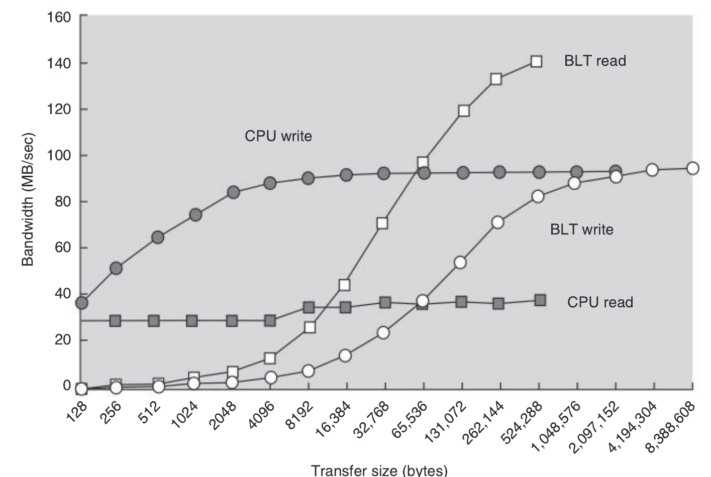

和前面的比方一样，分层做法的危险在于消息递送会因此增加相当可观的延迟。减少层数就可以减小延迟，但要记住，协议族只规定标准，并不限定怎样实现标准。一种指令系统结构有多种实现方法，一个协议族同样有多种实现方法。

下面以 TCP/IP 协议栈为例，并假定最底层的协议是以太网。往上一层是网际协议（Internet Protocol），即 IP 层，IP 包的正式名称是*数据报*（datagram）。IP 层把数据报路由到目的机器，途中可能经过许多中间机器或交换机。IP 尽最大努力递送包，但不保证数据报一定送达，也不保证内容正确、顺序不乱。IP 之上的 TCP 层则保证可靠、按序递送，并防止数据报损坏。

按照[图 F.37](#fig-f-37) 的例子，假定一个应用程序要经由以太网给一台机器发送一条消息。处理从 TCP 开始。一次最多只能发送 64 KB，而数据可能远大于 64 KB，所以 TCP 必须把数据分成较小的段，到达目的地后再按正确的顺序组装起来。TCP 给每个数据报加上一个 20 字节的包头（[图 F.38](#fig-f-38)），然后交给 IP。物理层之上的 IP 层再加上一个 20 字节的包头，也画在[图 F.38](#fig-f-38) 中。从 IP 层交给以太网的数据，按[图 F.30](#fig-f-30) 所示的格式装成包发送。注意，TCP 包出现在 IP 数据报的数据部分中，正如[图 F.37](#fig-f-37) 所示。

![图 F.38　IP 和 TCP 的包头。图的宽度为 32 位。两者的标准包头都是 20 字节，但都可以选择加长，以容纳很少传送的信息。两种包头都有包头长度字段（L），用来适应可选字段，也都有源字段和目的字段。IP 把整个数据报的长度放在单独的长度字段里；TCP 则以字节为单位给出数据报的序号，从而把数据报的长度和序号合在一起。TCP 用校验和字段确保数据报没有遭到破坏，用序号字段确保数据报到达后按正确的顺序组装。IP 只对包头做校验和检错，因为包的其余部分已经由 TCP 保护。TCP 的一项优化是：可以先连续发送一串数据报，再等待继续发送的许可。不必等待许可就能发送的数据报数量称为*窗口*，窗口字段说明在本数据报所确认的字节之后，还可以再发送多少字节。TCP 根据 IP 层发送数据报的成功情况调整窗口大小：IP 层越可靠、越快，TCP 就把窗口设得越大。由于窗口随着数据的到达和确认向前滑动，这种技术称为*滑动窗口协议*。TCP 的捎带确认字段是另一项优化。有些应用在同一个连接上来回发送数据，这时单独发送一个只含确认的数据报显得很浪费。有了捎带字段，携带数据的数据报就可以同时携带对上一次传送的确认，即「捎带」在数据传送之上。TCP 的紧急指针字段给出数据报中一个重要字节（如中断字符）的地址。有了这个指针，应用软件就可以跳过数据，用户不必等到前面的所有数据都处理完，才看到让软件停下来的那个字符。IP 的标识符字段和分片字段允许中间机器把原来的数据报拆成许多较小的数据报。原数据报有一个唯一的标识符，放进每个分片中，由分片字段说明哪一片是哪一片。数据报经过的中间交换机数达到上限后，网络就根据生存时间字段把它丢弃，不论它此时位于网络中的什么地方。数据报到达（如果能到达的话）所需的跳数有了上限，协议软件就可以简化。协议字段指明是哪一个上层协议发送了这个 IP 数据报，在我们的例子中是 TCP。有了 V（版本）字段和类型字段，网络就可以使用不同版本的 IP 协议软件。显式地给出版本号，是为了让软件可以逐台机器地平稳升级，而不必关闭整个网络。如今，第 6 版网际协议（IPv6）已经得到广泛使用。图内标注：IP header，IP 包头；IP data，IP 数据；TCP header，TCP 包头；TCP data，TCP 数据；V，版本；L，包头长度；Type，类型；Length，长度；Identifier，标识符；Fragment，分片；Time，生存时间；Protocol，协议；Header checksum，包头校验和；Source，源；Destination，目的；Sequence number (length)，序号（长度）；Piggyback acknowledgment，捎带确认；Flags，标志；Window，窗口；Checksum，校验和；Urgent pointer，紧急指针；32 bits，32 位；(0–65,516 bytes)，（0～65,516 字节）。](images/appf/fig-f-38.png){#fig-f-38 width=70%}

## 互连网络的交叉问题 {#sec-f-10}

本节介绍其他各章讨论过的五个问题。这些问题从根本上受互连网络的影响，反过来也影响互连网络。

### 面向密度优化的处理器与面向 SPEC 优化的处理器 {-}

世界各地的人都在访问网站，服务器放在哪里其实无关紧要。因此，许多服务器放在托管机房（collocation site）里。托管机房按预留和使用的网络带宽、占用的空间以及消耗的电力收费。过去，桌面微处理器的设计目标是：在能够散掉的热量范围内尽可能快，几乎不考虑封装和周围芯片的尺寸。事实上，直到 2006 年，Intel 和 AMD 的一些桌面微处理器功耗还高达 130 W！占地面积的利用效率也基本没人关心。这样取舍的结果是，电力成了托管机房的一项主要成本，处理器密度受限于消耗和散发的功率，互连网络中的功率也包括在内！

便携式计算机日益普及（2005 年笔记本电脑的销量首次超过台式计算机），而且功耗和散热需求都较低，于是有机会用这种技术构造密度高得多的计算系统。例如，2006 年 Intel Pentium M 的功耗为 25 W，但在很多应用上的性能接近桌面微处理器。因此可以设想，每瓦性能或每立方英尺性能可能取代每个微处理器的性能，成为重要的品质因数。关键在于，许多应用已经在使用大型机群，因此用 256 个（举例而言）高能效处理器替换 64 个高功耗处理器，成本可能更低，软件仍然兼容。这样一来，互连网络设计在功耗和性能上的效率就更加重要了。

谷歌的机群是这种转变的一个典型例子：用许多「较凉」的处理器，取代数量较少的「较热」处理器。它使用的机架最多装 80 个 1 GHz 的 Intel Pentium III 处理器，而不用功耗更高的高端处理器。刀片服务器是另一类例子。刀片服务器由宽 1 英寸、高 7 英寸的机架单元刀片组成，这些刀片基于移动处理器设计。HP ProLiant BL10e G2 刀片服务器最多支持 20 个 1 GHz 的超低电压 Intel Pentium M 处理器，带 400 MHz 前端总线、1 MB L2 Cache 和最多 1 GB 内存。Fujitsu Primergy BX300 刀片服务器最多支持 20 个 1.4 GHz 或 1.6 GHz 的 Intel Pentium M 处理器，每个处理器配 512 MB 内存，可扩展到 4 GB。

### 智能交换机与智能接口卡 {-}

[图 F.39](#fig-f-39) 给出了一种权衡，即智能放在网络中的什么位置。一般来说，就是在更智能的网络接口和更智能的交换机之间选择。一方做得更智能，另一方通常就可以更简单、更便宜。以太网的接口价格低廉，所以能成为大多数台式计算机和服务器的标准配置。配置规模小的用户还可以选用较便宜的交换机，这类交换机不需要大型以太网交换机那样复杂的转发表和生成树协议。

Myrinet 走的是相反的路子。它的交换机是「笨」部件，除了实现流量控制和仲裁之外，只是从包头中取出第一个字节，直接用它选择输出端口。交换机里没有路由表，所以智能都在网络接口卡（NIC）里。NIC 负责为高效通信提供支持，并实现用于网络（重新）配置的分布式协议。

InfiniBand 采取折中的办法：一方面为磁盘这类要求不高的设备提供成本较低、功能较简单的接口卡，称为目标通道适配器（TCA），希望把它集成到某些 I/O 设备内部；另一方面为主机提供较贵、功能较强的接口卡，称为主机通道适配器（HCA）。InfiniBand 的交换机中设有路由表。

{#fig-f-39 width=80%}

### 保护与用户对网络的访问 {-}

一个难题是：怎样在常见情况下不调用操作系统，又能保证网络上的通信是安全的。Cray Research 的 T3D 超级计算机提供了一个有意思的案例。与较新的 Cray X1E 一样，T3D 支持全局地址空间，load 和 store 可以穿过网络访问存储器。每次访问都要经过 TLB 检查，因此保护是有保证的。为了传送较大的对象，T3D 在硬件中增加了块传送引擎（BLT）。为了保护访问，使用 BLT 之前必须调用操作系统检查访问范围，确保不会违反保护。

[图 F.40](#fig-f-40) 比较了读和写时实际带宽随对象大小的变化。读非常大的对象（如 512 KB）时，BLT 的性能最高，达到 140 MB/s；但读 8 KB 或更小的对象时，简单的 load 性能更高。写的峰值两者都是 90 MB/s，大概是受存储器总线的限制。但写的时候，传送大小要达到 2 MB，BLT 才能赶上简单 store 的性能；传送更小时，直接用 store 发送都更快。可见，BLT 如果在常见情况下不必调用操作系统，用处会大得多。

{#fig-f-40 width=80%}

### 高效的存储层次接口与高效的网络接口 {-}

SPECint 和 SPECfp 这类传统的处理器性能评价方法，鼓励把存储层次和处理器结合在一起，因为存储层次的效率会直接转化为处理器的性能。因此，微处理器在芯片上集成了多级 Cache 和写缓冲。SPECint 和 SPECfp 这类基准测试程序并不奖励良好的互连网络接口，所以许多机器访问网络时要穿过整个存储层次，访问时间因此拖长。写操作要艰难地穿过满载的写缓冲，读操作要经历一级、二级乃至三级 Cache 失效的周期，然后才能到达互连网络。结果，较新的系统访问互连网络的延迟比老机器还长。

我们来比较三台老机器：40 MHz 的 SPARCstation-2、不带外部 Cache 的 50 MHz SPARCstation-20，以及带外部 Cache 的 50 MHz SPARCstation-20。按 SPECint95 衡量，这三台机器的性能依次提高；但访问 I/O 总线（S-bus）的时间却依次增加，分别为 200 ns、500 ns 和 1000 ns。SPARCstation-2 最快，因为它的存储器和 I/O 共用一条总线，而且只有一级 Cache。SPARCstation-20 访存时必须先经过存储器总线（M-bus），再到 I/O 总线，增加了 300 ns。带二级 Cache 的机器在访问 I/O 总线之前，还要额外付出 500 ns 的代价。

### 面向计算优化的处理器与接收开销 {-}

接收一条消息的开销往往包括一次中断。如果没有卸载，中断就要付出清空并重新启动处理器流水线的代价。前面讲过，读取网络状态、从网络接口接收数据，很可能都以 Cache 失效的速度进行。微处理器的超标量程度越来越高、时钟频率越来越快，每接收一条消息所错失的指令发射机会很可能增加到无法接受的程度。

## 谬误与陷阱 {#sec-f-11}

互连网络中流传着许多误解，也潜藏着许多危险。本节提出几条警告，请谨慎对待。

**谬误**　*互连网络非常快，不需要改进。*

互连网络为系统提供某些功能，这一点和存储子系统、I/O 子系统很相像。设计互连网络时，应当让处理器能够以最高速率执行指令。互连网络子系统应当提供足够高的带宽，避免持续进入饱和，成为整个系统的瓶颈。

20 世纪 80 年代引入虫孔交换以后，可以用单芯片交换机构成大直径的拓扑，网络的带宽容量于是不再是限制因素。由此产生了一种错误的看法：互连网络不需要再改进了。20 世纪 80 年代以来，人们在提高处理器性能上投入了大量精力，对互连网络的关注则相对较少。工艺不断进步，互连网络在系统的资源、成本、功耗以及其他影响功能和性能的各项属性中，所占的比例往往越来越大。单靠把某些网络参数设计得过大来提高带宽，在成本上已经行不通了。设计者必须把端到端的互连网络设计与处理器、存储子系统和 I/O 子系统放在一起统筹考虑，才能达到整个系统在成本、功耗、功能和性能上的目标。带片上网络的多核处理器就是一个明显的例子。

**谬误**　*对分带宽能准确反映网络的成本约束。*

对分带宽虽然很常用，但从来不是实现互连网络时的实际约束，只是在将来的设计中可能成为约束。对分带宽更适合用作性能指标，而不是成本指标。芯片的引脚数才是更现实的带宽约束。

**陷阱**　*只用带宽（特别是对分带宽）来衡量网络性能。*

网络的聚合带宽（网络的对分带宽也一样）很少是整个网络端到端的瓶颈。即使是瓶颈，网络在对分截面上传输包的效率也几乎不可能达到 100%（即 $\rho < 100\%$），在网络端点接收包的效率同样如此（即 $\sigma < 100\%$）。前者在很大程度上取决于路由、交换、仲裁等因素，而前者和后者都在很大程度上取决于流量特征。忽略这些重要因素、只看原始带宽，可能得出严重误导的性能预测。例如，一个网络的聚合带宽和/或对分带宽比另一个网络高，实测性能却更低，这是完全可能的！

有了 TCP/IP 这样尽量提高实际带宽的复杂协议，许多网络公司似乎认为网络只有一个品质因数。视频流这类应用的发送方和接收方之间几乎没有交互，这种看法对它们也许成立。然而，许多应用属于请求–响应类型，每一条大消息都必然伴随一条或多条小消息，NFS 就是一例。[图 F.41](#fig-f-41) 用 NFS 流量比较了共享式 10 Mbit/s 以太网 LAN 和交换式 155 Mbit/s ATM LAN。以太网驱动程序比 ATM 驱动程序调得好，因此在有效载荷不超过 512 字节时，10 Mbit/s 的以太网反而比 155 Mbit/s 的 ATM 快。[图 F.41](#fig-f-41) 给出了在以太网和 ATM 上发送全部 NFS 消息的开销时间、传输时间和总时间。ATM 的峰值链路速率是以太网的 15 倍，对 8 KB 的消息，实测链路速率也将近是以太网的 9 倍。但较高的开销抵消了这些优势，ATM 传送 NFS 流量的速度只有以太网的 1.2 倍。

[图 F.41　在 10 Mbit 以太网和 155 Mbit ATM 上的总时间，开销和传输时间分开计算。注意，计算传输时间时，要把包头的大小加到数据字节数上。ATM 软件驱动程序的开销较高，抵消了网络带宽较高的优势。这些测量是 1994 年用 SPARCstation 10、ForeSystems SBA-200 ATM 接口卡和 Fore Systems ASX-200 交换机完成的（NFS 测量由加州大学伯克利分校的 Mike Dahlin 完成）。]{#fig-f-41 .caption}

| 大小 | 消息数 | 开销（s）ATM | 开销（s）以太网 | 数据字节数 | 传输（s）ATM | 传输（s）以太网 | 总时间（s）ATM | 总时间（s）以太网 |
|---:|---:|---:|---:|---:|---:|---:|---:|---:|
| 32 | 771,060 | 532 | 389 | 33,817,052 | 4 | 48 | 536 | 436 |
| 64 | 56,923 | 39 | 29 | 4,101,088 | 0 | 5 | 40 | 34 |
| 96 | 4,082,014 | 2817 | 2057 | 428,346,316 | 46 | 475 | 2863 | 2532 |
| 128 | 5,574,092 | 3846 | 2809 | 779,600,736 | 83 | 822 | 3929 | 3631 |
| 160 | 328,439 | 227 | 166 | 54,860,484 | 6 | 56 | 232 | 222 |
| 192 | 16,313 | 11 | 8 | 3,316,416 | 0 | 3 | 12 | 12 |
| 224 | 4820 | 3 | 2 | 1,135,380 | 0 | 1 | 3 | 4 |
| 256 | 24,766 | 17 | 12 | 9,150,720 | 1 | 9 | 18 | 21 |
| 512 | 32,159 | 22 | 16 | 25,494,920 | 3 | 23 | 25 | 40 |
| 1024 | 69,834 | 48 | 35 | 70,578,564 | 8 | 72 | 56 | 108 |
| 1536 | 8842 | 6 | 4 | 15,762,180 | 2 | 14 | 8 | 19 |
| 2048 | 9170 | 6 | 5 | 20,621,760 | 2 | 19 | 8 | 23 |
| 2560 | 20,206 | 14 | 10 | 56,319,740 | 6 | 51 | 20 | 61 |
| 3072 | 13,549 | 9 | 7 | 43,184,992 | 4 | 39 | 14 | 46 |
| 3584 | 4200 | 3 | 2 | 16,152,228 | 2 | 14 | 5 | 17 |
| 4096 | 67,808 | 47 | 34 | 285,606,596 | 29 | 255 | 76 | 290 |
| 5120 | 6143 | 4 | 3 | 35,434,680 | 4 | 32 | 8 | 35 |
| 6144 | 5858 | 4 | 3 | 37,934,684 | 4 | 34 | 8 | 37 |
| 7168 | 4140 | 3 | 2 | 31,769,300 | 3 | 28 | 6 | 30 |
| 8192 | 287,577 | 198 | 145 | 2,390,688,480 | 245 | 2132 | 444 | 2277 |
| 合计 | 11,387,913 | 7858 | 5740 | 4,352,876,316 | 452 | 4132 | 8310 | 9872 |

**陷阱**　*没有提供足够的接收链路带宽，使网络端节点更加成为性能瓶颈。*

除非流量模式是一种置换，否则大多数源设备注入流量时，会有几个包同时到达某些目的节点，从而产生竞争。这个问题如果不解决，竞争就可能演变成拥塞，并在整个网络中扩散。办法是分析流量模式，提供额外的接收带宽，例如让接收带宽大于注入带宽。IBM Blue Gene/L 就是这样做的：它的片上交换机有 7 位的注入链路和 12 位的接收链路，接收带宽等于交换机输入链路的聚合带宽。

**陷阱**　*用了高性能的网络接口卡，却忘了网络接口和主机处理器之间的 I/O 子系统。*

这个问题与上一个有关。消息通常先在用户空间的缓冲区里组装好，再调用通信库中的发送函数发出去。在某些 SAN 和 OCN 中，消息也可能由实现 Cache 一致性协议的 Cache 控制器组装。无论哪种情况，消息在发送前都必须复制到网络接口的存储器中。如果 I/O 带宽低于链路带宽，或者 I/O 引入了相当大的开销，通信性能就会受到明显影响。例如，市场上最早的一批 10 Gbit 以太网卡通过 PCI-X 总线接口与系统相连，而这种接口的带宽明显低于 10 Gbit/s。

**谬误**　*零拷贝协议不需要把消息或片段从一个缓冲区复制到另一个缓冲区。*

传统的计算机网络通信协议只允许在管态下通过系统调用访问通信设备。因此，发送消息时，通信例程要把消息从用户缓冲区复制到内核缓冲区。注意，通信协议可能需要保留消息的副本，以便出错时重传；而系统调用把控制交还给应用以后，应用又可能修改用户缓冲区的内容。零拷贝协议的通信例程在用户空间执行，协议也简单得多，因此去掉了这种缓冲区到缓冲区的复制。

但是，消息仍然要从应用的缓冲区复制到网络接口卡（NIC）的存储器中，NIC 的硬件才能从那里把它发送到网络上。直接在 NIC 存储器中分配应用的消息缓冲区，可以省掉这次复制（有些协议确实这样做）。但在目前的系统中，这样做未必方便，因为访问 NIC 存储器通常要经过 I/O 子系统，而经过 I/O 子系统一般比访问主存慢得多。因此，通常更高效的做法是在主存中组装消息，再由 DMA 设备负责把它传送到 NIC 存储器。

而且，有一次复制很少有人算进去，就是从计算出消息片段的地方（通常是 ALU，结果存放在某个处理器寄存器中）复制到主存。20 世纪 80 年代的一些类脉动阵列体系结构，如 iWarp，能够直接把消息片段从处理器发送到网络上，实际上省掉了所有的消息复制。Cray X1E 共享存储多处理器超级计算机采用的就是这种办法。

接收端的情况也类似。不过，这并不是说零拷贝协议效率低。在目前的系统中，零拷贝协议是效率最高的一类实现。

**陷阱**　*确定性能时忽略软件开销。*

要降低软件开销，需要操作系统和通信库配合。但即使采用了协议卸载，软件开销仍然大于硬件开销，不能忽略。[图 F.32](#fig-f-32) 和[图 F.41](#fig-f-41) 给出了两个例子，一个是 SAN 标准，一个是 WAN 标准。另一些例子来自超级计算机的专有 SAN。20 世纪 90 年代初的 Connection Machine CM-5 超级计算机，发送一条消息的软件开销为 20 μs，硬件开销只有 0.5 μs。20 世纪 90 年代初制造的第一台 Intel Paragon 超级计算机，硬件开销只有 0.2 μs，但最初发布的软件开销为 250 μs。后来的版本把这一开销降到 25 μs，最近又降到只有几微秒，但仍然大于硬件开销。IBM Blue Gene/L 的 MPI 发送/接收开销约为 3 μs，其中最多只有三分之一归于硬件。

这条陷阱其实就是 Amdahl 定律在网络上的应用：如果软件开销没有相应地降下来，更快的网络硬件就是多余的。如今，借助绕过操作系统、轻量级协议和协议卸载，软件开销已经大大降低，通常只有几微秒甚至更少，但它仍然是决定性能的一个重要因素。

**谬误**　*MIN 比直接网络的性价比高。*

MIN 所用的交换机数通常比需要连接的设备数少得多。直接网络则通常在每个节点中都有一个交换机，交换机数和要互连的节点数一样多。但是，完全可以在一个节点上放置多个计算设备（例如带片上交换机的多核处理器），或者在每个交换机上连接几个设备（即 bristling）。在这些情况下，直接网络的性价比可能与 MIN 一样高，甚至更高。注意，对 MIN 来说，每个节点可能需要好几个网络接口，才能与直接网络中每个节点的多条链路所提供的带宽相当。

**谬误**　*低维直接网络比超立方体这样的高维网络性能更高。*

得出这个结论的几项研究，都以对分带宽为主要物理约束来分析最优的维数。然而，这些研究大多没有考虑链路流水，只考虑了很短的链路，和/或没有考虑交换机体系结构设计上的约束。把对分带宽当作主要限制，这一错误假设也于事无补。如今，大多数研究者和设计者都认为高基数交换机比低基数交换机的性价比高，其中包括一些以前得出相反结论的人。

**谬误**　*虫孔交换的性能比其他交换技术好。*

虫孔交换的无负载延迟与其他流水化交换技术（如虚拟直通交换）相同。20 世纪 80 年代末，虫孔交换机问世，恰好赶上网络带宽的大幅提高，于是许多人以为性能提高主要归功于虫孔交换。实际上，性能提高主要来自链路带宽的急剧增加；而链路带宽能够增加，是因为虫孔交换可以用片上缓冲区缓存包的片段，不必为此使用节点的主存或其他片外存储。后来，大得多的片上缓冲区变得可行，虚拟直通交换取得了与虫孔交换相同的无负载延迟，吞吐率却高得多。但这并不意味着虫孔交换已经过时。在只应使用小缓冲区的应用中（片上网络或许就是一例），虫孔交换仍然是首选的交换技术。

**谬误**　*实现少量虚通道总能让包越过前面被阻塞的包，从而提高吞吐率。*

一般来说，在虫孔交换机中实现少量虚通道是可取的，因为包很可能越过前面被阻塞的包，从而减小延迟，明显提高吞吐率。但在虚拟直通交换机中，改进就没有那么显著。虚拟直通交换的缓冲区应当大到能存放几个包，因此每个虚通道都可能引入 HOL 阻塞，在高负载下可能使性能下降。增加虚通道会提高成本，但除非虚通道数与交换机端口数一样多，并且按目的地把包映射到虚通道（即虚拟输出排队），否则可能带不来多少额外的性能。在虚拟直通网络中，虚通道确实可以用来隔离不同的流量类别，这可能非常有益。但是，在一条物理链路上逐 flit 地复用各个包，会使来自不同虚通道的所有包都受到延误。如果逐包复用，平均包延迟会明显缩短；但这时包的大小应当有上限，以免某一个包独占大部分链路带宽。

**谬误**　*自适应路由会造成包乱序到达，于是在目的设备上为包重新排序需要太大的开销。*

自适应路由允许包根据网络流量走不同的路径，因此通常会造成包乱序到达。但这并不一定意味着在目的设备上重新排序会带来很大的开销，以致自适应路由失去用处。例如，迄今为止最高效的自适应路由算法，在一些虚通道中支持完全自适应路由，但为了防止死锁，要求在另一些虚通道中实现确定性路由（IBM Blue Gene/L 就是这样）。这时，很容易为每个包分别选择自适应路由或确定性路由：包头中用一位就能告诉交换机，是所有虚通道都可以用，还是只能用实现确定性路由的那些虚通道。下面将说明，可以利用这种硬件支持消除目的设备上为包重新排序的开销。

大多数并行计算机和机群的通信协议，都按消息大小实现两种不同的协议。短消息使用*急切协议*（eager protocol）：消息直接发送，接收节点用某个预先分配的缓冲区暂存到来的消息。长消息则使用*会合协议*（rendezvous protocol）：先发送一条控制消息，请求目的节点分配一个足以存放整条消息的缓冲区；目的节点返回确认，表示缓冲区已经分配好，发送方随后把消息拆成大小有上限的包，发往目的节点。

急切消息如果只使用确定性路由，显然不会在目的节点引入任何重新排序的开销。长消息的包则可以用自适应路由传送。由于每个包都带有它在消息中的序号（或者相对消息开头的偏移量），目的节点可以把每个到来的包直接存放到消息缓冲区中的正确位置，与使用确定性路由相比没有任何额外开销。唯一不同的是完成条件：不再检查消息的最后一个包是否已经到达，而是要对到达的包计数，计数值等于消息大小时就通知接收结束。考虑到长消息即使不常出现，通常也占用了大部分网络带宽，可以看出，使用上面介绍的协议，大多数包都能从自适应路由中受益，又不会引入重新排序的开销。
