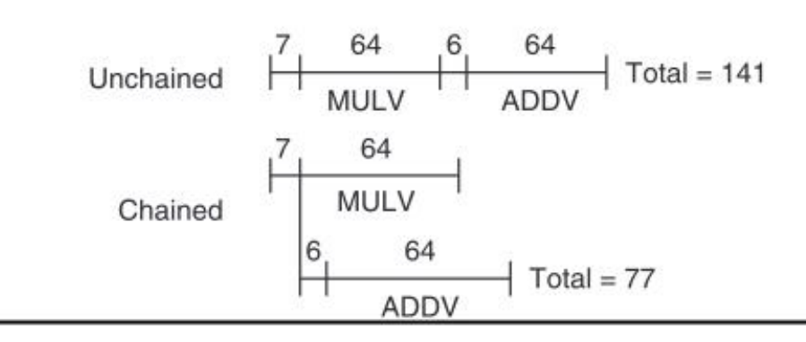

[图 G.7　按存储体编号和访问开始的时间槽列出的存储地址（以字节为单位）。每个存储体在访问开始时锁存元素地址，然后忙 6 个时钟周期，再把数值返回给 CPU。注意，CPU 每个周期只能送出一个新地址、接收一个数据项，因此无法让 8 个存储体一直都处于忙状态。表中「忙」即原图的 Busy。]{#fig-g-7 .caption}

| 周期号 | 存储体 0 | 1 | 2 | 3 | 4 | 5 | 6 | 7 |
|---|---|---|---|---|---|---|---|---|
| 0 | | 136 | | | | | | |
| 1 | | 忙 | 144 | | | | | |
| 2 | | 忙 | 忙 | 152 | | | | |
| 3 | | 忙 | 忙 | 忙 | 160 | | | |
| 4 | | 忙 | 忙 | 忙 | 忙 | 168 | | |
| 5 | | 忙 | 忙 | 忙 | 忙 | 忙 | 176 | |
| 6 | | | 忙 | 忙 | 忙 | 忙 | 忙 | 184 |
| 7 | 192 | | | 忙 | 忙 | 忙 | 忙 | 忙 |
| 8 | 忙 | 200 | | | 忙 | 忙 | 忙 | 忙 |
| 9 | 忙 | 忙 | 208 | | | 忙 | 忙 | 忙 |
| 10 | 忙 | 忙 | 忙 | 216 | | | 忙 | 忙 |
| 11 | 忙 | 忙 | 忙 | 忙 | 224 | | | 忙 |
| 12 | 忙 | 忙 | 忙 | 忙 | 忙 | 232 | | |
| 13 | | 忙 | 忙 | 忙 | 忙 | 忙 | 240 | |
| 14 | | | 忙 | 忙 | 忙 | 忙 | 忙 | 248 |
| 15 | 256 | | | 忙 | 忙 | 忙 | 忙 | 忙 |
| 16 | 忙 | 264 | | | 忙 | 忙 | 忙 | 忙 |

如果步长与存储体数互素，并且存储体数足以避免单位步长情况下的冲突，那么单条向量访存指令内部就不会发生存储体冲突。没有存储体冲突时，多字步长和单位步长的访问速率相同。为了在步长为 1 时不停顿，存储体数有一个最小值；存储体数超过这个最小值，另一些步长的停顿频率就会降低。例如，有 64 个存储体时，步长为 32 的访问每隔一次停顿一次，而不是每次都停顿。原来如果是步长 8、16 个存储体，每隔一次访问就要停顿一次；改成 64 个存储体后，步长为 8 的访问每 8 次才停顿一次。有多条存储流水线，或者多个处理器共享同一个存储系统时，也需要更多的存储体来防止冲突。即使只有一条存储流水线，单位步长访问也可能发生存储体冲突，冲突出现在前一条指令的最后几个元素和后一条指令的最初几个元素之间；增加存储体可以降低这种指令间冲突的概率。2011 年，大多数向量超级计算机把每个 CPU 的访问分散到数百个存储体上。非单位步长时仍然可能发生存储体冲突，因此程序员会尽可能采用单位步长访问。

现代超级计算机可能有几十个 CPU，每个 CPU 有多条存储流水线，连接到数千个存储体。在每条存储流水线和每个存储体之间都铺设专用通路并不现实，因此通常用多级交换网络把存储流水线和存储体连接起来。不同的向量访问争用同一条电路通路时，交换网络就会发生拥塞，给存储系统带来额外的停顿。

## 提高向量性能 {#sec-g-4}

本节比第 4 章更深入地介绍提高向量处理器性能的技术。

### 深入讨论链接 {-}

早期的链接与前递的工作方式相似，链中源指令和目的指令的时序因此受到限制。近来的实现采用*灵活链接*（flexible chaining）：只要不产生结构冒险，一条向量指令基本上可以与任何其他正在执行的向量指令链接。灵活链接要求不同的向量指令能同时访问同一个向量寄存器，实现办法有两种：一是增加读写端口；二是像存储系统那样，把向量寄存器堆的存储组织成交叉的存储体。本附录其余部分都假设采用灵活链接。

即使两个操作相互依赖，链接也能让它们在向量的不同元素上并行执行。于是，这两个操作可以调度到同一个护航指令组中，所需的钟鸣数随之减少。前面那个指令序列中的两个操作虽然相关，仍然能达到每个时钟周期两次浮点操作（即一个钟鸣）的持续速率（不计启动）！这时该序列的总运行时间为：

$$
\text{向量长度} + \text{启动时间}_{\texttt{ADDV}} + \text{启动时间}_{\texttt{MULV}}
$$

[图 G.8](#fig-g-8) 给出了向量长度为 64 时，上面这对向量指令在链接和不链接两种情况下的时序。这个护航指令组只需要一个钟鸣；但由于采用了链接，启动开销会在它的实际时序中体现出来。在[图 G.8](#fig-g-8) 中，链接时的总时间为 77 个时钟周期，即每个结果 1.2 个周期。这段时间内完成了 128 次浮点操作，所以每个时钟周期得到 1.7 FLOPS。不链接时共 141 个时钟周期，即每个时钟周期 0.9 FLOPS。

{#fig-g-8 width=70%}

链接把两条相关指令放进同一个护航指令组，减少了执行时间中的钟鸣部分，但不能消除启动开销。要准确估计运行时间，护航指令组内部和组与组之间的启动时间都要计入。采用链接时，一个序列的钟鸣数取决于两点：一是处理器有多少种可用的向量功能部件，二是应用需要多少种。尤其是，任何护航指令组都不能含有结构冒险。例如，在 VMIPS 这样只有一个向量 load/store 部件的处理器上，含有两条向量访存指令的序列至少要占两个护航指令组，因而至少需要两个钟鸣。

链接非常重要，所有现代向量处理器都支持灵活链接。

### 深入讨论稀疏矩阵 {-}

第 4 章介绍过让稀疏矩阵程序以向量模式执行的技术，这里先简单回顾一下。稀疏矩阵中向量的元素通常按某种压缩形式存放，再通过间接方式访问。假设采用一种简化的稀疏结构，代码可能是这样的：

```fortran
      do   100 i = 1,n
100        A(K(i)) = A(K(i)) + C(M(i))
```

这段代码对数组 A 和 C 做稀疏向量求和，用索引向量 K 和 M 指出 A 和 C 中的非零元素（A 和 C 的非零元素个数必须相同，都是 n 个）。稀疏矩阵的另一种常用表示是：用一个位向量指出哪些元素存在，再用一个稠密向量存放非零元素。同一个程序中常常两种表示并存。许多程序都用到稀疏矩阵，实现方法也很多，具体取决于程序所用的数据结构。

简单的向量化编译器无法自动把上面的代码向量化，因为它不知道 K 的各个元素取值互不相同，也就无法确定不存在相关。这时要由程序员给出编译指示，告诉编译器这个循环可以按向量模式运行。

更高级的向量化编译器会插入数据相关的运行时检查，不需要程序员标注就能自动把循环向量化。[附录 H](#app-h) 介绍过 Itanium 处理器中的高级装入地址表（ALAT）硬件，这些运行时检查就是 ALAT 的向量化软件版本：用一张软件散列表代替相联的 ALAT 硬件，检测同一次分段开采迭代中是否有两个元素访问同一个地址。如果没有检测到相关，这次分段开采迭代就可以按最大向量长度完成。如果检测到相关，就把向量长度重设为一个较小的值，避开所有的相关违例，剩下的元素留到分段开采循环的下一次迭代处理。这种方案给循环增加了相当大的软件开销，但在没有相关的常见情况下，这些开销大部分也是向量化执行的。因此，循环仍然比标量代码快得多（不过比有程序员编译指示时慢得多）。

近来的许多超级计算机都提供集中—分散功能。集中—分散操作实现起来更复杂，也更容易发生存储体冲突，所以往往比带步长的访问慢；但比起替代做法（可能是一个标量循环），它们仍然快得多。矩阵的稀疏特性一旦改变，就必须重新计算索引向量，许多处理器为此提供了快速计算索引向量的支持。VMIPS 中的 CVI（create vector index，生成向量索引）指令根据给定的步长 *m* 生成索引向量，索引向量中的值为 0, *m*, 2 × *m*, …, 63 × *m*。有些处理器提供专门的指令来生成压缩的索引向量，索引向量的各项对应掩码寄存器中为 1 的位置；另一些向量体系结构则提供压缩向量的方法。在 VMIPS 中，我们规定 CVI 指令总是用向量掩码生成压缩的索引向量；向量掩码全为 1 时，生成的就是标准的索引向量。

带索引的 load/store 和 CVI 指令为条件向量执行提供了另一种支持方法。我们先回顾第 4 章的一段代码：

```fortran
      low = 1
      VL = (n mod MVL) /*找出零头部分*/
      do 1 j = 0,(n/MVL) /*外层循环*/
         do 10 i = low, low + VL - 1 /*执行 VL 次*/
            Y(i) = a * X(i) + Y(i) /*主运算*/
10       continue
         low = low + VL /*下一个向量的起点*/
         VL = MVL /*把长度重设为最大值*/
1     continue
```

下面是用 CVI 实现这个循环的向量指令序列：

```
LV       V1,Ra        ;把向量 A 装入 V1
L.D      F0,#0        ;把浮点数 0 装入 F0
SNEVS.D  V1,F0        ;若 V1(i)!=F0，则把 VM 的相应位置 1
CVI      V2,#8        ;在 V2 中生成索引
POP      R1,VM        ;求 VM 中 1 的个数
MTC1     VLR,R1       ;装入向量长度寄存器
CVM                   ;清除掩码
LVI      V3,(Ra+V2)   ;装入 A 的非零元素
LVI      V4,(Rb+V2)   ;装入 B 的对应元素
SUBV.D   V3,V3,V4     ;做减法
SVI      (Ra+V2),V3   ;把 A 存回
```

用集中—分散实现是否优于条件执行的版本，取决于条件成立的频率和各操作的开销。不考虑链接时，原来版本的运行时间是 $5n + c_1$。第二个版本使用带索引的 load 和 store，每个时钟处理一个元素，运行时间是 $4n + 4fn + c_2$，其中 $f$ 是条件成立（即 A(i) ≠ 0）的元素所占的比例。假设 $c_1$ 和 $c_2$ 的值相近，或者都远小于 $n$，就可以求出第二种技术在什么情况下更好：

$$
\begin{aligned}
\text{Time}_1 &= 5(n) \\
\text{Time}_2 &= 4n + 4fn
\end{aligned}
$$

我们希望 $\text{Time}_1 > \text{Time}_2$，所以

$$
\begin{aligned}
5n &> 4n + 4fn \\
\frac{1}{4} &> f
\end{aligned}
$$

也就是说，非零元素不到四分之一时，第二种方法更快。而在许多情况下，条件成立的频率还要低得多。如果索引向量可以重复使用，或者 if 语句中的向量语句增多，集中—分散方法的优势还会急剧扩大。

## 编译器向量化的效果 {#sec-g-5}

一个程序能在多大程度上以向量模式运行，取决于两个因素。一是程序本身的结构：循环中有没有真数据相关？能不能重构循环，消除这样的相关？这一点取决于所选的算法，在一定程度上也取决于代码的写法。二是编译器的能力。循环迭代之间没有并行性时，任何编译器都无法把循环向量化；但判断循环能否向量化的能力，不同编译器之间差别极大。程序向量化所用的技术与第 3 章发掘 ILP 的技术相同，这里只回顾这些技术的效果。

不同编译器把程序向量化的效果差别极大。[图 G.9](#fig-g-9) 概括了向量化编译器的现状：用 100 个手写的 FORTRAN 核心程序组成测试集，给出了不同处理器上的向量化程度。这些核心程序专门用来测试向量化能力，全部都可以手工向量化；习题中会看到其中几个循环的例子。

[图 G.9　向量化编译器处理 100 个 FORTRAN 测试核心程序的结果。对每种处理器，给出了完全向量化、部分向量化和未向量化的循环个数。这些循环由 Callahan、Dongarra 和 Levine [1988] 收集。Cray X-MP 上两种不同编译器的结果表明，向量化效果在很大程度上取决于编译器技术。]{#fig-g-9 .caption}

| 处理器 | 编译器 | 完全向量化 | 部分向量化 | 未向量化 |
|---|---|---:|---:|---:|
| CDC CYBER 205 | VAST-2 V2.21 | 62 | 5 | 33 |
| Convex C-series | FC5.0 | 69 | 5 | 26 |
| Cray X-MP | CFT77 V3.0 | 69 | 3 | 28 |
| Cray X-MP | CFT V1.15 | 50 | 1 | 49 |
| Cray-2 | CFT2 V3.1a | 27 | 1 | 72 |
| ETA-10 | FTN 77 V1.0 | 62 | 7 | 31 |
| Hitachi S810/820 | FORT77/HAP V20-2B | 67 | 4 | 29 |
| IBM 3090/VF | VS FORTRAN V2.4 | 52 | 4 | 44 |
| NEC SX/2 | FORTRAN77 / SX V.040 | 66 | 5 | 29 |

## 融会贯通：向量处理器的性能 {#sec-g-6}

本节讨论向量处理器的性能度量，以及这些度量能说明处理器的哪些特点。要确定处理器在向量问题上的性能，必须同时考察启动开销和持续速率。报告向量处理器在某个循环上的性能，最简单也最好的办法是给出这个向量循环的执行时间。但人们报告向量循环的性能时，常常给出 MFLOPS（每秒百万次浮点操作）值，而不给执行时间。我们用 $R_n$ 表示长度为 $n$ 的向量上的 MFLOPS 值。只要 FLOPS 数的算法事先约定一致，用 $T_n$（时间）度量和用 $R_n$（速率）度量就是等价的。无论用哪一种，都应该把开销计算在内。

本节从不同角度考察 VMIPS 执行 DAXPY 循环（见第 4 章）的性能。向量循环的执行时间仍然用 [G.2 节](#sec-g-2)推导的公式计算；同时我们还要看到，根据算出的时间可以用不同的方法度量性能。本节所用的 $T_{\text{loop}}$ 常数值会带来少量误差，这里忽略不计。

### 向量性能的度量 {-}

向量长度在很大程度上决定了处理器的性能，因此除了时间和 MFLOPS，人们还常常使用与长度有关的度量。这些度量在不同处理器之间往往差别很大，比较起来很有意思。（不过要记住，比较两个处理器的相对速度时，真正关心的始终是*时间*。）最重要的三个与长度有关的度量是：

* $R_\infty$：无穷长向量上的 MFLOPS 速率。估计峰值性能时，这个度量可能有用；但实际问题的向量长度有限，遇到的开销损失也会更大。
* $N_{1/2}$：达到 $R_\infty$ 的一半所需的向量长度。它能很好地衡量开销的影响。
* $N_v$：向量模式比标量模式更快所需的向量长度。它同时衡量开销和标量相对于向量的速度。

我们来看 DAXPY 在 VMIPS 上运行时的这些度量。采用链接时，按护航指令组划分的 DAXPY 代码内层循环如[图 G.10](#fig-g-10) 所示（假设 Rx 和 Ry 中存放起始地址）。

回顾 $n$ 个元素的向量循环的执行时间公式 $T_n$：

$$
T_n = \left\lceil \frac{n}{\text{MVL}} \right\rceil \times \left(T_{\text{loop}} + T_{\text{start}}\right) + n \times T_{\text{chime}}
$$

采用链接后，这个循环用三个钟鸣就能运行完（由于只有一条存储流水线，不能更少），因此 $T_{\text{chime}} = 3$。如果 $T_{\text{chime}}$ 能完全反映性能，这个循环的 MFLOPS 速率就是 2/3 × 时钟频率（因为每次迭代有 2 次浮点操作）。因此，如果只按钟鸣数计算，并且不考虑分段开采和启动开销，500 MHz 的 VMIPS 运行这个循环可以达到 333 MFLOPS。提高性能的办法有几种：增加向量 load/store 部件；允许护航指令组重叠，减小启动开销的影响；通过向量寄存器分配减少所需的 load 次数。本节考察前两种扩展。VMIPS 的「表亲」Cray-1 实际采用了最后一种优化，性能因此提高了 50%。减少 load 次数需要过程间优化，习题 G.6 会考察这种变换。在考察前两种扩展之前，我们先来看计入开销后的实际性能。

[图 G.10　按链接后的护航指令组划分的 DAXPY 代码内层循环。]{#fig-g-10 .caption}

| | | |
|---|---|---|
| `LV V1,Rx` | `MULVS.D V2,V1,F0` | 护航指令组 1：链接的 load 和乘法 |
| `LV V3,Ry` | `ADDV.D V4,V2,V3` | 护航指令组 2：第二个 load 和加法，链接 |
| `SV Ry,V4` | | 护航指令组 3：存储结果 |

### VMIPS 执行 DAXPY 的峰值性能 {-}

首先要确定峰值性能 $R_\infty$ 到底是多少，因为我们知道它肯定不等于理想的 333 MFLOPS。这里仍然沿用简化假设：前一个护航指令组的所有指令都完成后，下一个护航指令组才能开始；后面再去掉这一限制。在这一假设下，向量序列的启动开销就是各条指令启动时间之和：

$$
T_{\text{start}} = 12 + 7 + 12 + 6 + 12 = 49
$$

把 $\text{MVL} = 64$、$T_{\text{loop}} = 15$、$T_{\text{start}} = 49$、$T_{\text{chime}} = 3$ 代入性能公式，并假设 $n$ 不是 64 的整数倍，则 $n$ 个元素的操作所需时间为：

$$
\begin{aligned}
T_n &= \left\lceil \frac{n}{64} \right\rceil \times (15 + 49) + 3n \\
&\le (n + 64) + 3n \\
&= 4n + 64
\end{aligned}
$$

可见，实际的持续速率是每次迭代 4 个多时钟周期，而忽略开销的理论速率是 3 个钟鸣。两者的差别主要来自每个 64 元素块的启动开销（49 个周期，而循环开销只有 15 个周期）。

现在可以计算时钟频率为 500 MHz 时的 $R_\infty$：

$$
R_\infty = \lim_{n \to \infty} \left( \frac{\text{每次迭代的操作数} \times \text{时钟频率}}{\text{每次迭代的时钟周期数}} \right)
$$

分子与 $n$ 无关，因此

$$
\begin{aligned}
R_\infty &= \frac{\text{每次迭代的操作数} \times \text{时钟频率}}{\displaystyle\lim_{n \to \infty} (\text{每次迭代的时钟周期数})} \\
\lim_{n \to \infty} (\text{每次迭代的时钟周期数}) &= \lim_{n \to \infty} \left( \frac{T_n}{n} \right) = \lim_{n \to \infty} \left( \frac{4n + 64}{n} \right) = 4 \\
R_\infty &= \frac{2 \times 500\ \text{MHz}}{4} = 250\ \text{MFLOPS}
\end{aligned}
$$

不计启动开销的性能，即这种向量功能部件结构所能达到的峰值性能，现在是 $R_\infty$ 的 1.33 倍。而实际上，这个基准测试程序的峰值性能与持续性能之间的差距还要更大！

### VMIPS 在 Linpack 基准测试程序上的持续性能 {-}

Linpack 基准测试程序对一个 100 × 100 的矩阵做高斯消去，因此向量长度从 99 递减到 1，长度为 $k$ 的向量要用 $k$ 次。于是平均向量长度为：

$$
\frac{\displaystyle\sum_{i=1}^{99} i^2}{\displaystyle\sum_{i=1}^{99} i} = 66.3
$$

现在可以用向量长度 66 准确估计 DAXPY 的性能：

$$
\begin{aligned}
T_{66} &= 2 \times (15 + 49) + 66 \times 3 = 128 + 198 = 326 \\
R_{66} &= \frac{2 \times 66 \times 500}{326}\ \text{MFLOPS} = 202\ \text{MFLOPS}
\end{aligned}
$$

不计启动开销的峰值，是按实际向量长度估计出的持续性能的 1.64 倍。实际上，Linpack 基准测试程序中还有相当一部分代码无法向量化。这部分代码在向量化之前占不到 20% 的时间，但按 FLOPS 计算，它的运行性能不到向量部分的十分之一。因此由 Amdahl 定律可知，整体性能会比根据内层循环估计出的性能低得多。

向量长度对性能影响很大，所以比较向量机时常用 $N_{1/2}$ 和 $N_v$ 这两个度量。

**例题**　对时钟频率为 500 MHz 的 VMIPS，仅考虑 DAXPY 的内层循环，$N_{1/2}$ 是多少？

**解答**　以 $R_\infty$ 作为峰值速率，要求的就是达到约 125 MFLOPS 所需的向量长度。先写出在 $N_{1/2}$ 个元素上测量时的 MFLOPS 公式：

$$
\begin{aligned}
\text{MFLOPS} &= \frac{N_{1/2}\ \text{次迭代执行的 FLOPS}}{\text{执行 } N_{1/2}\ \text{次迭代的时钟周期数}} \times \frac{\text{时钟周期数}}{\text{秒}} \times 10^{-6} \\
125 &= \frac{2 \times N_{1/2}}{T_{N_{1/2}}} \times 500
\end{aligned}
$$

化简上式，再假设 $N_{1/2} < 64$，从而 $T_{N_{1/2} < 64} = 64 + 3 \times n$，得到：

$$
\begin{aligned}
T_{N_{1/2}} &= 8 \times N_{1/2} \\
64 + 3 \times N_{1/2} &= 8 \times N_{1/2} \\
5 \times N_{1/2} &= 64 \\
N_{1/2} &= 12.8
\end{aligned}
$$

所以 $N_{1/2} = 13$。也就是说，在 VMIPS 上运行 DAXPY 循环，长度为 13 的向量大约能达到峰值性能的一半。
