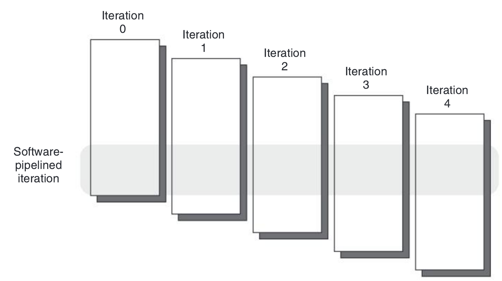
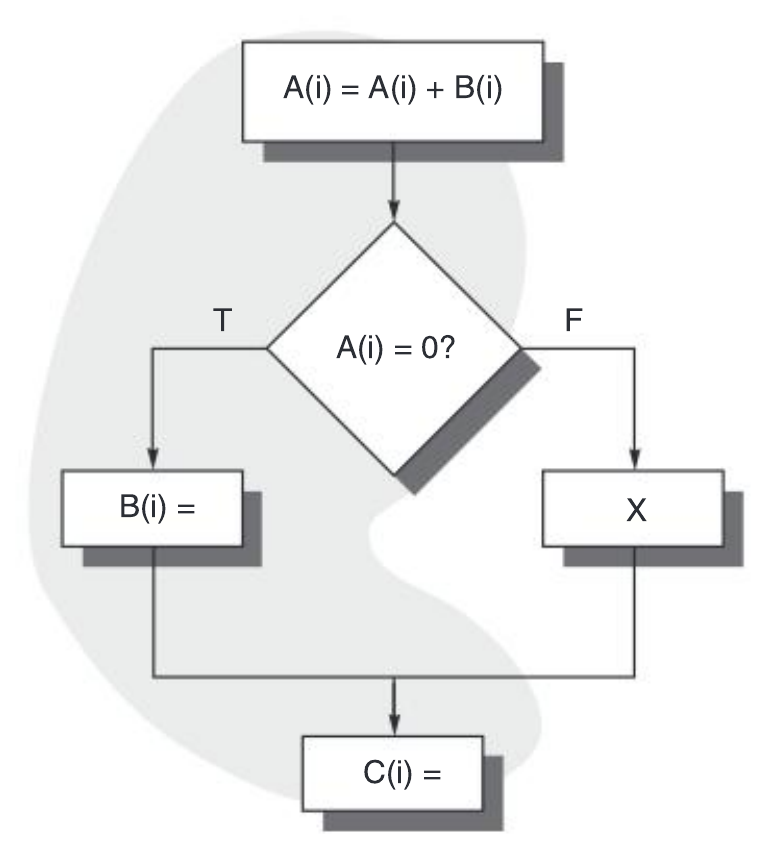

上面这些例子都把计算真正消除掉了。但有时我们也希望提高代码的并行性，哪怕操作数目因此增加。一段计算可以用树形结构表示，这类优化把树变得更宽、更矮，降低了树的高度，因此称为*树高降低*。看下面的代码序列：

```
ADD R1,R2,R3
ADD R4,R1,R6
ADD R8,R4,R7
```

每条指令都依赖紧挨在它前面的那条指令，因此这个序列至少需要三个执行周期。利用加法的结合律，可以把代码改写成：

```
ADD R1,R2,R3
ADD R4,R6,R7
ADD R8,R1,R4
```

改写后的序列只需要两个执行周期。使用循环展开时，经常会出现做这类优化的机会。

范围和精度不受限制的算术运算满足结合律，但计算机算术不满足：整数运算的范围有限，浮点运算的范围和精度都有限。因此，这些重组技术有时会导致错误的结果，只是这种情况很少见。正因为如此，大多数编译器要求显式打开依赖结合律的优化。

循环展开之后，这类代数优化对减小递推所引起的相关的影响很重要。所谓*递推*，就是这样一种表达式：它在某次迭代中的值，由一个依赖于前面各次迭代的函数给出。把含有递推的循环展开后，也许可以对展开后的循环做代数优化，让每次展开后的迭代只计算一次递推。一种常见的递推来自显式的程序语句，例如：

```
sum = sum + x;
```

假设把含有这个递推的循环展开五次，五次迭代中 `x` 的值分别记作 `x1`、`x2`、`x3`、`x4`、`x5`，那么每次展开结束时 `sum` 的值可以写成：

```
sum = sum + x1 + x2 + x3 + x4 + x5;
```

不做优化时，这个表达式需要五个相关的操作。它可以改写成：

```
sum = ((sum + x1) + (x2 + x3)) + (x4 + x5);
```

这样只需要三个相关的操作。

递推也会来自隐式的计算，例如数组下标的计算。每个数组下标都要转换成一个地址，这个地址根据循环下标变量算出。同样，借助展开和代数优化，可以把相关的计算减到最少。

## 面向并行的代码调度与组织 {#sec-h-3}

前面已经看到，循环展开这种编译技术能生成更长的直线型代码序列，从而发掘指令之间的并行性。为了同样的目的，人们还发展了另外两种重要技术：软件流水和踪迹调度。

### 软件流水：符号化的循环展开 {-}

*软件流水*是一种重组循环的技术，经过软件流水的代码中，每次迭代都由原循环不同迭代中的指令组成。要理解这种做法，最容易的办法是看 2.2 节例子中展开后的循环调度出来的代码。那个例子中，调度程序实际上是把不同循环迭代的指令交错排列，从而把同一次迭代内相关的指令分隔开。由于指令选自不同的迭代，相关的计算之间隔着整整一个循环体，展开后的循环就更有可能无停顿地调度。

软件流水循环不展开循环，也能把不同迭代的指令交错排列，如[图 H.1](#fig-h-1) 所示。Tomasulo 算法在硬件中做的事，这项技术在软件中完成。对前面的例子，软件流水循环中有一条 load、一条加法和一条 store，三者各来自一次不同的迭代。此外，循环开始前需要一些启动代码，循环结束后也需要一些收尾代码。为简单起见，这里不讨论这两部分。

{#fig-h-1 width=80%}

**例题**　下面的循环把一个数组的所有元素都加上 `F2` 的内容，数组的起始地址在 `R1` 中。写出这个循环的软件流水版本：

```
Loop:   L.D      F0,0(R1)
        ADD.D    F4,F0,F2
        S.D      F4,0(R1)
        DADDUI   R1,R1,#-8
        BNE      R1,R2,Loop
```

启动代码和收尾代码可以省略。

**解答**　软件流水先对循环做符号化的展开，再从每次迭代中选取指令。展开只是符号化的，所以循环开销指令（`DADDUI` 和 `BNE`）不必复制。下面是去掉开销指令后展开的循环体。原书用粗体标出了从各次迭代中选取的指令，即第 i 次迭代的 `S.D`、第 i+1 次迭代的 `ADD.D` 和第 i+2 次迭代的 `L.D`：

```
Iteration i:     L.D      F0,0(R1)
                 ADD.D    F4,F0,F2
                 S.D      F4,0(R1)
Iteration i+1:   L.D      F0,0(R1)
                 ADD.D    F4,F0,F2
                 S.D      F4,0(R1)
Iteration i+2:   L.D      F0,0(R1)
                 ADD.D    F4,F0,F2
                 S.D      F4,0(R1)
```

然后把从不同迭代中选出的这些指令和循环控制指令一起放进循环：

```
Loop:   S.D      F4,16(R1)   ;存入 M[i]
        ADD.D    F4,F0,F2    ;加到 M[i-1]
        L.D      F0,0(R1)    ;取 M[i-2]
        DADDUI   R1,R1,#-8
        BNE      R1,R2,Loop
```

不计启动和收尾部分，并假定 `DADDUI` 调度在 `ADD.D` 之前、调整过偏移量的 `L.D` 放在转移延迟槽中，这个循环每 5 个周期产生一个结果。load 和 store 的偏移量相差 16（即两次迭代），因此循环要少执行两次迭代。注意，`F4`、`F0`、`R1` 等寄存器被重复使用，硬件必须避免循环中会出现的读后写（WAR）冒险。本例不会出现由数据相关引起的停顿，所以这种冒险应该不成问题。

对照展开后的版本，就能看出启动代码和收尾代码应该是什么。启动代码要执行第 1、2 次迭代中循环本身不会执行的指令，即第 1、2 次迭代的 `L.D` 和第 1 次迭代的 `ADD.D`。收尾代码要执行最后两次迭代中循环本身不会执行的指令，即最后一次迭代的 `ADD.D` 和最后两次迭代的 `S.D`。

软件流水循环中的寄存器管理可能很棘手。上面的例子还不算太难，因为某次迭代写的寄存器，下一次迭代就读走了。在其他情况下，可能需要增加从发射一条指令到使用其结果之间相隔的迭代次数。循环体中的指令很少而延迟很大时，就需要这样做，这时要把软件流水和循环展开结合起来使用。

软件流水可以看作符号化的循环展开。事实上，有些软件流水算法正是用循环展开算法来确定怎样对循环做软件流水。与单纯的循环展开相比，软件流水的主要优点是占用的代码空间更少。两种技术都能得到调度得更好的内层循环，此外各自减少一种不同的开销：

* 循环展开减少的是循环本身的开销，即转移和计数器更新代码；
* 软件流水减少的是循环达不到峰值速度的时间，把它压缩到整个循环只在开始和结束时各出现一次。

如果把一个执行 100 次迭代的循环展开固定的次数，比如 4 次，那么每启动一次展开后的内层循环，就要付出一次这样的开销，共 100/4 = 25 次。[图 H.2](#fig-h-2) 用图形表示了这种情况。这两种技术针对两种不同的开销，因此两者一起使用，性能可能最好。

{#fig-h-2 width=80%}

在实际中，用软件流水来编译相当困难，原因有几个：一是许多循环要经过大量变换才能做软件流水；二是开销与软件流水循环效率之间的权衡很复杂；三是寄存器管理带来了额外的复杂性。为了帮助解决后两个问题，IA-64 为软件流水加入了大量硬件支持。有了这些硬件，软件流水用起来更高效，但编译器仍然需要复杂的支持，仍然要在怎样最好地编译一个循环上作出艰难的决策。

### 全局代码调度 {-}

3.2 节考察了怎样用循环展开和代码调度来提高 ILP。循环体是直线型代码时，3.2 节的技术效果很好，因为展开后的循环看上去就像一个基本块。同样，循环体是单个基本块时，软件流水的效果也很好，因为这时比较容易找到可以重复的调度。但是，如果展开后的循环体内部有控制流，代码调度就复杂得多。一般来说，要有效地调度内部有控制流的循环体，就需要跨转移移动指令，这就是*全局代码调度*。本节先考察全局代码调度面临的挑战和局限。[H.4 节](#sec-h-4)考察消除内层循环中控制流的硬件支持，然后考察消除控制流行不通时可用的两种编译技术。

全局代码调度的目标，是在保持数据相关和控制相关的前提下，把一个内部有控制结构的代码片段压缩成尽可能短的序列。数据相关规定了操作之间的偏序；控制相关决定了代码难以跨越哪些指令移动。数据相关通过展开来克服；对访存操作，还要用相关分析判断两次访问是否指向同一个地址。为一段代码找到尽可能短的序列，就是为它的*关键路径*找到最短的序列。关键路径是由相关指令构成的最长序列。

循环转移引起的控制相关可以通过展开来减少；非循环的条件转移引起的控制相关，全局代码调度可以通过移动代码来减小其影响。代码跨转移移动后，执行频率往往会改变，因此要有效地做全局代码移动，就需要估计不同路径的相对频率。全局代码移动并不能保证代码变快，但只要频率信息准确，编译器就能判断这样的移动是否可能让代码变快。

许多内层循环含有条件语句，因此全局代码移动很重要。[图 H.3](#fig-h-3) 给出了一个典型的代码片段，可以把它看成展开后循环的一次迭代，图中突出显示了较常走的控制流。

{#fig-h-3 width=50%}

要有效地调度这段代码，可能需要把对 B 和 C 的赋值提前到对 A 的测试之前执行。这样的全局代码移动必须满足一组约束才是合法的。此外，移动与 B 有关的代码是推测性的，移动与 C 有关的代码则不是：只有程序真的走包含 B 这段代码的路径时，移动它才能加快计算。

移动 B 时，必须保证数据流和异常行为都不改变。为了不改变异常行为，编译器不移动某些可能引起异常的指令类别，比如访存指令。在 [H.5 节](#sec-h-5)中，我们将看到硬件支持怎样为推测性的代码移动提供更多机会，并消除控制相关。这种增强的推测支持能让编译器发掘更多机会，但怎样选择最佳的编译方式，仍然是一个复杂的难题。

编译器怎样才能保证移动对 B 和 C 的赋值后不影响数据流？为了看清其中的问题，我们来看为[图 H.3](#fig-h-3) 的流程图生成的一段典型代码。假定 A、B、C 的地址分别在 `R1`、`R2` 和 `R3` 中，代码序列如下：

```
          LD      R4,0(R1)        ;取 A
          LD      R5,0(R2)        ;取 B
          DADDU   R4,R4,R5        ;加到 A
          SD      R4,0(R1)        ;存 A
          ...
          BNEZ    R4,elsepart     ;测试 A
          ...                     ;then 部分
          SD      ...,0(R2)       ;存入 B
          ...
          J       join            ;跳过 else 部分
elsepart: ...                     ;else 部分
          X                       ;X 的代码
          ...
join:     ...                     ;if 之后
          SD      ...,0(R3)       ;存入 C[i]
```

先考虑把对 B 的赋值移到 `BNEZ` 指令之前。把 if 语句之前最后一条给 B 赋值的指令记作 *i*。如果在代码段 X 中或 if 语句之后，有指令在 B 被赋值之前引用了 B，就把这条指令记作 *j*。只要存在这样的指令 *j*，移动对 B 的赋值就会改变程序的数据流：移动之后，*j* 数据相关于移动后的那条 B 赋值指令，而不再相关于它原来依赖的 *i*。可以设想一些更巧妙的方案，即使 B 的值被使用，也允许移动 B。例如在第一种情况下，可以在 if 语句之前给 B 做一个影子副本，在 X 中使用这个影子副本。不过，这类方案通常都不采用，原因有两个：一是实现复杂；二是如果选出的踪迹不是最优的，这些操作最终还要额外执行一些指令，反而拖慢程序。

把对 C 的赋值移到第一个转移之前，需要两步。

第一步，把赋值越过 else 部分的汇合点，移到 then 部分对应的那一段中。这样一来，C 的指令就控制相关于这个转移；如果走的是 else 路径（即不常走的路径），这些指令就不会执行。于是，在这个代码片段之后执行、且数据相关于 C 的赋值的那些指令会受到影响。为了保证这些指令算出正确的值，要在 else 路径上复制一份计算 C 并给 C 赋值的指令。

第二步，如果 C 不影响流入转移条件的任何数据流，就可以把 C 从转移的 then 部分移过转移条件。C 移到 if 测试之前以后，else 分支中的那份 C 的副本就成了冗余代码，通常可以删去。

从这个例子可以看出，全局代码调度受到许多约束。正是这一点促使设计者提供硬件支持，让这类代码移动更容易，[H.4 节](#sec-h-4)和 [H.5 节](#sec-h-5)将详细讨论这种支持。

全局代码调度在决定是否移动代码时，还需要作复杂的权衡。例如，假定对 B 的赋值可以移到条件转移之前（另一个分支上可能需要一些补偿代码），这样移动会让代码运行得更快吗？答案是：有可能！同样，把 C 的副本移进 if 和 else 两个分支，一开始会让代码变大！只有编译器能成功地把这段计算移过 if 测试，才可能有好处。

编译器在移动 B 的计算和赋值时，必须考虑以下因素：

* 转移的 then 情况和 else 情况，相对执行频率各是多少？如果 then 情况频繁得多，代码移动可能有好处；否则，考虑移动代码的可能性就小一些，但也并非没有。
* 在转移之上执行 B 的计算和赋值，代价是多少？转移之上的代码中可能有一些空的指令发射槽，B 的指令可以放进这些本来会空着的槽里。这样，至少在一阶近似下，B 的计算是「免费」的。
* 移动 B 会怎样改变 then 情况的执行时间？如果 B 位于 then 情况关键路径的开头，移动它可能非常有好处。
* B 是最值得移到转移之上的代码片段吗？与移动 C 或 then 情况中的其他语句相比如何？
* else 情况可能需要的补偿代码代价是多少？这些代码能调度得多好？它们对执行时间有什么影响？

从这份并不完整的清单就可以看出，全局代码调度是一个极其复杂的问题。权衡取决于许多因素，对各条指令所作的全局调度决策又高度相互依赖。就连先从哪些指令开始考虑，把它们作为全局代码移动的候选对象，都很复杂！

为了简化这个过程，人们发展了几种不同的全局代码调度方法。这里简要考察其中两种。它们都基于一个简单的原则：让编译器集中处理一段直线型代码，这段代码代表估计执行最频繁的那条路径。直线型代码由展开生成，复杂之处当然在于怎样处理条件转移。两种方法都选出最频繁的路径并对它做调度，实际上就把条件转移拉直了。

### 踪迹调度：聚焦关键路径 {-}

*踪迹调度*适用于这样的处理器：每个时钟周期发射的指令很多；条件执行或谓词执行（见 [H.4 节](#sec-h-4)）不适用或不受支持；单靠简单的循环展开，可能发掘不出足够的 ILP 让处理器忙起来。踪迹调度是组织全局代码移动过程的一种方法。它把代码移动可能带来的代价放到不常走的路径上，从而简化代码调度。由于踪迹调度可能在指定的不常走路径上产生很大的开销，它最适合用在以下场合：剖析信息表明不同路径的频率差别很大，而且剖析信息能高度反映程序的行为、与输入无关。当然，这就把它的有效适用范围限制在某些类别的程序上。

踪迹调度分两步。

第一步称为*踪迹选择*。这一步设法找出一个可能的基本块序列，把这些基本块中的操作合并成数目较少的指令，这个序列称为*踪迹*。循环转移成功的概率很高，因此可以用循环展开来生成长踪迹。另外，利用静态转移预测，把其他条件转移也选定为成功或不成功，这样得到的踪迹就是由许多基本块连接而成的直线型序列。例如，假设[图 H.3](#fig-h-3) 所示的程序片段对应一个内层循环，其中突出显示的路径频繁得多，并且循环展开了四次，那么主踪迹就由程序阴影部分的四个副本组成，如[图 H.4](#fig-h-4) 所示。

第二步在选定踪迹之后进行，称为*踪迹压缩*。这一步设法把踪迹压进少量的宽指令中。踪迹压缩就是代码调度：它在一个序列（踪迹）中把各个操作尽量提前，把它们装进尽可能少的宽指令（或发射包）中。

踪迹调度方法的优点是简化了全局代码移动的决策。具体来说，转移被看作跳入或跳出所选踪迹的跳转，所选踪迹则假定为概率最大的路径。代码跨越这样的踪迹入口和出口移动时，往往需要在入口或出口处增加簿记代码。踪迹调度的关键假设是：踪迹的概率比其他路径大得多，因此簿记代码的代价不必作为决定性因素。只要一条指令可以移动，并且移动后能让主踪迹执行得更快，就移动它。

 中的程序片段是内层循环，把它展开四次，并把[图 H.3](#fig-h-3) 中的阴影部分当作可能的路径，就得到这条踪迹。踪迹出口对应跳离频繁路径，踪迹入口对应返回踪迹。图内标注：Trace exit，踪迹出口；Trace entrance，踪迹入口；T、F，条件为真、为假。](images/apph/fig-h-4.png){#fig-h-4 width=60%}
