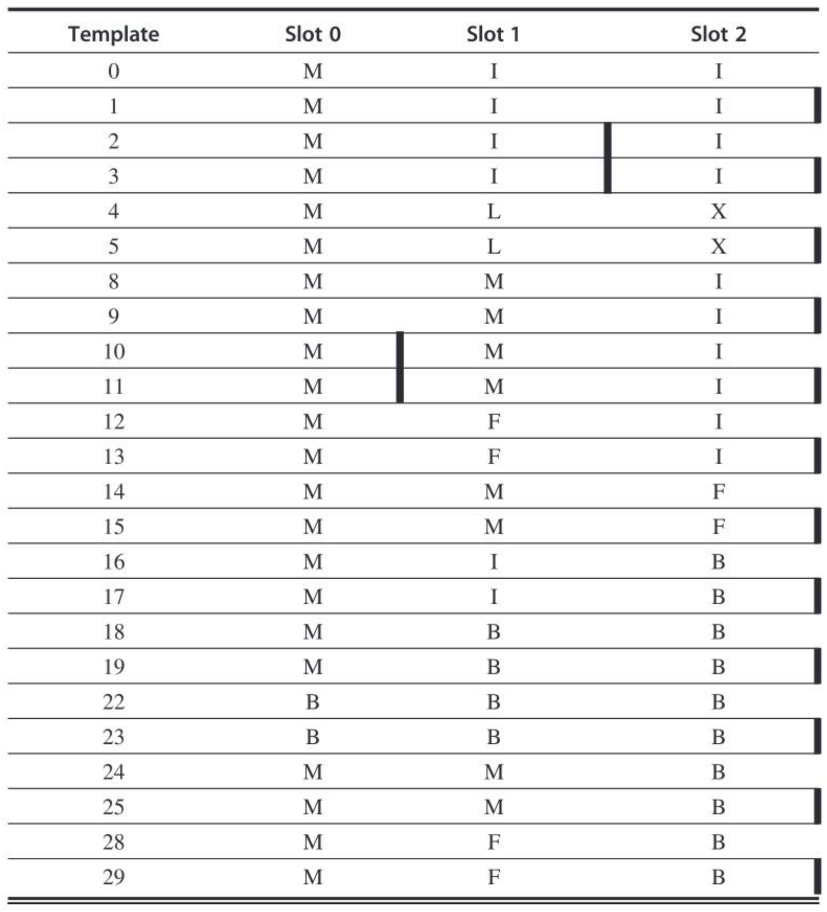

**例题**　以第 H-29 页的代码片段为例，说明怎样用推测指令和毒位编译这段代码，并指出推测访存产生的异常在哪里识别。假设 `R14` 未被使用，可以使用。

**解答**　代码如下，操作码前面加 s 表示推测指令：

```
      LD     R1,0(R3)     ;取 A
      sLD    R14,0(R2)    ;推测地取 B
      BEQZ   R1,L3        ;
      DADDI  R14,R1,#4    ;
L3:   SD     R14,0(R3)    ;推测 LW 的异常在此识别
```

如果推测的 `sLD` 产生了终止性异常，`R14` 的毒位就置位。随后执行非推测的 `SW` 指令时，如果 `R14` 的毒位已置位，这条指令就引发异常。

这种方法还有一个必须解决的问题：寄存器的毒位已置位时，操作系统在上下文切换时怎样保存用户寄存器？解决办法是提供一条专门的指令，用来保存并复位毒位的状态。

前面列出的第四种方法，也是最后一种，依靠一种工作方式类似重排序缓冲的硬件机制。采用这种方法时，编译器把指令标为推测指令，并在指令中注明两项信息：一是这条指令被推测地移过了多少条转移，二是编译器为这些转移假定的方向（成功或不成功）。后一项信息实际上告诉硬件，这条推测指令原来在哪个代码块中。实践中，推测的好处大多只需允许指令移过一条转移就能得到，因此只要 1 位，说明推测指令来自转移成功的路径还是不成功的路径。另一种做法是在推测指令原来的位置上放一个*哨兵*。哨兵告诉硬件：前面那条推测指令已经不再是推测的，它的值可以提交了。

和硬件推测方法一样，所有指令在发射时都放进重排序缓冲，并强制按序提交。但这里并不做真正的推测转移预测，也不做动态调度。重排序缓冲跟踪指令什么时候可以提交，并推迟所有推测指令的「写回」部分。推测指令要等到它被移过的那些转移也可以提交，或者等到遇到对应的哨兵，才允许提交。到了这一步，我们就知道这条推测指令究竟该不该执行：如果本该执行，又产生了终止性异常，程序就应当终止；如果本不该执行，这个异常就可以忽略。注意，寄存器重命名由编译器负责，而不是由硬件负责，编译器要借此保证推测结果得到正确使用，程序也能正确执行。

### 访存推测的硬件支持 {-}

编译器通常只在确知 load 和 store 的地址不冲突时，才把 load 移到 store 之前。3.2 节的例子表明，这类变换对缩短一段代码的关键路径至关重要。为了让编译器在不能绝对确定移动是否正确时也能做这种代码移动，可以在体系结构中加入一条专门检查地址冲突的指令。这条指令留在 load 原来的位置上，起守卫作用；load 本身则上移，越过一条或多条 store。

硬件执行推测的 load 时，把所访问存储单元的地址保存下来。在检查指令之前，如果后面某条 store 改写了这个单元，推测就失败了；如果这个单元没有被改写，推测就成功了。推测失败有两种处理办法：

* 如果只推测了这条 load，那么在检查指令处重新执行一次 load 就够了。为此，检查指令除了给出存储器地址，还可以给出目的寄存器。
* 如果依赖这条 load 的其他指令也被推测执行了，就需要一段修复代码，从这条 load 开始，把所有推测执行的指令重新执行一遍。这时，检查指令给出修复代码的地址。

本节介绍了多种硬件辅助机制。第 3 章和本附录中以编译器为主的方法，要靠这些机制才能得到良好的支持。此外，其中几种机制很容易集成到第 3 章以硬件为主的方法中，带来额外的好处。

## Intel IA-64 体系结构与 Itanium 处理器 {#sec-h-6}

本节概述 Intel IA-64 体系结构及其实现 Itanium 处理器。IA-64 是最先进的 VLIW 风格的处理器体系结构。

### Intel IA-64 指令系统结构 {-}

IA-64 是一种 RISC 风格的寄存器-寄存器型指令系统，但有许多新颖的特性，用来支持由编译器发掘 ILP。这里重点介绍 IA-64 ISA 独有的方面，其中大部分在本附录前面已经讨论过，包括谓词执行、由编译器检测并行性，以及对访存推测的支持。

HP 和 Intel 发布 IA-64 体系结构时提出了 EPIC（Explicitly Parallel Instruction Computer，显式并行指令计算机）这一术语，用来把这种新的体系结构方法与早期的 VLIW 体系结构以及其他 RISC 体系结构区分开来。VLIW 和 EPIC 体系结构有许多共同的特性，但 EPIC 方法引入了几个概念，扩展了早期的 VLIW 方法。这些扩展主要有两个方面：

1. EPIC 在表示指令间的并行性和指令格式上更加灵活。VLIW 依靠固定的指令格式，一条指令中的所有操作都必须能够并行执行，格式也完全僵化。EPIC 则用显式的标志指出指令之间可能存在的相关，并提供多种指令格式。因此，EPIC 方法比较僵化的 VLIW 方法能更灵活地表达并行性，也能减少 VLIW 指令格式通常不够灵活而造成的代码量增大。
2. EPIC 对软件推测的支持比早期的 VLIW 方案广泛得多，后者对软件推测只有极少的支持。

此外，IA-64 体系结构还有多种提高性能的特性，例如寄存器窗口和旋转的浮点寄存器（FPR）栈。

### IA-64 的寄存器模型 {-}

IA-64 的寄存器状态包括以下部分：

* 128 个 64 位通用寄存器，稍后会看到，它们实际上是 65 位宽；
* 128 个 82 位浮点寄存器，比标准的 80 位 IEEE 格式多 2 个指数位；
* 64 个 1 位谓词寄存器；
* 8 个 64 位转移寄存器，用于间接转移；
* 多种用于系统控制、存储映射、性能计数器以及与操作系统通信的寄存器。

整数寄存器采用一种寄存器栈机制来加速过程调用，这种机制与伯克利 RISC-I 处理器提出、SPARC 体系结构采用的机制相似。寄存器 0～31 总是可以访问，编址为 0～31。寄存器 32～128 用作寄存器栈，每个过程分到一组寄存器（0～96 个）供自己使用。调用过程时，硬件通过寄存器重命名为被调用过程建立新的寄存器栈帧；一个称为当前帧指针（CFM）的专用寄存器指向某个过程所用的那组寄存器。栈帧分为局部区和输出区两部分：局部区用于局部存储，输出区用来向被调用的过程传递值。两个区的大小由 `alloc` 指令规定。只有整数寄存器有寄存器栈支持。

过程调用时，硬件更新 CFM 指针，使被调用过程的 `R32` 指向被调用过程输出区的第一个寄存器。这样，调用者的参数就传进了被调用者可以编址的寄存器。被调用者执行一条 `alloc` 指令，一次分配两类寄存器：一是所需的局部寄存器，其中包括调用者的输出寄存器；二是向它所调用的过程传递参数所需的输出寄存器。保存和恢复寄存器栈有专门的 load 和 store 指令；寄存器栈溢出则由专门的硬件处理，这种硬件称为*寄存器栈引擎*。

除整数寄存器之外，还有三组寄存器：浮点寄存器、谓词寄存器和转移寄存器。浮点寄存器存放浮点数据；转移寄存器存放间接转移的目标地址；谓词寄存器存放谓词，用来控制谓词指令的执行。谓词执行机制在本节后面介绍。

整数寄存器和浮点寄存器都对寄存器 32～128 支持寄存器旋转。寄存器旋转用来简化软件流水循环中的寄存器分配，这个问题在 [H.3 节](#sec-h-3)中讨论过。寄存器旋转再结合谓词执行，软件流水循环就既不必展开，也不必单独编写启动代码和收尾代码。这样，使用软件流水带来的代码膨胀减少了，这种技术也能用于迭代次数较少的循环。按传统做法，这类循环的开销会抵消软件流水的许多好处。

### 指令格式与显式并行的支持 {-}

IA-64 体系结构的设计目标是获得 VLIW 方法的主要好处，即一条指令中各操作之间的隐式并行和操作字段的固定格式，同时又比通常的 VLIW 更灵活。具体办法是：仍然由编译器检测 ILP，把指令调度到并行的指令槽中；但指令格式更灵活，并允许编译器指出某条指令不能与它后面的指令并行执行。

IA-64 体系结构用两个不同的概念分别获得隐式并行和易于译码这两方面的好处：把指令放进*指令组*，获得隐式并行；引入*指令束*（bundle）的概念，让多条指令采用固定格式，每个指令束包含三条指令。下面先定义指令组。

指令组是一串连续的指令，它们之间没有寄存器数据相关（有少数几个小的例外）。只要硬件资源足够，并且通过存储器的相关都得到保持，一个组内的所有指令都可以并行执行。指令组可以任意长，但编译器必须*显式地*指出指令组之间的边界，办法是在分属不同组的两条指令之间放一个*停止位*（stop）。要说明停止位怎样表示，先要说明指令怎样放进指令束。

IA-64 的指令编码在指令束中。每个指令束 128 位宽，由一个 5 位的模板字段和三条指令组成，每条指令 41 位。（严格地说，这些 41 位的量并不是真正的指令，因为只有结合模板字段才能解释它们，所以这些操作有时称为*音节*（syllable）。为简单起见，我们仍然称之为「指令」。）为了简化译码和指令发射，指令束的模板字段规定了束内每条指令需要哪种类型的执行部件。[图 H.6](#fig-h-6) 列出了五种执行部件类型、每种类型的槽可以容纳的指令类别，并给出了一些例子。

[图 H.6　IA-64 体系结构中的五种执行部件槽，以及每种槽可以容纳的指令类型。A 类指令对应整数 ALU 指令，可以放在 I 部件槽或 M 部件槽中。L + X 槽比较特殊，要占用两个指令槽；L + X 指令用于编码 64 位立即数和少数几条特殊指令，由 I 部件或 B 部件执行。]{#fig-h-6 .caption}

| 执行部件槽 | 指令类型 | 指令说明 | 指令举例 |
|---|---|---|---|
| I 部件 | A | 整数 ALU | 加、减、与、或、比较 |
| | I | 非 ALU 整数 | 整数和多媒体移位、位测试、传送 |
| M 部件 | A | 整数 ALU | 加、减、与、或、比较 |
| | M | 访存 | 整数/浮点寄存器的 load 和 store |
| F 部件 | F | 浮点 | 浮点指令 |
| B 部件 | B | 转移 | 条件转移、调用、循环转移 |
| L + X | L + X | 扩展 | 扩展立即数、停止位和空操作 |

每个指令束的 5 位模板字段*同时*描述两件事：一是这个指令束带有哪些停止位，二是束内每条指令需要哪种类型的执行部件。[图 H.7](#fig-h-7) 列出了模板字段可以编码的各种格式，以及每种格式规定的停止位位置。指令束格式只能表示指令类型与停止位全部可能组合中的一部分。下面用一个例子说明指令束怎样工作。

**例题**　把数组递增的例子 `x[i] = x[i] + s` 展开七次，再把指令放进指令束：先不考虑流水线延迟，使指令束数目最少；然后调度代码，使停顿最少。调度时假设每个时钟执行一个指令束，任何停顿都会使整个指令束停顿。流水线延迟采用图 3.2 中的数值。为简单起见，使用 MIPS 的指令助记符。

{#fig-h-7 width=60%}

**解答**　两种版本见[图 H.8](#fig-h-8)。这里的延迟虽然与 Itanium 不同，但在 Itanium 中，最常用的指令束 MMF 也必须单独发射，和本例的假设一样。

![图 H.8　把 `x[i] = x[i] + s` 展开七次后的 IA-64 指令，包括指令束模板位和停止位：(a) 调度目标是使指令束数目最少；(b) 调度目标是使周期数最少（假定一个冒险会使整个指令束停顿）。空白项表示未用的槽，编码为空操作。没有停止位，说明有些指令束可以并行执行。使指令束数目最少需要 9 个指令束，使周期数最少则需要 11 个。调度后的版本所用的周期数只比前者的一半略多。版本 (a) 填满了 85% 的指令槽，版本 (b) 填满了 70%。调度后的代码空槽很多，又使用了指令束，代码量可能比其他 RISC 体系结构大得多。注意，两个序列中最后一个指令束里的转移都依赖于同一个指令束中的 `DADD`。在 IA-64 指令系统中，这个序列会编码成先设置一个谓词寄存器，再用一条以该寄存器为谓词的转移。这种相关的操作通常不能放在同一个指令束中，但这种情况正是前面提到的例外之一。图内标注：Bundle template，指令束模板；Slot 0～2，槽 0～2；Execute cycle (1 bundle/cycle)，执行周期（每周期 1 个指令束）；(a) The code scheduled to minimize the number of bundles，(a) 使指令束数目最少的调度；(b) The code scheduled to minimize the number of cycles assuming one bundle executed per cycle，(b) 假定每周期执行一个指令束、使周期数最少的调度。](images/apph/fig-h-8.png){#fig-h-8 width=90%}

### 指令系统基础 {-}

在介绍对推测的专门支持之前，先简要讨论主要的指令编码，并概览五种基本指令类别（A、I、M、F 和 B）中的指令。每条 IA-64 指令长 41 位。高 4 位与指明执行部件槽的指令束模板位合起来，作为主操作码。（也就是说，4 位的操作码字段在各种执行部件槽之间复用，可以把操作码看作 4 位再加上 M、F、I、B、L + X 的类型标识。）每条指令的低 6 位指定守护这条指令的谓词寄存器（见下一小节）。

[图 H.9](#fig-h-9) 汇总了除多媒体指令以外的大部分主要指令格式，并给出了每种格式所编码指令的例子。

[图 H.9　IA-64 ISA 部分指令格式汇总。主操作码位和守护谓词寄存器的编号使每条指令多占 10 位。第二列给出的各指令类别的格式数（共 111 种）是按严格标准计算的：字段用途不同，即使大小相同，也算作不同的格式。字段大小真正不同的格式，只有这个数的 1/3 到 1/2。有些指令有保留未用的位，本表没有列出。立即数位数包括符号位。转移指令带有预测位，在预测器没有有效预测时使用。多媒体指令有许多种格式，本表只列出其中一种。]{#fig-h-9 .caption}

| 指令类型 | 格式数 | 代表性指令 | 额外操作码位数 | GPR/FPR 数 | 立即数位数 | 其他/说明 |
|---|---|---|---|---|---|---|
| A | 8 | 加、减、与、或 | 9 | 3 | 0 | |
| | | 左移并相加 | 7 | 3 | 0 | 2 位移位量 |
| | | ALU 立即数指令 | 9 | 2 | 8 | |
| | | 加立即数 | 3 | 2 | 14 | |
| | | 加立即数 | 0 | 2 | 22 | |
| | | 比较 | 4 | 2 | 0 | 2 个谓词寄存器作目的 |
| | | 与立即数比较 | 3 | 1 | 8 | 2 个谓词寄存器作目的 |
| I | 29 | 可变位数的右移/左移 | 9 | 3 | 0 | 许多多媒体指令使用这种格式 |
| | | 位测试 | 6 | 3 | 6 位字段说明符 | 2 个谓词寄存器作目的 |
| | | 传送到 BR | 6 | 1 | 9 位转移预测 | 转移寄存器说明符 |
| M | 46 | 整数/浮点 load 和 store，行预取 | 10 | 2 | 0 | 推测/非推测 |
| | | 整数/浮点 load 和 store，行预取，按立即数后增量 | 9 | 2 | 8 | 推测/非推测 |
| | | 整数/浮点 load 预取，按寄存器后增量 | 10 | 3 | | 推测/非推测 |
| | | 整数/浮点推测检查 | 3 | 1 | 21（分在两个字段中） | |
| B | 9 | PC 相对转移，计数转移 | 7 | 0 | 21 | |
| | | PC 相对调用 | 4 | 0 | 21 | 1 个转移寄存器 |
| F | 15 | 浮点运算 | 2 | 4 | | |
| | | 浮点比较 | 2 | 2 | | 2 个 6 位谓词寄存器 |
| L + X | 4 | 传送长立即数 | 2 | 1 | 64 | |

### 谓词执行与推测的支持 {-}

IA-64 体系结构全面支持谓词执行，几乎每条指令都可以带谓词。指令中指定一个谓词寄存器，就成了谓词指令；谓词寄存器的编号放在每条指令字段的低 6 位。几乎所有指令都可以带谓词，因此 if 转换和代码移动的开销都比只有少量条件指令时低。完全谓词化带来的一个结果是：条件转移不过是一条带守护谓词的转移！

谓词寄存器由比较指令或测试指令设置。一条比较指令规定 10 种比较测试中的一种，并以两个谓词寄存器为目的。写入这两个谓词寄存器的有两种情况：一是比较结果（0 或 1）及其反码；二是把两次测试组合起来的某个逻辑函数（例如与）的结果及其反码。这样，一条指令就能完成多次比较。

IA-64 体系结构对推测的支持分为两部分：一是*控制推测*，负责推迟推测指令的异常；二是*访存推测*，支持 load 指令的推测执行。

推测指令的延迟异常处理，靠一种相当于毒位的机制支持。通用寄存器（GPR）的这种位称为 NaT（Not a Thing），多出这一位，GPR 实际上就成了 65 位宽。浮点寄存器则用一个特殊的值 NaTVal（Not a Thing Value）获得同样的能力，这个值编码为有效数为 0、指数在 IEEE 的范围之外。只有推测的 load 指令会产生这类值，但所有不影响存储器的指令都会把 NaT 或 NaTVal 传播到结果寄存器。（load 既有推测的，也有非推测的；非推测的 load 只能立即引发异常，不能推迟异常。）浮点异常不走这种机制，而是用浮点状态寄存器记录。

延迟的异常有两种解决办法。一是非推测指令（例如 store）如果收到 NaT 或 NaTVal 作为源操作数，就产生一个立即的、不可恢复的异常。二是用一条 `chk.s` 指令检测是否存在 NaT 或 NaTVal，并转移到编译器设计的一段例程，从推测操作中恢复。这种恢复办法更适合访存推测。

如果置有 NaT 或 NaTVal 的寄存器内容不能存储，操作系统就无法保存处理器的状态。因此，IA-64 提供了专门的寄存器保存和恢复指令。这些指令遇到 NaT 或 NaTVal 时不会引起异常，同时还保存和恢复 NaT 位。

IA-64 对访存推测的支持采用*提前 load*（advanced load）的概念。所谓提前 load，就是被推测地上移、越过了它可能依赖的 store 指令的 load。推测地执行 load 时，使用 `ld.a`（advanced load）指令。执行这条指令时，硬件在一个称为 ALAT 的专用表中建立一项，记下这条 load 的目的寄存器和所访问存储单元的地址。执行 store 时，硬件在活跃的 ALAT 项中做一次相联查找；如果某个 ALAT 项的存储器地址与这条 store 相同，就把该项标为无效。

任何非推测指令（即 store）在使用提前 load 产生的值，或者使用由提前 load 的结果导出的值之前，都需要做一次显式检查。检查指令指定提前 load 的目的寄存器。如果这个寄存器对应的 ALAT 项仍然有效，说明这次推测是合法的，检查的唯一作用就是清除这个 ALAT 项。如果检查失败，采取什么动作取决于用的是哪一种检查：

* 第一种是 `ld.c` 指令，它只是在这一点上把数据重新从存储器装入。只提前了 load 本身时，使用 `ld.c`。
* 另一种是 `chk.a`，它指定一段修复例程的地址，由这段例程重新执行这条 load，以及依赖于这条 load 的值的其他推测代码。

### Itanium 2 处理器 {-}

Itanium 2 处理器是 IA-64 体系结构的第二种实现。第一个版本 Itanium 1 于 2001 年上市，时钟频率为 800 MHz。Itanium 2 于 2003 年首次交付，到 2005 年最高时钟频率达到 1.6 GHz。两种处理器非常相似，流水线结构有些差别，存储层次的差别更大一些。Itanium 2 的速度大约是 Itanium 1 的 4 倍，提高来自以下几个方面：时钟频率提高到原来的 2 倍，存储层次更激进，增加了功能部件以提高指令吞吐率，旁路更完善，流水线更短从而减少了一些停顿，编译系统也更成熟。在从 Itanium 1 到 Itanium 2 大致相同的这段时间里，Pentium 处理器的性能提高到原来的 3 倍略多。IA-64 的体系结构和软件系统都是新的，而 IA-32 的实现早已成熟，因此 Itanium 提高得更多是合理的。
