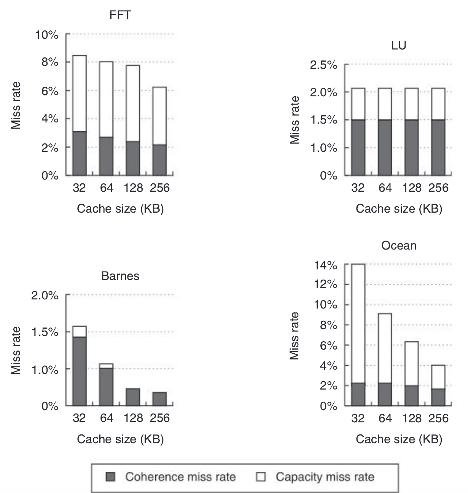
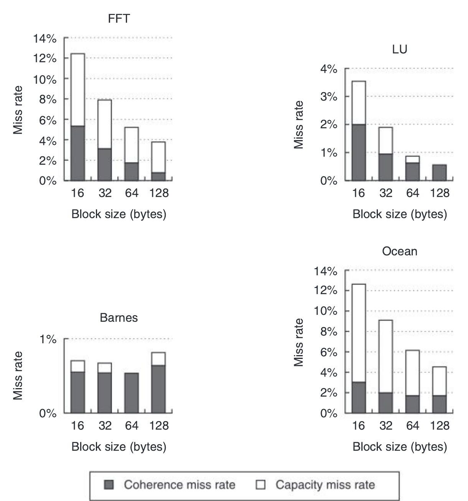
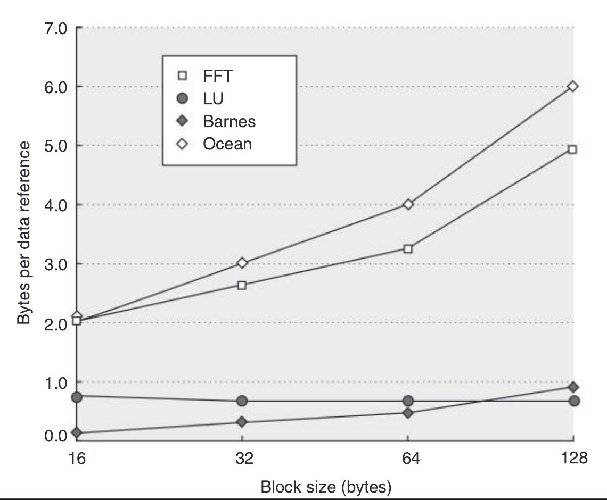
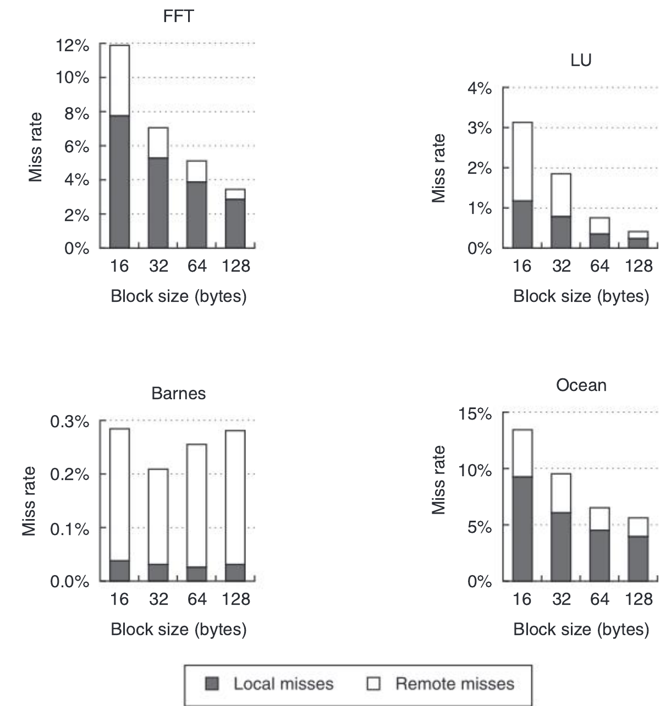

[图 I.7　用取并加一计数的感知反转栅障代码。]{#fig-i-7 .caption}

```c
local_sense =! local_sense; /* 翻转 local_sense */
fetch_and_increment(count);/* 原子更新 */
if (count==total) {/* 全部到达 */
      count=0;/* 复位计数器 */
      release=local_sense;/* 放行各进程 */
}
else {/* 还有进程未到 */
      spin (release==local_sense);/* 等待信号 */
}
```

**解答**　栅障的代码见[图 I.7](#fig-i-7)。对 $n$ 个处理器，这种实现需要 $n$ 次取并加一操作、$n$ 次访问计数变量的 Cache 失效，以及 $n$ 次放行操作引起的 Cache 失效，总共 $3n$ 次总线事务。10 个处理器需要 30 次总线事务，即 3000 个时钟周期。和排队锁一样，所需时间与处理器数呈线性关系。当然，取并加一也可以用来实现组合树栅障，以减少树中每个节点处的串行化。

从上面的分析可以看出，在规模较大的多处理器中，同步问题可能变得相当严重。同步本身已有困难，再加上访存延迟长、计算中可能出现负载不均衡，也就不难理解，高效地使用大规模并行处理器为什么很有挑战性。

## 共享存储多处理器上科学计算应用的性能 {#sec-i-5}

本节讨论 [I.3 节](#sec-i-3)介绍的几个科学计算应用分别在对称共享存储多处理器和分布式共享存储多处理器上的性能。

### 对称共享存储多处理器上科学计算负载的性能 {-}

我们在一台对称共享存储多处理器上评估这四个科学计算应用的性能，问题规模如下：

* Barnes-Hut：16 K 个物体，运行 6 个时间步（精度控制参数设为 1.0，这是一个典型的实际取值）；
* FFT：100 万个复数数据点；
* LU：512 × 512 的矩阵，分块大小为 16 × 16；
* Ocean：130 × 130 的网格，采用典型的误差容限。

在分析失效率随处理器数、Cache 容量和块大小的变化时，我们把总失效率分解为一致性失效和普通的单处理器失效两部分。普通的单处理器失效包括容量失效、冲突失效和强制失效。在这几个基准测试程序中，容量失效是主要成因，因此我们把这些失效统称为容量失效。测量时，凡是把块从共享状态升级为独占状态所需的写失效，都算作一致性失效，即使实际上并没有其他处理器共享这个 Cache 块。这种计法相当于采用一种不区分私有 Cache 块和共享 Cache 块的协议。

[图 I.8](#fig-i-8) 给出了这四个应用的数据失效率，问题规模保持不变，处理器数从 1 增加到 16。处理器增多，Cache 总容量随之增大，通常会使容量失效减少；但处理器增多通常也会使通信量增加，进而使一致性失效增多。这两种效应的大小因应用而异。

FFT 的容量失效率下降（从将近 7% 降到略高于 5%），一致性失效率却上升（从大约 1% 升到大约 2.7%），因此总失效率基本不变。Ocean 的情况是几种效应叠加的结果，其中有些效应与网格怎样划分、网格边界怎样映射到 Cache 块有关。在典型的二维网格程序中，通信引起的失效与网格每个分区的边界长度成正比，容量失效则与网格的面积成正比。因此，问题总规模不变而 Cache 总容量增大时，受影响更大的是容量失效率，至少在每个子网格都能装进单个处理器的 Cache 之前是这样。从 1 个处理器到 2 个处理器，失效率大幅跳升，原因是多个网格映射到 Cache 的方式引起了冲突。直接映射和 2 路组相联的 Cache 中存在这种冲突，相联度更高时冲突就逐渐消失。在基于数组的应用中，这样的冲突并不少见，同时使用多个网格时尤其如此。在 Barnes 和 LU 中，处理器数增加对失效率影响很小，失效率有时略有上升，有时略有下降。

![图 I.8　处理器数从 1 增加到 16 时，数据失效率可能以不直观的方式变化。失效率包括一致性失效率和容量失效率。这些基准测试程序的强制失效都非常少，已计入容量失效。这些应用中的大多数失效，都由访问可能共享的数据引起；但在失效率较高的应用（FFT 和 Ocean）中，失效率的主体是容量失效，而不是一致性失效。所谓数据可能共享，是指数据分配在地址空间中用于共享数据的部分。除 Ocean 以外，其余应用中可能共享的数据都被大量共享；而 Ocean 虽然把整个网格都当作可能共享的数据对象，真正共享的只有子网格的边界。当然，由于边界会随处理器数的增加而改变（问题规模固定时），网格中被共享的部分也随之改变。Ocean 从 1 个处理器变为 2 个处理器时容量失效率反常上升，原因是访问子网格时出现了冲突失效。除 Ocean 以外，在越来越多的处理器上运行固定规模的问题时，一致性事务引起的 Cache 失效所占比例都会上升。Ocean 的一致性失效在增加处理器的初期反而下降，原因是其中大量失效是对可能共享、但实际并不共享的数据的写所有权失效。子网格开始能够装进总的 Cache（约 16 个处理器时）以后，这种效应减弱。单处理器的数据包含写升级失效：在这个协议中，即使数据实际上不共享，只要它处于共享状态，就会发生写升级失效。所有这些运行中，Cache 容量为 64 KB，2 路组相联，块大小 32 字节。注意，各基准测试程序纵轴的刻度不同，这样才能看清每个程序的行为。图内标注：Miss rate，失效率；Processor count，处理器数；Coherence miss rate，一致性失效率；Capacity miss rate，容量失效率。](images/appi/fig-i-8.png){#fig-i-8 width=90%}

增大 Cache 容量能减少代价高昂的 Cache 失效，因此通常对性能有利。[图 I.9](#fig-i-9) 给出了 16 个处理器时失效率随 Cache 容量增大的变化，并分别标出一致性失效和单处理器容量失效所占的部分。Cache 容量增大时，有两种效应会使失效率不下降，或者至少不像我们预期的那样快速下降：一是固有通信，二是失效率的平台期。固有通信会产生一定频度的一致性失效，这部分失效基本不受 Cache 容量增大的影响。因此，如果问题规模保持不变而增大 Cache 容量，一致性失效率最终会限制 Cache 失效率的下降。这种效应在 Barnes 中最明显，它的一致性失效率基本上就是全部失效率。

{#fig-i-9 width=90%}

另一种效应次要一些，即容量失效率会出现暂时的平台期。如果应用程序的一部分数据已经在 Cache 中，而数据集中相当大的一部分既装不进这个 Cache，也装不进稍大一些的 Cache，就会出现平台期。以 LU 为例，很小的 Cache（约 4 KB）就能容纳内层循环使用的一对 16 × 16 的块；此后，容量失效率要等到两个矩阵都能装进 Cache，即 Cache 总容量在 4 MB 到 8 MB 之间时，才会再有大幅改善。这种效应有时称为*工作集效应*。FFT 在 32 KB 到 128 KB 之间也部分存在这种效应，容量失效率只下降了 0.3%。Cache 超过这一容量后，一个主要的数据结构开始驻留在 Cache 中，容量失效率随之下降得更快。以结构化方式处理大型数组的程序，常常会出现这样的平台期。

改变 Cache 失效率的另一个办法是增大块。在单处理器中，Cache 较大时，较大的块往往是最优的。在多处理器中，则有两种新的效应起作用：一是共享数据的空间局部性降低，二是伪共享可能使失效率上升。若干研究表明，共享数据的空间局部性比非共享数据差。局部性差，取较大的共享数据块就不如在单处理器中有效，因为块中的内容还没有全部访问到，这个块就被替换出去的概率更高。同样，增大块还会使伪共享可能发生得更频繁，从而使失效率上升。

[图 I.10](#fig-i-10) 给出了 16 个处理器、64 KB Cache 的情况下，失效率随 Cache 块增大的变化。最有意思的是 Barnes：它的失效率先下降，后来又因一致性失效增多而上升，一致性失效增多很可能是伪共享造成的。在其他基准测试程序中，增大块都会使总失效率下降。在 Ocean 和 LU 中，增大块对一致性失效率和容量失效率的影响大致相当。在 FFT 中，一致性失效率实际上比容量失效率下降得更快。原因是 FFT 中的通信经过精心组织，效率很高。在优化程度较低的程序中，可以预料伪共享会更多，共享数据的空间局部性会更差，于是行为会更接近 Barnes。

{#fig-i-10 width=90%}

块越长，失效率越低，这也许会让人以为选较长的块最好。但是，基于总线的多处理器，瓶颈往往在于有限的存储器带宽和总线带宽。块越大，每次失效在总线上传送的字节就越多。[图 I.11](#fig-i-11) 给出了总线流量随块增大而增长的情况。失效率高的程序流量增长最严重，Ocean 尤其如此。流量增长会使失效开销变长、总线竞争加剧，因而实际上可能使性能下降。

{#fig-i-11 width=80%}

### 分布式存储多处理器上科学计算负载的性能 {-}

基于目录的多处理器，其性能所取决的因素，许多与基于总线的多处理器相同（如 Cache 容量、处理器数和块大小）；此外还取决于失效在存储层次中各个位置上的分布。所请求的数据项位于何处，既取决于初始分配，也取决于共享模式。我们先考察这个科学/工程计算负载的基本 Cache 性能，再看不同类型失效的影响。

这台多处理器比前面基于监听的多处理器规模更大，延迟也更长，所以我们一开始就采用稍大一些的 Cache（128 KB），块也更大，为 64 字节。

在分布式存储体系结构中，存储请求在本地和远程之间怎样分布，是影响性能的关键，因为它既影响全局带宽的消耗，又影响请求所经历的延迟。因此，本节各图把 Cache 失效分成本地请求和远程请求两部分。看图时要记住，在这些应用中，远程失效大多是一致性失效；不过也有一些容量失效是远程失效，在某些数据分布不佳的应用中，这类失效可能相当多。

从[图 I.12](#fig-i-12) 可以看出，在这样的 Cache 容量下，失效率受处理器数变化的影响不大。唯一的例外是 Ocean，它的失效率在 64 个处理器时上升。上升的原因有两个：一是网格变小以后，Cache 中的映射冲突增多，使本地失效增加；二是一致性失效增多，而一致性失效都是远程失效。

{#fig-i-12 width=90%}

[图 I.13](#fig-i-13) 给出了 64 个处理器、64 字节块时，失效率随 Cache 容量增大的变化。这些失效率的下降速度与我们预期的大致相同。不过，一致性失效几乎不减少，起了削弱作用，因此远程失效比本地失效下降得慢。到图中最大的 Cache 容量 512 KB 时，远程失效率已经等于或大于本地失效率。Cache 再大，这一趋势还会更加明显。

{#fig-i-13 width=90%}

[图 I.14](#fig-i-14) 考察了改变块大小的影响。这些应用的空间局部性好，因此即使块已经很大，再增大块也能降低失效率，只是改用最大的块带来的性能收益很小。而且，失效率的改善大部分来自本地失效的减少。

{#fig-i-14 width=90%}

[图 I.15](#fig-i-15) 没有直接画出存储流量，而是画出每次数据访问所需的字节数与块大小的关系，并把需求分成本地带宽和全局带宽两部分。采用总线时，只要把每个处理器的需求加起来，就得到对总线带宽和存储器带宽的总需求。采用可扩展的互连网络时，可以用[图 I.15](#fig-i-15) 中的数据计算每个节点所需的全局带宽，并估算对分带宽，下面的例题说明了这一点。

**例题**　假定一台 64 个处理器的多处理器，处理器主频为 1 GHz，每个处理器每个时钟周期持续完成一次访存。块大小为 64 字节时，远程失效率为 0.7%。求 FFT 每个节点的带宽和估算的对分带宽。假定处理器不会因远程存储请求而停顿，例如所有远程数据都已预取时就可能如此。这些带宽需求与各种互连技术相比如何？

**解答**　每个节点的带宽就是每次访问的数据字节数乘以访问速率：$0.7\% \times 1\ \text{GB/s} \times 64 = 448\ \text{MB/s}$。这一速率比 Cray T3E 硬件可持续的传输速率（使用块预取）略高，比 SGI Origin 3000 的传输速率（每对处理器 1.6 GB/s）低。FFT 每个节点的带宽需求，是最快的标准网络所能持续提供带宽的 5 倍以上。

FFT 执行全对全通信，所以对分带宽等于处理器数乘以每个节点的带宽，约为 $64 \times 448\ \text{MB/s} = 28.7\ \text{GB/s}$。64 个处理器的 SGI Origin 3000 对分带宽约为 50 GB/s。没有哪种标准的网络技术能接近这一水平。

上面的例题考察的是带宽需求。并行程序的另一个关键问题是远程访存时间，即延迟。为了说明这个问题，我们以一台基于目录的多处理器为简单例子。[图 I.16](#fig-i-16) 给出了这个简单多处理器模型所采用的参数。模型假定：本地访存取得第一个字的时间为 85 个处理器周期，通往本地存储器的通路宽 16 字节，而网络互连宽 4 字节。模型忽略了竞争的影响。在我们考察的并行基准测试程序中，竞争大概不太严重，只有采用全对全通信的 FFT 可能例外。在其他负载中，竞争可能严重影响性能。

[图 I.17](#fig-i-17) 给出了在[图 I.16](#fig-i-16) 的参数下，平均每次访存的代价（以周期计）。这里只计入了每类访问的延迟。每个柱分别标出了 Cache 命中、本地失效、远程失效和三跳远程失效的贡献。访存代价既受 Cache 失效和升级的总频度影响，也受失效在哪里得到满足的分布影响。处理器数增加时，除 Ocean 以外，远程访存的代价都相当稳定。[图 I.12](#fig-i-12) 清楚地表明，Ocean 在 64 个处理器时失效率上升。失效率上升，可以预料访存所花的时间也会随之增加。

[图 I.17](#fig-i-17) 给出的是访存代价，在这些基准测试程序中，它是多处理器的主要开销。但完整的性能模型还需要考虑存储系统中竞争的影响，以及同步延迟造成的损失。

## 用科学计算应用测量并行处理器的性能 {#sec-i-6}

在并行处理领域，争议最大的问题之一是怎样测量并行处理器的性能。最直接的回答当然是：按原样运行基准测试程序，看墙钟时间。测量墙钟时间显然是合理的；而在并行处理器上，测量 CPU 时间可能产生误导，因为处理器可能处于空闲状态，却又不能另作他用。
