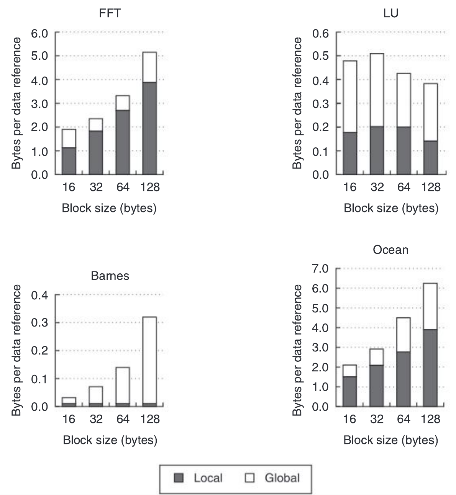

用户和设计者关心的，往往不只是多处理器在某个固定处理器数下性能如何，还有处理器增多时性能怎样随之扩展。很多情况下，应用程序或基准测试程序本身也应该随之扩大规模。人们增加处理器，本来就是希望用更多的处理器求解更大的问题；如果基准测试程序的规模不变，并行度有限、通信量增加等因素会让测得的结果偏于悲观。因此，处理器增多时，通常既要测问题规模固定时的加速比，也要测问题规模扩大后的加速比，得到不扩展和扩展两种加速比曲线。单处理器算法的测法也要慎重选择，否则会得出反常的结果：用基准测试程序的并行版本在单处理器上运行，可能低估单处理器的性能，从而夸大加速比。

{#fig-i-15 width=80%}

决定测量按比例扩展的加速比（scaled speedup）以后，接下来的问题是*怎样*扩展应用程序。假定在 $p$ 个处理器上运行规模为 $n$ 的基准测试程序是合理的，那么到了 $m \times p$ 个处理器上，基准测试程序应该扩大到多大？显而易见的扩展方法有两种：一是保持每个处理器使用的存储量不变，二是在假定加速比理想的前提下，保持总执行时间不变。第一种方法称为*存储受限扩展*（memory-constrained scaling），它规定在 $m \times p$ 个处理器上运行规模为 $m \times n$ 的问题。第二种方法称为*时间受限扩展*（time-constrained scaling），它保持运行时间不变，因此必须先知道运行时间与问题规模的关系。例如，假定数据规模为 $n$ 的应用程序在 $p$ 个处理器上的运行时间与 $n^2/p$ 成正比。采用时间受限扩展时，要运行的问题应当满足：它在 $m \times p$ 个处理器上的理想运行时间仍为 $n^2/p$。满足这一条件的问题，规模为 $\sqrt{m} \times n$。

**例题**　某个问题的执行时间与问题规模 $n$ 的三次方 $n^3$ 成正比。假定它在 10 个处理器的多处理器上实际运行 1 小时。分别按时间受限扩展模型和存储受限扩展模型，求在 100 个处理器的多处理器上要运行的问题规模，以及实际运行时间。

**解答**　按时间受限扩展，理想运行时间不变，仍为 1 小时，因此问题规模为 $\sqrt[3]{10} \times n$，是原来的 2.15 倍。按存储受限扩展，问题规模为 $10n$，理想执行时间为 $10^3/10$，即 100 小时！处理器多了一个数量级，运行时间却变成原来的 100 倍，大多数用户都不愿意这样运行问题，所以这么大的问题规模大概并不现实。

[图 I.16　示例中基于目录的多处理器的特性。失效可以在本地处理（包括由本地目录处理），也可以由远程的宿主节点处理，还可以同时借助宿主节点和另一个缓存着独占副本的远程节点处理。最后一种情况称为三跳失效（three-hop miss），它要同时询问宿主目录和一个远程 Cache，因此代价较高。注意，这个简单模型没有计入作废的时间，但考虑了互连时间增加的因素。这里的远程访问延迟以 SGI Origin 3000 为依据（它是 2001 年最快的可扩展互连系统），并假定处理器主频为 500 MHz。]{#fig-i-16 .caption}

| 特性 | 处理器时钟周期数（≤ 16 个处理器） | 处理器时钟周期数（17～64 个处理器） |
|---|---:|---:|
| Cache 命中 | 1 | 1 |
| Cache 失效，访问本地存储器 | 85 | 85 |
| Cache 失效，访问远程宿主目录 | 125 | 150 |
| Cache 失效，访问远程 Cache 中的数据（三跳失效） | 140 | 170 |

。Barnes 和 LU 的失效率低，因此总的访问时间也低。FFT 的访问代价较高，原因是本地失效率较高（1%～4%），三跳失效率也不低（1%）。随着 Cache 总容量增大，FFT 的本地失效率从 4% 降到 1%，访问代价因此下降。Ocean 访存代价的变化最大，64 个处理器时总代价也最高。代价高主要是因为本地失效率高（平均 1.6%）。从 8 个处理器增加到 16 个处理器时，网格更容易装进各个 Cache，访存代价随之下降。到 64 个处理器时，数据集太小，无法合理映射，本地失效和一致性失效都上升，这一点在[图 I.12](#fig-i-12) 中已经看到。图内标注：Average cycles per reference，每次访问的平均周期数；Average cycles per memory reference，每次访存的平均周期数；Processor count，处理器数；Cache hit，Cache 命中；Local miss，本地失效；Remote miss，远程失效；Three-hop miss to remote cache，访问远程 Cache 的三跳失效。](images/appi/fig-i-17.png){#fig-i-17 width=90%}

除了扩展方法，还有一个问题：如果增大问题规模会影响结果的质量，程序应当怎样扩展？这时往往必须调整应用程序的其他参数。举一个简单的例子：求解微分方程时，收敛所需的时间通常随问题规模增大而增加，比如问题越大，往往需要的迭代次数越多。因此，问题规模增大以后，总运行时间的增长可能比单纯按算法推算的更快。

例如，假定迭代次数随问题规模的对数增长。对算法运行时间与问题规模成线性关系的问题，实际运行时间就与 $n \log n$ 成正比。如果从 10 个处理器上规模为 $m$ 的问题开始扩展，单纯按算法扩展，100 个处理器上可以运行规模为 $10m$ 的问题。计入迭代次数的增加以后，在 100 个处理器上运行时间相同的问题规模为 $k \times m$，其中 $k \log k = 10$。这个问题规模相当于扩展到 $5.72m$，而不是 $10m$。

实际工作中，为控制误差而扩展问题，要求对应用程序有深入的理解，还可能涉及其他因素，例如误差容限（它会影响 Barnes-Hut 中打开单元的判据）。反过来，这些影响又常常会大大改变应用程序的通信特性或并行特性，也会影响问题规模的选择。

按比例扩展的加速比与不扩展的加速比（即真实加速比）不是一回事，两者混为一谈已经导致过一些错误的结论（参见 [I.6 节](#sec-i-6)中的讨论）。按比例扩展的加速比有它的重要作用，但前提是扩展方法合理，并且报告结果时明确说明用的是应用程序的扩展版本。Singh、Hennessy 和 Gupta [1993] 详细讨论了这些问题。

## Cache 一致性的实现 {#sec-i-7}

本节讨论实现 Cache 一致性的难题，先从监听一致性协议入手，第 5 章对这些难题只是略有提及。目录协议比监听协议又复杂一些，主要因为没有广播，必须改用别的机制解决竞争。此外，基于目录的多处理器处理器数更多，不能再假定缓冲无限，必须另想办法避免死锁。下面先看监听协议。

第 5 章讲过，没有总线时，监听一致性协议处理失效的难点在于设法让多步的失效处理过程看起来是原子的。升级失效和写失效需要的基本处理相同，实现时遇到的难题也相同。为简单起见，我们只讨论升级失效。处理一次升级失效的步骤如下：

1. 检测到失效，组装一条作废消息，准备发给其他 Cache。
2. 广播通信链路可用时，发出这条消息。
3. 作废处理完以后，处理器更新 Cache 块的状态，然后继续执行引起这次升级失效的写操作。

这里可能出现两个相关的难题。一是两个处理器 P1 和 P2 同时试图升级同一个 Cache 块时，竞争怎样解决？二是到了第 3 步，处理器怎样知道所有作废都已处理完，从而可以完成这一步？

竞争的胜者由广播通信介质规定的顺序决定。通信介质必须把任何一次 Cache 失效广播给所有节点。如果 P1 和 P2 同时试图广播，必须保证要么 P1 的消息先到达 P2，要么 P2 的消息先到达 P1。满足下面两个条件时，这一性质就成立：一是一个节点所有进出的请求都必须经过同一条通道；二是通信网络只有在能保证送达时才接收一条消息（也就是说，它实际上是电路交换的，见[附录 F](#app-f)）。如果 P1 和 P2 同时开始广播作废，网络只能接收其中一个操作，另一个被推迟。这一顺序保证了 P1 和 P2 中必有一个先完成第 2 步的通信。网络可以在接收一条消息时明确发出信号，并保证它就是下一个被传送的消息；处理器也可以只在网络上监视自己的请求，一旦看到这个请求，就知道它会在任何后续消息之前完整地传送给所有处理器。

现在假定 P1 在发送作废的竞争中获胜。P1 一旦知道自己获胜，就可以进入第 3 步，完成失效处理。但是 P2 这边可能出问题。P2 执行第 1 步时，认为这个块处于共享状态；而 P1 要推进第 3 步，必须知道 P2 已经处理了这次作废，这次作废必须把 P2 中该块的状态改为无效！一个简单的解决办法是让 P2 发觉自己在竞争中失败：它观察到 P1 的作废先于自己的作废被广播出去。于是 P2 可以作废这个块，再发出一次写失效来取得数据。P1 先看到自己的作废，后看到 P2 的作废，所以它把块改为已修改状态并更新数据，这样既保证了程序向前推进，又避免了死锁。随后 P1 又看到一个作废，针对的是处于已修改状态的块（第 5 章讨论的基本协议中不会出现这种情况），于是知道自己是竞争的胜者。它可以干脆忽略这个作废，因为它知道后面会跟着一次写失效；也可以把块写回存储器，并把块的状态改为无效。

另一种解决办法是让外来请求优先于外发请求：P2 在发出自己的作废之前，必须先处理所有待处理的作废或写失效。如果其中有失效针对的块与某条待发消息的地址相同，处理器就必须准备重新开始写操作，因为外来请求可能改变这个块的状态。注意，P1 只要成功完成广播，就知道这些作废都会得到处理，因为作废消息优先于外发请求。（使用目录协议的处理器不采用广播，因此无法知道作废何时被收到，而必须依靠显式的确认，下一小节会讨论这一点。我们还会看到，在请求得到确认之前，它甚至无法知道自己是否已经在竞争中获胜、成为属主。）

读操作同样需要多个步骤，因为要从存储器或远程 Cache（在写回 Cache 系统中）取回数据。不过，除了写操作已经存在的问题，读操作并没有带来本质上新的问题。

但是，还有几种棘手的边界情况必须正确处理。例如，在写回 Cache 中，处理器可能产生一次需要先写回的读失效；处理器可以推迟这次写回，让读失效优先。这时如果出现针对这个待写回 Cache 块的监听请求，处理器必须发现这一点并把数据送回，否则可能造成死锁。类似的棘手情况是：处理器产生一次写失效，要把一个块变为独占；但在它收到数据、能够更新这个块之前，其他处理器对该块产生了读失效。这些读失效必须等写操作的处理器收到数据并更新块以后才能处理。

更难的问题之一出现在写回 Cache 中：读失效或写失效所需的数据，既可能来自存储器，也可能来自某个处理器的 Cache，而发出请求的处理器事先并不知道数据从哪里来。大多数基于总线的系统用一个全局信号表示是否有处理器持有独占的（因而也是最新的）副本；没有的话，就由存储器响应。如果要求各处理器在失效广播之后固定的若干个周期内报告自己是否持有独占副本，这类方案在流水化的互连上也能工作。

然而，在现代多处理器中，处理一次监听请求所需的时间基本上无法给出上限。因此，需要另一种机制来判断存储器中是否有最新的副本。一种办法是在存储器中增加一致性位，表示数据是否以独占方式存放在某个远程 Cache 中。这种机制已经开始向目录方式靠拢，目录方式的实现难题下面接着讨论。

### 在 DSM 多处理器中实现 Cache 一致性 {-}

实现基于目录的 Cache 一致性协议，必须在不使用广播的条件下，解决监听协议中与非原子操作有关的所有问题（见第 5 章）。在监听协议中，广播使相互竞争的写操作串行化，也保证了存储一致性模型所要求的串行化。基于目录的系统的核心目标就是避免广播，因此必须用另一种方法保证串行化。

对一个存储块独占访问的请求很容易串行化：这些请求都要到达这个块唯一的目录，到达时就被串行化了。只要目录控制器保证一个请求完全处理完以后才开始处理下一个，写操作就是串行化的。请求者事先无法知道谁会在竞争中获胜，通信方式又不是广播，因此目录处理完胜者的请求时，必须通知胜者。通知的方式有两种：对写失效，用提供数据的消息通知；对作废请求，用一条授予所有权的显式确认消息通知。

竞争的失败者怎么办？最简单的办法是由系统发出否定确认，即 NAK（negative acknowledge），要求发出请求的节点重新产生请求。（这相当于监听方案中广播网络上的冲突，发生冲突时，发送节点之一要重新通信。）下一小节会说明，为什么 NAK 方式比把请求缓冲起来更好。

写失效应答或所有权确认消息一发出，请求节点获得所有权这件事就确认完毕了，但我们仍然不知道共享集合中的节点是否已经收到并处理了作废。所有存储一致性模型最终都要求处理器知道一次写操作引起的所有作废都已处理完，例如在下一次 Cache 失效之前，或者在某个同步点。在监听方案中，广播网络本身的性质就提供了这一保证。

在目录方案中，怎样才能知道作废已经完成呢？唯一的办法是让作废消息的目标节点（即共享集合的成员）对目录发来的作废消息作出显式确认。确认发给谁，有两种可能。一是发给目录，由目录计数，收齐所有确认后，再用一条消息向最初的请求者确认。二是目录在授予所有权时，告诉请求者要等多少个确认；作废消息的目标节点直接向请求者发送确认，请求者是谁由目录告知。现有的实现大多采用后一种方案，因为它降低了在目录处形成瓶颈的可能。要求确认确实增加了目录协议的复杂性，但这一要求源于目录协议不使用监听广播这类串行化机制，而这类机制本身正是限制可扩展性的因素。

### 避免由有限缓冲引起的死锁 {-}

基于目录的多处理器规模可能很大，这给实现带来了新的复杂性。第 5 章假定网络总能接收一致性消息，请求迟早会得到处理。在大得多的多处理器中，缓冲无限的假定可能并不合理。网络的缓冲有限时会怎样？主要后果是 Cache 控制器或目录控制器可能无法完成消息发送，从而可能导致死锁。

可能出现的死锁源于以下三个性质，许多死锁情形都具有这些性质：

1. 完成一个事务需要不止一种资源：产生请求、生成应答和确认、接收应答，都需要消息缓冲。
2. 资源要一直占用到一个非原子事务完成为止：用来生成应答的缓冲，要等应答被接收以后才能释放，原因后面就会看到。
3. 获取资源没有全局的偏序：各节点可以随意产生请求和应答。

这些特征会导致死锁，要避免死锁，就必须打破其中一个性质。不完成事务就释放资源很难，因为事务必须完全撤销，不能停在半途。因此，我们设法解决需要多种资源的问题。这种需求无法简单地消除，但可以设法保证所需资源总是可用。

保证事务总能完成的一种办法，是保证总有缓冲接收消息。对小型多处理器，如果处理器在 Cache 失效时阻塞，或者未完成的失效数很少，这种办法是可行的；但在目录协议中可能不太实用，因为一次写操作就可能产生许多作废消息。此外，预取、多个未完成的失效等特性也会增加所需的缓冲量。大多数系统采用另一种策略：在能够保证一个事务拥有完成所需的资源之前，不真正启动这个事务。这一策略包括四个部分：

1. 请求和应答使用各自独立的网络（物理网络或虚拟网络），这里的应答是指控制器在状态转换过程中等待的任何消息。这样，新的请求就不会堵住那些将要释放缓冲的应答。
2. 每个需要应答的请求，在产生时就分配好接收应答的空间；没有空间，请求就等待。这样节点总能接收应答消息，应答节点也就能释放自己的缓冲。
3. 任何控制器都可以用 NAK 拒绝任何请求，但决不能对应答发 NAK。这样，控制器如果不能保证有缓冲空间接收应答，就不会开始这个事务。
4. 收到 NAK 的请求只需重试。

要说明具有上述四个性质的系统不会死锁，必须保证所有应答都能被接收，并且每个请求最终都会得到服务。Cache 控制器或目录控制器在发出请求之前总会分配好处理应答的缓冲，因此应答返回时总能被接收。要说明每个请求最终都会得到服务，只需说明任何请求都能完成。每个请求都始于某个 Cache 中的一次读失效或写失效，因此只要说明任何读失效或写失效最终都会得到服务就够了。写失效的处理动作包含了读失效的处理动作，所以我们只说明写失效都会得到服务。最简单的情况是块未被缓存，这种情况可以归入块处于共享状态的情况，所以我们只讨论共享和独占两种情况。先看块处于共享状态的情况：

* CPU 试图执行一次写，产生一次写失效并发往目录。为简单起见，可以假定处理器暂停。处理器虽然可能继续发出其他请求，但在第一个请求完成之前，不应对同一个 Cache 块再发请求。对不相关块的请求可以分开处理。
* 写失效被发到这个存储块的目录控制器。注意，一个 Cache 控制器要处理对某个 Cache 块的所有请求，而不管块中存放的是哪个存储地址的内容；目录控制器则把对不同块的请求作为互不相关的事件处理（假定缓冲足够，并且目录在代表这个请求发出任何后续消息之前就已分配好缓冲）。目录控制器处唯一的冲突是对同一个块的两个请求同时到达，这时控制器必须等第一个操作完成。它可以直接对第二个请求发 NAK，也可以把它缓冲起来，但在对这个存储块的第一个请求完成之前，不应处理第二个请求。
* 再看目录控制器处的情况。假定下一个到达目录控制器的是这次写失效。控制器发出作废，Cache 控制器在有限的延迟之后总能接收这些作废。注意，有一种可能是 Cache 控制器对同一个块也有一个未完成的失效。这与监听方案的情形对偶，我们同样要强制 Cache 控制器接收并执行目录的请求，以此打破僵局。视具体时序而定，这个 Cache 控制器要么稍后从目录得到这个 Cache 行，要么收到 NAK，必须重新开始这一过程。

块处于独占状态的情况稍微棘手一些。分析从写失效到达目录控制器等待处理开始，有两种情况需要考虑：

* 目录控制器向一个处理器发送取数/作废消息，消息到达时，该块在这个处理器中处于独占状态。Cache 控制器向宿主目录发送一次数据写回，并把块的状态改为无效。这个应答到达宿主目录控制器，目录控制器预先分配了缓冲，因此总能接收它。目录控制器把数据送回发出请求的处理器，该处理器也总能接收这个应答；Cache 更新以后，发出请求的 Cache 控制器通知处理器。
* 目录控制器向记录为属主的节点发送取数/作废消息。消息到达属主节点时，发现这个 Cache 控制器已经发生了一次读失效或写失效，导致该块被替换。这时 Cache 控制器已经通过一次数据写回把块送到了宿主目录，本地的数据已不可用。这恰好就是取数/作废消息要达到的效果，所以这种情况下协议也能正确工作。

我们已经说明，在以下条件下这一一致性机制能正确工作：一是对于没有未完成操作的 Cache 块，Cache 控制器和目录控制器能够接收针对它们的操作请求；二是应答总能被接收；三是请求可以被 NAK 并被强制重试。与监听协议一样，Cache 控制器必须能够打破僵局，它的做法始终是优先服从目录发来的指令。缓冲有限的实现之所以能够避免死锁，正是因为可以对请求发 NAK。

### 目录控制器的实现 {-}

要实现 Cache 一致性方案，Cache 控制器必须具备监听方案中同样的能力：在等待本地处理器某个请求的响应时，能够处理对不相关块的请求。外来请求仍然按顺序处理，一个请求处理完才开始下一个。Cache 控制器如果在短时间内收到太多请求，可以对它们发 NAK，因为它知道目录随后会重新发出这些请求。

目录也必须是多线程的，能够独立处理对多个块的请求。这与 Cache 控制器处理对不相关块的外来请求有所不同：目录控制器需要在前一个请求还没处理完时就开始处理另一个请求。目录控制器不能等一个请求完成以后再处理下一个，否则可能导致死锁。目录控制器必须是*可重入*的，即能够在等待应答时挂起当前的执行，转而接收另一个事务。只有一处需要这样做：响应读失效或写失效、等待属主应答的时候。由此可以得出三点重要结论：

1. 只有在向远程位置发出的取数操作或取数/作废操作尚未完成时，才需要保存和恢复控制器的状态。
2. 实现时，只要对那些可能使未完成请求数超出上限的读失效或写失效请求发 NAK，就能限定目录中同时处理的未完成事务数。
