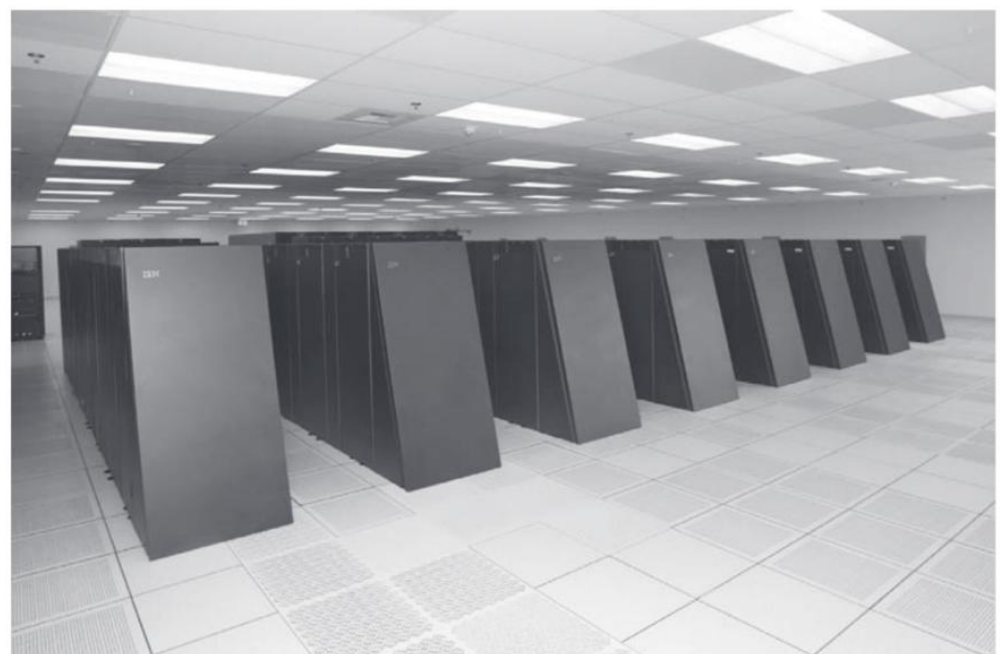

3. 如果属主节点不经过目录返回数据，而是把数据直接转发给请求者（同时也返回给目录），目录就不必同时处理一个以上未完成的请求。采用转发式协议，一是为了降低延迟，二就是为了这一点。不过，如果几个请求到达的时间挨得很近，转发式协议还会带来另外一些复杂问题。

实现上剩下的主要难点是处理 NAK。办法有两种：一种是每个处理器记录自己未完成的事务，收到 NAK 时就知道原来请求的是哪个事务；另一种是把原来的请求捆绑在 NAK 里，收到 NAK 的控制器据此判断原来的请求是什么。每个请求都分配了一个接收应答的槽位，而 NAK 也是一种应答，因此 NAK 总能收下。实际上，存放返回槽位的缓冲区还可以同时存放这个请求的信息，这样请求遭到 NAK 后，处理器就能重新发出它。

实际实现这些协议时必须非常小心，既要保证正确，又要避免死锁。本节讲到的关键思想，即怎样处理非原子性和有限缓冲，是保证实现正确的关键。设计者发现，形式化和非形式化的验证技术都有助于确保实现正确。

## 定制集群方法：Blue Gene/L {#sec-i-8}

Blue Gene/L（BG/L）是一台可扩展的消息传递超级计算机。按每瓦计算能力衡量，它的设计达到了前所未有的计算密度。BG/L 着重追求功耗效率，因此每立方英尺的吞吐率也无可匹敌。BG/L 计算密度高，节点成本效益好，又对 RAS（可靠性、可用性和可维护性）提供了全面的支持，因此能够高效地扩展到非常多的处理器。

BG/L 是一台分布式存储的消息传递计算机，但与基于集群的计算机很不一样。基于集群的计算机往往面向吞吐率，处理器和互连都依靠商用技术，有时连封装和系统级组成也是如此。BG/L 则采用专门定制的处理节点，节点内有两个处理器、Cache 和互连逻辑；处理器由嵌入式市场上使用的 PowerPC 440 芯片改造而来，功耗低，时钟频率也较低。处理节点再加上 SDRAM 芯片，就构成一个完整的计算节点。SDRAM 是 BG/L 设计中唯一的商用半导体部件。

BG/L 最多有 64 K 个节点，组织成 32 个机柜，每个机柜在约 50 立方英尺的空间里容纳 1 K 个节点。每个机柜有两块双面电路板，每块板上 512 个节点。电路板和机柜内的密度很高，85% 的互连都在单个机柜之内，因此机柜之间连接的复杂度和延迟大大降低。此外，每个节点功耗低、密度高，机柜才能做得这样紧凑。机柜紧凑又大大提高了效率，因为机柜内部连接所用的互连网络就集成在每个节点那块计算芯片上。

BG/L 的主互连网络是一个三维环面，[附录 F](#app-f) 已经讨论过。除此之外还有四个网络：一是千兆以太网，连接在指定的 I/O 节点上；二是用于测试的 JTAG 网络；三是栅障网络；四是全局集合通信网络。栅障网络有四个独立的通道，可以在所有处理器之间完成全局「或」或全局「与」运算，延迟不到 1.5 微秒。全局集合通信网络把所有处理器连接成一棵树，用于全局操作。这个网络直接支持多种整数归约运算，不需要处理器参与，因此大规模归约所需的时间是典型超级计算机的 1/100 到 1/10。集合通信网络还可以高效地广播单个值。集合通信网络和环面网络的支持逻辑，都集成在每个处理节点的核心芯片上。

### Blue Gene/L 的计算节点 {-}

每个 BG/L 节点由一块处理芯片和几块 SDRAM 芯片组成。BG/L 处理芯片如[图 I.18](#fig-i-18) 所示，包括以下部分：

1. 两个 PowerPC 440 CPU。每个 CPU 都是双发射超标量处理器，有 7 级流水线，能够推测式乱序发射。时钟频率为 700 MHz，不算高，也有利于节省功耗。每个 CPU 有各自独立的 32 KB 指令 Cache 和 32 KB 数据 Cache，都是非阻塞的，最多允许 4 个未完成的失效。Cache 一致性必须由软件保证。每个 CPU 还有一对浮点协处理器，每个协处理器有自己的浮点寄存器组，每个时钟周期都能发出一条乘加指令。浮点协处理器支持一种特殊的 SIMD 指令集，可以用一对寄存器和 128 位操作数完成复数运算。
2. 各自独立的全相联 L2 Cache，每个存放 2 KB 数据，块大小为 128 字节，实际上起预取缓冲的作用。L2 Cache 控制器能够识别流式数据访问，也负责从 L3 或主存预取。L2 Cache 延迟低（11 个周期），带宽高（每个时钟 5 字节）。L2 预取缓冲能够向 L1 Cache 提供 5.5 GB/s 的带宽。
3. 一个 4 MB 的 L3 Cache，用嵌入式 DRAM 实现。每个 L2 缓冲通过一条总线与 L3 Cache 相连，这条总线从 L3 Cache 取数的带宽为 11 GB/s。
4. 一条存储总线，支持 256 MB 到 512 MB 的 DDR DRAM，向 L3 Cache 提供 5.5 GB/s 的存储带宽。一个节点有两个处理器，每个处理器有两个浮点部件，相比之下，每个节点的存储容量似乎偏少。按 Amdahl 的经验法则（每 1 MIPS 配 1 MB 存储器），并假定实际性能为峰值的 25%，每个节点的存储容量应为现在的约 2.7 倍。不过，浮点密集型应用的计算需求通常随存储容量超线性增长，对这类应用来说，每节点 512 MB 的上限大概是合理的。
5. 五个互连网络的支持逻辑。

![图 I.18　BG/L 的处理节点。空白方框是增加了浮点部件的 PowerPC 处理器，深灰色方框是网络接口，浅灰色阴影方框属于存储系统，存储系统还用 DDR RAM 加以扩充。图内标注：32K/32K L1，32 KB 指令 Cache／32 KB 数据 Cache 的 L1；PPC 440 CPU，PowerPC 440 CPU；Double-issue FPU，双发射 FPU；L2 prefetch buffer，L2 预取缓冲；Snoop，监听；Shared L3 directory for embedded DRAM, Includes error correction control (ECC)，嵌入式 DRAM 的共享 L3 目录，含纠错控制（ECC）；4 MB embedded DRAM, L3 cache or memory，4 MB 嵌入式 DRAM，用作 L3 Cache 或存储器；Ethernet Gbit，千兆以太网接口；JTAG access，JTAG 访问；Torus，环面网络；Collective，集合通信网络；Global interrupt/lockbox，全局中断/锁箱；DDR control with ECC，带 ECC 的 DDR 控制器；Gigabit Ethernet，千兆以太网；IEEE 1149.1 (JTAG)，IEEE 1149.1（JTAG）；6 out and 6 in, each at 1.4 GB/sec link，6 出 6 入，每条链路 1.4 GB/s；3 out and 3 in, each at 2.8 GB/sec link，3 出 3 入，每条链路 2.8 GB/s；4 global barriers or interrupts，4 个全局栅障或中断；144-bit-wide DDR 256/512 MB，144 位宽 DDR，256/512 MB。连线旁的数字是数据通路位宽（如 128、256、1024 144 ECC）和带宽（GB/sec，即 GB/s）。](images/appi/fig-i-18.png){#fig-i-18 width=90%}

BG/L 把除 DRAM 以外的全部逻辑都放进一块芯片，因此密度更高、功耗更低、成本更低，处理节点可以封装得极为密集。密度高，互连网络就可以做到延迟低、带宽高，成本效益也相当好。这些因素结合起来，就得到一台能以很高的成本效益扩展的超级计算机：与其他方法相比，它的 GFLOPS/W 提高了一个数量级；在规模非常大的多处理器中，它的 GFLOPS/\$ 也有明显提高。

例如，64 K 个节点的 BG/L 峰值性能为 360 TFLOPS，功耗约 1.4 MW。在高端浮点处理器中，Power5+ 的功耗效率最高。用它达到 360 TFLOPS 的峰值，大约需要 23 500 个处理器（这种双核处理器在 1.9 GHz 下每个时钟最多执行 8 次浮点运算）。仅这些处理器本身，不算外部 Cache、DRAM 和互连，功耗就约为 2.9 MW，大约是整个 BG/L 系统的 2 倍。同样，BG/L 节点的晶片较小，唯一需要的外部芯片又只有 DRAM，因此成本比用高端多处理器构建的节点低得多。[图 I.19](#fig-i-19) 是 64 K 节点 BG/L 的照片。这台多处理器有 128 K 个处理器，所占的空间却与早先 16 K 个处理器的多处理器相当。

{#fig-i-19 width=90%}

## 结束语 {#sec-i-9}

过去五到十年里，大规模多处理器的格局发生了巨大变化。现在规模最大的多处理器都采用了某种形式的集群，但如果把它们统统称为「集群」，就忽略了它们在体系结构、实现方式、成本和性能上的重大差别。Bell 和 Gray [2002]讨论过这一趋势，认为集群将占据主导地位。Dongarra 等 [2005]同意规模最大的多处理器几乎必然要采用某种形式的集群，但提出了一种更细致的分类，力求把各种不同的方法区分开来。

[图 I.20](#fig-i-20) 汇总了描述大规模多处理器时用过的各种术语，着重从体系结构和实现的角度给出定义。[图 I.21](#fig-i-21) 给出了这些体系结构方法之间的层次关系。过去 15 年里，各种体系结构方法已经有一定程度的趋同。但 TOP500 榜单（按 Linpack 基准测试程序列出世界上最快的 500 台计算机）中仍然既有商用集群、定制集群，也有对称多处理器（SMP）、DSM 和星座系统，处理器也是标量、向量都有。

[图 I.20　大规模多处理器的分类]{#fig-i-20 .caption}

| 术语 | 特点 | 实例 |
|---|---|---|
| MPP | 原指一类体系结构，其特点是使用大量小型处理器（通常是定制的），并且通常采用 SIMD 风格的体系结构 | Connection Machines CM-2 |
| SMP（对称多处理器） | 处理器与存储器呈对称关系的共享存储多处理器，也称 UMA（均匀存储访问）。这类体系结构的可扩展版本使用多级互连网络，通常最多配置 64 到 128 个处理器 | SUN Sunfire、NEC Earth Simulator |
| DSM（分布式共享存储） | 以分布方式支持可扩展共享存储的一类体系结构，既有带 Cache 一致性的，也有不带的，通常可支持几百到几千个处理器 | SGI Origin 和 Altix、Cray T3E、Cray X1、IBM p5 590/5 |
| 集群 | 使用消息传递的一类多处理器。各个节点可以是商用的，也可以是定制的，互连也是如此 | 见商用集群和定制集群 |
| 商用集群 | 节点完全是商用产品的一类集群，节点通常是无头工作站、主板或刀片服务器，用 SAN 或 LAN 连接，一般通过 I/O 总线访问网络 | 「Beowulf」及其他「自制」集群 |
| 定制集群 | 节点和互连都经过定制，集成程度比商用集群更紧密的一种集群体系结构，也称分布式存储多处理器或消息传递多处理器 | IBM Blue Gene、Cray XT3 |
| 星座 | 由较小规模的多处理器组成集群而构成的大规模多处理器，这些较小的多处理器通常采用 DSM 或 SMP 体系结构，有 32 个或更多处理器 | 较大的 SGI Origin/Altix、ASC Purple |

MPP 这个术语原本是表中所说的意思，近来人们用它泛指所有的大规模多处理器，含义也就不那么精确了。目前在售的商用多处理器中，没有一台是原来意义上真正的 MPP，不过这种方法将来也许会有用武之地。SMP 和 DSM 两类都包括带向量支持的多处理器。「星座」（constellation）一词的用法不一，表中的用法看来既直观又精确[Dongarra et al. 2005]。

![图 I.21　大规模多处理器的分类空间以及各类之间的关系。图内标注：Larger multiprocessors，大规模多处理器；Shared address space，共享地址空间；Distributed address space，分布式地址空间；Symmetric shared memory (SMP), Examples: IBM eServer, SUN Sunfire，对称共享存储（SMP），例如 IBM eServer、SUN Sunfire；Distributed shared memory (DSM)，分布式共享存储（DSM）；Commodity clusters: Beowulf and others，商用集群：Beowulf 等；Custom cluster，定制集群；Cache coherent: ccNUMA: SGI Origin/Altix，Cache 一致：ccNUMA，如 SGI Origin/Altix；Noncache coherent: Cray T3E, X1，非 Cache 一致：Cray T3E、X1；Uniform cluster: IBM Blue Gene，均匀集群：IBM Blue Gene；Constellation cluster of DSMs or SMPs, SGI Altix, ASC Purple，星座：由 DSM 或 SMP 组成的集群，如 SGI Altix、ASC Purple。](images/appi/fig-i-21.png){#fig-i-21 width=90%}

尽管如此，看一看 TOP500 榜单上各类多处理器的分布，还是能发现一些已经很清楚的趋势：

1. 集群占了系统的大多数。集群的开发工作量较小，这显然是集群越来越流行的一个推动力。高端多处理器市场还没有大到能让全面、高度定制的设计成为主流选择。
2. 集群中大多数是商用集群，往往由用户自己组装，而不是由系统厂商作为标准产品设计。
3. 从数量上看，商用集群占主导地位；但榜单前 25 名的构成要多样得多，其中有 9 台定制集群（主要是 Blue Gene 或 Cray XT3 系统）、2 台星座系统、8 台商用集群、2 台 SMP（其中一台是 NEC Earth Simulator，它的节点使用向量处理器）和 4 台 DSM 多处理器。
4. 向量处理器曾经在榜单上占主导地位，现在几乎已经消失。
5. IBM Blue Gene 在前 10 名中占主导地位。这表明另一种方法有它的优势：部分采用商用处理器核，其他许多功能则自行定制，并在性能、功耗和封装密度之间取得平衡。
6. 体系结构趋同的推动力更多来自市场因素（市场缺乏增长、供应商有限等），而不是人们对最佳体系结构方法有了明确的共识。

并行计算面临的重大挑战仍然是软件，包括应用程序，也包括程序设计语言和环境，和 30 年前设计 Illiac IV 这类多处理器时一样。既容易编程又有高并行性能，这个目标至今仍难以实现。在这方面取得更大进展之前，向单一的程序设计模型和底层体系结构方法趋同（别忘了，单处理器基本上只有一种程序设计模型和一种体系结构方法！）将是一个缓慢的过程，或者将由已经证实的体系结构优越性以外的因素来推动。
