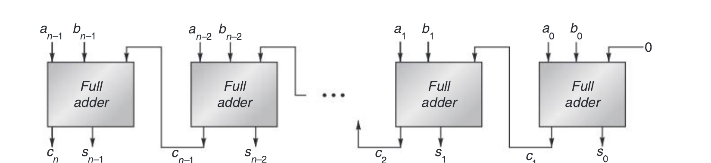
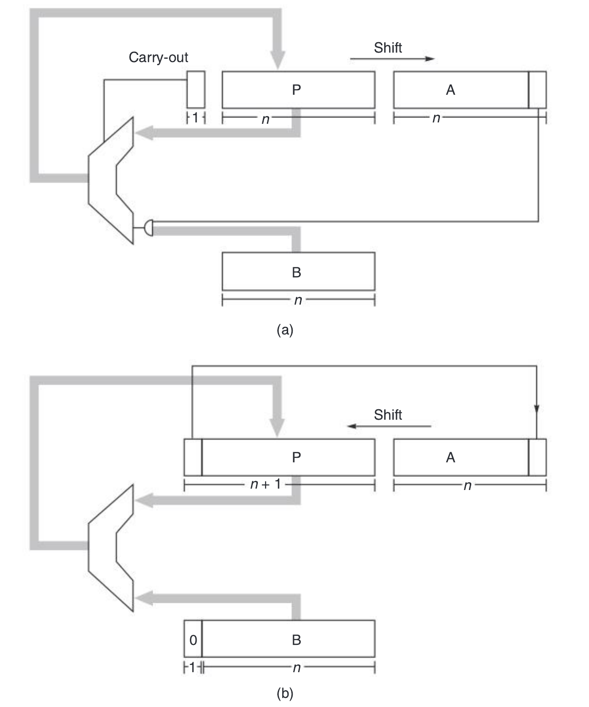

# 计算机算术 {#app-j}

*David Goldberg，Xerox 帕洛阿尔托研究中心*

> 快的总会把慢的挤出去，哪怕快的是错的。
>
> ——W. Kahan

## 引言 {#sec-j-1}

人们有时把计算机算术看作 CPU 设计中比较专门的一部分，但这一部分非常重要。1994 年，Intel 对此有了切身体会：人们发现它的 Pentium 芯片的除法算法有错误。这个浮点缺陷给 Intel 招来了一连串负面报道，也让它损失了大笔资金：为了支付更换问题芯片的费用，Intel 核销了 3 亿美元。

本附录介绍一些基本的浮点算法，其中包括 Pentium 使用的除法算法。人们为浮点加速器提出过种类繁多的算法，但实际实现的通常只是这里介绍的少数几种基本算法的改进和变形。计算机体系结构设计者除了要为加、减、乘、除选择算法，还要作出其他选择：应该实现哪些精度？异常应该怎样处理？本附录提供作出这些决定以及其他决定所需的背景知识。

IEEE 浮点标准（IEEE 754）正迅速得到普遍采用，因此我们对浮点的讨论几乎只围绕这个标准展开。浮点运算虽然要处理指数、移动小数部分，但浮点操作的大部分时间都花在用整数算法处理小数部分上（这部分硬件不一定与实现整数指令的硬件共用）。所以，讨论完浮点之后，我们还要更细致地考察整数算法。

关于计算机算术，下面几种参考资料都不错，按由浅入深排列：Patterson and Hennessy [2009] 的第 3 章；Hamacher, Vranesic, and Zaky [1984] 的第 7 章；Gosling [1980]；Scott [1985]。

## 整数算术的基本技术 {#sec-j-2}

学过计算机算术的读者会发现，本节的大部分内容都是复习。

### 行波进位加法 {-}

加法器通常由多个简单部件组合而成。加法最自然的部件是*半加器*和*全加器*。半加器的输入是两位 $a$ 和 $b$，输出是和位 $s$ 和进位位 $c_{\text{out}}$。用数学式表示，$s = (a + b) \bmod 2$，$c_{\text{out}} = \lfloor (a + b)/2 \rfloor$，其中 $\lfloor\ \rfloor$ 是向下取整函数。写成逻辑方程，就是 $s = a\bar{b} + \bar{a}b$，$c_{\text{out}} = ab$，这里 $ab$ 表示 $a \wedge b$，$a + b$ 表示 $a \vee b$。半加器有两个输入、两个输出，因此也称为 (2,2) 加法器。全加器是 (3,2) 加法器，定义为 $s = (a + b + c) \bmod 2$，$c_{\text{out}} = \lfloor (a + b + c)/2 \rfloor$，或者写成逻辑方程：

$$
s = a\bar{b}\bar{c} + \bar{a}b\bar{c} + \bar{a}\bar{b}c + abc \tag{J.2.1}
$$

$$
c_{\text{out}} = ab + ac + bc \tag{J.2.2}
$$

用较小的部件构造 $n$ 位加法器，主要问题是把进位从一个部件传到下一个部件。最直接的解决办法是*行波进位加法器*，它由 $n$ 个全加器组成，如[图 J.1](#fig-j-1) 所示（本附录的图中，最低有效位总是在右边）。加法器的输入是 $a_{n-1}a_{n-2}\cdots a_0$ 和 $b_{n-1}b_{n-2}\cdots b_0$，其中 $a_{n-1}a_{n-2}\cdots a_0$ 表示数 $a_{n-1}2^{n-1} + a_{n-2}2^{n-2} + \cdots + a_0$。第 $i$ 个加法器的输出 $c_{i+1}$ 接到下一个加法器（第 $i+1$ 个加法器）的输入 $c_{i+1}$，最低位的进位输入 $c_0$ 置为 0。既然最低位的进位输入固定接 0，最低位的加法器本可以用半加器。但后面会看到，把最低位的进位输入置为 1，可以用来做减法。

一般来说，电路产生输出所需的时间，与信号经过的最大逻辑级数成正比。不过，逻辑级数与时间之间的确切关系在很大程度上取决于工艺。因此，比较加法器时，我们只比较各自的逻辑级数。行波进位加法器有多少级呢？由 $a_0$ 和 $b_0$ 算出 $c_1$ 需要两级；再由 $c_1$、$a_1$、$b_1$ 算出 $c_2$ 又需要两级，依此类推，直到 $c_n$。所以总共有 $2n$ 级。$n$ 的典型值是：整数运算为 32，双精度浮点为 53。行波进位加法器是最慢的加法器，但也是最便宜的。它只需要 $n$ 个简单单元，而且连接方式简单、规整。

与 [J.8 节](#sec-j-8)讨论的设计相比，行波进位加法器比较慢，读者也许会问为什么还要用它。原因是，在 CMOS 这类工艺中，行波加法器的时间虽然是 $O(n)$，但常数因子非常小。因此，人们常常把较短的行波加法器用作基本模块，构造更大的加法器。

{#fig-j-1 width=90%}

{#fig-j-2 width=70%}

### 基 2 乘法和除法 {-}

最简单的乘法器每次处理一位，计算两个无符号数的乘积，如[图 J.2](#fig-j-2)(a) 所示。两个乘数 $a_{n-1}a_{n-2}\cdots a_0$ 和 $b_{n-1}b_{n-2}\cdots b_0$ 分别放在寄存器 A 和 B 中，寄存器 P 初值为 0。每个乘法步骤分两部分：

**乘法步骤**

* \(i) 如果 A 的最低有效位是 1，就把寄存器 B 的内容 $b_{n-1}b_{n-2}\cdots b_0$ 加到 P 上；否则把 $00\cdots00$ 加到 P 上。和放回 P。
* \(ii) 把寄存器 P 和 A 右移：加法的进位输出移入 P 的最高位，P 的最低位移入寄存器 A，A 最右边的一位移出，这一位在算法后面的步骤中不再使用。

$n$ 步之后，乘积就在寄存器 P 和 A 中，A 存放低位部分。

最简单的除法器也处理无符号数，每次产生一位商。硬件除法器如[图 J.2](#fig-j-2)(b) 所示。计算 $a/b$ 时，把 $a$ 放入寄存器 A，$b$ 放入寄存器 B，0 放入寄存器 P，然后执行 $n$ 个除法步骤。每个除法步骤分四部分：

**除法步骤**

* \(i) 把寄存器对 (P,A) 左移一位。
* \(ii) 从寄存器 P 中减去寄存器 B 的内容（即 $b_{n-1}b_{n-2}\cdots b_0$），结果放回 P。
* \(iii) 如果第 2 步的结果为负，把 A 的最低位置 0，否则置 1。
* \(iv) 如果第 2 步的结果为负，把寄存器 B 的内容加回 P，恢复 P 原来的值。

这个过程重复 $n$ 次以后，寄存器 A 中是商，寄存器 P 中是余数。这个算法就是手算除法的二进制版本，[图 J.3](#fig-j-3)(a) 给出了一个数值例子。

可以注意到，[图 J.2](#fig-j-2) 中的两个框图非常相似。主要区别在于，乘法时寄存器对 (P,A) 右移，除法时左移。只要让这两个寄存器能双向移位，乘法和除法就可以共用同一套硬件。

[图 J.3](#fig-j-3)(a) 所示的除法算法称为*恢复余数*除法，因为减去 $b$ 的结果为负时，要把 $b$ 加回去，恢复 P 寄存器的值。恢复余数算法有一个变种，它省掉恢复这一步，直接用得到的负数继续运算。这种*不恢复余数*算法的每一步分三部分：

**不恢复余数除法步骤**

如果 P 为负：

* \(i-a) 把寄存器对 (P,A) 左移一位。
* \(ii-a) 把寄存器 B 的内容加到 P 上。

否则：

* \(i-b) 把寄存器对 (P,A) 左移一位。
* \(ii-b) 从 P 中减去寄存器 B 的内容。

然后：

* \(iii) 如果 P 为负，把 A 的最低位置 0，否则置 1。

[图 J.3　(a) 恢复余数除法和 (b) 不恢复余数除法的数值例子。表中粗体数字是已经产生的商位]{#fig-j-3 .caption}

(a) 恢复余数除法

| P | A | 说明 |
|---|---|---|
| 00000 | 1110 | 14 = 1110~2~ 除以 3 = 11~2~。B 中始终是 0011~2~ |
| 00001 | 110 | 第 1 步 (i)：移位 |
| −00011 | | 第 1 步 (ii)：减 |
| −00010 | 110**0** | 第 1 步 (iii)：结果为负，商位置 0 |
| 00001 | 110**0** | 第 1 步 (iv)：恢复 |
| 00011 | 10**0** | 第 2 步 (i)：移位 |
| −00011 | | 第 2 步 (ii)：减 |
| 00000 | 10**01** | 第 2 步 (iii)：结果非负，商位置 1 |
| 00001 | 0**01** | 第 3 步 (i)：移位 |
| −00011 | | 第 3 步 (ii)：减 |
| −00010 | 0**010** | 第 3 步 (iii)：结果为负，商位置 0 |
| 00001 | 0**010** | 第 3 步 (iv)：恢复 |
| 00010 | **010** | 第 4 步 (i)：移位 |
| −00011 | | 第 4 步 (ii)：减 |
| −00001 | **0100** | 第 4 步 (iii)：结果为负，商位置 0 |
| 00010 | **0100** | 第 4 步 (iv)：恢复。商为 0100~2~，余数为 00010~2~ |

(b) 不恢复余数除法

| P | A | 说明 |
|---|---|---|
| 00000 | 1110 | 14 = 1110~2~ 除以 3 = 11~2~。B 中始终是 0011~2~ |
| 00001 | 110 | 第 1 步 (i-b)：移位 |
| +11101 | | 第 1 步 (ii-b)：减 $b$（加上 $b$ 的补码） |
| 11110 | 110**0** | 第 1 步 (iii)：P 为负，商位置 0 |
| 11101 | 10**0** | 第 2 步 (i-a)：移位 |
| +00011 | | 第 2 步 (ii-a)：加 $b$ |
| 00000 | 10**01** | 第 2 步 (iii)：P 非负，商位置 1 |
| 00001 | 0**01** | 第 3 步 (i-b)：移位 |
| +11101 | | 第 3 步 (ii-b)：减 $b$ |
| 11110 | 0**010** | 第 3 步 (iii)：P 为负，商位置 0 |
| 11100 | **010** | 第 4 步 (i-a)：移位 |
| +00011 | | 第 4 步 (ii-a)：加 $b$ |
| 11111 | **0100** | 第 4 步 (iii)：P 为负，商位置 0 |
| +00011 | | 余数为负，执行最后一次恢复 |
| 00010 | | 商为 0100~2~，余数为 00010~2~ |

这一过程重复 $n$ 次之后，商在 A 中。如果 P 非负，P 就是余数；否则要先恢复（即加上 $b$），恢复后才是余数。[图 J.3](#fig-j-3)(b) 给出了一个数值例子。既然步骤 (i-a) 和 (i-b) 相同，读者也许想先做这个公共步骤，再检测 P 的符号。这样做是不行的，因为移位时可能丢掉符号位。

不恢复余数算法为什么正确？解释如下。设 $r_k$ 是第 $k$ 步时寄存器对 (P,A) 的内容，不考虑商位（商位只是借用寄存器 A 中空出来的位）。在[图 J.3](#fig-j-3)(a) 中，A 的初值是 14，所以 $r_0 = 14$；第 1 步结束时 $r_1 = 28$，依此类推。在恢复余数算法中，第 (i) 部分计算 $2r_k$，第 (ii) 部分计算 $2r_k - 2^n b$（之所以是 $2^n b$，是因为 $b$ 是从左半部分减去的）。如果 $2r_k - 2^n b \geq 0$，两种算法在这一步结束时 (P,A) 的值相同。如果 $2r_k - 2^n b < 0$，恢复余数算法把它恢复为 $2r_k$，下一步一开始计算 $r_{\text{res}} = 2(2r_k) - 2^n b$。在不恢复余数算法中，$2r_k - 2^n b$ 作为负数保留下来，下一步计算

$$
r_{\text{nonres}} = 2(2r_k - 2^n b) + 2^n b = 4r_k - 2^n b = r_{\text{res}}
$$

因此，两种算法中 (P,A) 的各位完全相同。

如果 $a$ 和 $b$ 是 $n$ 位无符号数，即取值范围为 $0 \leq a, b \leq 2^n - 1$，那么[图 J.2](#fig-j-2) 中的乘法器只要寄存器 P 有 $n$ 位就能工作。但做除法时，为了检测 P 的符号，P 必须扩展到 $n + 1$ 位，因此加法器也必须有 $n + 1$ 位。

恢复余数除法与不恢复余数除法使用相同的硬件（控制稍有不同），却多一次加法，为什么还有人实现它？实际上，恢复余数除法的常见实现在第 (iv) 步并不真做加法，而是在加法器的输出端检测减法结果的符号，只有和非负时才把它装回寄存器 P。

最后一点：开始做除法之前，硬件必须检查除数是否为 0。

### 有符号数 {-}

表示 $n$ 位有符号数的常用方法有四种：*原码*（sign magnitude）、*补码*（two's complement）、*反码*（one's complement）和*移码*（biased）。

* 原码：最高位是符号位，低 $n - 1$ 位是数的绝对值。
* 补码：一个数与它的相反数相加等于 $2^n$。
* 反码：把一个数的每一位取反，就得到它的相反数（或者说，一个数与它的相反数相加等于 $2^n - 1$）。

在这三种表示中，非负数都按通常的方式表示。移码则不同，连非负数也不按通常的方式表示：所有数都先加上偏置值，再把和按普通无符号数编码。因此，只要 $k + \text{偏置值} \geq 0$，负数 $k$ 就能编码。偏置值的典型取值是 $2^{n-1}$。

**例题**　用 4 位数（$n = 4$）表示时，若 $k = 3$（二进制为 $k = 0011_2$），$-k$ 在上述各种格式中分别怎样表示？

**解答**　原码：$k = 0011_2$ 的最左位是符号位，把它翻转为 1，$-k$ 就表示为 $1011_2$。补码：$k + 1101_2 = 2^n = 16$，所以 $-k$ 表示为 $1101_2$。反码：把 $k = 0011_2$ 的各位取反，$-k$ 表示为 $1100_2$。移码：设偏置值为 $2^{n-1} = 8$，则 $k$ 表示为 $k + \text{偏置值} = 1011_2$，$-k$ 表示为 $-k + \text{偏置值} = 0101_2$。

表示整数最常用的是补码，本附录也采用补码。补码流行的原因之一是有符号加法很简单：只要丢掉最高位的进位输出即可。例如，计算 $5 + (-2)$，把 $0101_2$ 和 $1110_2$ 相加得到 $0011_2$，正是正确的结果 3。计算补码数 $a_{n-1}a_{n-2}\cdots a_1a_0$ 的值，有一个很有用的公式：

$$
-a_{n-1}2^{n-1} + a_{n-2}2^{n-2} + \cdots + a_1 2^1 + a_0 \tag{J.2.3}
$$

举例来说，$1101_2$ 作为 4 位补码数，它的值是 $-1 \cdot 2^3 + 1 \cdot 2^2 + 0 \cdot 2^1 + 1 \cdot 2^0 = -8 + 4 + 1 = -3$，与上面例题的结果一致。

运算结果超出所用表示的范围，称为*溢出*。例如，用 4 位表示无符号数时，$6 = 0110_2$，$11 = 1011_2$。它们的和 17 写成二进制是 $10001_2$，4 位放不下，因此溢出。无符号数的溢出很容易检测：当且仅当最高有效位有进位输出时，才发生溢出。补码的情况复杂一些：当且仅当进入最高位的进位与最高位的进位输出（这个进位要丢掉）不同时，才发生溢出。在上面 $5 + (-2)$ 的例子中，最左位的进位输入和进位输出都是 1，所以没有溢出。

求补码数的相反数，要先把每一位取反，再加 1。例如，求 $0011_2$ 的相反数，先取反得到 $1100_2$，再加 1 得到 $1101_2$。因此，用加法器实现 $a - b$，只要把 $a$ 和 $\bar{b}$（$\bar{b}$ 是 $b$ 各位取反得到的数）送入加法器，并把最低位的进位输入置为 1。这就是[图 J.1](#fig-j-1) 中最右边的加法器要用全加器的原因。

补码数的乘法就不像加法那样简单了。直接的办法是：先把两个操作数都转成非负数，做无符号乘法；如果原来两个操作数符号相反，再对结果求相反数。这种办法概念上简单，但需要额外的时间和硬件。下面介绍一种更好的办法。假设用[图 J.2](#fig-j-2)(a) 的硬件计算 $a$ 乘以 $b$，寄存器 A 装入 $a$，B 装入 $b$。由于寄存器 B 的内容始终是 $b$，下面 B 和 $b$ 混用。如果 B 可能为负，而 A 非负，那么把无符号乘法算法改成补码乘法算法只需改动一处：P 移位时采用算术移位，即移入 P 最高位的应当是 P 的符号位，而不是加法的进位输出。注意，这时 $n$ 位宽的加法器相加的是 $-2^{n-1}$ 到 $2^{n-1} - 1$ 之间的 $n$ 位补码数。

接下来假设 $a$ 为负。处理这种情况的方法称为 *Booth 重编码*。Booth 重编码是计算机算术中一项非常基本的技术，在 [J.9 节](#sec-j-9)中将起关键作用。第 J-4 页的算法计算 $a \times b$ 时，从最低有效位到最高有效位依次检查 $a$ 的各位。例如，若 $a = 7 = 0111_2$，步骤 (i) 将依次加 B、加 B、加 B、加 0。Booth 重编码把数 7「重新编码」为 $8 - 1 = 1000_2 - 0001_2 = 100\bar{1}$，其中 $\bar{1}$ 表示 $-1$。这样，计算 $a \times b$ 就有了另一种办法：依次减 B、加 0、加 0、加 B。这种办法同时用到加法和减法，比第 J-4 页的无符号算法复杂。它的好处在 $a$ 为负时才显现出来：只要重编码得当，就可以把 $a$ 当作无符号数处理。例如，取 $a = -4 = 1100_2$，把 $1100_2$ 看成无符号数 12，重编码为 $12 = 16 - 4 = 10000_2 - 0100_2 = 10\bar{1}00$。如果乘法算法只迭代 $n$ 次（这里 $n = 4$），最高位的数字被忽略，最后减去的就是乘数的 $0100_2 = 4$ 倍，结果恰好正确。

由此看来，用 $a$ 的重编码形式做乘法，对正数和负数同样适用。事实上，为了处理 $a$ 为负的情况，只需要有时从 P 中减去 $b$，而不总是把 $b$ 或 0 加到 P 上。准确的规则如下：设 A 的初始内容是 $a_{n-1}\cdots a_0$，那么在第 $i$ 个乘法步骤中，寄存器 A 的最低位是 $a_i$，乘法算法的步骤 (i) 改为：

* 规则 I：若 $a_i = 0$ 且 $a_{i-1} = 0$，则把 0 加到 P 上。
* 规则 II：若 $a_i = 0$ 且 $a_{i-1} = 1$，则把 B 加到 P 上。
* 规则 III：若 $a_i = 1$ 且 $a_{i-1} = 0$，则从 P 中减去 B。
* 规则 IV：若 $a_i = 1$ 且 $a_{i-1} = 1$，则把 0 加到 P 上。

第一步 $i = 0$ 时，取 $a_{i-1}$ 为 0。

**例题**　计算 $-6$ 乘以 $-5$ 时，寄存器对 (P,A) 中的值依次是什么？

**解答**　见[图 J.4](#fig-j-4)。

[图 J.4　Booth 重编码的数值例子。$a = -6$ 乘以 $b = -5$，得到 30]{#fig-j-4 .caption}

| P | A | 说明 |
|---|---|---|
| 0000 | 1010 | 把 −6 = 1010~2~ 放入 A，−5 = 1011~2~ 放入 B |
| 0000 | 1010 | 第 1 步 (i)：$a_0 = a_{-1} = 0$，按规则 I 加 0 |
| 0000 | 0101 | 第 1 步 (ii)：移位 |
| +0101 | | 第 2 步 (i)：$a_1 = 1$，$a_0 = 0$。按规则 III 减 $b$（即加 $-b = -1011_2 = 0101_2$） |
| 0101 | 0101 | |
| 0010 | 1010 | 第 2 步 (ii)：移位 |
| +1011 | | 第 3 步 (i)：$a_2 = 0$，$a_1 = 1$。按规则 II 加 $b$（1011） |
| 1101 | 1010 | |
| 1110 | 1101 | 第 3 步 (ii)：移位（算术移位，最左位移入 1） |
| +0101 | | 第 4 步 (i)：$a_3 = 1$，$a_2 = 0$。按规则 III 减 $b$ |
| 0011 | 1101 | |
| 0001 | 1110 | 第 4 步 (ii)：移位。最终结果为 00011110~2~ = 30 |

上面四种情况可以归结为一句话：第 $i$ 步把 $(a_{i-1} - a_i)$B 加到 P 上。有了这个结论，很容易验证这些规则是正确的，因为所有加法的结果是

$$
\sum_{i=0}^{n-1} b(a_{i-1} - a_i)2^i = b\left(-a_{n-1}2^{n-1} + a_{n-2}2^{n-2} + \cdots + a_1 2 + a_0\right) + ba_{-1}
$$

利用式 J.2.3（第 J-8 页），再加上 $a_{-1} = 0$，可以看出右边就是补码数 $b \times a$ 的值。

实现 Booth 重编码规则最简单的办法，是把寄存器 A 向右扩展一位，让新增的这一位存放 $a_{i-1}$。与把负操作数先取反的朴素办法不同，这种技术不需要额外的步骤，也不需要对负操作数做特殊处理，只是控制逻辑稍多一点。如果乘法器与除法器共用，硬件本来就能减去 $b$，而不只是加上 $b$。总结起来，处理补码乘法的一种简单方法是：P 右移时注意它的符号，并保存 A 最近移出的一位，用它决定从 P 中加上还是减去 $b$。

设计处理有符号数的乘法硬件，Booth 重编码通常是最好的方法。但如果硬件不直接实现 Booth 重编码，那么用软件或微码来做 Booth 重编码通常太慢，因为其中有条件测试和转移。如果硬件支持算术移位（这样负的 $b$ 能正确处理），可以采用下面的方法：把乘数 $a$ 当作无符号数，用第 J-4 页的算法执行前 $n - 1$ 个乘法步骤；如果 $a < 0$（这时寄存器 A 的最低位是 1），就从 P 中减去 $b$；否则（$a \geq 0$）既不加也不减。无论哪种情况，最后都再做一次移位（总共 $n$ 次移位）。这种方法之所以正确，是因为它相当于用 $b$ 乘以 $-a_{n-1}2^{n-1} + \cdots + a_1 2 + a_0$，而由式 J.2.3，这正是补码数 $a_{n-1}\cdots a_0$ 的值。如果硬件不支持算术移位，那么把操作数转换成非负数也许是最好的办法。

最后说明两点。一是检验有符号乘法程序的一个好办法是试算 $-2^{n-1} \times -2^{n-1}$，因为只有这种情况会产生 $2n - 1$ 位的结果。二是与乘法不同，硬件做除法时通常先把操作数转换成非负数，再做无符号除法。由于除法比乘法慢得多（用得也少），处理符号所花的额外时间对除法的影响比对乘法小。
