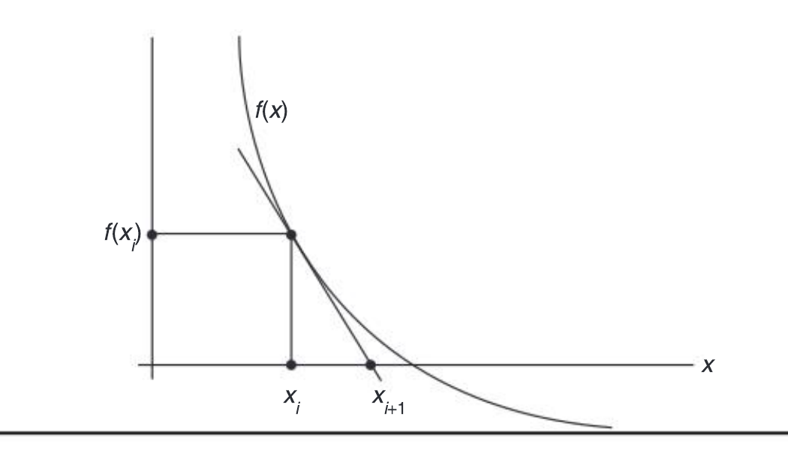

### 非规格化数 {-}

由于有非规格化数，检测下溢要复杂一些。在单精度中，结果的指数小于 −126 并不一定意味着下溢，因为结果可能是一个非规格化数。例如，$(1 \times 2^{-64})$ 与 $(1 \times 2^{-65})$ 的乘积是 $1 \times 2^{-129}$，−129 低于指数的合法下限；但这个结果是一个有效的非规格化数，即 $0.125 \times 2^{-126}$。一般来说，乘积的无偏指数一旦低于 −126，就必须把乘积右移，同时把指数加 1，直到指数达到 −126 为止。如果在这个过程中整个有效数都被移出去了，就发生了下溢。下溢的精确定义有些微妙，详见 [J.7 节](#sec-j-7)。

乘法的某个操作数是非规格化数时，它的有效数带有前导 0，于是两个有效数的乘积也带有前导 0。如果乘积的指数小于 −126，结果就是非规格化数，照前面的办法右移并增加指数即可。如果指数大于 −126，结果有可能是规格化数。这时要把乘积*左*移（同时减小指数），直到乘积变成规格化数，或者指数降到 −126 为止。

非规格化数是实现浮点乘法的一大障碍。处理非规格化数要在乘法器中做可变位数的移位，否则乘法器并不需要这种移位。因此，高性能浮点乘法器往往不处理非规格化数，而是产生陷阱，交给软件处理。有少数实用程序即使运行正常，也会频繁下溢；如果系统要求由陷阱处理程序处理非规格化数，这些程序就会慢很多。

到目前为止，我们还没有讲到操作数为 0 时怎么办。处理办法有两种：一是在开始乘法之前检查两个操作数，二是在乘完之后检查乘积。如果在乘完之后检查，一定要正确处理 $0 \times \infty$ 的情形：它的结果是 NaN，而不是 0。检测到结果为 0 后，要把偏置指数置为 0。符号也不能忽略：即使结果为 0，乘积的符号仍是两个操作数符号的异或（XOR）。

### 乘法的精度 {-}

讨论整数乘法时我们提到，设计者必须决定是只给出乘积的低位字，还是给出完整的乘积。浮点乘法也有类似的问题：精确乘积可以舍入到操作数的精度，也可以舍入到高一级的精度。整数乘法的情况是，标准的高级语言中都没有哪种语法结构会生成「单字长乘单字长得双字长」这样的指令。浮点则不同：许多语言允许把两个单精度变量的乘积赋给一个双精度变量，数值算法也可以利用这种写法。最著名的例子是用迭代求精法求解线性方程组。

## 浮点加法 {#sec-j-5}

浮点运算通常接收两个 $p$ 位精度的输入，返回一个 $p$ 位的结果。理想的算法是先精确地完成运算，再把结果舍入到 $p$ 位（采用当前的舍入模式）。上一节介绍的乘法算法就是按这个思路做的。实现 IEEE 算术的硬件必须给出与理想算法相同的结果，但不必真的按理想算法执行。加法就有更好的做法，下面看几个例子。

第一个例子是两个 6 位二进制数 $1.10011_2$ 与 $1.10001_2 \times 2^{-5}$ 相加。把加数移位，使两者指数相同，算式为

```
  1.10011
+  .0000110001
```

用 6 位加法器计算（丢掉第二个加数的低位），得到

```
  1.10011
+  .00001
+ 1.10100
```

丢掉的第一位是 1，仅凭这一位还不能决定是否进 1，还要检查其余丢掉的位 0001。实际上只需记下这些位中有没有非零位，并像乘法算法那样把这一信息存入粘滞位。所以，两个 $p$ 位数相加时，只要保留丢掉的第一位（舍入位）和其余各位的或（粘滞位），$p$ 位加法器就够用。然后就可以像乘法那样，用[图 J.11](#fig-j-11) 判断是否需要进 1。上例中粘滞位为 1，所以需要进 1，最后的和是 $1.10101_2$。

再看一个例子：

```
  1.11011
+  .0101001
```

6 位加法器给出：

```
   1.11011
+   .01010
+ 10.00101
```

左端有进位输出，因此舍入位不再是丢掉的第一位，而是和的最低位（1）。丢掉的两位 01 相或，得到粘滞位。舍入位和粘滞位都是 1，所以和的高 6 位 $10.0010_2$ 必须进 1，最终答案是 $10.0011_2$。

接下来考虑减法，例如：

```
  1.00000
−  .00000101111
```

最简单的算法是把 $-.00000101111_2$ 转换成补码，这样差就变成了和：

```
  1.00000
+ 1.11111010001
```

在 6 位加法器中计算这个和，得到：

```
  1.00000
+ 1.11111
  0.11111
```

高位相互抵消了，因此要用丢掉的第一位（保护位）填补和的最低位，和变成 $0.111110_2$，丢掉的第二位则成为舍入位。这与乘法算法中的情况 (1) 类似（见 [J.4 节](#sec-j-4)）。舍入位为 1，仅凭它还不能决定是否进 1，需要把其余各位（0001）全部相或，得到粘滞位。本例中粘滞位为 1，所以最终结果必须进 1，得到 0.111111。这个例子说明，减法使最高位抵消时，需要 1 个保护位。自然要问：最高的*两*位都抵消时，是否需要 2 个保护位？答案是不需要。如果 $x$ 与 $y$ 非常接近，使 $x - y$ 的最高两位都抵消，那么 $x - y$ 一定是精确的，根本不需要保护位。

概括起来，加法比乘法复杂，因为视操作数的符号而定，加法实际上可能是减法。做加法时，左端可能有进位输出，如第二个例子；做减法时，可能出现抵消，如第三个例子。这几种情况下舍入位的位置各不相同。但我们不必先算出精确的和再舍入，而是可以由和的高 $p$ 位以及舍入位、粘滞位推出舍入结果。

本节其余部分详细讨论浮点加法算法。设 $a_1$ 和 $a_2$ 是两个加数，$e_i$ 和 $s_i$ 分别表示加数 $a_i$ 的指数和有效数。也就是说，浮点输入已经解包，$s_i$ 带有显式的前导位。$a_1$ 与 $a_2$ 相加按以下八步进行：

1. 如果 $e_1 < e_2$，交换两个操作数。这样可以保证指数之差 $d = e_1 - e_2 \ge 0$。暂定结果的指数为 $e_1$。
2. 如果 $a_1$ 与 $a_2$ 符号不同，用 $s_2$ 的补码代替 $s_2$。
3. 把 $s_2$ 放进一个 $p$ 位寄存器，右移 $d = e_1 - e_2$ 位（如果上一步对 $s_2$ 求了补，移入的是 1）。在移出的各位中，把最高位置给 $g$，次高位置给 $r$，其余各位相或，置给粘滞位。
4. 把 $s_1$ 加到存放 $s_2$ 的 $p$ 位寄存器上，得到初步有效数 $S = s_1 + s_2$。如果 $a_1$ 与 $a_2$ 符号不同、$S$ 的最高位为 1 并且没有进位输出，那么 $S$ 是负数，这时用 $S$ 的补码代替 $S$。这种情况只在 $d = 0$ 时才会发生。
5. 移位 $S$。如果 $a_1$ 与 $a_2$ 符号相同，并且第 4 步有进位输出，就把 $S$ 右移 1 位，最高位填 1（即进位输出）；否则把 $S$ 左移，直到规格化为止。左移时，第一次移位在最低位填入 $g$ 位，以后各次移入 0。结果的指数随之调整。
6. 调整 $r$ 和 $s$。如果第 5 步把 $S$ 右移了，置 $r :=$ 移位前 $S$ 的最低位，$s := g\ \text{OR}\ r\ \text{OR}\ s$。如果没有移位，置 $r := g$，$s := r\ \text{OR}\ s$。如果左移了 1 位，$r$ 和 $s$ 不变。如果左移了 2 位或更多，置 $r := 0$，$s := 0$。（最后这种情况只在 $a_1$ 与 $a_2$ 符号相反、指数相同时才会出现，此时第 4 步计算的 $s_1 + s_2$ 是精确的。）
7. 用[图 J.11](#fig-j-11) 对 $S$ 舍入：如果表中对应的项不为空，就在 $S$ 的最低位加 1。如果舍入产生进位输出，就把 $S$ 右移并调整指数。这样得到的就是结果的有效数。
8. 计算结果的符号。如果 $a_1$ 与 $a_2$ 符号相同，结果就是这个符号。如果 $a_1$ 与 $a_2$ 符号不同，结果的符号取决于 $a_1$、$a_2$ 中哪一个为负，第 1 步是否做了交换，以及第 4 步是否用补码代替了 $S$，见[图 J.12](#fig-j-12)。

[图 J.12　两个加数符号不同时和的符号规则。swap 列指第 1 步是否交换操作数，compl 列指第 4 步是否求补。空白表示「无关」。]{#fig-j-12 .caption}

| swap | compl | sign($a_1$) | sign($a_2$) | sign(result) |
|---|---|---|---|---|
| Yes | | + | − | − |
| Yes | | − | + | + |
| No | No | + | − | + |
| No | No | − | + | − |
| No | Yes | + | − | − |
| No | Yes | − | + | + |

**例题**　用上述算法计算 $(-1.001_2 \times 2^{-2}) + (-1.111_2 \times 2^{0})$。

**解答**　$s_1 = 1.001$，$e_1 = -2$，$s_2 = 1.111$，$e_2 = 0$。

1. $e_1 < e_2$，所以交换。$d = 2$，暂定指数 $\text{exp} = 0$。
2. 两个操作数都是负数，不对 $s_2$ 求补。
3. 把 $s_2$（交换后为 1.001）右移 2 位，得到 $s_2 = .010$，$g = 0$，$r = 1$，$s = 0$。
4. 计算

    ```
       1.111
    +   .010
     (1)0.001
    ```

    $S = 0.001$，有进位输出。
5. 有进位输出，所以把 $S$ 右移，$S = 1.000$，$\text{exp} = \text{exp} + 1$，即 $\text{exp} = 1$。
6. $r =$ 和的最低位 $= 1$，$s = g \lor r \lor s = 0 \lor 1 \lor 0 = 1$。
7. $r$ AND $s$ = TRUE，所以按[图 J.11](#fig-j-11) 应进 1，$S = S + 1$，即 $S = 1.001$。
8. 两个符号都为负，所以结果为负。最终答案：$-S \times 2^{\text{exp}} = 1.001_2 \times 2^{1}$。

**例题**　用上述算法计算 $(-1.010_2) + 1.100_2$。

**解答**　$s_1 = 1.010$，$e_1 = 0$，$s_2 = 1.100$，$e_2 = 0$。

1. 不交换，$d = 0$，暂定指数 $\text{exp} = 0$。
2. 符号不同，用 0.100 代替 $s_2$。
3. $d = 0$，不移位。$r = g = s = 0$。
4. 计算

    ```
      1.010
    + 0.100
      1.110
    ```

    符号不同，最高位为 1，且没有进位输出，所以对和求补，得到 $S = 0.010$。
5. 左移 2 位，$S = 1.000$，$\text{exp} = \text{exp} - 2$，即 $\text{exp} = -2$。
6. 左移了 2 位，所以 $r = g = s = 0$。
7. 舍入不需要做加法。
8. 答案为 $\text{sign} \times S \times 2^{\text{exp}}$，即 $\text{sign} \times 1.000 \times 2^{-2}$。符号由[图 J.12](#fig-j-12) 得到：求了补但没有交换，sign($a_1$) 为 −，所以和的符号为 +。因此，答案 $= 1.000_2 \times 2^{-2}$。

### 加速加法 {-}

先估计一下执行上述算法需要多少时间。第 2 步可能要做一次加法，第 4 步要做一到两次加法，第 7 步可能要做一次加法。如果做一次 $p$ 位加法需要 $T$ 个时间单位（单精度 $p = 24$，双精度 $p = 53$），这个算法看起来至少需要 $4T$ 个时间单位。这个估计过于悲观。第 4 步需要做两次加法时，$a_1$ 与 $a_2$ 一定指数相同、符号相反，这时差是精确的，第 7 步不需要进 1。因此，最多只会做三次加法。同样，第 3 步和第 5 步看起来都可能需要可变位数的移位。但如果 $|e_1 - e_2| \le 1$，第 3 步最多右移 1 位，只有第 5 步需要可变移位；如果 $|e_1 - e_2| > 1$，第 3 步需要可变移位，但第 5 步最多左移 1 位。所以可变移位只会做一次。尽管如此，这个算法仍然需要顺序做三次加法；对 53 位的双精度有效数来说，这相当费时。

加速加法的技术有好几种。一种是采用流水线，「融会贯通」一节举例说明了一些商用芯片怎样用流水线实现加法。另一种是并行地做两次加法，Intel 860 就采用了这种方法 [Kohn and Fu 1989]。下面说明它怎样把延迟从 $3T$ 降到 $T$。

需要考虑三种情况。第一种情况是两个操作数符号相同。这时我们希望把第 4 步和第 7 步的加法合并。第 4 步的加法可能产生进位输出，也可能不产生，因此和的最高位在哪个位置事先并不知道。为此设置两个加法器，分别对应这两种可能。第一个加法器假定第 4 步的加法不产生进位输出，于是 $r$ 和 $s$ 的值可以在真正做加法之前算出来。如果 $r$ 和 $s$ 表明需要进 1，第一个加法器就计算 $S = s_1 + s_2 + 1$，这里 $+1$ 表示在 $s_1$ 的最低位位置加 1，用普通加法器把最低位的进位输入置为 1 即可。如果 $r$ 和 $s$ 表明不需要进 1，加法器照常计算 $S = s_1 + s_2$。还有一个细节：$r = 1$、$s = 0$ 时，还需要知道和的最低位，这一位也能事先很快算出来。第二个加法器针对有进位输出的情况。这时 $r$、$s$ 的值以及进 1 时 1 加在哪一位都与上面不同，但同样能事先很快算出来。是否有进位输出，要等加法真正做完才知道，但这并不要紧：两次加法并行进行，总有一个加法器会得到正确答案。

第二种情况是 $a_1$ 与 $a_2$ 符号相反、指数相同。这时和 $a_1 + a_2$ 是精确的（不需要进 1），但符号要等加法做完才知道。所以第 2 步不求补码（求补码要做一次加法），而是并行地计算 $\bar{s}_1 + s_2 + 1$ 和 $s_1 + \bar{s}_2 + 1$。第一个和相当于在对 $s_1$ 求补的同时求和，结果为 $s_2 - s_1$；第二个和得到 $s_1 - s_2$。两者中必有一个非负，它就是正确的最终答案。与第一种情况一样，所有加法都由两个并行工作的加法器在一步之内完成。

最后一种情况是 $a_1$ 与 $a_2$ 符号相反、指数不同，这种情况更复杂。如果 $|e_1 - e_2| > 1$，差的前导位只可能在两个位置之一，于是和加法一样分成两种情况。如果 $|e_1 - e_2| = 1$，可能出现抵消，前导位几乎可以出现在任何位置；但只有差的前导位与 $s_1$ 的前导位在同一位置时，才可能需要进 1。所以让一个加法器假定进 1，另一个假定不进 1。这样，第 4 步的加法和第 7 步的舍入就可以合并。不过，第 2 步的加法问题仍然存在！

为了省掉这次加法，看第 4 步的示意图：

```
    |—— p ——|
s1   1.xxxxxxx
s2 −         1yyzzzzz
```

如果标为 z 的位全是 0，$S = s_1 - s_2$ 的高 $p$ 位可以用 $s_1 + \bar{s}_2 + 1$ 算出；如果 z 位中至少有一位是 1，就用 $s_1 + \bar{s}_2$。所以 $s_1 - s_2$ 只用一次加法就能算出。但第 7 步舍入要用的是 $s_2$ 的补码的 $g$ 和 $r$，这两位仍然未知。

为了在算出 $s_1 - s_2$ 的同时得到正确的 $g$ 位和 $r$ 位，可以这样合并第 2 步和第 4 步：第 2 步不对 $s_2$ 求补；把计算 $S$ 的加法器向右扩展 2 位，扩展后的和记作 $S'$。如果初步的粘滞位（第 3 步算出的）为 1，就计算 $S' = s_1' + \bar{s}_2'$，其中 $s_1'$ 是在 $s_1$ 右边补上两个 0，$s_2'$ 是在 $s_2$ 后面附上初步的 $g$ 和 $r$。如果粘滞位为 0，就计算 $s_1' + \bar{s}_2' + 1$。这样，$S'$ 的最低两位就是正确的 $g$ 和 $r$ 值（粘滞位在第 3 步已经正确算出）。最后，把这一改进与前面合并第 4、7 步加法的改进结合起来，就能在一次加法的时间 $T$ 内得到最终结果。

还有一些细节需要考虑，见 Santoro、Bewick 和 Horowitz [1989] 以及习题 J.17。Santoro 等人的论文虽然讨论的是乘法，但其中许多内容同样适用于加法。习题 J.19 也与此有关，它给出了原码数相加的另一种方法。

### 非规格化数 {-}

与乘法不同，加法在某个输入是非规格化数时，上述过程几乎不用改动。只需检查指数字段是否为 0；若为 0，解包得到的有效数就没有前导 1。解包非规格化数时把偏置指数置为 1，算法不用修改就能工作。

为了处理非规格化的输出，第 5 步要稍作修改：移位 $S$，直到它规格化，或者直到指数变为 $E_{\min}$（即偏置指数变为 1）为止。如果指数为 $E_{\min}$，并且舍入后 $S$ 的最高位为 1，结果就是规格化数，按通常的方法打包，即省去这个 1。反之，如果最高位为 0，结果就是非规格化数，打包时指数字段必须置为 0。[J.7 节](#sec-j-7)讨论检测下溢的精确规则。

顺便指出，检测上溢非常容易。只有两种情况会上溢：一是第 5 步右移，并且这时偏置指数增大到 255（单精度）或 2047（双精度）；二是舍入之后出现这种情况。

## 除法与求余 {#sec-j-6}

本节讨论浮点除法和求余。

### 迭代除法 {-}

前面讨论过一种整数除法算法。把它改造成浮点除法算法，做法与把整数乘法算法改造成浮点乘法算法类似。由公式

$$
(s_1 \times 2^{e_1}) / (s_2 \times 2^{e_2}) = (s_1 / s_2) \times 2^{e_1 - e_2}
$$

可以看出，如果除法器算出 $s_1/s_2$，最终答案就是这个商乘以 $2^{e_1 - e_2}$。对照[图 J.2](#fig-j-2)(b)，操作数的对齐方式与整数除法稍有不同：把 $s_2$ 装入 B，把 $s_1$ 装入 P，A 寄存器不用来存放操作数。然后就可以使用整数除法算法（只做一个小改动：跳过最开始的那次左移），结果的形式为 $q_0.q_1\cdots$。舍入时，只需多算两位商（保护位和舍入位），并把余数用作粘滞位。之所以需要保护位，是因为商的第一位可能是 0。不过，由于被除数和除数都是规格化的，商的最高两位不可能都是 0。这个算法每一步产生一位商。

另一类除法以二次速率（而不是线性速率）收敛到商，[J.10 节](#sec-j-10)将介绍一台采用这类算法的实际机器。下面先介绍两种主要的迭代算法，再比较迭代法与直接算法的优缺点。构造迭代算法有一种通用技术，称为*牛顿迭代*，见[图 J.13](#fig-j-13)。做法是：先把问题转化为求函数零点；然后从零点的一个猜测值出发，用函数在这一点的切线近似函数，取切线的零点作为新的猜测值。如果 $x_i$ 是零点的猜测值，切线方程为

$$
y - f(x_i) = f'(x_i)(x - x_i)
$$

这个方程的零点在

$$
x = x_{i+1} = x_i - \frac{f(x_i)}{f'(x_i)} \tag{J.6.1}
$$

{#fig-j-13 width=60%}

为了把除法转化为求函数零点，考虑 $f(x) = x^{-1} - b$。这个函数的零点在 $1/b$，所以对它应用牛顿迭代，就可以由 $b$ 迭代算出 $1/b$。由 $f'(x) = -1/x^2$，式 J.6.1 变为：

$$
x_{i+1} = x_i - \frac{1/x_i - b}{-1/x_i^2} = x_i + x_i - x_i^2 b = x_i(2 - x_i b) \tag{J.6.2}
$$

因此，可以用下面的方法计算 $a/b$：

1. 把 $b$ 缩放到 $1 \le b < 2$ 的范围内，并通过查表得到 $1/b$ 的近似值（记作 $x_0$）。
2. 迭代 $x_{i+1} = x_i(2 - x_i b)$，直到得到足够精确的 $x_n$。
3. 计算 $a x_n$，并抵消第 1 步所做的缩放。

下面补充一些细节。第 2 步要迭代多少次？说 $x_i$ 精确到 $p$ 位，意思是 $|(x_i - 1/b)/(1/b)| = 2^{-p}$。通过简单的代数运算可以证明，这时 $(x_{i+1} - 1/b)/(1/b) = 2^{-2p}$。因此，每迭代一步，正确的位数就翻一番。牛顿迭代具有*自校正*性，即 $x_i$ 有误差其实并不要紧：迭代只把 $x_i$ 当作 $1/b$ 的猜测值，返回的 $x_{i+1}$ 是对它的改进（正确位数大约翻一番）。舍入误差是 $x_i$ 出错的原因之一。更重要的是，开始几次迭代本来就不指望有多少正确的位，因此可以用较低的精度做乘法，既提高速度，又不损失准确度。牛顿迭代的另一个应用见习题 J.20。

第二种迭代除法有时称为 *Goldschmidt 算法*。它的思想是：计算 $a/b$ 时，把分子和分母都乘以一个满足 $rb \approx 1$ 的数 $r$。具体地说，令 $x_0 = a$，$y_0 = b$，每一步计算 $x_{i+1} = r_i x_i$ 和 $y_{i+1} = r_i y_i$。这样，商 $x_{i+1}/y_{i+1} = x_i/y_i = a/b$ 保持不变。如果选取 $r_i$ 使 $y_i \to 1$，那么 $x_i \to a/b$，于是 $x_i$ 收敛到我们想要的答案。同样的思想也能用来计算其他函数。例如，要计算 $a$ 的平方根，令 $x_0 = a$，$y_0 = a$，每一步计算 $x_{i+1} = r_i^2 x_i$，$y_{i+1} = r_i y_i$。这时 $x_{i+1}/y_{i+1}^2 = x_i/y_i^2 = 1/a$，所以只要选取 $r_i$ 使 $x_i \to 1$，就有 $y_i \to \sqrt{a}$。TI 8847 就用这种技术计算平方根。

回到 Goldschmidt 除法算法。令 $x_0 = a$，$y_0 = b$，并把 $b$ 写成 $b = 1 - \delta$，其中 $|\delta| < 1$。如果取 $r_0 = 1 + \delta$，则 $y_1 = r_0 y_0 = 1 - \delta^2$。接着取 $r_1 = 1 + \delta^2$，则 $y_2 = r_1 y_1 = 1 - \delta^4$，依此类推。由于 $|\delta| < 1$，$y_i \to 1$。按这样选取 $r_i$，$x_i$ 的计算式为

$$
x_{i+1} = r_i x_i = \left(1 + \delta^{2^i}\right) x_i = \left(1 + (1 - b)^{2^i}\right) x_i
$$

即

$$
x_{i+1} = a\,[1 + (1 - b)]\left[1 + (1 - b)^2\right]\left[1 + (1 - b)^4\right] \cdots \left[1 + (1 - b)^{2^i}\right] \tag{J.6.3}
$$

这个算法看起来有两个问题：一是 $b$ 不接近 1（即 $\delta$ 不接近 0）时收敛很慢；二是这个公式不能自校正，因为商是若干个独立因子的乘积，其中一个因子有误差，这个误差不会得到纠正。针对收敛慢的问题，计算 $a/b$ 时可以先查表得到 $b$ 的近似倒数（记作 $b'$），再对 $ab'/bb'$ 运行这个算法。由于 $bb' \approx 1$，算法会很快收敛。

针对自校正的问题，计算时应多用几位精度，以补偿舍入误差。不过，Goldschmidt 算法确实有一种较弱的自校正性：$r_i$ 的精确值并不要紧。因此，开始几次迭代不需要 $1 - \delta^{2^i}$ 的全部精度，这时可以取 $1 + \delta^{2^i}$ 的截断值作为 $r_i$，这几次迭代可能因此算得更快，而收敛速度不受影响。$r_i$ 取截断值后，$y_i$ 就不再严格等于 $1 - \delta^{2^i}$，式 J.6.3 也就不能再用；但计算很容易组织成不依赖 $r_i$ 精确值的形式。做了这些改动后，Goldschmidt 算法如下（方括号中的注释说明它与前面公式的联系）：

1. 缩放 $a$ 和 $b$，使 $1 \le b < 2$。
2. 查表得到 $1/b$ 的近似值（记作 $b'$）。
3. 置 $x_0 = ab'$，$y_0 = bb'$。
4. 迭代，直到 $x_i$ 足够接近 $a/b$：

    $$
    \begin{array}{ll}
    \textbf{Loop} & \\
    \quad r \approx 2 - y & [\text{若 } y_i = 1 + \delta_i\text{，则 } r \approx 1 - \delta_i] \\
    \quad y = y \times r & [y_{i+1} = y_i \times r \approx 1 - \delta_i^2] \\
    \quad x_{i+1} = x_i \times r & [x_{i+1} = x_i \times r] \\
    \textbf{End loop} &
    \end{array}
    $$
