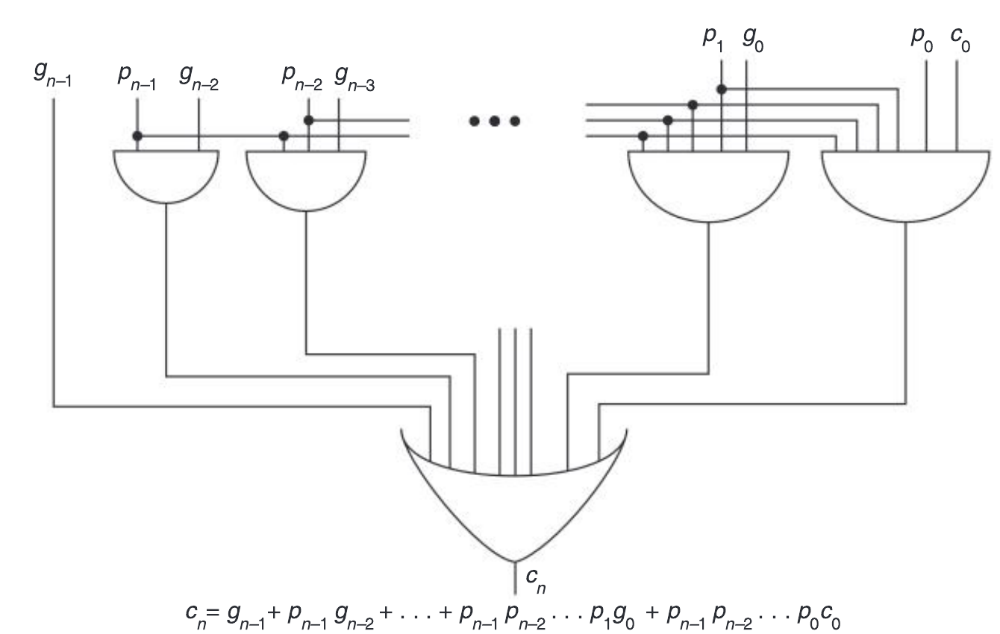
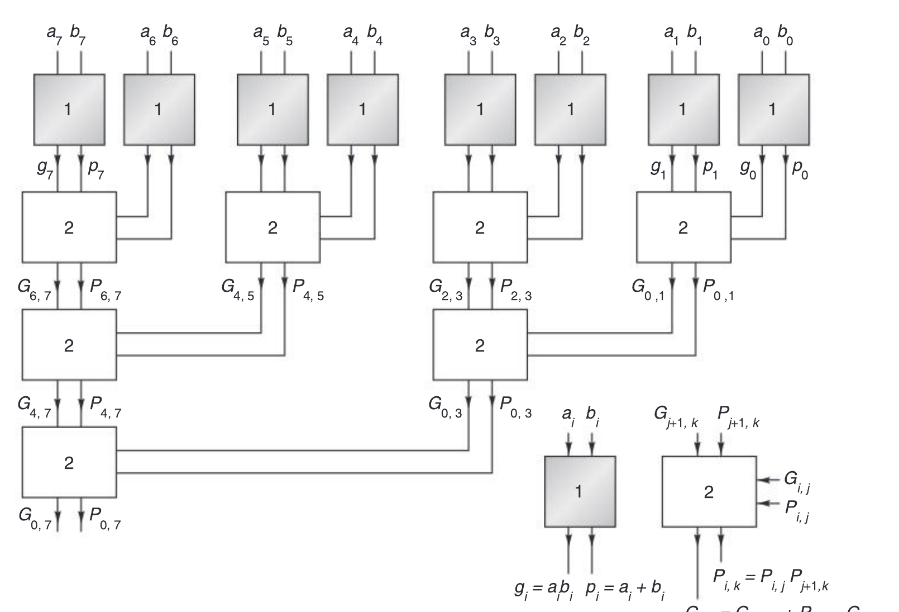

这两种迭代方法是相通的。把牛顿法的迭代展开，不再由 $x_i$ 递推出 $x_{i+1}$，而是直接用 $b$ 写出每一项 $x_{i+1}$，推算下去（见习题 J.22）就会得到：

$$
x_{i+1} = x_0(2 - x_0 b)\left[1 + (x_0 b - 1)^2\right]\left[1 + (x_0 b - 1)^4\right]\cdots\left[1 + (x_0 b - 1)^{2^i}\right]
$$

这个公式与式 J.6.3 非常相似。把式 J.6.3 中的 $a$ 和 $b$ 换成 $ax_0$ 和 $bx_0$，再令 $a = 1$，两者就完全相同。因此，如果以无限精度迭代，两种方法产生的序列 $x_i$ 完全一样。

迭代法的优点有两个：一是不需要专门的除法硬件，可以借用乘法器（但要增加额外的控制）；二是每一步得到的位数是上一步的两倍，而普通除法每一步只产生固定的位数。

用迭代法求倒数也有两个缺点。

一是 IEEE 标准要求除法结果正确舍入，而迭代法给出的结果只是接近正确舍入的答案。牛顿迭代算的是 $1/b$，不是直接算 $a/b$，因此还多一个问题：即使 $1/b$ 正确舍入，$a/b$ 也不一定正确舍入。看一个十进制的例子，取 $p = 2$，$a = 13$，$b = 51$。$a/b = .2549\ldots$，舍入为 .25；但 $1/b = .0196\ldots$，舍入为 .020，于是 $a \times .020 = .26$，最后一位差了 1。

二是迭代法不产生余数。几乎所有高级语言都有求余运算，因此用浮点除法硬件做整数除法时，这一点特别麻烦。

传统的看法是，要用迭代法得到正确舍入的结果，应当把 $1/b$ 和 $a/b$ 都算到略多于 $2p$ 位，再舍入到 $p$ 位。不过还有一种更快的办法，似乎最早用在 TI 8847 上。这种办法只把 $a/b$ 多算大约 6 位精度，得到一个初步的商 $q$；再比较 $qb$ 和 $a$（同样只多算 6 位），就能很快判断 $q$ 已经正确舍入，还是需要在最低有效位上加 1 或减 1。习题 J.21 会进一步讨论这个算法。

选择除法算法时，还要考虑除法与乘法的相对速度。除法比乘法复杂，运行得也就更慢。一条常用的经验规则是：除法算法的速度应当争取达到乘法的三分之一左右。理由之一是，有些实际程序（例如某些版本的 spice）中除法与乘法的比例是 1:3。系数 3 还出现在求平方根的标准迭代法中：这种方法每次迭代做一次除法，但可以换成一种用三次乘法的方法。习题 J.20 讨论了这个问题。

### 浮点余数 {-}

对非负整数，整数除法和余数满足：

$$
a = (a\ \text{DIV}\ b)b + a\ \text{REM}\ b, \qquad 0 \le a\ \text{REM}\ b < b
$$

浮点余数 $x\ \text{REM}\ y$ 可以类似地定义为 $x = \text{INT}(x/y)y + x\ \text{REM}\ y$。问题是 $x/y$ 应当怎样转换成整数。IEEE 的求余函数采用舍入到偶数的规则：取 $n = \text{INT}(x/y)$，使 $|x/y - n| \le 1/2$；如果有两个不同的 $n$ 都满足这个关系，就取偶数的那个。REM 定义为 $x - yn$。整数的余数满足 $0 \le a\ \text{REM}\ b < b$，浮点数的余数则满足 $|x\ \text{REM}\ y| \le y/2$。这个定义虽然精确，却不能直接用来计算，因为 $n$ 可能非常大。在单精度中，$n$ 可以大到 $2^{127}/2^{-126} = 2^{253} \approx 10^{76}$。

如果采用直接除法算法，计算 REM 有一种自然的办法，就是像计算 $x/y$ 那样做下去。设 $x = s_1 2^{e_1}$，$y = s_2 2^{e_2}$，除法器如[图 J.2](#fig-j-2)(b)所示，先把 $s_1$ 装入 P，$s_2$ 装入 B。做完 $e_1 - e_2$ 个除法步骤后，寄存器 P 中的数 $r$ 具有 $x - yn$ 的形式，并且 $0 \le r < y$。IEEE 余数满足 $|\text{REM}| \le y/2$，所以 REM 等于 $r$ 或 $r - y$。为了处理恰好居中的情况，只需要记下最后产生的那一位商。但 $e_1 - e_2$ 可能很大，步数很多，而浮点部件执行一条指令的时间通常有上限，因此一般不能直接实现 REM。[J.10 节](#sec-j-10)讨论的芯片都没有实现 REM，不过它们可以提供一条求余步指令来实现 REM，Intel 8087 系列就是这样做的。求余步指令以两个数 $x$ 和 $y$ 为参数，连续执行除法步骤，直到 P 中得到余数，或者已经执行了 $n$ 步为止。这里 $n$ 是一个较小的数，例如按所支持的最高精度做除法所需的步数。这样，REM 就可以用一个软件例程实现：例程调用 REM 步指令 $\lfloor (e_1 - e_2)/n \rfloor$ 次，第一次以 $x$ 为被除数，以后每次都改用上一次 REM 步得到的余数作被除数。

REM 可以用来计算三角函数。为简单起见，设想在十进制下计算，有效数字为 5 位，要计算 $\sin x$。设 $x = 7$，可以用 $\pi = 3.1416$ 做约简，改为计算 $\sin(7) = \sin(7 - 2 \times 3.1416) = \sin(0.7168)$。再看 $\sin(2.0 \times 10^5)$。$2 \times 10^5/3.1416 = 63661.8$，在 5 位系统中变成 63662。3.1416 乘以 63662 得 200000.5392，舍入为 $2.0000 \times 10^5$，于是参数约简把 $2 \times 10^5$ 约成了 0，与正确值相去甚远。问题在于，5 位系统的精度不够，无法正确地做参数约简。如果有 REM 运算，就可以计算 $2 \times 10^5\ \text{REM}\ 3.1416$，得到 $-.53920$。但这仍然不对，因为 3.1416 只是 $\pi$ 的近似值，而 $2 \times 10^5\ \text{REM}\ \pi$ 的值是 $-.071513$。

对参数很大的周期函数，传统上有两种计算方法：一是在 $x$ 很大时返回错误；二是把 $\pi$ 存到非常多的位数，做精确的参数约简。这两种情况下，REM 运算都帮不上什么忙。某些数学库（例如 Berkeley UNIX 4.3bsd 发行版）采用了第三种方法：把 $\pi$ 取为最接近它的浮点数，我们称之为机器 $\pi$，记作 $\pi'$；计算 $\sin x$ 时，用 $x\ \text{REM}\ \pi'$ 对 $x$ 做约简。从上面的例子可以看到，$x$ 很大时，$x\ \text{REM}\ \pi'$ 与 $x\ \text{REM}\ \pi$ 相差很大，因此按 $\sin(x\ \text{REM}\ \pi')$ 算出的并不是 $\sin x$ 的精确值。但这样计算三角函数有一个性质：所有常见的恒等式（如 $\sin^2 x + \cos^2 x = 1$）在几个舍入误差之内都成立。因此，REM 加上机器 $\pi$ 是一种计算三角函数的简单方法，参数小时结果准确，参数大时也可能仍然有用。

用 REM 做参数约简时，如果它还能返回 $n$ 的低位（其中 $x\ \text{REM}\ y = x - ny$），会非常方便。原因是三角函数的实际实现所用的约简量比 $2\pi$ 小。例如，可以用 $\pi/2$ 做约简，再利用 $\sin(x - \pi/2) = -\cos x$、$\sin(x - \pi) = -\sin x$ 这样的恒等式，这时就要靠 $n$ 的低位选出正确的恒等式。

## 浮点运算的补充话题 {#sec-j-7}

结束浮点运算这个话题之前，我们再介绍几个问题。

### 融合乘加 {-}

浮点部件最常见的用途大概是矩阵运算，而最常见的矩阵运算是矩阵乘矩阵（或乘向量），归结起来就是计算内积 $x_1 \cdot y_1 + x_2 \cdot y_2 + \ldots + x_n \cdot y_n$。计算内积需要一连串的乘加组合。

因此，IBM RS/6000 引入了一条计算 $ab + c$ 的指令，称为*融合乘加*。这条指令要在一条指令中读三个操作数，但有望提高内积计算的性能。

融合乘加先精确地算出 $ab + c$，再只舍入一次。只舍入一次能让内积的精度有所提高，但这不是引入它的主要原因。只舍入一次的好处主要有两个。一是前面几节已经看到，舍入可能需要做一次加法，实现代价高；只舍入一次，就省掉了一次加法运算。二是硬件不直接提供除法和平方根时，可以利用融合乘加多出来的精度，算出正确舍入的除法和平方根。此外，融合乘加还可以用来实现高效的浮点多精度运算软件包。

用融合乘加实现正确舍入的除法，细节很多，但主要思想很简单。回到 [J.6 节](#sec-j-6)的例子：计算 $a/b$，$a = 13$，$b = 51$。$1/b$ 舍入为 $b' = .020$，$ab'$ 舍入为 $q' = .26$，这不是正确舍入的商。按下面两个公式做两次融合乘加，就能把结果校正过来：

$$
\begin{aligned}
r &= a - bq' \\
q'' &= q' + rb'
\end{aligned}
$$

如果按两位精度计算，$bq' = 51 \times .26$ 舍入为 13，$r = a - bq'$ 就是 0，结果得不到校正。用融合乘加计算则不同：$r = a - bq' = 13 - (51 \times .26) = -.26$，然后 $q'' = q' + rb' = .26 - .0052 = .2548$，舍入后正是正确的商 .25。更多细节见 Montoye、Hokenek 和 Runyon [1990] 以及 Markstein [1990] 的论文。

### 精度 {-}

IEEE 标准规定了四种精度：*单精度*、*单精度扩展*、*双精度*和*双精度扩展*。这些精度的性质归纳在[图 J.7](#fig-j-7)中。标准不要求实现全部四种精度，但鼓励两种组合：一是单精度加单精度扩展，二是单精度、双精度加双精度扩展。科学计算普遍使用双精度，所以双精度几乎总会实现。因此，计算机设计者通常只需要决定是否支持双精度扩展；如果支持，再决定用多少位。

Motorola 68882 和 Intel 387 协处理器按允许的最小长度 80 位（有效数 64 位）实现扩展精度。但许多较新设计的高性能浮点芯片没有实现 80 位扩展精度，原因之一是 80 位的宽度与 64 位的总线和寄存器不好配合。有些新的体系结构，如 SPARC V8 和 PA-RISC，规定了 128 位的扩展精度（或称*四倍精度*），并为四倍精度形成了一个*事实上的*约定：指数 15 位，有效数 113 位。

大多数高级语言不提供扩展精度，但扩展精度对编写数学软件的人非常有用。例如，编写一个库例程，计算平面上向量 $(x, y)$ 的长度 $\sqrt{x^2 + y^2}$。如果 $x$ 大于 $2^{E_{\max}/2}$，按最直接的方法计算就会溢出。于是要么把这个子程序允许的指数范围减半，要么改用更复杂的、带比例缩放的算法。有了扩展精度，简单的算法就能用。计算向量长度是个简单的任务，设计一个不会溢出的算法并不难。但在一些更复杂的问题上，有没有扩展精度，决定了能用简单快速的算法，还是只能用复杂得多的算法。最好的例子之一是二进制到十进制的转换。Coonen [1984] 清楚易懂地介绍了一种高效的二进制到十进制转换算法，这种算法离不开扩展精度；Goldberg [1991] 也简要介绍了这个算法。另一个例子是计算超越函数的准确值，有了扩展精度，这个问题也容易得多。

关于精度，有一个非常重要的问题，就是*两次舍入*。用十进制来说明：要计算 $1.9 \times 0.66$，设单精度是两位数字，扩展精度是三位数字。乘积的精确结果是 1.254，舍入到扩展精度得 1.25，再舍入到单精度得 1.2。但 $1.9 \times 0.66$ 正确舍入到单精度的结果是 1.3。可见，舍入两次与舍入一次的结果可能不同。假如要做一个只支持双精度运算的硬件，能不能先用双精度计算、再舍入到单精度，以此模拟单精度呢？上面的例子表明不能。但两次舍入并不总是危险的。事实上，下面这条规则成立（证明不容易，可参看习题 J.25）：

> *如果 $x$ 和 $y$ 的有效数为 $p$ 位，先精确地算出 $x + y$，再舍入到 $q$ 位，那么当 $q \ge 2p + 2$ 时，第二次舍入到 $p$ 位不会改变结果。这一结论不仅对加法成立，对乘法、除法和平方根也成立。*

上面的例子中 $q = 3$，$p = 2$，$q \ge 2p + 2$ 不成立。而在 IEEE 算术中，双精度 $q = 53$，单精度 $p = 24$，$q = 53 \ge 2p + 2 = 50$。因此，单精度可以这样实现：先按双精度计算，即先精确算出结果、舍入到双精度，然后再舍入到单精度。

### 异常 {-}

IEEE 标准定义了五种异常：下溢、上溢、除以零、不精确和无效。默认情况下，发生这些异常时只设置一个标志，计算照常继续。这些标志是*粘滞的*，即一旦置位就一直保持，直到被显式清除。标准强烈建议各实现为每种异常提供一个陷阱允许位。发生异常时，如果这种异常的陷阱处理程序已经允许，就调用用户的陷阱处理程序，这时相应异常标志的值是未定义的。[J.3 节](#sec-j-3)提到过，$\sqrt{-3}$ 的值是 NaN，$1/0$ 是 $\infty$，这两个运算都会引发异常。默认情况下，计算 $\sqrt{-3}$ 会设置无效标志并返回 NaN；同样，计算 $1/0$ 会设置除以零标志并返回 $\infty$。

下溢、上溢和除以零异常在其他大多数系统中也有。*无效异常*针对 $\sqrt{-1}$、$0/0$、$\infty - \infty$ 这类运算，它们的结果无论作为浮点数还是作为 $\pm\infty$ 都没有自然的取值。*不精确异常*是 IEEE 算术特有的，在运算结果必须舍入或者上溢时发生。$1/0$ 和上溢的运算都给出 $\infty$，所以要区分两者，就必须查看异常标志。不精确异常是一种不寻常的「异常」：它发生得太频繁，算不上真正的异常情况。因此，为不精确异常允许陷阱处理程序，很可能严重影响性能。除了下溢，是否允许陷阱处理程序并不影响一个运算算不算异常。下溢的情况后面再讨论。

IEEE 标准假定，发生陷阱时能够找出引起陷阱的运算及其操作数。在采用流水线或有多个运算部件的机器上，发生异常时只让陷阱处理程序检查程序计数器可能还不够，也许需要硬件支持，才能准确找出是哪个运算引起了陷阱。

下面的程序片段说明了另一个问题。

```
r1 = r2/r3
r2 = r4 + r5
```

这两条指令很可能并行执行。如果除法引起陷阱，它的操作数 `r2` 可能已经被加法改写了，何况加法几乎总是比除法快。支持 IEEE 标准陷阱的计算机系统必须提供某种办法保存 `r2` 的值：要么由硬件保存，要么由编译器从一开始就避免出现这种情况。这类问题并不是浮点特有的。看下面的指令序列：

```
r1 = 0(r2)
r2 = r3
```

在等待访存的同时执行 `r2 = r3`，效率会很高。但如果访问 `0(r2)` 引起页面失效，重新启动指令 `r1 = 0(r2)` 时，`r2` 可能已经不在了。

解决这个问题的一种办法，是在指令周期的早期就识别出可能引起异常的指令，MIPS R3010 用的就是这种办法。例如，只有某个操作数的指数为 $E_{\max}$ 时，加法才可能上溢，其他运算依此类推。这种提前检查是保守的，可能把实际上不会引起异常的运算也标记出来。但只要这种误报很少，这项技术的性能就非常好。一条指令被标记为可能引起异常后，陷阱处理程序中的专门代码可以在不破坏任何状态的前提下计算它。要记住，所有这些问题只在允许陷阱处理程序时才会出现；否则，在正常处理过程中设置异常标志是很简单的。

### 下溢 {-}

前面几次提到，检测下溢比检测其他异常复杂。IEEE 标准规定：如果允许了下溢陷阱处理程序，那么只要结果是非规格化数，系统就必须产生陷阱；如果禁止了陷阱处理程序，那么只有在损失精度，即结果必须舍入时，才设置下溢标志。这样规定的理由是，下溢时如果没有损失精度，设置警告标志就没有意义；而允许了陷阱处理程序时，用户可能是在模拟清零（flush-to-zero），因此只要结果低于 $1.0 \times 2^{E_{\min}}$，就应当通知用户。

所以，没有陷阱处理程序时，只有结果既是非规格化数又不精确，才发出下溢异常信号。但*非规格化*和*不精确*的定义都有多种理解。通常，不精确是指结果不能精确表示，必须舍入。看一个例子（有效数为 3 位的二进制浮点系统，采用就近舍入）：$\left(1.11_2 \times 2^{-2}\right) \times \left(1.11_2 \times 2^{E_{\min}}\right) = 0.110001_2 \times 2^{E_{\min}}$。给出的结果是 $0.11_2 \times 2^{E_{\min}}$，它经过了舍入，因此要发出不精确信号。那么，同时发出下溢信号对不对呢？渐进下溢损失有效位，是因为指数范围有界。如果指数范围没有界限，给出的结果将是 $1.10_2 \times 2^{E_{\min}-1}$，与渐进下溢得到的答案完全相同。因此在这个例子中，非规格化数的有效数位数比规格化数少，并没有造成任何差别。标准的注释 [Cody et al. 1984] 建议以此作为设置下溢标志的判据：设想一个小数部分长度相同、但指数范围非常大的系统，只要实际给出的结果与这个系统给出的结果不同，就应当设置下溢标志。这种方案难以实现，因此标准允许：只要结果是非规格化数，并且与无限精确的结果不同，就设置下溢标志。

「结果是非规格化数」有两种可能的定义。考虑 $1.10_2 \times 2^{-1}$ 乘以 $1.10_2 \times 2^{E_{\min}}$。精确乘积是 $0.1111 \times 2^{E_{\min}}$，舍入后是规格化数 $1.00_2 \times 2^{E_{\min}}$。这时应当发出下溢信号吗？发出，就是采用*舍入前*规则，因为结果在舍入前是非规格化的；不发出，就是采用*舍入后*规则，因为结果在舍入后是规格化的。IEEE 标准允许任选一条规则，但选定以后，所有运算都必须一致地使用这条规则。

以浮点加法为例说明这些规则。加法（或减法）的结果如果是非规格化数，就一定是精确的，因此加法永远不需要设置下溢标志。原因是：没有允许陷阱时，不会引发异常；允许了陷阱时，下溢标志的值是未定义的，同样不需要设置。

关于下溢，最后还要说明一个细微之处。没有下溢陷阱处理程序时，对 $p$ 位数做运算引起下溢，结果是一个精度不超过 $p - 1$ 位的非规格化数。允许陷阱时，交给陷阱处理程序的是舍入到 $p$ 位、指数做了回绕的运算结果，这就可能出现两次舍入问题。陷阱处理程序如果要返回非规格化的结果，不能简单地对自己的参数做舍入，否则可能产生两次舍入误差。因此，要让陷阱处理程序给出正确舍入的结果，至少要多传给它一位信息。

## 整数加法的加速 {#sec-j-8}

上一节说明，实现浮点运算要经过许多步骤，但每个浮点运算最终都归结为整数运算。因此，整数运算快了，浮点运算也会随之加快。

整数加法是最简单、也是最重要的运算。程序即使不做显式的算术运算，也要用加法来递增程序计数器、计算地址。加法虽然简单，但高速加法并没有唯一的最佳做法。下面讨论目前使用的三种技术：先行进位、进位跳跃和进位选择。

### 先行进位 {-}

$n$ 位加法器只是一个组合电路，因此可以写成积之和形式的逻辑式，用两级逻辑电路计算。这个电路是什么样子的呢？由式 J.2.1，第 $i$ 位的和可以写成：

$$
s_i = a_i\bar{b}_i\bar{c}_i + \bar{a}_i b_i \bar{c}_i + \bar{a}_i\bar{b}_i c_i + a_i b_i c_i \tag{J.8.1}
$$

其中 $c_i$ 既是第 $i$ 个加法器的进位输入，又是第 $i - 1$ 个加法器的进位输出。

这个公式的问题在于：$a_i$ 和 $b_i$ 是电路的输入，值已知，$c_i$ 却是未知的。所以我们的目标是用 $a_i$ 和 $b_i$ 表示 $c_i$。为此，先把式 J.2.2改写为：

$$
c_i = g_{i-1} + p_{i-1}c_{i-1}, \qquad g_{i-1} = a_{i-1}b_{i-1}, \qquad p_{i-1} = a_{i-1} + b_{i-1} \tag{J.8.2}
$$

符号 $p$ 和 $g$ 的由来是：如果 $g_{i-1}$ 为真，$c_i$ 就一定为真，即*产生*（generate）了一个进位，所以 $g$ 代表产生；如果 $p_{i-1}$ 为真，那么 $c_{i-1}$ 为真时，这个进位会*传播*（propagate）到 $c_i$。从式 J.8.1 出发，先用式 J.8.2 把 $c_i$ 替换成 $g_{i-1} + p_{i-1}c_{i-1}$；再把式 J.8.2 中的 $i$ 换成 $i - 1$，用 $c_{i-2}$ 替换掉 $c_{i-1}$，依此类推，就得到：

$$
c_i = g_{i-1} + p_{i-1}g_{i-2} + p_{i-1}p_{i-2}g_{i-3} + \cdots + p_{i-1}p_{i-2}\cdots p_1 g_0 + p_{i-1}p_{i-2}\cdots p_1 p_0 c_0 \tag{J.8.3}
$$

用式 J.8.3 计算进位的加法器称为*先行进位加法器*（carry-lookahead adder，CLA）。CLA 用一级逻辑形成 $p$ 和 $g$，两级形成进位，两级形成和，总共五级逻辑。行波进位加法器需要 $2n$ 级，相比之下，这是巨大的改进。

{#fig-j-14 width=80%}

但从式 J.8.3 或[图 J.14](#fig-j-14) 都可以看出，$n$ 位先行进位加法器的 OR 门和最右边的 AND 门都需要 $n + 1$ 的扇入，信号 $p_{n-1}$ 还必须驱动 $n$ 个 AND 门。再加上[图 J.14](#fig-j-14) 的结构相当不规整，长连线又多，所以 $n$ 较大时，构造完全的先行进位加法器并不现实。

不过，我们可以利用先行进位的思想，构造一种结构简单规整的加法器，它只有大约 $\log_2 n$ 级逻辑，远少于行波进位加法器所需的 $2n$ 级。思路是分步构造出各个 $p$ 和 $g$。前面已经看到：

$$
c_1 = g_0 + c_0 p_0
$$

这个式子是说，第 0 位有进位输出（$c_1$），要么是因为第 0 位产生了进位，要么是因为有进位输入第 0 位，并且这个进位传播了出去。类似地，

$$
c_2 = G_{01} + P_{01}c_0
$$

$G_{01}$ 表示由最低两位组成的块产生了进位输出，$P_{01}$ 表示进位能传播通过这个块。$P$ 和 $G$ 的逻辑方程如下：

$$
\begin{aligned}
G_{01} &= g_1 + p_1 g_0 \\
P_{01} &= p_1 p_0
\end{aligned}
$$

更一般地，对任何满足 $i < j$、$j + 1 < k$ 的 $j$，有如下递推关系：

$$
c_{k+1} = G_{ik} + P_{ik}c_i \tag{J.8.4}
$$

$$
G_{ik} = G_{j+1,k} + P_{j+1,k}G_{ij} \tag{J.8.5}
$$

$$
P_{ik} = P_{ij}P_{j+1,k} \tag{J.8.6}
$$

式 J.8.5 是说，由第 $i$ 位到第 $k$ 位（含两端）组成的块产生进位输出，有两种情况：一是块的高位部分 $(j + 1, k)$ 产生了进位；二是块的低位部分 $(i, j)$ 产生了进位，并且这个进位传播通过了高位部分。如果令 $G_{ii} = g_i$，$P_{ii} = p_i$，那么这些方程在 $i \le j < k$ 时也成立。

**例题**　用各个 $p$ 和 $g$ 表示 $P_{03}$ 和 $G_{03}$。

**解答**　由式 J.8.6，$P_{03} = P_{01}P_{23} = P_{00}P_{11}P_{22}P_{33}$。因为 $P_{ii} = p_i$，所以 $P_{03} = p_0 p_1 p_2 p_3$。对于 $G_{03}$，由式 J.8.5，$G_{03} = G_{23} + P_{23}G_{01} = (G_{33} + P_{33}G_{22}) + (P_{22}P_{33})(G_{11} + P_{11}G_{00}) = g_3 + p_3 g_2 + p_3 p_2 g_1 + p_3 p_2 p_1 g_0$。

有了这些准备，就可以给出实际 CLA 的设计了。这种加法器由两部分组成：第一部分按式 J.8.5 和式 J.8.6，由 $p_i$ 和 $g_i$ 算出各个 $P$ 和 $G$ 的值；第二部分用这些 $P$ 和 $G$ 的值，按式 J.8.4 算出所有进位。第一部分如[图 J.15](#fig-j-15) 所示。在图的顶部，1 型单元把输入数 $a_7 \ldots a_0$ 和 $b_7 \ldots b_0$ 转换成各个 $p$ 和 $g$；然后 2 型单元按二叉树结构组合，生成各个 $P$ 和 $G$。第二部分如[图 J.16](#fig-j-16) 所示。从这棵树的底部送入 $c_0$，所有进位位就从顶部输出。每个单元都要知道一对 $(P, G)$ 值才能完成转换，所需的值写在单元里面。对比[图 J.15](#fig-j-15) 和[图 J.16](#fig-j-16) 可以看到，两者的单元一一对应，而且产生进位的单元所需的 $(P, G)$ 值，正好是对应的 $(P, G)$ 生成单元已经知道的值。把对应的单元合并，就得到[图 J.17](#fig-j-17)。要相加的数从顶部流入，沿树向下，在底部与 $c_0$ 汇合，再沿树向上流回，形成各个进位。注意，[图 J.17](#fig-j-17) 少了一样东西：计算加法器进位输出 $c_8$ 的一小块附加逻辑。

{#fig-j-15 width=90%}
