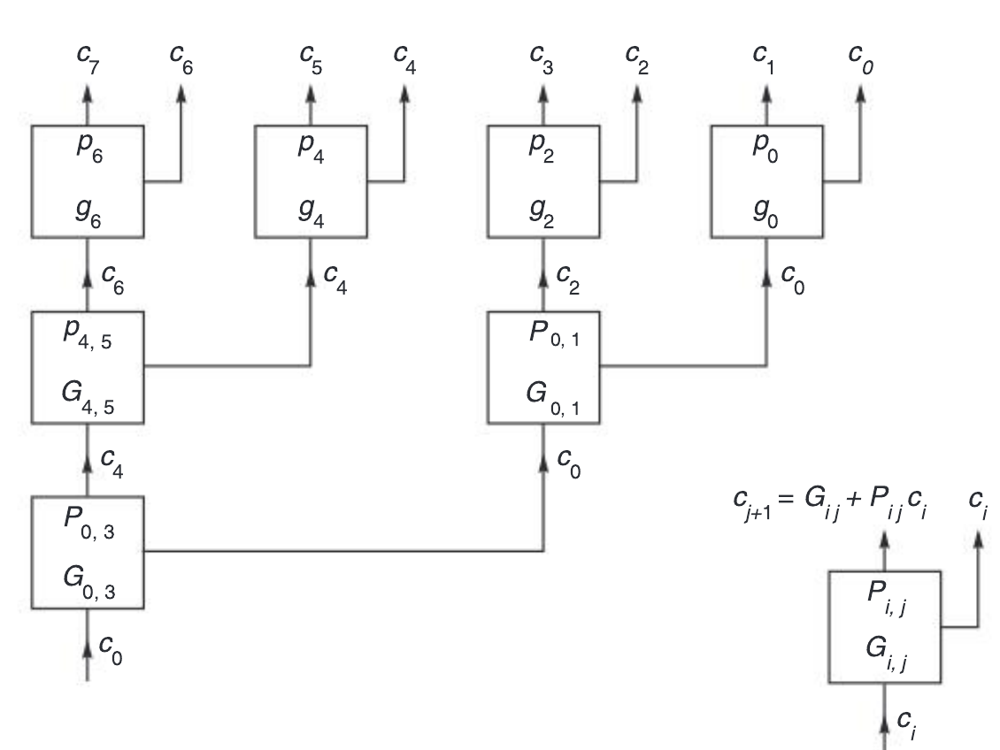
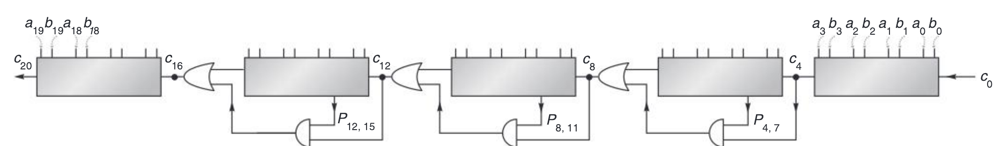
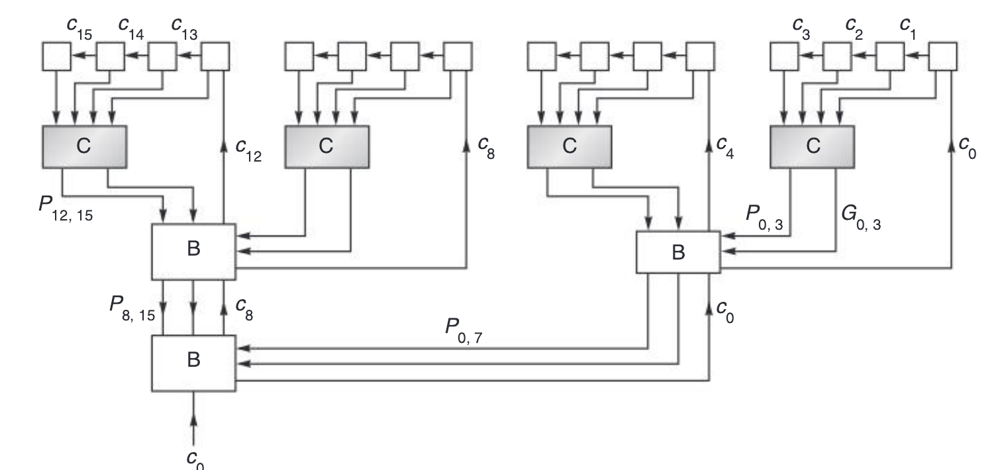
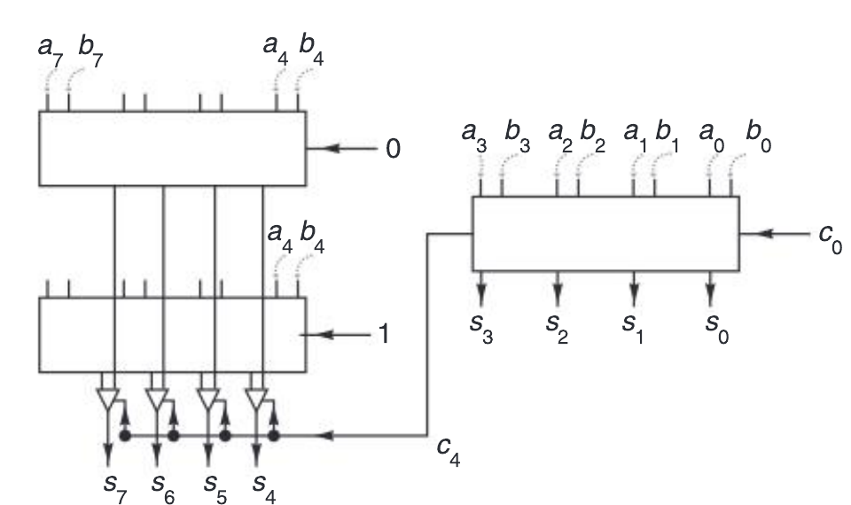
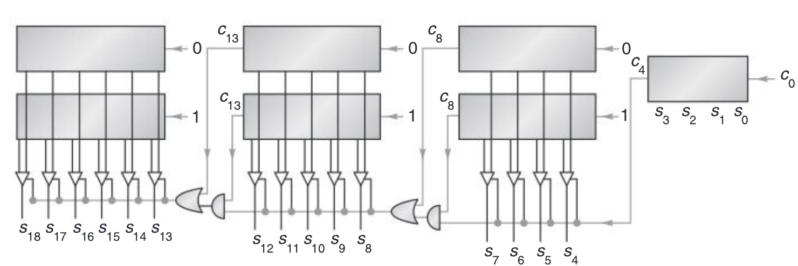
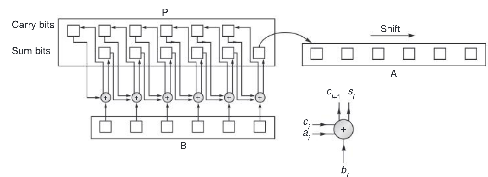

{#fig-j-16 width=75%}

CLA 中的信号大约要经过 $\log_2 n$ 级逻辑，行波进位加法器则要经过 $2n$ 级。速度因此提高很多，$n$ 越大越明显。不过，行波进位加法器只有 $n$ 个单元，CLA 却有 $2n$ 个单元，而且按我们的版图要占 $n \log n$ 的面积。可见，在面积上多投入一点，就能换来速度的大幅提高。

CLA 还可以根据工艺作一些改进。例如，树的每个结点如果有三个输入而不是两个，树高就从 $\log_2 n$ 降到 $\log_3 n$。当然，这样单元会更复杂，运行可能更慢，树高降低带来的好处也就抵消了。如果所用工艺中行波传递的效果好，混合设计可能更好，[图 J.19](#fig-j-19) 就是一例：顶层的加法器之间以行波方式传递进位，图中的「B」方框与[图 J.17](#fig-j-17) 中的相同。只要进位在四个加法器之间行波传递的时间比穿过一级「B」方框的时间短，这种设计就更快。（为了让结构看得更清楚，[图 J.19](#fig-j-19) 画的是 16 位加法器，[图 J.17](#fig-j-17) 的 8 位加法器相当于[图 J.19](#fig-j-19) 的右半部分。）

 和[图 J.16](#fig-j-16) 合并而成。要相加的数从顶部进入，向下流到底部与 $c_0$ 汇合，再向上流回，算出各个和位。图中 A 单元计算 $s_i = a_i \oplus b_i \oplus c_i$、$p_i = a_i + b_i$、$g_i = a_i b_i$；B 单元把 $(G_{j+1,k}, P_{j+1,k})$ 与 $(G_{ij}, P_{ij})$ 组合成 $(G_{i,k}, P_{i,k})$，并由 $c_i$ 算出 $c_{j+1}$。](images/appj/fig-j-17.png){#fig-j-17 width=90%}

{#fig-j-18 width=100%}

### 进位跳跃加法器 {-}

*进位跳跃加法器*（carry-skip adder）的速度和成本都介于行波进位加法器和先行进位加法器之间。（进位跳跃加法器不简称 CSA，因为这个名称已经留给了进位保留加法器。）这种加法器的设计思路来自 $P$ 和 $G$ 的方程。例如：

$$
\begin{aligned}
P_{03} &= p_0 p_1 p_2 p_3 \\
G_{03} &= g_3 + p_3 g_2 + p_3 p_2 g_1 + p_3 p_2 p_1 g_0
\end{aligned}
$$

计算 $P$ 比计算 $G$ 简单得多，而进位跳跃加法器只计算各个 $P$。[图 J.18](#fig-j-18) 给出了这样一个加法器。

{#fig-j-19 width=90%}

各块中的进位同时开始行波传递。只要某一块自己产生了进位，这一块的进位输出就为真，哪怕这时送进来的进位输入可能还不正确。如果每次加法开始时各块的进位输入都是 0，就不会产生虚假的进位输出，因此每块的进位输出可以看成这一块的 $G$ 信号。最低有效块的进位输出一旦产生，一方面送入下一块，另一方面和下一块的 $P$ 信号一起送入 AND 门。如果进位输出和 $P$ 信号都为真，进位就*跳过*第二块，直接准备送入第三块，依此类推。进位跳跃加法器要实用，必须能在每次运算开始时方便地清除进位输入信号，例如在 CMOS 中采用预充电。

下面分析进位跳跃加法器的速度。假设信号经过两级逻辑需要 1 个时间单位，那么进位以行波方式穿过大小为 $k$ 的块需要 $k$ 个时间单位，跳过一块需要 1 个时间单位。最长的信号路径从第 0 位产生进位开始。设加法器宽 $n$ 位，这条路径先用 $k$ 个时间单位行波穿过第一块，再用 $n/k - 2$ 个时间单位跳过中间各块，最后还要用 $k$ 个时间单位行波穿过最后一块。具体来说，20 位加法器按每组 4 位分块，完成一次加法需要 $4 + (20/4 - 2) + 4 = 11$ 个时间单位。稍加试验就会发现，20 位还有更高效的分块方法。例如分成五块：第一块是最低的 2 位，第二块是接下来的 5 位，后面三块依次是 6 位、5 位、2 位，加法时间就减少到 9 个时间单位。这个例子说明了一条重要的一般原则：进位跳跃加法器的中间块做得越大，加法器就越快。实际上，改变块大小的思路有时也能加快其他加法器。进位跳跃加法器的行波传递很多，因此最适合行波传递快的工艺。

### 进位选择加法器 {-}

*进位选择加法器*（carry-select adder）的原理是并行做两次加法，一次假定进位输入为 0，一次假定进位输入为 1。进位输入最终确定后，只需从预先算好的两个和中选出正确的一个。[图 J.20](#fig-j-20) 是这种设计的一个例子：8 位加法器分成两半，用低半部分的进位输出选择高半部分的和位。如果每块都用行波方式（一种线性时间算法）求和，[图 J.20](#fig-j-20) 的设计速度是原来的 2 倍，成本增加 50%。但 $c_4$ 信号必须驱动许多多路选择器，这在某些工艺中可能非常慢。加法器也可以不分成两半，而是分成四份，速度还能进一步提高，如[图 J.21](#fig-j-21) 所示。假设一块完成 $k$ 位加法需要 $k$ 个时间单位，由两个进位输出信号算出多路选择器的输入需要 1 个时间单位，那么要达到最佳效果，每块应比它右边的下一块宽 1 位，[图 J.21](#fig-j-21) 就是这样划分的。因此，和进位跳跃加法器一样，最好的设计采用大小可变的块。

{#fig-j-20 width=70%}

{#fig-j-21 width=90%}

[图 J.22　四种加法器在时间和空间上的渐近需求]{#fig-j-22 .caption}

| 加法器 | 时间 | 空间 |
|---|---|---|
| 行波进位 | $O(n)$ | $O(n)$ |
| CLA | $O(\log n)$ | $O(n \log n)$ |
| 进位跳跃 | $O(\sqrt{n})$ | $O(n)$ |
| 进位选择 | $O(\sqrt{n})$ | $O(n)$ |

作为本节的小结，[图 J.22](#fig-j-22) 列出了各种加法器在时间和空间上的渐近需求。（进位跳跃加法器和进位选择加法器的时间要精心选择块大小才能达到，进位跳跃加法器的情况见习题 J.26。）这几种加法器不是互相排斥、只能选其一的方案，而是构造加法器时可以组合使用的构件。每种构件好不好用，在很大程度上取决于所用的工艺。例如，信号能驱动许多多路选择器时，进位选择加法器效果好；工艺允许在每次运算开始时清除信号时，进位跳跃加法器就有吸引力。了解加法器的渐近特性有助于理解它们，但过分依赖渐近特性是一个陷阱，因为只有 $n$ 非常大时渐近特性才重要。加法器的 $n$ 是精度的位数，而今天的双精度和 20 年前一样，大约是 53 位。诚然，计算机越快，计算就越长，舍入误差随之增多，于是需要更高的精度；但这种效应随时间增长得非常缓慢。

## 整数乘法和除法的加速 {#sec-j-9}

[J.2 节](#sec-j-2)介绍的乘法和除法算法相当慢，每个周期只产生 1 位（尽管这个周期可能只是 CPU 指令周期的几分之一）。本节讨论提高乘法和除法性能的各种技术，其中包括 Pentium 芯片使用的除法算法。

### 跳 0 移位 {-}

跳 0 移位（shifting over zeros）技术目前用得不多，但很有启发意义。它的特点是执行时间与操作数有关。这种技术很少使用，主要原因是它比每次处理 1 位的算法快不了多少。此外，执行时间可变的算法很难流水线化，很难与 CPU 同步，也很难做好编译器优化。在乘法中，跳 0 移位的做法是增加一段逻辑，检测 A 寄存器的最低位是否为 0（见[图 J.2](#fig-j-2)(a)）；如果是 0，就跳过加法步骤，直接进入移位步骤。*跳 0 移位*的名称就由此而来。

除法能不能也这样移位呢？不恢复余数除法每一步都要做一次 ALU 运算（加法或减法），看起来没有机会跳过运算。但除法可以换一种方式理解：计算 $a/b$，就是从 $a$ 中减去 $b$ 的倍数，再报告一共减了多少次。在减法过程的每个阶段，余数都必须能放进[图 J.2](#fig-j-2)(b)的 P 寄存器。余数是一个小的正数时，通常要减去 $b$；假如这时只把余数移位，下一次再减 $b$，会怎么样呢？只要余数足够小（最高位为 0），移位后仍能放进 P 寄存器，信息不会丢失。不过，这样做就要改变记录「从 $a$ 中减了几次 $b$」的方式。这种思路通常称为 *SRT 除法*，名称取自 Sweeney、Robertson 和 Tocher 三人，他们各自独立提出了这类算法。SRT 除法带来的主要额外麻烦是：商位不能像普通不恢复余数除法那样，在每一步由 P 的符号立即确定。

具体做法如下。设 $a$ 和 $b$ 都是 $n$ 位数，要计算 $a$ 除以 $b$，先把 $a$ 和 $b$ 分别装入[图 J.2](#fig-j-2)的 A 寄存器和 B 寄存器，然后执行如下步骤：

**SRT 除法**

1. 如果 B 用 $n$ 位表示时有 $k$ 个前导 0，就把所有寄存器左移 $k$ 位。
2. 对 $i = 0, n - 1$，执行：
    a) 如果 P 的最高三位相等，置 $q_i = 0$，并把 (P,A) 左移一位。
    b) 如果 P 的最高三位不全相等且 P 为负，置 $q_i = -1$（也写作 $\bar{1}$），把 (P,A) 左移一位，再加 B。
    c) 否则置 $q_i = 1$，把 (P,A) 左移一位，再减 B。

    循环结束。
3. 如果最后的余数为负，就加 B 来修正余数，并从 $q_0$ 减去 1 来修正商。最后，余数必须右移 $k$ 位，$k$ 是第 1 步开始时左移的位数。

[图 J.23](#fig-j-23) 给出了一个数值例子。我们讨论的虽然是整数除法，但为了便于解释这个算法，不妨设想二进制小数点就在最高有效位的左边。这样，[图 J.23](#fig-j-23) 就从 $01000_2/0011_2$ 变成了 $0.1000_2/.0011_2$。分子和分母的小数点同时移动，商不受影响。(P,A) 寄存器对存放余数，余数用补码表示。例如，如果 P 中是 $11110_2$，A = 0，那么余数就是 $1.1110_2 = -1/8$。设余数的值为 $r$，则 $-1 \le r < 1$。

[图 J.23　$1000_2/0011_2$ 的 SRT 除法。商位用粗体表示，并用 $\bar{1}$ 表示 −1]{#fig-j-23 .caption}

| P | A | 说明 |
|---|---|---|
| 00000 | 1000 | 8 = 1000 除以 3 = 0011。B 中存放 0011。 |
| 00010 | 0000 | 第 1 步：B 有两个前导 0，所以左移 2 位。B 现在为 1100。 |
| | | 第 2.1 步：最高三位相等，属于情形 (a)，所以 |
| 00100 | 000**0** | 置 $q_0 = 0$ 并移位。 |
| | | 第 2.2 步：最高三位不相等且 P ≥ 0，属于情形 (c)，所以 |
| 01000 | 00**01** | 置 $q_1 = 1$ 并移位。 |
| + 10100 | | 减 B。 |
| 11100 | 00**01** | 第 2.3 步：最高几位相等，属于情形 (a)，所以 |
| 11000 | 0**010** | 置 $q_2 = 0$ 并移位。 |
| | | 第 2.4 步：最高三位不相等，属于情形 (b)，所以 |
| 10000 | **010$\bar{1}$** | 置 $q_3 = -1$ 并移位。 |
| + 01100 | | 加 B。 |
| 11100 | | 第 3 步：余数为负，所以恢复余数，并从 $q$ 减去 1。 |
| + 01100 | | |
| 01000 | | 必须撤销第 1 步的移位，所以右移 2 位，得到真正的余数。余数 = 10，商 = 010$\bar{1}$ − 1 = 0010。 |

有了这些准备，现在可以分析 SRT 除法算法了。算法的第一步把 $b$ 移位，使 $b \ge 1/2$。选择哪种 ALU 运算的规则是：

* 如果 $-1/4 \le r < 1/4$（P 的最高三位相等时总是如此），就把 (P,A) 左移一位，算出 $2r$；
* 如果 $r < 0$（因而 $r < -1/4$，否则就已经被第一个条件排除了），就先移位再相加，算出 $2r + b$；
* 如果 $r \ge 1/4$，就从 $2r$ 中减去 $b$。

利用 $b \ge 1/2$，很容易验证这些规则能保持 $-1/2 \le r < 1/2$。不恢复余数除法只能保证 $|r| \le b$，P 需要 $n + 1$ 位宽；SRT 除法对 $r$ 的界更紧，为 $-1/2 \le r < 1/2$，因此可以去掉 P 的最高位（$b$ 和加法器的最高位也一并去掉），省下 1 位。特别是，原来要判断 P 的最高三位是否相等，现在只需判断两位。

实现 SRT 除法时，算法可能略有变化：每次 ALU 运算之后，P 寄存器可以按需要移若干位，使 $r \ge 1/4$ 或 $r < -1/4$。移 $k$ 位，就一次把 $k$ 个商位置为 0。因此，SRT 除法有时也描述为一种让余数保持规格化、即 $|r| \ge 1/4$ 的除法。

注意，SRT 除法某一步算出的商位，取决于这一步执行的是哪种运算，而这又取决于上一步运算的结果。不恢复余数除法则不同，第 $i$ 步的商位取决于同一步运算的结果。这一差别的表现是：最后的余数为负时，SRT 除法必须调整最后一个商位，不恢复余数除法则不必。不过，SRT 除法商位最关键的特点是可以取 $\bar{1}$。[图 J.23](#fig-j-23) 虽然把商位存放在 A 的低位，但实际实现中不能这样做，因为一位放不下 −1、0、1 三个值。此外，商还必须在一个全加器中转换成普通的补码。常用的做法是：正的商位累积在一个寄存器中，负的商位累积在另一个寄存器中，等所有位都确定后，再把两个寄存器相减。用数字 −1、0、1 表示一个数，写法不止一种，所以说 SRT 除法采用的是*冗余*商表示。

SRT 除法与普通不恢复余数除法的区别可以归纳如下：

1. ALU 判定规则。不恢复余数除法由 P 的符号决定；SRT 除法由 P 的最高两位决定。
2. 最终的商。不恢复余数除法由 P 先后各次的符号直接得到；SRT 除法有三种商数字（1、0、$\bar{1}$），最终的商必须用一个完整的 $n$ 位加法器算出。
3. 速度。对于会产生 0 商位的操作数，SRT 除法更快。

上面给出的简单版 SRT 除法算法，在大多数情况下加速太小，不够实用。不过，本节后面会研究几种相当实用的 SRT 除法变体。

### 用单个加法器加快乘法 {-}

前面说过，跳 0 移位技术在当前的硬件中用得不多。下面讨论一些广泛使用的方法。提高乘法速度的方法分为两类：一类使用单个加法器，另一类使用多个加法器。先讨论使用单个加法器的技术。

讨论加法时已经指出，由于存在进位传播，用两级逻辑完成加法是不现实的。用[图 J.17](#fig-j-17) 的单元做两个 64 位数相加，计算各个 $P$ 和 $G$ 要经过 7 个单元，计算进位位还要再经过 7 个单元，至少需要 28 级逻辑。[图 J.2](#fig-j-2) 的简单乘法器每个乘法步都要经过这个加法器。改用*进位保留加法器*（carry-save adder，CSA），每一步的计算量可以大大减少。进位保留加法器就是 $n$ 个相互独立的全加器。[图 J.24](#fig-j-24) 是使用这种加法器的乘法器，图中每个标有「+」的圆圈是一个一位全加器，每个方框代表寄存器的一位。每次加法得到一对位，分别存入 P 的和部分与进位部分。各位的加法相互独立，所以一次加法只经过两级逻辑，比 28 级大为改进。

{#fig-j-24 width=90%}

使用[图 J.24](#fig-j-24) 的乘法器时，先把 P 的和位和进位位清 0，再执行第一次 ALU 运算。（如果采用 Booth 重编码，这次运算可能是减法而不是加法。）然后把 P 的最低和位移入 A，A 本身也同时移位。P 的高 $n - 1$ 位不需要移位，因为下一个周期这些和位会送入低一位的加法器。每个加法单元都独立工作，不传播进位，因此每个加法步都快得多。

进位保留加法器有两个缺点。一是硬件更多，因为必须再加一份寄存器 P，存放加法器的进位输出。二是最后一步之后，必须把结果的高位字送入一个普通加法器，把和部分与进位部分合并起来。一种办法是把 P 的输出送回执行加法运算的那个加法器。P 用两个寄存器表示，所以用进位保留加法器做乘法有时称为*冗余乘法*：把 P 表示成两个寄存器之和的方式有很多种，这种表示是冗余的。不是 CSA 的加法器称为*进位传播加法器*（carry-propagate adder，CPA）。传播加法器可以用行波、先行进位或其他方法传播进位。

另一种不增加加法器而加快乘法的办法，是每一步检查 A 的低 $k$ 位，而不是只检查 1 位，通常称为*高基数乘法*。以 $k = 2$ 为例：这一对位是 00，就给 P 加 0；是 01，就加 B；是 10，只需把 $b$ 左移一位再加到 P 上。遗憾的是，这一对位是 11 时，似乎就得计算 $b + 2b$。不过，采用高基数版本的 Booth 重编码可以避免这一点：把 A 看成一个 4 进制数，遇到数字 3 时把它改成 $\bar{1}$，并给高一位数字加 1 作为补偿。这种方案还有一个额外的好处：它和普通的 Booth 重编码一样，对负整数和正整数都适用（见 [J.2 节](#sec-j-2)）。

基 4 Booth 重编码的精确规则见[图 J.25](#fig-j-25)。在第 $i$ 个乘法步，A 寄存器的低两位是 $a_{2i}$ 和 $a_{2i+1}$。这两位和刚刚移出的那一位（$a_{2i-1}$）一起，选出要加到 P 寄存器上的 $b$ 的倍数。[图 J.26](#fig-j-26) 给出了一个数值例子。这种乘法技术又称为*重叠三元组*（overlapping triplets），因为它查看 3 位来决定用 $b$ 的哪个倍数，普通 Booth 重编码则只查看 2 位。

[图 J.25　基 4 Booth 重编码使用的 $b$ 的倍数。例如，如果 A 寄存器的低两位都是 1，最后从 A 寄存器移出的位是 0，那么正确的倍数就是 $-b$，见表的倒数第二行]{#fig-j-25 .caption}

| A 的低位：$2i + 1$ | A 的低位：$2i$ | 最后移出的位：$2i - 1$ | 倍数 |
|---|---|---|---|
| 0 | 0 | 0 | 0 |
| 0 | 0 | 1 | $+b$ |
| 0 | 1 | 0 | $+b$ |
| 0 | 1 | 1 | $+2b$ |
| 1 | 0 | 0 | $-2b$ |
| 1 | 0 | 1 | $-b$ |
| 1 | 1 | 0 | $-b$ |
| 1 | 1 | 1 | 0 |

[图 J.26　用基 4 Booth 重编码计算 −7 乘以 −5。标为 L 的一列是最后从 A 的右端移出的位]{#fig-j-26 .caption}

| P | A | L | 说明 |
|---|---|---|---|
| 00000 | 1001 | | −7 = 1001 乘以 −5 = 1011。B 中存放 1011。 |
| + 11011 | | | A 的低位是 0、1；L = 0，所以加 B。 |
| 11011 | 1001 | | |
| 11110 | 1110 | 0 | 右移两位，左端移入 1。 |
| + 01010 | | | A 的低位是 1、0；L = 0，所以加 −2b。 |
| 01000 | 1110 | 0 | |
| 00010 | 0011 | 1 | 右移两位。 |
| | | | 积为 35 = 0100011。 |

重叠三元组的控制逻辑更复杂，而且 P 寄存器要加宽 1 位，以容纳可能加上去的 $2b$ 或 $-2b$。也可以使用基 8（甚至更高基数）的 Booth 重编码，但这时可能的加数中就必须包括倍数 3B。基 8 乘法器通常在乘法运算开始时一次性算出 3B。

### 用多个加法器加快乘法 {-}

如果面积足够放下多个加法器，乘法速度就可以提高。[图 J.27](#fig-j-27) 是一个简单的阵列乘法器，它用三个 CSA 和一个传播加法器完成两个 5 位数的乘法。(a) 部分是方框图，本节一直采用这种画法。(b) 和 (c) 部分更详细地画出了加法器：(b) 画出加法器的全部输入，(c) 画出实际的各个加法器及其互连。(c) 中的每一行加法器对应 (a) 中的一个方框。图画成「扭斜」的，使位权相同的位排在同一列。实际实现时，阵列很可能排成正方形。
