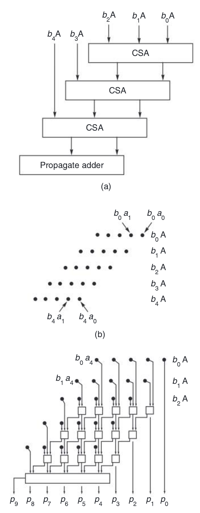
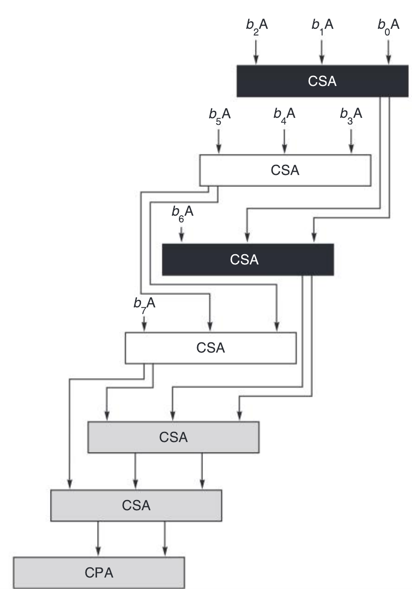
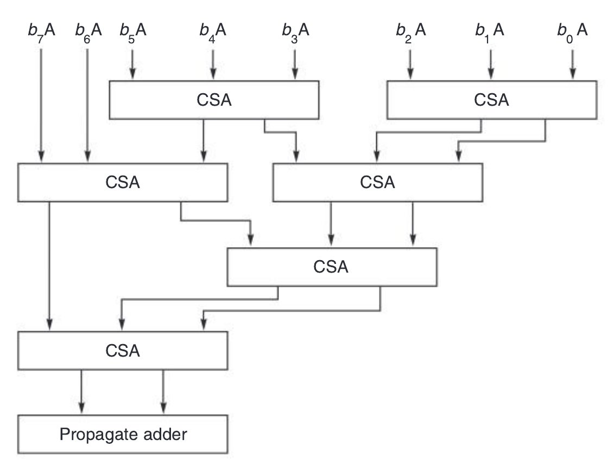
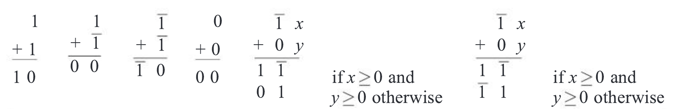
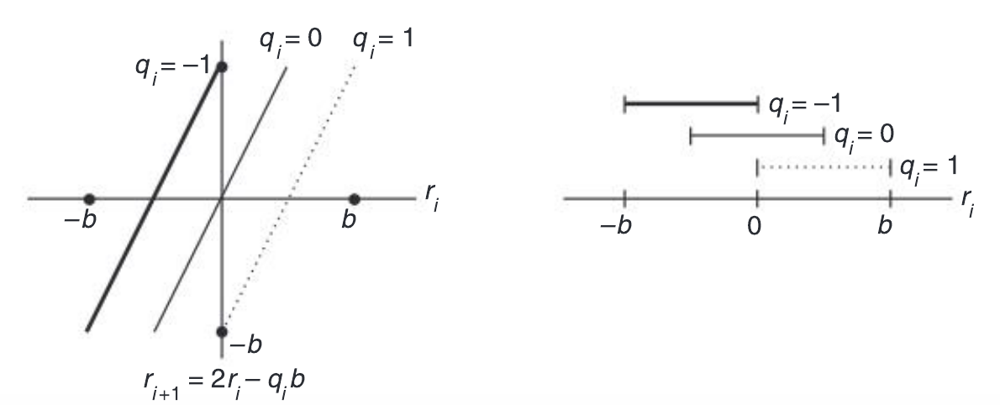
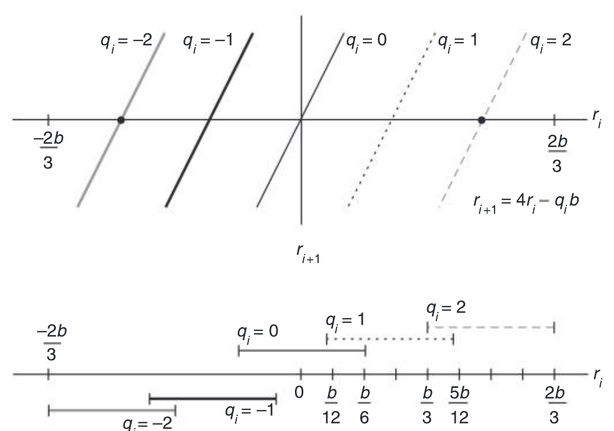

{#fig-j-27 width=45%}

[图 J.27](#fig-j-27) 的阵列乘法器做的加法次数与[图 J.24](#fig-j-24) 的设计相同，因此它的延迟与单个进位保留加法器相差不大。但[图 J.27](#fig-j-27) 的硬件可以把乘法流水化，从而提高总的吞吐率。另一方面，这种程度的流水化有时用在阵列处理机中，[J.10 节](#sec-j-10)讨论的单芯片浮点加速器却都没有采用。[附录 C](#app-c) 对流水线作了一般性的讨论，Kogge [1981] 则讨论了乘法器中的流水线。

有时，芯片上为算术部件预留的面积放不下一个大到足以完成两个双精度数相乘的阵列。这时常用的设计是[图 J.28](#fig-j-28) 那样的两遍结构：第一遍通过阵列，处理完 B 的 5 位；第一遍的结果反馈到阵列顶部，与接下来的三个加数合并；第二遍的结果再送入 CPA。不过，这种设计无法再流水化。

 那样的单遍设计的一半。第二遍结束时，各位流入 CPA。第一遍使用的输入以粗体标出。图内标注：CSA，进位保留加法器；CPA，进位传播加法器。](images/appj/fig-j-28.png){#fig-j-28 width=45%}

既然阵列所需的加法步数与[图 J.2](#fig-j-2) 和[图 J.24](#fig-j-24) 那些便宜得多的结构一样多，为什么阵列还这么受欢迎呢？原因有两个。

一是阵列的延迟比单个加法器小，因为阵列是组合电路，信号直接流过，不需要时钟控制。[图 J.28](#fig-j-28) 的两遍加法器一般仍要用时钟，但信号通过 $k$ 个阵列所需的周期时间，可以小于[图 J.2](#fig-j-2) 或[图 J.24](#fig-j-24) 那类设计所需时钟周期的 $k$ 倍。

二是阵列便于采用各种进一步加速的方案。[图 J.29](#fig-j-29) 就是其中之一。这种设计让两路加法并行进行，换句话说，每一路数据流只经过一半的加法器，因此运行速度几乎是[图 J.27](#fig-j-27) 乘法器的 2 倍。这种*奇偶*乘法器结构规整，在 VLSI 中很受欢迎。阵列还可以用异步逻辑来加速。[图 J.2](#fig-j-2)（第 J-4 页）的乘法器需要时钟，原因之一是防止加法器的输出在完全稳定之前就反馈到加法器的输入端。因此，如果[图 J.28](#fig-j-28) 的阵列足够长，在第一个加法器稳定下来所需的时间内，任何信号都来不及从顶部传到底部，就有可能完全不用时钟。Williams et al. [1987] 讨论过采用这一思路的设计，不过用于除法器，而不是乘法器。

{#fig-j-29 width=50%}

上一段介绍的技术，乘法时间仍是 $O(n)$；用树则可以把时间降到 $\log n$。最简单的树把加数 $b_0\mathrm{A} \cdots b_{n-1}\mathrm{A}$ 两两合并，把加数的个数从 $n$ 减到 $n/2$。然后这 $n/2$ 个数再两两相加，减到 $n/4$，依此类推，经过 $\log n$ 步得到一个和。但是，这种简单的二叉树无法直接用 (3,2) 全加器构成，因为全加器把三个输入变成两个，而不是把两个输入变成一个。[图 J.30](#fig-j-30) 是一种用全加器构成的树，称为 *Wallace 树*。在用 MSI 器件搭建计算机算术部件的年代，高速乘法器首选 Wallace 树。不过，用 VLSI 实现 Wallace 树有一个问题：如果试着把[图 J.30](#fig-j-30) 中 Wallace 树的所有加法器和通路都画出来，就会发现它没有[图 J.27](#fig-j-27) 那样整齐规整的结构。正因为如此，VLSI 设计者常常选用其他 $\log n$ 设计，例如下面要讨论的*二叉树乘法器*。

{#fig-j-30 width=60%}

用二叉树把加数相加，难点在于构造一个 (2,1) 加法器，把两个数字合并成一个和数字。由于有进位，用二进制表示做不到这一点，但换一种表示就可以做到。我们采用 $1$、$\bar{1}$ 和 $0$ 组成的*带符号数字表示*，前面理解 Booth 算法时用过这种表示。这种表示有两方面的代价：一是每个带符号数字要用 2 位来表示；二是两个带符号数字 $a_i$ 和 $b_i$ 相加的算法比较复杂，需要检查 $a_ia_{i-1}a_{i-2}$ 和 $b_ib_{i-1}b_{i-2}$。这样虽然要往回看 2 位，但二进制加法由于有进位，可能要往回看任意多位。

两个带符号数字的相加算法可以这样描述：首先，用[图 J.31](#fig-j-31) 算出和位 $s_i$ 和进位位 $c_{i+1}$；然后，把最终的和算成 $s_i + c_i$。表的设计保证了这个最终的和不会再产生进位。

{#fig-j-31 width=90%}

**例题**　带符号数字 $1\bar{1}0_2$ 与 $001_2$ 之和是多少？

**解答**　最低的两位之和为 $0 + 1 = 1\bar{1}$，下一对之和为 $\bar{1} + 0 = 0\bar{1}$，最高的一对之和为 $1 + 0 = 01$，所以和为

$$
1\bar{1} + 0\bar{1}0 + 0100 = 10\bar{1}_2
$$

这样就定义了一个 (2,1) 加法器。有了它，就可以直接用二叉树来做乘法。第一步并行地计算 $b_0\mathrm{A} + b_1\mathrm{A}$、$b_2\mathrm{A} + b_3\mathrm{A}$、…、$b_{n-2}\mathrm{A} + b_{n-1}\mathrm{A}$；下一步再把这些和两两相加，依此类推。虽然最后的和还要经过一个进位传播加法器，从带符号数字形式转换成补码，但任何使用 CSA 的乘法器都需要这最后一步加法。

概括起来，Wallace 树和带符号数字树都是 $\log n$ 乘法器。Wallace 树用的门较少，但较难布局。带符号数字树结构更规整，但每个数字要用 2 位表示，加法逻辑也更复杂。与加法器一样，不同的乘法技术也可以组合使用。例如，Booth 重编码可以和阵列结合：在[图 J.27](#fig-j-27) 中，每个输入不再是 $b_i\mathrm{A}$，而可以是 $b_ib_{i-1}\mathrm{A}$。为了避免计算倍数 $3b$，可以使用 Booth 重编码。

### 用单个加法器加快除法 {-}

前面讨论过用单个加法器加快乘法的两种技术：进位保留加法器和高基数乘法。但是，想用这两种方法来加快不恢复余数除法，会遇到困难。

先看进位保留加法器。如果把第 J-4 页[图 J.2](#fig-j-2)(b) 中的加法器换成进位保留加法器，P 就要换成两个寄存器，一个存和位，一个存进位位（对照[图 J.24](#fig-j-24) 的乘法器）。每个周期结束时，P 是这两个寄存器尚未求出的和，因此 P 的符号无法确定；而计算商数字、决定下一次 ALU 运算，用的恰恰是 P 的符号。

再看高基数。采用更高的基数时，问题在于确定从 P 中减去什么值。用纸笔做除法时，要猜商数字。二进制除法只有两种可能，我们可以先猜一个，再根据 P 的符号修正，从而巧妙地绕过这个问题。但在更高的基数下，可能的商数字不止两个，这种办法就行不通了，商的选择可能变得相当复杂：必须算出 $b$ 的所有倍数，再一一与 P 比较。

如果采用冗余的商表示，进位保留技术和高基数除法就都能用了。回忆一下 SRT 除法（第 J-45 页）的讨论：商数字允许取 −1、0 或 1，因此常常有不止一种选择。前面那个算法的思路是尽可能选 0，因为这样就可以省掉一次 ALU 运算。进位保留除法中，余数（即 (P,A) 寄存器对的值）以进位保留形式存放，无法确切知道，因此确切的商数字也无法知道；但由于采用了冗余表示，选商数字时并不需要精确知道余数。[图 J.32](#fig-j-32) 说明了这一点，图中 $x$ 轴表示 $r_i$，即第 $i$ 步之后的余数。标为 $q_i = 1$ 的直线表示选择 $q_i = 1$ 时 $r_{i+1}$ 的值，$q_i = 0$ 和 $q_i = -1$ 的直线与此类似。只要 $r_{i+1} = 2r_i - q_ib$ 满足 $|r_{i+1}| \le b$，$q_i$ 取什么值都可以。允许的范围画在[图 J.32](#fig-j-32) 的右半部分。可以看出，要选出商数字 $q_i$，并不需要知道 $r_i$ 的精确值，只要知道 $r$ 落在某个足够小的区间内，这个区间能整个放进[图 J.32](#fig-j-32) 右半部分那些相互重叠的横杠中的某一条之内。

{#fig-j-32 width=80%}

进位保留加法器正是据此使用的：取出进位保留加法器的高位，用传播加法器求和，再用得到的 $r$ 的近似值（连同除数 $b$）算出 $q_i$，通常借助查找表完成。同样的技术也适用于更高基数的除法（无论是否使用进位保留加法器）：用 P 的高位去索引一张表，表中给出一个允许的商数字。

设计高速 SRT 除法器时，难点在于确定需要检查 P 和 B 的多少位。例如，假设采用基 4，商数字取 $2$、$1$、$0$、$\bar{1}$、$\bar{2}$，但使用的是传播加法器。需要检查 P 和 B 的多少位？确定这一点分两步。

第一步是确定 $r_i$ 必须满足的界。普通的基 2 不恢复余数除法每一步都有 $|r| \le b$，因此 P 缓冲区不会溢出。但在基 4 下，每一步计算的是 $r_{i+1} = 4r_i - q_ib$，如果 $r_i$ 接近 $b$，$4r_i$ 就会接近 $4b$，即使取最大的商数字，也不能把 $r$ 拉回到 $|r_{i+1}| \le b$ 的范围内。换句话说，余数可能无限增长。不过，限定 $|r_i| \le 2b/3$ 之后，很容易验证 $r_i$ 会保持有界。

第二步，确定了 $r_i$ 的界，就可以画出与[图 J.32](#fig-j-32) 类似的[图 J.33](#fig-j-33)。例如，从图中可以看出，如果 $r_i$ 在 $(1/12)b$ 与 $(5/12)b$ 之间，就可以选 $q = 1$，依此类推。换一种说法，如果 $r/b$ 在 1/12 与 5/12 之间，就可以选 $q = 1$。假设除法器检查 P 的 5 位（包括符号位）和 $b$ 的 4 位（不计符号位，因为 $b$ 总是非负）。需要关注的是这样一种情况：P 的高位为 $00011xxx\cdots$，而 $b$ 的高位为 $1001xxx\cdots$。设想二进制小数点在每个寄存器的最左端。由于做了截断，$r$（P 与 A 拼接起来的值）可能在 $0.0011_2$ 到 $0.0100_2$ 之间，$b$ 可能在 $.1001_2$ 到 $.1010_2$ 之间。因此，$r/b$ 可能小到 $0.0011_2/.1010_2$，也可能大到 $0.0100_2/.1001_2$。但 $0.0011_2/.1010_2 = 3/10 < 1/3$ 要求商位取 1，而 $0.0100_2/.1001_2 = 4/9 > 5/12$ 要求商位取 2。也就是说，只看 P 的 5 位和 $b$ 的 4 位，不足以选出商位。实际上，P 的 6 位和 $b$ 的 4 位就够了。写一个检查所有情况的简单程序就可以验证这一点，[图 J.34](#fig-j-34) 给出了这样一个程序的输出。

{#fig-j-33 width=80%}

[图 J.34　采用传播加法器的基 4 SRT 除法的商数字。第一行的意思是：如果 $b$ 的高 4 位为 $1000_2 = 8$，并且 P 的高 6 位在 $110100_2 = -12$ 与 $111001_2 = -7$ 之间，那么 −2 是一个有效的商数字]{#fig-j-34 .caption}

| $b$ | P 的范围（下限） | P 的范围（上限） | $q$ | $b$ | P 的范围（下限） | P 的范围（上限） | $q$ |
|---|---|---|---|---|---|---|---|
| 8 | −12 | −7 | −2 | 12 | −18 | −10 | −2 |
| 8 | −6 | −3 | −1 | 12 | −10 | −4 | −1 |
| 8 | −2 | 1 | 0 | 12 | −4 | 3 | 0 |
| 8 | 2 | 5 | 1 | 12 | 3 | 9 | 1 |
| 8 | 6 | 11 | 2 | 12 | 9 | 17 | 2 |
| 9 | −14 | −8 | −2 | 13 | −19 | −11 | −2 |
| 9 | −7 | −3 | −1 | 13 | −10 | −4 | −1 |
| 9 | −3 | 2 | 0 | 13 | −4 | 3 | 0 |
| 9 | 2 | 6 | 1 | 13 | 3 | 9 | 1 |
| 9 | 7 | 13 | 2 | 13 | 10 | 18 | 2 |
| 10 | −15 | −9 | −2 | 14 | −20 | −11 | −2 |
| 10 | −8 | −3 | −1 | 14 | −11 | −4 | −1 |
| 10 | −3 | 2 | 0 | 14 | −4 | 3 | 0 |
| 10 | 2 | 7 | 1 | 14 | 3 | 10 | 1 |
| 10 | 8 | 14 | 2 | 14 | 10 | 19 | 2 |
| 11 | −16 | −9 | −2 | 15 | −22 | −12 | −2 |
| 11 | −9 | −3 | −1 | 15 | −12 | −4 | −1 |
| 11 | −3 | 2 | 0 | 15 | −5 | 4 | 0 |
| 11 | 2 | 8 | 1 | 15 | 3 | 11 | 1 |
| 11 | 8 | 15 | 2 | 15 | 11 | 21 | 2 |

**例题**　用 8 位寄存器，以基 4 SRT 除法计算 149/5。

**解答**　按第 J-45 页的 SRT 算法做，只是把第 2 步中的商选择规则换成使用[图 J.34](#fig-j-34) 的规则。计算过程见[图 J.35](#fig-j-35)。

[图 J.35　基 4 SRT 除法的例子：149 除以 5]{#fig-j-35 .caption}

| P | A | 步骤 | 说明 |
|---|---|---|---|
| 000000000 | 10010101 | | 149 除以 5。B 中存放 00000101。 |
| 000010010 | 10100000 | 第 1 步 | B 有 5 个前导 0，所以左移 5 位。B 现在为 10100000，因此使用表中 $b = 10$ 的部分。 |
| | | 第 2.1 步 | P 的高 6 位为 2，所以左移 2 位。查表，$q$ 可以取 0 或 1。选 $q_0 = 0$。 |
| 001001010 | 100000**0** | | |
| | | 第 2.2 步 | P 的高 6 位为 9，所以左移 2 位。$q_1 = 2$。 |
| 100101010 | 0000**02** | | |
| + 011000000 | | | 减去 $2b$。 |
| 111101010 | 0000**02** | 第 2.3 步 | 高位为 −3，所以左移 2 位。$q$ 可以取 0 或 −1，选 $q_2 = 0$。 |
| 110101000 | 00**020** | | |
| | | 第 2.4 步 | 高位为 −11，所以左移 2 位。$q_3 = -2$。 |
| 010100000 | **0202** | | |
| + 101000000 | | | 加上 $2b$。 |
| 111100000 | | 第 3 步 | 余数为负，所以加上 $b$ 恢复余数，并从 $q$ 中减去 1。 |
| + 010100000 | | | |
| 010000000 | | 答案 | $q = 020\bar{2} - 1 = 29$。求余数时，撤销第 1 步的移位，余数 = 010000000 >> 5 = 4。 |

Pentium 采用的基 4 SRT 除法算法与上面介绍的类似，只是它使用了进位保留加法器。习题 J.34(c) 和 J.35 对此作了详细探讨。这些虽然都是简单的情形，但所有 SRT 分析的步骤都一样：首先算出 $r_i$ 的范围，然后画出 $r_i$ 与 $r_{i+1}$ 的关系图，找出各个商数字的范围，最后写一个程序，算出需要多少位。（有时也可以用解析方法算出所需的位数。）构造实用的 SRT 除法器还要考虑各种细节。例如，商查找表的结构相当规整，因此把它编码成 PLA 通常比放在 ROM 中便宜。关于 SRT 除法的更多细节，见 Burgess and Williams [1995]。

## 融会贯通 {#sec-j-10}

本节比较 Weitek 3364、MIPS R3010 和 Texas Instruments 8847 三种芯片（见[图 J.36](#fig-j-36) 和[图 J.37](#fig-j-37)）。从许多方面看，这三种芯片都是理想的比较对象：它们都在单个芯片上实现了 IEEE 标准的加、减、乘、除；都是 1988 年推出的；周期时间都在 40 ns 左右。但它们采用的算法相当不同。Birman et al. [1990] 对 Weitek 芯片做了很好的介绍，Rowen, Johnson, and Ries [1988] 对 MIPS 芯片介绍得没那么详细，TI 芯片的细节可以在 Darley et al. [1989] 中找到。

这三种芯片有不少共同点。它们都能并行执行加法和乘法，都既不实现扩展精度，也不实现求余步操作。（回忆 [J.6 节](#sec-j-6)：如果有求余步指令，用软件实现 IEEE 求余函数很容易。）设计者不提供扩展精度，原因可能是最有影响力的用户运行的都是可移植的代码，而这类代码不能依赖扩展精度。但前面已经看到，扩展精度可以让数学库更快、更简单。

[图 J.36　本节讨论的三种浮点芯片概况。周期时间是 1989 年 6 月可以买到的量产芯片的数据。周期数是双精度运算的周期数]{#fig-j-36 .caption}

| 特性 | MIPS R3010 | Weitek 3364 | TI 8847 |
|---|---|---|---|
| 时钟周期（ns） | 40 | 50 | 30 |
| 面积（mil^2^） | 114,857 | 147,600 | 156,180 |
| 晶体管数 | 75,000 | 165,000 | 180,000 |
| 引脚数 | 84 | 168 | 207 |
| 功耗（W） | 3.5 | 1.5 | 1.5 |
| 加法周期数 | 2 | 2 | 2 |
| 乘法周期数 | 5 | 2 | 3 |
| 除法周期数 | 19 | 17 | 11 |
| 平方根周期数 | – | 30 | 14 |

![图 J.37　TI 8847、MIPS R3010 和 Weitek 3364 的芯片布局。左边一列是显微照片，右边一列是对应的布局图。图内标注（TI 8847）：Pads，焊盘；Input registers，输入寄存器；Operand select，操作数选择；C register，C 寄存器；Timing，定时；Divide/square root registers and multiplexers，除法/平方根寄存器和多路选择器；Divide/square root state machine，除法/平方根状态机；Seed programmable logic array，初值可编程逻辑阵列；Pre-alignment，预对齐；Instruction decoder，指令译码器；Signed digit multiplier，带符号数字乘法器；ALU，ALU；Pipeline register，流水线寄存器；Normalizer，规格化器；Status，状态；Rounder，舍入器；Signed digit converter，带符号数字转换器；Sum register，和寄存器；Product register，积寄存器。图内标注（MIPS R3010）：Register timing and decode，寄存器定时与译码；Register file，寄存器堆；IEEE exception and status register，IEEE 异常与状态寄存器；Conflict detect，冲突检测；Forwarding control，前递控制；Operand forwarding and staging，操作数前递与暂存；External data bus，外部数据总线；Instruction decode，指令译码；Exponent datapath，指数数据通路；32b++64b alignment，32 位 ++ 64 位对齐；Add control，加法控制；Shifter，移位器；Sticky，粘滞位；Pipeline control and interlock logic，流水线控制与互锁逻辑；IEEE rounding，IEEE 舍入；Adder，加法器；Clocks，时钟；Divide control，除法控制；Divider，除法器；Phase locked loop，锁相环；I/O control，I/O 控制；Multiply control，乘法控制；Multiplier，乘法器。](images/appj/fig-j-37.png){#fig-j-37 width=95%}

从[图 J.36](#fig-j-36) 给出的三种芯片概况可以看到，晶体管数越多，周期数一般越少。比较每种操作的周期数时要小心，因为 MIPS 芯片的数据是完整系统（R3000/3010 组合）的数据，而 Weitek 和 TI 的数据是单独芯片的数据，用在完整系统中时通常还会更大。
