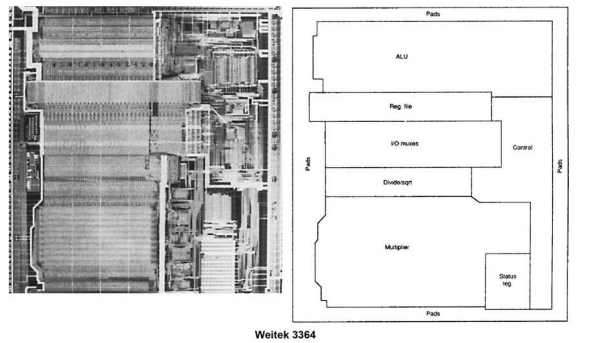

{#fig-j-37-cont width=90%}

三种芯片中，MIPS 芯片的晶体管最少。这一点也反映在功能上：它是三者中唯一既没有流水线、也没有硬件平方根的芯片。此外，乘法和加法共用完成最后舍入的进位传播加法器（以及舍入逻辑），因此这两种操作并不完全独立。

R3010 的加法器混合使用了行波进位、先行进位（CLA）和进位选择三种方法。进位选择加法器的用法与[图 J.20](#fig-j-20)相同。在每一半内部，进位用[图 J.19](#fig-j-19)那种行波进位与 CLA 混合的方式传播。不过，R3010 又作了进一步调整：各块的大小各不相同，而不是像[图 J.19](#fig-j-19) 那样都固定为 4 位。乘法器介于[图 J.2](#fig-j-2)和[图 J.27](#fig-j-27)两种设计之间。它的阵列大小刚好能让输出不经时钟打入，直接反馈到输入。此外，它还采用基 4 Booth 重编码和[图 J.29](#fig-j-29)的奇偶技术。R3010 能并行执行除法和乘法，这一点与 Weitek 芯片相同，与 TI 芯片不同。除法器采用基 4 SRT 方法，商数字取 −2、−1、0、1 和 2，与 Taylor [1985] 描述的方法相似。双精度除法所需的时间大约是乘法的 4 倍。R3010 表明，芯片采用 $O(n)$ 乘法器时，SRT 除法器的速度足够快，能使乘法与除法的速度之比保持在合理范围内。

Weitek 3364 的加法、乘法和除法部件相互独立。它也采用基 4 SRT 除法。不过，Weitek 芯片的加法和乘法都是流水执行的。加法分三级：（1）比较指数；（2）先加后移位（或者先移位后加）；（3）最后舍入。第（1）级和第（3）级各只需要半个周期，因此虽然有三个流水级，整个操作两个周期就能完成。乘法器采用[图 J.28](#fig-j-28) 那种形式的阵列，但使用基 8 Booth 重编码，因此必须算出乘数的 3 倍。乘法流水线也分三级：（1）计算 $3b$；（2）通过阵列；（3）最后的进位传播加法和舍入。单精度通过阵列一次，双精度通过两次。乘法的延迟与加法一样，也是两个周期。

Weitek 芯片的加法算法很有意思。它是[图 J.18](#fig-j-18)所示进位跳跃加法器的一种变形。不同之处在于，$P_{ij}$ 是许多项的逻辑「与」，Weitek 芯片用行波方式计算它，每传一级做一次「与」。这样，进位在一个块内向左传播的同时，$P_{ij}$ 的值在下一个块内向右传播；块的大小选得恰好使两股波同时传完。与 MIPS 芯片不同，3364 有硬件平方根，它与除法共用硬件。双精度乘法与除法的时间之比是 2:17。乘法与除法相差这么多，是因为乘法采用基 8 Booth 重编码，而除法采用基 4 方法。在 MIPS R3010 中，乘法和除法使用相同的基。

TI 8847 的突出特点是用迭代做除法（采用 [J.6 节](#sec-j-6)讨论的 Goldschmidt 算法）。这样做提高了除法速度（乘法与除法的时间之比是 3:11），代价是乘法和除法不能像另外两种芯片那样并行执行。加法采用两级流水线：第一级完成指数比较、小数移位和小数相加，第二级完成规格化和舍入。乘法采用由带符号数字加法器构成的二叉树，流水线分三级：第一级通过阵列，处理掉一半的位；第二级第二次通过阵列；第三级把带符号数字形式转换为补码。由于只有一个阵列，新的乘法操作只能隔一个周期启动一次。不过，如果放慢时钟，在一个周期内就能两次通过阵列，这时每个周期都可以启动一次新的乘法。8847 的加法器采用进位选择算法，而不是先行进位算法。[J.6 节](#sec-j-6)已经提到，TI 芯片保留 60 位精度，以保证除法结果正确舍入。

这三种芯片表明，约束条件相近的设计者也会作出不同的权衡。这些芯片最有意思的一点是算法各不相同：每种芯片的加法算法不同，乘法算法也不同。实际上，三种芯片共同采用的技术只有 Booth 重编码一项。

## 谬误与陷阱 {#sec-j-11}

**谬误**　*实际的浮点应用程序很少发生下溢。*

大多数程序确实很少下溢，但也有一些实际程序经常下溢。求解一维波动方程的 SDRWAVE [Kahaner 1988] 就是一例。这个程序即使运行正常，也相当频繁地下溢。在一台机器上的测量表明，如果在硬件上支持渐进下溢，SDRWAVE 的运行速度大约能提高 50%。

**谬误**　*整数与浮点数之间的转换很少见。*

实际上，在 spice 中，这种转换和除法一样频繁。由于假定转换很少见，SPARC 第 8 版指令系统犯了一个错误：它没有提供把数据从整数寄存器传送到浮点寄存器的指令。

**陷阱**　*提高浮点部件的速度，却不提高它的存储带宽。*

浮点部件的一种典型用法是把两个向量相加，得到第三个向量。如果这些向量由双精度数组成，那么每次浮点加法要用 3 个 64 位操作数，即 24 字节的存储数据。如果浮点部件能并行执行加法和乘法（大多数浮点部件都能），对存储带宽的需求还会更大。

**陷阱**　*$-x$ 与 $0 - x$ 不相同。*

这是 IEEE 标准中一个细微之处，曾让一些设计者栽了跟头。浮点数采用原码表示，因此有两个零：$+0$ 和 $-0$。标准规定 $0 - 0 = +0$，而 $-(0) = -0$。所以当 $x = 0$ 时，$-x$ 与 $0 - x$ 不相同。

## 历史回顾与参考文献 {#sec-j-12}

最早的计算机使用定点表示，而不是浮点表示。Burks、Goldstine 和 von Neumann [1946] 在《电子计算仪器逻辑设计的初步讨论》中是这样说的：

> 「浮动」小数点系统似乎有两个主要目的，二者都源于这样一个事实：每一台具体的机器，一个字的位数都是由设计考虑确定的常数。第一个目的是在和或积中保留尽可能多的有效数字；第二个目的是免去操作人员估计「比例因子」并把它插入问题中的负担。比例因子是一些乘法常数，用来使数保持在机器允许的范围之内。
>
> 当然，不可否认，安排引入合适的比例因子要花费人的时间。我们只是认为，这样花去的时间，在我们为机器准备一个有意义的问题所花的总时间中只占很小的比例。我们觉得，浮点的第一个优点多少有些虚幻。为了实现这样的浮点，必须浪费一部分存储容量，而这部分容量本来可以用来让每个字容纳更多的数字。因此在我们看来，浮动二进制小数点的这些不大的优点，能否抵消存储容量的损失以及运算电路和控制电路复杂性的增加，还很不清楚。

从这段话可以看出早期计算机设计者的观点：他们认为节省机器时间和存储器比节省程序员的时间更重要。

介绍 Wallace 树、Booth 重编码、SRT 除法、重叠三元组等技术的原始论文，都重印在 Swartzlander [1990] 中。早期机器 IBM 360/91 采用了流水化的 Wallace 树、Booth 重编码和迭代除法，Anderson 等人 [1967] 对这台机器有很好的说明。Freiman [1961] 讨论了单位 SRT 除法的平均时间，这是少数几篇没有收入 Swartzlander 的有价值的历史文献之一。

Mead 和 Conway [1980] 的经典著作认为 CLA 在 VLSI 中性价比不高，不主张使用。Brent 和 Kung [1982] 的重要论文帮助扭转了这种看法。CLA 详细版图的例子可以在 Ngai 和 Irwin [1985] 或 Weste 和 Eshraghian [1993] 中找到，Leighton [1992] 则给出了更偏理论的论述。Takagi、Yasuura 和 Yajima [1985] 详细描述了一种带符号数字树形乘法器。

IEEE 算术占据主导地位之前，人们使用过许多种浮点格式，其中重要的有三种，分别用于 IBM 370、DEC VAX 和 Cray。下面简要介绍这几种旧格式。

VAX 格式最接近 IEEE 标准。它的单精度格式（F 格式）与 IEEE 单精度一样，有隐含位、8 位指数和 23 位小数。但它没有粘滞位，因此遇到正好在中间的情况时向上舍入，而不是舍入到偶数。VAX 的指数范围与 IEEE 单精度略有不同：$E_{\min}$ 是 −128，而 IEEE 是 −126；$E_{\max}$ 是 126，而不是 127。VAX 与 IEEE 的主要区别是 VAX 没有特殊值，也没有渐进下溢。VAX 有一种保留操作数，但它的作用类似于发信号的 NaN：只要被引用就产生陷阱。VAX 的双精度格式（D 格式）原来也只有 8 位指数。8 位指数对许多应用来说太小，于是又增加了 G 格式，它和 IEEE 标准一样有 11 位指数。VAX 还有一种 128 位长的 H 格式。

IBM 370 的浮点格式以 16 为基，而不是以 2 为基，因此不能使用隐含位。它的单精度格式有 7 位指数和 24 位（6 个十六进制数字）小数，所以能表示的最大数是 $16^{2^7} = 2^{4 \times 2^7} = 2^{2^9}$，而 IEEE 是 $2^{2^8}$。但是，按十六进制意义规格化的数，只要求首位数字不为 0；按二进制解释，最高的 3 位有可能都是 0。因此，有效位可能不到 24 位。采用较大的基，是为了尽量减少浮点加法时所需的移位量。不过在现在的机器上，浮点加法的时间通常是固定的，与操作数无关，因此这一点已经不那么重要。370 算术与 IEEE 算术的另一个区别是：370 既没有舍入位，也没有粘滞位，实际上相当于截断而不是舍入。因此，在许多计算中，结果会系统性地偏小。与 VAX 和 IEEE 算术不同，370 的每一种位模式都是有效的数，所以库程序必须约定出错时返回什么。例如，在 IBM FORTRAN 库中，$\sqrt{-4}$ 返回 2！

Cray 计算机的算术很有意思，因为它的设计动机是追求尽可能高的浮点性能。它有 15 位的指数字段和 48 位的小数字段。Cray 计算机的加法没有保护位，乘法的精度比加法还要低。如果把乘法看成 $p$ 个数的和，每个数长 $2p$ 位，那么 Cray 计算机会丢掉每个加数的低位。因此，要精确分析乘法操作的误差特性并不容易。倒数用迭代计算，$a$ 除以 $b$ 则用 $a$ 乘以 $1/b$ 来完成。乘法和求倒数的误差叠加起来，使除法结果的最后 3 位不可靠。至少，Cray 计算机能让数值分析专家时刻保持警惕！

IEEE 标准化工作始于 1977 年，主要由 W. Kahan 推动，部分基于 Kahan 在多伦多大学用 IBM 7094 所做的工作 [Kahan 1968]。标准化过程旷日持久，争议最大的是渐进下溢。（据 Cleve Moler 说，当时到美国的访客都会得到这样的建议：不可错过的景点是拉斯维加斯、大峡谷和 IEEE 标准委员会的会议。）标准最终于 1985 年获得批准。Intel 8087 是第一个重要的 IEEE 商业实现，1981 年问世，比标准定稿还早。它包含一些在最终标准中被删去的特性，例如射影位（projective bits）。据 Kahan 说，双精度扩展格式的长度是根据 8087 能够实现的长度确定的。IEEE 标准虽然不是以任何现有浮点系统为基础，但它的大多数特性都在别的系统中出现过。例如，CDC 6600 为 INDEFINITE（不定值）和 INFINITY（无穷大）保留了专门的位模式；非规格化数的思想则在 Goldberg [1967] 和 Kahan [1968] 中都出现过。Kahan 因在浮点方面的工作获得了 1989 年的图灵奖。

浮点运算很少引起大众媒体的兴趣，但 1994 年 11 月，报纸上满是关于浮点除法的报道。起因是 Intel 所有 Pentium 芯片使用的除法算法中有一个错误，当时刚刚被人发现。发现者是弗吉尼亚州林奇堡学院的数学教授 Thomas Nicely。他在做涉及素数倒数的计算时发现了这个错误。Nicely 发现错误的消息最早见于 11 月 7 日出版的《电子工程时报》（*Electronic Engineering Times*）的头版。Intel 的第一反应是搪塞，声称这个错误只会影响理论数学家。Intel 对媒体说：「这连勘误都算不上……即使你是工程师，也不会遇到这个问题。」

在更大的压力下，Intel 发布了一份日期为 11 月 30 日的白皮书，解释为什么他们认为这个错误无关紧要。其中一条论据是：随机取两个浮点数相除，商出错的概率大约是九十亿分之一。但是，Intel 没有解释，为什么他们认为典型的用户是随机地使用浮点数的。

Intel 承受的压力越来越大。一个敏感的问题是，Intel 在 Nicely 发现之前就已经知道这个错误，却决定不公开。最终，Intel 在 12 月 20 日宣布：凡是使用了这一有缺陷算法的 Pentium 芯片，一律无条件更换；公司将为此从收益中冲销一笔未明确金额的费用，后来这笔费用是 3 亿美元。

Pentium 采用的是 [J.9 节](#sec-j-9)讨论的一种简单的 SRT 除法。错误是在把商查找表转换成 PLA 时引入的。看来，表中有几个商数字为 2 的元素，Intel 认为它们永远不会被访问，并按这一假设优化了 PLA 设计。结果，在这些情况下 PLA 返回 0，而不是 2。然而这些表项实际上是会被访问的，于是造成了除法错误。有缺陷的 PLA 使 2048 个表项中有 5 个出错，但输入随机时，Pentium 每九十亿次才算错一次商。习题 J.34 将探讨这一问题。

## 习题 {- #sec-j-exercises}

J.1　[12] <J.2> 用 $n$ 位补码系统能表示的最大整数和最小整数各是多少？

J.2　[20/25] <J.2> 在 [J.2 节](#sec-j-2)「有符号数」小节中讲过：进入最高位的进位与该位的进位输出不同时，补码就发生溢出。

a.　[20] <J.2> 对进位输入和进位输出的全部四种组合，各举出一对整数作为例子，验证上述规则。

b.　[25] <J.2> 解释为什么这条规则总是成立。

J.3　[12] <J.2> 用 4 位二进制数，以 Booth 重编码计算 $-8 \times -8$。

J.4　[15] <J.2> 式 J.2.1 和式 J.2.2 用于两个 $n$ 位数相加。推导减法的类似公式，这时出现的是借位，而不是进位。

J.5　[25] <J.2> 在一台不用硬件检测整数溢出的机器上，说明如何用软件检测有符号加法运算的溢出。

J.6　[15/15/20] <J.3> 把下列各数分别表示成 IEEE 单精度和双精度浮点数：

a.　[15] <J.3> 10。

b.　[15] <J.3> 10.5。

c.　[20] <J.3> 0.1。

J.7　[12/12/12/12/12] <J.3> 下面列出了几个浮点数。对每个数，写出它在单精度下的二进制形式和十进制形式，并给出它的 IEEE 表示。

a.　[12] <J.3> 小于 1 的最大数。

b.　[12] <J.3> 最大数。

c.　[12] <J.3> 最小的正规格化数。

d.　[12] <J.3> 最大的非规格化数。

e.　[12] <J.3> 最小的正数。

J.8　[15] <J.3> 把非规格化数也考虑在内时，非负浮点数的大小顺序是否与整数的顺序相同？

J.9　[20] <J.3> 编写一个程序，打印出你最喜欢的计算机上表示浮点数所用的位模式。NaN 用的是什么位模式？

J.10　[15] <J.4> 取 $p = 4$，说明二进制浮点乘法算法如何计算 $1.875 \times 1.875$ 的积。

J.11　[12/10] <J.4> 关于浮点乘法中的指数相加：

a.　[12] <J.4> 实现指数相加的硬件是什么样子？

b.　[10] <J.4> 如果单精度的偏置值是 129 而不是 127，指数相加实现起来是更难还是更容易？

J.12　[15/12] <J.4> 在讨论浮点乘法的溢出检测时讲过，（对单精度而言）用一个 9 位加法器做指数相加，就能检测指数溢出。

a.　[15] <J.4> 给出检测溢出的确切规则。

b.　[12] <J.4> 如果改用 10 位加法器，溢出检测会不会更容易？

J.13　[15/10] <J.4> 浮点乘法：

a.　[15] <J.4> 构造两个单精度浮点数，使它们的积直到最后的舍入步骤才溢出。

b.　[10] <J.4> 有没有哪种舍入模式不会出现这种现象？

J.14　[15] <J.4> 举一个乘积的例子：有一个操作数是非规格化数，但输出是规格化数。最后一步移位移了多少位？输入为双精度数时，可能出现的最大移位是多少？

J.15　[15] <J.5> 用 [J.5 节](#sec-j-5)的浮点加法算法计算 $1.010_2 - .1001_2$（4 位精度）。

J.16　[10/15/20/20/20] <J.5> 在某些情况下，可以确定 $a + b$ 能用浮点数精确表示，也就是说，不需要舍入。

a.　[10] <J.5> 如果 $a$、$b$ 的指数相同、符号不同，解释为什么 $a + b$ 是精确的。[J.5 节](#sec-j-5)「加速加法」小节用到了这一点。

b.　[15] <J.5> 举一个例子：指数相差 1，$a$ 与 $b$ 符号不同，而 $a + b$ 不精确。

c.　[20] <J.5> 如果 $a \geq b \geq 0$，并且计算 $a - b$ 时 $a$ 的最高两位被抵消，解释为什么结果是精确的（[J.5 节](#sec-j-5)提到了这一事实）。

d.　[20] <J.5> 如果 $a \geq b \geq 0$，并且指数相差 1，证明除非 $a - b$ 的最高位与 $a$ 的最高位处于同一位置，否则 $a - b$ 是精确的（[J.5 节](#sec-j-5)「加速加法」中提到）。

e.　[20] <J.5> 如果 $a - b$ 或 $a + b$ 的结果是非规格化数，证明结果是精确的（[J.7 节](#sec-j-7)「下溢」小节中提到）。

J.17　[15/20] <J.5> $p = 5$ 时的快速浮点加法（使用并行加法器）。

a.　[15] <J.5> 对 $a = 1.0111_2$、$b = .11011_2$，逐步执行快速加法算法计算 $a + b$。

b.　[20] <J.5> 假设舍入模式是向 $+\infty$ 舍入。在上面的例子中，假定有进位输出的那个加法器会遇到什么麻烦？提出一种解决办法。

J.18　[12] <J.4, J.5> 如何用两个并行的加法器，省去浮点乘法中最后一次舍入进 1 的加法？

J.19　[30/10] <J.5> 本题介绍一种方法，只用一个加法器，就能把浮点加法中的加法步骤从三步减为两步。

a.　[30] <J.5> 设 $A$ 和 $B$ 是符号相反的整数，$a$ 和 $b$ 是它们的绝对值。证明按下列规则处理无符号数 $a$ 和 $b$，可以得到 $A + B$：

1. 对其中一个操作数求反。
2. 用循环进位（end-around carry）把求反后的操作数与另一个（未求反的）操作数相加。
3. 如果有进位输出，结果的符号就是未求反操作数的符号。
4. 否则，即没有进位输出时，对结果求反，并赋予它求反操作数的符号。

b.　[10] <J.5> 利用上面的结果，说明 [J.5 节](#sec-j-5)浮点加法算法的第 2 步和第 4 步如何只用一次加法完成。

J.20　[20/15/20/15/20/15] <J.6> 迭代求平方根。

a.　[20] <J.6> 用牛顿法推导一种求平方根的迭代算法。公式中会出现除法。

b.　[15] <J.6> 你能想到的把一个浮点数除以 2 的最快方法是什么？

c.　[20] <J.6> 如果除法很慢，迭代求平方根的程序也会很慢。对 $f(x) = 1/x^2 - a$ 使用牛顿法，推导一种不用除法的方法。

d.　[15] <J.6> 假设除以 2、浮点加法、浮点乘法的时间之比为 1:2:4。乘法时间与除法时间之比为多少时，(c) 中方法的每一步迭代会比 (a) 中方法的每一步迭代快？

e.　[20] <J.6> 用 (a) 中的方法时，初始猜测值需要有多少位，才能在三次迭代后达到双精度的精度？（可以忽略舍入误差。）

f.　[15] <J.6> 假设 spice 在 TI 8847 上运行时，有 16.7% 的时间花在平方根程序上（这一百分比是在其他机器上测得的）。利用[图 J.36](#fig-j-36) 中的数值，并假定迭代三次，如果用 (a) 中的方法以软件实现平方根，spice 会慢多少？

J.21　[10/20/15/15/15] <J.6> 正确舍入的迭代除法。设 $a$ 和 $b$ 是有效数为 $p$ 位的浮点数（双精度时 $p = 53$），$q$ 是精确的商 $q = a/b$，$1 \leq q < 2$。假设 $\bar{q}$ 是某个迭代过程的结果，它多出几位精度，并且 $0 < q - \bar{q} < 2^{-p}$。下面各小题都要用到这样一点：即使 $q$ 能精确地表示为浮点数，也有 $\bar{q} < q$。

a.　[10] <J.6> 如果 $x$ 是浮点数，并且 $1 \leq x < 2$，那么 $x$ 之后的下一个可表示的数是什么？

b.　[20] <J.6> 说明如何由 $\bar{q}$ 算出 $q'$，其中 $q'$ 有 $p + 1$ 位精度，并且 $|q - q'| < 2^{-p}$。

c.　[15] <J.6> 假设采用舍入到最近，证明正确舍入的商是 $q'$、$q' - 2^{-p}$ 或 $q' + 2^{-p}$ 三者之一。

d.　[15] <J.6> 根据 $q'$ 的最低位和 $a - bq'$ 的符号，给出由 $q'$ 求出正确舍入的商的规则。

e.　[15] <J.6> 对另外三种舍入模式，解答 (c)。

J.22　[15] <J.6> 验证 [J.6 节](#sec-j-6)「迭代除法」小节的公式。（*提示*：如果

$$
x_n = x_0(2 - x_0 b) \times \prod_{i=1,n}\left[1 + (1 - x_0 b)^{2^i}\right]
$$

那么

$$
2 - x_n b = 2 - x_0 b(2 - x_0 b)\prod\left[1 + (1 - x_0 b)^{2^i}\right] = 2 - \left[1 - (1 - x_0 b)^2\right]\prod\left[1 + (1 - x_0 b)^{2^i}\right]
$$

。）

J.23　[15] <J.7> 我们曾用一个例子说明两次舍入的结果可能与一次舍入不同，那个例子用的是舍入到偶数的规则。如果正好在中间的情况总是向上舍入，两次舍入是否仍然有风险？

J.24　[10/10/20/20] <J.7> [J.7 节](#sec-j-7)「精度」小节中那段斜体陈述所涉及的情况，有一些不难证明。

a.　[10] <J.7> 如果先舍入到 $q$ 位、再舍入到 $p$ 位，得到的结果与直接舍入到 $p$ 位不同，那么这个二进制数必须具有什么形式？

b.　[10] <J.7> 证明：对于 $p$ 位数的乘法，如果 $q \geq 2p$，那么先舍入到 $q$ 位、再舍入到 $p$ 位，与直接舍入到 $p$ 位的结果相同。

c.　[20] <J.7> 如果 $a$ 和 $b$ 是符号相同的 $p$ 位数，证明：当 $q \geq 2p + 1$ 时，把 $a + b$ 先舍入到 $q$ 位、再舍入到 $p$ 位，与直接舍入到 $p$ 位的结果相同。

d.　[20] <J.7> 在 $a$ 和 $b$ 符号相反时，解答 (c)。

J.25　[讨论] <J.7> 在 MIPS 处理异常的方法中，需要一种测试来判断两个浮点操作数是否可能引起异常。这种测试应当很快，误报也不能太多。你能想出一种实用的测试方法吗？这种设计的性能代价取决于浮点数的分布。Knuth [1981] 和 Swartzlander [1990] 中 Hamming 的论文讨论了这个问题。

J.26　[12/12/10] <J.8> 进位跳跃加法器。

a.　[12] <J.8> 假定时间与逻辑级数成正比。一个 $n$ 位加法器分成若干块，每块的（固定）长度为 $k$ 位，完成一次加法需要多长时间？

b.　[12] <J.8> $k$ 取什么值时加法器最快？

c.　[10] <J.8> 解释为什么进位跳跃加法器的时间是 $O(\sqrt{n})$。
