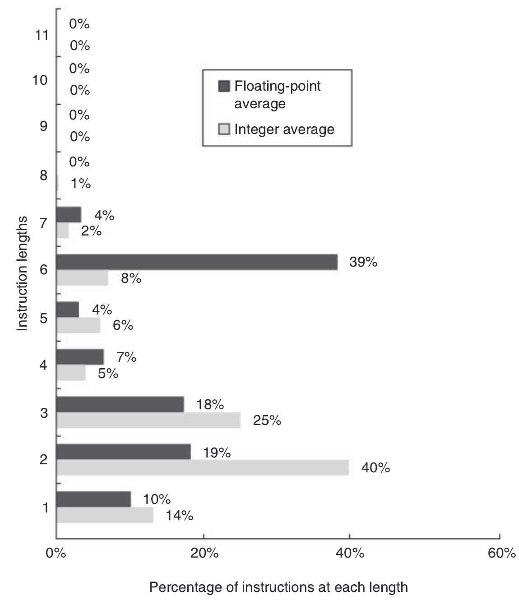

前面讲过，SSE2 提供的是一种 IEEE 浮点寄存器模型。

### 80x86 指令编码 {-}

最糟糕的部分留到最后讲：8086 的指令编码很复杂，指令格式多种多样。指令长度从 1 字节到 6 字节不等：没有操作数的指令只有 1 字节；带 16 位立即数、又使用 16 位偏移量寻址的指令长达 6 字节。前缀指令还会使 8086 指令超出这些表面上的长度。

80386 增加的内容让指令进一步变长，如[图 K.36](#fig-k-36) 所示。偏移量字段和立即数字段都可以长达 32 位，前缀又多了两种，操作码可以长达 16 位，比例变址方式的说明符还要再加 8 位。80386 指令最长可达 17 字节。

[图 K.37](#fig-k-37) 给出了[图 K.33](#fig-k-33) 中几条示例指令的格式。操作码字节中通常有一位，指明操作数宽度是 1 字节还是更大；更大时是 16 位还是 32 位，取决于当前模式。有些指令的操作码里还包含寻址方式和寄存器，许多形如「寄存器 ← 寄存器 op 立即数」的指令就是这样。另一些指令用一个额外的操作码字节存放寻址方式信息，这个字节称为「后字节」（postbyte），在[图 K.36](#fig-k-36) 中标为「mod, reg, r/m」。许多访存指令都使用这个后字节。基址加比例变址寻址还要用第二个后字节，在[图 K.36](#fig-k-36) 中标为「sc, index, base」。

{#fig-k-36 width=45%}

。许多指令含有 1 位的 w 字段，指明操作的是字节还是字。形如 v/w 或 d/w 的字段，是 d 字段或 v 字段后面跟着 w 字段。有的指令既可能向存储器传送数据，也可能从存储器传送数据，MOV 中的 d 字段就用于这类指令，指明传送方向。SHL 指令中的 v 字段表示可变长度移位；可变长度移位用一个寄存器存放移位位数。ADD 指令展示了一种典型的优化短编码，只有第一个操作数是 AX 时才能使用。总的来说，指令长度在 1 到 6 字节之间。图内标注：各字段上方的数字是字段位数；Condition，条件；Displacement，偏移量；Offset，偏移；Segment number，段号；r-m postbyte，寄存器-存储器后字节；r-r postbyte，寄存器-寄存器后字节；Reg，寄存器；Constant，常数；Postbyte，后字节；Immediate，立即数。](images/appk/fig-k-37.png){#fig-k-37 width=70%}

浮点指令用 8086 的换码（escape）操作码加上后字节地址说明符来编码。访存的浮点操作留出 2 位，指明操作数是 32 位或 64 位实数，还是 16 位或 32 位整数。在不访存的版本中，同样这 2 位用来决定操作之后是否弹栈，以及结果写回栈顶还是写回栈顶下面的某个寄存器。

遗憾的是，80x86 对寄存器的使用限制与寻址方式的编码分不开，所以[图 K.38](#fig-k-38) 和[图 K.39](#fig-k-39) 把两个后字节地址说明符在 16 位和 32 位模式下的编码都列了出来。

 所示的比例变址方式。mod = 3 时，r/m 字段表示一个寄存器，编码与 reg 字段结合 w 位的编码相同。图内标注：16b、32b，16 位、32 位模式；same addr as mod = 0 + disp8（disp16、disp32），地址与 mod = 0 时相同，再加 8 位（16 位、32 位）偏移量；same as reg field，与 reg 字段相同；"，同上。](images/appk/fig-k-38.png){#fig-k-38 width=100%}

### 融会贯通：指令系统使用情况的测量 {-}

本节我们先给出 80x86 的详细测量结果，再与同一批程序在 MIPS 上的测量结果比较。为了便于比较动态指令系统测量结果，我们选用 SPEC92 中的一部分程序。80x86 的结果是 1994 年测得的，使用 Sun Solaris 的 FORTRAN 和 C 编译器 V2.0，程序在 32 位模式下执行。这些编译器的质量与 MIPS 所用的编译器相当。

[图 K.39　80386 中基址加比例变址方式的地址说明符。[图 K.38](#fig-k-38) 中用 (sib) 记号表示这种方式。注意，这种方式扩充了其他寻址方式可用的寄存器：使用 ESP 的寄存器间接寻址来自 Scale = 0、Index = 4、Base = 4；使用 EBP 的基址加偏移量寻址来自 Scale = 0、Index = 5、mod = 0。2 位的 scale 字段用于有效地址公式：基址寄存器 + 2^Scale^ × 变址寄存器。]{#fig-k-39 .caption}

| 编码 | Index（变址寄存器） | Base（基址寄存器） |
|---|---|---|
| 0 | EAX | EAX |
| 1 | ECX | ECX |
| 2 | EDX | EDX |
| 3 | EBX | EBX |
| 4 | 无变址 | ESP |
| 5 | EBP | 若 mod = 0，则为 disp32；若 mod ≠ 0，则为 EBP |
| 6 | ESI | ESI |
| 7 | EDI | EDI |

要记住，这些测量结果与所选的基准测试程序和所用的编译技术有关。我们认为本节的测量结果能够比较合理地反映这些体系结构的使用情况，但其他程序的行为可能与这里的任何一个基准测试程序都不同，换用别的编译器也可能得到不同的结果。如果要做真正的指令系统研究，体系结构设计者会希望用多得多的基准测试程序，覆盖尽可能宽的应用范围，还要考虑操作系统以及它对指令系统的使用。像这里测量的单用户基准测试程序，行为不一定和操作系统相同。

我们先单独评价 80x86 的各项特性，然后再把它的指令数和 DLX 比较。

#### 80x86 操作数寻址的测量 {-}

先看寻址方式。[图 K.40](#fig-k-40) 给出 80x86 中各类操作数的分布。这些测量针对的是运算的「第二个」操作数，例如

```
mov EAX, [45]
```

算作一个存储器操作数。如果统计的是第一个操作数的类型，寄存器所占的百分比大约会提高到原来的 1.5 倍。

[图 K.40　操作数类型的分布，分别取 5 个 SPECint92 程序（compress、eqntott、espresso、gcc、li）和 5 个 SPECfp92 程序（doduc、ear、hydro2d、mdljdp2、su2cor）的平均值]{#fig-k-40 .caption}

| 操作数类型 | 整数平均 | 浮点平均 |
|---|---:|---:|
| 寄存器 | 45% | 22% |
| 立即数 | 16% | 6% |
| 存储器 | 39% | 72% |

[图 K.41](#fig-k-41) 把 80x86 的存储器操作数按寻址方式分开统计。最出人意料的大概是 80386 新增的寻址方式（即图中最后四行）用得很多，约占全部访存的一半。另一个意外是直接寻址很常用，而在其他大多数机器上，相当于直接寻址的方式都很少使用。原因可能是 80x86 采用分段地址空间，地址是相对于段寄存器中的基地址计算的，因此直接寻址更有用。

[图 K.41　按程序统计的操作数寻址方式分布。本图不包括转移指令或控制指令所用的寻址方式]{#fig-k-41 .caption}

| 寻址方式 | 整数平均 | 浮点平均 |
|---|---:|---:|
| 寄存器间接 | 13% | 3% |
| 基址 + 8 位偏移量 | 31% | 15% |
| 基址 + 32 位偏移量 | 9% | 25% |
| 变址 | 0% | 0% |
| 基址变址 + 8 位偏移量 | 0% | 0% |
| 基址变址 + 32 位偏移量 | 0% | 1% |
| 基址 + 比例变址 | 22% | 7% |
| 基址 + 比例变址 + 8 位偏移量 | 0% | 8% |
| 基址 + 比例变址 + 32 位偏移量 | 4% | 4% |
| 32 位直接 | 20% | 37% |

Intel 指令的长度在很大程度上由这些寻址方式决定。[图 K.42](#fig-k-42) 给出指令长度的分布。整数程序平均每条指令 2.8 字节，标准差 1.5；浮点程序平均每条指令 4.1 字节，标准差 1.9。两者长度不同，部分原因在于寻址方式不同：整数程序更多地依靠较短的寄存器间接寻址和 8 位偏移量寻址，浮点程序则更常使用 80386 新增的、带较长 32 位偏移量的寻址方式。

{#fig-k-42 width=70%}

浮点指令既有栈的特点，又有寄存器的特点，实际使用情况如何？[图 K.43](#fig-k-43) 表明，至少就这次测量所用的编译器而言，程序很少按栈模型执行。（对这一现象的历史解释见[附录 M](#app-m) 的 M.4 节。）

[图 K.43　80x86 上浮点运算（加、减、乘、除）指令采用三种浮点操作数指定方式的百分比。三种方式是：(1) 严格的栈模型，操作数隐含在栈上；(2) 寄存器方式，显式指定一个不在栈顶两项之中的操作数；(3) 存储器操作数]{#fig-k-43 .caption}

| 方式 | doduc | ear | hydro2d | mdljdp2 | su2cor | 浮点平均 |
|---|---:|---:|---:|---:|---:|---:|
| 栈（第二个操作数为 ST(1)） | 1.1% | 0.0% | 0.0% | 0.2% | 0.6% | 0.4% |
| 寄存器（第二个操作数为 ST(i)，i > 1） | 17.3% | 63.4% | 14.2% | 7.1% | 30.7% | 26.5% |
| 存储器 | 81.6% | 36.6% | 85.8% | 92.7% | 68.7% | 73.1% |

最后，[图 K.44](#fig-k-44) 和[图 K.45](#fig-k-45) 给出 10 个 SPEC92 程序的指令混合比。

[图 K.44　5 个 SPECfp92 程序在 80x86 上的指令混合比]{#fig-k-44 .caption}

| 指令 | doduc | ear | hydro2d | mdljdp2 | su2cor | 浮点平均 |
|---|---:|---:|---:|---:|---:|---:|
| 取数（Load） | 8.9% | 6.5% | 18.0% | 27.6% | 27.6% | 20% |
| 存数（Store） | 12.4% | 3.1% | 11.5% | 7.8% | 7.8% | 8% |
| 加（Add） | 5.4% | 6.6% | 14.6% | 8.8% | 8.8% | 10% |
| 减（Sub） | 1.0% | 2.4% | 3.3% | 2.4% | 2.4% | 3% |
| 乘（Mul） | | | | | | 0% |
| 除（Div） | | | | | | 0% |
| 比较（Compare） | 1.8% | 5.1% | 0.8% | 1.0% | 1.0% | 2% |
| 寄存器间传送（Mov reg-reg） | 3.2% | 0.1% | 1.8% | 2.3% | 2.3% | 2% |
| 取立即数（Load imm） | 0.4% | 1.5% | | | | 0% |
| 条件转移（Cond. branch） | 5.4% | 8.2% | 5.1% | 2.7% | 2.7% | 5% |
| 无条件转移（Uncond branch） | 0.8% | 0.4% | 1.3% | 0.3% | 0.3% | 1% |
| 调用（Call） | 0.5% | 1.6% | | 0.1% | 0.1% | 0% |
| 返回、间接跳转（Return, jmp indirect） | 0.5% | 1.6% | | 0.1% | 0.1% | 0% |
| 移位（Shift） | 1.1% | | 4.5% | 2.5% | 2.5% | 2% |
| AND | 0.8% | 0.8% | 0.7% | 1.3% | 1.3% | 1% |
| OR | 0.1% | | | 0.1% | 0.1% | 0% |
| 其他（XOR、not 等） | | | | | | 0% |
| 浮点取数（Load FP） | 14.1% | 22.5% | 9.1% | 12.6% | 12.6% | 14% |
| 浮点存数（Store FP） | 8.6% | 11.4% | 4.1% | 6.6% | 6.6% | 7% |
| 浮点加（Add FP） | 5.8% | 6.1% | 1.4% | 6.6% | 6.6% | 5% |
| 浮点减（Sub FP） | 2.2% | 2.7% | 3.1% | 2.9% | 2.9% | 3% |
| 浮点乘（Mul FP） | 8.9% | 8.0% | 4.1% | 12.0% | 12.0% | 9% |
| 浮点除（Div FP） | 2.1% | | 0.8% | 0.2% | 0.2% | 0% |
| 浮点比较（Compare FP） | 9.4% | 6.9% | 10.8% | 0.5% | 0.5% | 5% |
| 浮点寄存器间传送（Mov reg-reg FP） | 2.5% | 0.8% | 0.3% | 0.8% | 0.8% | 1% |
| 其他（abs、sqrt 等） | 3.9% | 3.8% | 4.1% | 0.8% | 0.8% | 2% |

[图 K.45　5 个 SPECint92 程序在 80x86 上的指令混合比]{#fig-k-45 .caption}

| 指令 | compress | eqntott | espresso | gcc (cc1) | li | 整数平均 |
|---|---:|---:|---:|---:|---:|---:|
| 取数（Load） | 20.8% | 18.5% | 21.9% | 24.9% | 23.3% | 22% |
| 存数（Store） | 13.8% | 3.2% | 8.3% | 16.6% | 18.7% | 12% |
| 加（Add） | 10.3% | 8.8% | 8.15% | 7.6% | 6.1% | 8% |
| 减（Sub） | 7.0% | 10.6% | 3.5% | 2.9% | 3.6% | 5% |
| 乘（Mul） | | | | 0.1% | | 0% |
| 除（Div） | | | | | | 0% |
| 比较（Compare） | 8.2% | 27.7% | 15.3% | 13.5% | 7.7% | 16% |
| 寄存器间传送（Mov reg-reg） | 7.9% | 0.6% | 5.0% | 4.2% | 7.8% | 4% |
| 取立即数（Load imm） | 0.5% | 0.2% | 0.6% | 0.4% | | 0% |
| 条件转移（Cond. branch） | 15.5% | 28.6% | 18.9% | 17.4% | 15.4% | 20% |
| 无条件转移（Uncond. branch） | 1.2% | 0.2% | 0.9% | 2.2% | 2.2% | 1% |
| 调用（Call） | 0.5% | 0.4% | 0.7% | 1.5% | 3.2% | 1% |
| 返回、间接跳转（Return, jmp indirect） | 0.5% | 0.4% | 0.7% | 1.5% | 3.2% | 1% |
| 移位（Shift） | 3.8% | | 2.5% | 1.7% | | 1% |
| AND | 8.4% | 1.0% | 8.7% | 4.5% | 8.4% | 6% |
| OR | 0.6% | | 2.7% | 0.4% | 0.4% | 1% |
| 其他（XOR、not 等） | 0.9% | | 2.2% | 0.1% | | 1% |
| 浮点取数（Load FP） | | | | | | 0% |
| 浮点存数（Store FP） | | | | | | 0% |
| 浮点加（Add FP） | | | | | | 0% |
| 浮点减（Sub FP） | | | | | | 0% |
| 浮点乘（Mul FP） | | | | | | 0% |
| 浮点除（Div FP） | | | | | | 0% |
| 浮点比较（Compare FP） | | | | | | 0% |
| 浮点寄存器间传送（Mov reg-reg FP） | | | | | | 0% |
| 其他（abs、sqrt 等） | | | | | | 0% |

#### 运算的比较测量 {-}

[图 K.46](#fig-k-46) 和[图 K.47](#fig-k-47) 给出这 10 个程序在 80x86 上执行的指令数，以及与 DLX 执行指令数之比；比值小于 1.0，表示 80x86 执行的指令比 DLX 少。许多整数程序在两者上的指令数出奇地接近，因为按常理，像 DLX 这样的 load-store 型指令系统结构，执行的指令应当比 80x86 这样的寄存器-存储器型体系结构多。浮点程序则总是在 80x86 上指令数更多，原因大概是 80x86 缺少浮点寄存器，并且采用栈结构。

另一个问题是 80x86 和 DLX 的数据访问总量，因为 80x86 可以在运算中直接指定存储器操作数，而 DLX 只能通过 load 和 store 访存。[图 K.46](#fig-k-46) 和[图 K.47](#fig-k-47) 也给出了这 10 个程序的数据读、数据写和数据读-改-写次数。表格最下面几行是各类访存的总次数与 DLX 之比，其中一次读-改-写算作一次读加一次写。浮点程序在 80x86 上的数据访问次数大约是 DLX 的 2 到 4 倍，整数程序则是 DLX 的 1.25 倍。最后，[图 K.48](#fig-k-48) 给出 80x86 和 DLX 上各类指令所占的百分比。

[图 K.46　5 个 SPECint92 程序在 80x86 上执行的指令数和数据访问次数，以及与 DLX 之比]{#fig-k-46 .caption}

| | compress | eqntott | espresso | gcc (cc1) | li | 整数平均 |
|---|---:|---:|---:|---:|---:|---:|
| 80x86 上执行的指令数（百万条） | 2226 | 1203 | 2216 | 3770 | 5020 | |
| 执行指令数与 DLX 之比 | 0.61 | 1.74 | 0.85 | 0.96 | 0.98 | 1.03 |
| 80x86 上的数据读（百万次） | 589 | 229 | 622 | 1079 | 1459 | |
| 80x86 上的数据写（百万次） | 311 | 39 | 191 | 661 | 981 | |
| 80x86 上的数据读-改-写（百万次） | 26 | 1 | 129 | 48 | 48 | |
| 80x86 上的数据读总数（百万次） | 615 | 230 | 751 | 1127 | 1507 | |
| 数据读与 DLX 之比 | 0.85 | 1.09 | 1.38 | 1.25 | 0.94 | 1.10 |
| 80x86 上的数据写总数（百万次） | 338 | 40 | 319 | 709 | 1029 | |
| 数据写与 DLX 之比 | 1.67 | 9.26 | 2.39 | 1.25 | 1.20 | 3.15 |
| 80x86 上的数据访问总数（百万次） | 953 | 269 | 1070 | 1836 | 2536 | |
| 数据访问与 DLX 之比 | 1.03 | 1.25 | 1.58 | 1.25 | 1.03 | 1.23 |

[图 K.47　5 个 SPECfp92 程序在 80x86 上执行的指令数和数据访问次数，以及与 DLX 之比]{#fig-k-47 .caption}

| | doduc | ear | hydro2d | mdljdp2 | su2cor | 浮点平均 |
|---|---:|---:|---:|---:|---:|---:|
| 80x86 上执行的指令数（百万条） | 1223 | 15,220 | 13,342 | 6197 | 6197 | |
| 执行指令数与 DLX 之比 | 1.19 | 1.19 | 2.53 | 2.09 | 1.62 | 1.73 |
| 80x86 上的数据读（百万次） | 515 | 6007 | 5501 | 3696 | 3643 | |
| 80x86 上的数据写（百万次） | 260 | 2205 | 2085 | 892 | 892 | |
| 80x86 上的数据读-改-写（百万次） | 1 | 0 | 189 | 124 | 124 | |
| 80x86 上的数据读总数（百万次） | 517 | 6007 | 5690 | 3820 | 3767 | |
| 数据读与 DLX 之比 | 2.04 | 2.36 | 4.48 | 4.77 | 3.91 | 3.51 |
| 80x86 上的数据写总数（百万次） | 261 | 2205 | 2274 | 1015 | 1015 | |
| 数据写与 DLX 之比 | 3.68 | 33.25 | 38.74 | 16.74 | 9.35 | 20.35 |
| 80x86 上的数据访问总数（百万次） | 778 | 8212 | 7965 | 4835 | 4782 | |
| 数据访问与 DLX 之比 | 2.40 | 3.14 | 5.99 | 5.73 | 4.47 | 4.35 |

[图 K.48　80x86 和 DLX 上按类别统计的指令执行百分比，取[图 K.46](#fig-k-46) 和[图 K.47](#fig-k-47) 中 5 个 SPECint92 程序和 5 个 SPECfp92 程序的平均值]{#fig-k-48 .caption}

| 类别 | 整数平均：x86 | 整数平均：DLX | 浮点平均：x86 | 浮点平均：DLX |
|---|---:|---:|---:|---:|
| 数据传送合计 | 34% | 36% | 28% | 2% |
| 整数算术合计 | 34% | 31% | 16% | 12% |
| 控制合计 | 24% | 20% | 6% | 10% |
| 逻辑合计 | 8% | 13% | 3% | 2% |
| 浮点数据传送合计 | 0% | 0% | 22% | 33% |
| 浮点算术合计 | 0% | 0% | 25% | 41% |

### 结束语 {-}

> 美在观者的眼中。
>
> ——古谚

前面已经看到，Intel 的体系结构词典里没有「正交」这个词。要完全搞清楚哪些寄存器、哪些寻址方式可以用，就得查看所有寻址方式的编码，有时还得查看指令的编码。

有人认为，80x86 指令系统不够优雅是不可避免的，任何体系结构取得巨大成功都要付出这样的代价。我们不同意这种看法。诚然，成功的体系结构都不能抛弃以前的实现中加入的特性，而且时间一长，有些特性可能会显得不合时宜。但 80x86 的别扭从根子上就有，始于 8086 指令系统本身；8087、80286 和 80386 在体系结构上前后不一致的扩展，又让它雪上加霜。

IBM 360/370 体系结构就是一个反例。它比 80x86 古老得多，统治着大型机市场，正如 80x86 统治着 PC 市场。360/370 的基础更好，后来的增强也更注重兼容，无疑正是因为这一点，这个指令系统在首次实现 30 多年之后，仍然比 80x86 合理得多。

不论是好是坏，Intel 比竞争对手那些更优雅的体系结构早好几年拿出了 16 位微处理器。正是这一先发优势，使 IBM PC 选用了 8086 作为 CPU。80x86 在风格上的欠缺由数量弥补，从恰当的角度看，80x86 也是美的。

80x86 值得庆幸的一点是，它的各个体系结构组成部分实现起来都不算太难。1978 年以来，Intel 不断迅速提高整数程序的性能，就证明了这一点。要在这种体系结构上获得很高的浮点性能，则是更大的挑战。

## VAX 体系结构 {#sec-k-4}

> VAX：工业史上最成功的小型机设计……VAX 大概是黑客最喜欢的机器……它尤以庞大的、对汇编程序员友好的指令系统著称，而这一长处在 RISC 革命之后变成了短处。
>
> ——Eric Raymond，《新黑客词典》（*The New Hacker's Dictionary*，1991）
