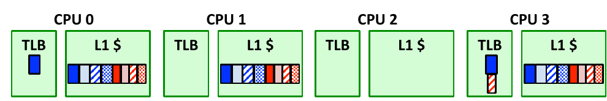
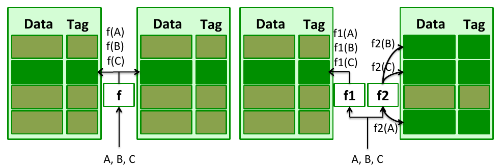

{#fig-l-4 width=80%}

**问答 4**

**问题 4**　[图 L.4](#fig-l-4) 画出了一个四核系统中各核私有的 L1 Cache 和 L1 TLB。页表项用蓝色、红色的实心方块和条纹方块表示。CPU 0 和 CPU 3 都访问过某个 Cache 行中的至少一个页表项（通过各自的页表遍历器或操作系统），因此这个装有 8 个页表项的 Cache 行被调入了 CPU 0 和 CPU 3 的 L1 Cache。CPU 0 过去访问过蓝色页表项，CPU 3 则访问过蓝色页表项和红色条纹页表项，所以这些页表项也在它们各自的 TLB 中。CPU 1 很可能只是在执行操作系统代码时访问过这个 Cache 行中的页表项，没有经过页表遍历器，因此这个 Cache 行在 CPU 1 的 L1 Cache 中，但它的 TLB 里没有其中任何一个页表项。CPU 2 则从未访问过这个 Cache 行中的任何页表项。本题分析转换一致性，并说明为每个核增加严格包含的 L2 TLB 以后，一致性操作对 L1 TLB 的探查怎样减少。

（问 4a）假设 CPU 1 运行操作系统，操作系统决定修改蓝色实心页表项中虚拟页对应的物理页帧号。维护一致性需要哪些步骤？

（问 4b）如果执行（问 4a）中操作的是 CPU 0 而不是 CPU 1，情况会怎样？

（问 4c）如果每个 CPU 都有私有的 L2 TLB，而且 L2 TLB 严格包含 L1 TLB，（问 4a）和（问 4b）中的操作会有什么变化？

（问 4d）如果 CPU 1 对红色条纹页表项执行一次 store，会发生什么？

（答 4a）转换一致性由两组相互独立的一致性操作组成：一是 TLB 中页表项的一致性，二是 L1 Cache 中页表项的一致性。因此，CPU 1 修改了蓝色实心页表项以后，CPU 0、2、3 的 TLB 和 Cache 中这个页表项的所有副本也都必须随之更新。

TLB 一致性有两种维护方式。在 x86-64 一类的体系结构中，CPU 1 通过*处理器间中断*调用其他 CPU 上的操作系统例程，迫使 CPU 0、2、3 做上下文切换，转去运行操作系统代码 [93]。这段操作系统代码再执行特权指令 *invlpg*，作废本核 TLB 中这个转换的副本。在[图 L.4](#fig-l-4) 的例子中，CPU 0 于是作废 TLB 中的蓝色实心页表项副本；CPU 2 找不到需要作废的项；CPU 3 也作废 TLB 中的蓝色实心页表项。在 ARM 一类的体系结构中，做法不同：CPU 1 执行一条 *tlbi* 指令，这条指令向其他所有核广播一条消息，让它们作废 TLB 中这个转换的副本。不论采用哪种方式，各 TLB 中与蓝色实心页表项对应的项都要作废。

L1 Cache 中页表项的一致性则由标准的 Cache 一致性协议（如 MESI、MOESI 等）维护。这就是说，CPU 1 要修改自己的蓝色实心页表项副本，必须先取得这个 Cache 行的独占访问权，为此要先向 CPU 0、2、3 发出作废消息。于是 CPU 0 和 CPU 3 可能遭遇伪共享：CPU 1 只修改了蓝色实心页表项，它们 Cache 行中的所有页表项却都作废了。

（答 4b）如果修改蓝色实心页表项的是 CPU 0，过程与上面只有一点小差别：CPU 0 在向 CPU 1、2、3 发出处理器间中断之前，必须先作废自己本地 TLB 中的蓝色页表项副本。

（答 4c）如果每个 CPU 都有严格包含的私有 L2 TLB，L2 TLB 就可以充当 L1 TLB 的过滤器。以 CPU 2 为例，它的 TLB 中没有缓存蓝色实心页表项。探查 CPU 2 的 L2 TLB 时发现没有蓝色页表项，就不必再查 L1 TLB。（容量较大的）L2 TLB 中也可能确实有蓝色页表项，这时仍然要探查 L1 TLB。但是，有了严格包含，L1 TLB 上至少可以省掉一部分一致性流量。

（答 4d）前面几个例子都假定 CPU 运行操作系统，由操作系统修改页表项。但是，硬件页表遍历器（用于在 TLB 失效时查找页表，详见 [L.6 节](#sec-l-6)）更新页表项中的状态位时，也会产生一致性流量。具体来说，页表项中有脏位，CPU 每次写对应的页时都要把它置位（详见 [L.6 节](#sec-l-6)）。因此，CPU 1 对红色条纹页表项执行 store 时，必须先产生 Cache 一致性流量，作废 CPU 0 和 CPU 3 中的 Cache 行，然后才能写脏位。不过，TLB 中并不保存脏位（只保存虚拟地址到物理地址的转换），所以不需要任何 TLB 一致性操作。

## 支持多种页大小 {#sec-l-5}

近年来，处理器厂商开始让 L2 TLB 同时缓存不同页大小的转换。为了同时支持多种页大小，这些方法要么容忍较长的访问时间，要么付出额外的实现复杂度。它们在技术上也可以用于 L1 TLB，但 L1 对访问时间的要求很严，所以实际上不可行。

**散列-再散列。** 这种方法先假定一种页大小（通常是基本页大小）探查 L2 TLB，称为散列 [29, 61]；如果失效，再按另一种页大小探查一次，称为再散列。如此依次对剩下的各种页大小做再散列查找，直到 TLB 命中，或者所有页大小都已查完为止。

散列-再散列的一个好处是实现比较简单。正因为如此，Intel Skylake/Broadwell 的 L2 TLB 很可能就是用这种技术同时支持 4 KB 页和 2 MB 页的，不过这一点没有得到证实。散列-再散列也有一些重要的问题。最明显的是命中时间不再只有一种：在散列查找中命中和在某一次再散列查找中命中，所用的时间不同。于是，有些命中比另一些慢；判定 TLB 失效也要更长时间，因为只有所有散列、再散列查找都做完，才能确定发生了 TLB 失效。

解决这些问题的办法有以下几种：

（1）**页大小预测。** 缩短 TLB 命中时间的一种办法，是用一个硬件结构预测转换的页大小 [61]，然后按预测的页大小做散列（即第一次 TLB 探查）。预测准确，TLB 命中就快。关键问题是预测器结构怎样设计。预测器可以做成一张直接映射的表，用程序计数器的若干位和/或虚拟地址的若干位来索引。[图 L.5](#fig-l-5) 画出了这两种做法。

左边的预测器用访存指令程序计数器的低位来索引。由于以程序计数器为索引，预测器可以在流水线中很早就查询，技术上早到取指阶段就可以查。这样，预测器的访问延迟就不在访存操作的关键路径上。缺点是，即使不同指令访问的是同一个页，也要分别学习它们的页大小。例如，程序可能用不同的指令处理同一个数据结构的不同字段。这些指令可能映射到不同的预测器项，于是预测器状态重复，学习时间变长，预测器别名也更多。

因此，用虚拟地址的一部分位来索引页大小预测器，效率可能更高，见[图 L.5](#fig-l-5) 的右边。这种做法仍然要在流水线早期访问预测器，所以实际上不从虚拟地址中取位，而是从访存指令的编码中取位。具体来说，可以取指令中对应基址寄存器 rs1 的字段，用它去访问寄存器堆，再用读出的寄存器值查询预测器。这样做的依据是：最终的虚拟地址通常与基址寄存器的值相差不大。

不论选用哪种页大小预测器，都要注意一点：两种做法都要占用面积，消耗功耗。设计者自然要在这些开销和带来的好处之间权衡。

{#fig-l-5 width=80%}

（2）**并行查找。** 比页大小预测器更简单的办法，是对 TLB 结构并行做多次查找，所支持的每种页大小各查一次。这种做法有三个好处：一是不需要预测器；二是保证所有 TLB 命中都很快，而且延迟相同；三是只用一次探查的延迟就能判定 TLB 失效。缺点是多次查找要额外消耗能量，而且其中大多数查找是白费的，因为一个转换在 TLB 结构中只能以一种页大小缓存。

（3）**并行页表遍历。** 最后一种办法是在做再散列探查的同时并行地遍历页表，它能（部分地）缓解判定 TLB 失效代价增大的问题。设想第一次探查 TLB 失效。按常规做法，这时要按下一种页大小再散列出一个新地址，用它探查 TLB。为了提高性能，可以同时启动一次推测性的页表遍历。这样，如果再散列也在 TLB 中失效，页表遍历至少已经与再散列的延迟部分重叠。推测性页表遍历确实带来一些复杂问题。例如，页表项中有一些状态位，其中之一记录页是否「访问」过，推测性遍历可能错误地更新这些状态位。不过，推测性页表遍历在其他场合也会发生（见 [L.6 节](#sec-l-6)），现代体系结构本来就支持处理这类情况。

**斜相联。** 斜相联 TLB 借鉴了斜相联 Cache 的研究 [79]，基本思想是改变 TLB 中「组」的概念。传统做法是由从虚拟页中取出的位唯一地确定一个组：TLB 查找只用一个散列函数，所以一个 TLB 组中的所有路都由同一组索引位访问。斜相联 TLB 的思路不同：一个组中的各路不再共用相同的索引位，每一路都有自己的索引函数。[图 L.6](#fig-l-6) 说明了这一思想，左图是传统的组相联 TLB，右图是斜相联 TLB。两种情况画的都是 4 个组的两路组相联 TLB，数据/tag 阵列中的每个水平切片代表一个组，每组两路。

{#fig-l-6 width=80%}

左图中，地址 *A*、*B*、*C* 散列到同一个组。采用传统索引和散列函数 *f* 时，这三个地址可以分配到这个组的两路中的任意一路。在这个例子中，每组只有两路，因此三个转换中必须逐出一个。右图则是斜相联 TLB 的例子。每组两路，所以斜相联 TLB 使用两个散列函数 *f1* 和 *f2*。这时，*A*、*B*、*C* 经散列函数 *f1* 在左边的组中散列到同一路；但是，经散列函数 *f2*，这三个地址的转换在右边的组中映射到不同的路。这样，同样的 TLB 结构可以同时容纳 *A*、*B*、*C*，这是传统组相联方法做不到的。

为了支持多种页大小，标准的斜相联结构需要稍作修改：一个转换映射到 TLB 中的哪些路，不仅取决于它的地址，还取决于它的页大小。具体来说，散列函数的设计保证一个虚拟地址只有属于某种页大小时，才能放在相应的路中。这也意味着每种页大小在 TLB 中各有一个有效相联度。

下面用一个例子说明查找过程。设有一个 512 项、8 路的斜相联 TLB，并假设这个 TLB 是为 SPARC 体系结构设计的，支持 8 KB、64 KB、512 KB 和 4 MB 四种页。要在 TLB 的 64 个组中选出一组，需要用虚拟页号中的 6 位作为索引位。设计散列函数的一种可能做法是使用第 23～21 位，规则如下：（a）属于 8 KB 页的，映射到第 0 路和第 4 路；（b）属于 64 KB 页的，映射到第 1 路和第 5 路；（c）属于 512 KB 页的，映射到第 2 路和第 6 路；（d）属于 4 MB 页的，映射到第 3 路和第 7 路。所支持的页大小种数在设计散列索引函数时就静态确定了，各种页大小的有效相联度都相同（这个例子中是 2）。需要分配一个项、因而要逐出一个项时，就在这种页大小的有效路中寻找逐出对象。在前面的例子中，如果虚拟地址 *A* 属于一个 8 KB 页，就只查找第 0 路和第 4 路。这些候选的牺牲项位于不同的组中，无法使用 LRU。因此，斜相联 TLB 依靠每个项附带的时间戳，时间戳最早的项首先成为逐出对象 [61, 78]。

斜相联 TLB 可以同时支持多种页大小，又没有命中延迟不唯一、TLB 失效判定慢的问题，但它也有几个主要缺点：一是需要多个散列函数，实现起来可能很复杂；二是替换策略需要时间戳，要占用额外的面积；三是要容纳的页大小种数越多，每种页大小的有效相联度就越低。

**问答 5**

**问题 5**　设某 CPU 为 4 KB 页、2 MB 页和 1 GB 页分别设置了 L1 TLB，L2 TLB 支持 4 KB 页和 2 MB 页，但不支持 1 GB 页。查找 4 KB 页时，有没有可能改变 2 MB 页 L1 TLB 的内容？反过来呢？查找 4 KB 页时，有没有可能改变 1 GB 页 L1 TLB 的内容？反过来呢？

**解答 5**　乍看似乎不可能，但如果 L2 TLB 严格包含 L1 TLB，查找 4 KB 页确实可能影响 2 MB 页的 L1 TLB。设想查找一个 4 KB 页时，在 L1 一级的 TLB 失效；接着 L2 TLB 也失效，于是启动页表遍历。取回的转换装入 L2 TLB 时，可能逐出其中一个已有的 2 MB 页项。这时，由于 L2 TLB 严格包含各个 L1 TLB，必须向 2 MB 页的 L1 TLB 发送一条反向作废消息，于是 2 MB 页 L1 TLB 中的某一项可能被作废。查找 2 MB 页时，也可能发生类似的一系列事件：为了给一个 2 MB 页转换腾出空间，可能要从 L2 TLB 中逐出一个 4 KB 页转换，从而引起对 4 KB 页 L1 TLB 中某个转换的反向作废。相反，在这个假想的 TLB 层次中，查找 4 KB 页不可能影响 1 GB 页，因为 L2 TLB 不会把 1 GB 页的转换与 4 KB 页、2 MB 页的转换一起缓存。

## 页表遍历 {#sec-l-6}

到目前为止，我们讨论的都是现代多核芯片中每个核的 L1 TLB 和 L2 TLB。但是，即使 TLB 非常有效，失效也不可避免。发生 TLB 失效时，必须搜索页表，也就是「遍历」页表，找到所需的转换。这种页表遍历（也称转换遍历）可以由软件完成，也可以由硬件完成。几十年来，计算系统的设计在这两种技术之间几经转换。例如，早期的 Alpha 系统一般使用硬件管理的转换遍历 [20]；后来 SPARC 和 ARM 体系结构演变为软件转换遍历；近年来，由于硬件转换遍历器的性能更好，处理器厂商又重新采用了它。

**软件方法。** 软件管理的转换遍历的核心思想是：TLB 失效时强制上下文切换到操作系统，由操作系统遍历页表。处理器有几种实现技术来强制这次上下文切换。在一些较老的嵌入式 x86-64 处理器上，TLB 失效会调用一条陷阱指令的微码，再由它迫使处理器切换到特权模式。另一些技术则让 TLB 数据通路能够直接通知核保存状态，并切换到特权模式。不论用哪种技术调用操作系统，随后都要经过几个步骤。首先，排空流水线，保存体系结构状态。接着，调用操作系统代码，其中一项工作是查陷阱表，转入专门处理 TLB 失效的操作系统例程。操作系统最近没有运行，所以取入它所需的 Cache 行时，指令 Cache 和数据 Cache 都会发生失效。最后，核执行操作系统的 TLB 失效处理程序。这个处理程序了解页表的组织方式，在页表中查找所需的页表项，也就是所需的转换。搜索（遍历）页表通常代价很高，要依次做多次访存，确切次数取决于页表的组织方式。以 x86-64 一类的页表为例，它是一种正向映射的多级数据结构，[图 L.7](#fig-l-7) 画出了一个 x86-64 页表。目前的 x86-64 页表通常有四级，五级页表的支持也正在兴起。

从[图 L.7](#fig-l-7) 可以看出，页表遍历要做多次访存（图中是 4 次），所以代价很高。为了节省页表占用的空间，x86-64 页表用多级结构表示程序的地址空间。每一级本身存放在内存的一个页中，所以我们把每一级称为一个*页表页*。x86-64 体系结构的基本页大小是 4 KB，页表项是 8 字节，因此每个页表页有 512 项。遍历页表时，先把虚拟地址分成页内偏移和虚拟页号两部分，再把虚拟页号分成 4 个 9 位的索引，分别用来索引 4 级页表中各级的页表页。在这个例子中，我们假定虚拟地址可以分解成十六进制序列（0b9, 00c, 0ae, 0c2, 016）。于是，页表遍历的第一步是把根页表（我们称它为 L4，x86-64 的术语叫作页映射第 4 级，即 PML4）第一项的物理地址与地址中的第一个 9 位索引 0x0b9 拼接起来。查找这个位置（即 L4 表中高亮的项），得到下一级页表 L3 的物理页号（PPN）。我们再把这个物理页号（0x042）与下一个 9 位索引 00c 拼接起来，查找 L3 页表页。如此逐级进行，直到叶级页表页 L1，由它最终给出待转换虚拟地址的物理页号。

{#fig-l-7 width=80%}

遍历这样的多级页表，代价自然很高，主要原因是要做多次访存，而且这些访存必须依次进行。因此，如果由操作系统的中断处理程序遍历页表，过程会很长，实际中很容易需要几十到几百个时钟周期 [18, 20]。找到所需的转换以后，把它填入硬件 TLB：如果 TLB 是大体包含或严格包含的，L1 和 L2 TLB 都要填；如果 TLB 是排他的，只填 L1 TLB。最后，核通过上下文切换回到用户应用程序，*重放*当初在 TLB 中失效的那条访存指令；用户程序还要重新预热它的指令 Cache 和数据 Cache。

从[图 L.7](#fig-l-7) 还可以看到，处理器厂商用各种技术来加速页表遍历。L1 和 L2 TLB 缓存的就是叶级（即 *L1* 级）的页表项。此外，更先进的地址转换实现还为 *L4*、*L3*、*L2* 三级页表专门设置存储管理部件（MMU）Cache，这将在 [L.7 节](#sec-l-7)讨论。MMU Cache 在技术上也可以与软件管理的转换遍历配合使用，但它通常只出现在采用硬件管理转换遍历的系统中，因此这些结构留到后面各节再讨论。

*转换存储缓冲。* 软件管理的转换遍历逐渐成熟，人们提出了多种优化来加速它。一种流行的技术是使用转换存储缓冲（Translation Storage Buffer，TSB），它最初由 SPARC 的体系结构设计者开发 [11, 68]。TSB 是软件 Cache（通常是直接映射的），存放页表中经常使用的部分。操作系统处理程序一开始就访问 TSB，力求快速找到所需的转换（最好只用一次访存），找不到才转而遍历页表。具体来说，操作系统用当初发生 TLB 失效的那个虚拟地址的低位，在 TSB 中查找所需的项。如果在 TSB 中找到了转换，操作系统处理程序就可以直接返回，省掉页表遍历的 4 次访存；否则就遍历页表。找到所需的转换以后，把它同时插入软件 TSB 和硬件 TLB 结构。

TSB 设计的一个重要问题是容量应该多大。TSB 是软件结构，容量可以动态确定，可以增长到任意大 [11]。但是，TSB 过大会污染处理器 Cache，最终降低性能。因此，实际系统中的 TSB 大多是固定容量的，也就是说，为了给新的转换腾出空间，可能要从 TSB 中逐出一些转换。

*状态位的管理。* 前面讨论的都是处理器页表中虚拟页到物理页的转换。但页表（和 TLB）还保存着其他信息：一是与虚拟页相关的权限，即这个页是否可读、可写和/或可执行；二是页的属性，即这个页是内核页还是用户级页，是否在多个地址空间中全局共享；三是页的使用情况，即记录页的热度的访问位，以及记录页是否被写过的脏位。操作系统遍历页表时，必须正确地处理这些状态位。

因此，操作系统完成转换遍历以后，要检查转换的保护位。读/写/执行权限允许这次访问，才返回物理页号；不允许，操作系统就转入另一个中断处理程序，由它处理这个「保护故障」。

页表项中还有访问位和脏位。操作系统用访问位跟踪一个页是否在程序的工作集中，用脏位跟踪一个页被逐出时是否需要写回内存，因为主存中的副本已经过时。访问位通常由 TLB 失效处理程序置位，时机是页表遍历之后把转换装入 TLB 的时候。视所实现的页替换策略而定，操作系统以后可能会修改这些访问位。例如，在*带第二次机会的 LRU 策略*中，操作系统的替换策略定期清除访问位，看对应的页在不久之后是否再次被访问，从而掌握比较新的页热度信息。同样，store 指令发生 TLB 失效时，操作系统可以把脏位置位。替换策略逐出一个 store 位已置位的页时，操作系统保证把这个页写回二级存储。

*优点和缺点。* 软件管理转换遍历的好处是，操作系统可以灵活地组织和管理页表。由于是操作系统的 TLB 处理程序遍历页表，页表既可以组织成多级页表（如前面 x86-64 例子中的页表），也可以采用其他方式（如反向页表或散列页表 [20]）。于是，操作系统可以按最符合系统需求的方式组织页表，这些需求包括页表的大小、搜索页表的时间，甚至页表能否保存比单个访问位更复杂的页热度属性 [2]。

软件管理转换遍历的缺点是，每次 TLB 失效都要对流水线做上下文切换并调用操作系统代码。现代高性能处理器有以下特点：一是体系结构状态很多，上下文切换时都要保存；二是流水线很深，排空和填充都要很多周期；三是使用很多体系结构预测器，上下文切换会污染这些预测器。近来的研究表明，即使不考虑 Cache 和预测器的污染效应，Intel Haswell/Broadwell 这样的处理器完成一次上下文切换也要大约 700 个时钟周期 [93]。因此，多数处理器厂商已经用硬件转换遍历取代了软件转换遍历。

![图 L.8　每个核集成的硬件页表遍历器（PTW）完成硬件转换遍历。硬件页表遍历器由一个状态机（PTW 状态机）和若干缓冲（PTW 缓冲）组成，缓冲记录未完成的 TLB 失效的状态，作用类似于 Cache 的失效状态处理寄存器（MSHR）。指令转换或数据转换在 TLB 中失效时，这两个硬件模块共同向存储层次发出访问，查找页表。PTW 可以与任意多个 TLB 配合使用，不限于图中所示的两级 TLB 层次。图中标注：L1 I-TLB，L1 指令 TLB；L1 D-TLB，L1 数据 TLB；PTW State Machine，PTW 状态机；PTW Buffers，PTW 缓冲；[Addr, State]，[地址, 状态]；From memory hierarchy，来自存储层次；To memory hierarchy，送往存储层次。](images/appl/fig-l-8.png){#fig-l-8 width=80%}

**硬件方法。** 硬件转换遍历的目的是提高性能：每个核集成一个硬件部件，它了解页表的组织方式，能够自行遍历页表，主处理器不必上下文切换到操作系统代码。为此，多数处理器厂商为每个核设置硬件页表遍历器（page table walker，PTW），如[图 L.8](#fig-l-8) 所示。硬件 PTW 由两部分组成：一是状态机，按照体系结构所支持的页表组织方式设计；二是 PTW 缓冲，即一组寄存器，记录每个未完成的 TLB 失效的信息。PTW 缓冲类似于跟踪未完成 Cache 失效的失效状态处理寄存器 [20]。

下面再用[图 L.7](#fig-l-7) 中的 x86-64 页表例子说明硬件 PTW 的工作过程。假设页表中阴影路径所示的转换发生了 TLB 失效。这时，核不调用操作系统、不执行 TLB 失效处理程序，而是启动硬件 PTW。硬件 PTW 通常可以访问一个寄存器，这个寄存器保存页表根的物理地址。在[图 L.7](#fig-l-7) 的例子中，这个寄存器就是 CR3，它存放 L4 级页表的物理地址。PTW 状态机把 CR3 的内容与虚拟地址的第一个 9 位索引（这个例子中是 0x0b9）拼接起来，并据此更新 PTW 缓冲中对应这次未完成失效的状态字段，记下 PTW 即将发出一次访存，读取所需 L4 页表中的信息。这次访问送到存储层次，依次探查 L1/L2/LLC 各级 Cache，可能还要访问主存。L4 级中存放的信息（这个例子中是物理页号 0x42）返回以后，送给 PTW 状态机。状态机把返回的地址与虚拟地址中的 9 位 L3 索引（这个例子中是 0x00c）拼接起来，更新未完成失效缓冲，记下即将对 L3 级页表发出访存请求，然后发出这次访存请求。如此进行下去，直到整个页表遍历完成，从页表中取出所需的转换。然后把转换插入 TLB，并重放当初引起 TLB 失效的那次访存 [18, 19]。整个页表遍历完全不需要软件干预。硬件 PTW 在概念上容易理解，但它的设计有几个重要的复杂之处，下面逐一讨论。
