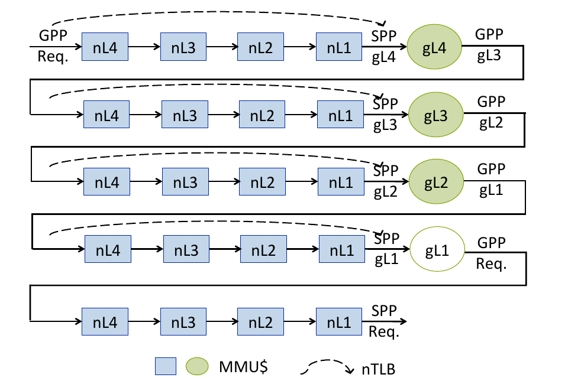

**微码注入。** 地址转换要正确完成，往往要用到一些微码指令。这些指令不是作为 ISA 层的指令从用户态或内核态取来的。具体地说，TLB 失效启动硬件 PTW，PTW 再调用微码操作，由这些微码操作从各级页表读数据。在现代乱序处理器中，这些微码操作要送进执行核心。不过，微码操作不只有遍历各级页表的 load 操作，还可能有修改状态位的 store 操作，下面就来讨论。

**状态位的维护。** 完全由硬件遍历页表时，页表项的访问位和脏位由硬件 PTW 负责更新。在页表遍历器看来，这些更新是「粘滞」的：一位一旦置 1，只有操作系统才能把它清零。PTW 用微码指令以原子方式更新这些位。从存储一致性的角度看，这些更新必须保证在与之相关的 load/store 提交之前提交 [54, 55, 73]。

**多个核并发遍历页表。** 每个核都有自己的硬件 PTW，因此各个核可以同时遍历页表。不同核上的应用程序如果属于不同的地址空间，各个 PTW 就各自遍历不同的页表。即使多个核运行的是同一地址空间中的不同线程，多个 PTW 也可以访问同一个页表，分别处理各个核上的 TLB 失效。由于多个线程可能同时更新访问位和脏位，多个核有可能同时更新落在同一个 Cache 行中的若干 PTE 的访问位/脏位。这些更新以什么顺序发生、以什么顺序对其他核可见，由 Cache 一致性协议仲裁。

[图 L.9　假设第一条 load 发生 TLB 失效。用软件遍历页表时，CPU 必须上下文切换到操作系统，由操作系统遍历页表，之后才能执行其余指令。用硬件遍历页表时，硬件 PTW 处理 TLB 失效，CPU 可以同时继续执行与失效无关的指令。第二条 load 指令的有效地址映射到同一个虚拟页号（假设页大小为 4 KB），所以它不是无关指令。但第 3、4 条 load 指令和第 6 条指令（加法）与失效无关，可以在处理 TLB 失效期间执行。图中注释：Effective address of，有效地址为。]{#fig-l-9 .caption}

```
1. L.D    F6, 34(R1)    // Effective address of 0x100012
2. L.D    F2, 45(R2)    // Effective address of 0x100123
3. L.D    F4, 31(R3)    // Effective address of 0x010012
4. L.D    F8, 22(R4)    // Effective address of 0x020111
5. ADD.D  F12, F6, F2
6. ADD.D  F13, F4, F8
7. ST.D   F12, 34(R1)
```

**利弊。** 硬件 PTW 的好处是性能比软件方案高。TLB 失效时不必再做上下文切换，一次 TLB 失效的开销通常可以从几百个时钟周期降到几十个时钟周期。硬件 PTW 的缺点有两个：一是 PTW 状态机和缓冲要占用额外的面积和功耗；二是不如软件的 TLB 失效处理程序灵活。第一个问题并不严重。近来的研究表明，在现代芯片上，硬件 PTW 的面积不超过典型 L2 TLB 面积的 5%～7%，给每个核增加的面积远小于 1% [14, 69, 70]。第二个问题则更值得关注。硬件 PTW 要有效工作，它的状态机必须针对特定的页表组织方式来设计。例如，在[图 L.7](#fig-l-7) 的 x86-64 例子中，PTW 状态机知道页表组织成四级结构，每级有 512 个页表项。这就是说，页表格式在设计时就固定了，即使运行时发现别的页表格式可能效率更高，也无法改变。由操作系统管理的页表遍历能提供这种灵活性；但硬件页表遍历省去了操作系统的上下文切换，性能要高得多。除此之外，硬件页表遍历的性能优势还有两个来源：

（1）**TLB 失效与有用的工作重叠。** 硬件 PTW 如果集成在支持乱序执行的 CPU 上，CPU 就可以同时执行其他无关的指令流，从而至少隐藏一部分 TLB 失效延迟。以[图 L.9](#fig-l-9) 中的代码片段为例，假设第 1 条指令（从内存读数据的 load）发生 TLB 失效。在用软件遍历页表的体系结构中，操作系统要执行 TLB 失效处理程序，找到所需的地址转换。处理程序在 CPU 上执行期间，用户程序的其他指令都不能执行。用硬件遍历页表就没有这个限制。在[图 L.9](#fig-l-9) 的例子中，底层的乱序机制（如记分牌、Tomasulo 算法等）可以识别出第 3、4、6 条指令与失效无关，让它们乱序发射和执行。但第 2 条指令中的 load 要等第 1 条指令的 TLB 失效处理完才能执行，因为它的有效地址与第 1 条指令在同一个虚拟页（0x100）中。第 5 条和第 7 条指令分别依赖第 2 条和第 1 条指令，所以也要等 TLB 失效处理完才能执行。尽管如此，硬件 PTW 至少能让一部分 TLB 失效时间与无关指令重叠，从而减轻页表遍历对性能的影响。

（2）**并发处理多个失效。** 要让无关指令与 TLB 失效重叠，隐含的前提之一是：硬件 PTW 要让 TLB 支持失效下命中。也就是说，第一条 load 虽然发生了 TLB 失效，第三、四条 load 对应的是不同的虚拟页号，仍然可以查找 TLB（并且命中）。但还有一个关键问题没有解决：硬件 PTW 正在遍历页表时，如果并行进行的另一次 TLB 查找也失效了，怎么办？硬件 PTW 能不能同时处理多个 TLB 失效？

最早几代硬件 PTW 只能处理一个未完成的 TLB 失效，原因有多方面：一是硬件复杂度低，[图 L.8](#fig-l-8) 中的 PTW 缓冲只需要一项；二是微码控制简单，要支持并发 TLB 失效，就得把两次页表遍历的微码同时注入流水线；三是 TLB 失效本来就足够少（尽管每次代价很高），很少会遇到多个 TLB 失效同时出现。但是，近来的处理器设计已开始采用支持多个失效的 PTW，原因也有几个。一是体系结构设计者不断加大重排序缓冲，以便从每个 CPU 中挖掘更多的 ILP，于是一次页表遍历进行期间又发生 TLB 失效的可能性越来越大。二是现代 TLB 层次一般要通过同时多线程（超线程）为多个硬件线程服务，硬件线程越多，几个线程同时遇到 TLB 失效的可能性就越大。三是 GPU 等新兴硬件加速器同时执行成百上千个线程，经常同时遇到多个 TLB 失效。

总之，现在的硬件 PTW 都支持多个未完成的失效。如[图 L.8](#fig-l-8) 所示，PTW 缓冲有多项，每个未完成的失效占一项。例如，Intel 的 Haswell/Broadwell/Skylake 芯片就采用这种技术，可以支持 2～4 个未完成的 TLB 失效；GPU 则可以支持几十个 [28, 29, 69, 70, 72, 87]。

**混合方案。** 有些体系结构采用混合式页表遍历器，兼取硬件和软件页表遍历之长，不过这种做法很少见。以 Linux 对 ARM V7 体系结构的支持为例。Linux 维护两个页表：一个由软件管理，另一个由硬件管理，MMU 也能访问后者。TLB 失效时，硬件 PTW 可以遍历由硬件管理的页表，把地址转换填入 TLB。但硬件 PTW 不能置脏位或访问位，脏位改用仿真的办法实现：当且仅当软件页表中这一页标记为可写且为脏时，硬件页表才授予写权限。换句话说，写一个干净页会引起权限故障，迫使操作系统运行一个处理程序，把这个页表项标记为脏。处理程序用新的权限更新硬件页表，做完相关的记录工作，用户态程序再从重新执行的那条指令处开始运行。一般来说，混合方案的好处是：TLB 失效可以由硬件快速处理，而操作系统维护访问/脏信息的方式又比传统的纯硬件 PTW 更能准确地反映各页的冷热程度。

**问答 6**

**问题 6**　虚拟化的详细讨论超出了本附录的范围，下面通过一道练习作个浅显的介绍。考虑一个虚拟化系统：用户程序在虚拟机中访存，虚拟机里运行客户操作系统，客户操作系统运行在虚拟机监控器之上。在这种执行模型下，需要两级地址转换：先把客户虚拟地址转换成客户物理地址，再把客户物理地址转换成系统物理地址。许多现代体系结构维护两级页表来完成这两步转换。第一级是客户页表，把客户虚拟页转换成客户物理页，由客户操作系统维护；第二级是嵌套页表，把客户物理页转换成系统物理页，由虚拟机监控器维护。假设页表遍历器可以访问这两个页表，那么在这种虚拟化环境中，一次页表遍历预计要访存多少次？可以假设是 x86-64 体系结构。

**解答 6**　[图 L.10](#fig-l-10) 给出了虚拟化系统中的二维页表遍历。客户虚拟页（GVP，图中未画出）要转换成客户物理页（GPP）。具体做法是：把 GVP 中的 L4 索引位与一个专门的 CR3 寄存器（客户 CR3）拼接起来，客户 CR3 中存放客户页表根的系统物理页（SPP）。这样得到一个 GPP（例子中称为 GPP Req），它必须再转换成 SPP，然后才能用这个 SPP 查找客户页表的 L4 级（gL4）。生成这个 SPP 要用到四级嵌套页表（nL4～nL1）。接着，把这个 SPP 与 GVP 的 L3 索引位组合起来查找 gL4，得到 gL3 的 GPP。随后又要查找嵌套页表，如此反复，直到得出 L1 的 GPP。最后再用这个 GPP 查找一次嵌套页表，确定最终的 SPP。这样一次二维页表遍历总共要访存 24 次，是非虚拟化执行时的好几倍。正因为如此，在虚拟化环境中，地址转换的性能问题尤为突出。为了部分减轻这一开销，处理器厂商加入了专用的 Cache，即 MMU Cache 和嵌套 TLB，省去其中一部分访存。嵌套 TLB 超出了本附录的范围，MMU Cache 在下一节讨论。

{#fig-l-10 width=80%}

## MMU Cache {#sec-l-7}

硬件 PTW 能够减轻 TLB 失效对性能的不利影响，但处理器厂商不断追求更高的性能，于是又探索其他技术来缩短页表遍历的延迟。办法之一是使用*存储管理部件（MMU）Cache*，又称*前缀 Cache*（prefix cache）[10, 16]，许多商用处理器都采用了这种办法。MMU Cache 最初是根据这样一个观察提出的：页表遍历耗时长，是因为要依次进行多次访存。例如，x86-64 体系结构要依次访存 4 次，才能走完页表的全部四级。MMU Cache 用来省去其中的几次（理想情况下是 3 次）访存，下面详细介绍。

多级页表转换一个虚拟地址要访问多次，但对前几级的访问有很强的时间局部性。这是很自然的：x86-64 页表根级的每个页表项映射虚拟地址空间中连续的 512 GB，而页表的叶级每项只映射 4 KB。一般来说，虚拟地址空间中相邻两页的地址转换很可能用到 L4、L3、L2 各级中相同的页表项，因为选择这些页表项的 9 位索引取自虚拟地址的高位，而高位变化较少。

MMU 访问页表要经过存储层次。从道理上讲，页表上层各项的时间局部性可以由处理器 Cache 来利用。但处理器 Cache 还要缓存用户数据和其他内核数据结构，因此页表项往往只能在 LLC 中找到，而访问 LLC 要几十个周期。MMU Cache 解决的正是这个问题，它是专门缓存页表上层各项的低延迟 Cache。如[图 L.7](#fig-l-7) 所示，页表的叶级缓存在 TLB 中，上面各级则缓存在 MMU Cache 中。

MMU Cache 有几种设计方式。一种与传统的数据 Cache 类似：每项存放一个页表项，用这个页表项在内存页表中所在位置的物理地址作 tag，AMD 的页遍历 Cache（page walk cache）就是一例 [15]。Intel 则采用另一种方法：用虚拟地址的若干部分来索引 MMU Cache，这种结构称为*分页结构 Cache*（paging structure cache）。此外，研究者还提出了另一种格式，称为*转换路径 Cache*（translation path cache）[10]。无论采用哪种 tag 方案，页表各级的项既可以混放在一个 Cache 里（统一 Cache），也可以分别放在不同的 Cache 里（分离 Cache）。下面详细介绍这些方案。

**页遍历 Cache。** 先看标准的指令 Cache 和数据 Cache。硬件 PTW 根据要访问的页表级和虚拟地址中相应的 9 位索引生成一个物理地址，用这个地址查找存储层次。页遍历 Cache 采用同样的办法：每项用它在页表中的物理地址作 tag，tag 的宽度是物理页号的位数加上一个页表索引的位数。（前面讲过，x86-64 页表的 L1 项缓存在 TLB 中，所以不放进页遍历 Cache。）

（1）**统一页遍历 Cache。** 统一页遍历 Cache 是一种高速只读 Cache，把页表上面各级的页表项放在一起。页表不同级的项一般混在一起存放，替换策略通常也按相近的优先级对待它们，并且都按物理地址索引。[图 L.11](#fig-l-11) 左边是一个统一页遍历 Cache 的例子，给出的是[图 L.7](#fig-l-7) 中的页表遍历完成后的状态，这次遍历的虚拟地址分解成的各个 9 位索引为（0b9, 00c, 0ae, 0c2, 016）。tag 由基物理地址（Base 字段）和对应 L4、L3 或 L2 项的 9 位索引（Index 字段）组合而成。数据即下一级页表的基物理地址，存放在 Next 字段中。

 中的页表遍历完成后页遍历 Cache 的状态。右边是同一次遍历之后分离页遍历 Cache 的状态，L4、L3、L2 的项各有单独的结构。图内标注：Unified Page Walk Cache，统一页遍历 Cache；Split Page Walk Cache L2/L3/L4，L2/L3/L4 分离页遍历 Cache；Base，基地址；Index，索引；Next，下一级。](images/appl/fig-l-11.png){#fig-l-11 width=80%}

以[图 L.11](#fig-l-11) 中的 Cache 状态为例，假设 MMU 接着要转换虚拟地址（0b9, 00c, 0ae, 0c3, 103）。硬件 PTW 先查找 L4 页表中位置 0b9 处的页表项，L4 页表位于物理页号 613（由 CR3 寄存器给出）。这一项在页遍历 Cache 中（即 Base 为 613、Index 为 0b9 的第三项），Next 值为 042。页遍历 Cache 命中了，PTW 就不必把这次访存发往 Cache 层次，性能因此大为提高（MMU Cache 一般只需一个周期就能访问）。下一步，硬件 PTW 在统一页遍历 Cache 中查找 Base 为 042、Index 为 00c（取自虚拟地址中的 9 位 L3 索引）的项，又一次在页遍历 Cache 中命中，不必查找存储层次。这一过程继续下去，直到找到 L1 级页表的地址（508），把它与 L1 索引（0c2）拼接起来，再用拼接得到的地址访存。

如果没有页表 Cache，访问页表项的这 4 次都要访存，每次访存可能在处理器 Cache 中命中，也可能要访问主存。有了页遍历 Cache，前三级页表在 MMU Cache 中查找都命中，只有 L1 的查找需要访存。

（2）**分离页遍历 Cache。** 统一页遍历 Cache 的主要问题是替换策略复杂。L4、L3、L2 的页表项在 Cache 中可以随意混放，而它们分别映射虚拟地址空间中 512 GB、1 GB 和 2 MB 的区域，局部性特点可能相差很大。传统 Cache 的 LRU 策略以每行映射同样大小的地址空间为前提，所以在这种情况下，替换策略实现起来就比较复杂。

因此，页表 Cache 的另一种设计把不同级的页表项分别放进不同的硬件结构，[图 L.11](#fig-l-11) 右边就是这种分离方案。在这种设计中，每一项的 tag 和数据与统一页表 Cache 中的完全相同。主要区别是每级页表有一个私有的 Cache，不同级的项不再争用同一组存储位置。这样既解决了不同级的地址转换之间相互干扰的问题，也让替换算法更容易设计。

**分页结构 Cache。** 页遍历 Cache 按物理地址给各项加 tag；另一种办法是用虚拟地址中的索引作 tag，分页结构 Cache 就是这样设计的。具体地说，L4 项用 9 位 L4 索引作 tag；L3 项用 9 位 L4 索引和 9 位 L3 索引作 tag；L2 项则用 9 位 L4 索引、9 位 L3 索引和 9 位 L2 索引作 tag。这样，查找下一级页表的项时，不需要上一级那一项的数据。换句话说，L4、L3、L2 的查找可以同时进行。最后，MMU 选出与虚拟地址前缀匹配最长的那一项，因为这样硬件 PTW 可以跳过最多的级。

 中的页表遍历完成后页遍历 Cache 的状态。右边是同一次遍历之后分离页遍历 Cache 的状态，L4、L3、L2 的项各有单独的结构。图内标注：Unif Paging Struct Cache，统一分页结构 Cache；Split Pag Struct Cache L2/L3/L4，L2/L3/L4 分离分页结构 Cache；L4/L3/L2 Index，L4/L3/L2 索引；L4/L3 Index，L4/L3 索引；L4 Index，L4 索引；Next，下一级。](images/appl/fig-l-12.png){#fig-l-12 width=80%}

（1）**统一分页结构 Cache。** [图 L.12](#fig-l-12) 左边是一个统一分页结构 Cache，L4、L3、L2 各级的项混放在一起。图中是[图 L.7](#fig-l-7) 中对（0b9, 00c, 0ae, 0c2, 016）的页表遍历完成后 Cache 的状态。现在假设 MMU 要转换虚拟地址（0b9, 00c, 0dd, 0c3, 929）。为了尽量减少查找分页结构 Cache 的次数，硬件 PTW 要在其中找出与虚拟地址前缀匹配最长的项。也就是说，硬件 PTW 先尝试同时匹配 L4、L3、L2 索引。结果是 L4 和 L3 索引匹配：0b9/00c/xxx 和 0b9/xxx/xxx 两项都匹配，而 0b9/00c/0ae 不匹配，因为所需的 L2 索引是 0dd。两个匹配项中，前一项的前缀最长。于是，硬件 PTW 取出这一项的数据（125），与 L2 索引（0dd）拼接，生成所需页表项在 L2 页表页中的物理地址，把这个地址送往存储层次，之后再访问一次 L1 页表页。在这个例子中，分页结构 Cache 让页表查找省掉了两次。

 中的页表遍历完成后，转换路径 Cache 中内容的例子。tag 由 3 个 9 位索引组成，3 个页表级的 3 个 40 位物理页号全都存放在一项中。图内标注：Translation Path Cache，转换路径 Cache；L4/L3/L2 Index，L4/L3/L2 索引；L3/L2/L1，L3/L2/L1 页表的物理页号。](images/appl/fig-l-13.png){#fig-l-13 width=80%}

（2）**分离分页结构 Cache。** [图 L.12](#fig-l-12) 右边是分离分页结构 Cache 的设计。它的工作方式与统一分页结构 Cache 相近，但与分离页遍历 Cache 一样，消除了 L4、L3、L2 各项之间（由局部性特点不同引起）的相互干扰。此外，结构分开以后，所有分页结构 Cache 更容易并行查找。

**转换路径 Cache。** 在[图 L.12](#fig-l-12) 的分页结构 Cache 中，同一条页表遍历路径的三项，tag 的内容是相同的：L4 项和 L3 项有若干*无关*位，而它们保存的那部分转换内容是一样的。于是研究者提出了转换路径 Cache，把三个物理页号存放在同一项中，减少这种面积浪费 [10, 16]。在这种 Cache 中，一项代表一整条路径，包括所有中间项，而不是一次遍历中的单个项。

[图 L.13](#fig-l-13) 是[图 L.7](#fig-l-7) 中的页表遍历完成后转换路径 Cache 的内容，这次遍历的全部数据都存放在转换路径 Cache 的一项中。如果 MMU 开始转换虚拟地址（0b9, 00c, 0ae, 0c3, 929），就能找到 L1 项。具体地说，硬件 PTW 在 Cache 中找到 tag 为（0b9, 00c, 0ae）的项，读出 L1 页所在位置的物理页号 508。之后，如果 PTW 要转换虚拟地址（0b9, 00c, 0de, 0fe, 829），这个地址与先前插入的项有一段共同的路径（0b9, 00c），因此转换路径 Cache 可以提供 L2 项的物理地址。

**设计比较。** 前面详细介绍了各种 MMU Cache，下面比较它们的设计特点。

（1）**索引方式。** MMU Cache 的索引方式影响它的整体工作方式和效率。前面讨论的几种方案，有的用物理地址给 MMU Cache 项加 tag，有的用虚拟地址。例如，页遍历 Cache 用物理地址给页表项加 tag，实质上相当于专门存放上层页表项的传统处理器数据 Cache。因此它容易设计，AMD 等厂商在商用处理器中采用它就是这个原因 [15]。但它有一个重要缺点：一次地址转换要自顶向下查找多次。具体地说，L4 项的查找结果出来以后才能开始查找 L3 项，因为 L4 项给出 L3 页表页的物理页号，而生成 L3 页表项的物理地址需要这个页号。同样，L2 的查找依赖 L3 的查找结果。自顶向下查找带来几个问题。首先，即使一次遍历的各级都在页遍历 Cache 中，也要查找它好几次，访问延迟和能耗都会累积。分页结构 Cache 则用虚拟地址的一部分（即索引）作 tag，因此可以按任意顺序查找（先查 L4、先查 L2，或者并行查找），效率较高。

（2）**覆盖范围。** 地址转换 Cache 的覆盖范围，是指它有限的表项所能表示的虚拟地址空间大小。例如，一个 128 项、页大小为 4 KB 的 TLB，覆盖范围是 128 × 4 KB，即 512 KB。可惜 MMU Cache 的覆盖范围没有这么容易刻画。例如，假设硬件 PTW 查找分页结构 Cache 时 L3 项命中，但 L2 项没有命中。这时 MMU Cache 加快了地址转换，但仍要访存一次来取 L2 页表项。这次查找算不算被覆盖了？

以往的研究采取严格的定义：只有取 L4、L3、L2 页表项时都不需要访存，才算 MMU Cache 覆盖了 [10, 16]。一般来说，容量相同时，分页结构 Cache 能覆盖的地址空间比页遍历 Cache 大，因为分页结构 Cache 对表项的利用通常比页遍历 Cache 更有效。按严格定义，页遍历 Cache 要提供覆盖，必须同时存有 L4、L3、L2 的页表项；而分页结构 Cache 一项就能提供经过 L4、L3、L2 各级的完整路径。

（3）**复杂度。** MMU Cache 可以用 CAM 和 SRAM 做成全相联或组相联的 Cache。各种变体的 tag 宽度和数据宽度不同，实现的复杂度也就不同。[图 L.14](#fig-l-14) 给出了前面讨论过的各种 MMU Cache 的复杂度。图中把页遍历 Cache 和分页结构 Cache 分开分析，列出了各自需要的 Cache 个数、每项 tag 的位数和每项数据字段的位数。分析中用到三个参数：页表的级数 L，物理地址的位数 P，某一级页表索引的偏移位数 N。

现代 x86-64 体系结构的 L 为 4，P 为 52，N 为 9。由此可知，分页结构 Cache 和转换路径 Cache 的 tag 比页遍历 Cache 小得多（27 位对 40 位），因此一般面积更小，能效也更高。

## MMU 的集成：融会贯通 {#sec-l-8}

前面介绍了参与地址转换的几种微结构部件，从两级 TLB 层次、页表遍历器到多种 MMU Cache。这些部件还与 load-store 队列、处理器 Cache 等其他微结构部件有重要的相互作用。总的来说，这些部件相互作用时会形成大量的间接关系，因此可能比较难理解。本节专门详细说明这些微结构部件之间的相互作用。当然，相互作用的具体情况取决于采用哪些微结构部件，例如 Cache 是物理 tag 还是虚拟 tag，页表遍历由硬件还是软件完成，等等。为了简化讨论，我们假设 MMU 与一个虚拟索引、物理 tag 的 L1 Cache 集成在一起，并采用硬件 PTW。
