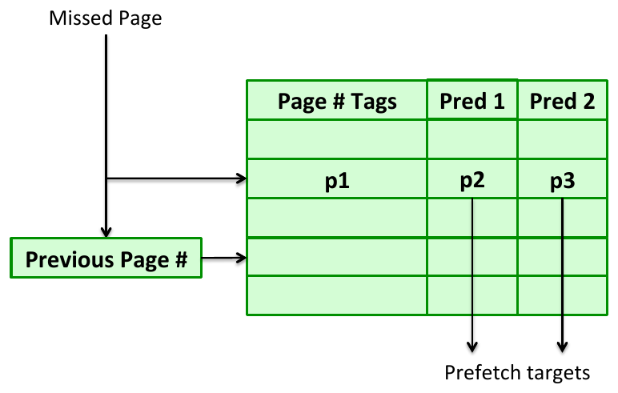

**顺序预取。** 下面讨论 TLB 的预取技术。顺序预取是最简单的 TLB 预取策略 [23, 47]。预取来的 TLB 项全部放进一个预取缓冲，预取缓冲与 TLB 分开，因此预取不会污染 TLB。TLB 污染一般有两种情形：（1）算法预取的 TLB 项用不到，却逐出了 TLB 中一个有用的项；（2）算法预取的 TLB 项有用，但被逐出的现有项会更早用到。使用预取缓冲后，这两种情形都不会出现。

步长预取有几种变体。一种变体以当前访问的虚拟页号 ±1 的虚拟页为目标，预取它的页表项，而且不论当前访问在 TLB 中命中还是失效都要预取。预取前先查一次 TLB，确认预取目标确实不在 TLB 中，不在才发出预取。这种做法预取得很积极，缺点是可能对 TLB 发出大量预取和查询。预取过多会占用很高的存储带宽，即使 TLB 命中率提高，性能也可能反而下降。另一种做法只在 TLB 失效时发出预取。研究表明，这种做法通过调节预取频率，能大大缓解访存流量问题，但常常错过有效预取的机会。

实际采用顺序预取的系统取两者的折中：TLB 预取由两种事件触发，一是 TLB 失效，二是 CPU 访问了一个之前预取进来的项。出现第二种情况，说明预取算法预取得准，它对自己有了把握，于是可以接着预取下一个相邻的地址转换。有预取缓冲的实现很容易做到这一点：预取缓冲中某一项命中，就发起对 ±1 虚拟页的页表项的预取。

简单的步长预取有两个设计决策值得进一步研究。一是预取进来的项是否需要单独的预取缓冲，有没有办法直接预取到 TLB 中，又不过度污染 TLB。二是替换策略：有预取缓冲时，预取缓冲用什么替换策略；预取缓冲完全并入 TLB 时，TLB 中既有按需装入的项又有预取的项，又该用什么替换策略。这些问题目前还没有答案。

**任意步长预取。** 步长预取只能捕捉 ±1 的模式。许多实际应用的访问具有更复杂的空间相邻模式，Cache 预取器过去就针对这一现象作过设计 [35]。任意步长预取同样可以用于 TLB [47]。[图 L.21](#fig-l-21) 给出了任意步长预取需要增加的硬件，[图 L.22](#fig-l-22) 给出了这张表和其他预取逻辑在 TLB 数据通路中的位置。

与标准的顺序预取一样，CPU 同时查找 TLB 和预取缓冲，两者都失效时启动页表遍历。页表遍历找到的地址转换装入 TLB，图中没有画出这一步。在我们的例子中，预取由 TLB 失效和预取缓冲命中两种事件触发。TLB 命中时当然也可以发起预取，但由于前面讨论过的原因，只在 TLB 失效和预取缓冲命中时预取，效果最好 [47]。生成预取目标的预取逻辑块用[图 L.21](#fig-l-21) 中的表实现。这张表用 PC 值索引，每一行记录三项信息：

* 这个 PC 处的指令上一次访问的虚拟页号，即 *Previous Page Number* 字段；
* 这个 PC 处的指令最近请求的两个虚拟页之间的步长，即 *Stride* 字段；
* 状态，即 *State* 字段，记录这个步长已经出现了多少次。

每当 PC 访问到这条指令，就更新 *Previous Page* 字段。只有当这条指令连续超过 N 次访问的步长都不变时，才发起预取。N 是设计时确定的参数，实际中常取 2 [47]。设置这道关卡，是为了减轻步长偶然变化的影响。

{#fig-l-21 width=70%}

{#fig-l-22 width=70%}

**马尔可夫预取。** 前面几种 TLB 预取方案，都是通过检测相继访问的地址之间的差值来发现访问规律。但访问也可能具有更复杂的时间模式：某些虚拟页链按一定次序被访问，相继的虚拟页之间却没有固定的步长。基于马尔可夫模型的 TLB 预取器就是要检测这类模式，这一点与基于马尔可夫模型的 Cache 预取器 [35] 相同。它用一张硬件表表示马尔可夫状态转移图，状态表示被访问的虚拟页，转移弧表示接下来访问某个页表项的概率。[图 L.23](#fig-l-23) 给出了预取逻辑的主要部件，即马尔可夫状态表。

预测表用发生 TLB 失效的虚拟地址索引。每一行有 N 个槽，每个槽存放一个虚拟页号。预计这些虚拟页会紧接在当前失效的虚拟页之后发生失效，因此它们是预取候选。

开始时，所有预取目标槽都是空的。发生 TLB 失效时查表，由于预取槽都空着，不发起预取，只把失效的页号存入 *Previous Page Number* 寄存器。下一次 TLB 失效时，用 *Previous Page Number* 找到上一次 TLB 失效对应的表项，在这一项中找到第一个空槽，填入本次失效的虚拟页号。这样，表中就记下了相继引起失效的两个虚拟页之间的关联。

设计马尔可夫预测器要考虑几个问题。一是预取槽的数目，它决定每次 TLB 失效发起多少次预取。我们画的表允许两次预取，实际系统则常常预取多达 4 个 TLB 项 [21, 47]。预取得多，可以大幅减少 TLB 失效，但也可能产生过多的访存流量，或者加重 TLB 污染、降低预取的准确性。二是替换策略，即所有槽都满时，新的虚拟页号填到哪个槽。以往的工作考虑过用 LRU 策略来决定 [47]，也可以用其他策略，这还有待研究。

{#fig-l-23 width=70%}

**最近性预取。** 前面这些预取方法最初都是为 Cache 设计的，后来才移植到 TLB 上；最近性预取（recency-based prefetching）则是专门针对 TLB 提出的 [76]。它的核心观点是：过去在时间上相继被访问的虚拟页，将来也会在时间上相继被访问。从某种意义上说，马尔可夫预取也基于类似的观点，但最近性预取利用这一现象的机制与马尔可夫预取正交，能识别许多组页之间确切的时间关系。具体来说，最近性预取使用一个由虚拟页号构成的 LRU 栈。[图 L.24](#fig-l-24) 画出了这个 LRU 栈，它由硬件 TLB 和软件页表共同组成。

为了更好地理解 LRU 栈的构造和操作，暂且假定 TLB 是全相联的，采用 LRU 替换。这时，LRU 栈的顶部实际上由 TLB 实现：TLB 内部 LRU 栈的栈顶是最近使用的地址转换；TLB 的 LRU 表底部是最近最少使用的地址转换，也就是下一个要逐出的候选。LRU 栈的其余部分由软件的页表项构成。页表本身并不按 LRU 栈的顺序排列，而是虚拟页号相邻的页，其地址转换在页表中的位置也相邻。因此，为了在页表中记录 LRU 顺序，[图 L.24](#fig-l-24) 为页表项增加了 previous 指针和 next 指针，分别指向在时间上先于它和后于它被访问的页表项。还要注意，这里所说的页表「访问」，对应的是发生 TLB 失效的情形。

从[图 L.24](#fig-l-24) 的例子可以看到，按时间顺序，E、A、B 先后发生了 TLB 失效。因此，E 的 next 指针指向地址转换 A 的物理地址；A 的 next 指针指向 B，previous 指针指向 E；B 的 previous 指针指向 A。最后还要考虑 TLB 逐出时的情形。被逐出的项成为页表 LRU 栈的栈顶：原来的栈顶赋给这个被逐出的地址转换的 next 指针，它的 previous 指针则留空。

现在假定 CPU 访问虚拟页 A 内的一个地址，而 A 不在 TLB 中。于是发生 TLB 失效，启动页表遍历。假定找到了页表项，页表遍历器就读出其中的 previous 指针和 next 指针，随后对前一个地址转换 E 和后一个地址转换 B 分别发出预取请求。由于指针保存的是页表项的物理地址，页表遍历器不必再遍历页表，就能直接发出这些请求。预取器还可以更积极一些，利用 next 和 previous 指针找出更多的预取机会。例如，页表遍历器可以用 A 的 next 指针找到地址转换 B 的物理地址，再对 B 的 next 指针所指的地址转换发出一次预取。当然，预取越积极，可能得到的性能收益越大，但访存流量和污染问题也越严重。最后，还必须权衡在页表中维护 previous 和 next 指针的开销。特别是页表占用的空间增大，可能使处理器 Cache 中更多的容量被页表项占去。因此，评估最近性预取的收益，需要仔细分析所有这些因素 [47, 76]。

{#fig-l-24 width=70%}

**基于距离的预取。** 前面讨论的预取方案可以分成两类：一类存储开销小，如顺序预取和自适应步长预取；另一类需要大表来捕捉虚拟页之间的时间关系，如马尔可夫预取和最近性预取。两类的学习时间也不同。第一类预取器学得相当快，快慢取决于同一步长要出现多少次才发起预取；马尔可夫预取器和最近性预取器要填满更大的表，学习时间因此较长。但第二类也有胜过第一类的地方，就是通常更准确。

基于距离的预取（distance-based prefetching）试图兼取两类之长。它的目标是：不付出马尔可夫预取和最近性预取那样的存储开销，就能发现它们所能发现的大部分模式（也许还有其他一些模式），同时还能捕捉步长模式。基于距离的预取记录相继虚拟页号之间的差值，即「距离」。例如，一个访存流依次访问虚拟页 1、2、4、5、7、8。基于距离的预取用硬件记下「距离 1 之后预测的距离是 2」这一事实，这样，只要一张两项的表就能捕捉整个虚拟页流。相比之下，马尔可夫预测器在这个例子中要为 6 个虚拟页各设一项。

[图 L.25](#fig-l-25) 给出了基于距离的预取的一种实现。硬件的核心是一张表，它把以往访存中出现过的距离值模式关联起来。具体步骤如下：

* ⓐ 计算当前距离，即当前引起 TLB 失效的虚拟页号与上一个发生 TLB 失效的虚拟页号之差。当前距离就是表的 tag。
* ⓑ 用 tag 查表，得到的项预测程序接下来可能遇到的几个距离。在我们的例子中，距离表记录两个预测的未来距离，也可以构造能记录更多预测距离的表。
* ⓒ 把这些距离加到当前虚拟页号上，得到目标虚拟页号，再向存储层次发出对这些虚拟页的预取请求。
* ⓓ 把本次算出的距离填入上一个页号所对应项的预测距离槽中。
* ⓔ 最后，用当前距离的值覆盖上一距离。

总的来说，基于距离的预取所需硬件比较少，已经证明是一种有效的预取机制。此外，这里讨论的基于距离的方法以提高单线程性能为目标 [47]；类似的方案也已经过改造，让在一个 CPU 上执行的线程为在其他 CPU 上运行的线程预取 TLB 项 [23]。

**小结。** [图 L.26](#fig-l-26) 汇总了前面研究过的各种预取策略，列出了各种方法的做法、软硬件开销、对预测表的需求，以及向存储层次额外注入的访存次数（不含预取本身所需的访存）。除了表中列出的参数，预取还有其他几个重要方面，下面简要讨论。

{#fig-l-25 width=80%}

[图 L.26　各种预取技术的参数，包括表项数、每项的内容、表的位置和表的索引方式。表中还列出了各种预取方法所用的访存次数（不含实际预取本身的访存次数），以及每种方法可能发出的预取数]{#fig-l-26 .caption}

| | 自适应步长 | 马尔可夫 | 最近性 | 距离 |
|---|---|---|---|---|
| 表项数 | r | r | 页表项数 | r |
| 每项内容 | PC tag、页号、步长、状态 | 页 tag、N 个预测 | next、previous 指针 | 距离 tag、N 个预测距离 |
| 表的位置 | 每个 CPU 一张表 | 每个 CPU 一张表 | 在页表中 | 每个 CPU 一张表 |
| 表的索引 | 程序计数器 | 页号 | 页号 | 距离值 |
| 访存操作 | 只有预取本身的操作 | 只有预取本身的操作 | 指针数 | 只有预取本身的操作 |
| 预取数 | 1 次预取 | N 次预取 | 所追踪的指针数 | N 次预取 |

（1）**超级页。** 前面的预取例子都假定是基本大小的虚拟页，但预取算法当然必须支持多种页大小。一般来说，基本大小虚拟页的失效完全可以引发对超级页地址转换的预取，反之亦然。但要预取任意页大小的地址转换，预取缓冲就必须支持多种页大小。因此，已提出的许多预取缓冲设计采用全相联结构，而不是组相联结构 [23]。

此外，多种页大小会让最近性预取这类技术尤其难以实现，因为 LRU 栈中的项对应地址空间中大小不同的区域，维护起来很复杂。例如，在 x86-64 页表中加上 previous 和 next 指针后，这些指针可能指向不同页表级的物理地址：一个 4 KB 页的地址转换可能保存指向一个 2 MB 页的指针，这时 L1 页表级中的指针就可能指向 L3 页表级。因此，如果需要更新的是另一级页表，设置指针时可能要额外访存，从根开始遍历整棵树。

（2）**与 Cache 的交互。** 地址转换预取把页表项带进 TLB 子系统，那么，预取是否还应该把存放所需页表项的 Cache 行带进处理器的高层 Cache（如 L1 Cache）？一方面，如果预取器准确，同一 Cache 行中的其他页表项可能不久也会用到，把它们带进 Cache 可能有好处。另一方面，预取本质上是推测性操作，过于积极的预取可能白白污染处理器 Cache，损害性能。归根结底，「正确」的策略取决于负载。大多数实际实现中，TLB 预取不把页表项带进 Cache。这种做法的前提是：TLB 中的预取引擎识别未来地址转换的能力已经足够强，不需要再把一行页表项缓存进 L1 Cache 来增强预取效果。

（3）**与状态位的交互。** 预取是推测性操作，不是 CPU 真正的请求，因此理想情况下不应影响预取目标的状态位。具体来说，不应允许发出预取的页表遍历器设置所预取地址转换的访问位（预取不写任何页，所以不会设置脏位）。但在 x86-64 这类体系结构中，这会使 MMU 的设计变得复杂，因为 x86-64 的存储一致性模型规定，只有访问位已置位的地址转换才允许驻留在 TLB 中 [54, 73]。由于所有预取都会设置访问位，x86-64 的厂商通常愿意花更多硬件资源，构造特别准确的 TLB 预取器。原因在于，如果一个地址转换被预取了但最终没有用到，它的访问位仍然置位；操作系统的替换策略依靠访问位识别热页，这样做出的决策就不是最优的。尽量保证所有预取最终都被用到，是避免这种情况的一种办法。

（4）**与缺页的交互。** 如果预取目标没有映射到物理页帧，预取就可能引发缺页。问题在于，这种预取是否应该调用操作系统及其缺页处理程序。预取通常是不引发缺页的（non-faulting）：发现预取目标没有映射到物理页时，就放弃这次请求，不调用操作系统 [20, 21, 23]。主要原因是预取是推测性的，可能预取错了，而错误地引发一次缺页，性能代价太高。因此，系统通常不冒这个险，凡是会引发缺页的预取都放弃。

## 重放预取 {#sec-l-10}

[L.8 节](#sec-l-8)（特别是[图 L.20](#fig-l-20)）讨论了页表项的冷热与它所指物理页帧中各 Cache 行之间的关系。其中的关键观察是：如果页表遍历需要访问存储层次中较深的层次，如末级 Cache（LLC，Last-Level Cache）或 DRAM，那么随后的重放通常也要访问 LLC 或 DRAM。近来的研究利用这一观察，预取重放最终需要的数据，以提高整体性能。[图 L.27](#fig-l-27) 说明了这种转换触发的预取（translation-triggered prefetching）是怎样工作的 [18]。

{#fig-l-27 width=90%}

把[图 L.20](#fig-l-20) 和[图 L.27](#fig-l-27) 对比一下，就能理解转换触发预取的基本思想。它针对的情形是：找到所需的页表项要访问 DRAM，随后重放的指令也要访问 DRAM。它的目标是把重放的 DRAM 访问变成 LLC 命中，或者 DRAM 中的行缓冲命中。最初的研究在存储控制器中增加了硬件，用来识别对页表的 DRAM 访问 [18]。

识别出对页表的 DRAM 访问后，由组合逻辑找出这个地址转换中存放的物理页，再结合页表遍历器发给存储控制器的所需 Cache 行信息，就能在访存重放之前确定页表遍历之后要访问的存储地址。从[图 L.27](#fig-l-27) 可以看出，这样可以做两项优化：一是把存放重放所需数据的 4～16 KB 的行从 DRAM 阵列预取到行缓冲中；二是把存放这些数据的 Cache 行预取到 LLC 中。

理想情况下，转换触发的预取让重放在 LLC 中命中，从而省掉以下开销：

1. 从 LLC 到存储控制器的片上网络传输；
2. 存储控制器中的排队延迟；
3. DRAM 行缓冲查找；
4. 写回 DRAM 行缓冲内容的时间；
5. 激活 DRAM 阵列中所需行的时间；
6. 从 DRAM 阵列读/写所需数据的时间；
7. Cache 填充操作。

这样可以节省 100～150 多个周期。当然，LLC 中的这一行也可能在使用之前就被逐出，但研究表明这种情况很少发生 [18]。而且即使发生了，DRAM 行缓冲仍可能命中，从而省掉第 4～7 项开销。

归根结底，转换触发的预取利用了这样一个事实：预取可以与一段时间窗口重叠。在这段窗口内，地址转换（页表遍历之后）正在填入 Cache 和 TLB，重放则一直进行到查找 LLC 为止。由此可以得出两点。一是这段窗口通常足够长，来得及完成行缓冲预取和 LLC 预取。例如，Intel Haswell 和 Skylake 处理器完成这些事件通常要 120 多个周期 [18]；相比之下，从 DRAM 阵列预取到行缓冲需要 60～100 个周期，再预取到 LLC 还要另加 20～30 多个周期。二是即使预取时间超过窗口长度，预取也能部分重叠，仍然可以提高性能。实际研究发现，部分重叠时 LLC 命中少一些，但 DRAM 行缓冲命中仍很普遍 [18]。

转换触发的预取要正确工作，需要改进页表遍历器和片上存储控制器的硬件，但操作系统和应用程序都不需要修改。[图 L.28](#fig-l-28) 给出了所需的改动。设 CPU 请求虚拟地址 0x01002。假定页大小为 4 KB（这一基本机制也适用于超级页），这个虚拟地址可以分成虚拟页号 0x1 和页内偏移 0x002。再假定用虚拟页号 0x1 查 TLB 时失效，于是启动页表遍历。页表遍历器（PTW）遍历页表，最终找到所需的页表项。假定在遍历过程中，这个页表项必须经存储控制器（MC）从 DRAM 中读出。这样，MC 就可以触发预取，取回重放最终需要的数据，这些数据很可能也在 DRAM 中。问题是怎样构造预取目标。预取以 Cache 行为单位进行，所以需要的是这个地址转换所指物理页帧内的 Cache 行号。在我们的例子中，假定虚拟页 1 映射到物理页 3，那么要找的就是物理页帧号 0x3 内的 Cache 行号 0x000。MC 很容易取得物理页帧号，因为它本来就要为页表遍历读出页表项。现在还需要得到这个物理页帧内所需的 Cache 行号，以便与 MC 取出的页帧号（0x3）拼接起来。为了把这个行号提供给 MC，最早提出转换触发预取的研究建议修改 PTW：PTW 为页表遍历向存储层次发出的请求中，不仅带上虚拟页号，还带上行号 0x000。页表遍历消息里加上这几位之后，MC 就能预取存放重放最终所需数据的 Cache 行 0x3002。
