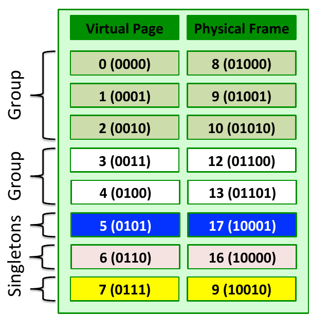
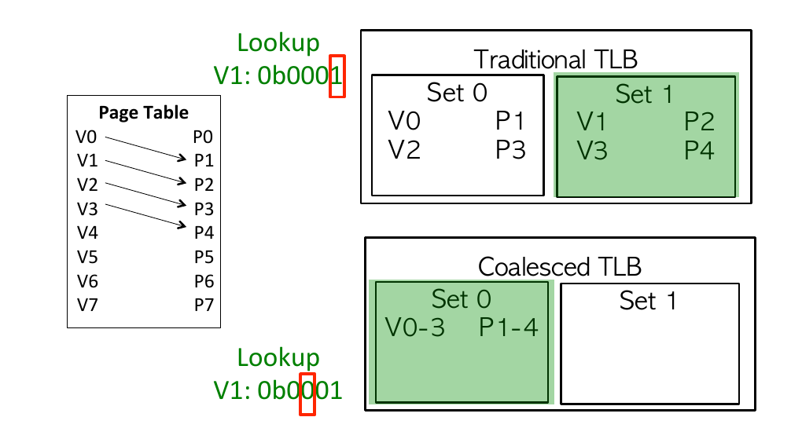
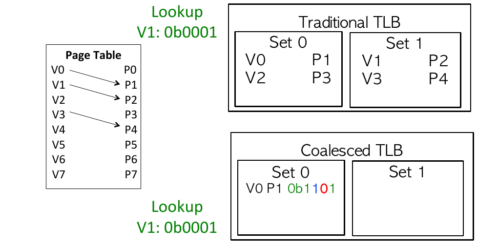
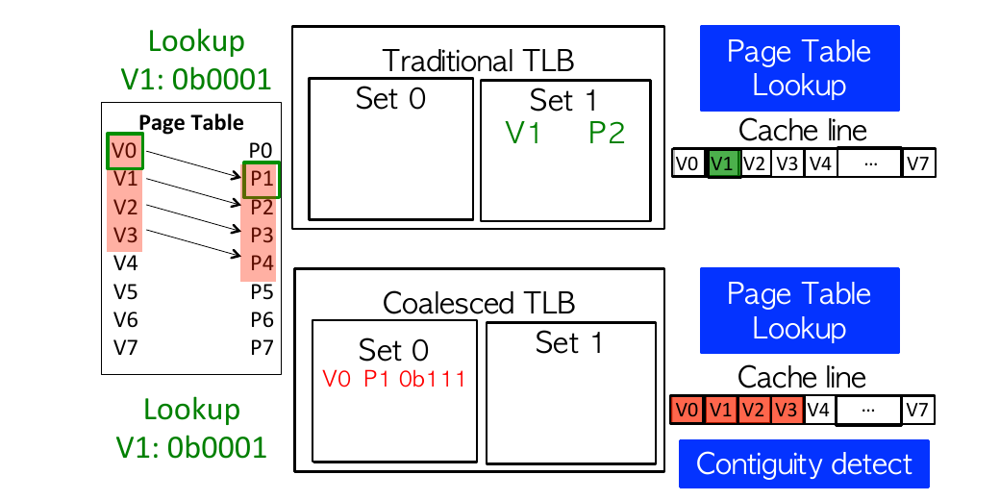
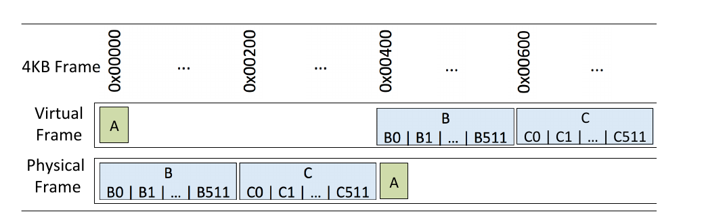
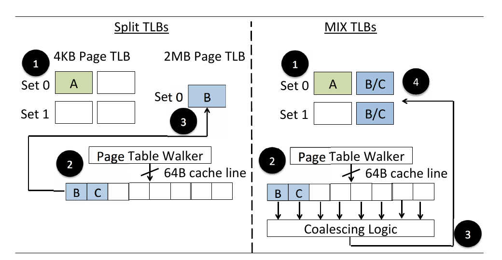
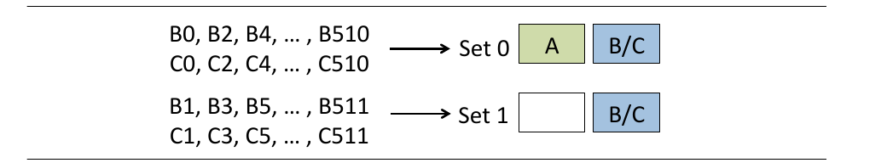

{#fig-l-28 width=80%}

转换触发的预取不仅实现简单，与传统预取相比还有一个重要区别。传统的 Cache 预取要预测将来的访存，因而要推测这些访存的目标地址，而推测可能出错。推测出错会白白耗费能量、降低性能，还会无谓地污染 Cache。转换触发的预取*在目标地址上不做推测*，因此没有这些问题：重放访存的地址*总是*由存储控制器正确算出。

## 转换连续性 {#sec-l-11}

减少 TLB 失效有一种特别有吸引力的方法：鼓励操作系统把相邻的虚拟页分配到相邻的物理页上。我们把这类通用技术称为*转换连续性*（translation contiguity）。有了转换连续性，就可以设计专门的硬件，把一组相邻的页表项存进一个 TLB 项，从而降低失效率、提高性能。大页其实就是以此为前提的：一个大页把几百个连续的虚拟页映射到几百个连续的物理页上。但是，大页需要大片的转换连续性，而操作系统要生成这样大片的连续性，往往会遇到种种障碍。实际系统要长时间运行，多个负载会把计算机系统的内存弄得支离破碎，这时尤其如此 [52, 57, 64, 68]。因此，我们来考虑另一些办法，利用范围较为有限的转换连续性。

{#fig-l-29 width=60%}

**操作系统生成的转换连续性。** 大页需要操作系统显式介入，才能保证足够的转换连续性（从 512 个到几千个连续页）；而操作系统也可能生成*中等*程度的连续性（几十到几百个页）。例如，在[图 L.29](#fig-l-29) 的页表中，虚拟页 0～2 的表项使用一组空间上顺序排列的物理页帧，也就是说，虚拟页 0～2 的转换确实是连续的；虚拟页 3～4 的转换同样是连续的。有好几项研究表明，操作系统确实会这样分配内存（虽然并非必须如此），原因是操作系统内部的伙伴分配器和内存紧缩策略会造成成片连续的已用空间和空闲空间 [52, 63, 64, 66, 68]，这方面的内容超出了本附录的范围。这种中等程度的连续性不足以构成 2 MB/1 GB 的超级页，但硬件可以利用它提高 TLB 命中率。孤立的页表项（[图 L.29](#fig-l-29) 中虚拟页 5、6、7 的转换）则无法这样利用。

**聚合。** [图 L.30](#fig-l-30) 给出了利用转换连续性的一种办法，即采用*聚合 TLB*（coalesced TLB）[66]。AMD Zen 体系结构等商用产品已经实现了这类方法。[图 L.30](#fig-l-30)(a) 和 [图 L.30](#fig-l-30)(b) 对比了传统 TLB 和聚合 TLB 的工作方式：传统 TLB 的一项只对应一个转换（虚拟页 V1 到物理页 P3），聚合 TLB 的一项则映射一组连续的、空间上相邻的转换（虚拟页 1～5 的页表项）。聚合 TLB 项只记录基页表项，以及与基页表项相邻、被聚合在一起的页表项个数，因此能容纳任意一组页表项（例如 [图 L.30](#fig-l-30)(b) 中的 5 项）。查找时，根据与 tag 中所存基虚拟地址之间的偏移，算出相对于基物理页的偏移。此外，聚合 TLB 不加任何对齐限制，基虚拟页可以映射到任意物理页帧。这与超级页不同：以 2 MB 或 1 GB 超级页为例，超级页起始处的虚拟页和物理页帧必须分别对齐到 2 MB 或 1 GB 的地址边界。聚合 TLB 要发挥作用，唯一真正的要求是每一项只比传统 TLB 项多占很少的面积。

![图 L.30　页表与 TLB 项的几种组合，对应为利用空间连续性和聚集性而提出的不同技术。我们对比了以下几种情形下的 TLB 项：传统情形、聚合情形 [29, 66]、完全子块情形 [85] 和部分子块情形 [85]。图内标注：HARDWARE，硬件；SOFTWARE，软件；(a) Conventional TLB，(a) 传统 TLB；(b) Coalesced TLB，(b) 聚合 TLB；(d) Sub-blocked TLB，(d) 子块 TLB；(e) Partial sub-blocked TLB，(e) 部分子块 TLB；Page Table，页表。](images/appl/fig-l-30.png){#fig-l-30 width=80%}

**完全子块化。** 聚合 TLB 的主要好处是：即使系统碎片化，操作系统难以构成超级页，它仍然能利用系统内存中可能还存在的中等程度连续性。不过，有些情况下，连中等程度的空间连续性也很难生成。在这类连续空间局部性更稀缺的场合，子块 TLB（sub-blocked TLB）可以发挥作用 [85]。[图 L.30](#fig-l-30)(c) 表明，完全子块方法针对的是虚拟页号连续的一簇页表项。对子块因子 *N*，这种方法寻找 *B* 个对齐的虚拟页，即这些虚拟地址除最低 $\log_2(B)$ 位以外，其余各位都相同。完全子块 TLB 把这一组对应的全部页表项存进一个完整的硬件项。在[图 L.30](#fig-l-30)(c) 的例子中，子块因子为 4，虚拟页 0～3 都满足对齐，因此只要硬件 TLB 项为每个物理页帧（例如 P1、P6、P3 和 P5）各保留一个字段，这几个页表项就能存进一个 TLB 项。遗憾的是，完全子块化要能存放任意一组物理页帧，TLB 项中就要为物理页帧设置多个字段，硬件代价高昂。此外，聚合可以容纳任意长度的连续页表项，而完全子块化存放的连续计数固定等于子块因子。

**部分子块化。** Talluri 和 Hill 提出了部分子块化，作为完全子块化的一种开销更低的替代方案 [85]。[图 L.30](#fig-l-30) 表明，部分子块化寻找的页表项要满足两个条件：虚拟页构成一个对齐的组，物理页也构成一个对齐的组。只要页表项的虚拟页号和物理页帧号相对于对齐组起点的偏移相同，就可以聚合成一项（在我们的例子中，就是虚拟页号（VPN）为 0、2、3 的页表项）。如果物理页在对齐组内的偏移与虚拟页的偏移不同，这种方法允许组内的页表项出现「空洞」，我们例子中的虚拟页 1 就是这种情况。部分子块化对物理页帧加上了对齐和偏移的限制，因此用比完全子块化更简单的硬件就能取得很大的覆盖范围。[图 L.30](#fig-l-30) 表明，每一项只维护一个位向量，记录各物理页是否存在，而不存放物理页帧号的全部位。直观地说，部分子块化比聚合更进一步：它既利用连续的空间局部性，也能利用这样一种情形，即一簇空间上相邻的页映射到另一组相邻的物理页帧，但簇内虚拟页到物理页的映射可以任意排列。

**在 MMU 中集成连续性优化。** 上面介绍的连续性优化在概念上不难理解，但集成到各个 CPU 的 MMU 逻辑中时，有多种设计变体，对性能的影响各不相同。详细介绍所有这些变体超出了本附录的范围。下面只讨论聚合 TLB 的设计，按原始研究论文的介绍来讲；一般认为，AMD Zen 体系结构中的聚合与之类似 [29, 66]。

**查找。** [图 L.31](#fig-l-31) 说明了 TLB 查找的过程。左边是一张页表，其中 V0～V3 的转换是连续的；右边对比了传统组相联 TLB 和聚合 TLB 的查找。我们关注的情形是：CPU 在 TLB 中查找 V1 的转换。

传统 TLB 用虚拟页号的低位确定要查找的 TLB 组。在我们这个只有两组的 TLB 例子中，最低一位就是索引，因此 V1 的转换必须放在组 1。聚合 TLB 则不同，因为相邻虚拟页的转换聚合以后必须映射到同一组。以最多聚合 4 个转换的聚合 TLB 为例，如[图 L.31](#fig-l-31) 所示，V0～V3 的转换映射到同一组，而不是交错分布在两组中。为此，聚合 TLB 不用最低位作索引，而用第 2 位作组索引。确定组索引以后，就扫描组内的各个转换，过程如[图 L.32](#fig-l-32) 所示。图中虽然只画了一个转换，但组内所有转换都要比较。每个转换都维护一个位向量，记录 4 个可能聚合的转换中哪些确实连续、因而已被聚合。因此，一次查找既要用虚拟页号各位做常规的 tag 匹配，还要查位图中的相应位。查找 V1 时，查的是图中蓝色的那一位。这一位为 1，就说明所请求的转换在这个聚合组里，这时把相应的偏移加到所存的物理页帧号上，就得到物理页帧（在我们的例子中是 P1 + 1）。

{#fig-l-31 width=80%}

{#fig-l-32 width=80%}

[图 L.32](#fig-l-32) 还表明，同一组中可以同时存在多个虚拟页 tag 相同的转换。例如，如果 V0～V1 单独构成连续（指向 P1～P3），V2～V3 也连续（例如指向 P5～P6），组 0 中就会有两个独立的项，分别对应这两个聚合组。查找时，靠位图字段中的相应位区分这两个聚合组：第一项的位图为 0b1100，第二项为 0b0011。也就是说，位图用来区分 tag 相同的虚拟页。

[图 L.32](#fig-l-32) 还说明，位图支持一种超出页表严格连续性的优化。具体来说，V2 的转换并不映射到 P3；但 V3 映射到 P4，符合 V0～V1 转换的连续模式。因此，只要把位图中 V2 对应的位（图中红色）置为 0，就可以用一个项存放 V0、V1 和 V3 的全部连续转换。

最后，这种聚合 TLB 设计需要静态地改变组索引方式。只要页表有足够的连续性，这是一种好的设计选择；但如果页表的连续性很少，这样改变组索引方式可能增加 TLB 失效。因此，已有研究考虑了另一些方案：有的只用 TLB 的一部分面积做聚合，其余部分仍作为传统 TLB 硬件 [64]；有的只在 L2 TLB 做聚合，L1 TLB 保持不变 [66]。

**填充。** 下面介绍识别连续转换的机制。为了让 TLB 查找延迟保持不变，聚合通常在 TLB 的填充通路上完成，而不是在查找时完成 [66]。TLB 填充和聚合的过程如[图 L.33](#fig-l-33) 所示。假设查找 V1 时 TLB 失效，传统 TLB 和聚合 TLB 都会发生 TLB 失效。两种情况下，页表遍历器都以 Cache 行为单位请求页表的各个部分。以 x86-64 系统为例，一个 64 字节的 Cache 行中存放 8 个页表项。聚合 TLB 在填充通路上增加了组合逻辑，用来检测 Cache 行内的连续转换；检测出连续转换后，就把它们聚合起来，填入聚合 TLB。这样，实际上可聚合的转换个数可能被限制在一个 Cache 行中的页表项个数以内。要突破这一限制，页表遍历器可以选择读取存放页表项的多个相邻 Cache 行。

{#fig-l-33 width=80%}

总之，聚合 TLB（以及子块化等其他方法）的好处有两个。一是用一个项缓存多个转换的信息，而这个项并没有增大很多，因此提高了 TLB 的有效容量。二是不那么明显的一点：TLB 聚合还起到了预取的作用。例如在[图 L.33](#fig-l-33) 中，原来的请求只针对 V1，聚合 TLB 却把 V0、V2 和 V3 的转换也聚合起来填进了 TLB。不久之后对 V0、V2 和 V3 的访问，在传统 TLB 上本来都会失效，现在都变成了命中。这种预取同样能提高性能。

**问答 7**

**问题 7**　我们在 [L.5 节](#sec-l-5)讨论过，要设计一个组相联 L1 TLB 结构，同时缓存多种页大小的转换，是很困难的。主要难点在于，不同页大小的页内偏移位宽和虚拟页号位宽各不相同。总的来看，我们讨论过的各种技术都是这样解决这个问题的：放弃「所有转换不论页大小，都用同一组虚拟页号位作 TLB 索引」这一想法。但这道练习要问的是：假定有下面这个观察结果，能否设计出高效的组相联 L1 TLB，同时缓存多种页大小的转换？观察结果是：虚拟页相邻的超级页，在物理页帧号上通常也是连续分配的（虽然并非必须如此）。

**解答 7**　最近的研究 [29] 探索过这样一种思路：利用超级页的连续性，构建能同时缓存多种页大小转换的组相联 L1 TLB，这种 TLB 称为 MIX TLB。为了理解它的工作方式，我们来看[图 L.34](#fig-l-34) 所示的地址空间。图中给出了虚拟地址和物理地址，其中 A 是小页，B～C 是超级页。注意，虽然我们假定系统是 64 位的，但为了节省篇幅，例子中给出的是 32 位地址。这些地址都用 4 KB 页帧号表示，在后面补上 0x000 就是完整地址。因此，超级页 B 位于虚拟地址 0x00400000、物理地址 0x00000000。超级页 B 和 C 各由 512 个 4 KB 页帧组成，记为 *B0～511* 和 *C0～511*。

{#fig-l-34 width=80%}

[图 L.35](#fig-l-35) 说明了 MIX TLB 的查找和填充操作，并与分离 TLB 作了对比。在①中查找 *B*，但分离 TLB 和 MIX TLB 中都只有 *A*，因此查不到，于是在②中启动硬件页表遍历器。页表遍历器以 Cache 行为单位读取页表，因此读入的 Cache 行中有 8 个转换（包括 *B* 和 *C*）。随后，分离 TLB 把 *B* 填入超级页 TLB（③）。遗憾的是，尽管小页 TLB 中还有 3 个项空着，*C* 却没有地方放。

{#fig-l-35 width=80%}

MIX TLB 则不同，它缓存所有页大小的转换。经过失效（①）和页表遍历（②）之后，*B* 被填入正确的组。MIX TLB 对所有转换都使用小页的索引位（在我们这个两组 TLB 的例子中是第 12 位），因此对超级页来说，索引位取自它的页内偏移。于是，超级页并不唯一地映射到某一组，*B* 被*镜像*到两个组中，也就是在两个 TLB 组中各填入一份。

但镜像也带来了一个问题。分离 TLB 中一个超级页转换只有一份，MIX TLB 中却有好几个镜像副本，这就降低了 TLB 的有效容量。MIX TLB 依据下面这一观察结果来抵消这个问题：操作系统经常（虽然并非必须）把超级页分配在相邻的虚拟地址和物理地址上。例如，[图 L.34](#fig-l-34) 表明，*B* 和 *C* 不仅组成它们的 4 KB 页帧（如 *B0～511* 和 *C0～511*）是连续的，两个超级页整体也是连续的。MIX TLB 这样利用这种连续性：页表遍历器读入一个 Cache 行的转换时（②），扫描该 Cache 行中相邻的转换，检测出连续的超级页。与标准聚合 TLB 一样，这一步可以由 TLB 填充通路上的组合聚合逻辑完成（步骤③）。在我们的例子中，*B* 和 *C* 是连续的，因此被聚合起来并做镜像。聚合抵消了镜像的影响：如果连续超级页的个数与镜像副本的个数相同（或接近），MIX TLB 就把它们聚合起来，这样尽管有镜像，净容量仍相当于超级页的覆盖范围。

{#fig-l-36 width=80%}

除了上面的初步介绍，[图 L.36](#fig-l-36) 还表明，MIX TLB 的查找与标准聚合 TLB 基本相同。超级页聚合后的镜像虽然存放在多个组中，但每次查找只探查一个 TLB 组。在我们的例子中，虚拟地址第 12 位决定访问的是超级页内编号为偶数的 4 KB 区域，还是编号为奇数的 4 KB 区域，因此对 *B0*、*B2* 等和 *C0*、*C2* 等的访问都送往组 0。这一概述自然会引出几个重要问题，下面简要回答。

*MIX TLB 为什么用小页对应的索引位，而不用大页对应的索引位？* 用大页索引位的好处是每个超级页唯一地映射到一组，不需要镜像（例如 *B* 映射到组 0，*C* 映射到组 1）。遗憾的是，这会带来另一个问题：空间上相邻的小页会映射到同一组。例如，如果用 2 MB 超级页对应的索引位（在我们这个两组 TLB 的例子中是第 21 位），每 512 个相邻的 4 KB 虚拟页就会映射到同一组。实际程序具有空间局部性，因此除非相联度超过 512，TLB 冲突就会增加；而 512 路远高于现代 TLB 所用的 4～8 路相联度。如果操作系统确实把小页在虚拟地址和物理地址上都连续分配，也可以设想把小页聚合起来。但正如本节讨论过的，小页的连续性往往只有几十个页，最多也就几百个。已有研究发现，与使用小页索引位相比，使用超级页索引位时，TLB 失效平均是原来的 4～8 倍 [29]。

*一个超级页会产生多少个镜像？需要多少连续性才能弥补镜像造成的 TLB 有效容量损失？* 考虑一个有 *M* 组的 MIX TLB 和一个含 *N* 个 4 KB 区域的超级页（2 MB 和 1 GB 超级页的 *N* 分别为 512 和 262144）。实际商用的 L1 和 L2 TLB 通常有 16～128 组，因此今天的系统中 *N* > *M*，这意味着超级页在每个组中各有一个镜像（即 *N* 个镜像）。但如果将来的系统 *N* < *M*，镜像个数就变成 *M*。归根结底，MIX TLB 要取得好的命中率，依靠的是超级页的连续性：连续超级页的个数等于（或足够接近）镜像个数，MIX TLB 就会有大量命中。对现代 16～128 组的 TLB，我们希望有（接近）16～128 个连续的超级页。已有研究表明，实际系统常常确实有这么多的超级页连续性 [29]。

这道练习介绍了 MIX TLB 的许多基本细节，但还有一些重要的设计问题和微结构细节没有涉及。感兴趣的读者可参阅原始论文 [29] 了解更多细节。

## 结论 {#sec-l-12}

本附录的目的是介绍现代地址转换栈的复杂性。我们讲了几个重要概念，但还有许多别的地址转换技术和优化有待深入探讨。感兴趣的读者可以参阅以下主题的研究（所列主题并不完整）：

* **共享的地址转换结构。** 现代处理器通常每个核有自己的 MMU（包括每核私有的 TLB、MMU Cache、PTW 等），但越来越多的证据表明，地址转换硬件可以由系统中的多个核有效共享，从而提高性能 [14, 21, 83]。
* **TLB 推测。** 最近有几项研究 [11, 68] 提出用推测技术进一步提高 TLB 的有效命中率：对在 TLB 中失效的转换，「猜测」它的物理页帧号，于是 CPU 可以一边做页表遍历，一边继续执行。
* **作为内存一部分的 TLB 优化。** TLB 历来与 CPU 紧密耦合，但越来越多的证据表明，把大容量 TLB 做成 DRAM 的一部分也可能有价值，在高带宽 DRAM 出现之后尤其如此 [75]。
* **直接段、范围优化、超级页。** 另一类技术依靠操作系统（可能还借助程序员提供的提示）生成大量连续的转换，减少所需的 TLB 项数，从而大幅降低对 TLB 的需求 [12, 36, 48]。此外，学术界还在继续探索改进超级页管理的方法 [39, 52, 60, 68]。
* **软件优化。** 最近有研究致力于更高效地管理页迁移和页分配，特别是在异构内存和加速器的环境中。读者可参阅相关论文 [1, 2, 34, 38]。
