# 说明 {-}

本稿是 *Computer Architecture: A Quantitative Approach*（第 7 版，Morgan Kaufmann / Elsevier）的中文重译稿，仅供个人学习，未经授权不得公开发布。章节、图号、公式和习题编号与原书一致。

<!--chapter:end:index.Rmd-->

# 定量设计与分析基础 {#ch-fundamentals}

> iPod、手机、互联网移动通信设备，这不是三台独立的设备！我们把它叫作 iPhone！今天，苹果要重新发明手机。它就在这里。
>
> ——史蒂夫·乔布斯，2007 年 1 月 9 日

> 新的信息通信技术，特别是高速互联网，正在改变企业的经营方式，改变公共服务的提供方式，也使创新更加大众化。高速互联网连接每增加 10%，经济增长率就提高 1.3 个百分点。
>
> ——世界银行，2009 年 7 月 28 日

## 引言 {#sec-1-1}

第一台通用电子计算机问世至今大约 75 年，计算机技术取得了惊人的进步。2000 年，世界上最快的计算机售价超过 1 亿美元；今天，一部 800 美元的手机就具有同样的性能。这样快的进步来自两个方面：一是计算机制造工艺在进步，二是计算机设计在创新。

从历史上看，工艺的进步一直比较平稳，体系结构改进带来的进步则时快时慢。电子计算机诞生后的头 25 年里，这两方面都作出了重要贡献，性能每年提高约 25%。20 世纪 70 年代末，微处理器出现了。微处理器能够搭上集成电路工艺进步的快车，于是性能提高得更快，每年约 35%。

这样的增长速度，加上微处理器大批量生产带来的成本优势，使计算机产业中基于微处理器的部分所占份额越来越大。此外，计算机市场的两个重要变化，让一种新的体系结构比以往任何时候都更容易取得商业成功。一是汇编语言编程几乎消失，对目标代码兼容的要求随之降低；二是出现了 UNIX 及其克隆 Linux 这样标准化的、不依赖于特定厂商的操作系统，推出新体系结构的成本和风险因此降低。

正是这些变化，使得 20 世纪 80 年代初一批指令更简单的新体系结构得以成功开发，这就是精简指令集计算机（RISC）体系结构。基于 RISC 的机器使设计者把注意力集中到两项提高性能的关键技术上：一是利用指令级并行（ILP），最初通过流水线，后来通过多发射；二是使用 Cache，最初形式简单，后来组织方式和优化手段越来越复杂。

基于 RISC 的计算机抬高了性能标杆，原有的体系结构要么跟上，要么被淘汰。DEC 的 VAX 没能跟上，最终被一种 RISC 体系结构取代。Intel 接受了挑战，主要办法是在处理器内部把 80x86 指令转换成类似 RISC 的指令，从而能够采用 RISC 设计中首先出现的许多创新。20 世纪 90 年代末，晶体管数量急剧增加，转换较为复杂的 80x86 体系结构所需的硬件开销已经可以忽略不计。但在手机这类低端应用中，80x86 转换开销在功耗和芯片面积上的代价仍然明显，这也是 RISC 体系结构 ARM 能够在这一领域占据主导地位的原因之一。

[图 1.1](#fig-1-1) 表明，体系结构和组成两方面的改进结合在一起，使处理器性能连续 17 年以每年 50% 以上的速度增长，这在计算机产业历史上是前所未有的。

![图 1.1　45 年来处理器性能的增长。图中画的是用 SPEC 整数基准测试程序测得的程序性能，以 VAX 11/780 为基准（见 1.8 节）。20 世纪 80 年代中期以前，处理器性能的增长主要由工艺推动，平均每年约 25%，即每 3.5 年翻一番。从 1986 年起，增长率提高到约 52%，即每 2 年翻一番，这要归功于以 RISC 体系结构为代表的更先进的体系结构和组成思想，以及 CPU 改用微处理器构建。到 2003 年，这种增长带来的性能是按 25% 的速度持续增长所能达到的性能的 25 倍；如果与半导体工艺改进带来的每年 35% 相比，则是 7.5 倍。2003 年以后，Dennard 缩放终结带来的功耗限制，加上可利用的指令级并行有限，使单处理器性能的增长放慢到每年 23%，即每 3.5 年翻一番，这一情况一直持续到 2011 年。这些结果只统计单芯片系统，通常每片最多 8 个核，每个核 1 到 2 个超线程。2007 年以后，最快的 SPECintbase 成绩都打开了自动并行化，因此单处理器的速度更难衡量。2011 年到 2015 年，每年的提高不到 12%，即每 6 年翻一番，部分原因是 Amdahl 定律对并行性的限制。2015 年以后，随着摩尔定律放缓，每年只提高 9%，即每 8 年翻一番。浮点计算的性能趋势相同，只是在每个阴影区内年增长率通常高出 1 到 2 个百分点。（SPEC 从 1989 年到 2017 年共有 6 个版本，因此长期的性能变化是利用同时具有相邻两版成绩的计算机求出换算系数来估计的。）](images/ch01/fig-1-1.png){#fig-1-1 width=100%}

20 世纪性能的高速增长带来了四方面的影响。

第一，计算机用户可以使用的计算能力大大增强。在许多应用中，性能最高的微处理器已经超过了不到 20 年前的超级计算机。

第二，性价比的大幅提高催生了新的计算机类型。20 世纪 80 年代，随着微处理器的出现，个人计算机和工作站应运而生。近 15 年来，智能手机和平板电脑兴起，许多人已经用它们代替 PC，作为主要的计算平台。这些移动客户端设备越来越多地通过互联网访问装有 5 万台服务器的「仓库」，而这些仓库是作为一台巨型计算机来设计的。带无线连接的嵌入式计算机统称为物联网（IoT）设备，目前每年出货量超过 100 亿台，预计还将大幅增长。

第三，半导体制造技术按照摩尔定律的预测不断进步，基于微处理器的计算机因此在计算机设计的各个领域都占据了主导地位。小型机过去用现成的逻辑芯片或门阵列搭建，后来被基于微处理器的服务器取代。就连今天的大型机和高性能超级计算机，也都是由大量微处理器组成的。

上述硬件创新带来了计算机设计的复兴。这次复兴既重视体系结构的创新，也重视对工艺进步的有效利用。增长逐年累积，到 2003 年，高性能微处理器的速度已经是单靠工艺（包括电路设计的改进）所能达到速度的 7.5 倍，即年复合增长率 52% 对 35%。

硬件的复兴还带来了第四方面的影响，即对软件开发的影响。从 1978 年至今，性能提高了 9 万倍（见[图 1.1](#fig-1-1)），程序员因此可以用性能换取开发效率。今天，越来越多的程序不再用 C、C++ 这类注重性能的语言编写，而是改用 Java 这类托管语言。此外，开发效率更高的脚本语言，如 JavaScript 和 Python，也越来越流行，AngularJS、Django 这类编程框架同样如此。为了在保持开发效率的同时尽量缩小性能差距，带即时编译器的解释器和基于踪迹的编译正在取代传统的编译器和链接器。软件的发布方式也在变化：通过互联网使用的软件即服务（SaaS），正在取代那种盒装出售、必须安装在本地计算机上运行的软件。

应用的性质也在变化。语音、声音、图像和视频越来越重要；可预测的响应时间也越来越重要，因为它对用户体验至关重要。谷歌翻译就是一个令人印象深刻的例子。用户举起手机，把摄像头对准一个物体，图像就通过无线网络和互联网传送到一台仓库级计算机（WSC）上，WSC 识别出照片中的文字，再将其翻译成用户的母语。用户也可以对着手机说话，它会把所说的话翻译成另一种语言，并以语音输出。谷歌翻译的文字翻译支持 133 种语言，拍照翻译支持 37 种语言，对话模式下的语音翻译支持 32 种语言。

遗憾的是，[图 1.1](#fig-1-1) 同样表明，通用处理器性能快速提高的这 17 年硬件复兴已经结束。根本原因是，半导体工艺有两个持续了几十年的特性，现在已经不再成立。

第一个是 Dennard 缩放。1974 年，Robert Dennard 观察到，由于每个晶体管的尺寸在缩小，即使晶体管数量增加，单位面积硅片的功率密度也保持不变。更难得的是，晶体管可以变得更快，同时功耗更低。2004 年前后，电流和电压无法在保证集成电路可靠性的前提下继续降低，Dennard 缩放就此终结。

这一变化迫使微处理器产业转而采用多个高效的处理器（即多个核），而不再使用单个低效的处理器。事实上，2004 年 Intel 取消了它的高性能单处理器项目，并和其他厂商一起宣布：今后提高性能要靠在一块芯片上集成多个处理器，而不是靠更快的单处理器。这一里程碑标志着一次历史性的转变：从只依靠 ILP（这是本书前三版的重点），转向数据级并行（DLP）和线程级并行（TLP）。DLP 和 TLP 从第 4 版开始介绍，第 5 版作了扩充。第 5 版还增加了 WSC 和请求级并行（RLP），本版对 RLP 作了进一步扩充。ILP 由编译器和硬件配合，以隐式的方式利用，对程序员是透明的。DLP、TLP 和 RLP 则是显式并行的，需要重新组织应用程序，才能利用其中的并行性。有些情况下这并不难，但在很多情况下，这对程序员来说是一项新的沉重负担。

Amdahl 定律（见[1.10 节](#sec-1-10)）为每块芯片上有用的核数规定了实际上限。如果一项任务有 10% 是串行的，那么无论在芯片上放多少个核，并行带来的性能提升最多也只有 10 倍。

第二个最近发生变化的是摩尔定律。1965 年，Gordon Moore 作出了一个著名的预测：每块芯片上的晶体管数每年翻一番。1975 年，他把预测修改为每 2 年翻一番。这一预测维持了大约 50 年，但现在已经不再成立。例如，本书 2010 年版出版时，Intel 最新的微处理器有 11.7 亿个晶体管。如果摩尔定律一直成立，2022 年的微处理器应当有 1059 亿个晶体管。而实际上，苹果 M2 微处理器只有 200 亿个晶体管，约为摩尔定律预测值的五分之一。

以下几个因素共同作用：

* 摩尔定律放缓和 Dennard 缩放终结，使晶体管本身的改进不再明显；
* 微处理器的功耗预算保持不变；
* 单个高功耗的处理器被若干个高能效的处理器取代；
* Amdahl 定律限制了多处理器所能带来的收益。

结果是处理器性能的提高放慢了：1986 年到 2003 年间每 1.5 年翻一番，而现在要每 8 年才翻一番（见[图 1.1](#fig-1-1)）。

要在能耗、性能和成本上取得显著改进，剩下的唯一途径是专用化。未来的微处理器将包含若干个领域专用核。这些核只擅长某一类计算，但在这类计算上比通用核强得多。第 7 章介绍领域专用体系结构。2023 年 ChatGPT 发布以后，专为人工智能领域设计的加速器部署速度大大加快，从 IoT 设备到 WSC，应用无处不在。

本书讨论的是同步数字计算机，过去 75 年推动计算机产业发展的正是这类计算机。随着改进速度放缓，一些人开始研究其他尚未产生重要商业影响的方案，例如模拟计算、生物计算、量子计算、类脑计算和异步计算。这些不同的设计何时能在经济上可行，甚至能否可行，目前都还不清楚，因此本书仍以同步数字硬件为研究对象。

本书介绍三方面的内容：一是上个世纪使性能得以惊人增长的体系结构思想，以及与之配套的编译器改进；二是这场剧变的原因；三是 21 世纪体系结构、编译器和解释器面临的挑战，以及初步显现前景的应对方法。贯穿全书的核心是一种定量的计算机设计与分析方法，它以对程序的实际观察、实验和模拟为工具。本书体现的正是这种计算机设计的风格和方法。本章的目的，是为后续各章和附录奠定定量分析的基础。

我们写这本书，不仅是为了讲清这种设计风格，也是为了激励读者为这一进步作出贡献。我们相信，这种方法过去在隐式并行的计算机上行之有效，将来在新的计算机上也同样适用。

<!--chapter:end:01-fundamentals-01.Rmd-->

## 计算机的分类 {#sec-1-2}

这些变化为一场剧变奠定了基础：进入新世纪，我们看待计算、计算应用和计算机市场的方式都在发生巨大的变化。自个人计算机问世以来，计算机的形态和用法还从未发生过如此显著的变化。计算机用法的这些变化形成了五个不同的计算市场，每个市场都有各自的应用、需求和计算技术。[图 1.2](#fig-1-2) 总结了这几类主流计算环境及其重要特点。

[图 1.2　五类主流计算设备及其系统特点。2021 年的销量大约是：PMD 20 亿台（90% 是手机），PC 3.57 亿台（80% 是笔记本电脑），服务器 1300 万台。嵌入式处理器的总销量约为 300 亿个。2021 年，基于 ARM 技术的芯片共出货 230 亿片。注意，服务器和嵌入式系统的系统价格跨度很大，嵌入式系统小到 U 盘，大到网络路由器。服务器的价格跨度之所以这样大，是因为高端事务处理需要规模非常大的多处理器系统。]{#fig-1-2 .caption}

| 特点 | 物联网/嵌入式 | 个人移动设备（PMD） | 桌面 | 服务器 | 集群/仓库级计算机 |
|---|---|---|---|---|---|
| 系统价格 | \$10–\$100,000 | \$100–\$1000 | \$300–\$2500 | \$5000–\$10,000,000 | \$100,000–\$200,000,000 |
| 微处理器价格 | \$0.01–\$100 | \$10–\$100 | \$50–\$500 | \$200–\$2000 | \$50–\$250 |
| 系统设计的关键问题 | 价格、能耗、面向具体应用的性能 | 价格、能耗、媒体性能、响应速度 | 性价比、能耗、图形性能 | 吞吐率、可用性、可扩展性、能耗 | 性价比、吞吐率、能耗正比性 |

### 物联网/嵌入式计算机 {-}

嵌入式计算机存在于日常使用的各种机器中：微波炉、洗衣机、大多数打印机、网络交换机，以及所有的汽车。*物联网*（IoT）指连接到互联网的嵌入式计算机，通常采用无线连接。IoT 设备配上传感器和执行器以后，就能采集有用的数据，并与物理世界交互，由此产生了各种各样的「智能」应用，如智能手表、智能恒温器、智能音箱、智能汽车、智能家居、智能电网和智慧城市。

嵌入式计算机的处理能力和成本跨度最大。其中既有售价可能只有 1 美分的 8 位到 32 位处理器，也有用于汽车和网络交换机、售价 100 美元的高端 64 位处理器。嵌入式计算市场上计算能力的跨度虽然很大，但设计这一领域的计算机时，价格是一个关键因素。性能要求当然也有，但首要目标往往是以最低的价格满足性能需要，而不是以更高的价格换取更高的性能。据预测，2025 年 IoT 设备的出货量在 300 亿到 400 亿台之间。

本书的大部分内容都适用于嵌入式处理器的设计、使用和性能，无论它们是现成的微处理器，还是要与其他专用硬件组装在一起的微处理器核。

遗憾的是，其他类型计算机的定量设计和评价所依据的数据，推广到嵌入式计算领域还处在早期阶段（例如，见 [1.9 节](#sec-1-9) 中 EEMBC 遇到的难题）。因此，目前我们只能作定性的描述，而这与本书其余部分不太协调。于是，嵌入式方面的内容集中放在附录 E。我们相信，单独设一个附录，既能使正文的思路更连贯，又能让读者看到不同的需求如何影响嵌入式计算。

### 个人移动设备 {-}

*个人移动设备*（PMD）是我们对一类带多媒体用户界面的无线设备的统称，如智能手机、功能手机、平板电脑、智能手表等。2021 年，PMD 的年收入最高，约为 5000 亿美元。整个产品卖给消费者的价格只有几百美元，因此成本是首要考虑。强调能效常常是因为要使用电池；此外，需要采用更便宜的封装（塑料而不是陶瓷），又没有风扇散热，这些也限制了总功耗。我们在 [1.5 节](#sec-1-5) 更详细地讨论能耗和功耗问题。PMD 上的应用往往基于 Web、面向媒体，如前面提到的谷歌翻译。由于能耗和体积方面的要求，PMD 使用 Flash 存储器（第 2 章）而不是磁盘来存储数据。

PMD 中的处理器常被看作嵌入式计算机，但我们把它们单列为一类。原因是 PMD 是能够运行外部开发的软件的平台，与桌面计算机有许多共同特点。其他嵌入式设备在硬件和软件的复杂程度上都更为有限。我们以能否运行第三方软件作为非嵌入式计算机与嵌入式计算机的分界线。

响应及时、可预测，是媒体应用的关键特点。有*实时性能*要求，是指应用中的某一段有一个绝对的最长执行时间。例如，在 PMD 上播放视频时，每一帧的处理时间是有限的，因为处理器很快就必须接收并处理下一帧。有些应用的要求更细一些：既限制某项任务的平均时间，也限制超过某个最长时间的次数。如果允许偶尔错过某个事件的时间约束，只要错过的次数不太多，就可以采用这类做法，它有时称为*软实时*。实时性能往往与具体应用密切相关。

许多 PMD 应用还有两个关键特点：一是要尽量减少内存用量，二是要高效地使用能量。电池供电和散热两方面都要求高能效。内存可能占系统成本的很大一部分，这时优化内存容量就很重要。内存容量重要，意味着要重视代码量，因为数据量是由应用决定的。

### 桌面计算 {-}

按销售额计算，2021 年桌面计算市场的规模大约是智能手机市场的一半。桌面计算的产品，从售价不到 300 美元的低端上网本，一直到配置很高、售价可能达到 2500 美元的高端工作站。从 2008 年起，每年生产的桌面计算机中，一半以上是电池供电的笔记本电脑。2021 年，笔记本电脑占桌面计算机销量的四分之三。

在这样宽的价格和能力范围内，桌面市场往往都以优化*性价比*为目标。这个市场上的客户最看重的，是系统的性能（主要用计算性能和图形性能来衡量）与价格的组合，因此计算机设计者最看重的也是这一点。于是，最新、性能最高的微处理器，以及降低了成本的微处理器，常常最先出现在桌面系统中（影响计算机成本的因素见 [1.6 节](#sec-1-6)）。

桌面计算在应用和基准测试程序方面往往也刻画得相当清楚，不过以 Web 为中心的交互式应用用得越来越多，给性能评价带来了新的挑战。

### 服务器 {-}

20 世纪 80 年代，计算转向桌面，服务器的作用随之扩大，开始提供规模更大、更可靠的文件服务和计算服务。这类服务器取代了传统的大型机，成为大规模企业计算的骨干。

服务器看重的是另一些特点。第一，可用性至关重要（我们在 [1.7 节](#sec-1-7) 讨论它）。以银行 ATM 系统和航空订票系统所用的服务器为例，这类服务器系统发生故障，后果比一台桌面计算机发生故障严重得多，因为这些服务器必须每周 7 天、每天 24 小时不间断地运行。[图 1.3](#fig-1-3) 估计了服务器应用停机造成的收入损失。

服务器系统的第二个关键特点是可扩展性。服务器系统所支持的服务需求增加，或者功能要求扩展，系统常常就要随之扩大。因此，能否扩充服务器的计算能力、内存、存储和 I/O 带宽，是至关重要的。

第三个特点是，服务器的成本目标是总拥有成本（TCO），而不是购买价格。TCO 等于购买价格加上计算机整个寿命期内的运行成本，运行成本包括电费、冷却、维护和场地的费用。之所以关注 TCO，原因是：

* 服务器的寿命比桌面计算机长得多，通常是 5 到 8 年；
* 服务器的功耗比 PC 大得多；
* 服务器处理器的购买价格可能只占整个 TCO 的四分之一。

最后，服务器的设计目标是高效的吞吐率。也就是说，关键在于服务器的整体性能，用每分钟处理的事务数或每秒提供的网页数来衡量。对单个请求的响应速度仍然重要，但大多数服务器的关键指标是整体效率和成本效益，而这取决于单位时间内能处理多少请求。我们在 [1.9 节](#sec-1-9) 再回过头来讨论如何评估不同类型计算环境的性能。

[图 1.3　通过分析停机代价（按直接损失的收入计算）得出的系统不可用造成的损失，结果四舍五入到 10 万美元。这里假设了三种不同的可用性水平，并假设停机时间是均匀分布的。数据来自 Landstrom（2014），由 Contingency Planning Research 收集和分析。]{#fig-1-3 .caption}

| 应用 | 每小时停机代价 | 年停机 1%（87.6 h/年）时的年损失 | 年停机 0.5%（43.8 h/年）时的年损失 | 年停机 0.1%（8.8 h/年）时的年损失 |
|---|--:|--:|--:|--:|
| 经纪服务 | \$4,000,000 | \$350,400,000 | \$175,200,000 | \$35,000,000 |
| 能源 | \$1,750,000 | \$153,300,000 | \$76,700,000 | \$15,300,000 |
| 电信 | \$1,250,000 | \$109,500,000 | \$54,800,000 | \$11,000,000 |
| 制造 | \$1,000,000 | \$87,600,000 | \$43,800,000 | \$8,800,000 |
| 零售 | \$650,000 | \$56,900,000 | \$28,500,000 | \$5,700,000 |
| 医疗 | \$400,000 | \$35,000,000 | \$17,500,000 | \$3,500,000 |
| 媒体 | \$50,000 | \$4,400,000 | \$2,200,000 | \$400,000 |

### 集群/仓库级计算机 {-}

搜索、社交网络、视频观看与分享、多人游戏、网上购物等应用的 SaaS 不断发展，带动了一类称为*集群*的计算机的发展。集群是一组通常价格不高的服务器，它们用局域网连接在一起，作为一台更大的计算机工作。每个节点运行自己的操作系统，节点之间用网络协议通信。WSC 是规模最大的集群，它的设计目标是让几万台服务器像一台计算机那样工作。第 6 章介绍这类超大型计算机。

WSC 规模很大，因此性价比和功耗对它至关重要。第 6 章将会说明，仓库的大部分成本与仓库内计算机的供电和冷却有关。一个 WSC 的计算机本身加上网络设备，年摊销成本约为 5000 万美元，因为这些设备通常每隔几年就要更换。购买这么多计算设备，必须精打细算：性价比提高 10%，每个 WSC 每年就能节省 500 万美元（5000 万美元的 10%）；而像亚马逊这样的公司，可能拥有 100 多个 WSC！

WSC 和服务器的共同之处在于可用性至关重要。例如，Amazon.com 2023 年的销售额为 5750 亿美元。一年大约有 8760 小时，因此平均每小时的收入约为 6600 万美元。在圣诞购物的高峰时段，可能的损失还要高出许多倍。第 6 章将会说明，WSC 与服务器的区别在于，WSC 以冗余的廉价部件为基本构件。在这样的规模上计算，必然会出现大量故障；WSC 依靠一个软件层来捕获和隔离这些故障，从而提供这类应用所需的可用性。注意，WSC 的可扩展性由连接各台计算机的局域网解决，而不是像服务器那样依靠集成的计算机硬件。

*超级计算机*与 WSC 的共同之处在于两者同样昂贵，造价都在几亿美元。但超级计算机有两点不同：一是强调浮点性能，二是运行大型的、通信密集的批处理程序，这些程序一次可以运行好几个星期。超级计算机通常还使用高带宽、低延迟的互连网络。相比之下，WSC 强调的是交互式应用、大规模存储、标准局域网、可信性和很高的互联网带宽。

### 并行的类型与并行体系结构 {-}

现在，在所有四类计算机上，多个层次的并行都是推动计算机设计的动力，而能耗和成本是主要的约束。应用中的并行基本上有两种：

1. *数据级并行*（DLP）：有许多数据项可以同时处理，于是产生了数据级并行。
2. *任务级并行*（TLP）：创建出的工作任务可以独立运行，而且在很大程度上可以并行，于是产生了任务级并行。

计算机硬件则可以通过四种主要方式来利用应用中的这两种并行：

1. *指令级并行*（ILP）利用的是 DLP：在编译器的帮助下，用流水线这类思想利用程度不高的 DLP；用猜测执行这类思想利用中等程度的 DLP。
2. *向量体系结构、图形处理器（GPU）和多媒体指令集*用一条指令并行地处理一组数据，以此利用 DLP。
3. *线程级并行*（TLP）在紧耦合的硬件模型中利用 DLP 或任务级并行，这种硬件模型允许并行的线程之间相互作用。
4. *请求级并行*（RLP）利用的是由程序员或操作系统指定、基本上互不耦合的任务之间的并行。

Flynn（1966）研究了 20 世纪 60 年代的并行计算工作，提出了一种简单的分类方法，其中的缩写今天仍在使用。这种分类针对的是 DLP 和 TLP。Flynn 着眼于多处理器中受限最严重的部件，考察那里的指令对指令流和数据流提出了怎样的并行要求，据此把所有计算机归入以下四类之一：

1. *单指令流单数据流*（SISD）：这一类就是单处理器。程序员把它看作标准的顺序计算机，但它可以利用 ILP。第 3 章介绍采用超标量、猜测执行等 ILP 技术的 SISD 体系结构。
2. *单指令流多数据流*（SIMD）：同一条指令由多个处理器执行，各处理器使用不同的数据流。SIMD 计算机对多个数据项并行地执行同样的操作，以此利用 *DLP*。早期的 SIMD 计算机中，每个处理器有自己的数据存储器（SIMD 中的 MD 即由此而来），但只有一个指令存储器和一个控制处理器，由控制处理器取指令、分派指令。（新近的 SIMD 计算机从一个共享的存储器中一次取多个数据项。）第 4 章介绍 DLP 和利用 DLP 的三种体系结构：向量体系结构、标准指令集的多媒体扩展，以及 GPU。
3. *多指令流单数据流*（MISD）：迄今为止，还没有人造出过这一类的成功商用多处理器，但有了这一类，这个简单的分类才完整。
4. *多指令流多数据流*（MIMD）：每个处理器取自己的指令，处理自己的数据，针对的是 TLP。一般来说，MIMD 比 SIMD 灵活，因而适用面更广，但它本质上比 SIMD 昂贵。例如，MIMD 计算机也能利用 DLP，但开销很可能比 SIMD 计算机大。开销大，就意味着粒度必须足够大，才能高效地利用并行性。第 5 章介绍紧耦合的 MIMD 体系结构，它们利用的是 *TLP*，因为有多个相互协作的线程在并行运行。第 6 章介绍松耦合的 MIMD 体系结构，具体来说就是*集群*和*仓库级计算机*，它们利用的是 *RLP*：许多独立的任务可以很自然地并行执行，几乎不需要通信或同步。

这种分类法只是一个粗略的模型，因为许多并行处理器是 SISD、SIMD 和 MIMD 几类的混合体。尽管如此，用它为本书将要介绍的各种计算机的设计空间搭建一个框架，仍然是有用的。

<!--chapter:end:01-fundamentals-02.Rmd-->

## 计算机体系结构的定义 {#sec-1-3}

计算机设计者面对的是一项复杂的任务：先确定一台新计算机的哪些属性是重要的，再在成本、功耗和可用性的约束之内设计这台计算机，让它的性能和能效尽可能高。这项任务涉及许多方面，包括指令集设计、功能组成、逻辑设计和实现。实现又可能包括集成电路设计、封装、供电和冷却。要优化设计，就必须熟悉非常广泛的技术，从编译器、操作系统一直到逻辑设计和封装。

几十年前，*计算机体系结构*这个术语一般只指指令集设计。计算机设计的其他方面称为*实现*，言下之意往往是实现缺乏趣味，或者挑战性较小。

我们认为这种看法是错误的。体系结构设计者的工作远远不止指令集设计；而且，项目其他方面的技术难关，很可能比指令集设计中遇到的更有挑战性。下面我们先简要回顾指令系统结构，再介绍计算机体系结构设计者面临的更大挑战。

### 指令系统结构：短视的计算机体系结构观 {-}

本书用*指令系统结构*（ISA）这个术语，指程序员实际可见的指令集。ISA 是软件和硬件的分界，因此是计算机最重要的接口。下面简要回顾 ISA，用 80x86、ARMv8 和 RISC-V 的例子来说明 ISA 的七个方面。最流行的 RISC 处理器来自 ARM（Advanced RISC Machine）。2023 年出货的芯片中，有 300 亿片用的是 ARM 处理器，是用 80x86 处理器（常简写为 x86）的芯片的 100 多倍。附录 A 和附录 K 对这三种 ISA 有更详细的介绍。

RISC-V（读作「RISC Five」）是 2010 年在加州大学伯克利分校开发的一种现代 RISC 指令集。应工业界的要求，RISC-V 免费、开放，任何人都可以采用。RISC-V 不仅有完整的软件栈（编译器、操作系统和模拟器），还有多种可以免费使用的 RISC-V 实现，可用于定制芯片或现场可编程门阵列（FPGA）。RISC-V 是在第一批 RISC 指令集出现 30 年后开发的。它继承了前辈的优秀思想，即大量的寄存器、便于流水线实现的指令和精简的操作集合，同时避免了前辈的疏漏和错误。它是前面提到的 RISC 体系结构的一个免费、开放而又优雅的范例。正因为如此，已有 200 多家公司加入了 RISC-V 国际基金会，其中包括阿里巴巴、AMD、谷歌、Intel、MIPS、诺基亚、英伟达、高通、三星、希捷、西门子、索尼和西部数据。2024 年出货的 RISC-V 片上系统（见 [1.6 节](#sec-1-6)）有 20 亿个，预计到 2031 年将增加到每年 300 亿个。本书以 RISC-V 的整数核心 ISA 作为示例 ISA。

*ISA 的类型*：今天几乎所有的 ISA 都属于通用寄存器体系结构，操作数要么是寄存器，要么是存储单元。x86 有 16 个通用寄存器，另有 16 个寄存器可以存放浮点数据；RISC-V 有 32 个通用寄存器和 32 个浮点寄存器（见[图 1.4](#fig-1-4)）。这一类中流行的有两种：一种是*寄存器-存储器*型 ISA，如 x86，许多指令在执行中都可以访存；另一种是 *load-store* 型 ISA，如 ARMv8 和 RISC-V，只有 load 指令和 store 指令才能访存。1985 年以后发布的 ISA 全都是 load-store 型。

[图 1.4　RISC-V 的寄存器、名称、用途和调用约定。除了 32 个通用寄存器（x0–x31），RISC-V 还有 32 个浮点寄存器（f0–f31），每个浮点寄存器既可以存放一个 32 位的单精度数，也可以存放一个 64 位的双精度数。过程调用前后必须保持不变的寄存器，标为「被调用者」（Callee）保存。]{#fig-1-4 .caption}

| 寄存器 | 名称 | 用途 | 保存者 |
|---|---|---|---|
| `x0` | `zero` | 常数 0 | 不适用 |
| `x1` | `ra` | 返回地址 | 调用者 |
| `x2` | `sp` | 栈指针 | 被调用者 |
| `x3` | `gp` | 全局指针 | – |
| `x4` | `tp` | 线程指针 | – |
| `x5-x7` | `t0-t2` | 临时寄存器 | 调用者 |
| `x8` | `s0/fp` | 保存寄存器/帧指针 | 被调用者 |
| `x9` | `s1` | 保存寄存器 | 被调用者 |
| `x10-x11` | `a0-a1` | 函数参数/返回值 | 调用者 |
| `x12-x17` | `a2-a7` | 函数参数 | 调用者 |
| `x18-x27` | `s2-s11` | 保存寄存器 | 被调用者 |
| `x28-x31` | `t3-t6` | 临时寄存器 | 调用者 |
| `f0-f7` | `ft0-ft7` | 浮点临时寄存器 | 调用者 |
| `f8-f9` | `fs0-fs1` | 浮点保存寄存器 | 被调用者 |
| `f10-f11` | `fa0-fa1` | 浮点函数参数/返回值 | 调用者 |
| `f12-f17` | `fa2-fa7` | 浮点函数参数 | 调用者 |
| `f18-f27` | `fs2-fs11` | 浮点保存寄存器 | 被调用者 |
| `f28-f31` | `ft8-ft11` | 浮点临时寄存器 | 调用者 |

1. *存储器寻址*：几乎所有的桌面计算机和服务器，包括 x86、ARMv8 和 RISC-V，都用字节编址来访问存储器操作数。有些体系结构，如 ARMv8，要求对象必须*对齐*。在字节地址 $A$ 处访问一个大小为 $s$ 字节的对象，如果 $A \bmod s = 0$，这次访问就是对齐的（见 A-8 页的图 A.5）。80x86 和 RISC-V 不要求对齐，但操作数对齐时，访问一般会快一些。
2. *寻址方式*：寻址方式除了指定寄存器和常数操作数，还指定存储器对象的地址。RISC-V 的寻址方式有寄存器寻址、立即数寻址（用于常数）和偏移量寻址；偏移量寻址是把一个常数偏移量加到一个寄存器上，形成存储器地址。x86 支持这三种方式，外加偏移量寻址的三种变形：不用寄存器（绝对寻址），用两个寄存器（基址变址加偏移量寻址），以及用两个寄存器、其中一个寄存器乘以操作数的字节数（基址加比例变址加偏移量寻址）。x86 还有更多类似后三种的寻址方式：去掉偏移量字段，就是寄存器间接寻址、变址寻址和基址加比例变址寻址。ARMv8 有 RISC-V 的三种寻址方式，再加上 PC 相对寻址、两个寄存器相加，以及两个寄存器相加且其中一个寄存器乘以操作数的字节数。ARMv8 还有自增寻址和自减寻址，即用计算出的地址替换形成地址时所用的某个寄存器的内容。
3. *操作数的类型和大小*：和大多数 ISA 一样，x86、ARMv8 和 RISC-V 支持的操作数大小有 8 位（ASCII 字符）、16 位（Unicode 字符或半字）、32 位（整数或字）、64 位（双字或长整数），以及 32 位（单精度）和 64 位（双精度）的 IEEE 754 浮点数。x86 还支持 80 位浮点数（扩展双精度）。近来 AI 受到广泛关注，新近的处理器因此把 16 位（半精度）乃至更短的浮点格式作为可选功能（见第 7 章）。
4. *操作*：操作大致分为数据传送、算术逻辑、控制（下面讨论）和浮点几类。RISC-V 是一种简单、便于流水线实现的 ISA，可以代表今天使用的 RISC 体系结构。[图 1.5](#fig-1-5) 总结了 RISC-V 的整数 ISA，[图 1.6](#fig-1-6) 列出了浮点 ISA。x86 的操作集合要丰富得多，也大得多（见附录 K）。
5. *控制流指令*：几乎所有的 ISA，包括这三种在内，都支持条件转移、无条件跳转、过程调用和返回。三者都用 PC 相对寻址，即转移地址由一个地址字段指定，这个字段要加到 PC 上。三者之间有一些小差别。RISC-V 的条件转移（`BE`、`BNE` 等）检测的是寄存器的内容；x86 和 ARMv8 的转移检测的是条件码位，这些位作为算术/逻辑运算的副作用而置位。ARMv8 和 RISC-V 的过程调用把返回地址放在寄存器里，而 x86 的调用指令（`CALLF`）把返回地址放在内存中的栈上。

[图 1.5　RISC-V 指令的一个子集。RISC-V 有一个基本指令集（R64I），并提供几种可选扩展：乘除（RVM）、单精度浮点（RVF）和双精度浮点（RVD）。本图包括 RVM，下一张图给出 RVF 和 RVD。附录 A 详细介绍 RISC-V。]{#fig-1-5 .caption}

| 指令类型/操作码 | 指令含义 |
|---|---|
| *数据传送* | *在寄存器和存储器之间，或者在整数寄存器与浮点寄存器、特殊寄存器之间传送数据；唯一的存储器寻址方式是 12 位偏移量加 GPR 的内容* |
| `lb`, `lbu`, `sb` | 取字节，取无符号字节，存字节（取到整数寄存器/从整数寄存器存出） |
| `lh`, `lhu`, `sh` | 取半字，取无符号半字，存半字（取到整数寄存器/从整数寄存器存出） |
| `lw`, `lwu`, `sw` | 取字，取无符号字，存字（取到整数寄存器/从整数寄存器存出） |
| `ld`, `sd` | 取双字，存双字（取到整数寄存器/从整数寄存器存出） |
| `flw`, `fld`, `fsw`, `fsd` | 取 SP 浮点数，取 DP 浮点数，存 SP 浮点数，存 DP 浮点数 |
| `fmv._.x`, `fmv.x._` | 在整数寄存器和浮点寄存器之间相互复制；「\_」= S 表示单精度，D 表示双精度 |
| `csrrw`, `csrrwi`, `csrrs`, `csrrsi`, `csrrc`, `csrrci` | 读计数器、写状态寄存器，计数器包括时钟周期数、时间和已提交的指令数 |
| *算术/逻辑* | *操作 GPR 中的整数数据或逻辑数据* |
| `add`, `addi`, `addw`, `addiw` | 加，加立即数（立即数都是 12 位），只加 32 位并符号扩展到 64 位，只对 32 位加立即数 |
| `sub`, `subw` | 减，只减 32 位 |
| `mul`, `mulw`, `mulh`, `mulhsu`, `mulhu` | 乘，只乘 32 位，乘取高半部分，有符号与无符号相乘取高半部分，无符号乘取高半部分 |
| `div`, `divu`, `rem`, `remu` | 除，无符号除，求余，无符号求余 |
| `divw`, `divuw`, `remw`, `remuw` | 除和求余：同上，但只对低 32 位做除法，产生符号扩展的 32 位结果 |
| `and`, `andi` | 与，与立即数 |
| `or`, `ori`, `xor`, `xori` | 或，或立即数，异或，异或立即数 |
| `lui` | 取高位立即数：用立即数装入寄存器的第 31–12 位，然后符号扩展 |
| `auipc` | 把放在第 31–12 位、低位补零的立即数加到 PC 上；与 `JALR` 配合使用，可以把控制转到任意 32 位地址 |
| `sll`, `slli`, `srl`, `srli`, `sra`, `srai` | 移位：逻辑左移，逻辑右移，算术右移；移位量可以是变量，也可以是立即数 |
| `sllw`, `slliw`, `srlw`, `srliw`, `sraw`, `sraiw` | 移位：同上，但对低 32 位移位，产生符号扩展的 32 位结果 |
| `slt`, `slti`, `sltu`, `sltiu` | 小于置位，小于立即数置位，有符号和无符号 |
| *控制* | *条件转移和跳转；PC 相对或通过寄存器* |
| `beq`, `bne`, `blt`, `bge`, `bltu`, `bgeu` | GPR 相等/不相等则转移；小于；大于或等于，有符号和无符号 |
| `jal`, `jalr` | 跳转并链接：保存 PC+4，目标是 PC 相对的（`JAL`）或在寄存器中（`JALR`）；如果指定 `x0` 为目的寄存器，就成为简单的跳转 |
| `ecall` | 向支持它运行的执行环境发出请求，这个执行环境通常是操作系统 |
| `ebreak` | 调试器用它把控制转回调试环境 |
| `fence`, `fence.i` | 同步线程，保证访存的顺序；为向指令存储器写数据的 store 同步指令和数据 |

[图 1.6　RISC-V 的浮点指令。RISC-V 有一个基本指令集（R64I），并提供单精度浮点（RVF）和双精度浮点（RVD）两种可选扩展。DP 表示双精度，SP 表示单精度。]{#fig-1-6 .caption}

| 指令类型/操作码 | 指令含义 |
|---|---|
| *浮点* | *对 DP 和 SP 格式的数做浮点操作* |
| `fadd.d`, `fadd.s` | DP、SP 数相加 |
| `fsub.d`, `fsub.s` | DP、SP 数相减 |
| `fmul.d`, `fmul.s` | DP、SP 浮点乘 |
| `fmadd.d`, `fmadd.s`, `fnmadd.d`, `fnmadd.s` | DP、SP 数乘加；DP、SP 数取负乘加 |
| `fmsub.d`, `fmsub.s`, `fnmsub.d`, `fnmsub.s` | DP、SP 数乘减；DP、SP 数取负乘减 |
| `fdiv.d`, `fdiv.s` | DP、SP 浮点除 |
| `fsqrt.d`, `fsqrt.s` | DP、SP 浮点平方根 |
| `fmax.d`, `fmax.s`, `fmin.d`, `fmin.s` | DP、SP 浮点最大值和最小值 |
| `fcvt._._`, `fcvt._._u`, `fcvt._u._` | 转换指令：`FCVT.x.y` 把类型 `y` 转换成类型 `x`，其中 `x` 和 `y` 是 `L`（64 位整数）、`W`（32 位整数）、`D`（DP）或 `S`（SP）；整数可以是无符号的（`U`） |
| `feq._`, `flt._`, `fle._` | 比较两个浮点寄存器中的浮点数，把布尔结果记录在整数寄存器中；「\_」= `S` 表示单精度，`D` 表示双精度 |
| `fclass.d`, `fclass.s` | 向整数寄存器写一个 10 位的掩码，指明这个浮点数的类别（$-\infty$、$+\infty$、$-0$、$+0$、NaN 等） |
| `fsgnj._`, `fsgnjn._`, `fsgnjx._` | 符号注入指令，只改变符号位：复制另一个源操作数的符号位，取另一个源操作数符号位的反，两个符号位的异或 |

*ISA 的编码*：编码基本上有两种选择：*定长*和*变长*。ARMv8 和 RISC-V 的指令全都是 32 位长，这简化了指令译码。[图 1.7](#fig-1-7) 给出了 RISC-V 的指令格式。x86 的编码是变长的，从 1 字节到 18 字节。变长指令占的空间可以比定长指令少，所以为 x86 编译的程序通常比为 RISC-V 编译的同一个程序小。注意，前面提到的那些选择会影响指令如何编码成二进制表示。例如，寄存器的数目和寻址方式的数目对指令的长度都有很大影响，因为在一条指令中，寄存器字段和寻址方式字段可能出现多次。（ARMv7 和 RISC-V 后来分别推出了 Thumb-2 和 RV64IC 扩展，提供 16 位和 32 位长指令的混合，以减小程序的大小。ARMv8 仍然只有 32 位指令。这些 RISC 体系结构紧凑版本的代码量比 x86 小。见附录 K。）

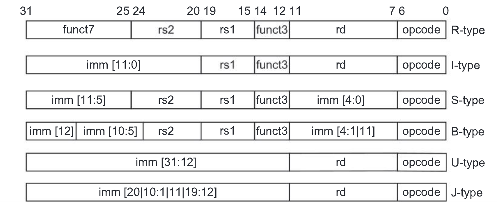{#fig-1-7 width=90%}

除 ISA 设计以外，计算机体系结构设计者面临的其他挑战在当前尤其突出，因为现在各种指令集之间的差别很小，而应用领域又各不相同。因此，从本书第 4 版开始，除了这里的快速回顾，指令集方面的大部分内容都放到了附录中（见附录 A 和附录 K）。

### 真正的计算机体系结构：设计组成和硬件以满足目标和功能需求 {-}

计算机的实现包括两部分：组成和硬件。*组成*（organization）这个术语涵盖计算机设计中的高层方面，如存储系统、存储器互连，以及处理器即 CPU（中央处理器，算术、逻辑、转移和数据传送都在这里实现）内部的设计。也可以用*微结构*（microarchitecture）这个术语来代替组成。例如，AMD EPYC 和 Intel Xeon 就是 ISA 相同、组成不同的两种处理器。两者都实现 x86 指令集，但流水线和 Cache 的组成很不一样。

一个微处理器中改为集成多个处理器以后，*核*这个术语也用来指处理器。人们不说「多处理器微处理器」，而是普遍采用了*多核*这个术语。中央处理器（CPU）这个术语，一般指微处理器中的一个核，因为 PMD、PC 和服务器里的微处理器几乎全都是多核的。

*硬件*指计算机的具体细节，包括计算机的详细逻辑设计和封装技术。同一系列的计算机常常 ISA 完全相同，组成也非常相似，只是硬件实现的细节不同。例如，Intel Core i7（见第 3 章）和 Intel Xeon E7（见第 5 章）几乎完全相同，但时钟频率和存储系统不同，因此 Xeon E7 用作服务器更有效。

本书中，*体系结构*一词涵盖计算机设计的全部三个方面：ISA、组成或微结构，以及硬件。

计算机体系结构设计者设计计算机时，既要满足功能需求，又要达到价格、功耗、性能和可用性目标。[图 1.8](#fig-1-8) 总结了设计一台新计算机时要考虑的需求。体系结构设计者常常还要确定功能需求是什么，这可能是一项繁重的任务。这些需求可能是由市场催生的具体特性。应用软件决定了计算机的使用方式，因此通常会左右某些功能需求的选择。如果某种 ISA 上已经有大量软件，体系结构设计者可能会决定让新计算机实现现有的指令集。某一类应用如果有很大的市场，就可能促使设计者纳入一些需求，使计算机在这个市场上具有竞争力。后面各章会深入讨论其中许多需求和特性。

[图 1.8　体系结构设计者面对的部分关键功能需求。左栏说明需求的类别，右栏给出具体的例子。右栏还注明了讨论这些具体问题的章节和附录。]{#fig-1-8 .caption}

| 功能需求 | 需要的或支持的典型特性 |
|---|---|
| *应用领域* | *计算机的目标* |
| 物联网/嵌入式计算 | 往往需要对图形或视频（或其他面向具体应用的扩展）提供专门支持；可能需要功耗限制和功耗控制；实时约束（第 2、3、5、7 章；附录 A 和附录 E） |
| 个人移动设备 | 一系列任务的实时性能，包括图形、视频和音频的交互性能；能效（第 2–5 章和第 7 章；附录 A） |
| 通用桌面 | 一系列任务的均衡性能，包括图形、视频和音频的交互性能（第 2–5 章；附录 A） |
| 服务器 | 支持数据库和事务处理；增强可靠性和可用性；支持可扩展性和安全性（第 2、5、7 章；附录 A、D、F） |
| 集群/仓库级计算机 | 许多独立任务的吞吐率性能；内存纠错；能耗正比性；安全性（第 2、6、7 章；附录 F） |
| *软件兼容的层次* | *决定计算机可以使用多少现有软件* |
| 程序设计语言级 | 对设计者最灵活；需要新的编译器（第 3、5、7 章；附录 A） |
| 目标代码或二进制兼容 | 指令系统结构完全确定，灵活性很小，但不需要在软件或移植程序上投入（附录 A） |
| *操作系统需求* | *支持所选操作系统必需的特性（第 2 章；附录 B）* |
| 地址空间大小 | 非常重要的特性（第 2 章）；可能限制应用 |
| 存储管理 | 现代操作系统必需；可以是分页的，也可以是分段的（第 2 章） |
| 保护 | 操作系统和应用的需要各不相同：分页还是分段；虚拟机（第 2 章） |
| *标准* | *市场可能要求符合某些标准* |
| 浮点 | 格式和算术：IEEE 754 标准（附录 J），用于图形、信号处理或 AI 的特殊算术 |
| I/O 接口 | 用于 I/O 设备：Serial ATA、Serial Attached SCSI、PCI Express（附录 D 和附录 F） |
| 操作系统 | UNIX、Windows、Linux、iOS、Android |
| 网络 | 需要支持各种网络：以太网、Infiniband（附录 F） |
| 程序设计语言 | 语言（ANSI C、C++、Java、Fortran）会影响指令集（附录 A） |

体系结构设计者还必须了解工艺和计算机使用两方面的重要趋势，因为这些趋势不仅影响未来的成本，也影响一种体系结构的寿命。

<!--chapter:end:01-fundamentals-03.Rmd-->

## 工艺的发展趋势 {#sec-1-4}

一种 ISA 要想长久流行，设计时就必须经得起计算机工艺的快速变化。毕竟，一种成功的新 ISA 可能沿用几十年，例如 IBM 大型机的核心已经用了 60 年。体系结构设计者必须为工艺的变化做好规划，这样才能延长一台成功的计算机的寿命。

要规划一台计算机的演进，设计者必须了解实现工艺的快速变化。现代计算机离不开下面五种实现工艺，它们的变化都非常快：

* *集成电路逻辑工艺*。过去，晶体管密度每年提高大约 35%，4 年多一点就翻两番。晶片面积的增长更难预测，也更慢，每年 10% 到 20%。两者合在一起，传统上一块芯片上的晶体管数每年增长大约 40% 到 55%，也就是每 18～24 个月翻一番。前面说过，这一趋势叫作摩尔定律。器件速度的提高要慢一些，我们后面会讨论。令人吃惊的是，摩尔定律正在放缓。每块芯片上的器件数还在增加，但增速越来越慢。和摩尔定律时代不同，我们预计每一代新工艺都会让翻番所需的时间拉长（见 [1.12 节](#sec-1-12)的[图 1.24](#fig-1-24)）。
* *半导体 DRAM*（动态随机访问存储器）。这种工艺是主存的基础，我们在第 2 章讨论它。DRAM 的增长已经大大放慢，不再像过去那样每 3 年翻两番。8 Gbit 的 DRAM 在 2014 年就已出货，16 Gbit 的 DRAM 却到 2019 年才出货。下一步是 2023 年的 24 Gbit，这是第一种容量不是 2 的幂的 DRAM。再下一个目标是 32 Gbit DRAM。这就是说，DRAM 容量从 8 Gbit 翻两番到 32 Gbit，至少要用 10 年。今后的增长面临很大的挑战（Kim，2005）。第 2 章提到了另外几种有望取代 DRAM 的工艺，但现在越来越清楚，DRAM 不大可能有替代者。
* *半导体 Flash*（电可擦除可编程只读存储器）。这种非易失的半导体存储器是 PMD 的标准存储设备。它迅速普及，容量也随之快速增长。在服务器领域，2024 年基于 Flash 的固态盘（SSD）占了磁盘销量的一半以上。近几年，每块 Flash 芯片的容量每年提高大约 50%～60%，大约每 3 年翻一番。目前，按每位计算，Flash 的价格只有 DRAM 的 1/10～1/8。第 2 章会介绍 Flash 存储器。今后提高容量仍将靠向第三维发展，即在晶圆加工时加上更多的层，同时缩小存储单元的尺寸。
* *磁盘工艺*。1990 年以前，磁盘密度每年提高大约 30%，3 年翻一番。此后提高到每年 60%，1996 年更是达到每年 100%。2004 年到 2011 年间，又降到每年大约 40%，即每 2 年翻一番。过去十年里，磁盘的改进放慢到每年不到 5%，要 15～20 年才翻一番。提高磁盘容量的一个办法是在面密度不变的情况下增加盘片，但 3.5 英寸规格的磁盘在 1 英寸的厚度内已经装了 10 张盘片。现在按每位计算，硬盘的价格只有 Flash 的 1/5～1/3、DRAM 的 1/200～1/100。将来，为了容纳更多的盘片，封装的厚度很可能要增加，这可能会减少单位体积内的磁盘数。这种工艺是服务器级和仓库级存储的核心，我们在附录 D 详细讨论它的发展趋势。
* *网络工艺*。网络性能既取决于交换机的性能，也取决于传输系统的性能。我们在附录 F 讨论网络的发展趋势。

这些工艺决定了计算机的设计。在速度和工艺不断改进的情况下，一台计算机的寿命可能有 3～7 年。工程师往往针对下一代工艺来设计，因为他们知道，等产品开始批量出货时，下一代工艺可能性价比最高，或者有性能优势。

工艺一般是连续进步的，但进步带来的影响可能是跳跃式的：工艺一旦跨过某个门槛，就能提供一种新的功能。例如，20 世纪 80 年代初，MOS 工艺发展到一块芯片上能放下 25,000 到 50,000 个晶体管，单芯片的 32 位微处理器才有可能做出来。到 80 年代末，一级 Cache 可以放到芯片上了。后来的进步又把二级甚至三级 Cache 也集成进来。这样，处理器内部、处理器和各级 Cache 之间不再需要跨芯片传输，性价比和性能能耗比都有可能大幅提高。工艺达到一定程度之前，这样的设计根本无法实现。这样的工艺门槛并不少见，它们对各种各样的设计决策都有重大影响。

### 性能趋势：带宽胜过延迟 {-}

我们将在 [1.8 节](#sec-1-8)看到，*带宽*或*吞吐率*是指在给定时间内完成的工作总量，例如磁盘传输时每秒多少兆字节。*延迟*或*响应时间*则是一个事件从开始到完成所经历的时间，例如一次磁盘访问要多少毫秒。[图 1.9](#fig-1-9) 画出了微处理器、内存、网络和磁盘在各个技术里程碑上带宽和延迟的相对改进。[图 1.10](#fig-1-10) 更详细地列出了这些例子和里程碑。

{#fig-1-9 width=60%}

[图 1.10　微处理器、内存、网络和磁盘 25～45 年间的性能里程碑。微处理器的里程碑是几代 IA-32 处理器，从 16 位总线、微码实现的 80286，到 64 位总线、多核、乱序执行、超流水、片上有三级 Cache 的 Xeon。内存模块的里程碑从 16 位宽的普通 DRAM，到 64 位宽的第 5 版双倍数据率同步 DRAM。以太网从 10 Mbit/s 发展到大约 2026 年的 800 Gbit/s。磁盘的里程碑按转速划分，到 2016 年从 3600 RPM 提高到 15,000 RPM，2021 年又回到 7200 RPM。每种情况给出的都是最好情况下的带宽；延迟是假定没有竞争时完成一次简单操作的时间。根据 Patterson, D., 2004. Latency lags bandwidth. Commun. ACM 47 (10), 71–75 更新。]{#fig-1-10 .caption}

| 微处理器 | Intel 80286 | Intel 80386 | Intel 80486 | Intel Pentium | Intel Pentium Pro | Intel Pentium 4 | Intel Core i7 | Intel Core i7 | Intel Xeon |
|---|---|---|---|---|---|---|---|---|---|
| 特点 | 16 位地址/总线，微码 | 32 位地址/总线，微码 | 5 级流水线，片上指令 Cache 和数据 Cache，FPU | 2 路超标量，64 位总线 | 乱序 3 路超标量 | 乱序超流水，片上 L2 Cache | 多核乱序，16 路，片上 8MB L3 Cache，Turbo | 多核乱序，16 路，片上 40MB L3 Cache，Turbo | 多核乱序，16 路，片上 40MB L3 Cache，Turbo |
| 年份 | 1982 | 1985 | 1989 | 1993 | 1997 | 2001 | 2010 | 2015 | 2021 |
| 晶片面积（mm²） | 47 | 43 | 81 | 90 | 308 | 217 | 240 | 122 | 400 |
| 晶体管数 | 134,000 | 275,000 | 1,200,000 | 3,100,000 | 5,500,000 | 42,000,000 | 1,170,000,000 | 1,750,000,000 | |
| 每芯片处理器数 | 1 | 1 | 1 | 1 | 1 | 1 | 4 | 4 | 8 |
| 延迟（时钟周期） | 6 | 5 | 5 | 5 | 10 | 22 | 14 | 14 | 14 |
| 总线宽度（bits） | 16 bits | 32 bits | 32 bits | 64 bits | 64 bits | 64 bits | 196 | 196 | 196 |
| 时钟频率（MHz） | 13 | 16 | 25 | 66 | 200 | 1500 | 3333 | 4000 | 2800 |
| Turbo 模式（MHz） | -- | -- | -- | -- | -- | -- | 3600 | 4200 | 5100 |
| 带宽（峰值 MIPS） | 2 | 6 | 25 | 132 | 600 | 4500 | 50000 | 64000 | 89600 |
| 延迟（ns） | 320 | 313 | 200 | 76 | 50 | 15 | 4 | 4 | 5 |

| 内存模块 | DRAM | 页模式 DRAM | 快速页模式 DRAM | 快速页模式 DRAM | SDRAM | DDR DRAM | DDR3 SDRAM | DDR4 SDRAM | DDR5 SDRAM |
|---|---|---|---|---|---|---|---|---|---|
| 模块宽度（bits） | 16 bits | 16 bits | 32 bits | 64 bits | 64 bits | 64 bits | 64 bits | 64 bits | 64 bits |
| 年份 | 1980 | 1983 | 1986 | 1993 | 1997 | 2000 | 2010 | 2016 | 2021 |
| 每片 DRAM 容量（Mbit） | 0.06 | 0.25 | 1.00 | 16.00 | 64.00 | 256.00 | 2048 | 4,096 | 16,384 |
| 每片 DRAM 引脚数 | 16 | 16 | 18 | 20 | 54 | 66 | 134 | 134 | 288 |
| 带宽（MB/s） | 13 | 40 | 160 | 267 | 640 | 1,600 | 16,000 | 27,000 | 51,000 |
| 延迟（ns） | 225 | 170 | 125 | 75 | 62 | 52 | 50 | 48 | 46 |

| 局域网 | 以太网 | 快速以太网 | 千兆以太网 | 万兆以太网 | 100G 以太网 | 400G 以太网 | 800G 以太网 |
|---|---|---|---|---|---|---|---|
| 年份 | 1978 | 1995 | 1999 | 2003 | 2010 | 2017 | 2024? |
| IEEE 标准 | 802.3 | 802.3u | 802.3ab | 802.3ac | 802.3ba | 802.3bs | 802.3df |
| 带宽（Mbit/s） | 10 | 100 | 1000 | 10000 | 100,000 | 400,000 | 800,000 |
| 延迟（μs） | 3000 | 500 | 340 | 190 | 100 | 60 | 60 |

| 硬盘 | 3600 RPM | 5400 RPM | 7200 RPM | 10000 RPM | 15000 RPM | 15,000 RPM | 15,000 RPM | 7,200 RPM |
|---|---|---|---|---|---|---|---|---|
| 年份 | 1983 | 1990 | 1994 | 1998 | 2003 | 2010 | 2016 | 2021 |
| 容量（GB） | 0.03 | 1.4 | 4.3 | 9.1 | 73.4 | 600 | 600 | 20,000 |
| 磁盘外形尺寸 | 5.25 in. | 5.25 in. | 3.5 in. | 3.5 in. | 3.5 in. | 3.5 in. | 3.5 in. | 3.5 in. |
| 盘片直径 | 5.25 in. | 5.25 in. | 3.5 in. | 3.0 in. | 2.5 in. | 2.5 in. | 2.5 in. | 2.5 in. |
| 接口 | | | | | | | SAS | SATA 6 Gbps |
| 带宽（MB/s） | 1 | 4 | 9 | 24 | 86 | 204 | 250 | 285 |
| 延迟（ms） | 48.3 | 17.1 | 12.7 | 8.8 | 5.7 | 5.6 | 5.6 | 12.0 |

性能是区分微处理器和网络产品的主要指标，所以它们的提高最大：带宽提高了 45,000～80,000 倍，延迟提高了 50～90 倍。内存和磁盘一般更看重容量而不是性能，所以容量提高得更多；即便如此，它们的带宽也提高了 450～4000 倍，远远超过延迟 5～9 倍的提高。

显然，在这些技术中，带宽的进步都超过了延迟，而且很可能还会继续如此。计算机设计者应当据此做好规划。

### 晶体管性能和连线的缩放 {-}

集成电路工艺用*特征尺寸*来刻画。特征尺寸是晶体管或连线在 x 方向或 y 方向上的最小尺寸。特征尺寸从 1971 年的 10 μm 缩小到 2022 年的 0.007 μm。事实上，我们已经换了单位，2022 年的量产工艺叫作「7 nm」，3 nm 芯片也正在推进。Intel 宣布了 1.8 nm 芯片的计划，并把它改称为 18Å（埃），为更小的几何尺寸铺路。每平方毫米硅片上的晶体管数取决于单个晶体管的面积，因此特征尺寸线性缩小，晶体管密度就按平方增长。

但提高晶体管的性能要复杂得多。特征尺寸缩小时，器件在水平方向上按平方缩小，在垂直方向上也会缩小。垂直方向缩小了，就必须降低工作电压，才能保证晶体管正确、可靠地工作。这几种缩放因素结合在一起，使晶体管性能和工艺特征尺寸之间的关系十分复杂。粗略地说，过去晶体管性能随特征尺寸的缩小而线性提高。

晶体管数按平方增长，晶体管性能却只是线性提高，这既是挑战也是机遇，计算机体系结构设计者正是为此而生的！微处理器发展早期，密度提高得更快，人们借此迅速从 4 位微处理器发展到 8 位、16 位、32 位，再到 64 位。近些年，密度的提高支撑了单芯片多处理器、更宽的 SIMD 部件，以及第 2～5 章中推测执行和 Cache 方面的许多创新。

虽然特征尺寸缩小时晶体管的性能一般会提高，集成电路中的连线却不会。具体来说，连线的信号延迟与它的电阻和电容之积成正比。当然，特征尺寸缩小后连线变短了，但单位长度的电阻和电容变差了。这种关系很复杂，因为电阻和电容都取决于工艺的具体细节、连线的几何形状、连线上的负载，甚至还取决于连线和其他结构是否相邻。偶尔也有工艺改进（例如引入铜互连）能一次性地改善连线延迟。

但总的来说，工艺缩放时，连线延迟的改善远不如晶体管性能，这给设计者带来了更多挑战。除了功耗限制以外，连线延迟也已经成为大型集成电路的一大设计障碍，而且往往比晶体管的开关延迟更关键。信号在连线上的传播延迟占去的时钟周期比例越来越大，但现在功耗起的作用比连线延迟还要大。

<!--chapter:end:01-fundamentals-04.Rmd-->

## 集成电路功耗和能耗的发展趋势 {#sec-1-5}

今天，几乎每一类计算机的设计者面临的最大挑战都是能耗。第一，电源要引入芯片并分配到芯片各处，现代微处理器仅电源和地就要占用几百个引脚和多个互连层。第二，功耗会转化为热量散发出来，这些热量必须排走。

### 功耗和能耗：系统的视角 {-}

系统设计者或用户应该怎样看待性能、功耗和能耗？从系统设计者的角度看，主要关心三个问题。

第一，处理器最多需要多大的功率？满足这个需求对保证系统正确工作可能很重要。例如，如果处理器试图汲取的功率超过供电系统所能提供的功率（即需要的电流超过系统所能供给的电流），结果通常是电压下降，可能导致器件工作失常。现代处理器的功耗变化范围很大，峰值电流很高，因此提供了电压索引（voltage indexing）方法，让处理器降低速度，在更宽的范围内调节电压。显然，这样做会降低性能。

第二，持续功耗是多少？这个指标通常称为*热设计功耗*（TDP），因为它决定了散热要求。TDP 既不是峰值功耗（峰值功耗往往是 TDP 的 1.5 倍），也不是某次计算中实际消耗的平均功耗（平均功耗很可能还要更低）。系统电源的额定功率一般高于 TDP，散热系统通常按等于或高于 TDP 来设计。如果散热不足，处理器的结温就会超过最大值，导致器件失效，甚至可能造成永久损坏。最高功耗（以及由此带来的发热和温升）可能超过 TDP 规定的长期平均值，因此现代处理器提供了两项功能来帮助管理发热。一是温度接近结温上限时，电路会降低时钟频率，从而降低功耗。二是如果这种方法仍不能奏效，就触发第二级热过载保护，切断芯片的电源。

设计者和用户要考虑的第三个因素是能耗和能效。回忆一下，功耗就是单位时间的能耗：1 W = 1 J/s。比较处理器时，应该用能耗还是功耗作为指标？一般来说，能耗总是更好的指标，因为它与一项具体任务以及完成这项任务所需的时间联系在一起。具体来说，完成一个工作负载的能耗，等于平均功耗乘以这个工作负载的执行时间。

所以，要想知道两个处理器中哪个完成某项任务的效率更高，我们需要比较执行这项任务的能耗，而不是功耗。例如，处理器 A 的平均功耗可能比处理器 B 高 20%，但如果 A 执行这项任务只用 B 所需时间的 70%，A 的能耗就是 1.2 × 0.7 = 0.84，显然更好。

有人可能会说，在大型服务器或云里，人们常常假定工作负载是无限的，因此只考虑平均功耗就够了。但这种看法是有误导性的。如果云中配置的是处理器 B 而不是 A，那么消耗同样多的能量，云完成的工作就更少。用能耗来比较各种方案，就能避免这个陷阱。只要工作负载是固定的，不管是仓库那么大的云还是一部智能手机，比较能耗都是比较不同计算机方案的正确方法，因为云的电费和智能手机的电池续航都由所消耗的能量决定。

功耗什么时候是一个有用的度量？它主要的正当用途是作为约束条件，例如，一块风冷芯片的功耗可能限制在 300 W 以内。工作负载固定时，功耗也可以用作指标，但这时它只是真正的指标「每项任务的能耗」的一种变形。

### 微处理器内部的能耗和功耗 {-}

CMOS 芯片的能耗传统上主要来自晶体管的开关，称为*动态能耗*。每个晶体管所需的能量与它驱动的容性负载和电压平方的乘积成正比：

$$
\text{能耗}_{\text{动态}} \propto \text{容性负载} \times \text{电压}^2
$$

这个式子给出的是 0→1→0 或 1→0→1 这样一个逻辑跳变脉冲的能量。于是，单次跳变（0→1 或 1→0）的能量是：

$$
\text{能耗}_{\text{动态}} \propto 1/2 \times \text{容性负载} \times \text{电压}^2
$$

每个晶体管所需的功率，就是一次跳变的能量乘以跳变的频率：

$$
\text{功耗}_{\text{动态}} \propto 1/2 \times \text{容性负载} \times \text{电压}^2 \times \text{开关频率}
$$

任务固定时，降低时钟频率能降低功耗，但不能降低能耗。

显然，降低电压能大幅降低动态功耗和动态能耗，因此 20 年里电压从 5 V 降到了略低于 1 V。容性负载取决于连接到一个输出端的晶体管数和工艺，工艺决定了连线和晶体管的电容。

**例题**　现在有些微处理器设计成电压可调，电压降低 15% 时，频率可能随之降低 15%。这对动态能耗和动态功耗有什么影响？

**解答**　电容不变，因此能耗之比就是电压之比的平方：

$$
\frac{\text{能耗}_{\text{新}}}{\text{能耗}_{\text{旧}}} = \frac{(\text{电压} \times 0.85)^2}{\text{电压}^2} = 0.85^2 = 0.72
$$

动态能耗降到原来的 72% 左右。功耗还要再乘上频率之比：

$$
\frac{\text{功耗}_{\text{新}}}{\text{功耗}_{\text{旧}}} = 0.72 \times \frac{\text{开关频率} \times 0.85}{\text{开关频率}} = 0.61
$$

动态功耗降到原来的 61% 左右。

从一代工艺过渡到下一代工艺时，发生开关的晶体管数和开关频率都在增加，这种增加的作用超过了负载电容和电压降低的作用，因此功耗和能耗总体上是增长的。最早的微处理器功耗不到 1 W，最早的 32 位微处理器（如 Intel 80386）大约用 2 W，而 2.4 GHz 的 Intel Xeon Platinum 8380 要消耗 270 W。这些热量要从一块边长约 2.5 cm 的芯片上散发出去，已经接近风冷所能达到的极限，而这种状况已经持续了将近十年。（Intel 和 NVIDIA 最近发布的产品中有 TDP 接近 1000 W 的芯片，需要液冷。）

由上面的式子可以预料，如果不能降低电压，也不能提高每块芯片的功耗，时钟频率的增长就会放慢。[图 1.11](#fig-1-11) 表明，2003 年以来情况确实如此，就连[图 1.1](#fig-1-1) 中每年性能最高的微处理器也是这样。注意，时钟频率趋于平缓的这段时期，正对应着[图 1.1](#fig-1-1) 中性能提高缓慢的那几段。

 中微处理器时钟频率的增长。1978 年到 1986 年，时钟频率每年提高不到 15%，性能每年提高 22%。1986 年到 2003 年是性能每年提高 52% 的「复兴时期」，这期间时钟频率迅速提高，每年将近 40%。此后时钟频率几乎没有变化。从 2008 年起，Intel 提供了 Turbo 模式，芯片可以临时以更高的时钟频率运行，直到温度过高为止。即使是 Turbo 模式，2011 年到 2022 年也只是每年提高约 2%。](images/ch01/fig-1-11.png){#fig-1-11 width=90%}

配电、散热和防止热点已经成为越来越难的挑战。现在，使用晶体管的主要约束是能耗；过去则是硅片面积本身。因此，尽管时钟频率不再提高、电源电压保持不变，现代微处理器还是提供了许多技术来设法提高能效：

1. *把「什么都不做」做好*（Do nothing well）。今天的大多数微处理器会关掉不工作模块的时钟，以节省能耗和动态功耗。例如，如果没有浮点指令在执行，就关掉浮点部件的时钟。如果有些核空闲，就停掉它们的时钟。
2. *动态电压频率调节*（DVFS）。第二种技术直接来自前面的公式。PMD、笔记本电脑乃至服务器都有活动较少的时期，这时不需要以最高的时钟频率和电压运行。现代微处理器通常提供几档可供选用的时钟频率和电压，以较低的功耗和能耗运行。[图 1.12](#fig-1-12) 画出了一台服务器在 2.4 GHz、1.8 GHz 和 1 GHz 三种时钟频率下，工作负载减小时 DVFS 可能节省的功耗。每降一档，服务器总功耗大约节省 10% 到 15%。
3. *针对常见情况设计*。PMD 和笔记本电脑经常处于空闲状态，因此内存和存储设备提供低功耗模式来节省能耗。例如，DRAM 有一系列功耗逐级降低的模式，用来延长 PMD 和笔记本电脑的电池续航；也有人提出让磁盘在不用时转得慢一些，以节省功耗。但是，在这些模式下不能访问 DRAM 或磁盘，所以不管访问频率多低，读写时都必须回到完全活动的模式。前面说过，PC 的微处理器则是按高温下高负荷运行来设计的，依靠片上温度传感器检测何时应自动降低活动，以免过热。有了这种「紧急降速」，制造商可以按更典型的情况来设计，如果真有人运行了功耗远高于一般水平的程序，再依靠这一安全机制。
4. *超频*。Intel 从 2008 年开始提供 *Turbo 模式*：芯片判断可以安全地短时间以更高的时钟频率运行，可能只在少数几个核上这样做，直到温度开始上升为止。例如，2.8 GHz 的 Xeon E-2378G 可以短时间以 5.1 GHz 运行（见[图 1.11](#fig-1-11)）。事实上，[图 1.1](#fig-1-1) 中 2008 年以来每年性能最高的微处理器都提供临时超频，到 2016 年为止大约比标称时钟频率高 10%，此后 Turbo 模式要高 30% 到 80%。运行单线程代码时，这些微处理器可以关掉除一个核以外的所有核，让这个核运行得更快。注意，操作系统虽然可以关掉 Turbo 模式，但 Turbo 模式启用后并不会发出通知，所以程序员可能会惊讶地发现，自己程序的性能会随室温变化！
5. *异构核*。手机早就同时配有快速、高功耗的核和慢速、高能效的核。例如，苹果 iPhone 14 Pro 智能手机的芯片有两个高性能核和四个高能效核。这样做的目的是节省能耗：在保持用户期望的响应速度的前提下，用能效最高的处理器来运行应用。智能手机甚至还有专用于特定窄领域的处理器，进一步提高这些任务的能效。

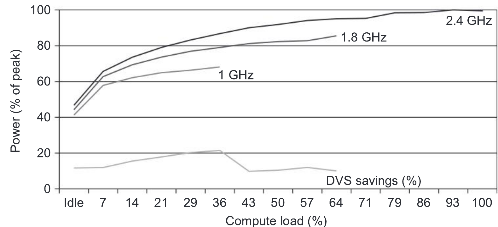{#fig-1-12 width=90%}

虽然传统上认为动态功耗是 CMOS 功耗的主要来源，但静态功耗正在成为一个重要问题，因为即使晶体管关断，也有漏电流流过：

$$
\text{功耗}_{\text{静态}} \propto \text{静态电流} \times \text{电压}
$$

也就是说，静态功耗与器件数成正比。

因此，即使晶体管处于空闲状态，增加晶体管数也会增加功耗；而且晶体管尺寸越小，处理器的漏电流越大。结果，功耗非常低的系统甚至会切断不工作模块的电源（称为*电源门控*），以控制漏电造成的损耗。2011 年，漏电的目标是占总功耗的 25%，而高性能设计中的漏电有时远远超过这个目标。这类芯片的漏电可能高达 50%，部分原因是大容量的 SRAM Cache 需要供电才能保住存储的值。（SRAM 中的 S 就是 static，即静态。）要制止漏电，唯一的希望是切断芯片中部分电路的电源。

最后，处理器只是系统总能耗的一部分，所以用一个更快但能效较低的处理器，让系统其余部分得以进入睡眠模式，可能是合理的。这种策略称为*冲刺到停机*（race-to-halt）。

功耗和能耗的地位提高了，人们对一项创新的效率也就审视得更加严格。因此，现在的主要评价指标是每焦耳完成的任务数或每瓦性能，而不是过去的每平方毫米硅片的性能。这个新指标影响到利用并行性的方法，我们将在第 4 章和第 5 章看到。

### 能耗限制带来的计算机体系结构转变 {-}

晶体管的改进放慢了，于是计算机体系结构设计者必须另找办法来提高能效。事实上，在能耗预算的限制下，今天很容易设计出一个晶体管多到无法同时全部打开的微处理器。这种现象称为*暗硅*，意思是由于散热的约束，芯片的很大一部分在任何时刻都不能使用（是「暗」的）。这一现象促使体系结构设计者重新审视处理器设计的基本原理，以求更好的能耗-成本性能。

[图 1.13](#fig-1-13) 列出了现代计算机各种基本构件的能耗代价，从中可以看出它们之间的比例大得惊人。例如，一次 32 位浮点加法的能耗是一次 8 位整数加法的 50 倍。但差别最大的是存储器：一次 32 位 DRAM 访问的能耗将近 8 位加法的 200,000 倍。小容量 SRAM 的能效是 DRAM 的 175 倍，这说明了用好 Cache 和存储缓冲区的重要性。

[图 1.13　比较：TSMC 7 nm 工艺节点下各种算术运算以及访问 SRAM 和 DRAM 的能耗（Jouppi 等，2021）。]{#fig-1-13 .caption}

| 序号 | 操作 | 能耗（pJ） | 相对能耗 |
|---|---|---:|---:|
| 1 | Int 8 加法 | 0.007 | 1 |
| 2 | Int 32 加法 | 0.030 | 4 |
| 3 | BFloat 16 加法 | 0.110 | 16 |
| 4 | IEEE FP 16 加法 | 0.160 | 23 |
| 5 | IEEE FP 32 加法 | 0.380 | 54 |
| 6 | Int 8 乘法 | 0.070 | 10 |
| 7 | Int 32 乘法 | 1.480 | 211 |
| 8 | BFloat 16 乘法 | 0.210 | 30 |
| 9 | IEEE FP 16 乘法 | 0.340 | 49 |
| 10 | IEEE FP 32 乘法 | 1.310 | 187 |
| 11 | 从 8 KB SRAM 读 32 位 | 7.500 | 1,071 |
| 12 | 从 1 MB SRAM 读 32 位 | 14.000 | 2,000 |
| 13 | 从 DDR4 DRAM 读 32 位 | 1,300.000 | 185,714 |

每项任务能耗最小这一新的设计原则，加上[图 1.13](#fig-1-13) 中的相对能耗，为计算机体系结构开辟了一个新方向，我们在第 7 章介绍。领域专用处理器节省能耗的办法，一是减少宽位浮点运算，二是部署专用存储器来减少 DRAM 访问。省下来的能耗用于配置更多（位宽更窄的）运算部件，数量是传统处理器的 10～1000 倍。这类处理器虽然只能完成有限的一组任务，但完成这些任务比通用处理器快得多，能效也高得多。

就像医院里既有全科医生又有专科医生一样，在这个讲究能耗的世界里，计算机已经变成了通用核和专用核的组合：通用核什么任务都能做，专用核只做少数几件事，但做得极好，能效还更高。

### 计算机能耗对全球气候变化的影响 {-}

全球气候变化是当今社会面临的一个巨大挑战。计算的快速增长让人们对它的碳足迹产生了担忧，这种担忧是有道理的。

碳排放可以分成两类：

* *运行排放*，即运行硬件的能耗代价，对服务器来说还包括数据中心的开销；
* *隐含排放*，即在运行排放之外，再加上所涉及的全部部件在制造过程中排放的隐含碳，从芯片一直到数据中心的建筑。

隐含排放要难算得多，因为它要求把排放一层层追溯到最初的制造源头，再把中间各个环节直到最终产品的排放累加起来。

运行能耗为：

$$
\text{能耗} = \text{执行时间} \times \text{计算机台数} \times \text{每台计算机的平均功耗}
$$

（对数据中心来说，还要再乘一个因子，反映把能量输送给里面计算机的效率，这个因子叫作电源使用效率，第 6 章会介绍。）

能耗以千瓦时为单位，排放则以千克*二氧化碳当量*（CO~2~e）为单位，它把甲烷这类温室气体也包括在内。排放的计算公式为：

$$
\text{CO}_2\text{e} = \text{以 KWh 计的能耗} \times \text{每 KWh 的 CO}_2\text{e}
$$

能耗相对容易算出，最后一项却很难确定，因为它随主要能源的不同，在不同地区之间相差 5～10 倍（Patterson 等，2022）。煤是最脏的能源；天然气干净一些，但仍然含碳；太阳能、风能、核能和水电则是无碳能源的例子。以谷歌的能源为例，2020 年新加坡的数据中心所用能源只有 4% 是无碳的，而芬兰的数据中心用的能源有 94% 是无碳的。即使在同一个国家内，差别也可能很大：在美国，内华达州数据中心所用能源有 19% 是无碳的，艾奥瓦州则是 93%。谷歌之所以能达到这么高的比例，是因为它与可再生能源供应方签订合同，以减少当地电网电力的碳排放。就艾奥瓦州而言，那里昼夜都有充足的风能。

计算机体系结构设计者可以从两方面帮助减少信息技术的碳足迹：一是提高自己所设计计算机的运行能效，二是学会在制造自己的设计时减少隐含碳足迹。

<!--chapter:end:01-fundamentals-05.Rmd-->

## 成本的变化趋势 {#sec-1-6}

有些计算机设计不太看重成本，特别是超级计算机。但对成本敏感的设计越来越重要。事实上，过去 40 年里，计算机产业的一条主线就是利用工艺进步，既提高性能，也降低成本。

教科书讲性价比时，常常只讲性能，不讲成本。原因有两个：一是成本总在变化，写进书里很快就会过时；二是成本问题很微妙，不同的行业领域情况又各不相同。尽管如此，计算机体系结构设计者必须了解成本和影响成本的因素。在成本是重要考量的设计中，一项新功能是否应当加入，要靠这些知识才能作出明智的判断。（想象一下，建筑师设计摩天大楼，却对钢梁和混凝土的价格一无所知！）

本节讨论影响计算机成本的主要因素，以及这些因素随时间发生的变化。

### 时间、产量和商品化的影响 {-}

即使基本的实现工艺没有明显改进，制造出来的计算机部件成本也会随时间下降。推动成本下降的基本原理是*学习曲线*：制造成本随时间不断降低。学习曲线本身最好用*成品率*（yield）的变化来衡量。成品率是指制造出来的器件中通过测试的百分比。不论是芯片、电路板还是整个系统，成品率提高一倍的设计，成本就降低一半。

要预测一个产品在整个生命周期里的成本，关键是弄清学习曲线如何提高成品率。例如，DRAM 每 GB 的价格长期以来一直在下降。除了缺货或供过于求的时期，DRAM 的定价往往与成本紧密相关，因此 DRAM 的价格和成本走势基本一致。

微处理器的价格也随时间下降。但微处理器的标准化程度不如 DRAM，因此价格和成本的关系更复杂。在竞争激烈的时期，价格往往紧跟成本，不过微处理器厂商大概很少亏本销售。

决定成本的第二个关键因素是产量。产量增加会从几个方面影响成本。首先，产量增加会缩短走完学习曲线所需的时间，因为这段时间部分地与制造出的系统（或芯片）数量成正比。其次，产量增加提高了采购和制造的效率，从而降低成本。有些设计者根据经验估计，产量每翻一番，成本大约降低 10%。此外，产量越大，每台计算机要分摊的开发成本就越少，成本和售价因此可以更接近，同时仍有利润。

*大宗商品*是指由多家厂商大批量销售、彼此基本相同的产品。杂货店货架上出售的几乎所有商品都是大宗商品，标准 DRAM、闪存、显示器和键盘也是。过去 40 年里，个人计算机产业的很大一部分已经成为大宗商品业务，主要是制造台式机和笔记本电脑，这些机器通常运行微软的 Windows。

许多大宗商品厂商出售的产品几乎完全相同，因此市场竞争非常激烈。这种竞争当然会缩小成本和售价之间的差距，但它也降低了成本本身。成本之所以下降，是因为大宗商品市场既有产量，产品定义又明确，于是多家供应商可以竞相为这种产品制造部件。部件供应商之间相互竞争，供应商又能借助产量提高效率，整个产品的成本因此更低。这种竞争使计算机行业的低端能够取得比其他领域更好的性价比，低端市场也增长得更快，只是利润非常有限（任何大宗商品业务通常都是如此）。

### 集成电路的成本 {-}

一本讲计算机体系结构的书，为什么要用一节来讲集成电路的成本？计算机市场的竞争越来越激烈，磁盘、闪存、DRAM 等标准部件在每个系统的成本中都占了相当大的比重。于是，在不同计算机之间存在差别的那部分成本中，集成电路所占的比重越来越大，在产量大、对成本敏感的那部分市场中尤其如此。事实上，个人移动设备（PMD）依赖*片上系统*（SOC），集成电路的成本因此占了 PMD 成本的大部分。所以，计算机设计者要了解当今计算机的成本，就必须了解芯片的成本。

集成电路的成本已经呈指数下降，但硅片制造的基本流程没有变：*晶圆*（wafer）仍然要先测试，再切成一个个*晶片*（die），然后封装（见[图 1.14](#fig-1-14)～[图 1.16](#fig-1-16)）。因此，一个封装好的集成电路的成本为

$$
\text{集成电路成本} = \frac{\text{晶片成本} + \text{晶片测试成本} + \text{封装和终测成本}}{\text{终测成品率}}
$$

本节着重讨论晶片的成本，测试和封装方面的关键问题放在最后概括介绍。

要预测每片晶圆上有多少个好的芯片，首先要知道一片晶圆上能放下多少个晶片，然后要学会预测其中有多大比例能正常工作。有了这两项，预测成本就很简单了：

$$
\text{晶片成本} = \frac{\text{晶圆成本}}{\text{每片晶圆的晶片数} \times \text{晶片成品率}}
$$

芯片成本公式中这第一项最值得关注的特点是它对晶片尺寸很敏感，下面就会看到这一点。

每片晶圆的晶片数大约等于晶圆面积除以晶片面积。更精确的估算公式是

$$
\text{每片晶圆的晶片数} = \frac{\pi \times (\text{晶圆直径}/2)^2}{\text{晶片面积}} - \frac{\pi \times \text{晶圆直径}}{\sqrt{2 \times \text{晶片面积}}}
$$

第一项是晶圆面积（$\pi r^2$）与晶片面积之比。第二项用来修正「方钉插圆孔」的问题，也就是圆形晶圆边缘附近的那些矩形晶片。用周长（$\pi d$）除以正方形晶片的对角线，得到的大约就是沿边缘分布的晶片数。

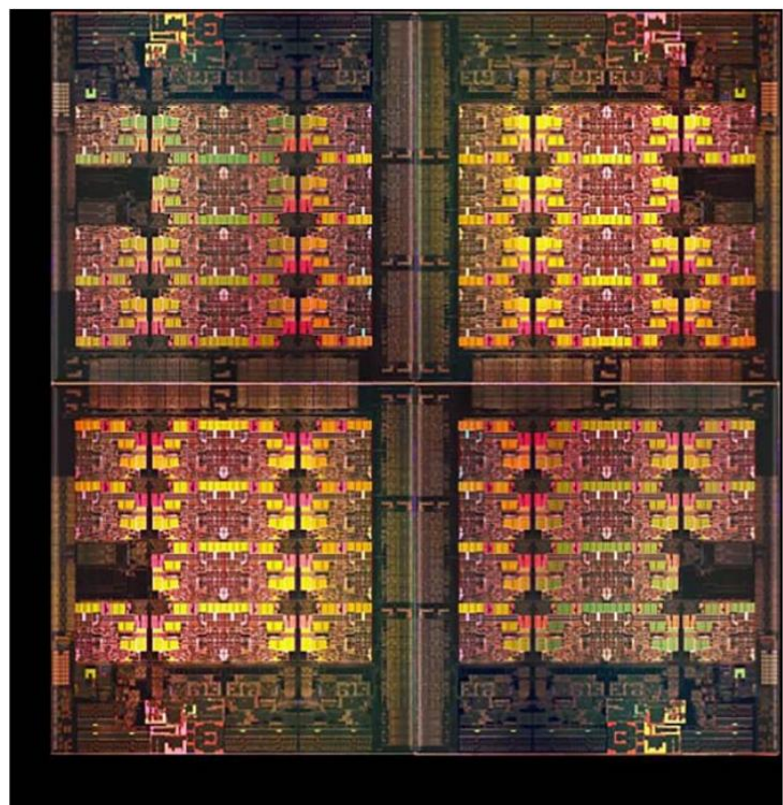{#fig-1-14 width=70%}

 的微处理器晶片上标出各部分的功能。*UPI*（Ultra Path Interconnect）是 Intel 在插座之间使用的点对点互连。*PCIe* 是一种标准的高速串行扩展总线，用来连接 GPU、网络接口和存储设备。*Memory* 块是 DDR5 DRAM 的内存控制器。*Accelerators* 块包括对高级矩阵扩展（AMX）和高级向量扩展（AVX）的硬件支持、一个用于加速加密和数据压缩/解压缩的引擎（QuickAssist 技术），以及名副其实的数据流加速器（DSA）。（Sapphire Rapids 还有一个与高带宽存储器（HBM）封装在一起的版本，HBM 接口也在 Accelerators 块中。）](images/ch01/fig-1-15.png){#fig-1-15 width=80%}

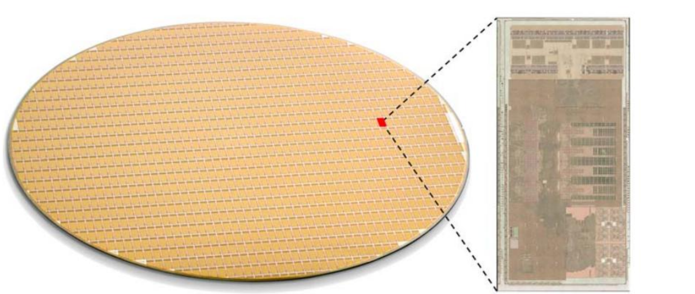{#fig-1-16 width=90%}

**例题**　一片 300 mm（30 cm）的晶圆，晶片边长分别为 1.5 cm 和 1.0 cm 时，每片晶圆各有多少个晶片？

**解答**　晶片面积为 2.25 cm² 时：

$$
\text{每片晶圆的晶片数} = \frac{\pi \times (30/2)^2}{2.25} - \frac{\pi \times 30}{\sqrt{2 \times 2.25}} = \frac{706.9}{2.25} - \frac{94.2}{2.12} = 270
$$

大晶片的面积是小晶片的 2.25 倍，所以每片晶圆上的小晶片数大约是大晶片的 2.25 倍（640/270 = 2.37）：

$$
\text{每片晶圆的晶片数} = \frac{\pi \times (30/2)^2}{1.00} - \frac{\pi \times 30}{\sqrt{2 \times 1.00}} = \frac{706.9}{1.00} - \frac{94.2}{1.41} = 640
$$

不过，这个公式给出的只是每片晶圆上晶片数的最大值。关键问题是：一片晶圆上*好的*晶片占多大比例，也就是*晶片成品率*是多少？一个简单的集成电路成品率模型假设缺陷在晶圆上随机分布，并且成品率与制造工艺的复杂度成反比，由此得到：

$$
\text{晶片成品率} = \text{晶圆成品率} \times 1/(1 + \text{单位面积缺陷数} \times \text{晶片面积})^N
$$

这个 Bose-Einstein 公式是通过观察许多条生产线的成品率总结出来的经验模型（Sydow，2006），至今仍然适用。*晶圆成品率*考虑的是整片报废的晶圆，这些晶圆上的晶片不必逐个测试。为简单起见，我们假设晶圆成品率为 100%。单位面积缺陷数衡量的是制造中随机出现的缺陷。2022 年，7 nm 和 5 nm 工艺的这一数值一般都是每平方英寸 0.075 个缺陷，换成公制是每平方厘米 0.012 个缺陷。最后，$N$ 是一个称为工艺复杂度因子的参数，用来衡量制造的难度。2022 年 7 nm 工艺的 $N$ 为 33，5 nm 工艺的 $N$ 为 35。

**例题**　假设缺陷密度为每平方厘米 0.012 个，$N$ 为 35，求边长为 1.5 cm 和 1.0 cm 的晶片的成品率。

**解答**　两种晶片的面积分别是 2.25 cm² 和 1.00 cm²。大晶片的成品率为

$$
\text{晶片成品率} = 1/(1 + 0.012 \times 2.25)^{35} \times 270 = 109
$$

小晶片的成品率为

$$
\text{晶片成品率} = 1/(1 + 0.012 \times 1.00)^{35} \times 640 = 427
$$

最终要看的是每片晶圆上好晶片的个数。大晶片只有 40% 是好的，小晶片却有三分之二是好的。小芯片的面积不到大芯片的一半，好晶片的个数却是大芯片的 4 倍左右。

许多微处理器的面积在 1.00 cm² 到 2.25 cm² 之间。低端的嵌入式 32 位处理器有时只有 0.05 cm²，用于嵌入式控制（面向廉价的 IoT 设备）的处理器常常不到 0.01 cm²，而高端服务器芯片和 GPU 芯片可以大到 8 cm²。一个芯片能够复制的最大尺寸称为*光罩极限*（reticle limit），也就是光刻设备一次掩膜步骤所能曝光的面积，大约是 8.5 cm²。

DRAM 和 SRAM 这类大宗商品面临巨大的价格压力，因此设计者用冗余来提高成品率。多年来，DRAM 一直按惯例设置一些冗余的存储单元，从而能够容忍一定数量的瑕疵。设计者在微处理器内部用作 Cache 的大型 SRAM 阵列中也用了类似的技术。出于同样的原因，GPU 芯片上大约 100 个处理器中有 4 个是冗余的。显然，有了冗余单元，成品率可以大大提高。

2022 年，用 7 nm 工艺加工一片直径 300 mm（12 英寸）的晶圆大约需要 10 000 美元，5 nm 晶圆大约需要 16 000 美元。假设加工好的晶圆成本为 16 000 美元，那么 1.00 cm² 的晶片每个大约 35 美元，2.25 cm² 的晶片每个则大约 135 美元。

关于芯片成本，计算机设计者应该记住什么？晶圆成本、晶圆成品率和单位面积缺陷数都由制造工艺决定，设计者能控制的是晶片面积和冗余。实际上，由于单位面积缺陷数很小，每片晶圆上好晶片的个数，以及由此决定的每个晶片的成本，大致按晶片面积的平方变化。计算机设计者从两个方面影响晶片尺寸，进而影响成本：一是哪些功能放进晶片、哪些不放，二是 I/O 引脚的数量。从环境的角度看，一片晶圆的隐含碳成本与晶圆上晶片的成品率无关，因此，降低每个晶片隐含碳成本的一个好办法，是提高每片晶圆上晶片的成品率。

晶片要成为可以装进计算机使用的部件，必须先经过测试（把好晶片和坏晶片分开），再封装，封装后还要再测试一次。这些测试大大延长了从流片到获得可用芯片的时间，也大大增加了制造芯片的成本。

前面的分析着重讨论的是制造一个可用晶片的可变成本，这对大批量生产的集成电路是合适的。但固定成本中有一个非常重要的部分，在产量小（少于 100 万片）时会显著影响集成电路的成本，这就是一套掩膜的成本。集成电路工艺的每一步都需要一块单独的掩膜。现代高密度制造工艺最多有 10 层金属，因此掩膜成本在 7 nm 时约为 1000 万美元，在 5 nm 时约为 2000 万美元。

[图 1.17](#fig-1-17) 给出了商用芯片开发总成本的分项构成，并表明这些成本在最近几代工艺节点上大幅上升。这些成本统称为*一次性工程*（NRE）成本，也就是开发新产品时只需支出一次的成本。

{#fig-1-17 width=100%}

好消息是，半导体公司提供「班车」流片（shuttle run），可以大幅降低微小测试芯片的成本。办法是把许多小设计放到同一个晶片上，分摊掩膜成本，之后再把晶片切成小块，分给各个项目。例如，2022 年台积电用 28 nm 工艺交付 80～100 个 1 mm × 1 mm 的未测试晶片，收费 12 000 美元。这些晶片虽然很小，却能为体系结构设计者提供几百万个晶体管，一个这样的晶片上就能放下好几个 RISC-V 处理器。

班车流片有助于制作原型和调试，但解决不了几万到几十万片的小批量生产问题。掩膜成本很可能还会继续上升，因此一种新方法正越来越受欢迎，下面就讨论这种方法。

### 芯粒 {-}

本书前几版记录了工艺尺寸不断缩小所付出的代价。第 6 版列出的 28 nm 工艺加工一片 300 mm 晶圆的成本是 4000～5000 美元，与第 5 版中 90 nm 晶圆的价格相近。到了 5 nm，一片晶圆要 16 000 美元，价格约为原来的 4 倍。第 6 版中 28 nm 的掩膜成本是 150 万美元，同样与第 5 版中 90 nm 的掩膜成本相近。到了 5 nm，掩膜成本达到 2000 万美元，上升为原来的 13 倍。事实上，AMD 发现，从 45 nm 到 5 nm，一个 250 mm² 的合格晶片的成本上升为原来的 5 倍（Naffziger，2021）。

掩膜成本上升，对大批量芯片（如 1000 万片以上）的成本影响相对较小，却为小批量芯片（如 100 万片以下）的成本设定了一个相当高的下限。第 7 章将会看到，专用处理器能够大幅改善性价比，通用处理器则做不到，于是人们转而制造许多种小批量芯片，而不只是大批量生产少数几种芯片。体系结构走向专用化的趋势，与当前偏向更大批量制造的半导体经济趋势相互冲突。

此外，最新的、更昂贵的工艺仍在不断改进逻辑门，芯片的其他部分却没能跟上（见[图 1.13](#fig-1-13)）。导线单位长度的能耗改进得慢得多，SRAM 密度的缩放也比过去慢。[图 1.18](#fig-1-18) 比较了从 65 nm 到 3 nm 的情况：每平方毫米的 SRAM 容量只有理想缩放应达到密度的大约 1/20，而早期的工艺尺寸是能够达到理想缩放的。模拟电路的缩放也在减速，这意味着过了 7 nm 以后，I/O 的改进将很缓慢。

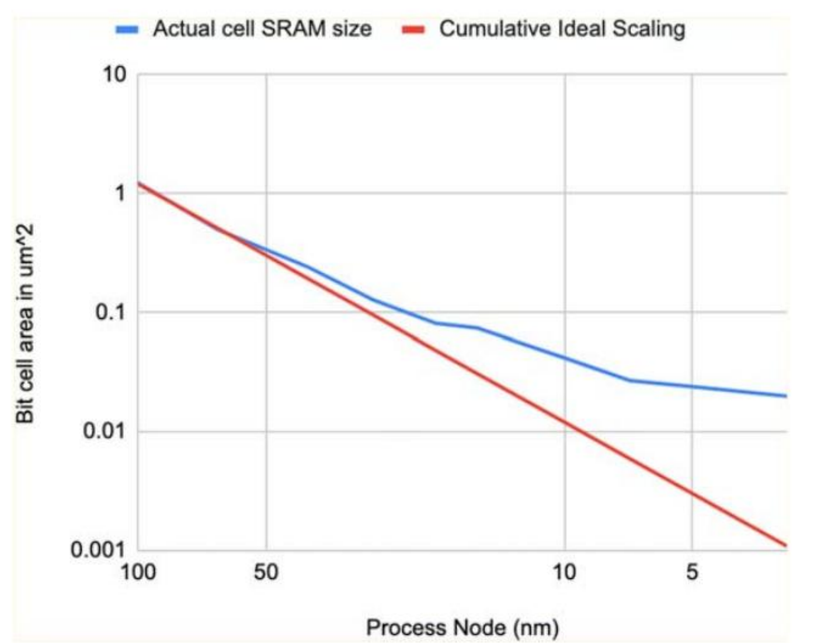{#fig-1-18 width=75%}

工艺的趋势与体系结构的趋势方向相反，一种解决办法是*芯粒*（chiplet）。传统办法是按摩尔定律的预期把晶片越做越大；芯粒的办法则是把几个较小的晶片集成在一个封装里，其中有些晶片采用较老、较便宜的工艺节点。这种新颖的封装方案带来了新的挑战：

* 芯片设计更复杂，因为需要把一个逻辑上的整体设计划分成若干个独立的、更小的部件。
* 芯粒之间需要新的通信通路。与片内通信相比，这些通路更长，功耗或延迟更高，带宽更低。
* 有些功能在单个大晶片里只需一份，现在可能每个芯粒都要复制一份。

尽管如此，与单个大芯片的设计相比，明智地选用芯粒仍然可以降低成本，并增加有效的硅片总面积。

例如，第一代 AMD EPYC CPU 用了 4 个 14 nm 的芯粒（Naffziger，2021）。AMD 估计，如果用 14 nm 工艺做一个 32 核的单芯片，需要 777 mm²。实际做法是每个芯粒 213 mm²，4 个芯粒的总面积大约多出 10%（4 × 213 = 852）。把成品率考虑进去以后，AMD 估计芯粒方案能把成本降为原来的 1/1.7。此外，借助芯粒，AMD 用一套设计就能同时推出 16 核和 32 核两种产品。到了第二代 EPYC Rome CPU，AMD 发现 I/O 在 7 nm 下改进不大，因此更合理的做法是把这些功能合并到一个用更便宜的工艺制造的 I/O 芯粒中（12 nm 工艺，416 mm²），而 8 核的芯粒在 7 nm 下可以缩小到 74 mm²。芯粒又一次让 AMD 用一套设计推出了多种产品：16 核、24 核、48 核和 64 核。AMD 估计，16 核到 48 核的产品如果各自做成单独的定制芯片，成本大约是芯粒方案的 1.8～2 倍；64 核的产品如果做成单个定制芯片，则根本无法制造，因为它的面积超过 1000 mm²，超出了掩膜的光罩极限。芯粒之间通信的功耗比单个大芯片内部通信的功耗高，但这部分功耗只占整个系统功耗的一小部分，可以在系统设计中统筹考虑。

AMD、Intel、NVIDIA 等许多公司都在使用为特定产品专门设计的定制芯粒。除了定制芯粒，对整个产业可能大有好处的是把芯粒标准化，使之能够在许多产品线中重复使用，从而提高芯粒的产量，降低相对的掩膜成本。熟悉芯片历史的人都知道，德州仪器的《TTL 数据手册》就是通用积木标准的一个成功例子。手册里收录的是 74xx 系列芯片，那时是 20 世纪 70 年代，摩尔定律正处于小规模集成阶段。今天，许多项目正在尝试启动一个通用芯粒产业。如果取得成功，定制硬件设计的成本和开发时间都可能大幅降低。不过到目前为止，这与其说是一种很可能实现的前景，不如说是一种理论上很有吸引力的可能。

为了避免把系统中的芯片和芯粒混淆，后面各章用*插座*（socket）这个词来指一个 CPU，不管它是一个单独的大芯片，还是一组封装在一起的芯粒。

### 成本与价格 {-}

计算机商品化以后，产品的制造成本与售价之间的差额一直在缩小。公司的研发（R&D）、市场营销、销售、制造设备维护、房屋租金、融资成本、税前利润和税款，都要从这部分差额中支付。许多工程师惊讶地发现，大多数公司只把收入的 4%（大宗商品化的 PC 业务）到 12%（高端服务器业务）用于研发，而全部工程开支都出自这笔研发经费。

### 制造成本与运营成本 {-}

本书前四版说的成本，是指制造一台计算机的成本；说的价格，是指购买一台计算机的价格。WSC 出现后，情况发生了变化。一个 WSC 有几万台服务器，除了购买成本，运营这些计算机的成本也很可观。经济学家把这两种成本分别称为资本支出（CAPEX）和运营支出（OPEX）。

第 6 章将会说明，假设 IT 设备的使用寿命较短，只有 3～4 年，那么服务器和网络的购买价格分摊下来，大约占 WSC 每月运营成本的一半。这样，总拥有成本（TCO）就是 CAPEX 加上 3～4 倍的 OPEX。每月运营成本中大约 40% 用于电费，以及供电和 IT 设备冷却等基础设施的分摊费用，尽管这些基础设施是按 10～15 年分摊的。因此，要降低 WSC 的运营成本，计算机体系结构设计者需要高效地利用能量。另外，摩尔定律放缓以后，有些公司开始把 IT 设备的使用寿命延长到 6～8 年。

<!--chapter:end:01-fundamentals-06.Rmd-->

## 可信性 {#sec-1-7}

从历史上看，集成电路一直是计算机中最可靠的部件之一。芯片的引脚可能比较脆弱，通信信道上也可能出现故障，但芯片内部的故障率一直很低。到了 5 nm 及更小的特征尺寸，这一传统认识正在改变：瞬时故障和永久故障都越来越常见，体系结构设计者必须让系统能够应对这些挑战。存储系统早就要处理*瞬时*错误（某一位的值发生翻转）和*永久*错误（某个存储单元损坏），而现在芯片内部的逻辑也开始出现问题。

事实上，研究人员发现，每千台服务器中就有几个他们称为*反复无常*（mercurial）的核（Dixit, 2021; Hochschild, 2021; Trippel, 2022）。这一小部分核在执行某些指令时反复出错，而且只有把这些指令的结果与预期结果对照检查才能发现。这类*静默数据错误*（silent data error），也叫*静默错误执行*（silent corrupt execution error），有以下特点：

* 检测到的频率比程序员预想的高得多；
* 并不只是硬件错误背景发生率的小幅上升；
* 出现在功能逻辑中，而不是出现在容易用检错码发现错误的存储结构中；
* 可能在硬件安装很久以后才出现；
* 通常只影响特定的核，而不是整个多核芯片；
* 可能由于多种原因突然出现，无法预测，其中一种原因是软件的小改动使原本很少用到的指令用得更多了。

研究人员建议用软件手段缓解静默错误，以帮助应对这一问题；同时要求硬件厂商把硬件做得更健壮，办法也许是借鉴大型机采用的检错技术。有一位研究者建议加强扫描测试和系统级测试，以改进芯片制造完成后的测试。

本节简要介绍可信性方面的问题，术语和方法的正式定义留到附录 D 的 D.3 节。

计算机是在不同的抽象层次上设计和构建的。沿着一台计算机逐层递归地往下看，可以看到部件一层层展开成完整的子系统，直到单个晶体管为止。有些故障影响范围很广，比如断电；但许多故障可以限制在模块内的单个部件上。因此，某一层上的一个模块彻底失效，在更高一层的模块看来，可能只是一个部件出了错。这种区分有助于我们寻找构建可信计算机的办法。

一个难题是如何判定系统在正常工作。这原本是一个理论问题，互联网服务普及以后，它变成了实际问题。基础设施提供商开始提供*服务等级协议*（SLA）或*服务等级目标*（SLO），保证其网络服务或供电服务是可信的。例如，如果每月达不到协议规定的若干小时，提供商就要向客户支付罚金。这样，SLA 就可以用来判定系统是在运行还是已经宕机。

对照 SLA，系统在两种服务状态之间交替：

1. *服务完成*，即按规定提供服务。
2. *服务中断*，即提供的服务与 SLA 不符。

两种状态之间的转换由*失效*（从状态 1 到状态 2）或*恢复*（从状态 2 到状态 1）引起。把这些转换量化，就得到可信性的两个主要度量：

* *模块可靠性*度量的是从某个参考起始时刻开始连续完成服务的情况，也可以等价地说，度量的是到失效为止的时间。因此，*平均无故障时间*（MTTF）是一种可靠性度量。服务中断用*平均修复时间*（MTTR）来度量。*平均故障间隔时间*（MTBF）就是 MTTF 与 MTTR 之和。

  MTBF 的倒数是故障率。*年故障率*（AFR）与 MTBF（以小时计）的关系是

  $$
  AFR = 1 - e^{-365 \times 24/MTBF}
  $$

  如果 MTBF 很大，或者说 AFR 很小，这个比值可以近似为

  $$
  AFR = 365 \times 24/MTBF
  $$

  AFR 一般用每十亿小时运行中的失效次数来表示，称为 *FIT*（failures in time）。因此，1,000,000 小时这样大的 MTTF，大约相当于 $10^9/10^6$，即 1000 FIT。如果一组模块的寿命服从指数分布，也就是说模块已经使用了多久与失效概率无关，那么这组模块的总故障率就是各模块故障率之和。

* *模块可用性*度量的是在完成和中断两种状态交替出现的情况下服务完成的程度。对有修复、无冗余的系统，模块可用性为

  $$
  \text{模块可用性} = \frac{\text{MTTF}}{(\text{MTTF} + \text{MTTR})}
  $$

注意，可靠性和可用性现在都是可以量化的指标，而不再只是可信性的同义词。有了这些定义，只要对部件的可靠性作一些假设，并假定各次失效相互独立，就可以定量地估计系统的可靠性。

**例题**　假设一个磁盘子系统由以下部件组成，各部件的 MTTF 如下：

* 10 个磁盘，每个的额定 MTTF 为 1,000,000 小时
* 1 个 ATA 控制器，MTTF 为 500,000 小时
* 1 个电源，MTTF 为 200,000 小时
* 1 个风扇，MTTF 为 200,000 小时
* 1 根 ATA 线缆，MTTF 为 1,000,000 小时

为简化计算，假设寿命服从指数分布，各次失效相互独立。求整个系统的 MTTF。

**解答**　各部件故障率之和为

$$
\begin{aligned}
\text{故障率}_{\text{系统}} &= 10 \times \frac{1}{1{,}000{,}000} + \frac{1}{500{,}000} + \frac{1}{200{,}000} + \frac{1}{200{,}000} + \frac{1}{1{,}000{,}000} \\
&= \frac{10 + 2 + 5 + 5 + 1}{1{,}000{,}000\ \text{小时}} = \frac{23}{1{,}000{,}000} = \frac{23{,}000}{1{,}000{,}000{,}000\ \text{小时}}
\end{aligned}
$$

即 23,000 FIT。系统的 MTTF 就是故障率的倒数：

$$
\text{MTTF}_{\text{系统}} = \frac{1}{\text{故障率}_{\text{系统}}} = \frac{1{,}000{,}000{,}000\ \text{小时}}{23{,}000} = 43{,}500\ \text{小时}
$$

也就是不到 5 年。

*应对失效的主要办法是冗余*。冗余可以是时间上的，即重复执行操作，看是否仍然出错；也可以是资源上的，即由其他部件接替失效的部件。部件更换完毕、系统完全修复之后，就认为系统的可信性与新的一样。下面用一个例子量化冗余带来的好处。

**例题**　磁盘子系统常常配备冗余电源来提高可信性。沿用上例的部件和 MTTF，计算冗余电源的可靠性。假设一个电源就足以让磁盘子系统运行，现在再增加一个冗余电源。

**解答**　我们需要一个公式，说明在能够容忍一次失效、仍能提供服务的情况下，可靠性会是多少。为简化计算，假设部件的寿命服从指数分布，各部件的失效之间没有相关性。冗余电源的 MTTF，等于其中一个电源失效前的平均时间，除以在第一个电源更换之前另一个电源也失效的概率。因此，如果修复前发生第二次失效的概率很小，这对电源的 MTTF 就很大。

由于有两个电源，而且失效相互独立，其中一个电源失效前的平均时间是 $\text{MTTF}_{\text{电源}}/2$。第二次失效的概率可以很好地近似为 MTTR 除以另一个电源失效前的平均时间。因此，一对冗余电源的 MTTF 可以合理地近似为

$$
\text{MTTF}_{\text{电源对}} = \frac{\text{MTTF}_{\text{电源}}/2}{\dfrac{\text{MTTR}_{\text{电源}}}{\text{MTTF}_{\text{电源}}}} = \frac{\text{MTTF}^2_{\text{电源}}/2}{\text{MTTR}_{\text{电源}}} = \frac{\text{MTTF}^2_{\text{电源}}}{2 \times \text{MTTR}_{\text{电源}}}
$$

沿用前面的 MTTF 数值，假设操作员平均要 24 小时才能发现电源失效并将其更换，那么这对容错电源的可靠性为

$$
\text{MTTF}_{\text{电源对}} = \frac{\text{MTTF}^2_{\text{电源}}}{2 \times \text{MTTR}_{\text{电源}}} = \frac{200{,}000^2}{2 \times 24} \cong 830{,}000{,}000
$$

于是，这对电源的可靠性大约是单个电源的 4150 倍。

<!--chapter:end:01-fundamentals-07.Rmd-->

## 安全 {#sec-1-8}

攻击者攻击计算机系统，主要途径是操作系统和其他具有特权访问的系统软件（如虚拟机）中大量的软件缺陷。但在 2015 年，谷歌演示了用户程序可以利用 DDR3 DRAM 芯片的一个弱点，破坏虚拟内存保护（Seaborn, 2015）。DRAM 内部是二维结构，DDR3 DRAM 的存储单元又非常小，研究人员因此观察到：反复写 DDR3 DRAM 的某一行，也就是「锤击」这一行，可能在相邻的行中引起干扰错误，使这个受害行中的位发生翻转。后来的研究表明，攻击两个邻近的行效果更好。

行锤击（row hammer）攻击的是物理内存，因此破坏一些数据要比命中虚拟内存中的某个特定目标容易得多。锤击的确切结果无法预测，但多次尝试就可能造成灾难性的后果。高明的攻击者可以用行锤击技术修改页表项中的保护位，从而让程序访问操作系统要保护的内存区域。后来的微处理器和 DRAM 加入了检测行锤击攻击的机制，以挫败这类攻击。在 DRAM 和操作系统中防范定向行锤击攻击的技术，在第 2 章讨论。

这次攻击震惊了许多安全研究人员，此前他们一直认为硬件不会有安全问题。有人可能会说，行锤击其实是一个可信性问题，因为它使内存中存放了错误的信息。但行锤击只是这类新攻击途径的第一枪，这类攻击以硬件的弱点为目标。

至少从 20 世纪 70 年代起，人们就知道时序信道（timing channel）是一种漏洞，但大多数体系结构设计者错误地认为它在实际中无关紧要。以前的攻击要么利用操作系统的缺陷，要么需要攻击者亲临现场，要么泄露信息的带宽非常低。然而，时序这类实现上的特性是可能影响功能的。

2018 年曝光的 Spectre 突出地暴露了这一陷阱。Spectre 利用微结构的推测执行，把用户级沙箱、内核或虚拟机管理程序中的私密信息泄露给用户级的攻击代码（Kocher, 2019）。Spectre 利用了三种微结构技术：

1. **指令推测**：处理器核越过转移指令推测执行，力图同时执行几十条指令；推测正确就提交对 ISA 状态的改变，推测错误就把这些改变回滚。Spectre 却反其道而行之，故意推测执行一些它明知 ISA 状态改变会被回滚的指令。它的隐蔽目的，是在微结构中留下「面包屑」，透露程序员以为已经藏好的秘密。
2. **Cache**：Cache 对 ISA 是不可见的。特别是，按照传统的计算机体系结构认识，组相联 Cache 中哪一块是最近最少使用的，与程序能否正确执行无关，因此推测错误时不必恢复这一状态。Spectre 正是利用这个出人意料的漏洞放下「面包屑」，之后再找到这些透露秘密的「面包屑」。这样，它就把 Cache 的内容当作「侧信道」（side channel），用来传送一个（秘密的）数据值。
3. **硬件多线程**：如果攻击程序能在离目标程序很近的地方运行，察觉这种细微的时序变化就容易得多。硬件多线程（见第 3 章）使一个程序的指令可以和其他程序的指令交织在一起，这件事也就变得简单了。硬件攻击已经令人十分担忧，云服务提供商现在都提供一个选项，使用户的服务器不与其他客户的程序共用。例如，AWS 提供「专用实例」（Dedicated Instances），价格比传统的共享实例高约 5%。

Spectre 公布之后，人们又开发出了许多利用类似微结构漏洞的攻击。

我们在第 2 章和第 3 章还会更深入地讨论安全，介绍存储层次和处理器中通过时序攻击泄露信息的问题。

前面已经介绍了安全，也量化了计算机技术的成本、功耗和可信性，下面就可以量化性能了。

<!--chapter:end:01-fundamentals-08.Rmd-->

## 性能的测量、报告和汇总 {#sec-1-9}

我们说一台计算机比另一台快，究竟是什么意思？手机用户可能会说，程序运行时间短的计算机快；而 Amazon.com 的管理员可能会说，每小时完成事务多的计算机快。手机用户想缩短的是*响应时间*，即一件事从开始到完成所经过的时间，也叫*执行时间*。云数据中心的运营者想提高的是*吞吐率*，即给定时间内完成的工作总量。

比较不同的设计方案时，我们常常要比较两台计算机的性能，比如 X 和 Y。本书说「X 比 Y 快」，是指完成给定任务时，X 的响应时间或执行时间比 Y 短。具体地说，「X 的速度是 Y 的 $n$ 倍」是指

$$
\frac{\text{执行时间}_{\text{Y}}}{\text{执行时间}_{\text{X}}} = n
$$

执行时间是性能的倒数，所以下面的关系成立：

$$
n = \frac{\text{执行时间}_{\text{Y}}}{\text{执行时间}_{\text{X}}} = \frac{\dfrac{1}{\text{性能}_{\text{Y}}}}{\dfrac{1}{\text{性能}_{\text{X}}}} = \frac{\text{性能}_{\text{X}}}{\text{性能}_{\text{Y}}}
$$

同样，「X 的吞吐率是 Y 的 1.3 倍」是指计算机 X 在单位时间内完成的任务数是 Y 的 1.3 倍。

遗憾的是，比较计算机性能时引用的指标并不总是时间。我们的观点是：唯一一致、可靠的性能度量是真实程序的执行时间。凡是用其他指标代替时间，或者用其他对象代替真实程序作为测量对象的提议，最终都导致了误导性的宣传，甚至导致了计算机设计上的错误。

即使是执行时间，计入的内容不同，定义也不同。最直接的定义称为*墙钟时间*（wall-clock time）、*响应时间*或*经过时间*（elapsed time），即完成一项任务的延迟，访问存储设备、访存、I/O 活动、操作系统开销等一切时间都计算在内。在多道程序环境下，处理器在等待 I/O 时会去运行另一个程序，不一定使某一个程序的经过时间最短。因此，需要一个术语来反映这种情况。*CPU 时间*就体现了这种区别，它指处理器用于计算的时间，*不*包括等待 I/O 的时间和运行其他程序的时间。（显然，用户看到的响应时间是程序的经过时间，而不是 CPU 时间。）

经常运行同一批程序的计算机用户，是评估新计算机的理想人选。评估一个新系统时，这些用户只需比较自己*工作负载*的执行时间。工作负载是用户在一台计算机上运行的程序和操作系统命令的组合。然而，处于这种理想情况的用户很少。大多数人只能依靠其他方法来评估计算机，而且常常要依靠其他评估者，希望这些方法能够预测新计算机在自己的使用场景下的性能。一种方法是使用基准测试程序，许多公司都用这些程序来确定自己计算机的相对性能。

### 基准测试程序 {-}

测量性能的基准测试程序，最好的选择是真实应用，比如 [1.1 节](#sec-1-1) 提到的谷歌翻译。尝试运行比真实应用简单得多的程序，已经带来了不少性能评测上的陷阱。这类程序包括：

* *核心程序*（kernel），即真实应用中短小而关键的片段。
* *玩具程序*（toy program），即编程入门作业里那种 100 行的程序，比如快速排序。
* *合成基准测试程序*（synthetic benchmark），即为模仿真实应用的特征和行为而编造的假程序，比如 Dhrystone。

这三类程序如今都已失去公信力，原因通常是编译器编写者和体系结构设计者可以联手，使计算机在这些替代程序上显得比在真实应用上更快。令本书作者遗憾的是，我们在第 4 版中删去了关于用合成基准测试程序刻画性能的谬误，因为我们以为所有计算机体系结构设计者都已公认这种做法不可取；然而，合成程序 Dhrystone 至今仍是嵌入式处理器最常引用的基准测试程序之一！

另一个问题是运行基准测试程序的条件。提高基准测试成绩的一种手段，是使用专门针对某个基准测试程序的编译选项。这些选项引起的变换，在许多程序上往往是不合法的，或者会使其他程序变慢。为了限制这种做法，使结果更有意义，基准测试程序的开发者通常要求厂商对同一种语言（如 C++ 或 C）的所有程序使用同一个编译器和同一组编译选项，目的是尽量减少「基准营销」（benchmarketing）的影响（见 1.11 节）。

除了编译选项，另一个问题是是否允许修改源代码。对此有三种不同的做法：

1. 不允许修改源代码。
2. 允许修改源代码，但实际上几乎不可能修改。例如，数据库基准测试依赖的是有几千万行代码的标准数据库程序，数据库公司极不可能为了提高某一种计算机上的性能而修改这些程序。
3. 允许修改源代码，只要修改后的版本产生相同的结果。

基准测试程序的设计者决定是否允许修改源代码时，要考虑的关键问题是：这样的修改是否反映了实际做法、能为用户提供有用的参考，还是只会降低基准测试程序预测实际性能的准确性。第 7 章将会看到，领域专用体系结构的设计者为定义明确的任务设计处理器时，常常采用第三种做法。

为了避免把鸡蛋都放在一个篮子里，人们常用一组基准测试应用来衡量处理器在各种应用上的性能，这样的一组程序称为*基准测试程序集*（benchmark suite）。当然，程序集的好坏取决于其中每个基准测试程序的好坏。尽管如此，程序集有一个关键的优点：由于有其他基准测试程序存在，任何一个基准测试程序的弱点都会被冲淡。基准测试程序集的目标，是刻画两台计算机真实的相对性能，特别是在客户可能运行、但不在程序集中的程序上的相对性能。

在建立标准化基准测试应用程序集的尝试中，最成功的之一是标准性能评估公司（SPEC）。SPEC 起源于 20 世纪 80 年代末为工作站和服务器提供更好的基准测试程序的努力，当时推动它的部分原因，是人们不满于日益流行的 Dhrystone 基准测试程序不够准确。计算机产业在不断发展，对不同基准测试程序集的需求也随之变化，现在 SPEC 基准测试程序已经覆盖许多应用类别。所有 SPEC 基准测试程序集及其公布的结果都可以在 http://www.spec.org 找到。

后面许多小节的讨论以 SPEC 基准测试程序为主，但人们也为运行 Windows 操作系统的 PC 开发了许多基准测试程序，比如 Geekbench。

一个引以为戒的例子是 EEMBC（Electronic Design News Embedded Microprocessor Benchmark Consortium，读作「embassy」）的基准测试程序。它是一组 41 个核心程序，用来预测不同嵌入式应用的性能，这些应用包括汽车/工业、消费电子、网络、办公自动化和电信。EEMBC 既报告未经修改的性能，也报告「全力以赴」（full fury）的性能，后者几乎没有任何限制。一方面由于这些基准测试程序采用的是小的核心程序，另一方面由于这些报告选项，EEMBC 的结果很少有人引用。正是由于 EEMBC 不成功，它想要取代的 Dhrystone 才遗憾地仍在使用。EEMBC 在 2009 年确实开发了 CoreMark，它是由四个核心程序组成的单个合成程序，现在的引用频率与 Dhrystone 一样高。Embench 是最近的一项工作（Patterson et al., 2025），它受 SPEC 启发，旨在为嵌入式计算提供一个免费、开放的基准测试程序集，目标是取代 Dhrystone 和 CoreMark，成为标准的嵌入式基准测试程序（见 www.embench.org）。

#### 桌面基准测试程序 {-}

桌面基准测试程序分为两大类：处理器密集型基准测试程序和图形密集型基准测试程序，不过许多图形基准测试程序也包含密集的处理器活动。SPEC 最初建立了一个侧重处理器性能的基准测试程序集（最初称为 SPEC89），现在已经发展到第六代 SPEC CPU2017，此前依次是 SPEC2006、SPEC2000、SPEC95、SPEC92 和 SPEC89。SPEC CPU2017 包括 10 个整数基准测试程序（CPU2017 Integer Speed）和 17 个浮点基准测试程序（CPU2017 Floating Point Speed）。[图 1.19](#fig-1-19) 介绍了当前的 SPEC CPU 基准测试程序及其沿革。针对前面讨论的编译选项问题，SPEC 的解决办法是同时提供 *base*（基础）和 *peak*（峰值）两种结果。base 要求同一种语言的所有基准测试程序使用相同的编译选项，peak 则允许程序员为每个基准测试程序挑选尽可能好的编译选项。

{#fig-1-19 width=100%}

SPEC 基准测试程序是真实程序，为了便于移植、尽量减小 I/O 对性能的影响而作了修改。整数基准测试程序种类各异，从 C 编译器的一部分、围棋程序到视频压缩都有。浮点基准测试程序包括分子动力学、图像处理和天气预报。SPEC CPU 程序集既可用于桌面系统的处理器基准测试，也可用于服务器。本书各处都会给出其中许多程序的数据。但是，这些程序与现代的编程语言和编程环境，以及 [1.1 节](#sec-1-1) 介绍的谷歌翻译应用，几乎没有共同之处。其中三分之一至少部分是用 Fortran 编写的！它们甚至是静态链接的，而不像大多数真实程序那样动态链接。遗憾的是，SPEC2017 的应用本身也许是真实的，却缺乏启发性。SPECINT2017 和 SPECFP2017 能否体现 21 世纪计算令人振奋之处，并不清楚。

1.11 节将介绍开发 SPEC CPU 基准测试程序集过程中出现过的陷阱，以及维护一个有用、有预测能力的基准测试程序集所面临的挑战。

SPEC CPU2017 针对的是处理器性能，但 SPEC 还提供许多其他基准测试程序。[图 1.20](#fig-1-20) 列出了 2023 年仍在使用的 17 个 SPEC 基准测试程序。

#### 服务器基准测试程序 {-}

服务器有多种功能，相应地，基准测试程序也有多种类型。最简单的大概是面向处理器吞吐率的基准测试程序。SPEC CPU2017 用 SPEC CPU 基准测试程序构造了一个简单的吞吐率基准测试：每个 SPEC CPU 基准测试程序运行多个副本（通常与处理器个数相同），再把 CPU 时间换算成速率，即 SPEC CPU2017 Integer Rates 和 CPU2017 Floating Point Rates，从而测出多处理器的处理速率。如果一次测量运行 8 个副本，所用时间是参考机的一半，那么这个基准测试程序的 SPECrate 就是 16。这些基准测试程序度量的是 [1.2 节](#sec-1-2) 介绍的 RLP。为了度量 TLP，SPEC 提供了一类称为高性能计算基准测试程序的程序，它们围绕 OpenMP 和消息传递接口（MPI）构建，也面向 GPU 这样的加速器（见[图 1.20](#fig-1-20)）。

除了 SPECrate，大多数服务器应用和基准测试程序都有大量来自存储或网络流量的 I/O 活动，包括面向文件服务器系统、Web 服务器以及数据库和事务处理（TP）系统的基准测试程序。SPEC 既提供文件服务器基准测试程序（SPECstorage），也提供 Java 服务器基准测试程序。（附录 D 详细讨论了一些文件和 I/O 系统的基准测试程序。）SPEC VIRT_SC 2013 和 SPECvirt Datacenter 2021 评估虚拟化数据中心服务器的端到端性能。还有一个 SPEC 基准测试程序测量功耗，1.11 节将讨论它。

[图 1.20　截至 2022 年 SPEC 仍在使用的基准测试程序]{#fig-1-20 .caption}

| 类别 | 名称 | 测量对象的性能 |
|---|---|---|
| 云 | Cloud_IaaS 2018 | 用 NoSQL 数据库事务和基于 map/reduce 的 K-Means 聚类测量云 |
| CPU | CPU2017 | 计算密集型的整数和浮点工作负载 |
| 图形和工作站性能 | SPECviewperf® 2020 | 运行 OpenGL 和 Direct X 的系统上的 3D 图形 |
| | SPECworkstation 3.1 | 在 Windows 操作系统下运行专业应用的工作站 |
| | SPECapcSM for Maya® 2017 | 运行 Autodesk 3ds Max 2017 专有应用的 3D 图形 |
| | SPECapcSM for PTC Creo 3.0 | 运行 PTC Creo 3.0 专有应用的 3D 图形 |
| | SPECapcSM for Siemens NX 9.0 and 10.0 | 运行 Siemens NX 9.0 或 10.0 专有应用的 3D 图形 |
| | SPECapcSM for SolidWorks 2021 | 运行 SolidWorks 2021 CAD/CAM 专有应用的系统上的 3D 图形 |
| 高性能计算 | SPEC ACCEL | 用 OpenCL 和 OpenACC 运行并行应用的加速器和宿主 CPU |
| | SPEChpc 2021 | 四个规模递增的 HPC 应用或小型应用程序集，从单个节点到数百个节点 |
| | SPEC MPI 2007 | 在集群和 SMP 上运行的 MPI 并行、浮点、计算密集型程序 |
| | SPEC OMP 2012 | 运行 OpenMP 的并行应用 |
| Java 客户机/服务器 | SPECjbb2015 | Java 服务器 |
| | SPECjEnterprise 2018 Web Profile | Java EE Web Profile V7 或更高版本的应用服务器、数据库和支撑基础设施 |
| | SPECJEnterprise 2010 | Java EE Web Profile V5 或更高版本的应用服务器、数据库和支撑基础设施 |
| | SPECjvm 2008 | Java 运行时环境的真实应用和基准测试程序，侧重 Java 核心功能 |
| 功耗 | SPECpower_ssj2008 | 运行 SPECjbb2015 的批量服务器级计算机的功耗。其他几个 SPEC 程序集也测量功耗：ACCEL、CPU 2017、OMP、2012 和 VIRT_SC 2013 |
| 存储 | SPECstorage Solution 2020 | 文件服务器的吞吐率和响应时间 |
| 虚拟化 | SPEC VIRT_SC 2013 | 用于虚拟化服务器整合的数据中心服务器 |
| | SPECvirt Datacenter 2021 | 第三代基准测试程序，面向数据中心里多台主机上的虚拟化环境 |

TP 基准测试程序测量系统处理事务的能力，事务由数据库访问和更新组成。航空订票系统和银行 ATM 系统是 TP 典型的简单例子；更复杂的 TP 系统涉及复杂的数据库和决策。20 世纪 80 年代中期，一群关心这一问题的工程师成立了不依附于厂商的事务处理委员会（TPC），希望为 TP 建立真实、公平的基准测试程序。TPC 基准测试程序的介绍见 http://www.tpc.org。

第一个 TPC 基准测试程序 TPC-A 于 1985 年发布，此后由几个不同的基准测试程序取代和增强。TPC-C 最初建立于 1992 年，模拟复杂的查询环境。TPC-H 模拟即席（ad hoc）决策支持，即各次查询互不相关，不能利用过去查询的知识来优化以后的查询。TPC-DI 基准测试程序针对一种新的数据集成（DI）任务，也叫 ETL（即抽取、转换、加载），它是数据仓库的重要组成部分。TPC-DS 是一个决策支持基准测试程序。TPC-E 是一个联机事务处理（OLTP）工作负载，模拟一家证券经纪公司的客户账户。

传统关系数据库和「NoSQL」存储方案之间存在争议。TPC 认识到这一点，推出了 TPCx-HS 和 TPC-DS：TPCx-HS 测量使用 Hadoop 文件系统运行 MapReduce 程序的系统，TPC-DS 测量使用关系数据库或基于 Hadoop 的系统的决策支持系统。TPC-VMS 和 TPCx-V 测量虚拟化系统的数据库性能，TPC-Energy 则在所有现有的 TPC 基准测试程序中加入了能耗指标。TPC 最近还扩展了范围，也提供物联网和人工智能方面的基准测试程序。

所有 TPC 基准测试程序都以每秒事务数来衡量性能。此外，它们还有响应时间要求，只有满足响应时间限制，才测量吞吐率性能。为了模拟现实世界的系统，较高的事务率还要对应较大的系统，用户数和事务所访问的数据库都要更大。最后，基准测试系统的成本也必须计入，以便准确比较性价比。TPC 修改了定价政策，使所有 TPC 基准测试程序采用同一个规范，并使 TPC 公布的价格可以核实。

### 报告性能结果 {-}

报告性能测量结果的指导原则应当是*可重现*（reproducibility），即列出其他实验者重现这些结果所需的一切。SPEC 基准测试报告要求详细描述计算机和编译选项，并同时公布基础结果和优化结果。除了硬件、软件和基础调优参数的说明，SPEC 报告还给出实际的性能时间，既有表格形式，也有图。TPC 基准测试报告更加完整，因为它必须包含基准测试审计的结果和成本信息。厂商既要比拼高性能，也要比拼性价比，因此这些报告是了解计算系统真实成本的极好来源。

### 汇总性能结果 {-}

在实际的计算机设计中，设计者必须用一组公认相关的基准测试程序，评估无数种设计选择，定量地比较它们各自的相对收益。同样，想挑选计算机的消费者也可能依靠基准测试程序的性能测量结果，理想情况下，这些基准测试程序与用户的应用相似。在这两种情况下，用一组基准测试程序来测量都很有用：一是重要应用的性能会与程序集中一个或几个基准测试程序的性能相似，二是可以了解性能的波动情况。最理想的情况是，程序集相当于应用空间的一个统计上有效的样本。但这样的样本所需的基准测试程序比大多数程序集通常包含的更多，而且需要随机抽样，而几乎没有哪个基准测试程序集采用随机抽样。

选定用基准测试程序集测量性能以后，我们希望能用一个数字来汇总程序集的性能结果。一种简单的汇总方法，是比较程序集中各程序执行时间的算术平均值。另一种方法是给每个基准测试程序加一个权重因子，用加权算术平均值作为汇总性能的那个数字。权重的一种选法是使所有程序在某台参考计算机上的执行时间相等，但这会使结果偏向参考计算机的性能特点。

也可以不选权重，而是以一台参考计算机为基准，把执行时间归一化：用参考计算机上的时间除以被评测计算机上的时间，得到一个与性能成正比的比值。SPEC 就采用这种方法，把这个比值称为 SPECRatio。它有一个特别有用的性质，正好符合本书一直采用的评测计算机性能的方式，即比较性能的比值。例如，假设在某个基准测试程序上，计算机 A 的 SPECRatio 是计算机 B 的 1.25 倍，那么可以得到

$$
\begin{aligned}
1.25 = \frac{\text{SPECRatio}_{\text{A}}}{\text{SPECRatio}_{\text{B}}} &= \frac{\dfrac{\text{执行时间}_{\text{参考}}}{\text{执行时间}_{\text{A}}}}{\dfrac{\text{执行时间}_{\text{参考}}}{\text{执行时间}_{\text{B}}}} = \frac{\text{执行时间}_{\text{B}}}{\text{执行时间}_{\text{A}}} \\
&= \frac{\text{性能}_{\text{A}}}{\text{性能}_{\text{B}}}
\end{aligned}
$$

注意，以比值来比较时，参考计算机上的执行时间相互约去，选哪台计算机作参考机也就无关紧要。本书始终采用的正是这种比较方式。[图 1.21](#fig-1-21) 给出了一个例子。

[图 1.21　Sun UltraSPARC-IV+（SPEC CPU2017 的参考计算机）运行 SPEC CPU2017 Integer Speed 的执行时间（单位为秒），以及 AMD EPYC 7763 和 Intel Xeon Platinum 8380 的执行时间和 SPECRatio。最后两列是执行时间之比和 SPEC 比值之比。本图说明，计算相对性能时，参考计算机的选择无关紧要。执行时间之比与 SPEC 比值之比完全相同，几何平均值之比（11.69/11.99 = 0.98）也与各比值的几何平均值（0.98）完全相同。]{#fig-1-21 .caption}

| 基准测试程序 | Sun UltraSPARC-IV+ 时间（秒） | AMD EPYC 7763 时间（秒） | SPEC CPU2017 比值 | Intel Xeon Platinum 8380 时间（秒） | SPEC CPU2017 比值 | AMD/Intel 时间之比（秒） | Intel/AMD SPEC 比值之比 |
|---|--:|--:|--:|--:|--:|--:|--:|
| perlbench | 1,774 | 257 | 6.90 | 253 | 7.01 | 1.02 | 1.02 |
| gcc | 3,976 | 310 | 12.83 | 371 | 10.72 | 0.84 | 0.84 |
| mcf | 4,721 | 236 | 20.00 | 240 | 19.67 | 0.98 | 0.98 |
| omnetpp | 1,630 | 199 | 8.19 | 138 | 11.81 | 1.44 | 1.44 |
| xalancbmk | 1,417 | 103 | 13.76 | 108 | 13.12 | 0.95 | 0.95 |
| x264 | 1,763 | 107 | 16.48 | 105 | 16.79 | 1.02 | 1.02 |
| deepsjeng | 1,432 | 231 | 6.20 | 248 | 5.77 | 0.93 | 0.93 |
| leela | 1,703 | 310 | 5.49 | 362 | 4.70 | 0.86 | 0.86 |
| exchange2 | 2,939 | 131 | 22.44 | 156 | 18.84 | 0.84 | 0.84 |
| xz | 6,182 | 253 | 24.43 | 255 | 24.24 | 0.99 | 0.99 |
| **几何平均** | | | 11.99 | | 11.69 | 0.98 | 0.98 |

SPECRatio 是比值，而不是绝对的执行时间，因此平均值必须用*几何*平均来计算。（SPECRatio 没有单位，用算术方法比较 SPECRatio 没有意义。）公式是

$$
\text{几何平均} = \sqrt[n]{\prod_{i=1}^{n} sample_i}
$$

在 SPEC 中，$sample_i$ 就是程序 $i$ 的 SPECRatio。使用几何平均可以保证两条重要的性质：

1. 比值的几何平均等于几何平均的比值。
2. 几何平均的比值等于性能比值的几何平均，这意味着选哪台计算机作参考机无关紧要。

因此，使用几何平均的理由很充分，尤其是在我们用性能比值作比较的时候。

**例题**　证明几何平均的比值等于性能比值的几何平均，并且 SPECRatio 的参考计算机无关紧要。

**解答**　假设有两台计算机 A 和 B，各有一组 SPECRatio。

$$
\begin{aligned}
\frac{\text{几何平均}_{\text{A}}}{\text{几何平均}_{\text{B}}} &= \frac{\sqrt[n]{\prod_{i=1}^{n} \text{SPECRatio A}_i}}{\sqrt[n]{\prod_{i=1}^{n} \text{SPECRatio B}_i}} = \sqrt[n]{\prod_{i=1}^{n} \frac{\text{SPECRatio A}_i}{\text{SPECRatio B}_i}} \\
&= \sqrt[n]{\prod_{i=1}^{n} \frac{\dfrac{\text{执行时间}_{\text{参考}_i}}{\text{执行时间}_{\text{A}_i}}}{\dfrac{\text{执行时间}_{\text{参考}_i}}{\text{执行时间}_{\text{B}_i}}}} = \sqrt[n]{\prod_{i=1}^{n} \frac{\text{执行时间}_{\text{B}_i}}{\text{执行时间}_{\text{A}_i}}} = \sqrt[n]{\prod_{i=1}^{n} \frac{\text{性能}_{\text{A}_i}}{\text{性能}_{\text{B}_i}}}
\end{aligned}
$$

也就是说，A 和 B 的 SPECRatio 的几何平均之比，等于程序集中所有基准测试程序上 A 对 B 的性能比值的几何平均。[图 1.21](#fig-1-21) 用 SPEC2017 的例子验证了这一点。

<!--chapter:end:01-fundamentals-09.Rmd-->

## 计算机设计的量化原则 {#sec-1-10}

前面已经介绍了怎样定义、测量和归纳性能、成本、可信性、能耗和功耗，下面可以讨论计算机设计与分析中有用的一些准则和原则。本节先介绍关于设计的几条重要观察，再介绍两个用来评估不同方案的公式。

### 利用并行性 {-}

利用并行性是提高性能最重要的方法之一。本书每一章都有一个例子，说明怎样利用并行性提高性能。这里先简要介绍三个例子，后面各章再详细展开。

第一个例子是系统级的并行。在典型的服务器基准测试程序（如 SPECStorage 或 TPC-C）上，要提高吞吐率性能，可以使用多个处理器和多个存储设备。这样，处理请求的工作负载就能分摊到各个处理器和存储设备上，吞吐率因此提高。系统能够扩充内存，也能增加处理器和存储设备的数量，这种能力称为*可扩展性*，它是服务器的一项宝贵优势。把数据分散存放在许多存储设备上，就可以并行读写，这利用的是 DLP。SPECstorage 还要依靠 RLP 来使用许多处理器，TPC-C 则利用 TLP 更快地处理数据库查询。

在具体的数字设计层面，同样可以利用并行性。例如，存储系统使用多个存储体（bank），对不同存储体的多个访问可以并行进行，从而提高存储带宽。算术逻辑部件采用先行进位，利用并行性加快求和：求和所需的时间原来与操作数的位数成线性关系，现在变成对数关系。这些也是 DLP 的例子。

### 利用流水线 {-}

在单个处理器这一层，要获得高性能，关键是利用指令之间的并行性。最简单的办法之一是流水线。（附录 C 会更详细地介绍流水线，第 3 章也以它为重点。）流水线的基本思想是让多条指令的执行相互重叠，从而缩短完成一个指令序列的总时间。理解流水线的一个关键在于：并不是每条指令都依赖紧挨在它前面的那条指令，因此这些指令有可能完全或部分地并行执行。流水线是 ILP 最为人熟知的例子。

### 利用预测 {-}

俗话说，先做了再请求原谅，有时比事先请求许可更好。照这个思路，下一个可以利用的机会是预测。如果预测错误后的恢复机制代价不太高，而预测又比较准确，那么在有些情况下，先猜一个结果并立即开始工作，平均来看会比等到确切知道结果再开始更快。存储层次（见第 2 章）用到了预测，现代流水线处理器（见第 3 章）更是大量使用预测，但预测也可能成为安全问题的来源（见 [1.8 节](#sec-1-8)）。

### 利用局部性原理 {-}

一些重要的基本观察来自程序本身的性质。我们经常利用的最重要的程序性质是*局部性原理*：程序倾向于重复使用最近用过的数据和指令。有一条广为流传的经验法则：程序 90% 的执行时间只花在 10% 的代码上。由局部性可知，我们可以根据程序最近的访问情况，比较准确地预测它很快会用到哪些指令和数据。局部性原理对数据访问也适用，只是不像对代码访问那样明显。

人们观察到两种不同的局部性。*时间局部性*是指最近访问过的项很可能很快会再次被访问。*空间局部性*是指地址相邻的项往往会在相近的时间里被访问。第 2 章会介绍这两条原理的应用。

### 通过冗余实现可信性 {-}

计算机不仅要快，还要可信。任何物理器件都可能发生故障，因此我们在系统中加入冗余部件来保证可信性：发生故障时，冗余部件能够接替工作，*并且*帮助检测故障，前面冗余电源的例子就是如此。内存和外存长期以来一直依靠冗余来保证可信性，但静默数据损坏（见 [1.7 节](#sec-1-7)）表明，这些技术对计算机的其他部件也将变得重要。

### 关注常见情况 {-}

计算机设计中最重要、最普遍的原则，大概就是关注常见情况：在设计中权衡取舍时，优先照顾经常出现的情况，而不是很少出现的情况。决定怎样使用资源时，这条原则同样适用，因为一种情况出现得越频繁，改进它的效果就越大。

关注常见情况不仅适用于资源分配和性能，也适用于能耗。处理器的取指和译码部件的使用频率可能比乘法器高得多，因此应当先优化它。这条原则对可信性同样适用。如果一台数据库服务器每个处理器配 50 个存储设备，那么系统的可信性很可能主要取决于存储的可信性。

此外，常见情况往往比少见情况更简单，也更容易做快。例如，处理器做两个数的加法时，可以预期溢出很少发生，因此可以优化更常见的不溢出情况，从而提高性能。这样做可能会使发生溢出的情况变慢，但只要溢出很少发生，针对正常情况的优化就能提高总体性能。

全书会多次用到这条原则。应用这条简单的原则时，我们必须确定什么是常见情况，以及加快这种情况能使性能提高多少。有一条基本定律可以把这条原则定量化，这就是 *Amdahl 定律*。

### Amdahl 定律 {-}

改进计算机的某一部分能带来多大的性能收益，可以用 Amdahl 定律计算。Amdahl 定律指出：采用某种更快的执行方式所能获得的性能提高，受限于这种更快的方式可以使用的时间所占的比例。

Amdahl 定律定义了采用某项特性所能获得的*加速比*。什么是加速比？假设我们可以对计算机作一项改进，使用这项改进时性能会提高。加速比就是下面这个比值：

$$
\text{加速比} = \frac{\text{尽可能使用该改进时整个任务的性能}}{\text{不使用该改进时整个任务的性能}}
$$

也可以写成：

$$
\text{加速比} = \frac{\text{不使用该改进时整个任务的执行时间}}{\text{尽可能使用该改进时整个任务的执行时间}}
$$

加速比表示与原来的计算机相比，一项任务在改进后的计算机上运行能快多少。

利用 Amdahl 定律可以快速求出某项改进的加速比。加速比取决于两个因素：

1. *在原来的计算机上，计算时间中能够转而利用这项改进的部分所占的比例*。例如，一个程序总共要运行 100 秒，其中有 40 秒的执行时间可以使用某项改进，那么这个比例就是 40/100。我们把这个值记作 $\text{比例}_\text{改进}$，它总是小于或等于 1。
2. *改进后的执行方式带来的提高，即如果整个程序都采用改进后的方式，任务能运行得快多少*。这个值等于原来方式所用的时间除以改进后方式所用的时间。例如，程序的某一部分采用改进后的方式需要 4 秒，采用原来的方式需要 40 秒，那么提高就是 40/4，即 10。我们把这个值记作 $\text{加速比}_\text{改进}$，它总是大于 1。

在原来的计算机上加入改进后的执行方式，执行时间等于使用计算机未改进部分的时间加上使用改进部分的时间：

$$
\text{执行时间}_\text{新} = \text{执行时间}_\text{旧} \times \left( (1 - \text{比例}_\text{改进}) + \frac{\text{比例}_\text{改进}}{\text{加速比}_\text{改进}} \right)
$$

总加速比是两个执行时间之比：

$$
\text{加速比}_\text{总} = \frac{\text{执行时间}_\text{旧}}{\text{执行时间}_\text{新}} = \frac{1}{(1 - \text{比例}_\text{改进}) + \dfrac{\text{比例}_\text{改进}}{\text{加速比}_\text{改进}}}
$$

**例题**　假设我们要改进用于 Web 服务的处理器。在 Web 服务应用中，新处理器的计算速度是老处理器的 10 倍。假设原来的处理器有 40% 的时间忙于计算，60% 的时间在等待 I/O，那么采用这项改进以后，总加速比是多少？

**解答**

$$
\text{比例}_\text{改进} = 0.4;\quad \text{加速比}_\text{改进} = 10;\quad \text{加速比}_\text{总} = \frac{1}{0.6 + \dfrac{0.4}{10}} = \frac{1}{0.64} \approx 1.56
$$

Amdahl 定律体现的是收益递减规律：如果只改进计算的一部分，那么随着改进不断增加，每次新增改进带来的加速比增量会越来越小。Amdahl 定律有一个重要推论：如果一项改进只能用于任务的一部分，那么任务的加速比不可能超过 1 减去这部分比例之后的倒数。

应用 Amdahl 定律时，一个常见的错误是把「转而*使用改进*的时间比例」和「*改进投入使用以后*的时间比例」混为一谈。如果我们测量的不是计算中*能够使用*改进的时间，而是改进投入使用*以后*的时间，结果就会是错的！

Amdahl 定律可以指导我们估计一项改进能使性能提高多少，以及怎样分配资源来提高性价比。目标显然是按照时间花费的比例来投入资源。Amdahl 定律特别适合比较两种方案的系统总体性能，但也可以用来比较两种处理器设计方案，下面的例题就是这样。

**例题**　求平方根是图形处理器中常用的一种变换。浮点平方根（FSQRT）的各种实现在性能上差别很大，在专为图形设计的处理器之间尤其如此。假设在一个关键的图形基准测试程序中，FSQRT 占执行时间的 20%。一种方案是改进 FSQRT 硬件，使这种操作的速度提高到原来的 10 倍。另一种方案只是设法使图形处理器中所有浮点指令的速度都提高到原来的 1.6 倍；假设浮点指令占这个应用执行时间的一半。设计团队认为，使所有浮点指令的速度提高到 1.6 倍，与实现快速平方根所需的工作量相同。请比较这两种设计方案。

**解答**　比较两种方案的加速比即可：

$$
\text{加速比}_\text{FSQRT} = \frac{1}{(1 - 0.2) + \dfrac{0.2}{10}} = \frac{1}{0.82} = 1.22
$$

$$
\text{加速比}_\text{FP} = \frac{1}{(1 - 0.5) + \dfrac{0.5}{1.6}} = \frac{1}{0.8125} = 1.23
$$

由于浮点运算出现得更频繁，改进所有浮点运算的性能要稍好一些。

Amdahl 定律的用途不限于性能。我们重做第 39 页的可靠性例题，这次通过冗余提高电源的可靠性，使 MTTF 从 200,000 小时提高到 830,000,000 小时，即提高到原来的 4150 倍。

**例题**　磁盘子系统故障率的计算过程是：

$$
\begin{aligned}
\text{故障率}_\text{系统} &= 10 \times \frac{1}{1{,}000{,}000} + \frac{1}{500{,}000} + \frac{1}{200{,}000} + \frac{1}{200{,}000} + \frac{1}{1{,}000{,}000} \\
&= \frac{10 + 2 + 5 + 5 + 1}{1{,}000{,}000\ \text{小时}} = \frac{23}{1{,}000{,}000\ \text{小时}}
\end{aligned}
$$

因此，在整个系统每百万小时 23 次的故障中，能够改进的是 5 次，比例为 0.22。

**解答**　可靠性的提高为：

$$
\text{提高}_\text{电源对} = \frac{1}{(1 - 0.22) + \dfrac{0.22}{4150}} = \frac{1}{0.78} = 1.28
$$

一个模块的可靠性提高到原来的 4150 倍，看起来很可观；但从整个系统来看，这项改动带来的好处虽然可以测量出来，却很小。

在前面几个例题中，我们需要知道新的、改进后的版本所占的时间比例，而这些时间往往很难直接测量。下一小节将介绍另一种比较方法：用一个公式把 CPU 执行时间分解成三个独立的组成部分。只要知道一种方案对这三个部分各有什么影响，就能确定它的总体性能。而且，往往可以在实际设计硬件之前，就构建模拟器来测量这些组成部分。

### 处理器性能公式 {-}

几乎所有计算机都使用以恒定频率运行的时钟。这些离散的时间事件称为*时钟周期*（clock period、clock、cycle 或 clock cycle）。计算机设计者描述时钟周期的时间时，要么给出它的长度（如 1 ns），要么给出它的频率（如 1 GHz）。这样，一个程序的 CPU 时间可以用两种方式表示：

$$
\text{CPU 时间} = \text{程序的 CPU 时钟周期数} \times \text{时钟周期时间}
$$

或

$$
\text{CPU 时间} = \frac{\text{程序的 CPU 时钟周期数}}{\text{时钟频率}}
$$

除了执行一个程序所需的时钟周期数，我们还可以统计执行的指令条数，即*指令路径长度*或*指令数*（IC）。知道了时钟周期数和 IC，就可以算出*每条指令的平均时钟周期数*（CPI）。我们使用 CPI，一是因为它用起来更方便，二是因为本章讨论的是简单的处理器。设计者有时也使用*每个时钟周期执行的指令数*（IPC），它是 CPI 的倒数。

CPI 的计算方法是：

$$
\text{CPI} = \frac{\text{程序的 CPU 时钟周期数}}{\text{指令数}}
$$

CPI 这个处理器品质因数有助于理解不同风格的指令系统和实现，后面四章会大量使用它。

把上式中的 IC 移到等号另一边，时钟周期数就可以定义为 IC × CPI。于是，执行时间公式中就可以使用 CPI：

$$
\text{CPU 时间} = \text{指令数} \times \text{CPI} \times \text{时钟周期时间}
$$

把第一个公式展开成计量单位，就能看出各部分是怎样组合在一起的：

$$
\frac{\text{指令}}{\text{程序}} \times \frac{\text{时钟周期}}{\text{指令}} \times \frac{\text{秒}}{\text{时钟周期}} = \frac{\text{秒}}{\text{程序}} = \text{CPU 时间}
$$

这个公式表明，处理器性能取决于三个特性：时钟周期（或时钟频率）、CPI 和 IC。而且，CPU 时间对这三个特性的依赖程度是*相同*的。例如，其中任何一项改进 10%，CPU 时间都会改进 10%。

遗憾的是，很难只改变一个参数而完全不影响其他参数，因为改变各个特性所涉及的基础技术是相互依赖的：

* *时钟周期时间*：硬件工艺和组成；
* *CPI*：组成和 ISA；
* *指令数*：ISA 和编译技术。

幸运的是，许多可能提高性能的技术主要改进处理器性能的某一个组成部分，对另外两个部分的影响很小，或者是可以预测的。

设计处理器时，有时用下式计算处理器的总时钟周期数会很有用：

$$
\text{CPU 时钟周期数} = \sum_{i=1}^{n} \text{IC}_i \times \text{CPI}_i
$$

其中 $\text{IC}_i$ 表示指令 $i$ 在程序中执行的次数，$\text{CPI}_i$ 表示指令 $i$ 的平均时钟周期数。用这种形式，CPU 时间可以表示为

$$
\text{CPU 时间} = \left( \sum_{i=1}^{n} \text{IC}_i \times \text{CPI}_i \right) \times \text{时钟周期时间}
$$

总的 CPI 可以表示为

$$
\text{CPI} = \frac{\sum_{i=1}^{n} \text{IC}_i \times \text{CPI}_i}{\text{指令数}} = \sum_{i=1}^{n} \frac{\text{IC}_i}{\text{指令数}} \times \text{CPI}_i
$$

后一种 CPI 算法用到每一个 $\text{CPI}_i$，以及每种指令在程序中出现的比例（即 $\text{IC}_i \div \text{指令数}$）。$\text{CPI}_i$ 必须包括流水线的影响、Cache 失效以及存储系统中其他各种低效因素，因此应当实际测量，而不能只根据参考手册后面的表格计算。

再来看第 52 页的性能例题。这次改用实际测得的指令频度和各指令的 CPI 值；在实践中，这些数据是通过模拟或硬件插桩得到的。

**例题**　假设我们测得以下数据：

* 浮点运算的频度 = 25%
* 浮点运算的平均 CPI = 4.0
* 其他指令的平均 CPI = 1.33
* FSQRT 的频度 = 2%
* FSQRT 的 CPI = 20

假设两种设计方案分别是：把 FSQRT 的 CPI 降到 2，或者把所有浮点运算的平均 CPI 降到 2.5。请用处理器性能公式比较这两种设计方案。

**解答**　首先注意，只有 CPI 发生了变化，时钟频率和 IC 都保持不变。我们先求出两项改进都不采用时原来的 CPI：

$$
\begin{aligned}
\text{CPI}_\text{原} &= \sum_{i=1}^{n} \text{CPI}_i \times \left( \frac{\text{IC}_i}{\text{指令数}} \right) \\
&= (4 \times 25\%) + (1.33 \times 75\%) = 2.0
\end{aligned}
$$

从原来的 CPI 中减去节省的周期数，就能算出改进 FSQRT 后的 CPI：

$$
\begin{aligned}
\text{CPI}_\text{采用新 FPSQR} &= \text{CPI}_\text{原} - 2\% \times \left( \text{CPI}_\text{旧 FPSQR} - \text{CPI}_\text{仅新 FPSQR} \right) \\
&= 2.0 - 2\% \times (20 - 2) = 1.64
\end{aligned}
$$

改进所有浮点指令后的 CPI，可以用同样的方法计算，也可以把浮点和非浮点两部分的 CPI 相加。用后一种方法得到：

$$
\text{CPI}_\text{新 FP} = (75\% \times 1.33) + (25\% \times 2.5) = 1.625
$$

改进全部浮点运算后的 CPI 略低一些，因此它的性能会稍好一些。具体来说，改进全部浮点运算的加速比为：

$$
\begin{aligned}
\text{加速比}_\text{新 FP} &= \frac{\text{CPU 时间}_\text{原}}{\text{CPU 时间}_\text{新 FP}} = \frac{\text{IC} \times \text{时钟周期} \times \text{CPI}_\text{原}}{\text{IC} \times \text{时钟周期} \times \text{CPI}_\text{新 FP}} \\
&= \frac{\text{CPI}_\text{原}}{\text{CPI}_\text{新 FP}} = \frac{2.00}{1.625} = 1.23
\end{aligned}
$$

令人高兴的是，这与我们在第 51 页用 Amdahl 定律得到的加速比相同。

处理器性能公式的各个组成部分常常可以分别测量。与上一个例题中的 Amdahl 定律相比，这种单独测量是使用处理器性能公式的一大优势。特别是，「一组指令占执行时间的比例」这样的量可能很难测量。在实践中，这个比例多半要把这组指令中每条指令的 IC 与 CPI 相乘再求和才能算出。由于出发点往往就是各条指令的 IC 和 CPI 测量值，处理器性能公式非常有用。

要把处理器性能公式用作设计工具，我们必须能够测量其中的各个因素。对于现有的处理器，执行时间很容易测量得到，默认的时钟速度也是已知的，难点在于求出 IC 或 CPI。大多数处理器都设有计数器，既统计执行的指令数，也统计时钟周期数。定期监视这些计数器，还可以把执行时间和 IC 对应到代码的各个片段上，这对程序员理解和调优应用程序的性能很有帮助。设计者或程序员常常希望在比硬件计数器更细的粒度上理解性能，例如想知道 CPI 为什么是这个值。这时所用的模拟技术，与设计中的处理器所用的模拟技术类似。

有助于提高能效的技术，如动态电压频率调节和超频（见 [1.5 节](#sec-1-5)），会使这个公式更难使用，因为在测量程序的过程中，时钟速度可能会变化。一个简单的办法是关闭这些功能，使结果能够重现。好在性能和能效往往高度相关：程序运行的时间越短，通常越节省能耗。因此，考虑性能时不考虑 DVFS 或超频对结果的影响，大概是可以的。

<!--chapter:end:01-fundamentals-10.Rmd-->

## 融会贯通：性能、价格和功耗 {#sec-1-11}

每章临近结尾都有一节「融会贯通」，用实际例子说明怎样运用本章的原理。本节使用 SPECpower 和 SPECCPU 基准测试程序，考察小型服务器的性能指标和功耗性能指标。

[图 1.22](#fig-1-22) 列出了我们要评估的两台多处理器服务器及其价格。为了使价格比较公平，两台都选用 Dell PowerEdge 服务器。第一台是 PowerEdge R650，它基于 Intel Xeon Platinum 8380 微处理器，时钟频率为 2.30 GHz，Turbo 模式下为 3.4 GHz。与第 2 章到第 5 章中的微处理器不同，这块 Intel 芯片有 40 个核和 256 MB 的 L3 Cache。我们选用的是双插槽系统，共 80 个核，配有 256 GB 的 3200 MHz DDR4 DRAM。第二台是 PowerEdge R7525，它基于 AMD EPYC 7763 微处理器，时钟频率为 2.45 GHz，Turbo 模式下为 3.5 GHz。它的插槽数与第一台相同，DRAM 的容量和类型也相同。AMD 微处理器采用芯粒，因此每个插槽可以有 64 个核，共 128 个核，L3 Cache 为 256 MB。运行 SPECpower 基准测试程序时，两台服务器都使用 Oracle Java HotSpot 18.9 版 Java 虚拟机（JVM）和 SUSE Linux Enterprise Server 5.3 版操作系统。Dell 对 64 核 AMD 微处理器的定价大约是 40 核 Intel 微处理器的 2 倍，因此 R7525 的价格约为 R650 的 1.4 倍。

[图 1.22　被测的两台 Dell PowerEdge 服务器、截至 2022 年 6 月的价格以及性能。处理器的成本是我们减去第二个处理器的成本后算出的。因此，服务器的基本成本经过调整，去掉了默认处理器和内存的估计成本。第 5 章介绍这类多插槽系统是怎样连接起来的。由于 Dell 没有提交这两台服务器的 SPECPower 成绩，我们采用了富士通（对应 Intel）和联想（对应 AMD）服务器的 SPECPower 成绩，这些服务器使用完全相同的微处理器、存储系统和时钟频率。]{#fig-1-22 .caption}

| | | 价格 | 占总价 | | 价格 | 占总价 | R7525/R650 |
|---|--:|--:|--:|--:|--:|--:|--:|
| 基本服务器 | Dell PowerEdge R650 | \$5,049 | 21% | Dell PowerEdge R7525 | \$3,989 | 11% | 0.79 |
| 电源 | 850 W | -- | | 750 W | -- | | 0.88 |
| 以太网 | 1 Gb/sec | -- | | 1 Gb/sec | -- | | 1.00 |
| 处理器 | Intel Xeon Platinum 8380 | \$10,726 | 44% | AMD EPYC 7763 | \$22,455 | 64% | 2.09 |
| 时钟频率 | 2.30 GHz | -- | | 2.45 GHz | -- | | 1.07 |
| Turbo 频率 | 3.4 GHz | -- | | 3.5 GHz | -- | | 1.03 |
| 插槽数 | 2 | -- | | 2 | -- | | 1.00 |
| 每插槽核数 | 40 | -- | | 64 | -- | | 1.60 |
| DRAM | 256 | \$8,277 | 34% | 256 | \$8,277 | 23% | 1.00 |
| 磁盘 | 480GB SSD | \$509 | 2% | 480GB SSD | \$509 | 1% | 1.00 |
| SUES Linux 操作系统 | | \$3,619 | 15% | | \$3,715 | 11% | 1.03 |
| 合计 | | \$24,561 | 100% | | \$35,230 | 100% | 1.43 |
| CPU2017 Integer Speed | 11.7 | | | 12.0 | | | 1.03 |
| CPU2017 Floating Point Speed | 228 | | | 248 | | | 1.09 |
| CPU2017 Integer Rates | 533 | | | 822 | | | 1.54 |
| CPU2017 Floating Point Rates | 449 | | | 634 | | | 1.41 |
| SPEC Power Max ssj_ops | 7,923,820 | | | 12,339,147 | | | 1.56 |

注意，受基准测试的影响（见 [1.9 节](#sec-1-9)），这两台服务器的配置很不寻常。与计算能力相比，[图 1.22](#fig-1-22) 中系统的内存很少，固态盘也只有很小的 480 GB。如果不需要相应地增加内存和外存，增加核数的成本是很低的！

SPEC CPU 运行的是静态链接的 C 程序，SPECpower 则使用一套用 Java 编写的、更现代的软件栈。它以 SPECjbb 为基础，代表商业应用的服务器端，性能用每秒完成的事务数来衡量，称为 *ssj_ops*，即*每秒服务器端 Java 操作数*（server-side Java operations per second）。它不仅像 SPEC CPU 那样测试服务器的处理器，还测试 Cache、存储系统，甚至多处理器互连系统。此外，它还测试 JVM，包括 JIT 运行时编译器和垃圾回收器，以及底层操作系统的一部分。

[图 1.22](#fig-1-22) 的最后五行是用 SPEC CPU 和 SPECpower 测得的性能。面向延迟的 CPU2017 Integer Speed 和 Floating-Point Speed 成绩相差不大，AMD 系统的速度分别是 Intel 系统的 1.03 倍和 1.09 倍。面向吞吐率的 SPEC CPU2017 Integer Rates、Floating Point Rates 和 SPECpower 最大 ssj_ops，AMD 系统则分别约为 Intel 系统的 1.4 倍、1.5 倍和 1.6 倍，与两者的核数之比（约 1.6）相近。

大多数基准测试程序（以及大多数计算机体系结构设计者）只关心系统在峰值负载下的性能，但计算机很少在峰值负载下运行。事实上，第 6 章的图 6.35 给出了谷歌对数万台服务器在 6 个月内利用率的测量结果：平均利用率达到 100% 的服务器不到 1%，大多数服务器的平均利用率在 10% 到 50% 之间。因此，SPECpower 基准测试程序要测量目标工作负载从峰值开始、以 10% 为间隔一直降到 0% 时的功耗，0% 称为活动空闲（Active Idle）。

[图 1.23](#fig-1-23) 画出了目标负载从 100% 变到 0% 时的每瓦 ssj_ops（每秒 SSJ 操作数）和平均功耗。在每一档目标工作负载下，采用 AMD 插槽的 R7525 功耗都最低，每瓦 ssj_ops 都最高。由于瓦 = 焦耳/秒，这个指标与每焦耳完成的 SSJ 操作数成正比：

$$
\frac{\text{ssj\_operations}/\text{秒}}{\text{瓦}} = \frac{\text{ssj\_operations}/\text{秒}}{\text{焦耳}/\text{秒}} = \frac{\text{ssj\_operations}}{\text{焦耳}}
$$

 中两台服务器的功耗性能。柱形表示 ssj_ops/watt，对应左纵轴；折线表示瓦数，对应右纵轴。横轴是目标工作负载，从 100% 变到活动空闲。](images/ch01/fig-1-23.png){#fig-1-23 width=90%}

为了得到一个单一的数值来比较各系统的功耗效率，SPECpower 使用：

$$
\text{总的 ssj\_ops/watt} = \frac{\sum \text{ssj\_ops}}{\sum \text{功耗}}
$$

采用 Intel 插槽的 R650，总的 ssj_ops/watt 是 11,533；R7525 是 23,036。也就是说，R7525 的价格是 R650 的 1.4 倍，每瓦性能却是 R650 的 2 倍。

<!--chapter:end:01-fundamentals-11.Rmd-->

## 谬误与陷阱 {#sec-1-12}

每章都有这样一节，目的是澄清一些流传很广、应当避免的错误观念。我们把这类错误观念称为*谬误*（fallacy）。讨论谬误时，我们尽量给出反例。我们也讨论*陷阱*（pitfall），也就是容易犯的错误。陷阱往往来自对某些原理的推广，而这些原理只在有限的范围内成立。设置这些小节，是为了帮助读者在自己设计计算机时避开这些错误。本章涉及的话题中，错误观念和一犯再犯的错误比比皆是。

**陷阱**　*所有指数定律都必然会放缓。*

最先终结的是 Dennard 缩放。Dennard 在 1974 年观察到，电压和电流应当与晶体管的线性尺寸成正比。动态功耗与 $CV^2f$ 成正比，因此他的观察意味着：CMOS 工艺按比例缩小时，电路可以使用更多的晶体管，工作在更高的频率上，而功耗保持不变。30 年后 Dennard 缩放终结了，原因是阈值电压和漏电流使每个晶体管的功耗有了一个无法再按比例缩小的下限。于是，现代芯片受到功耗的限制，频率基本上不再提高，利用更高的晶体管密度也就越来越昂贵。

接下来放缓的是硬盘。磁盘并没有什么定律，但在过去 30 年里，硬盘的最大面密度（它决定了磁盘容量）每年提高 30% 到 100%。最近十年，每年的提高已不到 5%。每块硬盘容量的增加，主要靠在硬盘里多装几张盘片。

再往后就轮到久负盛名的摩尔定律了。每块芯片上的晶体管数每 1 到 2 年翻一番，已经是一段时间以前的事了。例如，2014 年推出的 DRAM 芯片有 80 亿个晶体管；而直到 2019 年，才有 160 亿个晶体管的 DRAM 芯片投入量产。按照摩尔定律，那时的 DRAM 芯片应当至少有 640 亿个晶体管。

[图 1.24](#fig-1-24) 是 Intel 对 1999 年以来各代新工艺节点推出时间的估计。从 180 nm 到 22 nm，节奏稳定在每 2 年一代；到 14 nm 拉长到 3 年，下一个节点用的时间更长。

[图 1.25](#fig-1-25) 画出了带宽提高幅度随时间的变化，对象既有微处理器和 DRAM（它们受到 Dennard 缩放终结和摩尔定律终结的影响），也有网络和磁盘。从曲线的弯折可以明显看出，工艺改进正在放慢。大约从 1980 年起，微处理器和网络带宽的提高幅度是内存带宽提高幅度的 10 倍以上；内存带宽的提高幅度又差不多是磁盘带宽提高幅度的 10 倍。

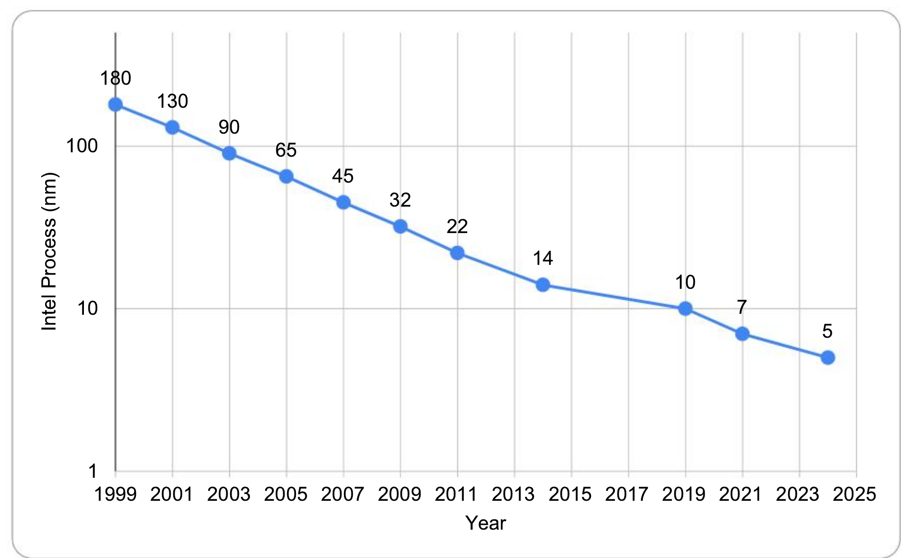{#fig-1-24 width=90%}

**陷阱**　*工艺线宽已经不再对应晶体管的实测宽度。*

大约 2005 年以前，工艺的纳米数是芯片内部一个真实的物理尺寸。后来，传统的平面晶体管到了 20 nm 性能令人失望，于是在同样的几何尺寸下改用 FinFET 晶体管。为了表明基于 FinFET 的新晶体管更好，厂商出于营销考虑，把它改称为 16 nm 工艺，尽管它仍然是同一代工艺。节点编号一旦不再对应某个实测尺寸，命名也就可以随意了。以两条金属线之间的间距为例，台积电 7 nm 工艺是 40 nm，Intel 10 nm 工艺却是 36 nm。因此，Intel 的 10 nm 工艺做出的芯片可能比台积电的 7 nm 工艺还小。所谓 5 nm 及更小的节点能带来多少好处，现在很难预测，因为这些名称已经成了营销用语，而且在仍在生产最先进逻辑芯片的三家公司（Intel、三星和台积电）之间，含义可能并不一致。

。注意，2021 年网络和微处理器的带宽与内存带宽相差 10 倍，内存带宽与磁盘带宽又相差将近 10 倍。](images/ch01/fig-1-25.png){#fig-1-25 width=90%}

**谬误**　*多处理器是灵丹妙药。*

2005 年前后，处理器转向在每块芯片上放多个处理器。这并不是因为出现了什么突破，使并行编程大为简化，或者使多核计算机变得容易制造。之所以转向，是因为 ILP 墙和功耗墙摆在面前，别无选择。每块芯片放多个处理器并不保证功耗更低；设计出一块功耗更高的多核芯片，完全是可能的。多核的潜力仅仅在于：用几个时钟频率较低、效率较高的核，取代一个时钟频率很高、效率很低的核，性能就有可能继续提高。

我们在第 4 章和第 5 章会看到，提高性能现在成了程序员的负担。程序员坐在躺椅上不动一根手指，靠硬件设计者让自己的程序跑得更快，这样的时代已经正式结束。程序员要想让程序一代比一代快，就必须提高程序的并行度。

摩尔定律的通俗说法是「每一代工艺都使性能提高」，现在这一点有一部分要取决于程序员了。

**陷阱**　*成为令人心碎的 Amdahl 定律的牺牲品。*

几乎每一位在一线工作的计算机体系结构设计者都知道 Amdahl 定律。尽管如此，我们几乎每个人都偶尔会在还没有测量某个特性原先的使用情况时，就花大力气去优化它。直到总体加速比令人失望，我们才想起来，在花这么大力气改进它之前，本该先测量一下！

**陷阱**　*单点故障。*

第 53 页用 Amdahl 定律计算了可靠性的改进，结果表明，可信性不会比链条上最薄弱的一环更强。正如那个例子所示，无论把电源做得多么可信，那唯一的一个风扇都会限制磁盘子系统的可靠性。由 Amdahl 定律的这一观察，产生了容错系统的一条经验法则：确保每个部件都有冗余，这样任何单个部件失效都不会使整个系统瘫痪。第 6 章介绍 WSC 内部怎样用一个软件层来避免单点故障。

**谬误**　*能提高性能的硬件改进也能提高能效，最坏也不会增加能耗。*

Esmaeilzadeh 等人（2011）在一台 2.67 GHz 的 Intel Core i7 上只用一个核，打开 Turbo 模式（见[1.5 节](#sec-1-5)），测量了 SPEC2006。时钟频率提高到 2.94 GHz（即提高到 1.10 倍）时，性能提高到 1.07 倍，但 i7 消耗的焦耳数增加到 1.37 倍，瓦时数增加到 1.47 倍！工程师在给[图 1.23](#fig-1-23) 中的两台服务器运行 SPECPower 基准测试程序时关掉了 Turbo 模式，原因也许就是这样的能效低下。

**谬误**　*基准测试程序永远有效。*

一个基准测试程序能否很好地预测真实性能，受几个因素影响，其中有些因素会随时间变化。一个很重要的因素，是基准测试程序抵御「基准测试工程」（benchmark engineering）或者说「基准营销」（benchmarketing）的能力。一个基准测试程序一旦标准化并流行起来，人们就会面临巨大的压力，要通过针对性的优化或者对运行规则的激进解读来提高它的性能。短小的核心程序（kernel），或者大部分时间都花在少量代码上的程序，尤其容易受到这种影响。

例如，尽管初衷再好不过，最初的 SPEC89 基准测试程序集里还是收入了一个叫 matrix300 的小核心程序，它由 8 个不同的 $300 \times 300$ 矩阵乘法组成。这个核心程序 99% 的执行时间都花在一行代码上（见 SPEC，1989）。IBM 的一个编译器优化了这个内层循环（用的是一种叫分块的好方法，第 2 章和第 4 章会讨论），性能提高到这个编译器上一个版本的 9 倍！这个基准测试程序测的是编译器调优的效果，它当然不能很好地反映总体性能，也不能反映这项优化通常的价值。

如果我们忽视历史，就可能不得不重蹈覆辙。SPEC Cint2006 十年没有更新，编译器开发者有充足的时间针对这套程序打磨自己的优化器。在一款 Intel 微处理器上，SPEC Cint2006 中除 libquantum 以外的所有基准测试程序，得分比值都落在 22 到 78 之间。libquantum 却快了 7300 倍！这个「奇迹」来自 Intel 编译器的优化：它把代码自动并行化到所有核上，还用位压缩（bit packing）来优化内存。位压缩把多个取值范围很窄的整数紧挨着存放在一起，从而节省内存空间，进而节省内存带宽。

为了说明基准测试程序寿命之短，第 43 页的[图 1.19](#fig-1-19) 列出了 SPEC 各个版本中全部 82 个基准测试程序的状况；SPEC89 的程序中只有 gcc 一个留到了现在。令人吃惊的是，SPEC2000 及更早版本的全部程序中，大约 70% 在下一个版本中就被淘汰了。

**谬误**　*磁盘的额定平均无故障时间是 1 200 000 小时，差不多 140 年，所以磁盘实际上永远不会坏。*

磁盘厂商目前的营销做法可能会误导用户。这样的 MTTF 是怎么算出来的呢？在早期阶段，厂商会把几千块磁盘放进一个房间，让它们运行几个月，然后统计坏了多少块。他们计算 MTTF 的方法，是用这些磁盘累计工作的总小时数除以坏掉的块数。

一个问题是，这个数字远远超过了磁盘的寿命，而磁盘寿命通常按 5 年即 43 800 小时计算。为了让这么大的 MTTF 讲得通，磁盘厂商辩称，这个模型对应的是这样一位用户：他买了一块磁盘，此后每 5 年（磁盘的设计寿命）换一块新的。按照他们的说法，如果许多客户（以及他们的曾孙辈）在接下来的一个世纪里都这样做，那么平均要换 27 块磁盘才会遇到一次故障，也就是大约 140 年。

更有用的度量是磁盘失效的百分比，即年故障率（见[1.7 节](#sec-1-7)）。假设有 1000 块 MTTF 为 1 000 000 小时的磁盘，每天 24 小时使用。如果每坏一块就换上一块可靠性特征相同的新磁盘，那么一年（8760 小时）内会坏掉的磁盘数为

$$
\begin{aligned}
\text{失效磁盘数} &= \frac{\text{磁盘数} \times \text{时间长度}}{\text{MTTF}} \\
&= \frac{1000\ \text{块磁盘} \times 8760\ \text{小时/块}}{1\,000\,000\ \text{小时/次失效}} = 9
\end{aligned}
$$

换句话说，每年有 0.9% 的磁盘会坏，5 年寿命内会坏 4.5%。

而且，厂商给出这些很高的数字时，假定温度和振动都在有限的范围内。一旦超出这个范围，这些数字就失去了意义。一项针对实际环境中磁盘驱动器的调查（Gray 和 van Ingen，2005）发现，每年有 3% 到 7% 的驱动器失效，相当于 MTTF 约为 125 000～300 000 小时。另一项规模更大的研究发现，磁盘的年故障率为 2% 到 10%（Pinheiro 等，2007）。因此，实际使用中的 MTTF 大约比厂商给出的 MTTF 差 2～10 倍。

**谬误**　*峰值性能能反映实测性能。*

峰值性能唯一普遍成立的定义是「计算机保证不会超过的性能水平」。[图 1.26](#fig-1-26) 给出了四个程序在四台多处理器上达到的峰值性能百分比，从 5% 到 58% 不等。差距这么大，而且随基准测试程序的不同变化很大，因此峰值性能一般不能用来预测实测性能。

{#fig-1-26 width=90%}

**陷阱**　*故障检测可能降低可用性。*

这个陷阱听起来有些讽刺。它之所以存在，是因为计算机硬件中有相当多的状态，并不总是对正确运行至关重要。例如，转移预测器出错并不致命，因为受影响的只可能是性能。

在激进地利用 ILP 的处理器中，并不是所有操作都是程序正确执行所必需的。Mukherjee 等人（2003）发现，在 SPEC2000 基准测试程序中，可能处在关键路径上的操作不到 30%。

程序也是如此。如果一个寄存器在程序中是「死」的，也就是说，程序再次读它之前会先写它，那么这个寄存器出错就无关紧要。如果在死寄存器中检测到瞬时故障就让程序崩溃，可用性就会无谓地降低。

2000 年，Oracle 的 Sun Microsystems 部门就落入过这个陷阱。它的 Sun E3000 到 Sun E10000 系统中，L2 Cache 带有奇偶校验，但没有纠错功能。他们用来构建 Cache 的 SRAM 有间歇性故障，奇偶校验能把它检测出来。如果 Cache 中的数据没有修改过，处理器只需从 Cache 中重新读一遍数据。但设计者没有用纠错码（ECC）来保护 Cache，因此脏数据出错时，操作系统只能报告错误，让程序崩溃。现场工程师检查后发现，90% 以上的情况根本没有问题。

为了降低这类错误的频率，Sun 修改了 Solaris 操作系统，用一个进程主动把脏数据写回内存，以此来「擦洗」（scrub）Cache。由于处理器芯片没有足够的引脚来增加 ECC，针对脏数据唯一的硬件办法，是把片外 Cache 复制一份，用没有奇偶错的那一份来纠正错误。

陷阱就在于只检测故障，却不提供纠正故障的机制。这些工程师大概不会再设计片外 Cache 不带 ECC 的计算机了。

**陷阱**　*高估计算机技术对碳排放的影响。*

全球气候变化事关重大，考虑信息技术在其中的作用无疑很重要。但我们必须把数字算对，一是为了确保解决的是最重要的问题，二是为了维护我们所提建议的可信度。具有讽刺意味的是，计算一旦出错，结果反而可能更有新闻价值，于是受到大量关注。即使后来有文章纠正了记录，也得不到同样的关注，于是这些有缺陷的「伪事实」（factoid）就在互联网上自行流传下去。

「Brandolini 定律」幽默地道出了这种讽刺：*驳斥*错误信息所需的精力，是*制造*错误信息所需精力的 10 倍。

Koomey 和 Masanet 指出了估算排放时的四个常见错误（Koomey 和 Masanet，2021）：

1. 忽视、误解或错误描述关键参数随时间的变化。
2. 假定计算领域的*短期*变化必然导致用电量立即发生成比例的变化。
3. 信息技术变化极快，连预测未来几年都有很大的不确定性，却仍要作长期预测。
4. 只根据信息技术生态系统中一个部分的趋势，就得出宽泛的结论。

下面是落入这些陷阱的三个例子：

* 2010 年到 2018 年，云数据中心的工作负载增加到 26 倍，估计的用电量增加到 5 倍。有人据此预言云计算会带来可怕的后果。但是，尽管云计算增长迅速，全球*所有*数据中心的实际能耗只增长了不到 10%。这两个观察之所以都成立，是因为 2010 年到 2018 年间，大量计算从效率相对较低的本地数据中心转移到了效率高得多的云数据中心（Masanet 等，2020）。这个估计犯了上面的第四个错误。
* 报纸声称「看 30 分钟 Netflix 产生的排放 [1.6 kg CO~2~e] 相当于开车将近 4 英里」。更准确的估计是 36 克 CO~2~e，只有前者的 1/45（Kamiya，2020）。这次高估主要可以用第一个错误，即忽视关键参数的变化来解释。
* 报纸报道说，「训练一个深度神经网络模型的排放是一辆汽车整个寿命期排放 [284 019 kg] 的 5 倍」。实际数字只有 2.4 kg CO~2~e，只有前者的 1/120 000（Patterson 等，2022）。第 7 章的谬误与陷阱一节会解释这个有缺陷的高估是怎样推算出来的，它主要是落入了四个常见错误中的第一个。

<!--chapter:end:01-fundamentals-12.Rmd-->

## 结束语 {#sec-1-13}

本章介绍了一些概念，给出了一个定量分析的框架，全书都将在这个框架上展开。从上一版开始，能效就一直与性能相伴。

第 2 章从至关重要的存储系统设计讲起。我们将考察一大批技术，它们共同作用，使内存看起来无限大，同时又尽可能快。（附录 B 为对 Cache 了解不多、缺乏相关背景的读者提供了入门材料。）和后面各章一样，我们将看到，硬件和软件的协作已经成为高性能存储系统的关键，正如它是高性能流水线的关键一样。

第 3 章讨论 ILP，流水线是 ILP 最简单、最常见的形式。利用 ILP 是构建高速单处理器最重要的技术之一。第 3 章首先详细讨论基本概念，为读者学习这两章中的大量思想打下基础。第 3 章所举的例子跨越了将近 50 年，从最早的超级计算机之一（IBM 360/91）一直到今天市场上最快的处理器。这一章着重介绍利用 ILP 的所谓*动态*方法，也叫*运行时方法*。这一章还讨论 ILP 思想的局限，并介绍多线程，第 4 章和第 5 章将进一步讨论多线程。附录 C 为对流水线了解不多、缺乏相关背景的读者提供了入门材料。（我们估计，对许多读者来说这部分是复习，包括读过我们的入门教材 *Computer Organization and Design: The Hardware/Software Interface*（《计算机组成与设计：硬件/软件接口》）的读者。）

第 4 章讲解利用 DLP 的三种方法。最经典、最古老的方法是向量体系结构，我们从它讲起，以奠定 SIMD 设计的原理基础。（附录 G 更深入地讨论向量体系结构。）接着讲解今天大多数桌面微处理器中都有的 SIMD 指令集扩展。第三部分深入讲解现代 GPU 是怎样工作的。大多数 GPU 介绍都是从程序员的角度写的，往往掩盖了计算机真正的工作方式。这一节从内行的角度讲解 GPU，还给出了 GPU 行话与比较传统的体系结构术语之间的对照。

第 5 章集中讨论怎样用多个处理器（即多处理器）获得更高的性能。多处理不是用并行性来重叠执行单条指令，而是用并行性让多个指令流在不同的处理器上同时执行。我们的重点是多处理器的主流形式，即共享内存多处理器；不过我们也介绍其他类型，并讨论任何多处理器都会遇到的普遍问题。这一章同样考察多种技术，重点是 20 世纪 80 年代和 90 年代首次提出的重要思想。

第 6 章先介绍集群，然后深入讨论仓库级计算机（WSC），现代云计算时代正是由 WSC 支撑的。WSC 的设计者在职业上是 Seymour Cray 等超级计算机先驱的传人，因为他们设计的同样是极端的计算机。一台 WSC 有几万台服务器，这些设备连同容纳它们的建筑，造价将近 2 亿美元。前面各章关注的性价比和能效问题同样适用于 WSC，用定量方法作决策也同样适用。这一章还介绍虚拟机，虚拟机是安全云计算的一项关键技术。

摩尔定律和 Dennard 缩放已经终结，要提高性能和能效，唯一的出路是领域专用体系结构，第 7 章就介绍这种体系结构。这一章给出构建有效的领域专用体系结构的指导原则，介绍深度神经网络这个激动人心的领域，描述最近的四个实例（它们加速神经网络的方法各不相同），最后比较它们的性价比。在我们完成这一版时，人们对 AI 的热情空前高涨，这不禁让人想问：从现在到下一版，获得最多投资的会是通用 CPU 还是 AI 加速器？

本书在网上提供了丰富的材料（详见前言），一方面是为了降低成本，另一方面是为了向读者介绍各种高级专题。[图 1.27](#fig-1-27) 列出了全部附录。附录 A 到 C 印在书中，对许多读者来说是复习。

附录 D 不再以处理器为中心，转而讨论存储系统中的问题。我们采用类似的定量方法，不过这种方法以观察系统行为为基础，并从端到端的角度分析性能。这个附录讨论一个重要问题：怎样主要利用成本较低的磁存储技术高效地存取数据。我们的重点是考察磁盘存储系统在典型的 I/O 密集型负载下的性能，例如本章提到的 OLTP 基准测试程序。我们还详细探讨基于 RAID 的系统中的高级专题。RAID 系统用冗余的磁盘同时获得高性能和高可用性。最后，附录 D 介绍排队论，排队论为在利用率和延迟之间作出权衡提供了依据。

附录 E 从嵌入式计算的角度审视各章和前面几个附录中的思想。

附录 F 全面探讨系统互连这一主题，包括让计算机之间能够通信的广域网和系统域网。

[图 1.27　附录一览]{#fig-1-27 .caption}

| 附录 | 标题 |
|---|---|
| A | 指令系统原理 |
| B | 存储层次回顾 |
| C | 流水线：基础与中级概念 |
| D | 存储系统 |
| E | 嵌入式系统 |
| F | 互连网络 |
| G | 深入向量处理器 |
| H | VLIW 与 EPIC 的硬件和软件 |
| I | 大规模多处理器与科学应用 |
| J | 计算机算术 |
| K | 指令系统结构综述 |
| L | 地址转换的高级概念 |
| M | 历史回顾与参考文献 |

附录 H 回顾超长指令字（VLIW）的硬件和软件。相比之下，VLIW 在通用计算中已经不如 1997 年惠普和 Intel 推出 EPIC 时那样流行了。VLIW 最终在数字信号处理器和领域专用体系结构中找到了归宿。

附录 I 介绍用于高性能计算的大规模多处理器。

附录 J 是第 1 版留下来的唯一一个附录，内容是计算机算术。

附录 K 综述各种指令系统结构，包括 x86、IBM 360、VAX，以及许多 RISC 体系结构，如 ARM、MIPS、Power、RISC-V 和 SPARC。

附录 L 讨论内存管理的高级技术，重点是对虚拟机的支持，以及面向超大地址空间的地址转换设计。云处理器越来越多，这些体系结构上的改进也随之越来越重要。

接下来介绍附录 M。

<!--chapter:end:01-fundamentals-13.Rmd-->

## 历史回顾与参考文献 {#sec-1-14}

附录 M（在网上提供）收录了对本书各章所讲关键思想的历史回顾。借助这些历史回顾，我们可以沿着一系列机器追溯一种思想的发展，也可以介绍一些重要的项目。每段历史的末尾都列有参考文献，供想了解某种思想或某款处理器最初如何发展起来、或者想进一步阅读的读者参考。本章对应的是 M.2 节「计算机的早期发展」，那里讨论了数字计算机的早期发展和性能测量方法。

阅读这些历史材料时，读者很快就会意识到，和许多其他工程领域相比，计算机领域还很年轻。这带来一个重要的好处：一些开创性思想的提出者仍然健在，我们只要去问他们，就能了解这段历史！

<!--chapter:end:01-fundamentals-14.Rmd-->

## 案例研究与习题（Gregory D. Peterson） {- #sec-1-exercises}

### 案例研究 1：芯片制造的趋势 {-}

*本案例研究涉及的概念*

* 制造成本
* 制造成品率
* 靠冗余容忍缺陷

半导体制造已经在逼近物理学的基本极限，但各家公司仍在不断建设新的制造厂，以跟上摩尔定律的步伐。每座新工厂的造价高达几百亿美元，而且只有在一大批相关技术上取得进步，才能制造出新的计算机芯片。这些挑战直接影响性能更高的计算机芯片能否造出来，也直接影响芯片的价格。在这个案例研究中，我们探讨芯片设计中的一些决策，这些决策会影响芯片的性能、成品率、冗余和成本。

1.1　[10/10/10/10/10/10] <1.6> [图 1.28](#fig-1-28) 给出了一组假想的数据，它们影响 GPU 芯片和 CPU 芯片的成本。在接下来的几道习题中，你将探讨这些芯片的各种设计决策会带来什么影响。

[图 1.28　假想的 GPU 和 CPU 的制造成本因素]{#fig-1-28 .caption}

| 芯片 | 晶片面积（mm²） | 估计缺陷率（每 cm²） | N | 制造尺寸（nm） | 晶体管数（十亿） | 核数或 SM 数 |
|---|---|---|---|---|---|---|
| GPU A | 800 | 0.011 | 36 | 4 | 80 | 132 |
| GPU B | 2 × 850 | 0.011 | 37 | 4 | 210 | 160 |
| CPU A | 270 | 0.011 | 36 | 4 | 16 | 8 |
| CPU B | 12 × 75 | 0.010 | 35 | 5 | 90 | 96 |
|  | 1 × 400 | 0.010 | 34 | 6 |  |  |

a.　[10] <1.6> 按完好的晶圆计算，GPU A 芯片的成品率是多少？

b.　[10] <1.6> 按完好的晶圆计算，CPU A 芯片的成品率是多少？

c.　[10] <1.6> GPU B 由两个大芯粒组合封装成一个系统。按完好的晶圆计算，GPU B 的每个芯粒的成品率是多少？

d.　[10] <1.6> CPU B 由若干个不同的芯粒组合封装成一个系统。其中 12 个相同的芯粒负责计算任务，采用较小的制造尺寸；另有 1 个芯粒负责 I/O 任务，采用较大的制造尺寸。假设晶圆是完好的，组成 CPU B 的每个计算芯粒的成品率是多少？I/O 芯粒的成品率又是多少？

e.　[10] <1.6> 考虑另一种可能：GPU B 不采用芯粒，而是制造成一块更大的单片芯片。这时成品率相比如何？你能想出采用芯粒更好的其他理由吗？

f.　[10] <1.6> 考虑另一种可能：CPU B 不采用芯粒，而是用较小的工艺节点制造成一块更大的单片芯片（假设 I/O 功能在较小的工艺节点下占用的面积不变）。这时成品率相比如何？

1.2　[20/20/20/25/25] <1.6> 设想有一座制造厂，能够生产上面讨论的每一种芯片。我们要评估应当为每种芯片分配多少产能。假设每颗无缺陷的 GPU A 芯片带来 1000 美元利润，每颗无缺陷的 CPU A 芯片带来 100 美元利润。对每种芯片，都假设晶圆直径为 300 mm。

a.　[20] <1.6> 每片 GPU A 晶圆能带来多少利润？

b.　[20] <1.6> 每片 CPU A 晶圆能带来多少利润？

c.　[20] <1.6> 如果每月的需求最多是 5000 颗 GPU A 芯片和 3000 颗 CPU A 芯片，而你的工厂每月能生产 90 片晶圆，那么每种芯片各应该生产多少片晶圆？

d.　[25] <1.6> 假设每个无缺陷的 GPU B 产品（需要两个芯粒）带来 2500 美元利润，那么每片 GPU B 晶圆能带来多少利润？

e.　[25] <1.6> 假设每个无缺陷的 CPU B 产品（需要 12 个计算芯粒和 1 个负责 I/O 功能的芯粒）带来 75 美元利润。每片 CPU B 计算芯粒晶圆能组成多少个可以出售的 CPU B 产品？每片 CPU B 计算芯粒晶圆需要配多少片 CPU B I/O 芯粒晶圆？如果你的工厂能生产 30 片这两种芯粒的晶圆，为了使利润最大，应当有多少片用于计算芯粒、多少片用于 I/O 芯粒？这时的利润是多少？

1.3　[20/5] <1.6> 大处理器芯片的成品率低。要提高这类芯片在经济上的可行性，可以考虑不丢弃部分功能完好的芯片，而是降价出售。有些产品可以分成不同的版本出售，各版本包含的核数不同（这些版本也叫库存单位，即 SKU）。例如，CPU A 芯片可以分成每块芯片含 8 个、4 个、2 个和 1 个核的几个版本出售。8 个核全都没有缺陷的芯片作为 CPU A~8~ 出售；有 4 到 7 个无缺陷核的芯片作为 CPU A~4~ 出售；有 2 个或 3 个无缺陷核的芯片作为 CPU A~2~ 出售。为了简化计算，单个核的成品率取面积为原 CPU A 芯片 1/8 的芯片的成品率，并把它看作单个核无缺陷的独立概率。每种配置的成品率，按相应个数的核无缺陷的概率计算。

a.　[20] <1.6> 单个核无缺陷的成品率是多少？CPU A~4~、CPU A~2~ 和 CPU A~1~ 的成品率各是多少？

b.　[5] <1.6> 根据 (a) 的结果，判断你认为哪些芯片值得封装出售，并说明理由。

1.4　[20/5/25] <1.6> 现在我们考虑用类似的办法，利用冗余来提高 GPU 的成品率。以 GPU B 为例，假设产品由两个芯粒组成，每个芯粒含 85 个对称多处理器（SM），SM 相当于 GPU 中的核。再假设出货含 160 个 SM 的产品需要 2 个功能正常的 GPU 芯粒，每个芯粒最多可以有 5 个 SM 带缺陷。和习题 1.3 中的 CPU A 一样，单个 SM 的成品率取面积为原 GPU B 芯粒 1/85 的芯粒的成品率，同样把它看作单个 SM 无缺陷的独立概率。芯粒的成品率按至少有 80 个 SM 无缺陷的概率计算。

a.　[20] <1.6> 单个 SM 无缺陷的成品率是多少？每个 GPU B 芯粒的成品率是多少？

b.　[5] <1.6> 根据 (a) 的结果，每片 GPU B 芯粒晶圆能带来多少利润？和 1.2(d) 的结果相比如何？

c.　[25] <1.6> 对每颗 GPU A 芯片也可以作类似的分析。假设每块晶片上有 144 个 SM，至少有 132 个 SM 功能正常的芯片就可以出售。这种冗余会怎样影响每片晶圆的利润？又会怎样影响 1.2(c) 的答案？

### 案例研究 2：可扩展的计算机系统 {-}

*本案例研究涉及的概念*

* Amdahl 定律
* 冗余
* MTTF

现代系统的规模，小到微型 IoT 设备，大到数据中心和超级计算机。下面的习题讨论影响这些系统的实际问题，如成本、功耗和能耗，以及性能的可扩展性。

大型可扩展计算机系统追求高性能，通常从两个方面入手：一是作业吞吐率，即同时处理许多个作业；二是延迟，即尽快完成任务；也可以两者兼顾。利用并行性是提高性能的一种关键方法，适用于各个层次的系统规模：在处理器内增加核，在服务器或节点内增加处理器或插槽，在数据中心或超级计算机内增加服务器或节点。

1.5　[10/20/20/20/25] <1.10> 把一个应用并行化时，理想的加速比等于处理器的个数。实际上，加速比受两方面限制：一是应用中能够并行化的部分所占的百分比，二是通信代价等开销的影响。Amdahl 定律考虑了前者，但没有考虑后者。

a.　[10] <1.10> 如果应用中有 [80%，90%，95%，99%] 可以并行化，不计通信代价，用 *N* 个处理器的加速比是多少？

b.　[20] <1.10> 如果每增加一个处理器，通信开销就是原执行时间的 [0.5%，1%，2%，5%]，用 32 个处理器的加速比是多少？

c.　[20] <1.10> 如果处理器个数每翻一番，通信开销就增加原执行时间的 [0.5%，1%，2%，5%]，用 32 个处理器的加速比是多少？

d.　[20] <1.10> 如果处理器个数每翻一番，通信开销就增加原执行时间的 [0.5%，1%，2%，5%]，用 *N* 个处理器的加速比是多少？

e.　[25] <1.10> 写出解决下面这个问题的一般方程：一个应用的原执行时间中有 P% 可以并行化，而且处理器个数每翻一番，通信就增加原执行时间的 [0.5%，1%，2%，5%]，那么处理器个数为多少时加速比最高？

1.6　[10/20/20/20] <1.10> 在习题 1.5 中，各种情况下并行运行的问题规模都相同，这称为强扩展（strong scaling）。在弱扩展（weak scaling）中，问题规模随处理器个数一起增大，弱扩展有时也称为 *Gustafson 定律*。我们来考虑一个弱扩展应用的性能，即扩展加速比，需要考虑的因素是串行应用（基准）中被并行化的部分所占的百分比，以及通信代价。

a.　[10] <1.10> 如果串行应用中有 [80%，90%，95%，99%] 可以并行化，不计通信代价，并假设其他方面都随处理器的增加而完美扩展，用 *N* 个处理器的扩展加速比是多少？

b.　[20] <1.10> 如果每增加一个处理器，通信开销就是原执行时间的 [0.5%，1%，2%，5%]，用 32 个处理器的扩展加速比是多少？

c.　[20] <1.10> 如果处理器个数每翻一番，通信开销就增加原执行时间的 [0.5%，1%，2%，5%]，用 32 个处理器的扩展加速比是多少？

d.　[20] <1.10> 如果处理器个数每翻一番，通信开销就增加原执行时间的 [0.5%，1%，2%，5%]，用 *N* 个处理器的扩展加速比是多少？

1.7　[讨论] <1.9, 1.10> Top 500 排行榜（top500.org）用 High Performance LINPACK（HPL）作为世界上最大的超级计算机的基准测试程序。HPL 是一个稠密线性代数程序，排行榜用它报告系统实际达到的每秒浮点运算次数（FLOPS），同时给出系统的理论峰值 FLOPS。排行榜还用稀疏线性代数程序 High Performance Conjugate Gradient（HPCG）报告实际达到的 FLOPS。从 2024 年 6 月的排行榜看，排名靠前的机器在 HPL 上平均达到峰值 FLOPS 的 70% 左右，在 HPCG 上却不到峰值 FLOPS 的 2%。

a.　你能把 Top 500 的 HPL 或 HPCG 结果换算成加速比或扩展加速比吗？说明理由。

b.　把这些 Top 500 结果和[图 1.26](#fig-1-26) 中科学计算程序在超级计算机上的报告结果作比较。

c.　2024 年有一项研究在 Frontier 上探索机器学习训练，Frontier 当时在 Top 500 排行榜上排名第一。研究人员报告说，他们达到了理论每秒运算次数的 32% 到 38%。^[见 <https://arxiv.org/pdf/2312.12705.pdf>。] 他们还报告说，训练程序的扩展加速比（弱扩展）接近 100%，加速比（强扩展）为 87% 到 89%。这些结果和 (a)、(b) 中的情况相比如何？

1.8　[10/10/20/20] <1.10> 你接到一项任务：在一台含 64 个核的新处理器上优化一组混合应用的性能。你要在这台处理器上运行 4 个应用，但它们对资源的需求各不相同。假设系统和应用的特征如[图 1.29](#fig-1-29) 所示。图中的场景 A 到 D 相互独立，本题可以针对其中任何一个或全部场景求解。图中的资源百分比表示：如果所有应用都串行运行，每个应用（1～4）在总运行时间中所占的比例。假设把程序的某一部分并行化为 X 份时，这一部分的加速比就是 X。

[图 1.29　4 个应用]{#fig-1-29 .caption}

| 应用 | 应用 1 | 应用 2 | 应用 3 | 应用 4 |
|---|---|---|---|---|
| **场景 A** |  |  |  |  |
| 所需资源（%） | 35 | 31 | 20 | 14 |
| 可并行化（%） | 50 | 80 | 60 | 90 |
| **场景 B** |  |  |  |  |
| 所需资源（%） | 41 | 28 | 17 | 14 |
| 可并行化（%） | 90 | 60 | 80 | 50 |
| **场景 C** |  |  |  |  |
| 所需资源（%） | 37.5 | 25 | 22 | 15.5 |
| 可并行化（%） | 80 | 90 | 50 | 60 |
| **场景 D** |  |  |  |  |
| 所需资源（%） | 50 | 25 | 12.5 | 12.5 |
| 可并行化（%） | 60 | 50 | 90 | 80 |

a.　[10] <1.10> 应用 1 在整个处理器上运行，和串行运行相比，加速比是多少？

b.　[10] <1.10> 应用 4 在整个处理器上运行，和串行运行相比，加速比是多少？

c.　[20] <1.10> 应用 1 需要一定百分比的资源。如果我们按这个百分比把核静态地分配给它，应用 1 并行运行，其他应用都串行运行，总加速比是多少？

d.　[20] <1.10> 如果 4 个应用都按各自所需资源的百分比静态地分配到一部分核，并且都并行运行，总加速比是多少？

1.9　[10/10/20/20] <1.7> 设计服务器时，最重要的考虑因素是可用性，其次是可扩展性和吞吐率。

a.　[10] <1.7> 我们有一个处理器，它的 FIT 为 100。这个系统的平均无故障时间（MTTF）是多少？

b.　[10] <1.7> 如果系统需要 1 天才能恢复运行，系统的可用性是多少？

c.　[20] <1.7> 设想政府为了削减成本，打算用廉价的计算机，而不是昂贵、可靠的计算机来构建一台超级计算机。一个有 1000 个处理器的系统，MTTF 是多少？假设只要有一个处理器出现故障，整个系统就出现故障。

d.　[20] <1.7> 最大的超级计算机可以有 10,000 个或更多的节点，每个节点有多个处理器或加速器。一个有 50,000 个处理器、可靠性特征和上面相同的系统，MTTF 是多少？在这种情况下，我能预期在出现故障之前完成的作业，最长能运行多长时间？

1.10　[20/20/20] <1.2, 1.7> 在云服务商使用的那类服务器集群中，单个故障不会导致整个系统崩溃，只会减少某一时刻能够满足的请求数。

a.　[20] <1.7> 一家公司有 10,000 台计算机，每台的 MTTF 是 35 天。只有当 1/3 的计算机出现故障时，公司才会遭遇灾难性故障。这个系统的 MTTF 是多少？

b.　[20] <1.2, 1.7> 假设停机每小时损失 10 万美元，系统崩溃后计算机需要 1 天才能恢复。每年停机造成的损失是多少？

c.　[20] <1.2, 1.7> 假设停机每小时损失 10 万美元，系统崩溃后计算机需要 1 天才能恢复。如果每台计算机多花 1000 美元就能使 MTTF 翻一番，这是不是一个合理的商业决策？假设计算机的使用寿命是 3 年。

### 案例研究 3：计算机系统中的能耗和功耗问题 {-}

*本案例研究涉及的概念*

* 动态能耗
* 功耗

现代系统的功耗取决于多种因素，包括芯片的时钟频率、效率和电压。下面的习题探讨不同的设计决策和使用场景会对功耗和能耗产生什么影响。

1.11　[10/10/10/10] <1.5, 1.9> 手机要完成的任务各不相同，包括播放流媒体音乐或视频、阅读电子邮件，还越来越多地执行图像识别、语音识别这类机器学习任务。用户要求手机电池续航时间长，因此降低功耗和能耗至关重要。在这道题中，我们考虑一种不现实的场景：手机没有任何专用处理单元，只有一个四核的通用处理单元。每个核满负荷运行时功耗为 0.5 W。完成手机的这些任务时，这个四核处理单元的速度是所需速度的 8 倍。

a.　[10] <1.5> 和全功率运行相比，需要多少动态能耗和功耗？先假设四核处理单元在 1/8 的时间里运行，其余时间空闲。也就是说，在 7/8 的时间里时钟是关闭的，这段时间里没有漏电。比较总的动态能耗，以及核运行期间的动态功耗。

b.　[10] <1.5> 如果采用调频调压，需要多少动态能耗和功耗？假设在整个时间里频率和电压都降到原来的 1/8。

c.　[10] <1.5, 1.9> 现在假设电压不能低于原电压的 50%。这个电压称为*电压下限*，电压一旦低于它，就会丢失状态。因此，频率可以继续降低，电压却不能。在这种情况下，动态能耗和功耗能节省多少？

d.　[10] <1.5> 如果采用暗硅方法，需要消耗多少能耗？这种方法为每项主要任务设计专用的 ASIC 硬件，这些部件不用时就对它们实施电源门控。芯片上只放一个通用核，其余部分都放专用单元。执行电子邮件这类任务时，这个核在 25% 的时间里运行，在另外 75% 的时间里通过电源门控完全关闭。在这 75% 的时间里，运行的是专用 ASIC 单元，它负责语音识别这类任务，能耗只有一个核的 20%。

1.12　[10/10/10] <1.5> 习题 1.11 提到，手机上运行着各种各样的应用。我们沿用前面的假设，即每个核的功耗为 0.5 W。

a.　[10] <1.5> 设想 80% 的代码可以并行化。要使单个核的执行速度和四路并行化的代码一样快，这个核的频率和电压需要提高多少？

b.　[10] <1.5> 在 (a) 中采用调频调压，动态能耗会降低多少？

c.　[10] <1.5> 如果采用暗硅方法，需要消耗多少能耗？这种方法对所有硬件单元都实施电源门控，可以把它们完全关闭（不产生漏电）。芯片上提供专用 ASIC，完成同样的计算只需要通用处理器 20% 的功耗。设想每个核都实施电源门控。假设图像识别这类任务需要 2 个 ASIC 和 2 个核。和在 4 个核上并行运行的基准情况相比，需要多少动态能耗？

1.13　[10/10/10/10/10/20] <1.5,1.9> 通用处理器是为通用计算优化的，因此在大量应用上都有不错的表现。但是，一旦把领域稍加限制，经过优化的功能部件或专用处理器就能更高效地完成工作。许多机器语言操作可以借助 ASIC 或图形处理器（GPU）这类专用硬件并发执行。这道题从性能和散热两个方面，探讨通用处理器和 GPU 之间的权衡。如果不能有效地排出计算机的热量，风扇吹回计算机的就会是热风，而不是冷风。注意：两者的差别不只在处理器上，片上存储器和 DRAM 也有影响。因此，这里的统计数据是系统级的，而不是芯片级的。

[图 1.30　基于通用处理器或基于图形处理器的系统的硬件特征，包括实测功耗]{#fig-1-30 .caption}

| 系统 | TDP | 空闲功耗 | 忙碌功耗 |
|---|---|---|---|
| 基于 CPU | 504 W | 159 W | 455 W |
| 基于 GPU | 1838 W | 357 W | 991 W |

[图 1.31　基于通用处理器或基于图形处理器的系统在两种神经网络负载上的性能特征。负载 A 和 B 来自已发表的结果。负载 C 是一个虚构的、更偏通用的应用]{#fig-1-31 .caption}

| 系统 | 吞吐率 A | 吞吐率 B | 吞吐率 C | % Max IPS A | % Max IPS B | % Max IPS C |
|---|---|---|---|---|---|---|
| 基于 CPU | 5482 | 13,194 | 12,000 | 42% | 100% | 90% |
| 基于 GPU | 13,461 | 36,465 | 15,000 | 37% | 100% | 40% |

a.　[10] <1.9> 一个数据中心用 CPU 运行时，70% 的时间花在负载 A 上，30% 的时间花在负载 B 上。GPU 系统相对 CPU 系统的加速比是多少？

b.　[10] <1.9> 一个数据中心用 CPU 运行时，70% 的时间花在负载 A 上，30% 的时间花在负载 B 上。这三种系统各自能达到 Max IPS 的百分之多少？

c.　[15] <1.5, 1.9> 在 (b) 的基础上，假设 IPS 从 0% 增长到 100% 时，功耗从空闲功耗线性增长到忙碌功耗。CPU 系统和 GPU 系统相比，每瓦性能如何？

d.　[10] <1.9> 另一个数据中心有 40% 的时间花在负载 A 上，10% 的时间花在负载 B 上，50% 的时间花在负载 C 上。GPU 系统相对通用系统的加速比是多少？

e.　[10] <1.5> 假设一个机柜用的冷却门价格为 4000 美元，能散发 14 kW 的热量（散发到机房内；要把热量排出机房还需要额外的成本）。按[图 1.30](#fig-1-30) 和[图 1.31](#fig-1-31) 中的 TDP 计算，一个冷却门能冷却多少台基于 CPU 或基于 GPU 的服务器？

f.　[20] <1.5> 典型的服务器集群每平方英尺最多能散发 200 W 的热量。一个服务器机柜需要占用 11 平方英尺（包括前后的留空）。一个机柜能放多少台 (e) 中的服务器？需要多少个冷却门？

### 习题 {-}

1.14　[15/10] <1.9> 假设我们对一台计算机作了一项改进，让某种执行模式的速度提高到原来的 10 倍。改进模式的使用时间占 50%，这个百分比是相对于使用改进模式之后的执行时间而言的。回想一下，Amdahl 定律依据的是原来未改进时的执行时间中能够使用改进模式的比例。因此，我们不能直接把这个 50% 的测量值代入 Amdahl 定律来计算加速比。

a.　[15] <1.9> 快速模式带来的加速比是多少？

b.　[10] <1.9> 原执行时间中有百分之多少转换成了快速模式？

1.15　[20/10/10/15] <1.9> 在这道习题中，假设我们打算改进一个基于芯粒的多核处理器，办法是加入加密硬件，用一个加密芯粒替换一个计算核芯粒。执行加密操作时，加密硬件的速度是普通执行模式的 20 倍。我们把加密百分比定义为：原执行过程中用来执行加密操作的时间所占的百分比。

a.　[20] <1.9> 画一张图，表示加速比随加密计算所占百分比变化的情况。y 轴标为「净加速比」（Net speedup），x 轴标为「加密百分比」（Percent encryption）。

b.　[10] <1.9> 加密百分比为多少时，加入加密硬件能使加速比达到 2？

c.　[10] <1.9> 如果加速比达到 2，新的执行过程中有百分之多少的时间花在加密操作上？

d.　[15] <1.9> 考虑这样的情况：去掉一个计算核芯粒，会使其他计算的性能下降 10%。加密单元的使用频率要达到多少，才值得加入？

1.16　[20/20/15] <1.9> 为优化处理器的某一部分而修改设计时，加快一类指令往往要以减慢其他部分为代价。例如，如果我们加入一个复杂的快速浮点部件，它要占用面积，于是可能要把某个部件移到离中心更远的位置，为它腾出空间，访问那个部件就要多一个周期的延迟。基本的 Amdahl 定律公式没有考虑这种权衡。

a.　[20] <1.9> 如果新的快速浮点部件使浮点操作的速度平均提高到原来的 2 倍，浮点操作占原程序执行时间的 20%，总加速比是多少（不计其他指令因此受到的损失）？

b.　[20] <1.9> 现在假设加快浮点部件导致数据 Cache 访问变慢，访问时间变为原来的 1.5 倍（或者说加速比为 2/3）。数据 Cache 访问占执行时间的 10%。现在的总加速比是多少？

c.　[15] <1.9> 实现了新的浮点操作之后，执行时间中有百分之多少花在浮点操作上？有百分之多少花在数据 Cache 访问上？

1.17　[10/10/20/20] <1.5> 云计算服务商使用的这类服务器集群，配备的计算能力足以应对一天中的最高请求率。设想这些服务器在大部分时间里只以 60% 的能力运行。再假设功耗并不随负载线性变化，即服务器以 60% 的能力运行时，消耗的是最大功耗的 90%。服务器可以关闭，但负载增加时重新启动太慢。有人提出了一种新系统，它能够快速重启，但处在这种「勉强活着」的状态时，需要消耗最大功耗的 20%。

a.　[10] <1.5> 关闭 40% 的服务器，能节省多少功耗？

b.　[10] <1.5> 让 40% 的服务器处于「勉强活着」的状态，能节省多少功耗？

c.　[20] <1.5> 把电压降低 20%、频率降低 20%，能节省多少功耗？

d.　[20] <1.5> 让 20% 的服务器处于「勉强活着」的状态，再关闭 20%，能节省多少功耗？

1.18　[10/10/10/10/5] <1.5> 实时应用必须满足特定的截止时间，为这类应用设计系统时，提前完成计算并不能带来任何好处。考虑这样一个 IoT 系统：在最坏情况下，它执行所需代码的速度也是所需速度的 2 倍。

a.　[10] <1.5> 如果按现在的速度执行，计算一完成就关闭系统，能节省多少能耗？

b.　[10] <1.5> 如果把电压和频率都降到原来的一半，能节省多少能耗？

c.　[10] <1.5> 考虑另一种 IoT 系统，它的核数多 50%，功耗高 30%。如果按现在的速度执行，计算一完成就关闭系统，能耗和 (a) 相比如何？

d.　[10] <1.5> 仍然考虑核数多 50%、功耗高 30% 的那种 IoT 系统。如果把电压和频率都降到原来的 1/3，能耗和 (c) 相比如何？

e.　[5] <1.5> 采用这种核数更多的 IoT 系统是否值得？为什么？

1.19　[10/15/15/10/10] <1.4, 1.5> 体系结构设计者面临的一个难题是：今天完成的设计，要经过几年的实现、验证和测试才能上市。因此，体系结构设计者必须提前几年预测届时的工艺会发展到什么程度，而这有时很难做到。

a.　[10] <1.4> 按照摩尔定律总结的器件缩小的历史趋势，2030 年一块芯片上的晶体管数应该是 2020 年的多少倍？

b.　[15] <1.5> 性能的提高曾经和这一趋势同步。如果性能一直按 20 世纪 90 年代的速度提高，到 2030 年，芯片的性能大约是 VAX-11/780 的多少倍？

c.　[15] <1.5> 按目前的提高速度，即 21 世纪 10 年代末到 20 年代初的速度，对 2030 年性能的更新预测是多少？

d.　[10] <1.4> 是什么限制了时钟频率的增长速度？现在体系结构设计者利用多出来的晶体管采取了哪些措施来提高性能？

e.　[10] <1.4> DRAM 容量的增长速度也放慢了。在 20 年的时间里，DRAM 容量每年提高 60%。如果 8 Gbit 的 DRAM 在 2014 年首次上市，而 16 Gbit 的 DRAM 直到 2019 年才上市，那么目前 DRAM 容量的增长率是多少？

1.20　[10/5/10/5/10] <1.2> 这道题通过[图 1.22](#fig-1-22) 中两种相近的服务器配置，探讨计算机系统的总拥有成本（TCO）。

a.　[10] <1.2> 假设每台服务器上的负载都是 70% 整数运算、30% 浮点运算。根据[图 1.22](#fig-1-22) 中给出的每台服务器的 SPEC 整数和浮点 rate 成绩，哪台服务器的性能更好？

b.　[5] <1.2> 根据 (a) 的结果，在这种负载下，两台服务器的性价比相比如何？

c.　[10] <1.2> 假设每台服务器有 60% 的时间忙碌，其余时间空闲。每台服务器忙碌时消耗电源功率上限的 90%，空闲时只消耗 30%。每台服务器一年要消耗多少功率？

d.　[5] <1.2> 假设 1 W 功率一年的费用是 1 美元，根据 (c) 的结果，每台服务器每年的用电费用是多少？

e.　[10] <1.2> 假设服务器的寿命是 5 年，考虑初始成本和每年的电费，它们每年的费用是多少？如果寿命是 6 年或 7 年，结果有什么变化？每台服务器在整个寿命期内的总费用是多少？

## 参考文献 {- #sec-1-references}

Barroso, L., Hölzle, U., Ranganathan, P., 2019. The Datacenter as a Computer: Designing Warehouse-Scale Machines. Springer Nature.

Jouppi, N., Kurian, G., Li, S., Ma, P., Nagarajan, R., Nai, L., Patil, N., Subramanian, S., Swing, A., Towles, B. Young, C., Patterson, D. "TPU v4: An optically reconfigurable supercomputer for machine learning with hardware support for embeddings." In *Proceedings of the 50th Annual International Symposium on Computer Architecture*. June 2023.

Norrie, T., Patil, N., Yoon, D.H., Kurian, G., Li, S., Laudon, J., Young, C., Jouppi, N., Patterson, D., 2021. The design process for Google's training chips: TPU v2 and TPU v3. IEEE Micro 41 (2), 56–63.

Patterson, D., Gonzalez, J., Holzle, U., Le, Q., Liang, C., Munguia, L.-M., Rothchild, D., So, D., Texier, M., Dean, J., 2022. The carbon footprint of machine learning training will plateau, then shrink. Computer 55 (7), 18–28.

Patterson, D., Bennett, J., Bennett, M., Chelin, H., Harris, D., Hellar, J., Jones, W., Moron, K., Savani, P., Shepherd, R., Simar, R., Suskind, Z., Wallentowitz, S., 2025. Emebnch IOT 2.0 and DSP 1.0: Modern Embedded Computing Benchmarks. IEEE Computer. In press.

<!--chapter:end:01-fundamentals-15.Rmd-->

# 存储层次设计 {#ch-memory}

> 理想情况下，人们希望存储器的容量无限大，其中任何一个……字都能立即取用。……我们……不得不考虑构造一种存储器的层次结构，其中每一级的容量都比上一级大，但访问速度比上一级慢。
>
> ——A. W. Burks、H. H. Goldstine 和 J. von Neumann，《电子计算仪器逻辑设计的初步讨论》（1946）

## 引言 {#sec-2-1}

计算机的先驱们早就预见到，程序员总希望快速存储器越多越好，最好是无限多。能以合理成本满足这一要求的办法，就是*存储层次*。存储层次依据两点构建：

* 一是*局部性*。第 1 章讲过，大多数程序访问代码和数据并不均匀，而是表现出时间局部性和空间局部性；
* 二是「越小越快」。在给定的工艺和功耗预算下，硬件做得越小，速度就越快。

不同的存储技术在成本和性能上各有长短，把速度、容量各不相同的存储器按层次组织起来，就能扬长避短。[图 2.1](#fig-2-1) 给出了几种典型的多级存储层次，以及各级常见的容量和访问速度。Flash 和新一代存储技术的每位成本正在逼近磁盘，因此很可能越来越多地取代磁盘，用作二级存储。从[图 2.1](#fig-2-1) 可以看到，许多个人计算机已经这样做了，服务器中也越来越普遍，因为这些技术在性能、功耗和密度上都有明显优势。

{#fig-2-1 width=90%}

存储层次之所以分成若干级，是因为快速存储器价格高。相邻两级相比，靠近处理器的一级容量较小、速度较快，每字节的价格也较高。存储层次的目标是：让整个存储系统每字节的成本接近最便宜的一级，速度接近最快的一级。多数情况下（并非全部），较低一级存放的数据是相邻较高一级数据的超集，这一性质称为*包含性*。对 Cache 而言，包含性通常由主存保证；对虚拟存储而言，通常由二级存储（磁盘或 Flash）保证。

处理器性能越高，存储层次就越重要。[图 2.2](#fig-2-2) 把单核性能的变化与主存访问时间的历年改进画在一起：

* 处理器曲线是单个核平均每秒发出的访存请求数，即两次访存间隔时间的倒数；
* 存储器曲线是每秒的 DRAM 访问次数，即 DRAM 访问延迟的倒数，这里假定只有一个 DRAM、一个存储体（bank）。

实际情况要复杂一些：处理器发出请求的速率并不均匀，处理器往往有多个核，存储系统也通常有多个 DRAM 存储体和多个通道。从图中可以看出，多年来两者的差距大幅扩大；近年来单处理器性能提高不多，差距扩大的速度才放慢下来。

），最近 5 年基本没有改进。处理器曲线假定：1986 年以前性能每年提高到上一年的 1.25 倍，1986 年到 2000 年每年 1.52 倍，2000 年到 2005 年每年 1.20 倍，2005 年到 2015 年处理器性能（按每个核计）只有很小的提高。可以看出，2010 年以前，DRAM 的访问时间改进得缓慢而稳定；2010 年以后，访问时间的改进比以前少了，但带宽仍在不断提高。更多信息见第 1 章的[图 1.1](#fig-1-1)。](images/ch02/fig-2-2.png){#fig-2-2 width=90%}

高端处理器有多个核，对带宽的需求比单核大得多。近年来单核的带宽需求增长放缓，但核数在增加，CPU 的访存需求与 DRAM 带宽之间的差距仍在扩大。以高端桌面处理器 Intel Core i9 12900 为例：

* 每个核每个时钟周期最多产生 4 次数据访存，共 8 个核，平均时钟频率 3 GHz，因此每秒最多产生 1920 亿次 128 位的数据访存；
* 取指的峰值需求约为每秒 480 亿次 128 位的指令访问；
* 两者合计，峰值带宽需求高达 3840 GiB/s。

为了提供如此高的带宽，i9 采取了三项措施：Cache 采用多端口和流水线；采用三级 Cache，每个核有两级私有 Cache，另有一个共享的 L3；第一级 Cache 分成指令 Cache 和数据 Cache。相比之下，使用两个存储通道的单总线 DDR5 主存，峰值带宽只有 56 GiB/s，约为需求的 2%。HBM 的访问时间更短，带宽也更高（见 [2.2 节](#sec-2-2)和 [2.3 节](#sec-2-3)）。

存储层次设计传统上以优化平均访存时间为目标，而平均访存时间取决于 Cache 访问时间、失效率和失效开销。近年来，功耗也成了必须考虑的主要因素。高端微处理器的片上 Cache 可达 60 MiB 以上，一个多芯片插座中的 Cache 可达 1 GiB。如此大的二级、三级 Cache 功耗相当可观，包括两部分：

* *静态功耗*，即不工作时的漏电功耗；
* *动态功耗*，即执行读写操作时的功耗（见 [2.3 节](#sec-2-3)）。

PMD 中的问题更突出。PMD 的 CPU 设计不那么激进，功耗预算可能只有高端处理器的 1/50 到 1/20，Cache 可能占到总功耗的 25% 到 50%。因此，设计存储层次时必须兼顾性能和功耗，本章对两者都会讨论。

### 存储层次基础：快速回顾 {-}

处理器与存储器的差距越来越大，存储层次的基础知识因此已经成为本科计算机体系结构课程的内容，操作系统和编译原理课程也会涉及。下面先快速回顾 Cache 的基本概念和工作方式，本章的重点则是为缩小处理器与存储器性能差距而提出的一些更高级的技术。

**块与 tag。** 访问的字不在 Cache 中时，必须从下一级存储（另一级 Cache 或主存）取出来放进 Cache，然后才能继续执行。每次调入的是若干个字组成的*块*（也称*行*），这样做一方面效率高，另一方面由于空间局部性，这些字很可能马上就会用到。每个 Cache 块都带有一个 *tag*（标签），用来指明它对应的存储地址。

**块的放置。** 设计 Cache 时首先要决定：一个块可以放在 Cache 的什么位置。最常用的方案是*组相联*。所谓*组*，就是 Cache 中的一组块。一个块先映射到某个组，然后可以放在组内的任意位置。查找时，先由块地址确定组号，再在组内查找，组内查找通常并行进行。组号的计算方法是：

$$
(\textit{块地址})\ \text{MOD}\ (\textit{Cache 中的组数})
$$

每组有 $n$ 个块时，称为 *n 路组相联*。组相联有两种极端情况：

* *直接映射*：每组只有一个块，一个块只能放在一个固定位置；
* *全相联*：整个 Cache 只有一组，一个块可以放在任意位置。

**写策略。** 只读数据的缓存很简单，因为 Cache 中的副本与存储器中的副本总是一致的。写操作就麻烦了，问题在于如何保持 Cache 副本与存储器副本的一致。主要有两种策略：

* *写直达*：写 Cache 的同时也写主存；
* *写回*：只写 Cache，等到该块被替换出 Cache 时，再把它写回存储器。

两种策略都可以使用*写缓冲*。数据一旦写入写缓冲，Cache 就可以继续工作，不必等待数据写入存储器的全部延迟。如果写缓冲中已有其他被修改的块，还可以检查新数据的地址与写缓冲中某个有效项是否相同，相同就把新数据合并到该项中，这种优化称为*写合并*。Intel Core i7 等许多处理器都采用了写合并。写回 Cache 通常一次写回整个块，所以写合并对写直达 Cache 的帮助更大。

需要注意的是，I/O 设备的寄存器常常映射到物理地址空间，而这些 I/O 地址*不能*进行写合并。原因是 I/O 寄存器的行为可能与普通存储器中的字数组不同，例如可能要求每个寄存器使用一个地址和一个数据字，不允许用一个地址一次写多个字。通常的处理办法是把这些页标记为不可合并的写直达方式。

**失效率与 3C 模型。** 衡量 Cache 组织好坏的一个指标是*失效率*，即失效的访问次数占总访问次数的比例。为了分析失效率高的原因、找到更好的设计，3C 模型把失效分成三类：

* *强制失效*：第一次访问某个块时，该块*不可能*在 Cache 中，必须调入。即使 Cache 容量无限大，强制失效也会发生；
* *容量失效*：Cache 装不下程序执行所需的全部块，有些块被替换出去后又被重新调入，由此产生的失效（强制失效之外）称为容量失效；
* *冲突失效*：放置策略不是全相联时，多个块映射到同一组，对它们的访问交替进行，一个块可能被替换出去后又被调入，由此产生的失效（强制失效和容量失效之外）称为冲突失效。

附录 B 第 24 页的图 B.8 给出了三类失效的相对比例。附录 B 也指出，3C 模型只是一个概念模型，它的结论通常成立，但不能精确解释每一次访问的 Cache 行为。

第 3 章和第 5 章将会看到，多线程和多核使 Cache 问题更加复杂：一方面容量失效更容易发生；另一方面又多了第四个 C，即*一致性*失效。多处理器为了保持各个 Cache 的一致而清空 Cache，由此引起一致性失效。这些问题留到第 5 章讨论。

**更好的衡量指标。** 失效率作为指标有几方面的局限，容易造成误导。因此，有些设计者更愿意用*每条指令的失效次数*，而不用每次访存的失效次数（即失效率）。两者的关系为：

$$
\frac{\text{失效次数}}{\text{指令}} = \frac{\text{失效率} \times \text{访存次数}}{\text{指令数}} = \text{失效率} \times \frac{\text{访存次数}}{\text{指令}}
$$

这个指标通常不写成小数，而写成整数，即每 1000 条指令的失效次数。

这两个指标的共同问题是都没有考虑失效的代价。更好的指标是*平均访存时间*：

$$
\text{平均访存时间} = \text{命中时间} + \text{失效率} \times \text{失效开销}
$$

其中，*命中时间*是 Cache 命中所需的时间，*失效开销*是从存储器调入替换块所需的时间，也就是一次失效的代价。平均访存时间比失效率好，但仍然只是性能的间接指标，不能代替执行时间。第 3 章将会讲到，推测执行的处理器可以在失效期间执行其他指令，从而降低实际的失效开销；多线程（见第 3 章）也能让处理器容忍失效，不必停下来等待。后面很快就会看到，要利用这类容忍延迟的技术，Cache 必须能在一次失效尚未处理完时继续响应其他请求。

以上内容如果读者还不熟悉，或者觉得回顾得太快，请参阅附录 B。附录 B 对这些入门内容讲得更深入，还给出了实际计算机中的 Cache 实例和效果的定量评估。

**六种基本的 Cache 优化。** 附录 B 的 B.3 节介绍了六种基本的 Cache 优化，并给出了效果的定量例子。下面快速回顾一下，同时简要说明它们对功耗的影响。

*增大块以降低失效率*：降低失效率最简单的办法是增大块，以利用空间局部性。块越大，强制失效越少，但失效开销越大。块大了 tag 就少了，静态功耗也能略有降低。但块增大也可能增加容量失效和冲突失效，在容量较小的 Cache 中尤其如此。块大小的选择是一个复杂的折中，取决于 Cache 容量和失效开销。

*增大 Cache 以降低失效率*：减少容量失效最直接的办法是增大 Cache。代价是命中时间可能变长，成本和功耗也更高，静态功耗和动态功耗都会增加。

*提高相联度以降低失效率*：提高相联度显然能减少冲突失效，但可能使命中时间变长。后面还会看到，相联度越高，功耗也越大。

*采用多级 Cache 以降低失效开销*：Cache 设计面临一个两难选择：是让 Cache 足够快，以跟上处理器的高时钟频率，还是让 Cache 足够大，以缩小处理器与主存之间的差距？在原来的 Cache 和存储器之间再加一级 Cache，就可以两全：第一级 Cache 做得足够小，与很短的时钟周期相匹配；第二级（或第三级）Cache 做得足够大，截住大部分本来要访问主存的请求。第二级 Cache 着眼于减少失效，因此块更大、容量更大、相联度更高。与容量相同的单级 Cache 相比，多级 Cache 的能效更高。用 L1、L2 分别表示第一级和第二级 Cache，平均访存时间可以改写为：

$$
\text{平均访存时间} = \text{命中时间}_{\text{L1}} + \text{失效率}_{\text{L1}} \times (\text{命中时间}_{\text{L2}} + \text{失效率}_{\text{L2}} \times \text{失效开销}_{\text{L2}})
$$

今天，从低端 PMD 到高端服务器多核处理器，所有处理器都采用多级 Cache，通常是两级或三级。各级 Cache 的优化目标不同，有的侧重命中时间，有的侧重失效时间，设计折中也就不同。例如，L1 的命中时间至关重要，而末级 Cache（LLC，Last-Level Cache，通常是 L2 或 L3）的命中时间稍长一些，对性能影响较小。另外，LLC 的失效开销通常比 L1 大得多，所以在 L1 中代价过高的优化，用在 LLC 中可能是合算的。

*读失效优先于写以降低失效开销*：这项优化适合在写缓冲上实施。写缓冲会带来一种冒险：读失效所需要的某个单元的最新值可能还在写缓冲中，这就是经由存储器的写后读冒险。一种解决办法是在读失效时检查写缓冲的内容，如果没有冲突而且存储系统空闲，就先发读请求，后处理写，从而降低失效开销。大多数处理器都让读优先于写，这样做对功耗影响很小。

*在 Cache 索引时避免地址转换以降低命中时间*：Cache 必须处理地址转换，即把处理器给出的虚拟地址转换成访问存储器所用的物理地址（虚拟存储见 [2.4 节](#sec-2-4)和 B.4 节）。常见的优化是用页内偏移量来索引 Cache，因为页内偏移量在虚拟地址和物理地址中完全相同（详见附录 B 的 B.36 页）。这种*虚拟索引、物理 tag* 的方法会增加系统的复杂性，也可能限制 L1 Cache 的容量和结构，但它把 TLB（translation lookaside buffer）的访问移出了关键路径，利大于弊。提高 L1 Cache 的相联度也能解决这个问题，因为相联度越高，用于索引 Cache 的地址位数越少。近来的 Intel 和 ARM 处理器就采用了这种方法。

需要指出的是，上述六种优化都有潜在的副作用，用得不当反而可能增加平均访存时间。

本章其余部分假定读者已经熟悉上述内容和附录 B 的细节。在「融会贯通」一节，我们将考察两种微处理器的存储层次：一种是面向高端桌面和小型服务器的 Intel Core i9 12900；另一种是面向 PMD 的 Arm Cortex-53，多种平板电脑和智能手机所用的处理器都以它为基础。即使在同一类处理器内部，用途不同，设计方法也有很大差别。

i9 比面向移动应用的 Intel 处理器核数多、Cache 大，但体系结构相似。面向小型服务器的处理器（如 i9 系列）和面向大型服务器的处理器（如 Intel Xeon 系列）通常要同时运行许多进程，而且这些进程往往属于不同的用户，因此存储带宽更加重要，这类处理器配有更大的 Cache 和更激进的存储系统来提高带宽。

PMD 则不同：它只为一个用户服务，操作系统一般较小，很少同时运行多个应用，应用本身也比较简单。PMD 必须兼顾性能和能耗，能耗决定了电池能用多久。在深入讨论更高级的 Cache 组织和优化之前，我们需要先了解各种存储技术及其发展趋势。

<!--chapter:end:02-memory-01.Rmd-->

## 存储技术及其优化 {#sec-2-2}

> ……真正让计算机站稳脚跟的，是一项发明：一种可靠的存储器，也就是磁芯存储器。……它的价格合理，工作可靠；正因为可靠，它后来才能做得很大。（第 209 页）
>
> ——Maurice Wilkes，《一位计算机先驱的回忆》（*Memoirs of a Computer Pioneer*，1985）

本节介绍构建存储层次（具体说就是构建 Cache 和主存）所用的技术，主要有三种：

* SRAM（静态随机访问存储器），用于 Cache；
* DRAM（动态随机访问存储器），用于主存；
* Flash，用于非易失性存储。

Flash 是用来替代硬盘的，但它的特性建立在半导体技术之上，所以也放在本节介绍。

Cache 失效时，数据要尽快从主存调进来，这就要求存储器有很高的带宽（HBM）。提高带宽的办法有两种：一是把构成主存的众多 DRAM 芯片组织成多个存储体（bank）和多个 rank，二是加宽存储总线；两种办法也可以同时采用。

为了跟上现代处理器的带宽需求，存储技术的创新已经深入到 DRAM 芯片内部。本节介绍的就是存储器芯片内部的技术。在此之前，先说明一个术语：*访问时间*，即从发出读请求到所需的字送达所经过的时间。Flash 和 DRAM 都支持突发传输，采用突发传输时，传送整个块的时间可能比取得块中第一部分数据的时间长。

1975 年以来，几乎所有计算机都用 DRAM 作主存、用 SRAM 作 Cache，其中一到三级 Cache 与 CPU 集成在同一块处理器芯片上。今天，所有 PMD 和笔记本电脑，以及大多数台式机，都已用 Flash 取代磁盘驱动器；许多服务器则把 Flash 和磁盘驱动器结合起来使用。

### SRAM 技术 {-}

SRAM 中的 S 代表*静态*（static）。DRAM 是动态电路，读出数据后必须写回，不过只有下一个请求访问同一个存储体时，才会遇到这段延迟。SRAM 则不同，它每位通常用 6 个晶体管，读出时信息不会受到干扰；在待机模式下，只需极少的功耗就能保持电荷。

早期大多数台式机和服务器用 SRAM 芯片构成一级、二级或三级 Cache，今天三级 Cache 都已集成到处理器芯片上。高端服务器芯片采用芯粒时，可能多达 60 个核、100 MiB 以上的 Cache；采用堆叠晶片时，可能超过 100 个核、1 GB 以上的 Cache。这类系统通常为每块处理器芯片配置 256～512 GiB 的 DRAM。大容量的片上三级 Cache，访问时间一般是二级 Cache 的 4 到 8 倍；即便如此，DRAM 的访问时间通常仍至少是 L3 的 5 倍。

片上 Cache 所用的 SRAM，宽度通常与 Cache 块大小一致，每个块的 tag与块并排存放，因此一个周期就能读出或写入一整块。把失效后取回的数据写入 Cache，或者把必须逐出的块写回时，这一点特别有用。Cache 的访问时间（不计组相联 Cache 中的命中检测和选择）与块数成正比；能耗则取决于两方面：一是 Cache 的位数，决定漏电造成的静态功耗；二是块数，决定每次访问产生的动态功耗。为了提高带宽、改善访问时间并降低功耗，许多多级 Cache 采用多存储体组织，这个问题留到 [2.3 节](#sec-2-3)讨论。

### DRAM 技术 {-}

**地址复用。** 早期 DRAM 的容量不断增大，要把所需的地址线全部引出，封装成本就成了问题。解决办法是复用地址线，使地址引脚数减少一半。[图 2.3](#fig-2-3) 是 DRAM 的基本组成。地址分两半先后送出：前一半在*行访问选通*（RAS）期间送出，后一半在*列访问选通*（CAS）期间送出。这两个名称来自芯片的内部组成：存储器是一个按行、列寻址的矩形阵列。

{#fig-2-3 width=90%}

**预充电与写回。** DRAM 中的 D 代表*动态*（dynamic），这一特性给 DRAM 带来了另一项要求。为了在一块芯片上放下更多的位，DRAM 只用一个晶体管存储一位，这个晶体管实际上起电容的作用。这带来两个后果。第一个后果是，检测电荷的读出线必须预充电，使它处于逻辑 0 和 1 的「中间」，这样单元中存储的少量电荷才能让读出放大器检测出 0 或 1。读出时，整行先放进行缓冲，再由 CAS 信号选出其中一部分，从 DRAM 读出。读一行会破坏这一行的信息，所以这一行不再需要时必须写回。写回与其他操作重叠进行，但在早期 DRAM 中，这意味着读新的一行之前要等的周期时间，比读一行并访问其中一部分的时间还长。

**刷新。** 第二个后果是，单元中的电荷会逐渐泄漏（假定这段时间没有读写它），为了不丢失信息，每一位都必须定期「刷新」。好在读出一行再写回，就能同时刷新这一行的所有位。因此，存储系统中的每块 DRAM 都必须在一定的时间窗口（例如 64 ms）内访问一遍所有行。DRAM 控制器和 DRAM 芯片中都有定期刷新的硬件。

刷新意味着存储系统偶尔不可用，因为这时它正在向每块芯片发出刷新信号。刷新一行需要一次行激活和一次预充电，预充电的同时把这一行写回；由于不需要列选择，这大约是取一个数据所需时间的 2/3。DRAM 的每一行都要这样刷新一遍。DRAM 的存储阵列在概念上是正方形的，因此一次刷新的步数通常是 DRAM 容量的平方根。DRAM 设计者力求让刷新时间不超过总时间的 5%。前面介绍主存时，仿佛它像瑞士的火车一样，始终严格按时刻表送达货物。实际上，使用 SDRAM 时，DRAM 控制器（通常在处理器芯片上）会尽量不打开新行，并尽可能使用块传输，以此优化访问；刷新又增加了一个不可预测的因素。

**容量与性能。** Amdahl 提出过一条经验法则：为了保持系统平衡，存储容量应当随处理器速度线性增长，例如 1000 MIPS 的处理器应当配 1000 MiB 内存。处理器设计者靠 DRAM 来满足这一需求。过去，人们预期 DRAM 容量每 3 年提高到原来的 4 倍，即每年提高 55%。但 DRAM 性能的增长要慢得多，主要原因是行访问时间缩短得不多，而行访问时间又受功耗限制、单个存储单元的电荷容量（也就是单元尺寸）等因素制约。在详细讨论这些性能趋势之前，先介绍 20 世纪 90 年代中期以来 DRAM 发生的几项重大变化。

### 在 DRAM 芯片内部提高存储性能：SDRAM {-}

**同步接口与突发传输。** 很早的 DRAM 就带有缓冲，可以对同一行做多次列访问，不必重新访问行。但这些 DRAM 采用异步接口，每次列访问和传送都要付出与控制器同步的开销。20 世纪 90 年代中期，设计者给 DRAM 接口加上时钟信号，重复的传送就不再承担这项开销，这就是*同步 DRAM*（SDRAM）。除了减少开销，SDRAM 还增加了突发传输模式，不必指定新的列地址就能连续传送多次。例如，让 DRAM 进入突发模式后，不发送任何新地址，就能完成 8 次或更多次 16 位传送。有了突发传输，一连串随机访问所得到的带宽，与访问一个数据块所得到的带宽相差很大。

**更宽的接口与 DDR。** DRAM 密度提高后，要从存储器获得更多带宽就成了问题，解决办法之一是把 DRAM 做宽。起初 DRAM 提供 4 位的传送模式；到 2024 年，DDR DRAM 的总线最多有 4、8、16 或 32 位。21 世纪初又出现了一项创新，即*双倍数据率*（DDR）：DRAM 在存储器时钟的上升沿和下降沿都传送数据，峰值数据率因此提高到原来的 2 倍。

**存储体。** SDRAM 还引入了*存储体*，用来帮助功耗管理、改善访问时间，并允许对不同存储体交叉访问和重叠访问。不同存储体的访问可以相互重叠；每个存储体都有自己的行缓冲，因此不同存储体中可以同时打开多行。在 DRAM 内部设置多个存储体，实际上是给地址又加了一段，地址于是由存储体号、行地址和列地址三部分组成。如果送来的地址指定某个存储体中的一个新行，就必须先打开这一行，这会带来额外的延迟。现代存储控制接口完全负责管理存储体和行缓冲，后续访问如果指定的是某个存储体中已经打开的行，只需发送列地址，访问很快就能完成。

**一次访问的过程。** 开始一次新的访问时，DRAM 控制器发送存储体号和行号。这条命令在 SDRAM 中称为 *Activate*（激活），以前称为 RAS，即行选择。它打开该行，把整行读入缓冲。随后控制器发送列地址，SDRAM 根据请求是单项请求还是突发请求，传送一个或多个数据项。访问新行之前，存储体必须先预充电。新行如果在同一个存储体中，就要承受预充电延迟；如果在另一个存储体中，关闭原来的行和预充电就可以与访问新行重叠进行。在 SDRAM 中，上述每个命令周期都占整数个时钟周期。

**发展趋势。** 1980 年到 1995 年，DRAM 按摩尔定律发展，容量每 18 个月翻一番，即每 3 年提高到原来的 4 倍。20 世纪 90 年代中期到 2010 年，容量增长放慢，大约每 26 个月翻一番。此后，容量用了 6 年（2010—2016 年）才再翻一番，下一次翻番直到 2024 年底才出现。[图 2.4](#fig-2-4) 给出了各代 DDR SDRAM 的容量和访问时间。从 DDR1 到 DDR3，访问时间缩短为原来的大约 1/3，相当于每年改进约 7%。DDR4 和 DDR5 在功耗和带宽上比 DDR3 有所改进，访问延迟则与 DDR3 相近。

[图 2.4　各代 DDR SDRAM 的容量和访问时间，按投产年份排列。访问时间指随机访问一个存储字的时间，并假定必须打开一个新行。新行在另一个存储体中时，假定该存储体已经预充电；行没有打开时，需要预充电，访问时间也更长。存储体越多，隐藏预充电时间的能力越强。DDR4 SDRAM 原先预计 2014 年推出，直到 2016 年初才投产。注意，DDR5 最初的容量与 DDR4 相同，但到 2024 年，它每块芯片的密度已是 DDR4 的 4 倍。]{#fig-2-4 .caption}

| 投产年份 | 芯片容量 | DRAM 类型 | 最好情况（不需预充电）：RAS 时间（ns） | 最好情况（不需预充电）：CAS 时间（ns） | 最好情况（不需预充电）：合计（ns） | 需要预充电：合计（ns） |
|---|---|---|--:|--:|--:|--:|
| 2000 | 256M bit | DDR1 | 21 | 21 | 42 | 63 |
| 2002 | 512M bit | DDR1 | 15 | 15 | 30 | 45 |
| 2004 | 1G bit | DDR2 | 15 | 15 | 30 | 45 |
| 2006 | 2G bit | DDR2 | 10 | 10 | 20 | 30 |
| 2010 | 4G bit | DDR3 | 13 | 13 | 26 | 39 |
| 2016 | 8G bit | DDR4 | 13 | 13 | 26 | 39 |
| 2021 | 8G bit | DDR5 | 13 | 13 | 26 | 39 |

从[图 2.4](#fig-2-4) 可以看出，DDR 是一系列标准：

* DDR2 把电压从 DDR1 的 2.5 V 降到 1.8 V，功耗随之降低，时钟频率也提高到 266、333 和 400 MHz；
* DDR3 把电压降到 1.5 V，最高时钟频率为 800 MHz；
* DDR4 原先预计 2014 年推出，实际到 2016 年初才大批量出货，电压降到 1.2 V，预期最高时钟频率为 1600 MHz；
* DDR5 使用 1.1 V 电压，直到 2022 年才达到量产规模；
* DDR6 看来要到 2025 年才能上市。

**DIMM 与命名。** DDR 出现以后，访问时间很难再改进，存储器设计者越来越关注带宽。更宽的 DRAM、突发传输和 DDR 共同推动了存储带宽的快速提高。DRAM 通常装在称为*双列直插存储模块*（DIMM）的小电路板上出售，每个 DIMM 上有 4～16 块 DRAM 芯片；用于台式机和服务器时，通常组织成 8 字节宽（另加 ECC）。DDR SDRAM 封装成 DIMM 后，按 *DIMM* 的峰值带宽命名，这很容易让人混淆。例如，DIMM 型号 PC3200 来自 200 MHz × 2 × 8 字节 = 3200 MiB/s，DIMM 上装的是 DDR SDRAM 芯片。更容易混淆的是，芯片本身不按时钟频率命名，而按*每秒传送的位数*命名，所以 200 MHz 的 DDR 芯片称为 DDR400。[图 2.5](#fig-2-5) 列出了 I/O 时钟频率、每块芯片每秒传送次数、芯片带宽、芯片名称、DIMM 带宽和 DIMM 名称之间的关系。

[图 2.5　2024 年 DDR DRAM 和 DIMM 的时钟频率、带宽和名称。注意各列数值之间的关系：第 3 列是第 2 列的 2 倍，第 4 列的 DRAM 芯片名称取自第 3 列的数值；第 5 列是第 3 列的 8 倍，取整后用作 DIMM 名称。DDR5 在 2022 年首次得到大量使用。]{#fig-2-5 .caption}

| 标准 | I/O 时钟频率 | 每秒传送次数（M） | DRAM 名称 | 每个 DIMM 的带宽（MiB/s） | DIMM 名称 |
|---|--:|--:|---|--:|---|
| DDR1 | 133 | 266 | DDR266 | 2128 | PC2100 |
| DDR1 | 150 | 300 | DDR300 | 2400 | PC2400 |
| DDR1 | 200 | 400 | DDR400 | 3200 | PC3200 |
| DDR2 | 266 | 533 | DDR2-533 | 4264 | PC4300 |
| DDR2 | 333 | 667 | DDR2-667 | 5336 | PC5300 |
| DDR2 | 400 | 800 | DDR2-800 | 6400 | PC6400 |
| DDR3 | 533 | 1066 | DDR3-1066 | 8528 | PC8500 |
| DDR3 | 666 | 1333 | DDR3-1333 | 10,664 | PC10700 |
| DDR3 | 800 | 1600 | DDR3-1600 | 12,800 | PC12800 |
| DDR4 | 1333 | 2666 | DDR4-2666 | 21,300 | PC21300 |
| DDR5 | 2400 | 4800 | DD5-4800 | 38,400 | PC38400 |

#### 降低 SDRAM 的功耗 {-}

动态存储器芯片的功耗由两部分组成：一是读写时的动态功耗，二是静态功耗（即待机功耗）。两者都取决于工作电压。DDR5 SDRAM 的工作电压已降到 1.1 V，功耗比 DDR4 略低，比 DDR3 降低约 25%。增加存储体也能降低功耗，因为每次只读出一个存储体中的行。

除此之外，近来所有的 SDRAM 都支持*掉电模式*：通知 DRAM 忽略时钟，就进入这种模式。掉电模式下，SDRAM 除了内部自动刷新以外全部停止工作；如果没有自动刷新，在掉电模式下停留的时间一旦超过刷新时间，存储器的内容就会丢失。[图 2.6](#fig-2-6) 给出了一块 2 GB DDR3 SDRAM 在三种情况下的功耗。从低功耗模式返回所需的确切延迟因 SDRAM 而异，典型值是 200 个 SDRAM 时钟周期。此外还有专为便携设备设计的低功耗 DDR（LPDDR1～5）。与 DIMM 相比，LPDDR 的电源电压更低、时钟更快，但每个通道上能直接连到 CPU 的存储器芯片较少。

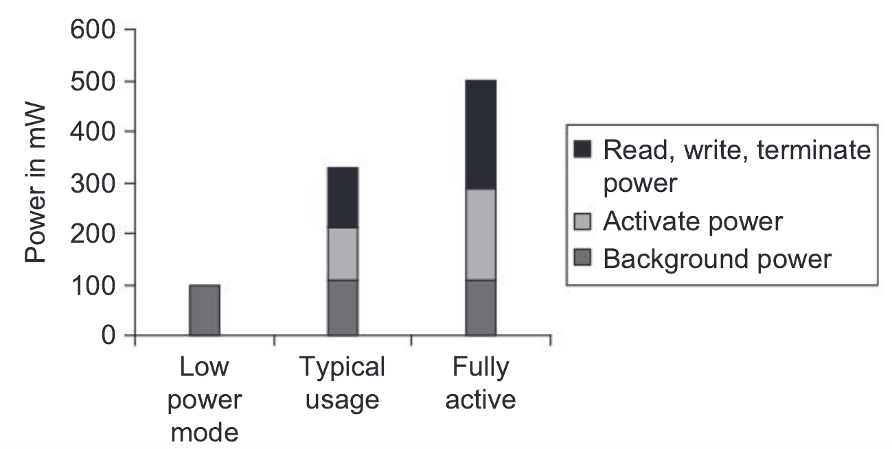{#fig-2-6 width=75%}

图形数据 RAM（GDRAM，即 GDDR1～6）以 SDRAM 为基础，但接口更宽、时钟频率更高，因此带宽是 SDRAM 的 2～5 倍。时钟频率高，限制了每个存储通道上 GDRAM 的数量，而且与 LPDDR 一样需要直接连接。2024 年，GDRAM 正在被采用 HBM 的新设计取代，HBM 是下一小节的主题。

这些改进降低了 DRAM 的功耗，但访问时间和功耗主要都取决于访问芯片外部的代价。从[图 2.1](#fig-2-1) 可以看到，访问片外 DRAM 的时间是访问小型 L1 Cache 的 50 到 100 倍，是访问大型 L3 的 5 到 10 倍。能耗的比例与此相仿：访问一次片外 DRAM 的能耗大约是访问小型 L1 的 100 倍，是访问大型 L3 的 10 到 20 倍。片外访问既慢又耗能，这就促使人们采用大容量的末级 Cache（LLC，Last-Level Cache），并用各种技术优化它们的性能。

### 封装创新：堆叠或嵌入式 DRAM 或 SRAM {-}

DRAM 最近的一项创新在封装上，而不在电路上：把多块 DRAM 叠成堆栈，嵌入与处理器相同的封装中。（*嵌入式 DRAM* 一词也指把 DRAM 做在处理器芯片上的设计。）DRAM 和处理器放进同一个封装有两点好处：一是缩短了 DRAM 与处理器之间的延迟，访问延迟随之降低；二是处理器和 DRAM 之间可以有更多、更快的连接，带宽有可能提高。这种技术称为*高带宽存储器*（HBM）。

HBM 的主要用法是借助一块含有连线的基板，即*中介层*（interposer），把 DRAM 堆栈紧挨着 CPU 放在同一个封装里。假定 CPU 有多个存储通道，就可以放 4 个堆栈（每边一个），每个堆栈最多叠 8 块 DRAM。采用专门版本的 SDRAM 和 4 个堆栈，一个封装可以容纳 32 GiB 存储器，数据传输率达到 4 TB/s。由于芯片必须专门为堆叠而制造，早期的应用大多在高端服务器、GPU 和领域专用体系结构（DSA）中。[图 2.7](#fig-2-7) 给出了中介层方式，以及另一种把芯片直接叠在处理器上面的结构。[图 2.7](#fig-2-7) 中的 3D 结构面临散热和电噪声两项挑战，到目前为止，垂直堆叠唯一的用途是把用作 L3 的 SRAM 叠在处理器上面。

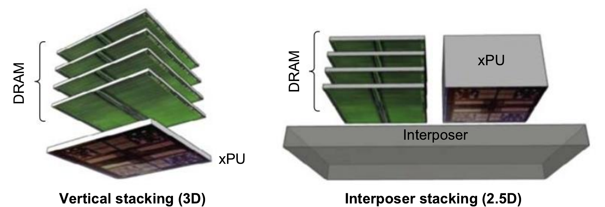{#fig-2-7 width=90%}

在某些应用中，封装内部也许能放下足够的 DRAM，满足应用的全部需要。例如，一种用作专用集群节点的 NVIDIA GPU 正在用 HBM 开发；在较高端的应用中，HBM 很可能成为 GDDR5 的后继者。有些情况下或许可以用 HBM 作主存，但成本限制和散热问题目前使它还不能用于某些嵌入式应用。下一节将讨论把 HBM 用作额外一级 Cache，或用作额外的主存单元的可能性。

### Flash 存储器 {-}

Flash 存储器是一种 EEPROM（电可擦除可编程只读存储器），通常只读，但可以擦除。Flash 的另一项关键特性是不加电也能保存内容。本书重点讨论 NAND Flash。与 NOR Flash 相比，NAND Flash 密度更高，更适合用作大容量非易失性存储器；缺点是只能顺序访问，写入也较慢，原因见下文。

在 PMD 和大多数台式机中，Flash 用作二级存储，作用相当于服务器中的磁盘。此外，大多数 PMD 的 DRAM 容量有限，Flash 还可能充当存储层次中的一级。台式机或服务器的主存可能是 PMD 的 10～100 倍，Flash 在其中承担这一角色的程度要小得多。

Flash 的体系结构与标准 DRAM 很不相同，特性也不同。最重要的区别有以下几点：

1. **读出。** 读 Flash 是顺序的，每次读出一整页，一页可以是 512 字节、2 KiB 或 4 KiB。NAND Flash 访问随机地址的第一个字节延迟很长（约 25 μs），此后能以约 40 MiB/s 的速度送出这一页的其余部分。相比之下，DDR5 SDRAM 取得第一个字节约需 40 ns，此后能以 5 GiB/s 的速度传送这一行的其余部分。传送 2 KiB 时，NAND Flash 约需 75 μs，DDR SDRAM 不到 450 ns，Flash 所需时间是 DRAM 的 150 倍以上。但与磁盘相比，从 Flash 读 2 KiB 的速度是磁盘的 300 到 500 倍。这些数字说明了为什么 Flash 不能替代 DRAM 作主存，却在许多系统中取代了磁盘：两者每位的成本已经接近，容量较小时尤其如此。

2. **擦除与写入。** Flash 存储器改写之前必须先擦除（flash（闪速）这个名称就来自「闪电式」的擦除过程），而且只能按块擦除，不能单独擦除某个字节或字。所以向 Flash 写数据时必须凑齐一整块：要么整块都是新数据，要么把待写数据与块中其余内容合并。写入速度只有 SDRAM 的约 1/1500，是磁盘的约 8～15 倍。

3. **非易失与低功耗。** Flash 存储器是非易失性的，即不加电也能保存内容；不读不写时，它的功耗也低得多（待机模式下不到一半，完全不活动时为零）。

4. **写入次数有限。** 每个块的写入次数有限，通常至少为 100,000 次。系统让写入的块均匀分布在整个存储器中，就能使 Flash 存储系统的寿命最长。这种技术称为*写均衡*（write leveling），由 Flash 存储器控制器负责。

5. **成本。** 高密度 NAND Flash 比 SDRAM 便宜，但比磁盘贵：Flash 大约是每 GiB 0.12～0.20 美元，SDRAM 是每 GiB 5 到 10 美元，磁盘是每 GiB 0.02～0.05 美元。过去 5 年里，Flash 成本下降的速度几乎是磁盘的 2 倍。

与 DRAM 一样，Flash 芯片也带有冗余块，有少量缺陷的芯片仍然可以使用；块的重映射在 Flash 芯片内部完成。Flash 控制器负责页的传送，提供页的缓存，并负责写均衡。

高密度 Flash 的快速进步，对低功耗 PMD 和笔记本电脑的发展至关重要，也大大改变了台式机和大型服务器：台式机越来越多地使用固态盘，大型服务器则常常把磁盘和基于 Flash 的存储结合使用。

### 相变存储器技术 {-}

几十年来，相变存储器（PCM）一直是活跃的研究领域。这种技术通常用一个小加热元件，使块状衬底在晶态和非晶态之间转换，两种状态的电阻特性不同。衬底上覆盖着一张二维网格，每一位对应网格中的一个交叉点。读出时检测 x 点与 y 点之间的电阻（PCM 因此又称*忆阻器*，memristor）；写入时施加电流，改变材料的相态。PCM 不需要晶体管之类的有源器件，因此成本应当比 NAND Flash 低，密度应当比 NAND Flash 高。

2017 年，美光和 Intel 开始供应基于这种技术的 Xpoint 存储器芯片。与 Flash 相比，PCM 有两大优势：一是随机写性能更好，因为不需要擦除步骤；二是写入寿命可能更长。读延迟比 Flash 略好。但由于「谬误与陷阱」一节将要讨论的原因，PCM 没有形成发展势头，至少目前已基本被搁置。

### 提高存储系统的可信性 {-}

**硬错误与软错误。** Cache 和主存容量很大，无论在制造过程中还是在运行期间，出错的可能性都大大增加。按成因，错误分为两类：

* 电路改变引起、能够重复出现的错误，称为*硬错误*或*永久性故障*。硬错误可能在制造时产生，也可能由运行期间的电路改变引起（例如 Flash 存储单元经多次写入后失效）。所有 DRAM、Flash 存储器和大多数 SRAM 在制造时都带有备用行，通过编程用备用行替换有缺陷的行，就能容忍少量制造缺陷。
* 单元内容的改变（而不是电路的改变）引起的动态错误，称为*软错误*或*瞬时故障*。如果没有某种形式的错误检测，这类错误就会成为静默数据错误，[第 1 章](#ch-fundamentals)讨论过这一点。

**奇偶校验与 ECC。** 动态错误可以用奇偶校验位检测，也可以用纠错码（ECC）检测并纠正。指令 Cache 是只读的，用奇偶校验就够了；较大的数据 Cache 和主存则用 ECC，既能检测错误，又能纠正错误。奇偶校验只需 1 位开销，就能检测出一串位中的单个错误；但它检测不出多位错误，这类错误会成为静默错误，所以一个奇偶校验位保护的位数必须有限，典型比例是每 8 个数据位配 1 个奇偶校验位。ECC 每 64 个数据位付出 8 位开销，能检测 2 个错误并纠正 1 个错误。ECC 在 DDR5 中已成为标准配置。

**Chipkill。** 在规模非常大的系统中，出现多位错误以及单块存储器芯片完全失效的可能性都不容忽视。为了解决这个问题，IBM 推出了 Chipkill，许多规模非常大的系统，如 IBM 服务器和谷歌集群，都使用这项技术（Intel 把自己的版本称为 SDDC）。Chipkill 的原理与磁盘所用的 RAID 方法类似：把数据和 ECC 信息分散存放，单块存储器芯片完全失效时，可以用其余芯片重建丢失的数据。按照 IBM 的分析，假定一台服务器有 10,000 个处理器，每个处理器配 4 GiB 内存，那么运行 3 年中出现的不可恢复错误如下：

* 只用奇偶校验：约 90,000 次，即每 17 分钟发生一次不可恢复（或未检测出）的故障。
* 只用 ECC：约 3500 次，即大约每 7.5 小时发生一次未检测出或不可恢复的故障。
* Chipkill：大约每 2 个月发生一次未检测出或不可恢复的故障。

换个角度，也可以问：要达到 Chipkill 那样的错误率，最多能保护多少台服务器（每台 4 GiB）？只用奇偶校验时，即使只有一个处理器的服务器，不可恢复错误率也高于一个由 10,000 台服务器组成、采用 Chipkill 保护的系统。只用 ECC 时，17 台服务器的系统，故障率就与 10,000 台服务器的 Chipkill 系统大致相同。因此，仓库级计算机中的 50,000～100,000 台服务器必须采用 Chipkill（见第 6 章 6.8 节）。

<!--chapter:end:02-memory-02.Rmd-->

## 存储层次的十种高级性能优化 {#sec-2-3}

前面的平均访存时间公式给出了衡量 Cache 优化的三个指标：命中时间、失效率和失效开销。结合近年来的发展趋势，我们再加上两个指标：Cache 带宽和功耗。按这 5 个指标，本节要讨论的 10 种高级存储系统优化可以分为 5 类：

1. *降低命中时间和功耗*：采用容量较小的 Cache，命中时间和功耗都能降低，代价是命中率下降。采用多个存储体也能降低命中时间和功耗，这在容量较大的 L2 和 L3 Cache 中尤为明显。
2. *提高 Cache 带宽*：包括流水化 L1 Cache、多体 Cache 和非阻塞 Cache。这几种技术对功耗的影响各不相同；如果存储系统支持多个未完成的失效，它们还可能降低失效开销。
3. *降低失效开销*：包括关键字优先和合并写缓冲，这两种优化对功耗影响很小。此外，采用多个存储体和 HBM 存储器可以缩短从存储器访问一个块的延迟，无论是访问单个块还是并行访问多个块，失效开销都能因此降低。
4. *降低失效率*：包括编译器优化和相联度。编译时所做的任何改进，显然都能降低功耗。采用组相联会使命中时间略有增加，但能降低失效率。优化组相联 Cache 的替换策略，也可能降低失效率。
5. *利用并行降低失效开销或失效率*：包括硬件预取和编译器预取。这类优化通常会增加功耗，主要原因是预取来的数据有一部分没有用上。

总的来说，按这个顺序往下，所需硬件越来越复杂。另外，有几种优化需要复杂的编译器技术，有一种要依靠 HBM。本节最后在第 113 页的[图 2.17](#fig-2-17) 中汇总这 10 种技术的实现复杂度和性能收益。其中比较简单的几种只作简要介绍，其余的则要多讲一些。

### 第一种优化：采用虚拟索引和组相联的流水化 L1 Cache {-}

L1 流水化以后，时钟频率可以提高，代价是延迟略有增加。以 Intel 处理器访问指令 Cache 的流水线为例：20 世纪 90 年代中期的 Pentium 需要 1 个时钟周期；20 世纪 90 年代中期到 2000 年的 Pentium Pro 到 Pentium III 需要 2 个时钟周期；2000 年推出的 Pentium 4 以及现在的 Intel i7 和 i9 需要 4 个时钟周期。指令 Cache 流水化，实际上就是增加了流水线的级数，转移预测错误的代价也随之增大。同样，数据 Cache 流水化以后，从发射 load 指令到使用数据，中间要隔更多的时钟周期（见第 3 章）。今天，所有处理器的 L1 都在一定程度上实现了流水化，最简单的也会把访问和命中检测分开；许多高速处理器的 Cache 流水线达到三级或更多。

Cache 流水化以后，实现组相联变得比较容易，命中时间几乎不受影响或完全不受影响，L1 Cache 的命中率因此得以提高。此外，Cache 采用虚拟索引时会出现别名问题，提高相联度也能避免这一问题。

这种 Cache 的访问流水线，典型的做法是把 Cache 访问和命中检测分成四步：

1. 地址译码，得到选择 Cache 字线所需的地址。
2. 访问指令 Cache 或数据 Cache 的 SRAM。
3. 把组内各个元素的 tag与 TLB 送来的物理 tag 比较，判断命中还是失效；如果命中，还要确定命中的是组内哪个元素。
4. 用多路选择器选出相应的 Cache 块，把所需的字与块中被访问的部分对齐，然后送给 CPU。

**用 CACTI 估算。** 要在芯片制造之前了解设计对命中时间和功耗的影响，一种办法是借助 CAD 工具。CACTI 就是这样一个估算程序，它能估算 CMOS 微处理器上各种 Cache 结构的访问时间和能耗，结果与更精细的 CAD 工具相差不到 10%。给定最小特征尺寸后，CACTI 把 Cache 的命中时间表示为以下参数的函数：Cache 容量、相联度、读写端口数以及其他更复杂的参数。[图 2.8](#fig-2-8) 是 CACTI 估算的命中时间随 Cache 容量和相联度变化的情况。这些估算值既与 Cache 容量有关，也与工艺有关，所以 CACTI 必须按所用工艺仔细校准；[图 2.8](#fig-2-8) 反映的是某一种工艺下的相对权衡。

{#fig-2-8 width=90%}

**例题**　利用附录 B 中图 B.8 的数据和[图 2.8](#fig-2-8)，判断 32 KiB 4 路组相联 L1 Cache 的访存时间是否比 32 KiB 2 路组相联 L1 Cache 更短。假设到 L2 的失效开销是较快的那个 L1 Cache 访问时间的 15 倍，忽略 L2 以外的失效。哪一种 Cache 的平均访存时间更短？

**解答**　设 2 路组相联 Cache 的访问时间为 1。对 2 路 Cache，有

$$
\begin{aligned}
\text{平均访存时间}_\text{2 路} &= \text{命中时间} + \text{失效率} \times \text{失效开销} \\
&= 1 + 0.038 \times 15 = 1.38
\end{aligned}
$$

4 路 Cache 的访问时间是 2 路的 1.4 倍，失效开销所占的实际时间折合为 15/1.4 = 10.1，为简单起见取 10：

$$
\begin{aligned}
\text{平均访存时间}_\text{4 路} &= \text{命中时间}_\text{2 路} \times 1.4 + \text{失效率} \times \text{失效开销} \\
&= 1.4 + 0.037 \times 10 = 1.77
\end{aligned}
$$

从结果看，提高相联度显然得不偿失。不过，现代处理器的 Cache 访问往往是流水化的，它对时钟周期时间的确切影响很难评估，相联度提高了也未必影响周期时间。如果再加上其他 Cache 优化，权衡还会更复杂。

**能耗。** 选择 Cache 容量和相联度时还要考虑能耗，见[图 2.9](#fig-2-9)。从 2 路改为 4 路，能耗增加到原来的 1.1～1.7 倍，具体倍数取决于 Cache 容量。

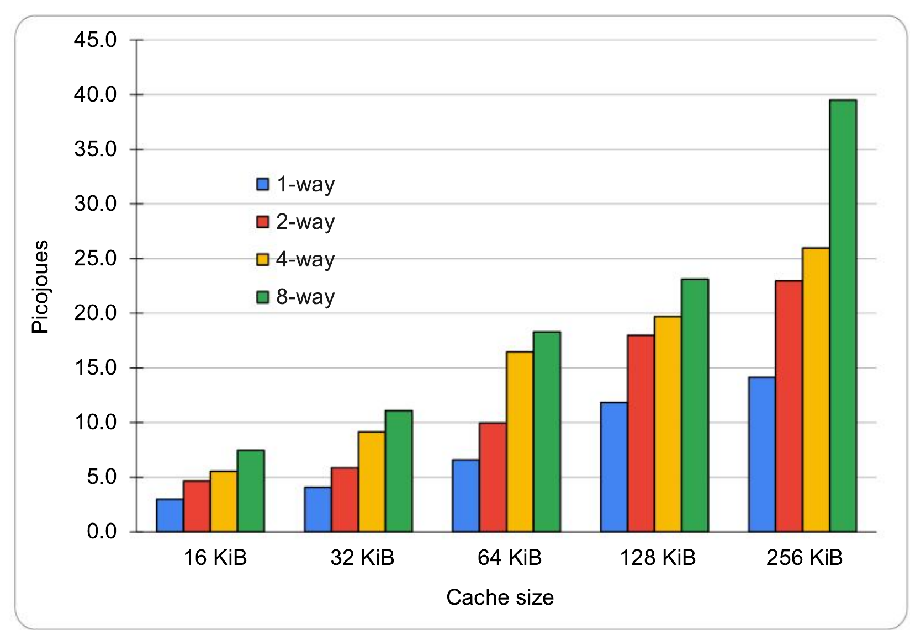{#fig-2-9 width=90%}

能耗已经成为关键问题，设计者因此致力于降低 Cache 访问的能耗。除了相联度，Cache 访问能耗还取决于另一个关键因素：Cache 中的块数，因为块数决定了每次要访问的「行」数。在 Cache 总容量不变的前提下，设计者可以增大块来减少行数，但这样可能提高失效率，容量较小的 L1 Cache 尤其如此。

**路预测。** *路预测*（way prediction）既利用了相联度，又能保持直接映射 Cache 的命中速度。它的做法是在 Cache 中保存一些额外的位，用来预测下一次 Cache 访问落在哪一路（即组内哪一块）。根据预测，多路选择器可以提前设置好，选出所要的块；这个时钟周期内只做一次 tag 比较，并且与读 Cache 数据并行进行。如果预测失误，就在下一个时钟周期检查其他块是否匹配。模拟表明，组预测的准确率在 2 路组相联 Cache 中超过 90%，在 4 路组相联 Cache 中为 80%，指令 Cache 的准确率高于数据 Cache。对 2 路组相联 Cache 来说，只要路预测能使访问速度提高 10% 以上，平均访存时间就会缩短，而这很有可能做到。路预测最早用于 20 世纪 90 年代中期的 MIPS R10000，在采用 2 路组相联的处理器中很常见，几款 Cache 为 4 路组相联的 ARM 处理器也采用过。要让路预测的代价保持在较低水平，关键是预测失误时只停顿一个周期，而这在速度很高的处理器中可能很难实现。

**牺牲 Cache。** 要获得组相联的部分优点，另一种办法是使用*牺牲 Cache*（victim cache）。所谓牺牲 Cache，就是一个小型 Cache，用来保存最近被逐出的少数几行的内容。Jouppi（1990）证明，对于小型直接映射 L1，一个只有 8 项的小型牺牲 Cache 就能使失效率大幅下降。如今 L1 和 L2 的容量都大了，提高 L1 相联度和采用预取的效果都比牺牲 Cache 好。后面还会看到，近来有些处理器实际上把末级 Cache（LLC，Last-Level Cache）当作牺牲 Cache 使用。

### 第二种优化：用多存储体和多端口提高 L1 数据 Cache 的带宽 {-}

处理器每个时钟周期能执行的最大指令数增加以后，数据 Cache 每个周期能接受的 load 和 store 次数也必须相应增加。早期的多发射处理器每个时钟周期能执行一条 load 和一条 store，较新的处理器每个时钟周期能执行两条 load 和两条 store，这就要求数据 Cache 每个时钟周期接受四次访问！（指令 Cache 的情况不同：[2.5 节](#sec-2-5)会讲到，它依靠空间局部性和转移预测，采用先行取指和预取，来满足增长了的取指需求。）

寄存器堆设置多个读写端口是合理的，但 Cache 的存储容量大得多，同样的方案代价要高得多。因此，大多数设计者选择采用多个存储体，可能再辅以有限的多端口。

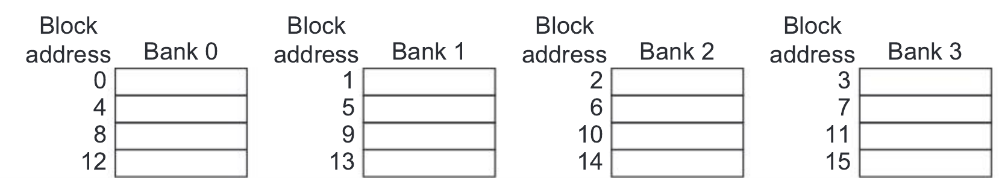{#fig-2-10 width=90%}

存储体最初用来提高主存的性能，现在不仅用在现代 DRAM 芯片内部，也用在 Cache 内部。Intel Core i7 的 L1 数据 Cache 有 4 个存储体（每个时钟周期最多支持两次访存）；i9 的 L1 数据 Cache 则采用双端口和 8 个存储体，以应对每个时钟周期四次访存的峰值。

**地址映射。** 访问自然地分散到各个存储体上时，多体结构的效果最好，因此地址到存储体的映射方式会影响存储系统的表现。一种简单而有效的映射是把块地址依次分配到各个存储体，这称为*顺序交叉*（sequential interleaving）。例如，有 4 个存储体时，存储体 0 存放地址模 4 余 0 的所有块，存储体 1 存放地址模 4 余 1 的所有块，依此类推。[图 2.10](#fig-2-10) 画出了这种交叉方式。

读者也许会以为，即使采用多体结构，数据 Cache 中各次访问之间的冲突仍然会很多。实际上，有两种情况可以减少冲突：一是处理器很少能持续地每个时钟周期访存四次，其他流水线停顿和 Cache 失效都会打断它；二是即使数据 Cache 同时收到四次访问，由于数据的局部性，其中很可能有两次或更多次访问的是同一个 Cache 块，这些访问可以合并成一次 Cache 访问。

**例题**　假设有 8 个存储体和 4 次访问，其中 1、2 或 3 次访问的是同一个块，求发生冲突的概率。

**解答**　如果数据 Cache 收到的 4 次访问分别访问不同的块，那么在 8 个存储体下不发生冲突的概率，就是第 2、3、4 次访问都不落在之前访问过的存储体上的概率：

$$
\frac{7}{8} \times \frac{6}{8} \times \frac{5}{8} = 41\%
$$

如果有两次访问的是同一个 Cache 块（另两次访问不同的块），这个概率为

$$
\frac{7}{8} \times \frac{6}{8} = 66\%
$$

如果只涉及两个存储体，发生冲突的概率降为 12.5%（7/8）。某个存储体发生冲突时，其中一次访存推迟，其他访存照常进行。

此外，只要某个周期准备好访问 Cache 的访存不到四次，冲突的概率也会降低。采用双端口同样能提高带宽，而且不需要解决冲突。如果 4 个存储体都是双端口的，冲突概率会低得多，因为要有三次访问落在同一个存储体才会发生冲突。

采用双端口总会增加访问时间，多个存储体的影响则取决于相联度、Cache 容量等其他因素。那么，从访问时间看，这几种提高 L1 Cache 带宽的方案孰优孰劣？[图 2.11](#fig-2-11) 给出了 CACTI 估算的访问时间，存储体数取 1、2、4，端口数取 1、2、4。

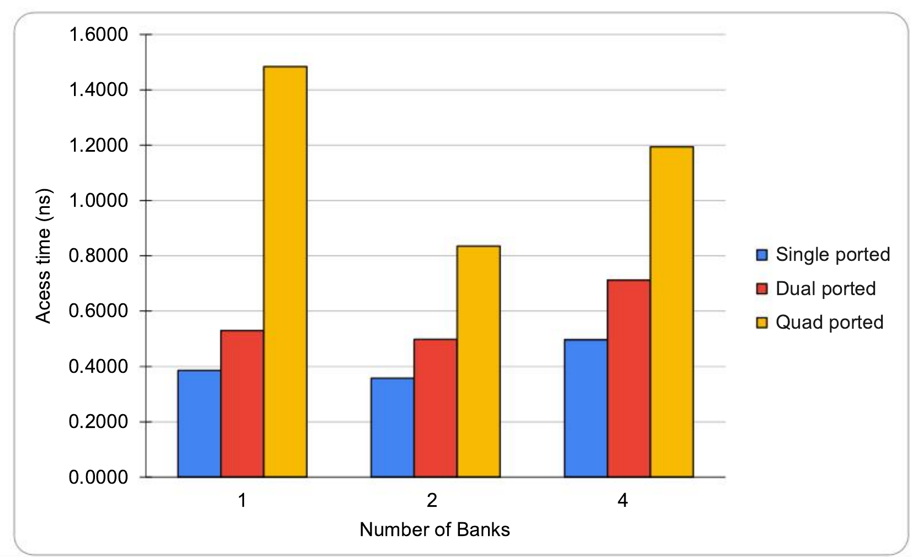{#fig-2-11 width=90%}

**例题**　为简单起见，假设任何冲突的效果都是使 Cache 访问时间增加 1 ns（即使发生四次冲突也是如此）。利用[图 2.11](#fig-2-11) 的数据，假设同时有四次访问，下面哪种设计的访问时间最短：

* 单端口，4 个存储体
* 双端口，2 个存储体（两个存储体都是双端口的）
* 四端口

**解答**　先看单端口的情况，发生冲突的概率为 $1 - \frac{3}{4} \times \frac{2}{4} \times \frac{1}{4} = 90\%$。

$$
\text{访问时间}_\text{单端口} = 0.5\ \text{ns} + 0.9 \times 1\ \text{ns} = 1.4\ \text{ns}
$$

双端口时，发生冲突的概率为 37.5%。有兴趣的读者可以逐一检查全部 16 种可能的访问组合，验证其中只有 6 种出现三次访问落在同一个存储体的情况。

$$
\text{访问时间}_\text{双端口} = 0.5\ \text{ns} + 0.375 \times 1\ \text{ns} = 0.875\ \text{ns}
$$

最后，四端口时只有一个存储体，访问时间为 1.5 ns。在这组参数（以及冲突代价）下，双端口、2 个存储体的方案最好。

### 第三种优化：用更好的替换策略降低失效率 {-}

直接映射 Cache 的替换策略无须选择，因为一个块只能放在一个位置。相联度提高以后，发生失效时 Cache 系统必须决定替换组内的哪个元素。选得好可以降低失效率，相联度越高效果越明显，因为可供替换的块更多。但要选得好，就要为每个 Cache 块额外记录一些信息。L1 Cache 的占空比很高，很难做到这一点，所以 L1 Cache 通常采用随机替换或某种简单的近似方法。L2 和 L3 Cache 的占空比较低，失效开销又较高，采用优化的替换策略就是合理的。

**MIN 与 LRU。** 最优的替换策略是存在的，称为 Belady 的 MIN 策略：替换将来最晚才会用到的块。遗憾的是，正如 Yogi Barra 所说：「预测是很难的，尤其是预测未来。」尽管如此，MIN 既为设计替换策略提供了一种思路，也为衡量实用算法提供了一个基准。另一种常被提出的方案是 LRU（Least Recently Used，最近最少使用），它替换过去最久没有用过的块。精确的 LRU 很难实现，因为它要求对组内所有块维护一个先后次序。

**NRU。** 因此，实际采用的是更新更简单的伪 LRU（或称近似 LRU）方案，其中比较简单的一种是 NRU（Not Recently Used，最近未使用）。NRU 为组内每个元素保留一位，表示这个块最近没有用过；某个元素一被访问，就把它的这一位清零。发生失效时，从 NRU 位为 1 的块中选一个替换，然后把除新换入的块以外的所有 NRU 位都置 1。如果组内有多个块的 NRU 位为 1（意味着所有块都最近访问过，或者都没有访问过），就随机替换组内的一个元素。NRU 实现起来很简单，一次访问与某个组匹配之后，只需要写一位。几款较早的 Intel 处理器在 L2 和 LLC 中采用过 NRU，L1 Cache 也常用 NRU。

**最近引用预测计数器。** 另一种代价不高的近似 LRU 方法是对 NRU 的推广：每个块用更多的位组成一个计数器，设法预测将来最晚才会用到的块。例如，每个块可以用 2 位构成一个饱和计数器，这种计数器称为*最近引用预测计数器*（recently referenced prediction counter）。它的规则如下：

* Cache 命中时，把这个块的计数器置为 0。
* Cache 失效时，如果有块的计数值为 3，就替换这个块，并把它的计数器置为 2。值 2 表示这个块不久之后可能再次使用，也可能不会。
* 如果没有块的计数器为 3，就把组内所有计数器加 1，直到至少有一个块的计数器为 3，再替换这个块。

这种方案的关键思想是设法区分两类访问：一类是只使用一次块的流式访问，另一类是反复使用块的访问。

Jaleel 等人（2010）模拟了多种这类引用预测替换方案，包括 NRU、LRU 和 2 位最近引用方案。在 2 MB、16 路的 L2（大致相当于 Intel i7 单个核的 L2）上，NRU 的性能比 LRU 差约 1%，2 位最近引用预测器则比 LRU 好约 5%。在 4 个核、LLC 为 8 MB 的多核多道程序环境下，2 位方案的改进达到 7%。原因可能是多道程序的活动使 LLC 中只使用一次的访问增多，而 2 位方案处理这类流式访问比 1 位方案好。这种方案可以推广到 $n$ 位计数器，$n$ 越大，方案越接近真正的 LRU。像 2 位方案那样对计数器加权，就可以优先保留失效之后至少命中过一次的块，这些块不大可能是只访问一次的流式数据。

人们还提出了许多更复杂的替换策略，力求比基于 LRU 的方案选得更准，其实质是像操作系统管理虚拟存储那样，对工作集的行为建模。有些研究表明改进很显著。如果这些策略的实现开销足够低，性能又仍然优于加权的近似 LRU 方案，就有可能用于将来的 LLC。

### 第四种优化：用多体 L2 和 L3 Cache 降低功耗和延迟、提高带宽 {-}

L1 数据 Cache 采用多个存储体，主要是为了提高 load/store 带宽；多个存储体还能为非阻塞 Cache 的失效提供更高的回填带宽，这项优化稍后介绍。在容量更大的 L2 和 L3 Cache 中，多个存储体有三方面的作用：一是降低功耗（与在 DRAM 中的作用一样），二是缩短延迟，三是提高响应 L1 或 L2 非阻塞失效的带宽。Intel Core i9 的 L2 有 8 个存储体，Arm Cortex 处理器采用的 L2 Cache 则有 1～4 个存储体。Intel 多核处理器把 LLC 分布在各个核上，所以存储体数随核数增加而增加。

### 第五种优化：用非阻塞 Cache 提高 Cache 带宽 {-}

允许乱序执行的流水线计算机（见第 3 章）在数据 Cache 失效时不必停顿。例如，处理器在等待数据 Cache 送回失效数据的同时，可以继续从指令 Cache 中取指令。*非阻塞 Cache*（nonblocking cache）又称*无锁 Cache*（lockup-free cache），它在失效期间仍能继续提供命中，使这种做法的潜在收益更大。这种「失效下命中」（hit under miss）优化让 Cache 在失效期间继续发挥作用，而不是让处理器完全停顿，从而降低了有效失效开销。还有一种更精巧也更复杂的做法：如果 Cache 能让多个失效相互重叠，有效失效开销还能进一步降低，这就是「多重失效下命中」（hit under multiple miss）或「失效下失效」（miss under miss）优化。第二种做法只有在存储系统能够同时处理多个失效时才有好处。所有高性能处理器（如近来的 Intel 和 AMD 处理器）通常两种都支持，而许多低端处理器只在 L2 中提供有限的非阻塞支持。

**效果评估。** Farkas 和 Jouppi（1994）研究了非阻塞 Cache 降低失效开销的效果，假设 Cache 为 8 KiB，失效开销为 14 个周期（符合 20 世纪 90 年代初的情况）。他们发现，允许一次失效下命中时，SPECINT92 基准测试程序的有效失效开销降低了 20%，SPECFP92 降低了 30%。Li 等人（2011）在三方面更新了这项研究：改用多级 Cache，对失效开销采用更符合现代情况的假设，并改用规模更大、要求更高的 SPECCPU2006 基准测试程序。这项研究以 Intel i7 的单个核为模型（峰值速度下每个时钟周期能发出两次数据访存请求），运行 SPECCPU2006 基准测试程序。[图 2.12](#fig-2-12) 给出了允许 1 次、2 次和 64 次失效下命中时数据 Cache 访问延迟的降低情况，存储系统的其他细节见图注。与早先的研究相比，Cache 容量更大，又增加了 L3 Cache，所以收益变小了：SPECINT2006 基准测试程序的 Cache 延迟平均降低约 9%，SPECFP2006 平均降低约 12.5%。

{#fig-2-12 width=90%}

**有效失效开销。** 在非阻塞 Cache 中，Cache 失效不一定使处理器停顿，因此很难判断单次失效的影响，平均访存时间也很难计算。有效失效开销不是各次失效时间之和，而是处理器停顿时间中没有被重叠掉的部分。非阻塞 Cache 的收益取决于三个因素：一是失效开销（有多个失效时），二是访存模式，三是在有失效未完成时处理器还能执行多少条指令。

一般来说，L1 数据 Cache 失效而 L2 Cache 命中时，乱序处理器能隐藏大部分失效开销；但如果更低一级的 Cache 也失效，乱序处理器就很难隐藏大部分失效开销了。要支持多少个未完成的失效，取决于多种因素：

* 失效流中的时间局部性和空间局部性。它决定了一次失效是否会向更低一级 Cache 或存储器发起新的访问。
* 响应请求的存储器或 Cache 的带宽。
* 处理器在最低一级 Cache（失效时间最长）允许的未完成失效数。最低一级允许多少，更高一级至少也要支持多少，因为失效必定从最高一级 Cache 开始。
* 存储系统的延迟。

下面用一个简化的例题说明其中的关键思想。

**例题**　假设主存访问时间为 36 ns，存储系统的持续传输率为 16 GiB/s。块大小为 64 字节，假设在给定的请求流下能够维持峰值带宽，并且各次访问从不冲突，那么最多需要支持多少个未完成的失效？如果一次访问与前四次访问之一冲突的概率为 50%，并假设这次访问必须等到先前的访问完成，估计最多有多少个未完成的访问。为简单起见，忽略失效之间的时间。

**解答**　第一种情况，假设能够维持峰值带宽，存储系统每秒可以支持 $(16 \times 10)^9/64 = 2.5$ 亿次访问。每次访问需要 36 ns，因此可以同时支持 $250 \times 10^6 \times 36 \times 10^{-9} = 9$ 次访问。如果冲突概率大于 0，就需要更多的未完成访问，因为冲突的访问无法开始处理；存储系统需要的独立访问只会更多，而不是更少！作近似估计时，可以简单地假设有一半访存不必发给存储器。这样，要支持的未完成访问数就要加倍，即 18 次。

Li、Chen、Brockman 和 Jouppi 的研究还发现：对整数程序，允许一次失效下命中时 CPI 降低约 7%，允许 64 次时降低约 12.7%；对浮点程序，允许一次失效下命中时 CPI 降低 12.7%，允许 64 次时降低 17.8%。这些降幅与[图 2.12](#fig-2-12) 中数据 Cache 访问延迟的降幅非常接近。

#### 非阻塞 Cache 的实现 {-}

非阻塞 Cache 有可能提高性能，但实现起来并不简单。首先要解决两类难题：一是仲裁命中与失效之间的争用；二是跟踪未完成的失效，以便知道 load 或 store 何时可以继续执行。

**命中与失效的争用。** 在阻塞 Cache 中，失效使处理器停顿，失效处理完之前不会再有对 Cache 的访问。在非阻塞 Cache 中则不然，命中可能与从存储层次下一级返回的失效发生冲突。如果允许多个未完成的失效（近来几乎所有处理器都允许），失效与失效之间也可能冲突。这些冲突必须解决，通常的办法是让命中优先于失效，再对相互冲突的失效（如果有）排定次序。

**跟踪未完成的失效。** 第二个问题源于要同时跟踪多个未完成的失效。在阻塞 Cache 中，未完成的失效最多只有一个，返回的是哪个失效总是清楚的；在非阻塞 Cache 中，这种情况很少见。乍看起来，失效似乎总是按顺序返回，只需维护一个简单的队列，把返回的失效与等待最久的请求对应起来就行了。但考虑 L1 中发生的一次失效：它在 L2 中可能命中，也可能失效；如果 L2 也是非阻塞的，失效返回 L1 的顺序就不一定与它们发生的顺序相同。Cache 访问时间不一致的多核系统和其他多处理器系统（称为 NUCA）也会带来同样的复杂情况。

失效返回时，处理器必须知道两件事：一是哪条 load 或 store 引起了这次失效，这样这条指令才能继续执行；二是数据应当放到 Cache 的什么位置（以及这个块的 tag 如何设置）。近来的处理器把这些信息保存在一组寄存器中，通常称为*失效状态处理寄存器*（MSHR）。允许 $n$ 个未完成的失效，就有 $n$ 个 MSHR。每个 MSHR 记录的信息包括：这次失效的数据放到 Cache 的什么位置，这次失效的各个 tag 位的值，以及引起这次失效的是哪条 load 或 store（下一章会介绍如何跟踪这一信息）。处理过程如下：

* 发生失效时，分配一个 MSHR 来处理这次失效，填入这次失效的有关信息，并用这个 MSHR 的编号给访存请求打上标记。
* 存储系统返回数据时带上这个标记，Cache 系统据此把数据和 tag 信息送到相应的 Cache 块，并「通知」引起失效的 load 或 store：数据已经可用，可以恢复执行。

非阻塞 Cache 显然需要额外的逻辑，因此要付出一定的能耗代价。但这一代价很难精确评估，因为非阻塞 Cache 可能减少停顿时间，从而缩短执行时间，能耗也随之降低。

除了上述问题，多处理器的存储系统，无论是在单个芯片内还是跨多个芯片，还必须解决与 Cache 一致性（coherency）和存储一致性（consistency）有关的复杂实现问题。此外，Cache 失效不再是原子操作（请求和响应是分开的，可能与多个请求交错进行），因此有可能发生死锁。第 5 章还会讨论这些问题，在线附录 I 的 I.7 节则讨论得更详细。

<!--chapter:end:02-memory-03.Rmd-->

### 第六种优化：关键字优先和提前重启，降低失效开销 {-}

处理器通常一次只需要块中的一个字。这项技术就是基于这一点，它的思路是「不等」：不必等整个块装入，先把所请求的字送给处理器，让处理器重新启动。具体有两种做法：

* *关键字优先*（critical word first）：先向存储器请求失效的那个字，它一到达就送给处理器；处理器继续执行，同时填充块中其余的字。
* *提前重启*（early restart）：仍按正常顺序取块中的字，但所请求的字一到达，就立即送给处理器，让处理器继续执行。

块不大时，这两种技术的收益很小，因此一般只有 Cache 块较大的设计才能从中受益。块的其余部分在填充时，Cache 通常仍能继续响应对其他块的访问。

不过，由于空间局部性，下一次访问很可能就落在这个块的其余部分。这时的失效开销与非阻塞 Cache 一样，不容易计算。采用关键字优先时，如果出现了第二个请求，有效失效开销就是从这次访问开始、到第二部分数据到达为止，其间没有被重叠掉的那段时间。所以，关键字优先和提前重启的收益取决于两点：一是块的大小，二是块中尚未取回的部分再次被访问的可能性。以 i7 6700 为例，它采用了提前重启和关键字优先；在它上面运行 SPECint2006，对失效尚未完成的块，访问次数超过一次（平均 1.23 次，范围为 0.5～3.0 次）。[2.6 节](#sec-2-6)将更详细地考察一个先进存储层次的性能。

### 第七种优化：通过编译器优化降低失效率 {-}

前面介绍的技术都要修改硬件，下面这种技术则不改动任何硬件，就能降低失效率。

这种神奇的效果来自软件优化，这也正是硬件设计者最喜欢的解决办法。处理器与主存之间的性能差距越来越大，促使编译器设计者仔细研究存储层次，看能否通过编译时的优化提高性能。这方面的研究同样分两类：一类减少指令失效，一类减少数据失效。下面介绍的优化，许多现代编译器都已采用。

#### 循环交换 {-}

有些程序含有嵌套循环，访问存储器中数据的次序与数据的存放次序不一致。只要交换循环的嵌套次序，就能让程序按存放次序访问数据。在数组装不进 Cache 的前提下，这一技术通过改善空间局部性来减少失效：调整次序以后，一个 Cache 块中的数据在被丢弃之前能得到最充分的利用。例如，`x` 是大小为 [5000,100] 的二维数组，`x[i,j]` 与 `x[i,j+1]` 相邻存放（数组按行排列，这种次序称为行优先）。下面两段代码说明了怎样优化对它的访问：

```c
/* 修改前 */
for (j = 0; j < 100; j = j + 1)
    for (i = 0; i < 5000; i = i + 1)
        x[i][j] = 2 * x[i][j];
/* 修改后 */
for (i = 0; i < 5000; i = i + 1)
    for (j = 0; j < 100; j = j + 1)
        x[i][j] = 2 * x[i][j];
```

修改前的代码以 100 个字为步长在存储器中跳跃；修改后的代码先访问完一个 Cache 块中的所有字，再转到下一个块。这一优化改善了 Cache 性能，执行的指令数却不受影响。

#### 分块 {-}

分块通过改善时间局部性来减少失效。这里处理的同样是多个数组，但有的按行访问，有的按列访问。由于每次循环迭代既要用到行又要用到列，数组无论逐行存放（*行优先顺序*）还是逐列存放（*列优先顺序*），都解决不了问题。访问方向这样相互正交，即使做了循环交换之类的变换，仍有很大的改进余地。

分块算法不对数组的整行或整列操作，而是对子矩阵，即二维的*块*操作，目标是让装入 Cache 的数据在被替换之前尽可能多地得到访问。下面这段矩阵乘法代码说明了为什么需要这种优化：

```c
/* 修改前 */
for (i = 0; i < N; i = i + 1)
    for (j = 0; j < N; j = j + 1)
        {r = 0;
         for (k = 0; k < N; k = k + 1)
             r = r + y[i][k]*z[k][j];
         x[i][j] = r;
        };
```

两个内层循环要读取 `z` 的全部 N×N 个元素，反复读取 `y` 中同一行的 N 个元素，并写入 `x` 的一行 N 个元素。[图 2.13](#fig-2-13) 是这三个数组访问情况的一个快照：深色表示最近访问过，浅色表示较早访问过，白色表示尚未访问。

容量失效的次数显然取决于 N 和 Cache 的大小：

* Cache 能装下全部三个 N×N 矩阵时，只要没有 Cache 冲突，就不会有问题；
* Cache 能装下一个 N×N 矩阵和一行 N 个元素时，至少 `y` 的第 `i` 行和数组 `z` 有可能留在 Cache 中；
* Cache 比这还小时，`x` 和 `z` 都可能发生失效。

最坏情况下，$N^3$ 次运算要访问 $2N^3 + N^2$ 个存储字。

为了保证正在访问的元素能装进 Cache，把原来的代码改成对 B×B 的子矩阵计算。这样，两个内层循环每次只按 B 的步长计算，而不是走完 `x` 和 `z` 的全长。B 称为*分块因子*。（假设 `x` 已初始化为 0。）

```c
/* 修改后 */
for (jj = 0; jj < N; jj = jj + B)
for (kk = 0; kk < N; kk = kk + B)
for (i = 0; i < N; i = i + 1)
    for (j = jj; j < min(jj + B,N); j = j + 1)
    {r = 0;
     for (k = kk; k < min(kk + B,N); k = k + 1)
         r = r + y[i][k]*z[k][j];
     x[i][j] = x[i][j] + r;
    };
```

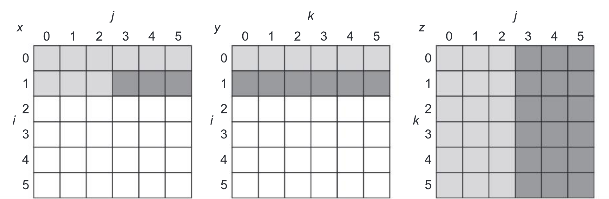{#fig-2-13 width=90%}

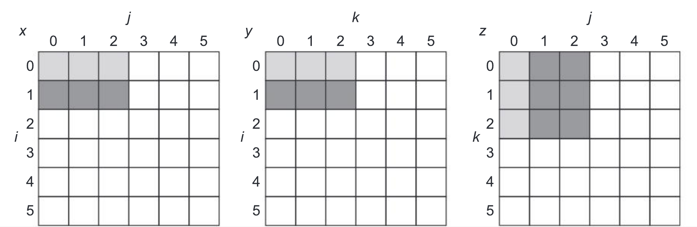{#fig-2-14 width=90%}

[图 2.14](#fig-2-14) 是分块以后三个数组的访问情况。只考虑容量失效时，访问的存储字总数为 $2N^3/B + N^2$，大约降为原来的 1/B。可见分块同时利用了空间局部性和时间局部性：`y` 得益于空间局部性，`z` 得益于时间局部性。例子中用的是正方形块（B×B），也可以用矩形块；矩阵不是方阵时，就必须用矩形块。

我们的目标是减少 Cache 失效，但分块也能帮助寄存器分配：把分块尺寸取得足够小，使一个块能放进寄存器，就能使程序中 load 和 store 的数目最少。

第 4 章的 4.8 节将会看到，在基于 Cache 的处理器上运行以矩阵为主要数据结构的应用，必须采用 Cache 分块才能获得良好的性能。

### 第八种优化：指令和数据的硬件预取，降低失效开销或失效率 {-}

非阻塞 Cache 让执行与访存重叠，从而有效地降低了失效开销。另一种办法是*预取*：在处理器请求*之前*，就把所需的内容取进来。指令和数据都可以预取，既可以直接取到 Cache 中，也可以取到一个访问速度比主存快的外部缓冲器中。

**指令预取。** 指令预取常常由 Cache 之外的硬件完成。典型的做法是：发生失效时，处理器取回两个块，一个是所请求的块，另一个是紧随其后的块。所请求的块返回后放入指令 Cache，预取的块放入指令流缓冲器。如果所请求的块已经在指令流缓冲器中，就取消原来的 Cache 请求，从流缓冲器中读出这个块，同时发出下一个预取请求。

**数据预取。** 类似的方法也可以用于数据访问（Jouppi，1990）。Palacharla 和 Kessler（1994）用一组科学计算程序做了研究，所考虑的多个流缓冲器既能处理指令，也能处理数据。他们发现，对于有两个 64 KiB 四路组相联 Cache（一个存指令、一个存数据）的处理器，8 个流缓冲器能够捕获全部失效的 50%～70%。

**Intel 处理器的硬件预取。** Intel Core i7 和 i9 支持向 L1 和 L2 的硬件预取，最常见的情形是预取下一行。L1 和 L2 失效率都较低的应用，预取带来的改进不大。即使 L1 或 L2 的失效率相当高，预取也必须谨慎使用，因为「坏」的预取可能替换掉有用的 Cache 块，还要占用 Cache 或存储器的带宽。Xeon Skylake-SP 的硬件预取与 Sapphire Rapids 非常相似，有四个数据预取器：L1 数据 Cache 单元预取器（DCUI）、L1 数据 Cache 指令指针步长预取器（DCUP）、L2 数据 Cache 空间预取器（L2A）和 L2 数据 Cache 流预取器（L2P）。在访存较密集的 SPECCPU2017 基准测试程序中，L2P 最为重要，CPI 的改进有 70% 来自它。L2 预取器从 L3 或存储器取数据，结果直接放入 L2；如果预取访问的是存储器，结果不放入 L3。

[图 2.15](#fig-2-15) 给出了多核 Xeon 处理器 Skylake-SP 打开硬件预取以后，SPECCPU2017 中部分程序的总体性能改进（以 CPI 的降低来衡量）。各程序的结果差别很大：两个基准测试程序性能略有下降，五个改进约 10% 或更少，还有两个性能提高到原来的两倍以上。[图 2.15](#fig-2-15) 还给出了 L3 每千条指令失效数（MPKI，Misses Per K Instructions）的降低情况，它与 CPI 的降低高度相关。

预取不计为失效。因此，L2P 向 L2 Cache 预取时，既能消除在 L3 中命中的 L2 失效，也能消除在 L3 中同样失效的 L2 失效。L3 失效的时间大约是 L2 失效的 4 倍，所以如[图 2.15](#fig-2-15) 所示，性能改进主要来自 L3 失效的减少。去掉预取，这些被消除的 L3 失效中有很多甚至全部都会发生；但预取方案并不完美，本身也会引起一些额外的失效。比较打开和关闭预取时 L3 请求的数据总量，就能看出这一点：打开预取后，L3 Cache 请求的数据比关闭时多 19%。在少数程序中（如 bwaves 和 lbm），预取器看来非常准确，L3 流量增加不到 1%。

**对功耗的影响。** 预取效果好时，对功耗的影响可以忽略不计，甚至略有好处；如果预取的数据没有用到，或者有用的数据被替换出去，预取就会明显增加功耗。

{#fig-2-15 width=90%}

### 第九种优化：编译器控制的预取，降低失效开销或失效率 {-}

除了硬件预取，也可以由编译器插入预取指令，在处理器需要数据之前就发出请求。预取有两种：

* *寄存器预取*：把值装入寄存器；
* *Cache 预取*：只把数据装入 Cache，不装入寄存器。

两种预取都可以是*引发异常的*（faulting），也可以是*不引发异常的*（nonfaulting），区别在于遇到虚拟地址故障和保护违例时，预取的地址是否引发异常。不引发异常的预取在本应引发异常时直接变成空操作，这正是我们所希望的。

最有效的预取对程序是「语义上不可见的」：它不改变寄存器和存储器的内容，*也*不会引起虚拟存储故障。今天大多数处理器都提供不引发异常的 Cache 预取。本节假定采用这种预取，它也称为*非绑定*（nonbinding）预取。

只有处理器在预取数据的同时能够继续执行，预取才有意义。也就是说，Cache 在等待预取数据返回期间不能停顿，而要继续提供指令和数据。因此，这类计算机的数据 Cache 通常是非阻塞的。

编译器控制的预取与硬件预取的目标相同，都是让执行与数据预取重叠。循环便于做预取优化，是主要的优化对象：失效开销较小时，编译器只需把循环展开一两次，把预取和执行调度在一起；失效开销较大时，编译器采用软件流水（见附录 H），或把循环展开多次，为后面的迭代预取数据。

不过，发出预取指令本身有指令开销，编译器必须保证开销不超过收益。程序只对可能发生 Cache 失效的访问做预取，就能避免不必要的预取，同时显著缩短平均访存时间。

**例题**　对于下面的代码，先判断哪些访问可能引起数据 Cache 失效，再插入预取指令以减少失效，最后计算执行的预取指令数和通过预取避免的失效次数。假设数据 Cache 为 8 KiB、直接映射、块大小 16 字节，采用写回和写分配。`a` 和 `b` 都是双精度浮点数组，元素长 8 字节。`a` 有 3 行 100 列，`b` 有 101 行 3 列。程序开始时，两个数组都不在 Cache 中。

```c
for (i = 0; i < 3; i = i + 1)
    for (j = 0; j < 100; j = j + 1)
        a[i][j] = b[j][0] * b[j + 1][0];
```

**解答**　编译器首先要确定哪些访问可能引起 Cache 失效，否则就会把时间浪费在为本来会命中的数据发预取指令上。

`a` 的元素按存放次序写入，因此 `a` 能得益于空间局部性：`j` 为偶数时失效，为奇数时命中。`a` 有 3 行 100 列，对它的访问引起 3 × (100/2) 即 150 次失效。

`b` 的访问次序与存放次序不同，得不到空间局部性的好处，但两次得益于时间局部性：一是 `i` 的每次迭代访问的都是同样的元素，二是 `j` 的每次迭代都要用到上一次迭代用过的 `b` 值。不考虑可能的冲突失效，`b` 的失效发生在两处：`i` = 0 时对 `b[j+1][0]` 的访问，以及 `j` = 0 时对 `b[j][0]` 的第一次访问。`i` = 0 时 `j` 从 0 变到 99，因此 `b` 引起 100 + 1 即 101 次失效。

这样，这个循环的数据 Cache 失效大约是 `a` 的 150 次加上 `b` 的 101 次，共 251 次。

为了简化优化，我们不考虑为循环最初的几次访问做预取：这些数据可能已经在 Cache 中，否则就为 `a` 或 `b` 的前几个元素付出失效开销。我们也不考虑在循环末尾屏蔽那些越过 `a` 末尾（`a[i][100]` … `a[i][106]`）和 `b` 末尾（`b[101][0]` … `b[107][0]`）的预取；如果这些预取会引发异常，就不能这样省事了。假设失效开销很大，至少要提前比如 7 次迭代开始预取，换句话说，到第 8 次迭代之前预取都没有收益。为加入预取而对前面代码所做的改动用下划线标出。

```c
for (j = 0; j < 100; j = j + 1) {
    prefetch(b[j + 7][0]);
    /* 7 次迭代之后要用的 b(j,0) */
    prefetch(a[0][j + 7]);
    /* 7 次迭代之后要用的 a(0,j) */
    a[0][j] = b[j][0] * b[j + 1][0];};
for (i = 1; i < 3; i = i + 1)
    for (j = 0; j < 100; j = j + 1) {
        prefetch(a[i][j + 7]);
        /* 7 次迭代之后要用的 a(i,j) */
        a[i][j] = b[j][0] * b[j + 1][0];}
```

修改后的代码预取了 `a[i][7]` 到 `a[i][99]`，以及 `b[7][0]` 到 `b[100][0]`，没有预取到的失效减少为：

* 第一个循环中元素 `b[0][0]`, `b[1][0]`, …, `b[6][0]` 的 7 次失效；
* 第一个循环中元素 `a[0][0]`, `a[0][1]`, …, `a[0][6]` 的 4 次失效（$\lceil 7/2 \rceil$；由于空间局部性，每个 16 字节的 Cache 块只失效 1 次）；
* 第二个循环中元素 `a[1][0]`, `a[1][1]`, …, `a[1][6]` 的 4 次失效（$\lceil 7/2 \rceil$）；
* 第二个循环中元素 `a[2][0]`, `a[2][1]`, …, `a[2][6]` 的 4 次失效（$\lceil 7/2 \rceil$）。

没有预取到的失效共 19 次。用执行 400 条预取指令的代价，避免了 232 次 Cache 失效，这很可能是一个合理的权衡。

**例题**　计算上一个例题节省的时间。忽略指令 Cache 失效，并假设数据 Cache 中没有冲突失效和容量失效。假设各次预取之间、预取与 Cache 失效之间都可以重叠，从而按最大存储带宽传输数据。不计 Cache 失效时，各循环的关键时间是：原来的循环每次迭代 7 个时钟周期，第一个预取循环每次迭代 9 个时钟周期，第二个预取循环每次迭代 8 个时钟周期（含外层 for 循环的开销）。一次失效需要 100 个时钟周期。

**解答**　原来的双重循环执行乘法 3 × 100 即 300 次，每次迭代 7 个时钟周期，共 300 × 7 即 2100 个时钟周期；Cache 失效再增加 251 × 100 即 25,100 个时钟周期，总计 27,200 个时钟周期。

第一个预取循环迭代 100 次，每次 9 个时钟周期，共 900 个时钟周期；Cache 失效增加 11 × 100 即 1100 个时钟周期，总计 2000 个时钟周期。第二个循环执行 2 × 100 即 200 次，每次 8 个时钟周期，共 1600 个时钟周期；Cache 失效增加 8 × 100 即 800 个时钟周期，总计 2400 个时钟周期。

由上一个例题可知，执行这两个循环共需 2000 + 2400 即 4400 个时钟周期，其间执行了 400 条预取指令。假设预取与其余执行完全重叠，预取代码的速度就是原来代码的 27,200/4400 即 6.2 倍。

**指针的预取。** 数组优化容易理解，但现代程序更多地使用指针。Luk 和 Mowry（1999）证明，基于编译器的预取有时也能推广到指针。他们研究了 10 个使用递归数据结构的程序，访问一个结点时预取它的所有指针，结果一半程序的性能提高了 4%～31%，其余程序的性能与原来相差也在 2% 以内。问题在于两点：一是预取的数据是否已经在 Cache 中，二是预取是否足够早，使数据在需要时已经到达。

许多处理器都提供 Cache 预取指令，高端处理器（如 Intel Core i7 和 i9）通常还会在硬件中做某种形式的自动预取。

### 第十种优化：多条存储总线和多个存储模块，提高带宽 {-}

台式机中的高速处理器（如 Intel i9 和 AMD Ryzen）、服务器中的高速处理器（Intel Xeon 和 IBM Power 系列），以及用于图形或深度学习的领域专用处理器，常常使用多个存储通道来提高可用的存储带宽。多个存储通道可以独立访问，一次访问不会使另一次访问停顿，因此也能有效地降低失效开销。

**SDRAM 与 HBM 混合。** 有了多条存储总线，就可以设计两种总线结构不同的存储通道，让系统同时使用 SDRAM 和 HBM。HBM 要求的信号约定与普通 SDRAM 不同，这样混合使用，既能发挥 HBM 存储器在速度和带宽上的优势，又不会使存储器的总容量受限于少数几个 HBM 堆叠。以这种方式混用不同类型的存储器，确实会形成非一致存储结构（NUMA，NonUniform Memory Architecture）；要利用这种能力，就必须把关键数据放到较快的 HBM 存储器中。在领域专用处理器中，这项工作通常由软件控制完成，一般还需要一种领域专用语言来指导软件在不同存储器之间分配和移动数据（见第 7 章）。

**HBM 用作 Cache。** 除了显式管理的 NUMA，另一种做法是把 HBM 存储器用作 Cache，最新的 Intel 和 AMD 处理器也支持这种做法。

HBM Cache 实质上是新增的 L4，即末级 Cache（LLC，Last-Level Cache），容量可以达到最大的片上 L3 Cache 的 10 倍以上。但这么大的、基于 DRAM 的 Cache 带来一个问题：tag放在哪里？这取决于 tag 的数量。假设块大小为 64B，1 GiB 的 L4 Cache 就需要 96 MiB 的 tag，大致相当于一个大型多核处理器全部 Cache 所用的 SRAM。增大块可以减少 tag 数，但块很大时失效率可能升高，冲突失效和一致性失效尤其如此。

**L-H 方案。** 如果把 LLC 的 tag 存放在 HBM 中而不是片上，就可以采用较小的块和较多的 tag。乍看起来这行不通，因为每次访问 L4 都要访问两次 DRAM：一次取 tag，一次取数据。Loh 和 Hill（2011）为此提出了一个巧妙的方案（我们称之为 L-H 方案）：把 tag 和数据放在 HBM SDRAM 的同一行中。打开一行（以及最终关闭它）需要很长时间，但在已打开的行中访问另一部分，CAS 延迟只有访问新行时间的三分之一左右。因此，可以先访问块的 tag 部分，命中以后再用一次列访问选出所需的字。

**合金 Cache。** Qureshi 和 Loh（2012）提出了一种缩短命中时间的改进方案，称为*合金 Cache*（alloy cache）。合金 Cache 把 tag 和数据熔铸在一起，并采用直接映射结构。这样，直接索引 HBM Cache，用一次突发传输同时送出 tag 和数据，就能把 LLC 的访问时间缩短到一个 HBM 周期。与 L-H 方案相比，合金 Cache 的命中时间降为不到原来的一半，代价是失效率提高到原来的 1.1～1.2 倍。

遗憾的是，这两种方案发生失效时，都需要两次完整的 DRAM 访问：先访问一次取得 tag，接着再访问更慢的主存。[图 2.16](#fig-2-16) 给出了以 SPECRate 方式运行 10 个访存密集的 SPECCPU2006 基准测试程序得到的加速比。合金 Cache 增加了一个小型失效预测器，预测到会失效时，就设法省去最初那次 HBM 访问。加上失效预测器以后，合金 Cache 的性能超过了 L-H 方案，甚至超过了不实用的 SRAM tag 方案。原因在于失效预测器访问时间短，预测结果又好，因此判定一次失效所需的时间更短，失效开销也就更低。合金 Cache 的性能接近理想情况（Ideal），即失效预测完美、命中时间最短的 LLC。

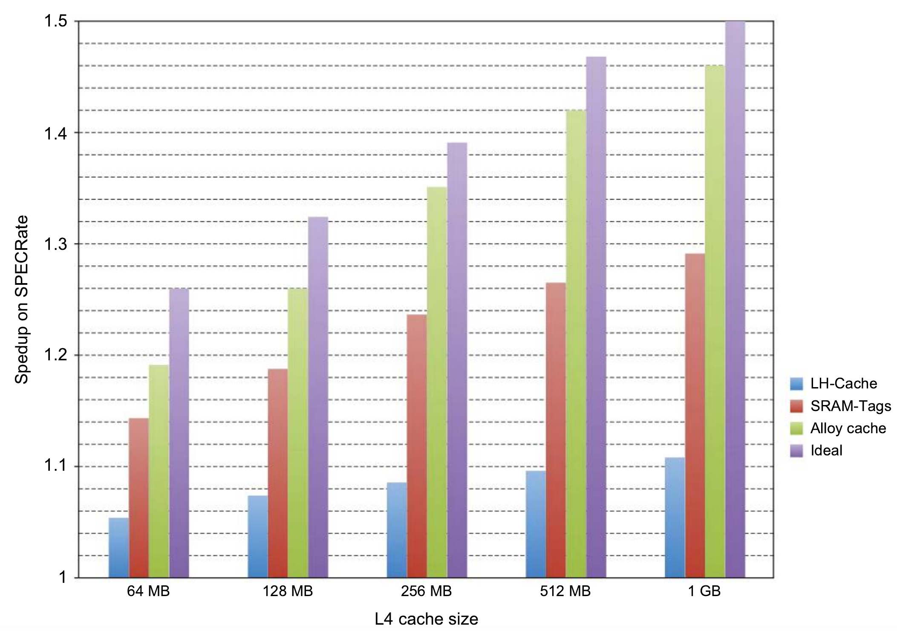{#fig-2-16 width=90%}

HBM 很可能以多种配置得到广泛应用：在某些高性能专用系统中承担整个存储系统，在有多条存储总线的设计中则把一部分存储器用作 LLC。

### 存储层次优化小结 {-}

改进命中时间、带宽、失效开销和失效率的技术，一般也会影响平均访存时间公式中的其他组成部分，以及存储层次的复杂度。[图 2.17](#fig-2-17) 对这些技术做了总结，并估计了它们对复杂度的影响：+ 表示改进了这一因素，– 表示损害了这一因素，空白表示没有影响。一般来说，没有哪一种技术能改进一个以上的类别。

[图 2.17　高级 Cache 优化小结：各技术对 Cache 性能、功耗和复杂度的影响。一种技术一般只对一个因素有帮助，但预取是例外：预取足够早时可以减少失效，不够早时也能降低失效开销。+ 表示该技术改进了这一因素，– 表示损害了这一因素，空白表示没有影响。复杂度的衡量是主观的，0 表示最容易，3 表示有挑战性。]{#fig-2-17 .caption}

| 技术 | 命中时间 | 带宽 | 失效开销 | 失效率 | 功耗 | 硬件成本/复杂度 | 说明 |
|---|:-:|:-:|:-:|:-:|:-:|:-:|---|
| 小而简单的 Cache | + | | | – | + | 0 | 很简单；广泛使用 |
| 路预测 Cache | + | | | | + | 1 | 用于 Pentium 4 |
| 流水化 Cache 和多体 Cache | – | + | | | | 1 | 广泛使用 |
| 非阻塞 Cache | | + | + | | | 3 | 广泛使用 |
| 关键字优先和提前重启 | | | + | | | 2 | 广泛使用 |
| 合并写缓冲 | | | + | | | 1 | 与写直达配合使用，广泛采用 |
| 减少 Cache 失效的编译器技术 | | | | + | | 0 | 软件实现有难度，但许多编译器能处理常见的线性代数计算 |
| 指令和数据的硬件预取 | | | + | + | – | 指令 2，数据 3 | 大多数处理器提供预取指令；现代高端处理器还在硬件中自动预取 |
| 编译器控制的预取 | | | + | + | | 3 | 需要非阻塞 Cache；可能有指令开销；许多 CPU 已采用 |
| HBM 作为附加的一级 Cache | | +/– | – | + | + | 3 | 依赖新的封装技术；效果在很大程度上取决于命中率的改善 |

<!--chapter:end:02-memory-04.Rmd-->

## 虚拟存储与保护 {#sec-2-4}

虚拟存储的关键概念见附录 B 的 B.4 节，这里先回顾两点。一是虚拟存储把物理内存当作辅存（硬盘或固态存储）的 Cache 来用：它在存储层次的这两级之间以页为单位搬移数据，就像 Cache 在各级之间搬移块一样；同样，TLB 充当页表的 Cache，地址转换时不必每次都访问一次内存。二是多个进程共用一个物理内存，但各有独立的虚拟地址空间，虚拟存储把这些进程彼此隔离开。继续往下读之前，读者应当先弄清虚拟存储的这两项功能。

本节着重讨论共用同一处理器的进程之间在保护和隐私方面的其他问题。在 2025 年信息技术面临的最棘手的难题中，安全和隐私占了两项。电子盗窃案经常见诸报道，失窃的往往是成批的信用卡号，而且一般认为，没有公开的案件还要多得多。这类问题的根源是编程错误：网络攻击者利用这些错误，访问本来无权访问的数据。编程错误无法杜绝，现代软件系统又十分复杂，编程错误相当常见。因此，研究人员和工程技术人员都在寻找更好的办法，提高计算机系统的安全性。保护信息并不只是硬件的事，但我们认为，要真正实现安全和隐私，很可能既要靠系统软件的创新，也要靠计算机体系结构的创新。

本节先回顾体系结构如何借助虚拟存储支持进程间的保护，然后介绍旁路攻击如何越过保护边界泄露信息。

### 利用虚拟存储实现保护 {-}

进程之间的保护主要靠基于页的虚拟存储，其中包括缓存页表项的 TLB。附录 B 的 B.4 节和 B.5 节回顾了虚拟存储，并详细介绍了 80x86 如何用分段和分页实现保护。这里只作简要回顾，读者如果觉得太简略，请参阅附录 B 的这两节。

所谓*多道程序设计*，就是同时运行的多个程序共用一台计算机。它带来了程序之间保护和共享的需求，也引出了*进程*的概念。打个比方，进程是程序呼吸的空气和生存的空间，也就是一个正在运行的程序，加上让它继续运行所需的全部状态。系统必须能在任何时刻从一个进程切换到另一个进程，这种切换称为*进程切换*或*上下文切换*。

1. 操作系统和体系结构相互配合，让各个进程共用硬件而又互不干扰。为此，体系结构必须限制用户进程运行时能访问的内容，同时允许操作系统进程访问更多内容。体系结构至少要做到以下几点：提供至少两种模式，指明当前运行的是用户进程还是操作系统进程，后者有时也称为*内核*进程或*管理*进程。
2. 提供一部分用户进程能用但不能写的处理器状态，包括用户/管理模式位、异常允许/禁止位和存储保护信息。如果用户能给自己管理特权、禁止异常或修改存储保护，操作系统就无法控制用户进程了，所以不允许用户写这部分状态。
3. 提供处理器从用户模式进入管理模式、再从管理模式返回用户模式的机制。进入管理模式通常靠*系统调用*。系统调用由一条特殊指令实现，这条指令把控制转到管理代码空间中的一个专门位置，同时保存系统调用处的 PC，并让处理器进入管理模式。返回用户模式的过程与子程序返回类似，恢复原先的用户/管理模式。
4. 提供限制访存的机制，用来保护进程的内存状态，而且上下文切换时不必把进程换出到磁盘。

附录 A 介绍了几种存储保护方案，其中最普遍的做法是给虚拟存储的每一页加上保护限制。页的大小固定，通常为 4 KiB、16 KiB 或更大，由页表把虚拟地址空间映射到物理地址空间。保护限制放在每个页表项（PTE）中，可以规定三件事：用户进程能否读这一页，用户进程能否写这一页，能否从这一页取代码执行。此外，一页如果不在某个进程的页表中，这个进程就既不能读也不能写这一页。页表只有操作系统能更新，因此分页机制提供了完全的访问保护。

**TLB。** 采用分页虚拟存储后，每次访存从逻辑上说至少要花两倍的时间：先访存一次得到物理地址，再访存一次取得数据。这个代价太高了。解决的办法是利用局部性原理：访存既然有局部性，这些访存的*地址转换*也必然有局部性。把地址转换保存在一个专门的 Cache 中，访存就很少需要再为地址转换多访问一次内存。这种专门用于地址转换的 Cache 传统上称为 *translation lookaside buffer*，简称 TLB。

TLB 项的结构与 Cache 项类似：tag部分存放虚拟地址的一部分，数据部分存放物理页地址、保护字段、有效位，通常还有使用位和脏位。操作系统修改这些位的办法是：先修改页表中的值，再使相应的 TLB 项无效；这一项从页表重新装入时，TLB 就得到了这些位的准确副本。TLB 失效时，可以从页表中读出地址信息来处理。后来，为了支持大得多的地址空间，页表结构越来越复杂，处理器于是引入了处理 TLB 失效的硬件，其处理方式与 Cache 失效类似，但更复杂。更高级的地址转换见附录 L。

只要计算机严格遵守对页的各项限制，并正确地把虚拟地址映射成物理地址，问题似乎就解决了。但见诸报端的新闻说明事实并非如此。

问题之所以没有解决，是因为我们不仅依赖硬件的正确性，还依赖操作系统的正确性。今天的操作系统有几千万行代码，而程序错误是按每千行代码多少个来计算的，所以实际使用的操作系统中有成千上万个错误。操作系统的缺陷造成了许多漏洞，这些漏洞经常遭到利用。不仅如此，下一小节将会说明，即使存储系统正确地实施了功能上的隔离，它仍然可能泄露受保护的信息。第 6 章介绍的一些技术（包括虚拟机和 enclave）能让程序保护高度敏感的数据，甚至能防范蓄意作恶的操作系统。遗憾的是，下面介绍的旁路攻击有时能绕过这些更强的保护机制。

### 针对存储系统的旁路攻击 {-}

针对存储系统的旁路攻击都采用同一个原理：扰动存储系统中的某个部分，再用处理器提供的计时器或性能计数器监测性能，观察扰动的效果。这类攻击之所以能够得逞，是因为多个相互独立的进程共用了一些不属于指令系统状态的硬件（如 Cache），而虚拟存储和操作系统用来隔离进程的常规机制保护不到这些硬件。

看下面这段简单的代码：

```c
if (x <= 0) {access P}
else {access Q}
```

假设我们要用旁路攻击窥探这段代码，判断是否 x <= 0。攻击分三步：

1. 填充 Cache（prime）：窥探者用自己的信息写满 if-then-else 两部分代码将会占用的 Cache 行。
2. 让受害者的代码运行一次。这次运行会使 then 子句或 else 子句中的一个发生失效。
3. 探测 Cache（probe）：访问 P 和 Q，测出每次访问是命中还是失效（可以用精确的计时器，也可以用统计 Cache 失效次数的性能计数器）。如果 x <= 0，P 原来对应的 Cache 行就已经被替换，窥探者访问这些行时会发生失效。知道了哪些 Cache 行命中、哪些失效，也就知道了受害者走的是哪条代码路径，x 的值的信息由此泄露。

这个简单例子中的代码直接区分出了我们想知道的关键事实（即 x <= 0）。实际上，从程序行为推断数据值或执行路径的途径还有很多。要获得另一个进程内存内容的详细信息，窥探者可能要把填充—探测序列重复很多次，不过每次都能执行得相当快。这类攻击的关键在于：即使虚拟存储系统禁止窥探者直接访问受害者的地址空间，两者仍然共用 Cache。

填充—探测攻击要奏效，有两个前提：一是知道受害者的代码在内存中的位置；二是保证在填充和探测之间运行的恰好是受害者的代码，中间没有插入其他操作。如果执行了其他代码，Cache 就可能受到污染，攻击效果会大大降低。在窥探者和受害者之间切换需要开销（一次进程切换），Cache 也可能因此受到污染，降低攻击效果。如果窥探者和受害者运行在同一个多核处理器的不同核上，并且共用 LLC，攻击就更容易、更有效。下一章将会看到，多线程让窥探者和受害者更紧密地共用硬件资源，这类攻击的效果还会更好。

**缓解措施。** 针对这类旁路攻击有几种缓解措施，能大大降低信息泄露给窥探者的概率。只要存在共享资源，几乎不可能杜绝所有旁路攻击，但可以大幅降低泄露率，使窥探受害者在实际上无法做到。下面几种措施能让旁路攻击难以实施得多：

* 随机分配页，让攻击者难以弄清一个代码段会落在 Cache 的什么位置。这一办法对物理地址 Cache 有效，对虚拟地址 Cache 无效。遗憾的是，有些操作系统代码可能固定在某些物理地址上。另一种办法是在使用高度敏感的信息之前，先把它复制到一个随机位置。关键是切断 Cache 行为与已知代码或数据之间的联系。
* 混淆时间。含有高度敏感信息的关键代码段可以在执行过程中插入随机的短暂延迟。20 世纪 70 年代，最早的旁路口令攻击之一就是用类似的办法防范的。
* 上下文切换时清空 Cache，消除一切隐式共享。遗憾的是，这一办法必须作用到 LLC 上，代价相当高。
* 划分资源。如果共享发生在 LLC，可以把 LLC 划分开，给同时活跃的各个进程分配各自独立的区段。这种办法可能带来很大的性能损失，对内存占用大的应用尤其如此。面向服务器环境的大多数处理器都支持 Cache 划分。

下一章将会看到，引入推测执行和多线程后，旁路攻击的带宽会大大提高（或许能提高到原来的 100 倍），因此必须采取硬件或软件上的对策。

<!--chapter:end:02-memory-05.Rmd-->

## 交叉问题：存储层次的设计 {#sec-2-5}

本节讨论五个问题。它们分散在其他各章介绍，但都是存储层次设计的基础。

### 自主取指部件 {-}

许多乱序执行的处理器，甚至一些只是流水线较深的处理器，都用一个独立的取指部件把取指（有时还包括最初的译码）分离出来（见第 3 章）。取指部件通常先从指令 Cache 中取出一整块，再把它译码成一条条指令。指令长度可变时，这种做法特别有用；每个时钟周期能发射多条指令的处理器则必须这样做。由于指令 Cache 按块访问，这类处理器的失效率就不能再和每条指令访问一次指令 Cache 的处理器相比。

预取也会影响失效率。取指部件可能把块预取到 L1 Cache 中，这些预取可能带来额外的失效，但前面已经看到，它们实际上可能减少总的失效开销。许多处理器还有数据预取，它可能提高数据 Cache 的失效率，同时却降低数据 Cache 的总失效开销。

### 专用指令 Cache {-}

超标量处理器面临的最大挑战之一，是提供足够的指令带宽。有些处理器把指令转换成微操作，最新的 Arm 处理器和 i7 处理器就是这样。这类设计可以用一个小 Cache 保存最近转换过的指令，从而降低对指令带宽的需求，也减小转移预测错误的开销。下一章将进一步讨论这项技术。

### 推测执行与访存 {-}

推测执行是高级流水线的主要技术之一：处理器还不知道一条指令是否真的需要执行，就先试探性地执行它。推测执行依靠转移预测，预测错了，就必须把推测执行的指令从流水线中清除。支持推测执行的存储系统要解决两个互相独立的问题：一是保护，二是性能。

**保护。** 推测执行时，处理器可能发出一些结果永远不会用到的访存，因为发出它们的指令来自错误的推测。这些访存如果真的执行，可能引发保护异常。而这类异常只应在指令确实执行时才发生。下一章将介绍怎样处理这种「推测异常」。

**性能。** 推测执行的处理器可能访问指令 Cache 和数据 Cache，事后却不用这些访问的结果，因此推测执行可能提高 Cache 的失效率。不过，与预取一样，这种推测执行可能降低 Cache 的总失效开销。也与预取一样，即使指令系统结构（ISA）和 Cache 结构在其他方面完全相同，拿采用推测执行的处理器的失效率去和不采用推测执行的处理器相比，也会得出误导性的结论。此外，推测执行还是能大幅提高旁路攻击泄露率的能力之一。

### 缓存数据的一致性 {-}

数据既可能在内存中，也可能在 Cache 中。只要处理器是唯一修改或读取这些数据的部件，而且 Cache 位于处理器和内存之间，处理器就几乎不会看到旧的副本，即*过时*的副本。后面将看到，多处理器和 I/O 设备都可能使几个副本不一致，从而读到错误的副本。

Cache 一致性问题在多处理器中和在 I/O 中出现的频度不同。对 I/O 来说，数据有多个副本是很少见的情况，应当尽量避免；而在多个处理器上运行的程序恰恰*希望*几个 Cache 里都有同一数据的副本。多处理器程序的性能取决于系统共享数据时的性能。共享数据的一致性和性能是第 5 章的主要内容。

**I/O 发生在哪里。** *I/O Cache 一致性*要回答的问题是：计算机中的 I/O 发生在 I/O 设备和 Cache 之间，还是发生在 I/O 设备和主存之间？如果输入把数据放进 Cache，输出也从 Cache 读数据，那么 I/O 和处理器看到的是同样的数据。这种做法的困难有两点：一是会干扰处理器，可能使处理器因等待 I/O 而停顿；二是输入还可能干扰 Cache，新数据把一些原有信息替换出去，而这些新数据短期内很可能不会被访问。

在带 Cache 的计算机中，I/O 系统的目标是既避免过时数据问题，又尽量少干扰处理器。因此，许多系统倾向于让 I/O 直接与主存交换数据，由主存充当 I/O 缓冲区。如果采用写直达 Cache，内存中就有信息的最新副本，输出就不会有过时数据问题。（处理器过去采用写直达，正是为了这一好处。）不过，今天写直达通常只用于一级数据 Cache，它的下一级是采用写回的 L2 Cache。

**存储器映射 I/O。** 写缓冲和写合并给存储器映射 I/O 带来了额外的麻烦。例如，I/O 寄存器的地址*不能*进行写合并，因为各个独立的 I/O 寄存器不一定像内存中的字数组那样工作：它们可能要求每个 I/O 寄存器使用一个地址和一个数据字，而不是用一个地址一次写入多个字。这一问题通常这样处理：把相应的页标记为要求 Cache 采用不合并的写直达。

**I/O 输入。** 输入需要格外注意，解决办法有软件和硬件两类：

* 软件办法是保证输入缓冲区的任何块都不在 Cache 中。一种做法是把包含缓冲区的页标记为不可缓存，操作系统总是输入到这样的页中；另一种做法是操作系统在输入之前，先把缓冲区地址从 Cache 中清除出去。
* 硬件办法是在输入时检查 I/O 地址是否在 Cache 中。如果 Cache 中有与 I/O 地址匹配的项，就使这些项无效，以免出现过时数据。

这些办法同样可以用于写回 Cache 的输出。数据中心要获得高性能，可能还需要用其他方法把 I/O 纳入存储层次，第 6 章将讨论这一问题。

### 利用虚拟机实现保护 {-}

虚拟机（VM）是与虚拟存储相关的一个思想，历史几乎和虚拟存储一样悠久。虚拟机最早出现在 20 世纪 60 年代末，多年来一直是大型机计算的重要组成部分。共用一台计算机的各个程序可以在虚拟机上分别运行相互独立的操作系统版本，彼此之间因此得到更高级别的保护。虚拟机是当今大规模数据中心的一项关键技术，第 6 章将详细介绍。虚拟机通常要引入影子页表，找到正确的地址映射需要更复杂的过程，TLB 失效的代价因此增大。附录 L 讨论到，设计者可以加入专门的硬件，来处理 TLB 失效时这些更复杂的步骤。

<!--chapter:end:02-memory-06.Rmd-->

## 融会贯通：ARM Cortex-A53 和 Intel Core i9 12900 的存储层次 {#sec-2-6}

本节考察两种处理器的存储层次：ARM Cortex-A53（下文简称 A53）和 Intel Core i9 12900（下文简称 i9），并给出各个部件在一组单线程基准测试程序上的性能。A53 的存储系统比较简单，所以先讲；i9 讲得更细，要完整地跟踪一次访存的全过程。阅读本节需要熟悉采用虚拟索引 Cache 的两级 Cache 层次是怎样组成的。这类存储系统的基础知识在附录 B 中有详细讲解；对它的组成还把握不准的读者，强烈建议先复习附录 B 中的 Opteron 例子。A53 的存储系统与 Opteron 相似，弄懂了 Opteron，下面对 A53 的简要说明就很容易看懂。

### ARM Cortex-A53 {-}

Cortex-A53 是一种可配置的核，支持 ARMv8A ISA，包括 32 位和 64 位两种模式。它以知识产权（IP）核的形式交付。在嵌入式、PMD 及相关市场上，IP 核是交付技术的主要形式，由 ARM、MIPS 和 RISC-V 的 IP 核制造出的处理器已达数十亿个。

IP 核与 Intel i7、AMD Athlon 等多核处理器中的核不是一回事。IP 核本身也可能是多核，它的用途是与其他逻辑集成在一起，成为一块芯片的核心。这些逻辑包括专用处理器（如视频编码器或解码器）、I/O 接口和存储器接口；集成之后再拿去制造，得到针对某种应用优化的处理器。例如，多种平板电脑和智能手机都使用 Cortex-A53 IP 核。它在设计上追求很高的能效，而能效正是靠电池供电的 PMD 的一项关键指标。A53 核用得很广，一块芯片上可以配置多个 A53 核，用于高端 PMD；这里只讨论单个核。

**硬核与软核。** IP 核一般有两种形式：

* *硬核*针对某一家半导体厂商优化，是一个黑盒，对外提供接口（接口仍在芯片上）。硬核通常只允许设置核外逻辑的参数，如 L2 Cache 的容量，IP 核本身不能修改；
* *软核*通常以标准逻辑单元库的形式交付，可以针对不同的半导体厂商编译，也可以修改。不过现代 IP 核十分复杂，要大规模修改非常困难。

总的来说，硬核性能更高、晶片面积更小；软核则可以改由其他厂商制造，修改起来也更容易。

**存储层次的组成。** Cortex-A53 每个时钟周期可以发射两条指令，时钟频率最高 1.3 GHz。它有两级 TLB 和两级 Cache，[图 2.18](#fig-2-18) 总结了存储层次的组成。发生失效时，关键字最先返回，处理器不必等失效处理完就可以继续执行；存储系统最多可以有 4 个存储体。D-Cache 为 32 KiB、页大小为 4 KiB 时，Cache 索引 7 位、块内偏移 6 位，合起来比页内偏移多一位，因此每个物理页可能映射到两个不同的 Cache 地址。和附录 B 的 B.3 节一样，A53 在失效时用硬件检测这种别名，从而避免它。[图 2.19](#fig-2-19) 给出了 32 位虚拟地址怎样用来索引 TLB 和 Cache，这里假设一级 Cache 为 32 KiB、二级 Cache 为 1 MiB，页大小为 16 KiB。

[图 2.18　Cortex A53 的存储层次包括多级 TLB 和多级 Cache。页映射 Cache（page map cache）记录一组虚拟页所对应的物理页位置，用来降低 L2 TLB 的失效开销。L1 Cache 采用虚拟索引、物理 tag；L1 D-Cache 和 L2 都采用写回策略，默认写分配。各级 Cache 的替换策略都是近似 LRU。微 TLB 和 L1 同时失效时，到 L2 的失效开销更大。L2 到主存的总线宽 64–128 位，总线较窄时失效开销更大。]{#fig-2-18 .caption}

| 结构 | 容量 | 组成 | 典型失效开销（时钟周期） |
|---|---|---|---|
| 指令微 TLB | 10 项 | 全相联 | 2 |
| 数据微 TLB | 10 项 | 全相联 | 2 |
| L2 统一 TLB | 512 项 | 4 路组相联 | 20 |
| L1 指令 Cache | 8–64 KiB | 2 路组相联；64 字节块 | 13 |
| L1 数据 Cache | 8–64 KiB | 2 路组相联；64 字节块 | 13 |
| L2 统一 Cache | 128 KiB–2 MiB | 16 路组相联；LRU | 124 |

{#fig-2-19 width=90%}

### Cortex-A53 存储层次的性能 {-}

Cortex-A8 存储层次的测量条件是：一级 Cache 32 KiB，L2 Cache 1 MiB，运行 SPECInt2006 基准测试程序。这些程序的指令 Cache 失效率很低，只看 L1 也是如此：大多数接近于零，全部低于 1%。原因大概有两个：一是 SPECCPU 程序属于计算密集型；二是两路组相联 Cache 消除了大部分冲突失效。

数据 Cache 的情况见[图 2.20](#fig-2-20)，L1 和 L2 的失效率都相当高：

* L1 失效率在 0.5% 到 37.3% 之间，最高值是最低值的 75 倍，中位数为 2.4%；
* L2 全局失效率在 0.05% 到 9.0% 之间，最高值是最低值的 180 倍，中位数为 0.3%。

上限都由号称「Cache 杀手」的 MCF 决定，它对平均值的影响也很大。要注意，L2 的全局失效率比局部失效率低得多。例如，单独计算 L2 的失效率，中位数是 15.1%，而全局失效率的中位数只有 0.3%。

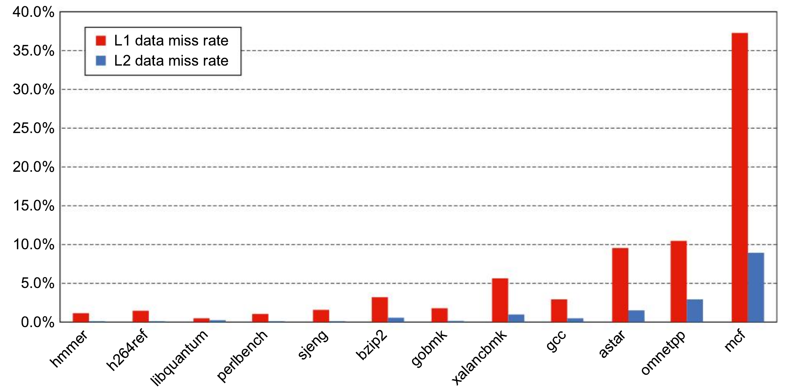{#fig-2-20 width=90%}

### 用这些失效开销计算 {-}

用[图 2.18](#fig-2-18) 中的失效开销计算，得到每次数据访问的平均开销，如[图 2.21](#fig-2-21) 所示。L1 的失效率约为 L2 的 7 倍，但 L2 的失效开销是 L1 的 9.5 倍，所以在对存储系统压力较大的基准测试程序中，L2 失效略占主导。Cache 失效对总体 CPI 的影响留到下一章研究。

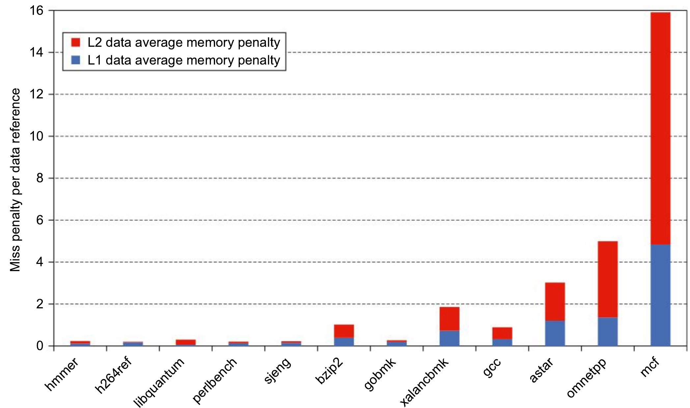{#fig-2-21 width=90%}

### Intel Core i9 {-}

i9 支持 x86-64 ISA，即 80x86 体系结构的 64 位扩展。i9 12900 采用 Alder Lake 微结构，是一种 *big.little* 设计，也就是把两类核组合在一起：8 个性能核（P-core）和 8 个能效核（E-core）。P-core 的时钟频率更高，并且支持多线程（见第 3 章）。本章从单个 P-core 的角度讨论存储系统的设计和性能；i9 的流水线和多线程性能在第 3 章研究，多处理器性能在第 5 章研究。

i9 的每个核每个时钟周期最多执行 4 条 80x86 指令，采用多发射、动态调度的 16 级流水线，第 3 章将详细介绍。2024 年，最快的 i9 单个 P-core 的时钟频率为 5.1 GHz（Turbo Boost 模式）。不过，多个 P-core 不能同时工作在 Turbo Boost 模式，否则会过热。

i9 可以支持两个存储通道，每个通道由一组独立的 DIMM 构成，各通道可以并行传输，DDR4 或 DDR5 均可。采用 DDR5-4800 时，最大存储带宽为 77 GB/s。

i9 的虚拟地址为 48 位，物理地址为 36 位，物理内存最大为 36 GiB。存储管理由两级 TLB 负责（见附录 B 的 B.4 节），[图 2.22](#fig-2-22) 对它作了总结。

[图 2.22　i9 TLB 结构的特点。一级指令 TLB 和数据 TLB 分开设置，而且各自又分为多个，后面共用一个二级 TLB。一级 TLB 支持标准的 4 KiB 页，其他页大小另设单独的 TLB。数据 TLB 中还有 load 和 store 各自专用的小 TLB。i9 用硬件实现页表遍历器（page table walker），能够并行处理 4 次 L2 TLB 失效。多级 TLB、对多种页大小的支持以及硬件 TLB 失效处理，详见在线附录 L。]{#fig-2-22 .caption}

| 特性 | 指令 TLB | 数据 TLB | 二级 TLB |
|---|---|---|---|
| 项数 | 256 项（4 KiB 页）；32 项（2/4 MiB 页） | 96 项（4 KiB 页）；32 项（2/4 MiB 页）；8 项（1 GiB 页） | 2048 项，用于 4 KiB、2 MiB 和 1 GiB 页 |
| 相联度 | 8 路 | 6 路、4 路、8 路 | 16 路 |
| 替换 | 伪 LRU | 伪 LRU | 伪 LRU |
| 访问延迟 | 1 个周期 | 1 个周期 | 8 个周期 |
| 失效 | 8 个周期 | 8 个周期 | 访问页表需要几十到几百个周期 |

i9 的三级 Cache 层次见[图 2.23](#fig-2-23)。一级 Cache 采用虚拟索引、物理 tag（见附录 B 的 B.3 节），L2 和 L3 采用物理索引。与前几代 Skylake 微结构相比，最近的高端处理器把 L2 的容量大幅增加到原来的 2～4 倍，L3 的容量则增加得较少。这样一来，L2 的总容量与 L3 的总容量更加接近，于是 L3 改为非包含方式。有些型号的 i9 还将支持用 HBM 封装的第四级 Cache。

[图 2.23　i9 P-core 三级 Cache 层次的特点。三级 Cache 都采用写回，块大小都是 64 字节。L1 和 L2 由各核私有，L3 由芯片上的所有核共享。L3 在物理上分成多个存储体，分布在各个核旁边，用一个简单的散列函数把地址分配到各个存储体。三级 Cache 都是非阻塞的，允许有多个未完成的写。L1 配有合并写缓冲：写 L1 时如果该行不在 L1 中，数据就暂存在写缓冲里（即 L1 写失效不分配 Cache 行）。L3 不是包含式的，因此各核 L2 与 L3 合起来存放的数据量可以超过 L3 的容量，L3 若是包含式的就做不到这一点。（非包含性对 Cache 一致性有影响，第 5 章讨论这个问题。）替换采用伪 LRU 和近似 LRU 的变体：L1 用 1 位方案（一种 NRU），L2 和 L3 用多位方案。]{#fig-2-23 .caption}

| 特性 | L1 I-Cache | L1 D-Cache | L2 | L3 |
|---|---|---|---|---|
| 容量 | 32 KiB | 48 KiB；双端口；8 个存储体 | 每核 1.25 MiB | 30 MiB，所有核共享；非包含 |
| 相联度 | 8 路 | 6 路 | 10 路 | 15 路 |
| 访问延迟 | 4 个周期 | 5 个周期 | 15 个周期 | 50 个周期 |
| 替换方案 | 伪 LRU | 伪 LRU | 加权 n 位 LRU | 加权 n 位 LRU |

**取指与指令 TLB。** [图 2.24](#fig-2-24) 标出了一次访存经过存储层次的各个步骤，这里假设页大小为 4 KiB。首先，PC 送往指令 Cache。指令 Cache 的索引为

$$
2^{\text{索引}} = \frac{\text{Cache 容量}}{\text{块大小} \times \text{组相联度}} = \frac{32\text{ K}}{64 \times 8} = 64 = 2^{6}
$$

即 6 位。指令地址的页帧号（36 = 48 − 12 位）送往指令 TLB（步骤 1）；与此同时，虚拟地址中 12 位的页内偏移送往指令 Cache（步骤 2）。指令 Cache 为 8 路组相联，Cache 地址需要 12 位：6 位 Cache 索引，加上 64 字节块的 6 位块内偏移，所以不会出现别名。

早期的 i7 采用 4 路组相联的 I-Cache，对应的物理地址在这一位上可能是 0，也可能是 1，所以一个虚拟地址对应的块可能出现在 Cache 中两个不同的位置。对指令来说这不成问题：同一条指令即使在 Cache 中有两份，内容也一定相同。数据则不同。如果允许数据这样重复存放，也就是允许别名，那么每次修改页映射都必须检查 Cache，好在修改页映射并不常见。只要非常简单地运用页着色（见附录 B 的 B.3 节），就能根除这种别名：把偶数地址的虚拟页映射到偶数地址的物理页，奇数页也一样，虚拟页号和物理页号的最低位就总是相同，别名永远不会出现。

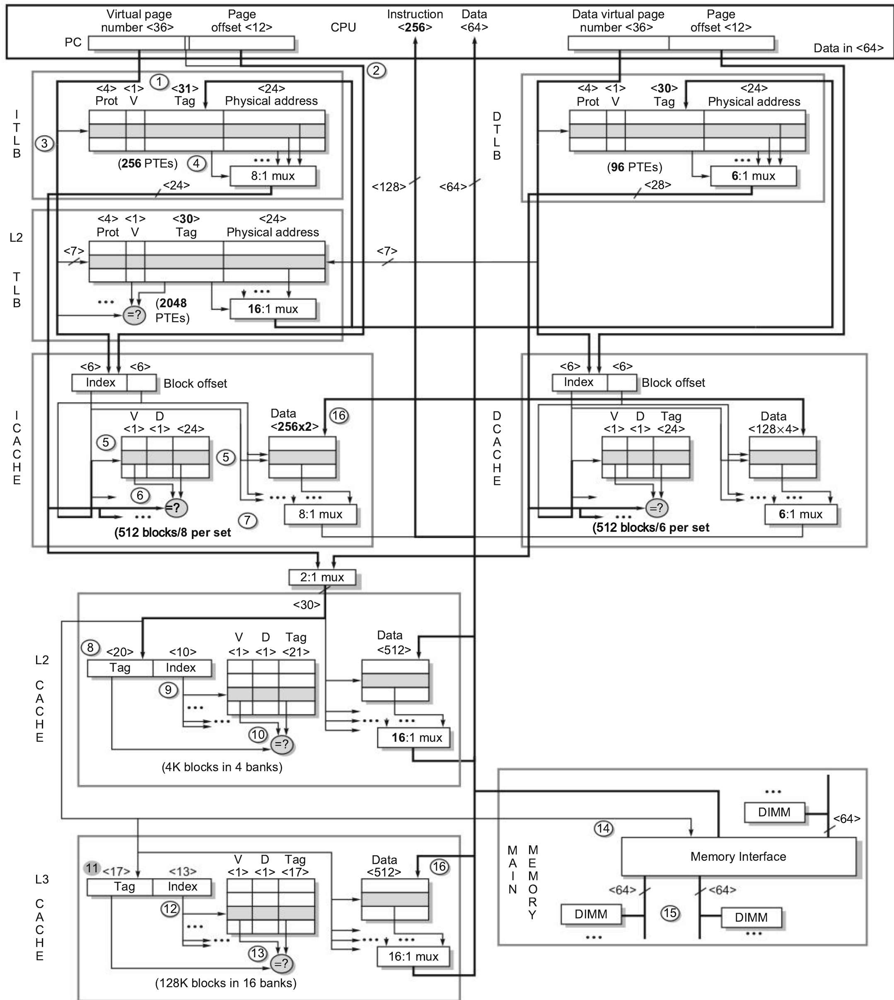{#fig-2-24 width=100%}

指令 TLB 查找与地址相匹配的有效 PTE（步骤 3 和 4）。除了转换地址，TLB 还要检查这个 PTE 是否表明这次访问违反了访问权限、应当引发异常。

指令 TLB 失效时，先访问 L2 TLB（又称 STLB）。L2 TLB 为 16 路组相联，含有 2048 个 4 KiB 页的 PTE。从 L2 TLB 装入 L1 TLB 需要 8 个时钟周期，再加上最初访问 L1 TLB 的 1 个周期，失效开销共 9 个周期。L2 TLB 也失效时，由硬件算法遍历页表并更新 TLB 项；页表遍历器和页结构 Cache（page structure cache）见在线附录 L 的 L.5 节和 L.6 节。最坏的情况是页面不在内存中，操作系统要从外存取得该页。处理一次缺页的时间里可以执行数百万条指令，因此如果有其他进程在等待运行，操作系统就换入那个进程。如果 TLB 没有异常，就继续访问指令 Cache。

**L1 指令 Cache。** 地址中的索引字段送往指令 Cache 的全部 8 个存储体（步骤 5）。指令 Cache 的 tag 为 36 位 − 6 位（索引）− 6 位（块内偏移），即 24 位。这 4 个 tag 连同有效位与指令 TLB 送来的物理页帧号比较（步骤 6）。i9 每次取指要取 32 字节，所以 6 位块内偏移之外还要再用 1 位，从块中选出所需的 32 字节，也就是用 6 + 1 即 87 位把 32 字节指令送给处理器。L1 Cache 采用流水线方式，命中延迟为 4 个时钟周期（步骤 7）。失效则访问二级 Cache。

**L2 Cache。** 指令 Cache 采用虚拟寻址、物理 tag，而二级 Cache 采用物理寻址，所以要把 TLB 给出的物理页地址与页内偏移拼起来，形成访问 L2 的地址。L2 的索引为

$$
2^{\text{索引}} = \frac{\text{Cache 容量}}{\text{块大小} \times \text{组相联度}} = \frac{1.25\text{ M}}{64 \times 10} = 2^{11}
$$

于是，30 位的块地址（36 位物理地址 − 6 位块内偏移）分为 19 位 tag 和 11 位索引（步骤 8）。索引和 tag 同样送往本核的 L2 Cache（步骤 9），并行比较。如果有一个 tag 匹配且有效（步骤 10），L2 经过最初 15 个周期的延迟后，以每个时钟周期 8 字节的速率按顺序返回这个块。

**L3 Cache。** L2 失效则访问 L3。i9-12900 有 8 个 P-core 和 8 个 E-core，L3 为 30 MiB，分成 8 个存储体。为了减少冲突，存储体由散列选择：取散列结果中的 3 位选出一个存储体，只访问这一个存储体。每个存储体内的索引为

$$
2^{\text{索引}} = \frac{\dfrac{\text{Cache 容量}}{8}}{\text{块大小} \times \text{组相联度}} = \frac{3.75\text{ M}}{64 \times 15} = 4096 = 2^{12}
$$

12 位索引（步骤 11）送往所选存储体的全部 15 路（步骤 12）。L3 的 tag 为 36 − (12 + 6) = 18 位，与 TLB 给出的物理地址比较（步骤 13）。命中时，L3 经过最初 50 个时钟周期的延迟后，以每个时钟周期 16 字节的速率返回这个块，并把它同时放入 L1 和 L2。L3 失效则启动一次访存。

**主存。** i9 有两个相互独立的存储通道（Xeon 服务器处理器更多），可以连接 HBM 存储器或标准 DIMM。由主存处理的失效，总延迟约为两部分之和：判定 L3 失效所需的 50 个处理器周期，加上取关键指令的 DRAM 延迟。以单存储体的 DDR5-4800 SDRAM 和 4.0 GHz 的 CPU 为例，取到前 16 字节的 DRAM 延迟约为 40 ns，即 160 个时钟周期，总失效开销约为 200 个时钟周期。随后，存储控制器以每个 I/O 总线时钟周期 32 字节的速率填充 64 字节 Cache 块的其余部分，又需要 2.5 ns，即 10 个时钟周期。取回的块写入 L2 和 L1，但不放入 L3，因为前面说过，末级 Cache（LLC，Last-Level Cache）是非包含的。

LLC 主要用来存放从 L2 逐出的块。如果不考虑多个核之间的共享，L2 和 L3 存放的是不同的块，因此 Cache 中的数据总量等于 L2 与 L3 的容量之和，而不只是 L3 的容量。L2 和 L3 都是写回 Cache，所以任何一次失效都可能把一个旧块写回下一级：L2 的旧块写回 L3，L3 的旧块写回内存。i9 有一个合并写缓冲，在下一级 Cache 没有读操作时把脏 Cache 行写回。发生失效时要检查写缓冲，如果所需的 Cache 行在缓冲中，就直接从缓冲中取数据处理失效。

**store 的处理。** 如果这条指令不是 load 而是 store，那么 store 发射时，也像 load 一样查找数据 Cache。失效时，由于 L1 Cache 写失效不分配块，这个块就放进写缓冲。命中时，store 也不立即更新 L1（或 L2）Cache，而要等到确认它不是推测执行之后才更新。在此期间，store 存放在 load-store 队列中，这个队列是处理器乱序控制机制的一部分。

i9 还支持从层次中的下一级向 L1 和 L2 预取。i9 的预取器与 i7 的相似，i7 预取器的性能前面已经考察过。

### i9 存储系统的性能 {-}

我们用 SPECINT2017 基准测试程序（SPECINTRate）评估 i9 Cache 结构的性能。i9 的流水线很复杂，有自主的取指部件，采用推测执行，还有指令预取和数据预取，所以很难拿它的 Cache 性能与较简单的处理器比较。前面说过，使用预取的处理器会产生与程序执行的访存无关的 Cache 访问。由实际的指令访问或数据访问引起的 Cache 访问，有时称为*按需访问*，以区别于*预取访问*。按需访问既可能来自推测的取指，也可能来自推测的数据访问，其中有些后来会被取消（推测执行和指令毕业详见第 3 章）。推测处理器产生的失效至少和顺序执行的非推测处理器一样多，通常还更多。

由于这些复杂因素，讨论失效率意义不大。我们改用现在常用的每千条指令失效数（MPKI）：分子是失效次数，分母是提交的指令数。MPKI 可以按 Cache 层次分别给出：MPKID1 表示一级数据 Cache 的失效，MPKI2 和 MPKI3 分别表示 L2 和 L3 的失效。

除了按需失效，指令预取和数据预取也会产生等效的失效。如果预取器非常有效，去掉预取反而会产生别的失效。发出一次预取，即使得到一次「预取失效」，只要因此避免了后来的按需失效，处理器就能运行得更快。i9 P-core 的预取器是 Skylake 预取器的扩展，Skylake 预取器的性能在第 23 页开始的硬件预取一节讨论过。

**指令 Cache。** i9 的取指部件每个周期试图取 32 字节。每个周期要取多条指令，这使得比较指令 Cache 失效率变得复杂。实际上，Cache 每次读出的是整个 64 字节的 Cache 行，后续的 32 字节取指不需要再访问 Cache，所以失效只按 64 字节块统计。32 KiB、8 路组相联的指令 Cache 使 SPECintRate 程序的指令失效率非常低。为简单起见，把 SPECintRate 的失效率计为 64 字节块的失效次数除以完成的指令数，那么除了一个基准测试程序（XALANCBMK），失效率都低于 1%。一个 64 字节块通常含有 16–20 条指令，因此按每条指令计算的有效失效率要低得多，具体低多少取决于指令流的空间局部性。

**数据 Cache。** [图 2.25](#fig-2-25) 给出了 SPECCPUINT2017 基准测试程序在 L1 数据 Cache、L2 和 L3 上的 MPKI。有 4 个基准测试程序的 L1D 失效相当多，每千条指令超过 20 次（前面说过，Skylake 的 L1 预取器效果不太好）；尽管 L2 Cache 容量达 1.25 MiB，这 4 个程序的 L2 失效也相当多，每千条指令达到 10 次或更多。

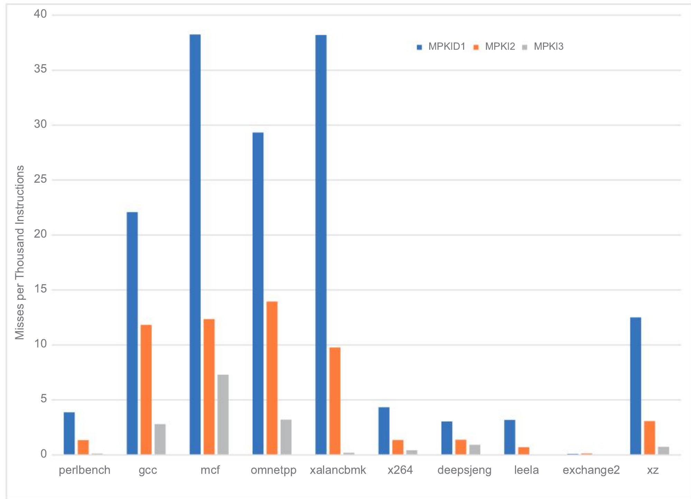{#fig-2-25 width=90%}

**失效的潜在影响。** [图 2.25](#fig-2-25) 没有反映失效可能造成的影响。在采用非阻塞 Cache 和乱序执行的处理器中，这种影响几乎不可能准确测量：相互重叠的失效代价较低，而且处理器可能仍然保持忙碌，在较短的 L1 失效期间尤其如此。为了粗略估计 L1、L2 和 L3 失效可能造成的影响，[图 2.26](#fig-2-26) 把 L1D、L2 和 L3 的 MPKI 分别乘以到下一级存储层次的平均失效延迟。这并不是对代价的测量，只能说明各级失效可能有多重要。公认的「Cache 杀手」mcf 有大量 L3 失效；其他访存密集的基准测试程序，L1、L2 和 L3 失效的影响比较均衡。前面考察 i7 上的预取时说过，有些 SPEC 浮点基准测试程序的 Cache 失效率也很高。i9 的 CPI 与 Cache 失效之间的关系，以及流水线的其他影响，留到下一章研究。

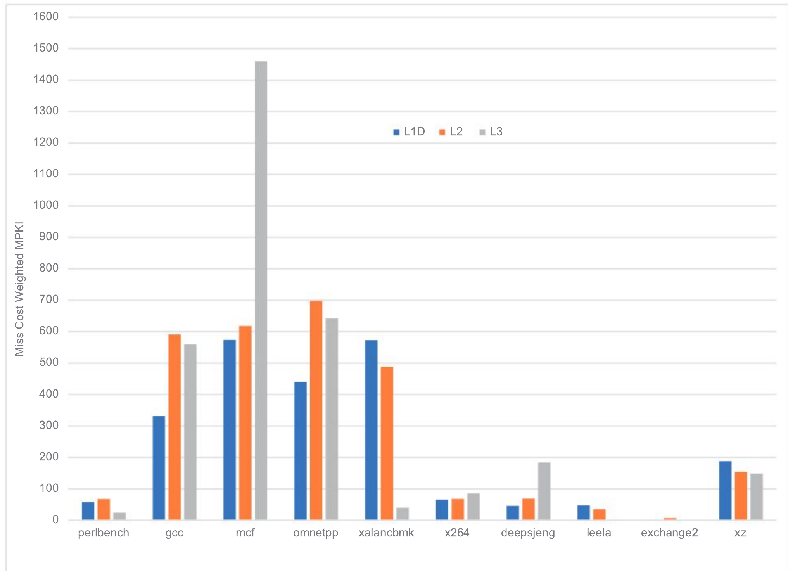{#fig-2-26 width=90%}

<!--chapter:end:02-memory-07.Rmd-->

## 谬误与陷阱 {#sec-2-7}

存储层次是计算机体系结构中最便于定量分析的领域，按说不容易出现谬误和陷阱。可是写这一节时，我们缺的不是可举的警示，而是篇幅！

**谬误**　*根据一个程序的 Cache 性能预测另一个程序的 Cache 性能。*

[图 2.27](#fig-2-27) 取 SPEC2000 基准测试程序集中的三个程序，给出了它们的指令失效率和数据失效率随 Cache 容量的变化。三个程序差别很大：Cache 为 4096 KiB 时，每千条指令的数据失效次数分别是 9、2 和 90；Cache 为 4 KiB 时，每千条指令的指令失效次数分别是 55、19 和 0.0004。数据库等商业程序即使配上很大的二级 Cache，失效率也相当高，SPECCPU 程序一般不会这样。可见，用一个程序的 Cache 性能去推断另一个程序是不可取的。[图 2.23](#fig-2-23) 也表明，程序之间的差异很大，甚至整数程序和浮点密集型程序哪一类失效率更高，这样的判断也可能出错，mcf 和 sphnix3 就是例子！

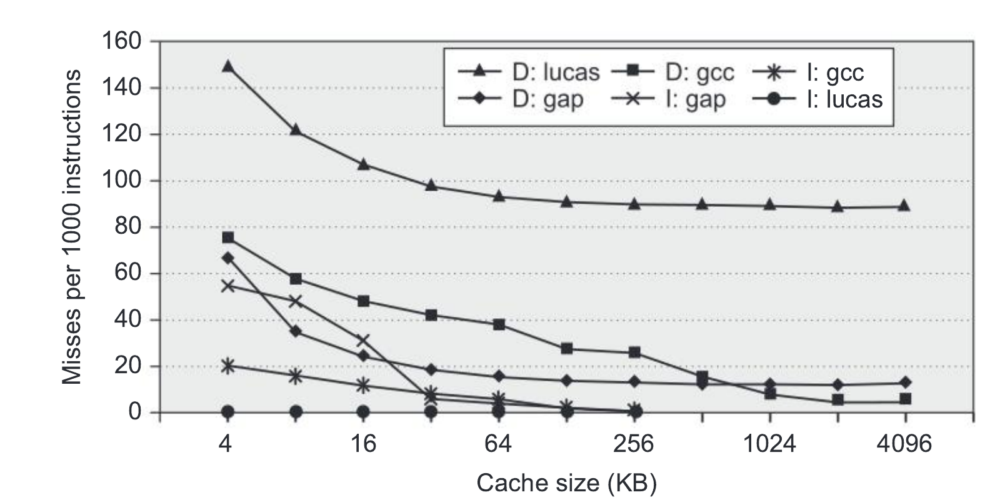{#fig-2-27 width=90%}

**陷阱**　*模拟足够多的指令，以准确测量存储层次的性能。*

这一条实际上包含三个陷阱：

* 一是用很短的踪迹去预测大容量 Cache 的性能；
* 二是程序的局部性行为在整个运行过程中并非一成不变；
* 三是程序的局部性行为可能随输入不同而变化。

[图 2.28](#fig-2-28) 给出了 SPEC2000 中同一个程序在五组输入下每千条指令的累计平均指令失效次数。对这几组输入而言，前 19 亿条指令的平均失效率与后续执行过程的平均失效率相差很大。

{#fig-2-28 width=90%}

**陷阱**　*在基于 Cache 的系统中不提供高存储带宽。*

Cache 能降低平均访存延迟，但应用如果必须访问主存，Cache 未必能为它提供高存储带宽。面对这类应用，体系结构设计者必须在 Cache 之后配置 HBM。第 4 章和第 5 章还会回到这个陷阱。

**陷阱**　*引入一种「介于」两种现有技术之间、但在速度和价格上都没有明显优势的存储技术。*

人们多次尝试引入新的存储技术，目的有两种：一是取代某种现有技术，二是「插入」两种现有技术之间，例如 DRAM 和磁盘之间。这些尝试大多失败了，原因是新技术没有带来显著而持久的优势：有时每位成本更低，但速度慢得多；有时速度更快，但成本更高。相变存储器（Micron 和 Intel 称之为 Xpoint）看来是最近一个落入这个陷阱的技术，在它之前还有很多，包括电荷耦合器件、磁泡存储器和光盘。相比之下，Flash 是唯一一个大获成功的例子。它胜出的原因有三：它是非易失的；它比磁盘快得多，读操作尤其如此；随着时间推移，它与磁盘在每位成本上的差距也缩小了大半。到 2022 年，除大规模归档存储之外，Flash 已经基本取代了硬盘。

<!--chapter:end:02-memory-08.Rmd-->

## 结束语：展望未来 {#sec-2-8}

> 过去 30 年里，不断有人预测计算机性能的提高即将（eminent [sic]）停止，结果每一次都错了。错的原因在于，这些预测都建立在一些没有明说的假设上，而后来的发展推翻了这些假设。例如，当年没有人预见到计算机会从分立元件转向集成电路，于是有人预测，光速会把计算机的速度限制在比现在低几个数量级的水平。我们对存储墙的预测大概也会错，但它提醒我们：必须开始「跳出框框」思考了。
>
> ——Wm. A. Wulf 和 Sally A. McKee，*Hitting the Memory Wall: Implications of the Obvious*，弗吉尼亚大学计算机科学系（1994 年 12 月）。「存储墙」（memory wall）一词即出自这篇论文。

存储层次的设想由来已久，20 世纪 40 年代末、50 年代初通用数字计算机刚刚诞生时就已提出。虚拟存储在 20 世纪 60 年代初用于研究型计算机，70 年代进入 IBM 大型机；Cache 也大约在同一时期出现。此后，为了缩小主存与处理器之间的访问时间差距，这些概念不断得到扩展和增强，但基本思想始终没有变。过去 25 年里，先进的存储层次一直挡住了存储墙；而最近，多种因素交织在一起，存储墙又成为提高性能的一大障碍。

**DRAM 与 SRAM 的趋势。** 引起存储层次设计重大变化的一个趋势是：DRAM 密度的提高和访问时间的缩短都在持续放缓。这两种现象过去 15 年里一直存在，近 5 年更加明显。DRAM 的带宽有一定提高，但访问时间缩短得慢得多，从 DDR4 到 DDR5 已经完全没有缩短。造成这种局面的原因，一是 Dennard 缩放终结，二是摩尔定律放缓；此外，DRAM 采用的沟槽电容结构也限制了它继续按比例缩小。今后 DRAM 访问带宽和延迟的改进，很可能主要依靠堆叠存储器这类封装技术。SRAM 的情况也类似：最近几代半导体工艺给 SRAM 带来的性能提升，已经比逻辑电路小。

可见，存储层次的性能提高将受到多种因素的阻碍，主要有：

* DRAM 的延迟不再改进，密度的改进也变小了；
* SRAM 访问时间的改进变小，每位功耗几乎没有改进；
* 无论是增大 LLC，还是增加 Cache 级数，收益都在递减；
* 流式处理超大数据集、时间局部性和空间局部性都较差的应用越来越多，包括图形处理和深度神经网络（见第 4 章和第 7 章）。

存储墙已经被挡住了 25 年，这些因素合在一起，又使它的影响加剧。第 4 章和第 7 章将会看到，对某些应用来说，最好的办法可能是换一种存储组织方式，而 Cray 早在 50 年前设计的一台早期超级计算机中就已经这样做了！

**Flash 与相变存储器。** 撇开 DRAM 和 SRAM 的改进不谈，Flash 存储器的作用也大了很多。Flash 在 PMD 中占据主导地位已有 15 年，将近 10 年前成为笔记本电脑的标准配置，近几年大多数台式机出厂时也以 Flash 作为主要的外存。Flash 相对于 DRAM 的潜在优势，在于它不需要每一位都配一个控制写入的晶体管；但这同时也是它的致命弱点：Flash 只能成块地擦除再重写，速度要慢得多。因此，尽管 Flash 已经成为增长最快的外存，主存仍然以 DDR DRAM 为主。

以相变材料为基础的存储器出现已有一段时间，但无论与磁盘还是与 Flash 相比，都从来没有形成有力的竞争。与 Flash 相比，这种技术似乎有几方面的优势，例如不需要速度很慢的先擦后写周期，寿命也更长，但到目前为止还没有在商业上取得重大成功。

**存储墙是怎样挡住的。** 多年来，不断有人预测存储墙即将到来（见前面引用的话和论文），并将严重限制处理器的性能。所幸以下几方面的进展挡住了存储墙：

* Cache 扩展到多级（从 2 级到 4 级）；
* 重填和预取方案更加精巧；
* 编译器和程序员更加重视局部性；
* DRAM 带宽大幅提高，自 20 世纪 90 年代中期以来提高到原来的 200 多倍。

近年来又出现了新的挑战：L1 的容量受访问时间限制（访问时间又受时钟周期限制），L2 和 L3 的容量受能耗限制。i7 和 i9 处理器核大约 12 年间的演变就说明了这一点：L1 指令 Cache 的容量没有变，数据 Cache 也只增大了 50%！更激进地使用预取，正是为了弥补 L2 和 L3 无法继续增大的不足。

除了多级 Cache 之外，乱序流水线允许同时存在多个未完成的失效，可以利用指令级并行来隐藏 Cache 系统中剩下的访存延迟。多线程更进一步，它利用更多的线程级并行，提供了更多的并行性，也就有了更多隐藏延迟的机会。在现代多级 Cache 系统中，无论访存延迟有多大，指令级并行和线程级并行很可能都会成为隐藏延迟的更重要的手段。

**便笺存储器。** 每隔一段时间就会有人提出，使用由程序员控制的便笺存储器（scratchpad）或其他对程序员可见的高速存储器。后面会看到，GPU 和领域专用体系结构就使用了这类存储器（见第 7 章）。但在通用处理器中，这类想法从来没有成为主流，原因有几个，主要是：

* 一是破坏存储模型。它引入了行为不同的地址空间。
* 二是变换难做。基于编译器或程序员的 Cache 优化（如预取）不必如此，而使用便笺存储器的存储变换必须完整地处理从主存地址空间到便笺存储器地址空间的重新映射，因此更难实现，适用面也有限。

GPU（见第 4 章）和领域专用体系结构（见第 7 章）大量使用局部便笺存储器，目前管理它们的负担落在程序员和编译器身上。对于能够使用这类存储器的领域专用软件系统，性能收益非常显著。在图形系统和类似的系统中，HBM 技术是主要的工作存储器。为了突破 Dennard 缩放终结和摩尔定律放缓带来的限制，领域专用体系结构的地位越来越重要（见第 7 章），便笺存储器和类似向量的寄存器组也随之越来越流行。

Dennard 缩放终结，对 DRAM 和处理器工艺都有影响。DRAM 由于结构特殊，受到的影响略大一些，但无论逻辑电路还是存储器，都受到功耗限制和摩尔定律放缓的制约。要延续过去 50 年那样的性能提高，关键在于计算机体系结构和相关软件的新创新，两者共同提高性能和效率。

<!--chapter:end:02-memory-09.Rmd-->

## 历史回顾与参考文献 {#sec-2-9}

M.3 节（在网上提供）考察了 Cache、虚拟存储和虚拟机的历史。在这三者的历史中，IBM 都扮演了重要的角色。那里还列有供进一步阅读的参考文献。

<!--chapter:end:02-memory-10.Rmd-->

## 案例研究与习题（Rajeev Balasubramonian、Norman P. Jouppi、Naveen Muralimanohar、Sheng Li） {- #sec-2-exercises}

### 案例研究 1：用高级技术优化 Cache 性能 {-}

*本案例研究涉及的概念*

* 非阻塞 Cache
* 面向 Cache 的编译优化
* 软件预取和硬件预取
* 计算 Cache 性能对更复杂处理器的影响

所谓矩阵转置，就是把矩阵的行和列互换，如下所示：

完成转置的简单 C 循环如下：

```c
for (i = 0; i < 3; i++) {
 for (j = 0; j < 3; j++) {
 output[j][i] = input[i][j];
 }
}
```

2.1　[10/15/15/12/20] <2.3> 输入矩阵和输出矩阵都按行主序存放。所谓*行主序*，就是同一行中相邻的元素占据内存中相邻的地址。在一个处理器上执行 256 × 256 的双精度矩阵转置，条件如下：

* L1 数据 Cache 容量为 16 KB，全相联（不必考虑 Cache 冲突），采用最近最少使用（LRU）替换，块大小为 64 字节；一个双精度数占 8 字节；
* L1 Cache 的失效或预取需要 16 个周期，而且总在 L2 Cache 中命中；L2 Cache 每 2 个处理器周期可以处理一个请求；
* 数据在 L1 Cache 中时，上面内层循环的每次迭代需要 4 个周期；
* 写失效时 Cache 采用写分配、写时取块的策略；
* 写回脏 Cache 块需要 0 个周期（这一假设并不现实）。

按上面的简单实现，这样的执行顺序对输出矩阵不理想；如果作循环交换，执行顺序又会对输入矩阵不理想。可见只靠循环交换无法提高这段代码的性能，必须改用分块。

a.　[10] <2.3> 要发挥分块执行的好处，Cache 至少应当多大？

b.　[15] <2.3> 在上面这个最小容量的 Cache 中，分块版本和不分块版本的失效次数相比如何？

c.　[15] <2.3> 编写执行转置的代码，以块大小 *B* 为参数，使用 *B* × *B* 的块。

d.　[12] <2.3> 要让性能稳定，不随两个数组在内存中的位置变化，L1 Cache 至少需要多大的相联度？

e.　[20] <2.3> 在一台计算机上分别运行分块和不分块的 256 × 256 矩阵转置。根据你对这台计算机存储系统的了解，结果与你的预期吻合到什么程度？如果可能，解释其中的差异。

2.2　[10] <2.3> 为上面*不分块*的矩阵转置代码设计一个硬件预取器。硬件预取器有简单和复杂之分：最简单的一种只在失效后预取顺序相邻的 Cache 块；更复杂的「非单位步长」硬件预取器能够分析失效访问流，检测出非单位步长并据此预取。软件预取则不同，确定非单位步长和确定单位步长一样容易，例如可以在 C 代码中用 `__builtin_prefetch( )` 函数插入软件预取。假设预取的数据直接写入 Cache，而且没有「污染」，即不会覆盖在预取数据之前就要用到的数据。采用非单位步长预取器时，为了获得最好的性能，内层循环进入稳定状态后，任一时刻必须有多少个尚未完成的预取？

2.3　[15/20] <2.3> 使用软件预取要兼顾两方面：一是预取必须及时完成，赶得上使用；二是尚未完成的预取要尽量少，既不超出微结构的能力，也尽量减少 Cache 污染。不同处理器的能力和限制各不相同，问题就更复杂了。

a.　[15] <2.3> 编写带软件预取的分块矩阵转置代码。

b.　[20] <2.3> 估算分块和不分块的转置代码在有、无软件预取时的性能，并加以比较。

### 案例研究 2：融会贯通：高度并行的存储系统 {-}

*本案例研究涉及的概念*

* 交叉问题：存储层次的设计
* 现代处理器中的存储层次参数

[图 2.29](#fig-2-29) 中的程序可以用来评估存储系统的行为，[图 2.29](#fig-2-29) 给出的是它的 C 代码。关键有两点：一是计时要准确；二是让程序以不同的步长遍历内存，从而访问到存储层次的不同级。

程序由三部分组成：

* 第一部分是一个过程，调用标准工具准确测量用户 CPU 时间。在某些系统上，可能要修改这个过程才能运行。
* 第二部分是一个嵌套循环，以不同的步长和 Cache 容量读写内存。为了得到准确的 Cache 计时，这段代码要重复执行许多次。
* 第三部分只测量嵌套循环本身的开销，以便从测得的总时间中减去，得出访存所用的时间。

结果以 `.csv` 文件格式输出，便于导入电子表格。根据所要回答的问题和被测系统的内存容量，可能需要修改 `CACHE_MAX`。在单用户模式下运行，或者至少不运行其他活动的应用，结果会更稳定。在现代机器上，这段代码可能要运行几分钟。

[图 2.29](#fig-2-29) 中的代码源自加州大学伯克利分校 Andrea Dusseau 编写的程序，依据的是 Saavedra-Barrera（1992）中的详细描述。为了解决在较新机器上出现的一些问题，代码作过修改；与 Linux 和 Microsoft Visual C++ 平台兼容的版本可以从 <https://users.cs.utah.edu/~rajeev/HP-code/> 获得。程序假设程序地址与物理地址一致，这只在少数使用虚拟地址 Cache 的机器上成立。一般来说，机器刚重启后，虚拟地址往往与物理地址一致，因此可能要重启机器，结果中的曲线才会平滑。

回答下面的问题时，作如下假设：存储层次中所有部件的容量都是 2 的幂；页的大小远大于二级 Cache（如果有的话）的块大小；二级 Cache 的块大小大于或等于一级 Cache 的块大小。

[图 2.29　用于评估存储系统的 C 程序]{#fig-2-29 .caption}

```c
#include <stdio.h>
#include <time.h>
#define ARRAY_MIN (1024) /* 1/4 smallest cache */
#define ARRAY_MAX (4096*4096) /* 1/4 largest cache */
int x[ARRAY_MAX]; /* array going to stride through */

double get_seconds() { /* routine to read time in seconds */
  time_t ltime;
  time(&ltime);
  return (double) ltime;
}

int label(int i) { /* generate text labels */
  if (i<1e3) printf("%ldB,",i);
  else if (i<1e6) printf("%ldK,",i/1024);
  else if (i<1e9) printf("%ldM,",i/1048576);
  else printf("%ldG,",i/1073741824);
  return 0;
}

int main(int argc, char* argv[]) {
  int register nextstep, i, index, stride;
  int csize;
  double steps, tsteps;
  double loadtime, lastsec, sec0, sec1, sec; /* timing variables */

  /* Initialize output */
  printf(" ,");
  for (stride=1; stride <= ARRAY_MAX/2; stride = stride*2)
    label(stride*sizeof(int));
  printf("\n");

  /* Main loop for each configuration */
  for (csize=ARRAY_MIN; csize <= ARRAY_MAX; csize=csize*2) {
      label(csize*sizeof(int)); /* print cache size for this loop */
      for (stride=1; stride <= csize/2; stride=stride*2) {
            /* Lay out path of memory references in array */
            for (index=0; index < csize; index=index+stride)
              x[index] = index + stride; /* pointer to next */
            x[index-stride] = 0; /* loop back to beginning */

            /* Wait for timer to roll over */

            lastsec = get_seconds();
            sec0 = get_seconds();
            while (sec0 == lastsec) {
              sec0 = get_seconds();
            }

            /* Walk through path in array for twenty seconds */
            /* This gives 5% accuracy with second resolution */
            steps = 0.0; /* number of steps taken */
            nextstep = 0; /* start at beginning of path */
            sec0 = get_seconds(); /* start timer */
            do { /* repeat until 20 seconds of execution */
              for (i=stride;i!=0;i=i-1) { /* keep samples same */
                   nextstep = 0;
                   do nextstep = x[nextstep]; /* dependency */
                   while (nextstep != 0);
              }
              steps = steps + 1.0; /* count loop iterations */
              sec1 = get_seconds(); /* end timer */
            } while ((sec1 - sec0) < 20.0); /* collect 20 seconds */
            sec = sec1 - sec0;

            /* Repeat empty loop to loop subtract overhead */
            tsteps = 0.0; /* used to match number of while iterations */
            sec0 = get_seconds(); /* start timer */
            do { /* repeat until same number of iterations as above */
              for (i=stride;i!=0;i=i-1) { /* keep samples same */
                   index = 0;
                   do index = index + stride;
                   while (index < csize);
              }
              tsteps = tsteps + 1.0;
              sec1 = get_seconds(); /* - overhead */
            } while (tsteps < steps); /* until = number of iterations above */
            sec = sec - (sec1 - sec0);
            loadtime = (sec*1e9)/(steps*csize);
            /* write out results in .csv format for Excel */
            printf("%4.1f,", (loadtime<0.1) ? 0.1 : loadtime);
      }; /* end of inner for loop */
      printf("\n");
  }; /* end of outer for loop */
  return 0;
}
```

2.4　[12/12/12/10/12] <2.6> [图 2.30](#fig-2-30) 画出了这个程序的一个输出样例，x 轴列出的是所测试数组的大小。根据[图 2.30](#fig-2-30) 中的结果样例回答下列问题。

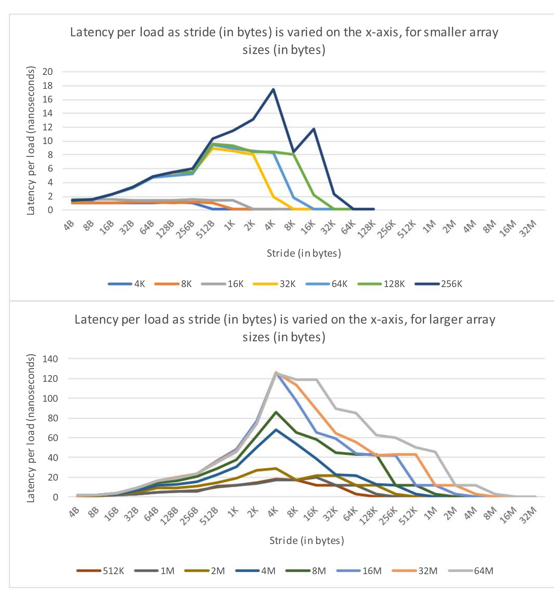{#fig-2-30 width=90%}

a.　[12] <2.6> 二级 Cache 的总容量和块大小各是多少？

b.　[12] <2.6> 二级 Cache 的失效开销是多少？

c.　[12] <2.6> 二级 Cache 的相联度是多少？

d.　[10] <2.6> 主存的容量是多少？

e.　[12] <2.6> 页大小为 4 KB 时，换页时间是多少？

2.5　[12/15/15/20] <2.6> 必要时修改[图 2.29](#fig-2-29) 中的代码，测量下列系统特征。画出实验结果：y 轴为所用时间，x 轴为访存步长，两个坐标轴都用对数刻度，每种 Cache 容量画一条曲线。

a.　[12] <2.6> 系统的页大小是多少？

b.　[15] <2.6> TLB 有多少项？

c.　[15] <2.6> TLB 的失效开销是多少？

d.　[20] <2.6> TLB 的相联度是多少？

2.6　[20/20] <2.6> 在多处理器存储系统中，单个处理器也许无法让存储层次的较低几级达到饱和，多个处理器协同工作时则应当可以。修改[图 2.29](#fig-2-29) 中的代码，同时运行它的多个副本，看能否确定：

a.　[20] <2.6> 你的计算机系统中有多少个真正的处理器？有多少个处理器只是额外的多线程上下文？

b.　[20] <2.6> 你的系统有多少个存储控制器？

2.7　[20] <2.6> 你能想出一种用程序测试指令 Cache 某些特征的办法吗？*提示*：编译器可能从一段代码生成大量不易察觉的指令，所以尽量使用你的指令系统结构（ISA）中长度已知的简单算术指令。

### 案例研究 3：研究各种存储系统组织方式的影响 {-}

*本案例研究涉及的概念*

* DDR3/DDR4 存储系统
* rank、存储体和行缓冲对性能和功耗的影响
* DRAM 时序参数
* DRAM 调度策略

处理器芯片通常支持几个 DDR3 或 DDR4 存储通道。本案例研究只考虑一个存储通道，探讨改变几个参数会怎样影响它的性能和功耗。

**存储通道的组织。** 一个通道上插有一个或多个 DIMM，每个 DIMM 支持一个或多个 rank。所谓 rank，就是一组协同工作、共同响应存储控制器一条命令的 DRAM 芯片。例如，一个 rank 可以由 16 片 DRAM 芯片组成，每片在通道时钟的每个边沿处理 4 位输入或输出，这样的芯片称为 x4（by four）芯片；一个 rank 也可以由 8 片 x8 芯片或 4 片 x16 芯片组成。无论哪种组成方式，一个 rank 都能处理 64 位存储通道上传送的数据。rank 内部又分为 8 个（DDR3）或 16 个（DDR4）存储体（bank）。每个存储体有一个行缓冲，它实际上保存着从这个存储体最后读出的一行。

**读操作的命令序列。** 从一个存储体读数据，典型的命令序列如下：

(i)　存储控制器发出预充电（Precharge）命令，让存储体做好访问新行的准备。预充电在经过时间 tRP 后完成。

(ii)　存储控制器接着发出激活（Activate）命令，从存储体中读出相应的行。激活在经过时间 tRCD 后完成，这时这一行就算进入了行缓冲。

(iii)　然后存储控制器可以发出列读命令（即 CAS 命令），把行缓冲中特定的一部分送到存储通道上。经过时间 CL 后，数据突发的最初 64 位出现在存储通道上。一次突发通常包含 8 次 64 位传输，在 4 个存储时钟周期的上升沿和下降沿完成，这段时间称为传输时间。

(iv)　如果存储控制器接下来要访问同一存储体中另一行的数据，称为行缓冲失效，这时要重复步骤 (i) 到 (iii)。这里暂且假设 CL 一过就可以发出步骤 (i) 的预充电命令；有些情况下还需要再加一段延迟，这里忽略不计。如果存储控制器要访问同一行中的另一块数据，称为行缓冲命中，这时只需再发一条 CAS 命令。两条背靠背的 CAS 命令至少要间隔 4 个周期，保证第一次数据传输完成后第二次才开始。

存储控制器可以在相继的周期里向不同的存储体发出命令，因此能够并行完成许多次读写，而不必闲等单个存储体的 tRP、tRCD 和 CL 过去。后面的问题都假设 tRP = tRCD = CL = 13 ns，存储通道频率为 1 GHz，即传输时间为 4 ns。

2.8　[10] <2.2> 发生行缓冲失效时，存储控制器看到的读延迟是多少？

2.9　[10] <2.2> 发生行缓冲命中时，存储控制器看到的延迟是多少？

2.10　[10] <2.2> 如果存储通道只支持一个存储体，而且访存以行缓冲失效为主，存储通道的利用率是多少？

2.11　[15] <2.2> 假设行缓冲失效率为 100%，要使存储通道利用率达到 100%，存储通道至少应当支持多少个存储体？

2.12　[10] <2.2> 假设行缓冲失效率为 50%，要使存储通道利用率达到 100%，存储通道至少应当支持多少个存储体？

2.13　[15] <2.2> 某个应用有 4 个线程，这些线程完全没有空间局部性，即行缓冲失效率为 100%。每隔 200 ns，4 个线程各自同时向存储控制器队列插入一个读操作。存储通道只支持一个存储体时，平均访存延迟是多少？支持 4 个存储体时又是多少？

2.14　[10] <2.2> 从上面几道题中，你对增加存储体个数的好处和坏处有什么认识？

2.15　[20] <2.2> 下面转向存储器的功耗。从以下链接下载 Micron 功耗计算器：<https://www.micron.com/sales-support/design-tools/dram-power-calculator>

这个链接提供了多种 DDR 技术的电子表格，这里只作 DDR3 的分析。电子表格已经预先配置好，可以估算 Micron 生产的几种 DRAM 芯片的功耗。操作步骤如下：

* 在电子表格的「DDR3 Config」选项卡中选择配置：x8 DDR3 2Gb DRAM 芯片，速度等级 -093，Fast 预充电退出模式；
* 转到「System Config」选项卡，设置负载的行为：页命中率（即行缓冲命中率）50%，读数据总线利用率 45%，写数据总线利用率 25%，其他参数用默认设置；
* 单击「Summary」选项卡，查看在这样的芯片和负载条件下单片 DRAM 芯片的功耗构成。

Micron 会随着工艺的进步定期更新这些电子表格。按 2024 年夏天的快照，这片 DRAM 芯片的功耗为 229 mW，其中激活操作 45 mW，CAS 操作 145 mW，背景功耗 39 mW。

接下来再次单击「System Config」选项卡，修改读写流量和行缓冲命中率，观察功耗构成怎样随之变化。例如，通道利用率为 35%（25% 读、10% 写）时，或者行缓冲命中率提高到 80% 时，功耗各降低多少？

2.16　[20] <2.2> 在默认配置中，一个 rank 由 8 片 x8 2 Gb DRAM 芯片组成，也可以改由 16 片 x4 芯片或 4 片 x16 芯片组成。每片 DRAM 芯片的容量也可以变化，有 1 Gb、2 Gb 和 4 Gb 三种。这些选项都在 Micron 功耗计算器的「DDR3 Config」选项卡中设置。把每种 rank 组织方式的总功耗列成表。对给定容量的 rank，哪种组成方式的功耗效率最高？

2.17　[20] <2.2> 前面讨论过，基于 DDR 的存储系统可以采用两种存储控制器，一种采用开页策略，另一种采用关页策略。两种策略的区别在于某个存储体没有待处理请求时怎么做：

* 开页策略让行缓冲保持打开，期望将来出现行缓冲命中；
* 关页策略发出预充电命令，让存储体为将来访问另一行做好准备（预计空间局部性有限）。

有待处理的请求时，两种策略都优先处理行缓冲命中；没有行缓冲命中时，按先来先服务的策略处理。下表是对一个存储体的一串块读操作，列出了每次读操作访问的 DRAM 行（X、Y、Z），以及该请求进入存储控制器队列的周期。请给出存储控制器发出每条命令的周期。假设预充电、激活和列读都需要 10 个周期；第一个请求在第 20 个周期到来时，存储体已经完成了预充电。

| 存储事务 | 入队周期 | 开页策略下的命令序列 | 关页策略下的命令序列 |
|---|---|---|---|
| Read X | 20 |  |  |
| Read X | 35 |  |  |
| Read X | 90 |  |  |
| Read Y | 95 |  |  |
| Read X | 100 |  |  |
| Read X | 160 |  |  |

### 习题 {-}

有几道习题要用到 Cache 模拟器。公开的模拟器中功能最强的是 CACTI（7.0 版），但它采用的是较旧的工艺（32nm）。这对习题没有根本影响，只是结果与较新的 SRAM 和 DRAM 工艺不符。CACTI 7.0 可以从 GitHub 获得（<https://github.com/topanitanw/Cacti-7.0>）。如果想用更新的工艺（14nm）做这些习题，可以试用 FT-CACTI，它把 CATCI 7.0 的模型更新到了较新的工艺，同样可以从 GitHub 获得（<https://github.com/marg-tools/FN-CACTI>）。

2.18　[12/12/15] <2.3> 下面的问题用 CACTI 7.0 或 FT-CACTI 研究小而简单的 Cache 的效果。

a.　[12] <2.3> 比较块大小为 64 字节、只有一个存储体的 64 KB Cache 的访问时间。以直接映射组织为基准，2 路组相联和 4 路组相联 Cache 的相对访问时间各是多少？

b.　[12] <2.3> 比较块大小为 64 字节、只有一个存储体的 4 路组相联 Cache 的访问时间。以 16 KB 的 Cache 为基准，32 KB 和 64 KB 的 Cache 的相对访问时间各是多少？

c.　[15] <2.3> 对一个 64 KB 的 Cache，在相联度 1 到 8 之间找出平均访存时间最短的一种。已知某个负载集的每条指令失效次数为：直接映射 0.00664，2 路组相联 0.00366，4 路组相联 0.000987，8 路组相联 0.000266。总体上每条指令有 0.3 次数据访问。假设在所有模型中 Cache 失效都需要 10 ns。计算以周期数表示的命中时间时，采用 CACTI 输出的周期时间，它对应 Cache 在流水线中不产生任何气泡时所能工作的最高频率。

2.19　[15] <2.3> 你要为一款新微处理器研究多体 L1 数据 Cache 和流水化 L1 数据 Cache 的相对性能。Cache 容量为 64 KB，2 路组相联，块大小为 64 字节。流水化 Cache 需要 4 个流水段来完成访问、命中检测和组选择；多体实现由两个 32 KB 的 2 路组相联存储体组成。使用 CACTI 或 FT-CACTI，并采用所支持的最好的工艺，比较流水化设计和多体设计的面积，以及每次访问的总动态读能耗。说明哪种设计占用的面积较小、哪种设计需要的功耗较大，并解释可能的原因。

2.20　[12/15] <2.3> 考虑在 L2 Cache 失效时采用关键字优先和提前重启。条件如下：

* L2 Cache 容量为 2 MB，块大小为 64 字节，回填通路宽 16 字节；
* 每 4 个处理器周期可以向 L2 写入 16 字节；
* 从存储控制器收到第一个 16 字节块需要 120 个周期，此后从主存每再取一个 16 字节块需要 16 个周期；
* 数据可以直接旁路到 L2 Cache 的读端口；
* 不计把失效请求传给 L2 Cache 以及把所需数据传给 L1 Cache 所用的周期。

a.　[12] <2.3> 采用和不采用关键字优先和提前重启时，处理一次 L2 Cache 失效各需要多少个周期？

b.　[15] <2.3> 你认为关键字优先和提前重启对 L1 Cache 更重要，还是对 L2 Cache 更重要？哪些因素决定了它们的相对重要性？

2.21　[12/12] <2.3> 你要在写直达的 L1 Cache 和写回的 L2 Cache 之间设计一个写缓冲。L2 Cache 的写数据总线宽 16 B，每 4 个处理器周期可以对一个独立的 Cache 地址完成一次写。

a.　[12] <2.3> 每个写缓冲项应当有多少字节宽？

b.　[15] <2.3> 用 64 位存数指令把内存清零时，如果其他所有指令都能和存数指令并行发射，而且这些块都在 L2 Cache 中，那么在稳定状态下，用合并写缓冲代替不合并的写缓冲，预计能得到多大的加速比？

c.　[15] <2.3> 在采用阻塞 Cache 和非阻塞 Cache 的系统中，可能发生的 L1 失效各会怎样影响所需的写缓冲项数？

2.22　[20] <2.1, 2.2, 2.3> Cache 起着过滤器的作用。例如，一个程序每执行 1000 条指令，平均可能有 20 次访存局部性很差，2 MB 的 Cache 无法满足。这时称这个 2 MB Cache 的 MPKI（每千条指令失效次数）为 20，而且无论 2 MB Cache 前面有哪些较小的 Cache，这个值大体上都不变。各种 Cache 的容量/延迟/MPKI 如下：32 KB/1/100，128 KB/2/80，512 KB/4/50，2 MB/8/40，8 MB/16/10；访问片外存储系统平均需要 200 个周期。对下面几种 Cache 配置，计算访问 Cache 层次所用的平均时间。Cache 层次太浅或太深各有什么坏处？

a.　32 KB L1；8 MB L2；片外存储器

b.　32 KB L1；512 KB L2；8 MB L3；片外存储器

c.　32 KB L1；128 KB L2；2 MB L3；8 MB L4；片外存储器

2.23　[15] <2.1, 2.2, 2.3> 一个 16 MB、16 路的 L3 Cache 由 A、B 两个程序共享。Cache 中有一种机制，监测每个程序的 Cache 失效率，并给每个程序分配 1～15 路，以减少 Cache 失效的总次数。程序 A 分到 1 MB Cache 时 MPKI 为 100，每多分 1 MB，MPKI 减少 1；程序 B 分到 1 MB Cache 时 MPKI 为 50，每多分 1 MB，MPKI 减少 2。各路怎样在程序 A 和 B 之间分配最好？

2.24　[20] <2.1, 2.6> 你要设计一款 PMD，并针对低能耗作优化。处理器核（包括一个 16 KB 的 L1 数据 Cache）只要不在休眠状态，功耗就是 1 W。如果 L1 Cache 命中率是理想的，核执行某项任务的平均 CPI 为 1，即执行 1000 条指令需要 1000 个周期。访问 L2 及更低层级每多用一个周期，核就多一个停顿周期。根据下面的规格，执行这项任务时，L2 Cache 取多大容量能使 PMD（核、L1、L2 和存储器）的能耗最低？

a.　核的频率为 1 GHz，L1 的 MPKI 为 100。

b.　256 KB 的 L2 延迟为 10 个周期，MPKI 为 20，背景功耗为 0.2 W，每次访问 L2 消耗 0.5 nJ。

c.　1 MB 的 L2 延迟为 20 个周期，MPKI 为 10，背景功耗为 0.8 W，每次访问 L2 消耗 0.7 nJ。

d.　存储系统的平均延迟为 100 个周期，背景功耗为 0.5 W，每次访存消耗 35 nJ。

2.25　[20] <2.2> 遵循 DDR 标准的存储系统在存储时钟的每个边沿传输 64 位数据。每次传输中可能有 1 位出错，错误可能来自随机的软错误，也可能来自某个 DRAM 引脚或连线的硬错误。为了容忍这种错误，可靠的存储系统给每次 64 位数据传输附加 8 位编码，通常是用于纠正单个错误、检测两个错误（SECDED）的汉明码。但有些硬件基础设施需要更高的可靠性，例如要求即使整片 DRAM 芯片及其所有输出位都失效，仍能保证纠正，这称为 Chipkill。你能设计一个简单的存储系统，在一片 DRAM 芯片失效时仍能提供正确的数据吗？提供这种更高的可靠性有什么缺点？你也许不是编码理论的专家，但很可能熟悉实现 RAID 存储时用到的奇偶校验和循环冗余校验（CRC）。

2.26　[20] <2.4> 本章介绍旁路时，主要以共享 Cache 访问和填充—探测为例。你能列举存储层次中的其他几种旁路吗？攻击者可能怎样利用它们？处理器体系结构设计者又可能怎样防御这些攻击？

2.27　[20] <2.3> 考虑下面三种 4 路组相联 L2 Cache 设计：

(i)　tag和数据并行访问：4 个周期、20 pJ 的 tag 查找与 20 个周期、1000 pJ 的数据阵列访问同时进行。

(ii)　tag 和数据串行访问：先作 4 个周期、20 pJ 的 tag 查找，再对其中一路作 20 个周期、250 pJ 的数据阵列访问。

(iii)　路预测的 tag 和数据访问：先访问一个 1 个周期、5 pJ 的路预测器，再对预测的那一路并行访问 tag 和数据（tag 查找 4 个周期、5 pJ，数据阵列访问 20 个周期、250 pJ）。如果路预测错误，再对其余三路并行访问 tag 和数据（tag 查找 4 个周期、15 pJ，数据阵列访问 20 个周期、750 pJ）。

假设路预测的准确率为 80%，分别按性能和能耗给这三种设计排序。

2.28　[20] <2.3> 本章讨论了采用大容量 L4 DRAM Cache 的可能性，最后落到「Alloy Cache」的设计上。为了减轻 DRAM 访问的高代价，Alloy Cache 组织成直接映射 Cache。一般认为，直接映射 Cache 可能有很高的冲突失效率。你认为这对 Alloy Cache 是不是问题？如果是，怎样缓解？此外，讨论在 Alloy Cache 中使用较大的数据块有哪些权衡，比如使用 4KB 的数据块会带来什么影响？

2.29　[20] <2.3> 在基准 Alloy Cache 设计中，访问 tag 需要 30 个周期，之后还要 4 个周期才能收到数据；如果访问 tag 后发现失效，就启动一次访存，平均需要 100 个周期。发现一次 Alloy Cache 失效要花这么长时间，因此再引入一个 1 个周期的命中/失效预测器，它与 Alloy Cache 访问并行工作：预测命中时，操作序列与基准设计完全相同；预测失效时，在查找 Alloy Cache 的同时就启动访存。对这两种设计，分别计算 Alloy Cache 及更低层级的平均延迟。命中/失效预测器的表现如下：

(i)　在全部访问中，80% 正确地预测为命中；

(ii)　5% 正确地预测为失效；

(iii)　5% 错误地预测为命中；

(iv)　10% 错误地预测为失效。

2.30　[10/10] <2.1, 2.2, 2.3> 一个组中的各路可以看作一个按优先级从高到低排列的列表。每访问一次这个组，就可以重新组织这个列表，改变各块的优先级。从这个角度看，Cache 管理策略可以分解成三个子策略：

* 插入（Insertion）：新取来的块放在优先级列表的什么位置；
* 提升（Promotion）：每次访问到一个块（Cache 命中）时，这个块在列表中的位置怎样变化；
* 牺牲块选择（Victim Selection）：发生 Cache 失效时，逐出列表中的哪一项，为新块腾出位置。

a.　你能用插入、提升和牺牲块选择这三个子策略来描述 LRU Cache 策略吗？

b.　你能定义其他有竞争力、值得进一步探索的插入策略和提升策略吗？

2.31　[15] <2.1, 2.3> 在运行多个程序的处理器中，末级 Cache（LLC，Last-Level Cache）通常由所有程序共享。这会带来干扰：一个程序的行为和 Cache 占用会影响其他程序可用的 Cache。干扰造成两方面的问题：一是服务质量（QoS），干扰会使一个程序得到的资源和性能低于承诺的水平，比如低于云服务运营商承诺的水平；二是隐私，一个程序可以根据自己观察到的干扰，用旁路攻击推断其他程序的访存模式。你可以在末级 Cache 中加入哪些策略，使一个程序的行为不受共享这个 Cache 的其他程序影响？

2.32　[15] <2.3> 容量达几 MB 的大型 L3 Cache，信号要经过很长的连线，访问可能需要几十个周期，例如访问一个 16 MB 的 L3 Cache 可能需要 20 个周期。这个 16 MB 的 Cache 不一定要组织成每次访问都需要 20 个周期，也可以组织成由较小的 Cache 存储体构成的阵列，其中有些存储体离处理器核较近，有些较远。这就形成了非一致 Cache 访问（NUCA）：最近的 2 MB 可以在 8 个周期内访问，接下来的 2 MB 需要 10 个周期，依此类推，最后的 2 MB 需要 22 个周期。你可以引入哪些新策略，使 NUCA Cache 的性能最高？

2.33　[10/10/10] <2.2> 一个台式机系统的处理器连接着一个 2 GB、带*纠错码（ECC）*的 DRAM。假设只有一个存储通道，宽 72 位（64 位数据，8 位 ECC）。

a.　[10] <2.2> 如果使用 1 Gb 的 DRAM 芯片，DIMM 上有多少片 DRAM 芯片？如果 DIMM 的每个数据引脚只连接一片 DRAM，每片 DRAM 必须有多少个数据 I/O？

b.　[10] <2.2> 要支持 32 B 的 L2 Cache 块，突发长度需要多长？

c.　[10] <2.2> 不计 ECC 开销，计算 DDR2-667 和 DDR2-533 DIMM 从活动页读数据时的峰值带宽。

2.34　[20] <2.3> 在末级 Cache 中准确跟踪 LRU 信息，主要难点是什么？

2.35　[20] <2.3> 晶体管在电源和地之间总在泄漏一些电流。处理器内消耗的能耗分为两类：一类是动态能耗，由晶体管开关时的电流引起，取决于开关活动；另一类是漏电能耗，由每个晶体管在每个周期的漏电流引起，取决于晶体管的数量。现代微处理器一半以上的面积由 Cache 占据，因此 Cache 是总漏电能耗的主要来源。降低漏电能耗的一种技术是切断晶体管的电源，使它不再漏电。问题在于：切断一个 Cache 块中晶体管的电源，这个 Cache 块中存放的数据就会丢失。注意，如果一个 Cache 块在一个周期里消耗 X 个单位的漏电能耗，那么从存储器取回这个 Cache 块要消耗 1000X 个单位的动态能耗。利用上述技术，为末级 Cache 设计一种机制，在尽量不影响性能的前提下，显著降低整个系统的能耗。

2.36　[12] <2.2> 你要为一台服务器配置资源。服务器采用 16 核、3 GHz 的 CMP，执行某个负载时的总 CPI 为 2.0（假设 L2 Cache 失效的回填不会延迟）。L2 Cache 的行大小为 32 字节。这些负载平均每 1K 条指令发生 6.67 次 L2 失效。系统使用 DDR4-2666 DIMM，如果所需带宽有时是平均值的 2 倍，那么应当提供多少个独立的存储通道，系统才不会受存储带宽的限制？

2.37　[15] <2.2> 一个处理器有 4 个存储通道。相邻的存储块应当放在同一个存储体中，还是放在不同通道的不同存储体中？

2.38　[15] <2.2> 计算机空闲时，既可以让它待机（这时 DRAM 仍处于活动状态），也可以让它休眠。假设休眠时只需把 DRAM 的内容复制到 Flash 这样的非易失性介质中。已知向 Flash 读或写一个 64 字节的 Cache 行需要 2.56 J，对 DRAM 读或写一个 Cache 行需要 0.5 nJ；DRAM 的空闲功耗为 1.6 W（8 GB）；主存容量为 8 GB。系统空闲多长时间，休眠才有好处？

2.39　[15] <2.2, 2.7> [2.7 节](#sec-2-7)讲过，Intel i7 处理器有一个激进的预取器。把预取器设计得极为激进，可能有哪些坏处？

<!--chapter:end:02-memory-11.Rmd-->

# 指令级并行及其利用 {#ch-ilp}

> 「谁是第一？」
>
> 「America 号。」
>
> 「谁是第二？」
>
> 「先生，没有第二。」
>
> ——1851 年一场帆船赛上两位观众的对话。这项赛事后来定名为「美洲杯」。John Cocke 由此得到启发，把 IBM 的一款研究型处理器命名为「America」。它是第一款超标量处理器，也是 PowerPC 的前身。

> 「因此，IA-64 赌的是：将来功耗不会成为关键的限制，海量的资源……也不会在时钟频率、路径长度或 CPI 这些因素上带来损失。我的看法显然是怀疑的……」
>
> ——Marty Hopkins（2000），IBM Fellow、早期的 RISC 先驱。这是他 2000 年对 Intel 新推出的 Itanium 的评论。Itanium 由 Intel 和 HP 联合开发，采用静态 ILP 方法（见附录 H），Intel 在它身上投入巨大，但它在 Intel 微处理器销售额中的占比从未超过 0.5%。

## 引言 {#sec-3-1}

大约从 1985 年起，所有处理器都采用流水线，让多条指令重叠执行，以提高性能。指令之间这种潜在的重叠称为*指令级并行*（ILP），因为这些指令可以并行地求值。在基本流水线的基础上，进一步增加指令之间可利用的并行性，有很多种技术，本章和附录 H 将逐一介绍。

本章内容比附录 C 的基本流水线深入得多。对附录 C 还不够熟悉的读者，应当先复习附录 C，再读本章。

本章先讨论数据冒险和控制冒险带来的限制，再讨论怎样提高编译器和处理器利用并行性的能力。前两节引入的概念很多，本章和下一章都以它们为基础。

**两类方法。** 利用 ILP 的方法大体上可以分成两类：

* 一是依靠硬件，在运行时动态地发现和利用并行性；
* 二是依靠软件技术，在编译时静态地寻找并行性。

为一类方法开发的许多技术，也用在了以另一类方法为主的设计中，所以本章对两类方法的关键概念都会介绍。目前在桌面和服务器市场上占主导地位的，是采用动态硬件方法的处理器，近年来所有的 Intel 和 AMD 处理器、许多 Arm 处理器都属于这一类；平板电脑和大多数智能手机的处理器，现在也普遍采用这类方法。IoT 领域则不同，功耗和成本的约束比性能目标更重要，设计者利用的 ILP 也就较少。激进的编译器方法从 20 世纪 80 年代起尝试过多次，最近一次是 1999 年推出的 Intel Itanium 系列。尽管投入了巨大的努力，这类方法只在两种场合取得了成功：领域专用体系结构，以及结构规整、数据级并行丰富的科学应用（见第 7 章）。

本章还会讨论 ILP 方法的局限。正是这些局限，直接促成了向多核的转变。今天要在 ILP 和线程级并行（TLP）之间合理取舍，仍然需要理解这些局限。

本节讨论两个问题：一是程序和处理器有哪些特征限制了指令之间可利用的并行性；二是程序结构与硬件结构之间的对应关系。后者至关重要，程序的某个特性会不会真正限制性能、在什么情况下限制性能，要靠它来判断。

流水线处理器的 CPI（每条指令的时钟周期数）等于基本 CPI 加上各种停顿带来的增量：

$$
\begin{aligned}
\text{流水线 CPI} = {} & \text{理想流水线 CPI} + \text{结构冒险停顿} + \text{数据冒险停顿} \\
& + \text{控制冒险停顿}
\end{aligned}
$$

其中，*理想流水线 CPI* 衡量的是这一实现所能达到的最高性能。右边每一项减小，总的流水线 CPI 都会降低，也就是 IPC（每个时钟周期执行的指令数）提高。按照一项技术减小的是哪一项，可以对各种技术分类。[图 3.1](#fig-3-1) 列出了本章和附录 H 要讨论的技术，以及附录 C 入门部分讲过的内容。本章将会看到，为降低理想流水线 CPI 而引入的技术，会让冒险的处理变得更加重要。

[图 3.1　附录 C、第 3 章和附录 H 讨论的主要技术，以及每种技术影响的是 CPI 公式中的哪一项]{#fig-3-1 .caption}

| 技术 | 减少的项 | 所在节 |
|---|---|---|
| 前递和旁路 | 数据冒险停顿 | C.2 |
| 简单的转移调度和预测 | 控制冒险停顿 | C.2 |
| 基本的编译器流水线调度 | 数据冒险停顿 | C.2、3.2 |
| 基本的动态调度 | 真相关引起的数据冒险停顿 | C.7 |
| 循环展开 | 控制冒险停顿 | 3.2 |
| 每个周期发射多条指令 | 理想 CPI | 3.3、3.8 |
| 深度流水 | 更高的时钟频率 | 3.3 |
| 高级转移预测 | 控制冒险停顿 | 3.4 |
| 寄存器重命名 | 输出相关（WAW）和反相关（WAR）引起的数据冒险停顿 | 3.5 |
| 带推测执行的动态调度 | 数据冒险停顿 | 3.6 |
| 动态存储器消歧 | 访存指令引起的数据冒险停顿 | 3.7 |
| 编译器相关分析、软件流水、踪迹调度 | 理想 CPI、数据冒险停顿 | H.2、H.3 |
| 支持编译器推测执行的硬件 | 理想 CPI、数据冒险停顿、控制冒险停顿 | H.4、H.5 |
| 同时多线程（SMT） | 停顿造成的空闲周期 | 3.11 |

### 什么是指令级并行 {-}

本章的技术利用的都是指令之间的并行性。所谓*基本块*，就是一段顺序执行的代码，除了入口没有别的转入点，除了出口没有别的转出点。基本块内的并行性相当少：典型的 RISC 程序中，动态转移频率平均通常在 15% 到 25% 之间，即每两条转移之间只执行 3 到 6 条指令；这几条指令又很可能相互依赖，所以基本块内能利用的重叠，很可能比基本块的平均大小还小。要大幅提高性能，必须跨越多个基本块去利用 ILP。

**循环级并行。** 提高 ILP 最简单、最常用的办法，是利用循环各次迭代之间的并行性，这通常称为*循环级并行*。下面这个循环把两个各有 1000 个元素的数组相加，是完全并行的：

```c
for (i=0; i<=999; i=i+1)
    x[i] = x[i] + y[i];
```

每次迭代都可以和其他任何一次迭代重叠；但在一次迭代内部，指令重叠的机会很少，甚至没有。

把这种循环级并行转化为 ILP 的技术有好几种，本章都会介绍。它们的基本做法都是展开循环：可以由编译器静态展开（见下一节），也可以由硬件动态展开（见 [3.3 节](#sec-3-3)到 [3.8 节](#sec-3-8)）。

**SIMD 与向量。** 利用循环级并行的另一种重要方法是 SIMD，向量处理器和图形处理器（GPU）都采用它，第 4 章会介绍这两类处理器。二者都利用数据级并行，区别在于：

* 一条 SIMD 指令并行处理少量到中等数量的数据项，通常是 2 到 16 个；
* 一条向量指令借助并行的执行部件和深度流水线，并行处理许多数据项。

以上面的循环为例，写成简单形式时每次迭代需要 7 条指令（两条 load、一条加法、一条 store、两条地址更新、一条转移），共 7000 条。在每条指令处理 4 个数据项的 SIMD 体系结构上，执行的指令数可能降为原来的 1/4。在某些向量处理器上，可能只需要 4 条指令：两条向量指令从存储器取出向量 `x` 和 `y`，一条向量指令把两个向量相加，一条向量指令把结果向量写回。这些指令要流水执行，延迟也比较长，但延迟可以相互重叠。

### 数据相关与冒险 {-}

一个程序中有多少并行性、怎样利用这些并行性，关键在于弄清一条指令怎样依赖另一条指令。具体来说，利用 ILP 就要确定哪些指令可以并行执行。分两种情况：

* 两条指令*无关*，只要流水线资源足够（因而没有结构冒险），它们就可以在任意深度的流水线中同时执行，不引起任何停顿；
* 两条指令相关，它们就不是并行的，必须按顺序执行，不过往往可以部分重叠。

可见两种情况的关键都是判断一条指令是否与另一条指令相关。

#### 数据相关 {-}

相关有三种：*数据相关*（也称真数据相关）、*名相关*和*控制相关*。只要下面两个条件之一成立，就称指令 *j* *数据相关*于它前面的指令 *i*：

* 指令 *i* 产生的结果可能被指令 *j* 使用；
* 指令 *j* 数据相关于指令 *k*，而指令 *k* 数据相关于指令 *i*。

第二个条件的意思是：两条指令之间只要有一条由第一类相关串成的相关链，它们就是相关的。这条相关链可以长达整个程序。注意，单条指令内部的相关（如 `add x1,x1,x1`）不算作相关。

下面这段 RISC-V 代码把存储器中一个向量的每个元素都加上寄存器 `f2` 中的标量。向量从地址 `0(x1)` 开始，最后一个元素在地址 `0(x2)`。

```asm
Loop: fld    f0,0(x1)    //f0=数组元素
      fadd.d f4,f0,f2    //加上 f2 中的标量
      fsd    f4,0(x1)    //保存结果
      addi   x1,x1,-8    //指针减 8 个字节
      bne    x1,x2,Loop  //若 x1≠x2 则转移
```

这段代码中的数据相关有两组，一组是浮点（FP）数据：

```asm
Loop: fld    f0,0(x1)    //f0=数组元素
               ↓
      fadd.d f4,f0,f2    //加上 f2 中的标量
               ↓
      fsd    f4,0(x1)    //保存结果
```

一组是整数数据：

```asm
      addi   x1,x1,-8    //指针减
             ↓           //8 个字节（每个双字）
      bne    x1,x2,Loop  //若 x1≠x2 则转移
```

两组相关序列中，每条指令都依赖它前面的一条，如箭头所示。这里以及后面例子中的箭头，都表示为保证正确执行而必须保持的顺序：箭头起点的指令必须先于箭头所指的指令执行。

**数据相关的后果。** 两条指令数据相关，就必须按顺序执行，既不能同时执行，也不能完全重叠。相关意味着两条指令之间存在由一个或多个数据冒险构成的链（附录 C 简要介绍过数据冒险，几页之后我们会给出精确定义）。如果硬要让它们同时执行，会有两种结果：

* 处理器有流水线互锁，并且流水线深度大于两条指令之间相隔的周期数，处理器就会检测到冒险并停顿，重叠因此减少或完全消失；
* 处理器没有互锁、依靠编译器调度，编译器就不能把相关指令调度成完全重叠，否则程序不能正确执行。

指令序列中的数据相关，反映的是生成这段指令序列的源代码中的数据相关，原有数据相关的效果必须保持。

相关是*程序*的属性。某个相关会不会让处理器检测到实际的冒险、这个冒险会不会真的引起停顿，则是*流水线组成*的属性。要理解怎样利用 ILP，必须分清这两者。

数据相关传达了三方面的信息：一是可能存在冒险；二是计算结果必须遵循的顺序；三是最多能利用多少并行性的上限。本章末的一个陷阱和附录 H 会更详细地讨论这些上限。

数据相关限制了可利用的 ILP，因此克服这些限制是本章的一个重点。克服相关有两条途径：一是保持相关，但避免冒险；二是变换代码，消除相关。在不改变相关的前提下避免冒险，主要靠调度代码，编译器和硬件都能做这种调度。

**经由寄存器和经由存储单元。** 数据值可以经由寄存器在指令之间流动，也可以经由存储单元流动。经由寄存器时，寄存器名固定在指令编码里，检测相关比较直接；不过中间夹有转移时就复杂一些，而且为了保证正确，编译器或硬件只能保守处理。

经由存储单元的相关，是 load 指令用到了前面 store 指令产生的数据值。这类相关更难检测，原因有二：一是两个地址看上去不同，却可能指向同一个单元，例如 `100(x4)` 和 `20(x6)` 可能是同一个存储地址；二是一条 load 或 store 指令每次执行时的有效地址可能不同，所以 `100(x6)` 和 `20(x4)` 可能时而相同、时而不同。

本章会介绍检测这类存储单元相关的硬件，但这些技术也有局限。要发掘循环级并行，检测这类相关的编译器技术至关重要。

#### 名相关 {-}

第二种相关是*名相关*：两条指令使用同一个寄存器或存储单元（称为*名*），但它们之间并没有经由这个名传递数据。设按程序顺序，指令 *i* *在*指令 *j* *之前*，名相关有两种：

1. *反相关*：指令 *j* 写指令 *i* 所读的寄存器或存储单元。必须保持原来的顺序，*i* 才能读到正确的值。在前面的 RISC-V 代码例子中，`fsd` 和 `addi` 之间就有寄存器 `x1` 上的反相关。
2. *输出相关*：指令 *i* 和指令 *j* 写同一个寄存器或存储单元。必须保持两条指令的顺序，最后写入的才是指令 *j* 的值。

反相关和输出相关都属于名相关，与真数据相关不同，因为指令之间并不传递任何值。既然名相关不是真正的相关，只要改变指令所用的名（寄存器号或存储单元），让指令之间不再冲突，有名相关的指令就可以同时执行或重新排序。这种重命名对寄存器操作数更容易实现，称为*寄存器重命名*，既可以由编译器静态完成，也可以由硬件动态完成。

#### 数据冒险 {-}

介绍转移引起的相关之前，先看相关与流水线数据冒险的关系。两条指令之间有名相关或数据相关，而且执行时重叠得足够多，以致改变了对相关所涉及的寄存器操作数或存储单元的访问顺序，这时就存在冒险。有相关，就必须保持所谓的*程序顺序*，即按原来的源程序一次一条顺序执行时，指令的先后顺序。我们的软件技术和硬件技术，目标都是利用并行性，只*在程序顺序影响程序结果的地方*才保持程序顺序。检测并避免冒险，就能保证必要的程序顺序得以保持。

数据冒险按指令中读、写访问的顺序分为三类。按照惯例，冒险以流水线必须保持的程序访问顺序命名。设有两条指令 *i* 和 *j*，按程序顺序 *i* 在 *j* 之前，可能出现的数据冒险有：

* RAW（*写后读*）：*i* 还没写某个源操作数，*j* 就去读，于是 *j* 错误地得到*旧*值。这是最常见的冒险，对应真数据相关。必须保持程序顺序，*j* 才能得到 *i* 产生的值。
* WAW（*写后写*）：*i* 还没写某个操作数，*j* 就去写。两次写的顺序颠倒，目的寄存器或存储单元最后留下的是 *i* 写的值，而不是 *j* 写的值。这类冒险对应输出相关，只出现在两种流水线中：一是有多个流水段写结果的流水线，二是前面的指令停顿时允许后面的指令继续执行的流水线。
* WAR（*读后写*）：*i* 还没读某个目的操作数，*j* 就去写，于是 *i* 错误地得到*新*值。这类冒险由反相关引起。大多数静态发射流水线不会出现 WAR 冒险，更深的流水线和浮点流水线也一样，因为所有的读都在前面（附录 C 流水线的 ID 段），所有的写都在后面（附录 C 流水线的 WB 段）。WAR 冒险只在两种情况下出现：一是有些指令在流水线前部写结果，*同时*另一些指令在流水线后部读源操作数；二是指令被重新排序，本章将会看到这种情况。

注意，RAR（*读后读*）不是冒险。

### 控制相关 {-}

最后一种相关是*控制相关*。控制相关确定了指令 *i* 相对于转移指令的顺序，使 *i* 按正确的程序顺序执行，而且只在应当执行时才执行。除了程序第一个基本块中的指令，每条指令都控制相关于某一组转移；一般来说，要保持正确的程序顺序，就必须保持这些控制相关。最简单的例子之一，是 if 语句「then」部分的语句对转移的相关。例如下面的代码段：

```c
if p1 {
    S1;
}
if p2 {
    S2;
}
```

`S1` 控制相关于 `p1`；`S2` 控制相关于 `p2`，但不控制相关于 `p1`。

一般来说，控制相关带来两条约束：

1. 控制相关于某条转移的指令，不能移到这条转移*之前*，否则它的执行就*不再受*这条转移控制。例如，不能把 if 语句 then 部分的指令移到 if 语句之前。
2. 不控制相关于某条转移的指令，不能移到这条转移*之后*，否则它的执行就*会受*这条转移控制。例如，不能把 if 语句之前的语句移进 then 部分。

处理器严格按程序顺序执行，控制相关自然得以保持。但*只要*不影响程序的正确性，我们也愿意执行本不该执行的指令，即违反控制相关。所以，控制相关并不是必须保持的关键属性。对程序正确性真正关键的是两个属性：*异常行为*和*数据流*。通常的做法是同时保持数据相关和控制相关，以此保持这两个属性。

**异常行为。** 保持异常行为，是指无论怎样改变指令的执行顺序，都不能改变程序中异常的发生方式。这个要求常常放宽为：改变执行顺序不能在程序中引起新的异常。下面用一个简单的例子说明，保持控制相关和数据相关怎样避免引起新异常。考虑下面的代码序列：

```asm
    add x2,x3,x4
    beq x2,x0,L1
    ld  x1,0(x2)
L1:
```

很容易看出，不保持涉及 `x2` 的数据相关，程序的结果就可能改变。不那么明显的是：如果忽略控制相关，把 load 指令移到转移之前，这条 load 就可能引起存储保护异常。注意，阻止交换 `beq` 和 `ld` 的*不是数据相关*，只是控制相关。要想对这两条指令重新排序（同时仍保持数据相关），我们希望在转移成功时干脆忽略这个异常。[3.3 节](#sec-3-3)将介绍一种称为*推测执行*的硬件技术，它可以克服控制相关带来的限制，包括这个异常问题。支持推测执行的软件技术见附录 H。

**数据流。** 保持数据相关和控制相关所保持的第二个属性是数据流。*数据流*是指数据值在产生结果的指令和使用结果的指令之间的实际流动。有了转移，一条指令的数据可以来自多处，数据流就成了动态的。换句话说，只保持数据相关是不够的：一条指令可能数据相关于前面的多条指令，实际由哪一条把数据值交给它，取决于程序顺序，而程序顺序要靠保持控制相关来保证。

例如下面的代码段：

```asm
    add x1,x2,x3
    beq x4,x0,L
    sub x1,x5,x6
L:  …
    or  x7,x1,x8
```

`or` 指令用到的 `x1` 是哪个值，取决于转移是否成功。只靠数据相关不足以保证正确：`or` 既数据相关于 `add`，也数据相关于 `sub`，但只保持这种顺序并不能保证正确执行。

指令执行时必须保持的是数据流：转移不成功时，`or` 应当使用 `sub` 算出的 `x1`；转移成功时，`or` 应当使用 `add` 算出的 `x1`。保持 `or` 对转移的控制相关，就能防止数据流被非法改变。同样的道理，`sub` 也不能移到转移之前。推测执行除了有助于解决异常问题，还能在保持数据流的同时减小控制相关的影响，详见 [3.3 节](#sec-3-3)。

**可以违反控制相关的情形。** 有时我们能够确定，违反控制相关既不影响异常行为，也不影响数据流。考虑下面的代码序列：

```
      add   x1, x2, x3
      beq   x12, x0, skip
      sub   x4, x5, x6
      add   x5, x4, x9
skip: or    x7, x8, x9
```

假设我们知道，`sub` 的目的寄存器 `x4` 在标号 `skip` 之后不再使用。（一个值会不会被后续指令使用，这种性质称为*活跃性*（liveness）。）这时 `x4` 在 `skip` 之后的代码区域中是*死*的（而不是活跃的），在转移之前改变 `x4` 的值不会影响数据流。因此，只要 `x4` 是死的，而且现有的 `sub` 指令不会产生异常（处理器能恢复同一进程继续执行的那类异常除外），就可以把 `sub` 移到转移之前，数据流不会受影响。

转移成功时，`sub` 照样执行，结果没有用处，但不影响程序的结果。这种代码调度也是推测执行的一种形式，通常称为软件推测执行，因为编译器在押注转移的结果，这里押的是转移通常不成功。更激进的编译器推测执行机制见附录 H。我们说「推测执行」或「推测的」时，指的是硬件机制还是软件机制，通常从上下文就能看清；看不清时，会明确写成「硬件推测执行」或「软件推测执行」。

保持控制相关的办法，是实现控制冒险检测，由它引起控制停顿。控制停顿可以用多种软件技术和硬件技术消除或减少，分别在 [3.2 节](#sec-3-2)和 [3.4 节](#sec-3-4)讨论。

<!--chapter:end:03-ilp-01.Rmd-->

## 揭示 ILP 的基本编译技术 {#sec-3-2}

本节介绍怎样用简单的编译技术提高处理器利用 ILP 的能力。采用静态发射或静态调度的处理器离不开这些技术，后面讨论这类处理器的设计和性能时，也要以它们为基础。附录 H 还会研究更复杂的编译技术和与之配合的硬件方案，目的都是让处理器能利用更多的 ILP。

### 基本流水线调度和循环展开 {-}

要让流水线保持满载，就必须找出能在流水线中重叠执行的无关指令序列，利用指令之间的并行性。为了避免停顿，一条相关指令必须与它所依赖的源指令隔开若干个时钟周期，间隔的周期数等于源指令的流水线延迟。编译器能把这种调度做到什么程度，一方面取决于程序中有多少 ILP 可用，另一方面取决于流水线中各功能部件的延迟。

本章对流水线做如下假设（另有说明的除外）：

* 浮点部件的延迟如[图 3.2](#fig-3-2) 所示；
* 整数流水线是标准的 5 级流水线，因此转移有 1 个时钟周期的延迟；
* 各功能部件都是全流水的，或者有多个副本（副本数与流水线深度相同），因此每个时钟周期都可以发射任何类型的操作，不存在结构冒险。

本节通过一个例子说明编译器怎样变换循环，以增加可用的 ILP。这个例子既用来介绍一项重要的技术，也为附录 H 中更强大的程序变换做铺垫。例子中的代码把一个标量加到一个双精度（64 位）浮点数向量上：

```c
for (i=999; i>=0; i=i-1)
    x[i] = x[i] + s;
```

这个循环每次迭代的循环体都互不相关，所以它是一个并行循环。附录 H 会把这一概念形式化，并介绍怎样在编译时检测各次迭代是否相互独立。下面先分析这个循环的性能，看看在具有上述延迟的 RISC-V 流水线上，怎样利用这种并行性提高性能。

第一步是把这段代码翻译成 RISC-V 汇编语言。代码中，寄存器 `x1` 的初值是数组中地址最高的元素的地址；`f2` 存放标量 *s*；寄存器 `x2` 的初值取得使 `x2+8` 正好是最后一个要处理的数组元素的地址。

[图 3.2　本章使用的浮点操作延迟。最后一列是为避免停顿，两条指令之间需要间隔的时钟周期数。这些数值与浮点部件上常见的平均延迟相近。浮点 load 到 store 的延迟为 0，因为 load 的结果可以旁路给 store，store 不必停顿。整数 load 的延迟仍假设为 1，整数 ALU 操作的延迟仍假设为 0（包括 ALU 操作到转移指令）。]{#fig-3-2 .caption}

| 产生结果的指令 | 使用结果的指令 | 延迟（时钟周期） |
|---|---|--:|
| 浮点 ALU 操作 | 另一个浮点 ALU 操作 | 3 |
| 浮点 ALU 操作 | 存储双精度数（store double） | 2 |
| 取双精度数（load double） | 浮点 ALU 操作 | 1 |
| 取双精度数（load double） | 存储双精度数（store double） | 0 |

不考虑流水线调度、直接翻译得到的 RISC-V 代码如下：

```
Loop: fld    f0,0(x1)     //f0=数组元素
      fadd.d f4,f0,f2     //加上 f2 中的标量
      fsd    f4,0(x1)     //存结果
      addi   x1,x1,-8     //指针减 8 字节（64 位数）
      bne    x1,x2,Loop   //若 x1≠x2 则转移
```

先看这个循环在 RISC-V 简单流水线上调度以后运行得怎样，延迟按[图 3.2](#fig-3-2) 计算。

**例题**　分别给出不调度和调度两种情况下，这个循环在 RISC-V 流水线上的执行过程，标出所有停顿或空闲的时钟周期。调度时要考虑浮点操作的延迟。

**解答**　不做任何调度时，循环的执行过程如下，每个数组元素需要 9 个周期：

```
                          发射的时钟周期
Loop: fld    f0,0(x1)         1
      stall                   2
      fadd.d f4,f0,f2         3
      stall                   4
      stall                   5
      fsd    f4,0(x1)         6
      addi   x1,x1,-8         7
      bne    x1,x2,Loop       8
```

调度以后只剩 2 个停顿，每次迭代缩短为 7 个周期：

```
Loop: fld    f0,0(x1)
      addi   x1,x1,-8
      fadd.d f4,f0,f2
      stall
      stall
      fsd    f4,8(x1)
      bne    x1,x2,Loop
```

把 `addi` 挪到 `fld` 后面，消除了 `fld` 之后的停顿；`fadd.d` 之后的 2 个停顿是在等 `fsd` 使用它的结果。

在这个例题中，每 7 个时钟周期完成一次迭代、写回一个数组元素，但真正处理数组元素的只有 load、add 和 store 这 3 个周期，其余 4 个周期是循环开销（`addi` 和 `bne`）和 2 个停顿。要消除这 4 个周期，就必须让实际操作在指令中所占的比例更大，开销指令所占的比例更小。

**循环展开。** 要提高实际指令相对于转移指令和开销指令的比例，一种简单的办法是*循环展开*：把循环体复制若干份，同时调整循环的结束代码。

循环展开还能改进调度。展开以后转移变少了，多次迭代中的指令就可以放在一起调度。在本例中，把展开后各次迭代的指令交错排列，就能消除使用数据造成的停顿。不过，如果展开时只是照搬指令，各份副本都使用同样的寄存器，就可能妨碍有效的调度。因此，每次迭代要使用不同的寄存器，所需的寄存器数也就增加了。

**例题**　把循环展开成 4 份循环体。假设 `x1 − x2`（即数组的大小）的初值是 32 的倍数，也就是说，迭代次数是 4 的倍数。消除所有明显冗余的计算，并且不要重复使用任何寄存器。

**解答**　下面的代码合并了各次迭代的 `addi` 指令，去掉了展开时复制出来的多余 `bne`。注意，`x2` 的初值现在必须使 `x2+32` 正好是最后 4 个元素的起始地址。

```
Loop: fld    f0,0(x1)      // 第 1 个元素的代码
      fadd.d f4,f0,f2
      fsd    f4,0(x1)      //去掉 addi 和 bne
      fld    f6,-8(x1)     // 第 2 个元素的代码
      fadd.d f8,f6,f2
      fsd    f8,-8(x1)     //去掉 addi 和 bne
      fld    f0,-16(x1)    // 第 3 个元素的代码
      fadd.d f12,f0,f2
      fsd    f12,-16(x1)   //去掉 addi 和 bne
      fld    f14,-24(x1)   // 第 4 个元素的代码
      fadd.d f16,f14,f2
      fsd    f16,-24(x1)
      addi   x1,x1,-32
      bne    x1,x2,Loop
```

这样省掉了 3 条转移指令和 3 次 `x1` 递减。为了把几条修改 `x1` 的 `addi` 合并成一条，各条 load 和 store 的地址偏移都做了相应的补偿。这项优化看似简单，实际上要用到*符号替换和化简*：重新整理表达式，使其中的常数能够合并。例如，表达式 ((*i* + 1) + 1) 可以改写为 (*i* + (1 + 1))，再化简为 (*i* + 2)。附录 H 会介绍这类优化更一般的形式，它们能消除相关的计算。循环展开通常放在编译过程的早期进行，这样优化器才能发现并消除冗余的计算。

如果不调度，展开后的循环中每条浮点 load 或浮点运算后面都紧跟着一条与它相关的操作，因而都会引起停顿。这时循环要运行 26 个时钟周期：每条 `fld` 停顿 1 个周期，每条 `fadd.d` 停顿 2 个周期，再加上 14 个指令发射周期。平均到 4 个元素上，每个元素 6.5 个时钟周期。经过调度，性能还能大幅提高。

**循环上界未知的情况。** 实际程序中，循环的上界通常在编译时并不知道。设上界为 *n*，要把循环展开成 *k* 份循环体，编译器生成的不是一个展开后的循环，而是前后相接的两个循环：

* 第一个循环执行 (*n* mod *k*) 次，循环体就是原来的循环体；
* 第二个循环是展开后的循环体，外面再套一层执行 (*n*/*k*) 次的循环。

*n* 很大时，大部分执行时间都花在展开后的循环体上。第 4 章将会讲到，这种技术与向量处理器编译器中所用的*分段开采*（strip mining）技术类似。

上一个例题中，循环展开消除了开销指令，提高了性能，但代码量也大幅增加。那么，针对前面介绍的流水线调度展开后的循环，性能又会怎样？

**例题**　针对具有[图 3.2](#fig-3-2) 所示延迟的流水线，调度上一例题中展开后的循环，给出调度后的代码。

**解答**

```
Loop: fld    f0,0(x1)
      fld    f6,-8(x1)
      fld    f10,-16(x1)
      fld    f14,-24(x1)
      fadd.d f4,f0,f2
      fadd.d f8,f6,f2
      fadd.d f12,f10,f2
      fadd.d f16,f14,f2
      fsd    f4,0(x1)
      fsd    f8,-8(x1)
      fsd    f12,16(x1)
      fsd    f16,8(x1)
      addi   x1,x1,-32
      bne    x1,x2,Loop
```

调度后，展开的循环总共只需 14 个时钟周期，即每个元素 3.5 个周期。相比之下，既不展开也不调度时每个元素需要 8 个周期，只展开不调度时需要 6.5 个周期。

调度对展开后的循环收益更大，原因是展开暴露出了更多无关指令，调度时可以用它们填满停顿周期；上面的代码已经完全没有停顿。不过，要这样调度，必须先认识到这些 load 和 store 互不相关，可以交换次序。

### 循环展开和调度小结 {-}

本章和附录 H 将介绍多种硬件和软件技术，它们都借助 ILP 来充分发挥处理器中各功能部件的潜力。这些技术大多以一点为关键：知道在什么时候、以什么方式可以改变指令之间的次序。前面的例子中就做了许多这样的改变。在我们看来，这些改变显然是允许的；但实际上，它们必须由编译器或硬件按部就班地完成。为了得到最终展开后的代码，我们做了以下几项判断和变换：

* 发现除了维护循环的代码之外，各次迭代互不相关，从而判断循环展开是有用的；
* 使用不同的寄存器，避免不同的计算共用同一组寄存器而带来不必要的约束（例如名相关）；
* 去掉多余的测试和转移指令，调整循环的结束代码和迭代代码；
* 发现不同迭代中的 load 和 store 互不相关，从而判断展开后的循环中 load 和 store 可以交换次序。这项变换需要分析存储器地址，确认它们不指向同一个地址；
* 调度代码，同时保留必需的相关，保证结果与原来的代码相同。

所有这些变换都建立在一个前提上：要弄清一条指令怎样依赖另一条指令，以及在这些相关的约束下，指令可以怎样修改或重新排序。

**循环展开的限制。** 循环展开的收益受三方面限制：一是每多展开一次，所能分摊的开销越来越少；二是代码量的限制；三是寄存器压力。

先看循环开销。循环展开 4 次以后，指令之间已有足够的并行性，调度后不再有停顿周期。这时 14 个时钟周期中只有 2 个是循环开销：一个是维护下标值的 `addi`，一个是结束循环的 `bne`。如果展开 8 次，每个元素分摊的开销从 1/2 个周期降为 1/4 个周期。

第二个限制是代码量增长。循环本身较大时，代码量增长可能成为问题，特别是在它使指令 Cache 失效率上升的时候。

另一个因素往往比代码量更重要：激进的展开和调度可能使寄存器不够用。在大段代码中调度指令会带来这一副作用，称为*寄存器压力*。为了增加 ILP 而调度代码，会使同时存活的值增多；调度得很激进时，可能无法把所有存活的值都分配到寄存器中。这样，变换后的代码理论上更快，却可能因为寄存器短缺而失去部分甚至全部优势。不展开时，转移本身已经足以限制激进调度，寄存器压力很少成为问题；展开和激进调度结合起来，才可能引起这个问题。多发射处理器需要暴露更多能重叠执行的无关指令序列，这个问题在其中尤其棘手。总的来说，复杂的高层变换在生成具体代码之前很难估计收益，而这类变换的使用已经使现代编译器复杂了许多。

循环展开简单而有用，它能扩大可有效调度的直线代码段。从前面讨论的简单流水线，到本章后面要讨论的多发射超标量处理器和 VLIW 处理器，这项变换在多种处理器上都有用。

## 现代超标量处理器中的 ILP 关键概念 {#sec-3-3}

所谓*超标量处理器*，是指理想 CPI 小于 1、用硬件技术发现和利用 ILP 的处理器。程序即使只经过中等程度的优化，在超标量处理器上也能获得很高的性能，因此在服务器、桌面、笔记本电脑和手机领域，超标量处理器都是主流选择。但超标量处理器有它的局限，设计也很复杂，所以芯片厂商把超标量思想与侧重数据级并行的技术（见第 4 章的 SIMD）和 TLP（见第 5 章的多核）结合起来使用。

**顺序语义与功能等价。** x86、Arm、RISC-V 等流行指令系统结构（ISA）的处理器，必须忠实地实现 ISA 的顺序语义：程序的执行在功能上必须等价于在一台简单处理器上执行，这台处理器按原始程序顺序逐条执行指令，指令之间没有重叠。功能等价包括三方面：一是寄存器和存储单元中产生的值，二是引发的异常，三是这些值和异常变得可见的顺序。下面很快就会看到，许多超标量处理器按数据相关决定的顺序而不是原始程序顺序执行指令，却仍然保持了功能等价，这类设计称为*乱序*（OOO）超标量处理器。现代超标量处理器大多是 OOO 流水线，所以许多人把「超标量」和「OOO 超标量」当成同义词。本章后面还会介绍低功耗的顺序超标量设计，它们按程序规定的顺序执行指令。

冗余代码消除、强度削弱、寄存器分配等基本编译优化，对超标量处理器和标量处理器都有好处。但循环展开这类高级编译技术，超标量处理器依赖得较少，因为它们有硬件机制，能在几十条到几百条指令的窗口内完成类似的优化。现有的二进制程序不必针对新处理器的流水线重新编译、重新优化，就能在新的超标量处理器上获得性能提升。这一优点是超标量体系结构在商业上取得成功的关键因素。

### 更深的流水线和多发射 {-}

CPU 执行时间公式为 $\text{CPU 时间} = \text{IC} \cdot \text{CPI} \cdot \text{CCT}$。超标量处理器针对其中两个因素，取得了比前面的简单流水线更高的性能：

* *更深的流水线*：附录 C 中的简单处理器采用 5 级流水线，超标量处理器的流水线更深，当前的设计为 10～20 级。流水线更深，时钟周期就能更短，现在的时钟频率在 1～5 GHz 之间。两个整数操作数相加这类简单操作仍只占一个流水级；乘法、浮点运算、指令 Cache 或数据 Cache 访问这类延迟较长的操作要占多个流水级，通常是 2～4 级。不过，大多数流水线中约有一半的流水级用于复杂的控制逻辑，负责发现 ILP 并进行动态调度。
* *多发射或宽发射*：附录 C 中的简单处理器每个时钟周期启动一条指令，流水线 CPI 最好也只能达到 1。超标量处理器力图每个时钟周期启动多条指令，当前的设计为每周期 2～16 条。每周期启动 4 条指令的处理器，CPI 最好能达到 1/4，即 IPC 最好能达到 4。这类处理器有加法器、乘法器等多个功能部件，用来并行执行指令。

举例来说，一台宽 4 条指令、深 15 级的超标量处理器，流水线中可以有 60 条指令重叠执行。它需要很高的 ILP，才能比简单流水线有明显的性能提高。

下面先回顾 [3.1 节](#sec-3-1)提出的几个 ILP 难题怎样影响了超标量处理器的设计，后面各节再逐一详细讲解每项技术。

### 控制相关 → 转移预测和推测执行 {-}

典型的程序每 4～7 条指令就有一条转移指令，由此产生的控制相关严重限制了可利用的 ILP。以 [3.1 节](#sec-3-1)中对数组元素做加法的循环为例：

```
Loop: fld    f0,0(x1)     //f0=数组元素
      fadd.d f4,f0,f2     //加上 f2 中的标量
      fsd    f4,0(x1)     //存结果
      addi   x1,x1,-8     //指针减 8 字节
      bne    x1,x2,Loop   //若 x1≠x2 则转移
```

这个循环的一次迭代内部，可利用的并行性很少。要让不同迭代中的无关指令重叠执行，就必须尽快解析循环末尾的 `bne`。本章后面会讲到，15 级流水线的转移延迟通常为 5～10 个周期。结束循环的转移多半是成功的，在宽 4 条指令的流水线中，每个转移延迟周期都意味着失去 4 条指令的执行机会，多发射和深流水线带来的性能收益大部分就丧失了。

编译器做循环展开可以降低转移的频率，从而缓解这个问题，但展开多少次合适，取决于处理器的设计。2 路发射、7 级流水线的处理器，循环展开 4 次可能就够了；4 路发射、15 级流水线的处理器，可能要展开多达 16 次才能暴露足够的并行性。许多程序以二进制形式发布，很难针对每一种处理器流水线重新编译、重新优化。此外，循环中常常有条件语句（if-then-else），循环展开对其中的转移无能为力。

**动态转移预测。** 超标量处理器用*动态转移预测*和*推测执行*来减小控制相关的影响。处理器中有专门的硬件结构，保存转移最近的执行历史，据此预测两件事：转移是否成功（*方向预测*），以及转移成功后的下一条指令是什么（*目标预测*）。对上面这个简单的循环，只需几次迭代、用简单的历史结构，就能以很高的把握断定：这条转移几乎总是成功，而且目标在整个程序执行期间不变。但有的程序含有成千上万条转移，为它们保存历史需要规模大、结构复杂的预测结构。这些结构还要能捕捉嵌套循环、直接和间接函数调用以及条件语句中使转移行为可以预测的模式，即使这些模式在程序执行中发生变化。另外，流水线更深、发射更宽，处理器流水线还必须能同时处理多条在途的已预测转移。

转移预测与取指并行进行：每个时钟周期，硬件都必须确定下一个周期取指用的程序计数器（PC）。第一次预测只能以当前 PC 为唯一输入，这时甚至还不知道 PC 指向的是不是转移指令，也不知道是哪一类转移指令。因此，处理器常常采用多级预测方案，在指令译码过程中，随着所取指令的信息陆续得到，再逐步修正预测。

已预测的转移之后取出的指令以推测方式执行，直到这条转移指令执行、方向预测和目标预测都得到验证为止。两个预测只要有一个错了，*恢复*机制就取消预测错误的转移之后以推测方式取出和执行的所有指令，然后从正确的 PC 继续执行。

**预测准确率的影响。** 超标量处理器要有良好的性能，转移预测必须非常准确。假设前面那台 4 路发射的处理器转移延迟为 10 个周期，对上面这个 5 条指令的循环，预测准确率为 95%。每预测错一次，处理器就要取 10 个周期的错误指令，对 4 路发射的设计来说，相当于损失 40 条指令的执行机会。在宽发射、深流水线中，要让 40 条指令以其他相关所允许的最快速度执行，处理器必须连续预测对 7 条转移，概率为 $(0.95)^7 = 69.8\%$；让 200 条指令执行完而不发生一次预测错误的概率只有 $(0.95)^{39} = 13.5\%$。可见，即使不考虑其他所有的性能难题，95% 的预测准确率也会限定任何超标量处理器持续性能的上限，并限制它流水线的宽度和深度。

### 名相关 → 寄存器重命名 {-}

有了转移预测，硬件就相当于能做循环展开，超标量处理器于是可以让多次迭代的指令重叠执行。在本例中，关键是让多次迭代的 load（`fld`）重叠执行，因为这些指令的延迟相当大，有些在 L1 Cache 中失效时更是如此。但所有 load 指令都写寄存器 `f0`，彼此存在名相关（WAW）。[图 3.3](#fig-3-3) 给出了循环两次迭代之间的全部名相关，包括 WAW 和 WAR，正是这些相关使跨迭代的指令无法有效地重叠执行。

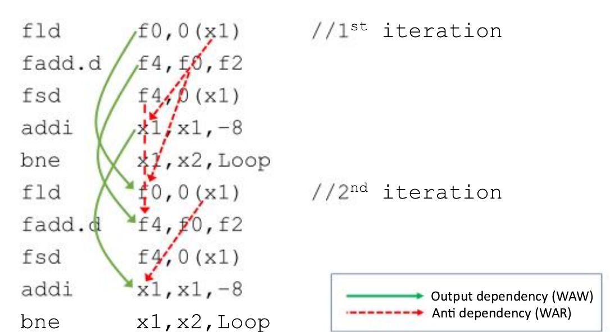{#fig-3-3 width=70%}

[3.2 节](#sec-3-2)中，编译器把循环展开 4 次时，每次迭代使用一组不同的整数寄存器，从而消除了名相关。*寄存器重命名*用硬件做同样的事，但与编译器有两点主要的不同：

* 一是硬件不能假定 ISA 定义的其他寄存器可以随便使用。示例代码虽然只用到 `f0`、`f2`、`f4` 和 `f6`，但其他所有浮点寄存器和整数寄存器都可能存放着程序前面或后面要用的数据；
* 二是需要的寄存器可能比 ISA 定义的还多。宽发射、深流水线要把循环展开 10 次，就需要 40 个浮点寄存器（每次迭代 4 个），超过了 RISC-V 定义的 32 个。

为了解决这些难题，硬件寄存器重命名设置了数以百计的*物理寄存器*。物理寄存器对软件透明，由硬件动态分配，用来消除名相关。硬件维护一张映射表，记录指令所引用的*体系结构寄存器*与硬件实际设置的物理寄存器之间的对应关系。指令发射时，硬件查这张表，确定指令的输入操作数在哪些物理寄存器中；同时更新映射表，指明由哪个物理寄存器存放指令的输出操作数。[3.4 节](#sec-3-4)将讨论这里的一个难题：怎样判断一个物理寄存器中的值已经不再需要，可以让后面的指令重新使用这个物理寄存器。

### 数据相关 → 采用动态调度的 OOO 执行 {-}

转移预测对控制相关做出推测，寄存器重命名消除了经由寄存器的名相关。在此基础上，超标量处理器采用*动态调度*，按数据相关的顺序执行已取出的指令，这种顺序也称为*数据流顺序*。硬件要完成两项工作：

* 一是跟踪所有待执行指令的输入操作数（物理寄存器）是否已经可用。一条指令的输入操作数全部可用时，它就*可以执行*了。例如在本例的循环中，寄存器 `f4` 和 `x1` 的值都可用时，`fsd` 就可以执行了；
* 二是根据指令的年龄、关键程度等准则，从可以执行的指令中选出一部分，送到空闲的功能部件上执行。

动态调度使指令乱序执行。在本例的循环中，第一次迭代的 load（`fld`）可能在 Cache 中失效，与它相关的加法指令（`fadd.d`）和存储指令（`fsd`）在几十个周期内都无法执行。但 `addi` 与这条 load 没有数据相关，可以先执行，第二次迭代的 load 也就能够执行了。如果第二条 load 在 Cache 中命中，第二次迭代的所有浮点指令很可能比第一次迭代中对应的指令先完成。

动态调度能处理多少条指令，受跟踪操作数的硬件结构容量限制，这一容量通常在几十条到一百条指令之间。编译器的静态调度只在指令的执行延迟能够静态确定时效果才好；动态调度则能应对可变的执行延迟。这一点对调度 load 指令很重要，因为 load 要从多级 Cache 中读数据，延迟从 2 个周期到 100 个周期不等。硬件会动态地绕过失效的 load，先执行后面与它无关的指令。这项优化是现代超标量处理器在性能上的一个关键优势。

### 存储相关 → 推测式存储器消歧 {-}

动态调度还必须遵守经由存储单元的相关。下面是示例循环的另一个版本，目标数组与输入数组不同，两个数组的遍历顺序也不同：

```
Loop: fld    f0,0(x1)     //f0=数组元素
      fadd.d f4,f0,f2     //加上 f2 中的标量
      fsd    f4,40(x3)    //结果存入另一个数组
      addi   x1,x1,-8     //x1 指针减 8 字节
      addi   x3, x3, 8    //x3 指针加 8 字节
      bne    x1, x2, Loop //若 x1≠x2 则转移
```

其余的浮点指令都与 load 数据相关，而 load 访问 Cache 时可能有很长的延迟，所以获得高性能的关键是尽早执行多次迭代中的 load。硬件要把第 (*i* + 1) 次迭代的 load 调度到第 *i* 次迭代的 store 之前，必须先确认两者访问的存储器地址不同。这项检查有几个困难：

* 它不一定能静态完成。寄存器 `x1` 和 `x3` 的值可能无法静态确定，编译器也无法判断输入数组和输出数组是不相交还是有重叠；
* store 的存储器地址不一定能立即得到。只有影响寄存器 `x3` 值的所有先前指令都执行完，并且 store 指令分配到地址生成部件、算出有效地址（`x3+40`）以后，才能进行这项检查。这一约束可能推迟下一条 load 的执行，从而限制硬件能利用的 ILP；
* 即使 load 和 store 的有效地址都已得到，硬件也不一定能安全地交换它们的次序，因为这可能违反多处理器系统中存储一致性的约束（见第 5 章）。

超标量处理器用*推测式存储器消歧*来克服存储相关的不确定性。与跟踪转移历史以便对控制相关做推测类似，硬件也跟踪 load 和 store 指令最近的历史，从中学习哪些 load 可能与尚未算出地址的较早的 store 相关。不大可能存在相关的 load，就以推测方式提到较早的 store 之前执行。等所有较早的 store 的地址都算出来以后，硬件就能验证这次重新排序是否正确。如果不正确，硬件必须从错误的推测中恢复，重新执行这条 load 以及所有与它相关的指令。

### 推测恢复和精确异常 → 重排序缓冲 {-}

程序在超标量处理器上的执行，必须在功能上等价于在一台指令不重叠执行的简单处理器上执行。这样的简单处理器要等一条指令的所有相关都解决了才执行它，因此既不需要预测转移的结果，也不需要预测 load/store 指令的次序。超标量处理器要保持功能等价，就需要一种恢复机制：转移指令预测错误，或者 load 与 store 之间的相关预测错误之后，取消所有错误执行的指令。恢复机制应当保证，错误执行的指令既不影响程序的数据流（不更新寄存器或存储器的值），也不影响控制流（不更新 PC）。

**精确异常。** 功能等价的要求同样适用于程序执行期间引发的各种异常，例如 load 指令发生缺页、浮点指令发生算术溢出。在简单处理器中，发生异常、控制转到操作系统时，引起异常的指令之前的所有指令都已执行完毕，而它之后的指令都还没有修改处理器状态（寄存器或存储单元），也没有引发任何异常。这一性质称为*精确异常*。超标量处理器一律预测指令不会引发异常，这种预测通常非常准确。但在一条*可能*引发异常的指令之后，所有指令都必须当作推测指令对待，直到处理器能够确认不会发生异常为止。

高级超标量处理器有两个特性，使精确异常变得复杂：

* 一是会对指令重新排序。在本例的循环中，第一次迭代的 store 引发缺页异常时，后续迭代中的若干条 load 和浮点指令可能已经执行，甚至已经引发了它们自己的异常；
* 二是对控制相关和存储相关都做推测。如果转移预测器预测错了，在发现并恢复之前，有些错误地全部或部分执行的指令可能会引发异常。如果推测式存储器消歧出了错，有些 load 指令可能返回错误的数据，进而导致错误的计算和错误的异常。

**重排序缓冲。** 超标量处理器用*重排序缓冲*（ROB）从错误推测中恢复。ROB 是一种先进先出（FIFO）结构，它暂存指令的结果，只允许这些结果按原始程序顺序对程序的数据流和控制流产生永久性的影响。ROB 的工作过程如下：

* 指令按程序顺序分配 ROB 表项；
* 指令乱序执行完毕时更新自己的 ROB 表项，同时标记执行中检测到的潜在异常；
* 每个时钟周期，硬件检查 ROB 中最老的几条指令，等它们执行完毕，才让它们的结果对寄存器（丢弃物理寄存器中较旧的值）和存储单元（允许 store 改写存储单元）产生永久性的影响，并释放相应的 ROB 表项。

如果最老的指令是一条转移，而它的结果在流水线较早的阶段预测错了，后面的所有指令都要取消，办法是释放它们的 ROB 表项和其他临时缓冲，比如这些指令为存放结果而分配的物理寄存器。取消了这些指令，错误的转移推测就不会影响程序的数据流和控制流。随后，处理器从这条转移指令执行时得到的正确目标处继续执行。如果最老的指令是一条错误地提到较早 store 之前的 load，就取消这条 load 本身和后面的所有指令，然后从这条 load 指令的地址继续执行。这样处理，存储相关的错误推测也不会影响程序的数据流和控制流。

ROB 提供的推测恢复同时也支持精确异常。如果 ROB 中最老的指令带有会导致异常的标记，例如缺页或算术溢出，这条指令和它后面的所有指令都要取消，然后从操作系统中处理这类异常的处理程序所对应的 PC 开始执行。硬件还会更新有关的寄存器，帮助操作系统识别引起异常的指令和异常的类型。异常要等指令到达 ROB 头部才报告给操作系统，所以错误推测和指令重新排序都不会影响异常报告的顺序。

### 超标量处理器概览 {-}

[图 3.4](#fig-3-4) 概括了现代超标量处理器怎样把多发射和深流水线与推测调度、动态调度技术结合起来。这样的处理器整条流水线中可能有几十到几百条待处理的指令，其中包括多条已预测的转移和多条发生了 Cache 失效的 load/store 指令。处理器流水线分为三部分，每部分都以流水方式每周期处理多条指令。

**前端。** 处理器*前端*每个周期*取出*并*译码*多条指令。前端用转移预测确定每个周期的 PC，所以是推测式的；但它不对指令重新排序，所以又是顺序的。每条指令译码以后，硬件重命名它的寄存器操作数，为它的结果分配一个 ROB 表项，然后把指令*发射*到用于动态调度的硬件结构中。如果没有空闲的物理寄存器、ROB 表项或调度表项，前端就停止取新指令，直到有可用的资源为止。一个时钟周期内并行发射的一组指令，我们称为一个*指令包*（instruction bundle）。在大多数超标量处理器中，同一个指令包中的指令也是并行取出和译码的。

**执行引擎。** *执行引擎*用动态调度，以推测、OOO 的方式每个周期处理多条指令，速度只受数据相关的限制。一条指令的输入操作数全部就绪，而且有合适的功能部件空闲时，硬件就把它*分派*（dispatch）去执行。指令执行完毕，结果（包括可能的异常）暂存在 ROB 表项中，同时通知调度硬件，因为有些相关指令这时可能已经可以执行了。注意，同一个指令包中的指令很可能在不同的时钟周期分派和执行完毕；硬件会对来自多个指令包的指令重新排序，并让它们重叠执行。

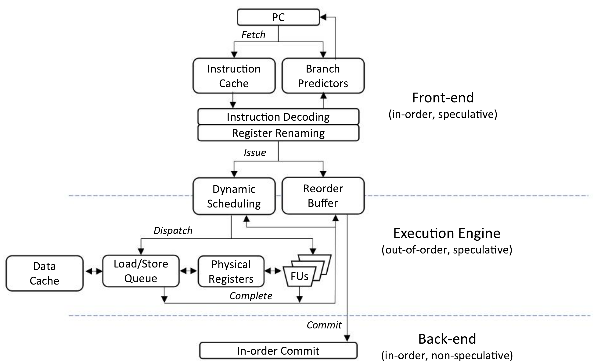{#fig-3-4 width=80%}

**后端。** 处理器*后端*用 ROB 按程序顺序更新处理器状态（寄存器和存储单元），并从各种错误推测或异常中恢复。一条指令只有成为 ROB 中最老的指令，才能*提交*（或称*退休*），它的结果才在体系结构上可见。如果最老的指令导致了异常或预测错误，就用 ROB 撤销它后面的所有指令：释放它们分配的物理寄存器和 ROB 表项，并从正确的 PC 继续执行。被取消的指令中，有些可能已经执行完毕，有些可能还在等待操作数。

了解了现代 OOO 处理器的整体工作过程，后面几节将深入研究其流水线中关键硬件结构的实现。[3.8 节](#sec-3-8)将进一步讨论：复杂性的一个主要来源，是要在每个流水级每个周期处理多条指令，同时不违反任何相关。

<!--chapter:end:03-ilp-02.Rmd-->

## 用高级转移预测降低转移开销 {#sec-3-4}

程序中转移很多，处理器又必须保证这些转移带来的控制相关，所以要开发 ILP，就离不开转移预测。附录 C 介绍的几种简单转移预测器，要么依靠编译时的信息，要么只观察单条转移自身的动态行为。流水线越来越深，每个时钟周期发射的指令越来越多，处于执行过程中的指令也随之增加，转移预测的准确率因而越来越重要。本节介绍用硬件提高动态预测准确率的技术，包括方向预测（预测转移成功还是不成功）和目标预测两个方面。本节大量用到 C.2 节的简单 2 位预测器，读者务必先弄懂它的工作原理，再往下读。

### 相关转移预测器 {-}

附录 C 的 2 位预测方案只看一条转移最近的行为，据此预测这条转移将来的行为。如果除了要预测的这条转移，还观察*其他*转移最近的行为，预测准确率就有可能提高。下面的代码片段取自 eqntott。eqntott 是早期 SPEC 基准测试程序集中的一个程序，转移预测效果特别差：

```c
if (aa==2)
 aa=0;
if (bb==2)
 bb=0;
if (aa!=bb) {
```

设 `aa` 和 `bb` 分别分配在寄存器 `x1` 和 `x2` 中，我们通常会为这段代码生成下面的 RISC-V 代码：

```asm
    addi x3,x1,-2
    bnez x3,L1       //转移 b1 (aa!=2)
    add  x1,x0,x0    //aa=0
L1: addi x3,x2,-2
    bnez x3,L2       //转移 b2 (bb!=2)
    add  x2,x0,x0    //bb=0
L2: sub  x3,x1,x2    //x3=aa-bb
    beqz x3,L3       //转移 b3 (aa==bb)
```

把这三条转移依次记为 b1、b2、b3。关键在于：b3 的行为与 b1、b2 的行为相关。如果 b1 和 b2 都不成功，即两个 if 条件都为真，`aa` 和 `bb` 都被赋值为 0，那么 `aa` 和 `bb` 必然相等，b3 一定成功。预测器如果只根据一条转移自身的行为来预测它的结果，就永远捕捉不到这种行为。

**相关预测器。** 利用其他转移的行为来作预测的转移预测器，称为*相关预测器*或*两级预测器*。现有的相关预测器在决定怎样预测某条转移时，会加入最近几条转移的行为信息。例如，(1,2) 预测器有一对 2 位转移预测器，预测某条转移时，根据上一条转移的行为从中选用一个。一般地，(*m*,*n*) 预测器根据最近 *m* 条转移的行为，从 $2^m$ 个转移预测器中选用一个，每个都是针对单条转移的 *n* 位预测器。这类相关转移预测器的好处是：预测准确率可以比 2 位方案高，而只需增加极少的硬件。

**硬件实现。** 硬件之所以简单，是因为最近 *m* 条转移的*全局历史*可以用一个 *m* 位移位寄存器记录下来，每一位记录对应的转移是成功（T）还是不成功（NT）。把转移指令地址（PC）的低位与这 *m* 位全局历史拼接起来，就可以作为索引去访问转移预测缓冲。例如，一个共有 64 项的 (2,2) 缓冲，用转移地址（字地址）的低 4 位，加上表示最近执行的两条转移行为的 2 位全局历史，组成 6 位索引，去访问这 64 个计数器。局部信息和全局信息可以拼接，也可以用简单的哈希函数组合，再用组合结果索引预测器表，这样得到预测结果的速度与标准 2 位预测器一样快。下面很快就会用到这种做法。

**与 2 位方案比较。** 相关转移预测器比标准 2 位方案好多少？要比较得公平，必须让两者的状态位数相同。(*m*,*n*) 预测器的位数为

$$
2^m \times n \times \text{由转移地址选择的预测项数}
$$

没有全局历史的 2 位预测器就是 (0,2) 预测器。

**例题**　有 4K 项的 (0,2) 转移预测器共有多少位？位数与它相同的 (2,2) 预测器有多少项？

**解答**　4K 项的预测器共有

$$
2^0 \times 2 \times 4\text{K} = 8\text{K}\ \text{位}
$$

(2,2) 预测器的预测缓冲共有 8K 位时，由转移选择的项有多少？由

$$
2^2 \times 2 \times \text{由转移选择的预测项数} = 8\text{K}
$$

可知，由转移选择的预测项数 = 1K。

[图 3.5](#fig-3-5) 比较了上面两种预测器的预测错误率：4K 项的 (0,2) 预测器和 1K 项的 (2,2) 预测器。从图中可以看出，这个相关预测器不仅优于状态位总数相同的简单 2 位预测器，而且常常优于项数不受限制的 2 位预测器。

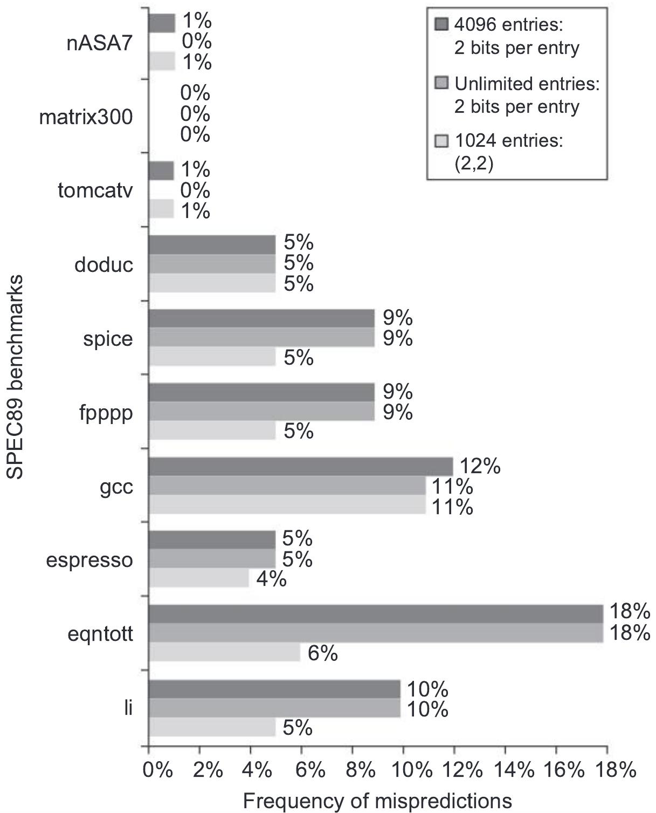{#fig-3-5 width=70%}

**gshare 预测器。** 相关预测器中最有名的，大概要数 McFarling 的 gshare 预测器。gshare 把转移地址与最近几条条件转移的结果做异或（XOR），形成索引，这实际上就是对转移地址和转移历史做哈希。哈希结果用来索引一个由 2 位计数器组成的预测阵列，如[图 3.6](#fig-3-6) 所示。作为一种简单的预测器，gshare 的效果相当好，常被用作基准，与更复杂的预测器比较。把局部转移信息和全局转移历史结合起来的预测器，也称为*合金预测器*或*混合预测器*。

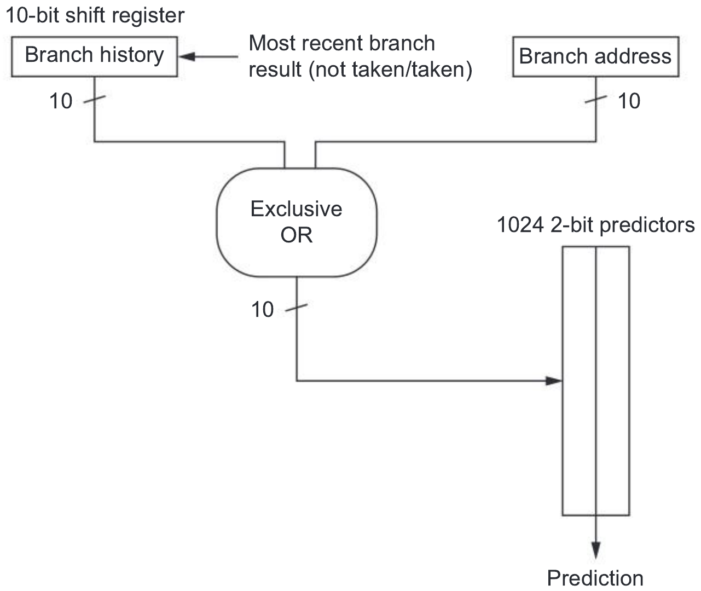{#fig-3-6 width=75%}

### 竞争预测器：自适应地组合局部预测器和全局预测器 {-}

人们提出相关转移预测器，主要是因为发现标准 2 位预测器只使用局部信息，在一些重要的转移上会预测失败，而加入全局历史有助于弥补这一不足。*竞争预测器*把这一思路又推进了一步：它同时使用多个预测器，通常是一个全局预测器和一个局部预测器，再由选择器从中选用一个，如[图 3.7](#fig-3-7) 所示。两种预测器的区别在于索引：*全局预测器*用最近的转移历史来索引，*局部预测器*用转移地址来索引。竞争预测器也是混合预测器（合金预测器）的一种形式。

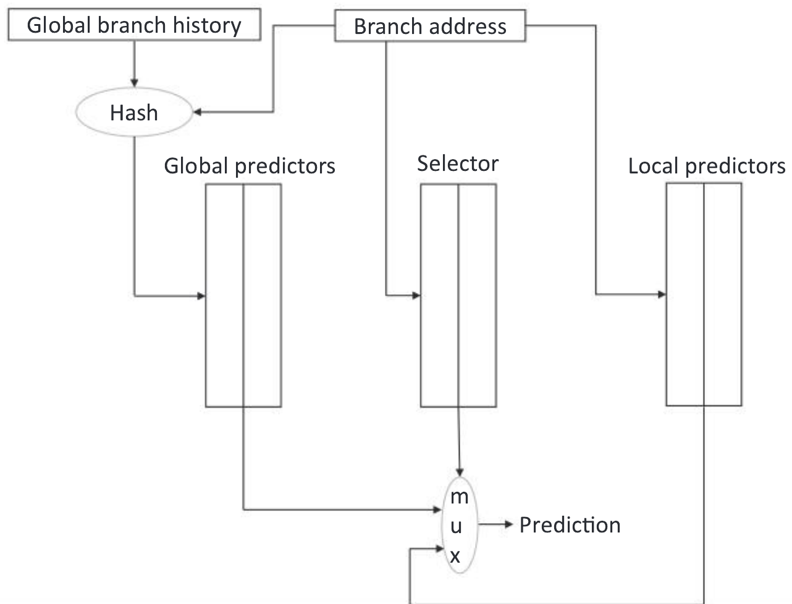{#fig-3-7 width=75%}

竞争预测器在中等规模（8K～32K 位）时准确率更高，而且能有效利用数量很大的预测位。现有的竞争预测器为每条转移设一个 2 位饱和计数器，用它在两个预测器之间选择，依据是最近的预测中哪一个（局部预测器、全局预测器，甚至二者随时间变化的某种组合）最有效。与简单 2 位预测器一样，饱和计数器要发生两次预测错误，才会改换优先选用的预测器。

竞争预测器的优点是能为某条转移选出合适的预测器，这一点对整数基准测试程序尤其关键。在 SPEC 整数基准测试程序上，典型的竞争预测器有将近 40% 的时间选用全局预测器；在 SPEC 浮点基准测试程序上，这一比例不到 15%。竞争预测器最早由 Alpha 处理器采用，此外还有几款 AMD 处理器使用了竞争式的预测器。

[图 3.8](#fig-3-8) 以 SPEC89 为基准测试程序，比较了三种预测器在不同位数下的性能：局部 2 位预测器、相关预测器和竞争预测器。局部预测器最早达到极限；相关预测器有明显改进；竞争预测器的性能又略好一些。换成更新版本的 SPEC，结果也会类似，只是要到预测器规模稍大一些时才进入渐近状态。

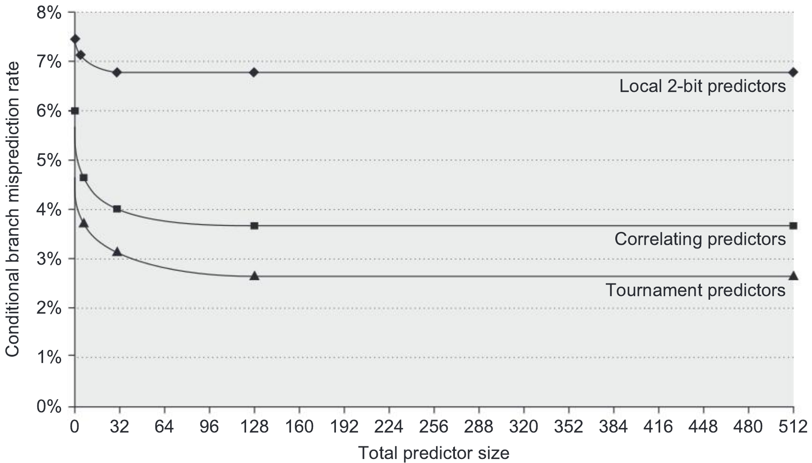{#fig-3-8 width=90%}

**两级局部预测器。** [图 3.8](#fig-3-8) 中评估的局部预测器本身也是两级预测器。上一级是局部历史表，由 1024 个 10 位的项组成，每一项记录这一项最近 10 次转移的结果。也就是说，转移连续成功 10 次或更多次，局部历史表中这一项就全为 1；转移成功与不成功交替出现，这一项就由交替的 0 和 1 组成。有了这 10 位历史，最长 10 条转移的模式都能被发现和预测。从局部历史表中选出的项再去索引一个 1K 项的表，表项是 3 位饱和计数器，由它们给出局部预测。这种组合共用 29K 位，预测准确率很高，而且比达到同样准确率的单级表用的位数少。两级局部预测器对迭代次数少的循环尤其有效。以迭代 3 次的循环为例，借助局部历史，我们可以识别出连续三次成功（TTT）的情况，并训练一个 2 位或 3 位饱和计数器，预测这条转移下一次执行时不成功。因此，频繁执行的少迭代循环可以做到 100% 准确地预测。

<!--chapter:end:03-ilp-03.Rmd-->

### 带 tag 的混合预测器 {-}

同时保存局部历史和全局历史的预测器，主要的缺点是历史长度很难选准。历史太短，有些重复出现的模式就捕捉不到，例如 4 位局部历史无法准确捕捉一个迭代 5 次的循环。历史太长，饱和计数器表中用到的表项增多，预测器要经过更长时间的训练才能准确捕捉一种模式。以前面 eqntott 的代码为例，若使用 3 位全局历史，为了正确预测 B1、B2、B3 之间的相关性，需要训练两个饱和计数器，即对应全局历史 NNN 和 TNN 的两个计数器。捕捉一种模式所需的计数器越多，就越容易发生*别名*（aliasing），即散列冲突使多条转移指令共用同一个计数器来跟踪历史。如果这几条转移指令的结果相反，执行又频繁交错，别名就会起破坏作用。

截至 2022 年，性能最好的转移预测方案针对上述缺点，把多个预测器结合起来，并跟踪每个预测是否很可能与当前这条转移指令相关。其中重要的一类，大致以统计压缩算法 PPM（部分匹配预测，prediction by partial matching）为基础。PPM（见 Jiménez 和 Lin，2001）和转移预测算法一样，都是根据历史来预测将来的行为。我们把这类预测器称为*带 tag 的混合预测器*（tagged hybrid predictor，见 Seznec 和 Michaud，2006），它由一组全局预测器组成，各自用不同长度的历史来索引。

**五分量的例子。** 如[图 3.9](#fig-3-9) 所示，一个五分量的带 tag 混合预测器有 5 个预测表 P(0)、P(1)、…、P(4)。访问 P(*i*) 时，用 PC 和最近 *i* 条转移指令的历史作散列，历史和 gshare 一样保存在移位寄存器 h 中。它的关键区别有两点：

* 一是用多种长度的历史分别索引各自的预测器；
* 二是 P(1) 到 P(4) 使用 tag（标签）来减少别名。

tag 不要求百分之百匹配，因此可以很短，4～8 位的短 tag 似乎就能获得大部分好处。只有当 tag 与转移地址和全局转移历史的散列值相匹配时，P(1)、…、P(4) 的预测才会被采用。与 Cache 不同，转移预测器的 tag 只用来降低别名的概率，不用来保证正确性。tag 较短时仍有很小的概率发生别名，但这只影响预测准确率，不影响正确性。P(0…*n*) 中的每个预测器都可以是标准的 2 位计数器；实际上，3 位计数器要连续三次预测错误才改变预测，效果比 2 位计数器略好。

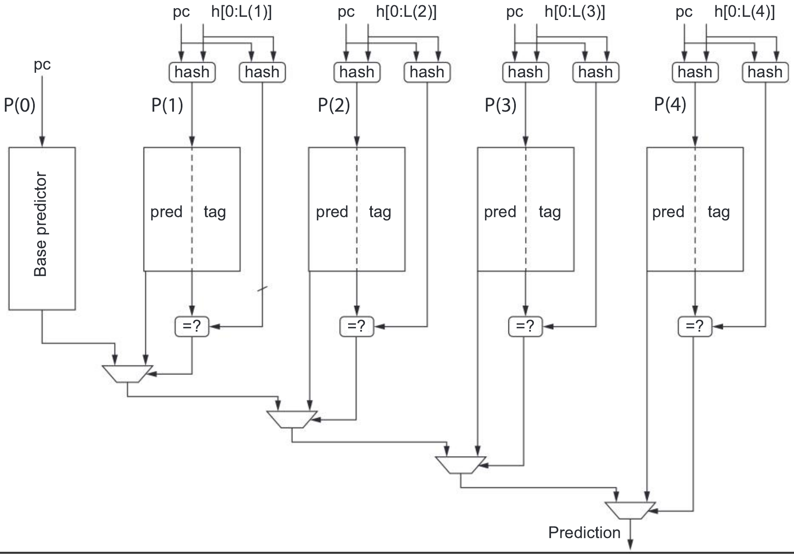{#fig-3-9 width=90%}

**预测的选择。** 对一条给定的转移指令，最终采用的是 tag 匹配的预测器中转移历史最长的那一个。P(0) 不用 tag，总是匹配；P(1) 到 P(*n*) 都不匹配时，就以 P(0) 作为默认预测。这种预测器的带 tag 混合版本，还在每个由历史索引的预测器中增加了一个 2 位的使用字段，表示这个预测最近是否用过。最近用过的预测很可能更准确；所有表项的使用字段可以定期复位，以清除旧的预测。实现这类预测器还涉及许多细节，特别是怎样处理误预测。寻找最优预测器的搜索空间也非常大，因为预测器的个数、索引所用的确切历史和每个预测器的大小都可以变化。

带 tag 的混合预测器（有时称为 TAGE 预测器，即 TAgged GEometric）和更早的基于 PPM 的预测器，是近年历届国际转移预测竞赛的优胜者。存储量适中（32～64 KiB）时，这类预测器就胜过 gshare 和竞争预测器；而且它们似乎还能有效利用更大的预测 Cache，进一步提高预测准确率。

**初始化。** 预测器做大以后，还有一个问题是怎样初始化。如果随机初始化，就要执行相当长的时间，预测器里才能装满有用的预测。有些预测器（包括近年的许多预测器）为表项设了一个有效位，表示这个表项已经设置过，还是处于「未使用状态」。对未使用的表项，可以不用随机的预测，而用某种方法来初始化。办法之一是利用提示位：有些指令系统设有一位，表示相应的转移指令预计是否会转移成功。在动态转移预测出现以前，这种提示位*就是*预测；在近年的处理器中，它可以用来设置初始预测。办法之二是按转移方向设置：向前的转移初始化为不成功；向后的转移很可能是循环转移，初始化为成功。对于运行时间较短的程序和预测器较大的处理器，这种初始设置对预测性能的影响是可以测出来的。

**与 gshare 的比较。** [图 3.10](#fig-3-10) 表明，带 tag 的混合预测器明显优于 gshare，在 SPECint 和服务器应用这类较难预测的程序上尤其如此。图中的性能指标是每千条指令误预测数。假设转移指令占 20%～25%，那么在多媒体基准测试程序上，按每条转移指令计算，gshare 的误预测率为 2.7%～3.4%，带 tag 的混合预测器为 1.8%～2.2%，误预测大约少了三分之一。带 tag 的混合预测器也有缺点：实现比 gshare 复杂；需要检查多个 tag 并从中选出一个预测结果，速度可能稍慢。不过，对于流水线很深、转移误预测开销很大的处理器，准确率的提高足以抵消这些缺点。因此，许多高端处理器的设计者在最新的实现中都采用了带 tag 的混合预测器。

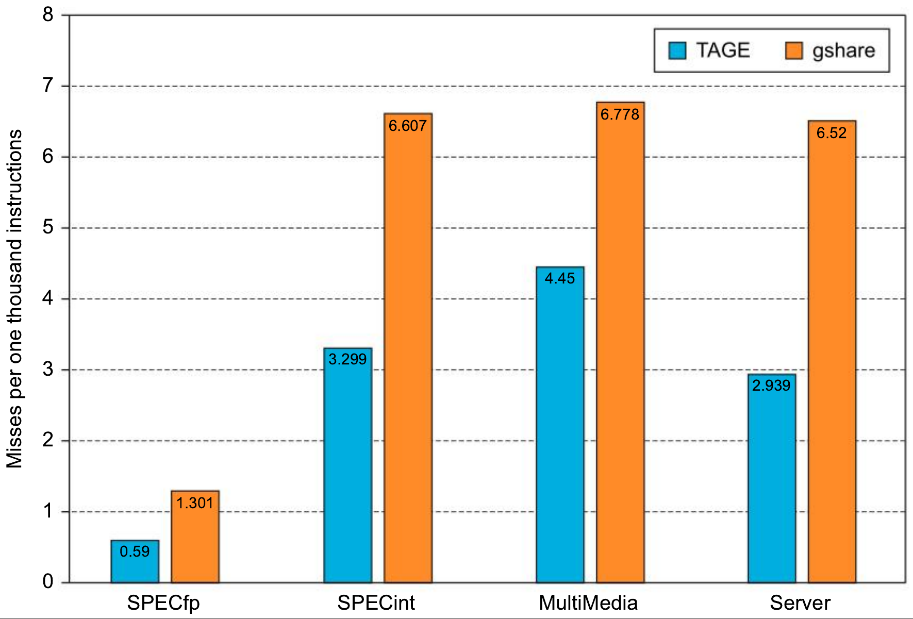{#fig-3-10 width=90%}

此外，转移预测器在速度与规模、复杂度之间存在权衡，采用多级、多阶段的设计可以绕开这一权衡。

### Intel 处理器中转移预测器的演变 {-}

超标量处理器流水线深，每个时钟周期又发射多条指令，因此同时在流水线中执行的指令很多，近年的设计多达几百条。转移预测因此至关重要，Intel 也一直在这方面不断改进。也许正因为转移预测器对性能影响极大，Intel 往往对它的细节严格保密，即使是 2008 年推出的 Core i7 920 这样较老的处理器，公布的信息也很有限。本节简要介绍已知的情况，并比较两款处理器的预测器性能：一款是采用 Nehalem 微结构的 Core i7 920，另一款是 2016 年发布、采用 Skylake 微结构的 Intel Core i7 6700。

**Core i7 920。** 它采用两级预测器。第一级较小，用来满足每个时钟周期预测一条转移指令的周期约束；第二级较大，作为后备。每一级都结合了三种预测器：

* 一是简单的 2 位预测器，附录 C 介绍过它，前面的竞争预测器也用到了它；
* 二是全局历史预测器，与刚才介绍的那些类似；
* 三是循环退出预测器。如果检测出某条转移指令是循环转移，就用一个计数器预测它转移成功的确切次数，也就是循环的迭代次数。

对每条转移指令，预测器像竞争预测器那样跟踪每种预测的准确率，从三个预测器中选出最好的预测。除了这个多级主预测器，还有一个单独的部件预测间接转移的目标地址，另有一个栈用来预测返回地址。

**Core i7 6700。** 关于它的预测器，已知的情况更少，但有充分的理由相信 Intel 采用了带 tag 的混合预测器。这种预测器的一个优点是，把早先 i7 中三个第二级预测器的功能合而为一：使用不同历史长度的带 tag 混合预测器，涵盖了循环退出预测器以及局部和全局历史预测器的功能。返回地址仍由单独的预测器预测。

**评价方法与结果。** 和其他场合一样，推测执行给评价预测器带来了一些困难：一条转移指令误预测后，很容易导致另一条转移指令被取进来并且也被误预测。为简单起见，我们统计误预测次数占成功完成的转移指令数的百分比，成功完成的转移指令是指不由错误推测执行产生的那些转移指令。[图 3.11](#fig-3-11) 给出了 SPECCPU2006 整数基准测试程序的这一数据。这些程序比 SPEC89 或 SPEC2000 大得多，所以即使采用了更强的预测器组合，误预测率仍高于[图 3.8](#fig-3-8) 中的值。转移误预测会导致无效的推测执行，造成工作浪费，本章后面会讲到这一点。

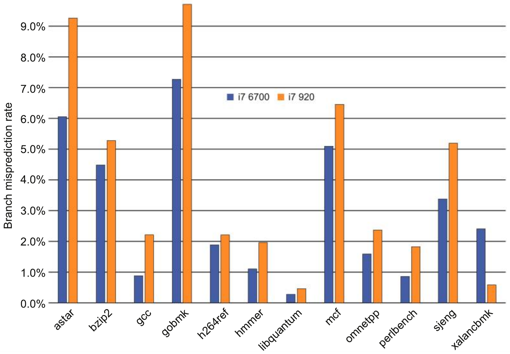{#fig-3-11 width=90%}

#### 转移目标缓冲 {-}

前面介绍的转移预测器，能推测当前取指所用的 PC 指向的转移指令是否会转移成功。如果这条尚未译码的指令是一条预测为成功的转移指令，还需要预测它的目标地址，才能及时重定向取指，使转移开销为零。预测目标地址的部件称为*转移目标缓冲*（BTB），也称*转移目标 Cache*。它是一种 Cache，存放的是转移指令之后下一条指令的预测地址。[图 3.12](#fig-3-12) 画出了一个 BTB。每个表项包含一个预测目标和一个 tag，tag 中是该表项所对应的转移指令的 PC。BTB 表项带 tag，是为了在 BTB 发生冲突时，处理器不会用错转移指令的目标地址，否则性能会下降。BTB 表项还包括其他一些信息，如有效位、转移的类型，以及实现替换策略所用的若干位。

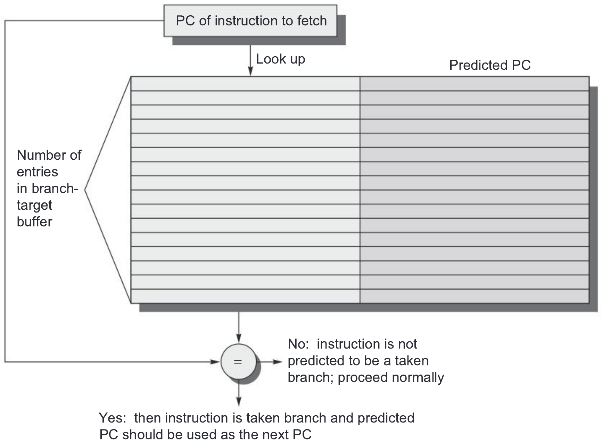{#fig-3-12 width=90%}

**BTB 的访问。** BTB 与转移预测器并行访问，结果分三种情况：

* 转移预测为不成功，就忽略 BTB 的查找结果；
* 转移预测为成功，并且 BTB 表项的 tag 与所取指令的 PC 匹配（BTB 命中），就在随后的周期中使用预测的 PC；
* 转移预测为成功，但 BTB 失效，处理器就必须停止取指，等当前指令取出并译码、算出目标地址以后再继续。

经常执行的成功转移，其目标会放进 BTB，替换掉最近没有用过或现在经常不成功的转移的目标。BTB 中只需存放预测为成功的转移指令，因为不成功的转移只要像普通指令那样顺序取下一条指令即可。

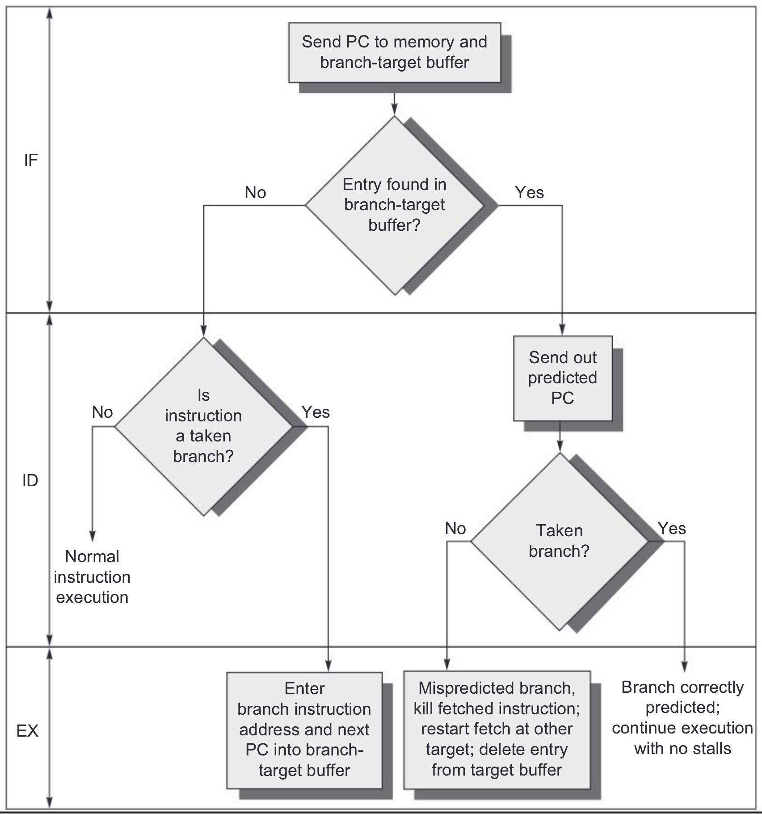{#fig-3-13 width=90%}

成功转移在 BTB 中的命中率对性能至关重要，可以用与第 2 章改进 Cache 相似的技术来提高：采用相联的 BTB 可以减少冲突失效；BTB 命中时间与 BTB 容量失效之间的权衡，可以用多级 BTB 结构来解决。如果处理器流水线要经过 5～10 个周期才能完成取指和有效目标的计算，多级 BTB 结构就特别有用。

[图 3.13](#fig-3-13) 给出了简单的五段流水线中使用 BTB 的步骤。从图中可以看出，对于一条成功的转移指令，只要方向预测正确，并且在缓冲中找到了转移目标表项，就没有转移延迟；否则至少要付出两个时钟周期的开销。

要评价 BTB 的效果，先要确定各种可能情况下的开销。[图 3.14](#fig-3-14) 给出了简单的五段流水线下的这些开销。

[图 3.14　假设缓冲中只存放成功的转移指令，转移指令是否在缓冲中与实际转移情况的所有组合及其开销。如果一切预测正确，并且在目标缓冲中找到了这条转移指令，就没有转移开销。如果预测不正确，开销是：1 个时钟周期用正确的信息更新缓冲（这期间不能取指令），必要时再用 1 个时钟周期为这条转移指令重新开始取下一条正确的指令。如果没有找到这条转移指令而它又转移成功，开销为 2 个周期，缓冲在这期间更新。]{#fig-3-14 .caption}

| 指令在缓冲中 | 预测 | 实际转移 | 开销周期数 |
|---|---|---|---|
| 是 | 成功 | 成功 | 0 |
| 是 | 成功 | 不成功 | 2 |
| 否 | | 成功 | 2 |
| 否 | | 不成功 | 0 |

**例题**　设各种误预测的开销周期数如[图 3.14](#fig-3-14) 所示，求转移目标缓冲的总转移开销。预测准确率和命中率假设如下：

* 预测准确率为 90%（对缓冲中的指令而言）。
* 缓冲的命中率为 90%（对预测为成功的转移指令而言）。

**解答**　开销来自两个事件：一是转移指令预测为成功，最终却不成功；二是转移指令成功，却不在缓冲中。两者的开销都是两个周期，计算它们的概率即可：

$$
\begin{aligned}
\text{概率（转移指令在缓冲中但实际不成功）} &= \text{缓冲命中率} \times \text{预测错误率} \\
&= 90\% \times 10\% = 0.09 \\
\text{概率（转移指令不在缓冲中但实际成功）} &= 10\% \\
\text{转移开销} &= (0.09 + 0.10) \times 2 \\
\text{转移开销} &= 0.38
\end{aligned}
$$

流水线越长，转移延迟越大，动态转移预测带来的改进也就越大；预测器越好，性能上的优势也越大。现代高性能处理器的转移误预测延迟在 15 个时钟周期左右，准确的预测至关重要。

**存放目标指令的 BTB。** BTB 的一种变形是存放一条或多条*目标指令*，代替预测的*目标地址*，或者两者都存。这样做有两个潜在的优点：

* 一是 BTB 的访问时间可以长于相邻两次取指的间隔，因而有可能采用更大的 BTB 或多级 BTB；
* 二是缓冲中有了实际的目标指令，就可以实施一种称为*转移折叠*（branch folding）的优化。转移折叠可以使无条件转移的开销为 0 个周期，有时还能使条件转移的开销为 0 个周期。

后面会看到，Cortex A-53 使用了一个单表项的转移目标 Cache，存放预测的目标指令。

设 BTB 存放的是预测路径上的指令，现在用一条无条件转移指令的地址访问它。无条件转移的唯一作用是改变 PC，因此，当 BTB 发出命中信号并指明这是一条无条件转移时，流水线只需用 BTB 中的指令替换 Cache 返回的那条指令（即这条无条件转移指令）即可。如果处理器每个周期发射多条指令，缓冲就需要提供多条指令，才能获得最大的好处。某些情况下，还有可能消除条件转移的开销。

### 专用转移预测器：预测过程返回、间接跳转和循环转移 {-}

用推测执行来增加并行的机会，就要面对间接跳转的预测问题。所谓间接跳转，是目标地址在运行时会变化的跳转。高级语言程序中的间接过程调用（如 C++ 的虚函数调用）、select 或 case 语句以及 FORTRAN 的计算 goto 都会产生这类跳转，不过许多间接跳转只是过程返回。例如，在 SPEC95 基准测试程序中，平均而言，过程返回占转移指令的 15% 以上，并占间接跳转的绝大多数。在 C++ 和 Java 这类面向对象语言中，过程返回更加频繁。因此，重点放在过程返回上看来是合适的。

**返回地址栈。** 过程返回虽然可以用 BTB 预测，但如果一个过程从多处调用，而且来自同一处的调用在时间上并不集中，这种预测的准确率就可能很低。例如，在 SPEC CPU95 中，一个激进的转移预测器对这类返回转移的预测准确率不到 60%。为解决这个问题，大多数处理器设置了一个按栈方式工作的小型返回地址缓冲，称为*返回地址栈*（RAS）。RAS 缓存最近的返回地址：调用时把返回地址压栈，返回时弹出一个返回地址。只要这个 Cache 足够大（与最大调用深度相同），就能完全正确地预测返回。[图 3.15](#fig-3-15) 给出了表项数为 0～16 时，这种返回缓冲在若干 SPEC CPU95 基准测试程序上的性能。近年所有的高性能超标量处理器都实现了 RAS。

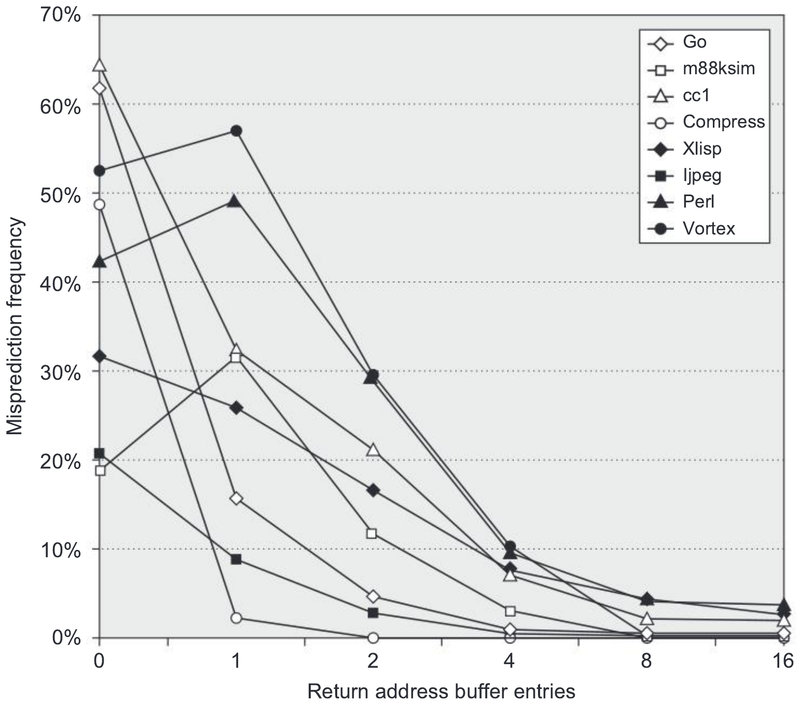{#fig-3-15 width=90%}

**其他间接跳转。** 各种函数调用和控制转移也会产生间接跳转，预测它们的目标不像预测过程返回那样简单。有些处理器为所有间接跳转专门增设了预测器，另一些则依靠转移目标缓冲。

**循环转移。** gshare 这类简单的预测器能很好地预测许多条件转移，但它不是专为循环转移设计的，对长时间运行的循环尤其不适应。前面讲过，Intel Core i7 920（Skylake 微结构）使用了专用的循环转移预测器。带 tag 的混合预测器出现以后，它预测循环转移同样有效，于是近年有些设计者选择把资源投入更大的带 tag 混合预测器，而不再单设循环转移预测器。

#### 集成的取指部件 {-}

为了满足多发射处理器的要求，近年的许多设计把集成的取指部件做成一个独立自主的部件，由它向流水线的其余部分提供指令，这种结构通常称为*解耦前端*（decoupled front-end）。这样做实质上是承认：多发射十分复杂，把取指看作一个简单的单一流水段已经不再合适。近年的设计改用集成的取指部件，把以下几项功能集成在一起：

1. *集成的转移预测*——转移预测器成为取指部件的一部分，不断地预测转移，驱动取指流水线。转移预测器和 BTB 能处理一个取指包中的多条转移指令。
2. *指令预取*——为了每个时钟周期提供多条指令，取指部件很可能需要提前取指。取指部件自主管理指令预取（预取技术见第 2 章），并把它与转移预测结合起来。
3. *指令存储器访问与缓冲*——每个周期取多条指令会遇到各种复杂情况，例如可能要访问多个 Cache 行。取指部件把这些复杂情况封装在内部，并用预取尽量掩盖跨 Cache 块的代价。取指部件还提供缓冲，实际上起着按需供给的作用：发射段需要时，按需要的数量向它提供指令。

现在几乎所有的高端处理器都使用独立的取指部件，它通过一个存放待处理指令的缓冲与流水线的其余部分相连。

<!--chapter:end:03-ilp-04.Rmd-->

## 用寄存器重命名克服名相关 {#sec-3-5}

寄存器重命名让超标量处理器可以使用大量物理寄存器，从而消除名相关可能引起的 WAR 冒险和 WAW 冒险。下面先结合一种可能的实现，详细说明重命名是怎样工作的，然后再讨论其他实现方式的利弊。为简单起见，这里只讨论整数寄存器重命名所需的硬件，浮点寄存器的重命名采用类似的结构。

**统一寄存器堆与两张映射表。**[图 3.16](#fig-3-16) 给出了用*统一寄存器堆*（URF，unified register file）实现寄存器重命名所需的硬件结构。URF 中有一大组物理寄存器（[图 3.16](#fig-3-16) 中的 `p0`–`p127`），既保存 32 个体系结构可见寄存器的值，也保存尚未提交的指令产生的临时值。物理寄存器的使用由两张表管理：

* *重命名映射表*（renaming map）：记录指令作为输入操作数指定的体系结构寄存器，当前对应哪个物理寄存器号（x~i~→p~i~）。指令在处理器流水线前端发射时，查找并更新这张表。其中一些指令以后可能因推测错误或异常而被取消，所以表中保存的映射是推测性的。
* *体系结构映射表*（architectural map）：根据已经提交的指令，记录每个体系结构寄存器对应的物理寄存器号。这张表在流水线后端更新，用于异常和预测错误之后的恢复。

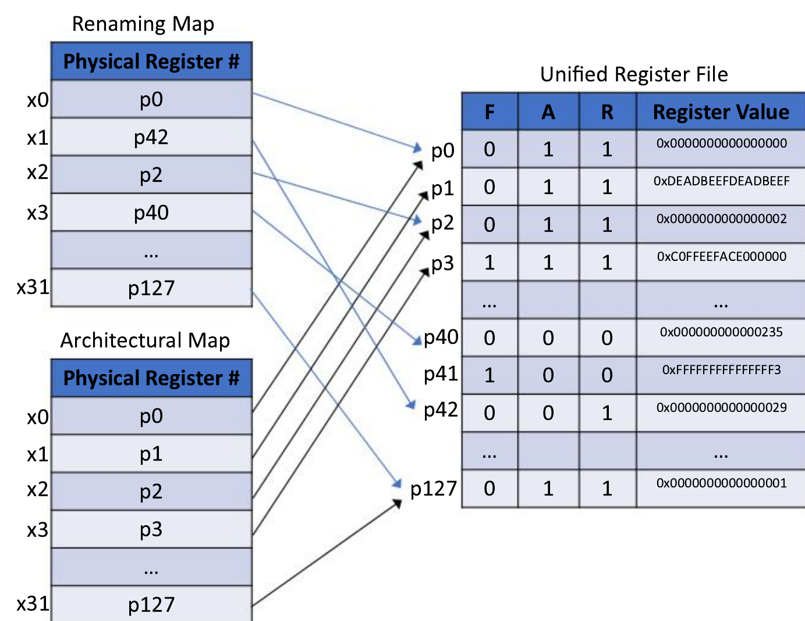{#fig-3-16 width=70%}

**物理寄存器的状态。**[图 3.17](#fig-3-17) 给出了物理寄存器的四种可能状态：

* *空闲*：寄存器当前没有使用，可以分配给新的指令。
* *已用未就绪*和*已用就绪*：寄存器已经分配给一条尚未完成的指令。未就绪表示这条指令还没有执行完，值还不能供后续的相关指令使用；就绪表示产生这个值的指令已经执行完但尚未提交，值已经可以使用。
* *体系结构态*：寄存器保存的是一条已经执行完并且已经提交的指令的结果，体系结构映射表中有一项指向它。体系结构寄存器总是就绪的。

复位时，前 32 个物理寄存器处于体系结构态，其余都空闲。[图 3.16](#fig-3-16) 中每个物理寄存器的状态用三个元数据位（Free、Architectural、Ready）编码：空闲为（1, 0, 0），已用未就绪为（0, 0, 0），已用就绪为（0, 0, 1），体系结构态为（0, 1, 1）。

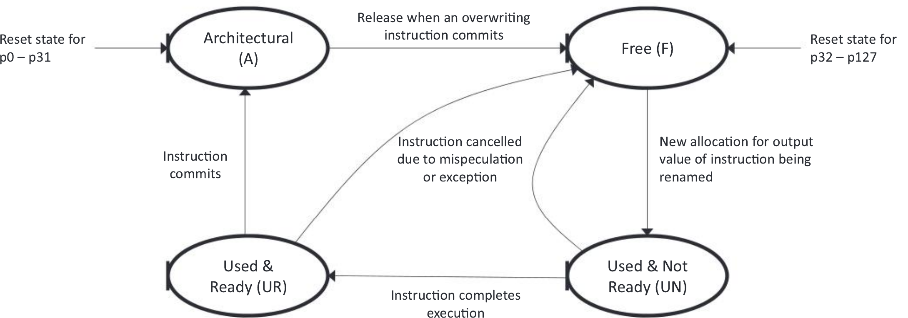{#fig-3-17 width=90%}

重命名的大部分工作在指令译码之后的发射级完成。不过，指令经过后续各个执行阶段时，物理寄存器的状态也随之转换：

* **发射（按序）**：指令发射时，先在重命名映射表中查找输入操作数，得到若干物理寄存器的地址，这些物理寄存器保存着该指令所读体系结构寄存器的最新值。物理寄存器号及其状态随后送往实现动态调度的硬件（见 [3.6 节](#sec-3-6)）。与此同时，指令为输出寄存器 x~i~ 的新值分配一个新的物理寄存器 p~j~，把重命名映射表中 x~i~ 的表项改为 x~i~→p~j~，并把新分配的物理寄存器状态置为已用未就绪。store、转移等指令不产生新的寄存器值，因此不分配新的物理寄存器。
* **分派（乱序）**：保存输入操作数的物理寄存器全部处于体系结构态或已用就绪状态时，指令就可以执行，可以分派出去。跟踪输入操作数状态的调度硬件在 [3.6 节](#sec-3-6)介绍。指令输出所用的物理寄存器 p~j~ 状态不变，仍是已用未就绪。
* **完成（乱序）**：功能部件执行完指令后，把新值写入分配好的物理寄存器 p~j~，并把它的状态改为已用就绪。此后，相关指令就可以使用这个值了。
* **提交（按序）**：指令到达 ROB 头部，并且没有产生异常或预测错误，就把结果提交到体系结构状态，p~j~ 的状态变为体系结构态。我们还要更新体系结构映射表中 x~i~ 的表项：如果原来的映射是 x~i~→p~k~，就改为 x~i~→p~j~，并把 p~k~ 的状态置为空闲。这时改写 p~k~ 的指令刚刚提交，p~k~ 中的值已经不可能再被用到。
* **恢复（按序）**：如果 ROB 中最老的指令发生了异常或预测错误，就必须取消所有尚未完成的指令，恢复精确的体系结构状态，就像这些指令从来没有被处理过一部分一样。重命名状态的恢复只需两个很快的步骤：一是把处于两种已用状态的物理寄存器全部标为空闲；二是丢弃重命名映射表的当前状态，用一次整体复制把它初始化为体系结构映射表的状态。

超标量处理器要在一个时钟周期内为一个指令组（bundle）中的全部指令做重命名，所以重命名逻辑相当复杂。这带来两方面的影响。一是映射表必须做成多端口结构。处理器每个周期分派 N 条指令时，重命名映射表需要 2N 个读端口查找所有输入操作数的当前映射，还需要 N 个写端口更新所有输出操作数的映射；处理器每个周期提交 M 条指令时，体系结构映射表需要 M 个写端口完成相应的更新。物理寄存器的三个元数据位也要支持每个周期多次访问，不过它们是用位掩码实现的，增加多个端口做并行更新，代价不大。

二是重命名逻辑必须检测并遵守指令组内部的数据相关。如果相关不在组内，就用重命名映射表找出保存着（或将要保存）所需结果的物理寄存器；如果一条指令数据相关于同一组中前面的某条指令，就应当把前面那条指令分配的物理寄存器用作输入操作数。下面用一个循环说明这个问题，这个循环把整数数组的每个元素都加 1：

```asm
Loop: ld   x2,0(x1)    //x2 = 数组元素
      addi x2,x2,1     //x2 加 1
      sd   x2,0(x1)    //存储结果
      addi x1,x1,8     //指针加 8
      bne  x1,x3,Loop  //不是最后一个元素则转移
```

[图 3.18](#fig-3-18) 给出了处理器以每周期 5 条指令的速度，对这个循环的两次迭代做重命名的过程，每个指令组含 5 条指令。第一个时钟周期为指令结果分配了三个物理寄存器：`p51` 重命名 `ld` 的 `x2`，`p52` 重命名第一条 `addi` 的 `x2`，`p53` 重命名第二条 `addi` 的 `x1`。周期结束时，映射表中 `x2` 的映射取两条指令中较新的那一条产生的映射，即 `p52`。组内还有三个数据相关。第一个是寄存器 `x2`：它由 `ld` 产生，由紧接着的 `addi` 使用。`addi` 不用重命名表为 `x2` 返回的指针 `p40`，而是使用 `ld` 在同一周期分配的 `p51`。`sd` 与 `addi` 之间关于 `x2` 的真相关、`bne` 与 `addi` 之间关于 `x1` 的真相关，重命名逻辑也照此处理。第二个时钟周期，重命名逻辑以同样的方式处理循环第二次迭代的指令组，为这些指令产生的新值使用新的物理寄存器 `p61`、`p62` 和 `p63`。

{#fig-3-18 width=100%}

**物理寄存器的释放。**复杂性还有一个来源：要判断什么时候可以安全地释放（回收）一个物理寄存器。分配给体系结构寄存器 x~i~ 的物理寄存器 p~k~，要满足两个条件才能释放：一是后面某条改写 x~i~ 的指令已经为 x~i~ 分配了新的物理寄存器；二是等待调度的指令中，已经没有尚未读取 p~k~ 的指令。此外，还必须确保在这条改写指令能够提交之前，不会有指令引发异常。因此，大多数处理器选择晚一些释放，等改写指令提交时再释放物理寄存器，以物理寄存器占用时间更长为代价，换取设计的简单。

### 寄存器重命名的其他实现方式 {-}

寄存器重命名还有以下几种实现方式。

*不用体系结构映射表*：采用 URF 时，也可以只用重命名映射表实现重命名。没有体系结构映射表，发生预测错误或异常时，按下面的办法恢复精确的寄存器状态。分派时，每条指令在用新分配的物理寄存器号 p~j~ 改写目的寄存器的映射之前，先读出原来的映射 p~k~，记入 ROB；指令提交时，丢弃这个旧映射；发生异常或预测错误时，从较新的指令到较老的指令反向遍历 ROB，把每个 ROB 项中记录的旧映射写回重命名映射表。这种方法的缺点是恢复延迟与 ROB 的大小成正比。

*物理寄存器与体系结构寄存器分开*：也可以不用含 128 个物理位置的 URF，而是设两个寄存器堆：一个保存体系结构状态，称为 *ARF*，共 32 项（`x0`–`x31`）；另一个保存临时的重命名寄存器，称为 *RRF*。指令在分派时分配 RRF 寄存器，在完成时写入；提交时，新的输出值从 RRF 中的物理寄存器复制到 ARF 中的体系结构寄存器，同时更新重命名表以反映这一变化。从异常或预测错误中恢复很快，只需把所有 RRF 寄存器标为空闲，再把重命名映射表各项重新初始化为指向 ARF。实际上，ARF 和重命名映射表可以合成一个 32 项的结构：每个 ARF 项含一个指向 RRF 的指针，指出最近一条将要改写这个体系结构寄存器、尚未完成的指令所分配的物理寄存器。这样就不再需要单独的体系结构映射表。

*重命名寄存器放在 ROB 中*：像上面那样把体系结构寄存器和重命名寄存器分开以后，还可以把重命名寄存器并入 ROB。每个 ROB 项留出一个寄存器值的空间，指令的输出先缓存在这里，直到指令提交；提交时，再把这个值从 ROB 复制到 ARF。发生异常或预测错误时，这个临时缓冲随 ROB 项一起释放。这种方法的缺点是，本来就是多端口的 ROB 会变得更加复杂。

*重命名表放在 ROB 中*：有些设计更进一步，把映射表也并入 ROB。分派时，新指令对它要读的每个体系结构寄存器，都要在 ROB 中查找可能写过这个寄存器的最新指令。找到匹配的 ROB 项，就由这一项在值就绪时向新指令提供输入值；找不到，就从体系结构寄存器堆取值。这样，读输入操作数就不必再分两步走（先访问重命名映射表，再访问寄存器堆）。代价是 ROB 每个时钟周期都要为多条指令的多个输入操作数做相联查找，而且查找时必须优先考虑较新的指令，也就是离 ROB 头部最远的指令。

## 用动态调度克服数据冒险 {#sec-3-6}

动态调度让超标量处理器能够利用 ILP：不管指令在程序中的顺序如何，只要它的数据相关已经解除，就立即执行。遇到 Cache 失效或其他长延迟操作时，动态调度更是必不可少，否则这些操作会使流水线长时间停顿。本书以前各版先介绍用于动态执行的 Tomasulo 算法，这个算法于 1967 年提出，在 IBM 360/91 大型机的浮点部件中实现。本版不再这样安排，而是直接介绍动态调度的现代实现，它们建立在转移预测、推测执行和寄存器重命名的基础之上。

### 动态调度的基本思想 {-}

动态调度分两步：

* 一是硬件跟踪每条尚未完成的指令的数据相关状态，判断它什么时候可以执行，称为*指令唤醒*（instruction wakeup）；
* 二是硬件从已就绪的指令中选出一部分，启动它们执行，称为*指令分派*（instruction dispatch）。

指令虽然是乱序分派、乱序执行的，但有 ROB 作保证：推测错误之后能够恢复，指令产生异常时能够恢复精确的状态。

指令唤醒和分派有两种实现方式：一种是集中式硬件调度器（也称统一调度器），另一种是一组分布式的较小调度结构。Intel 近期的处理器（如 Skylake 和 Golden Cove）对整数和浮点指令都采用集中式方法，AMD 近期的处理器（如 Milan 和 Genoa）则采用分布式方法。下面先介绍集中式调度器，再讨论它与分布式设计的利弊。在研究文献中，集中式调度器有时也称为*指令窗口*（instruction window）、*指令缓冲*（instruction buffer）或*指令队列*（instruction queue），尽管它并不按先进先出的方式工作。

**调度器表项。**[图 3.19](#fig-3-19) 给出了集中式调度器每一项的字段（上）和它的整体结构（下）。每一项包括：

* 忙（busy）字段，表示这一项是否已被一条尚未调度的指令占用；
* 三个在指令开始执行时使用的字段：操作码、目的物理寄存器、要更新的 ROB 项；
* 两个输入寄存器 j 和 k 的状态：执行这条指令是否需要它们（`V`~j~ 和 `V`~k~），提供其值的物理寄存器编号（`Reg`~j~ 和 `Reg`~k~），以及这些值是否已经就绪（`R`~j~ 和 `R`~k~）；
* 最后一个字段，表示指令是否可以执行，所有有效的输入寄存器都就绪时置位。

输入物理寄存器就绪有两种情况：一是在发射时就已经就绪，二是某个功能部件通知调度器，写这个物理寄存器的指令已经执行完毕。功能部件每个时钟周期都通过广播总线，把已完成的指令所写的物理寄存器通知指令调度器。调度器每一项都有比较器，不断地把本项两个输入物理寄存器的编号（`Reg`~j~ 和 `Reg`~k~）与功能部件刚刚更新的物理寄存器相比较，发现匹配，就把其中一个或两个寄存器标为就绪（把 `R`~j~ 和/或 `R`~k~ 置为真）。

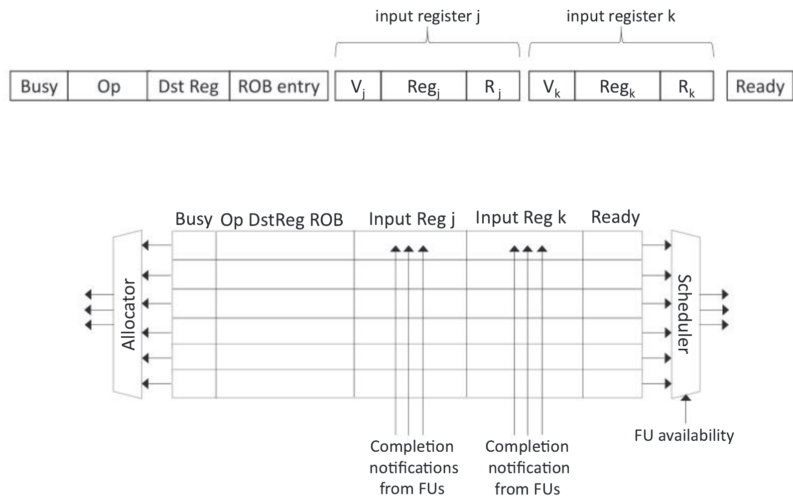{#fig-3-19 width=80%}

**ROB。**[图 3.20](#fig-3-20) 给出了 ROB 的组织。每一项跟踪一条指令的状态，内容包括：指令是否已经执行完毕（`Ready`）；指令是否产生寄存器输出（`DestV`）；指令所写的体系结构寄存器号和物理寄存器号（`Dst AReg` 和 `PReg`）；指令地址（PC）；指令是否引起了预测错误或异常，以及预测错误或异常的类型。ROB 作为循环缓冲来管理，用头指针和尾指针指示两端。

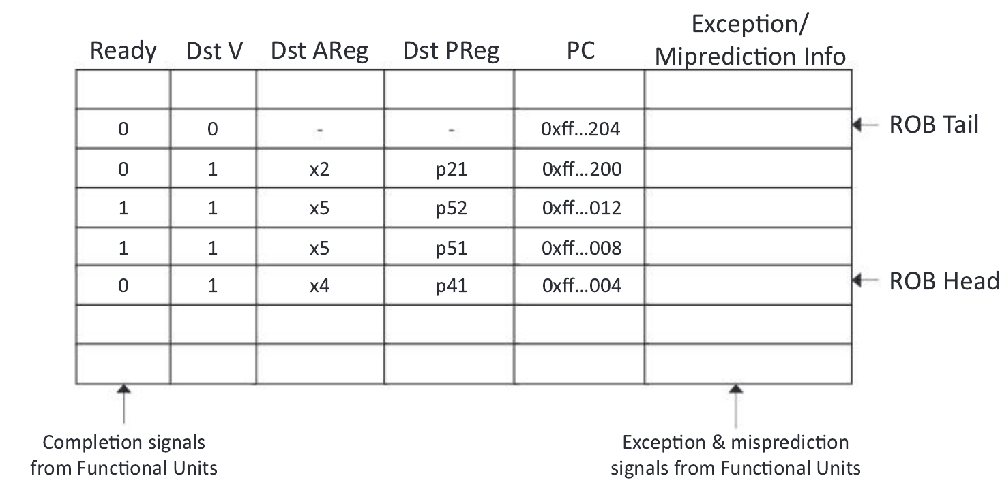{#fig-3-20 width=80%}

[图 3.21](#fig-3-21) 是处理器执行引擎和后端的框图，其中包括指令窗口和 ROB。图中实线表示传送数据或地址，虚线表示传送指令、控制信号和通知。框图还给出了 load-store 部件的基本结构，这部分在 [3.7 节](#sec-3-7)讨论。

{#fig-3-21 width=90%}

重命名之后，指令的执行分为以下几步：

1. *发射（按序）*：每条指令都在 ROB 中分配一项。算术、逻辑和转移操作还要在调度器中分配一项；load/store 操作则送往 *load/store 队列*，在那里做存储地址消歧和调度（见 [3.7 节](#sec-3-7)）。如果 ROB、硬件调度器或 load/store 队列已满，就让处理器前端停顿，直到有空位为止。
2. *分派（乱序）*：每个时钟周期，调度器从已就绪的指令中选出一部分去执行。选择电路既要考虑可用功能部件的数量和类型，也要考虑已就绪指令的类型和年龄。指令必须按序提交，所以最好先调度已就绪指令中最老的那些。选中的指令移出指令窗口，送往相应的功能部件。流水化的功能部件每个周期可以发射一条指令。
3. *完成（乱序）*：功能部件执行已发射的指令时，先从 URF 读出输入数据；运算完成后，把结果写回目的物理寄存器，同时向 ROB 和调度器发出完成通知。ROB 据此把相应的指令标为就绪，检测到异常或预测错误时还要记录下来。调度器得知目的物理寄存器已经就绪，据此完成*指令唤醒*：调度器每一项都把这个目的寄存器号与自己的输入寄存器号相比较，判断其中一个或两个输入寄存器是否已经就绪。如果某一项的两个输入寄存器都已就绪，这条指令就就绪了，可以参与调度。
4. *提交或恢复（按序）*：指令到达 ROB 头部，并且已经执行完毕、没有产生任何异常，就可以提交。提交还有一个附加条件：转移指令没有预测错误，load 指令在存储消歧时没有涉及错误的推测。对大多数指令来说，提交就是更新目的寄存器的体系结构映射，并把指令移出 ROB。store 的提交与此类似，只是还要通知 store 缓冲：现在可以安全地更新存储器了。如果到达 ROB 头部的是一条导致推测错误的转移或 load，或者是一条引起异常的指令，就清空 ROB 和整个处理器流水线，从正确的 PC 重新开始执行。正确的 PC 是指正确的转移目标、这条 load 的地址或异常处理程序的 PC。

这四步每个周期都要处理多条指令。例如，一条流水线可以按每周期发射 4 条、分派 6 条、提交 4 条指令来设计。分派宽度大于流水线的发射宽度和提交宽度，是一种常见的做法：只要有足够的功能部件可用，关键的相关一旦解除，就能很快处理积压的指令。比如，一条在 L1 和 L2 Cache 中都失效的 load，可能让许多相关指令在调度器中一直等到它完成；load 完成后，较宽的分派就能很快处理完这些积压的指令。

### 动态调度的例子 {-}

**例题**　假设一个动态调度的超标量处理器有三个功能部件，分别执行浮点 load/store、浮点加/减和浮点乘/除，延迟见[图 3.2](#fig-3-2)：加法 2 个时钟周期，乘法 6 个时钟周期，除法 12 个时钟周期。下面是一段已经重命名的代码，注释中是原来的代码；`pf6` 表示浮点物理寄存器，`p2` 表示整数物理寄存器。请给出 `fmul.d` 准备提交时，指令窗口、ROB 和浮点物理寄存器的状态。

```asm
fld     pf6,0(p2)       // fld     f6, 0(x2)
fld     pf2,0(p3)       // fld     f2, 0(x3)
fmul.d  pf0, pf2,pf4    // fmul.d  f0, f2, f4
fsub.d  pf8, pf2,pf6    // fsub.d  f8, f2, f6
fdiv.d  pf10,pf0,pf6    // fdiv.d  f0, f0, f6
fadd.d  pf16,pf8,pf2    // fadd.d  f6, f8, f2
```

**解答**　ROB、调度器和浮点物理寄存器的状态见[图 3.22](#fig-3-22)。可以看到，`fsub.d` 虽然已经执行完毕，但要等 `fmul.d` 提交以后才能提交。寄存器 `f6` 已经重命名，避免了 WAR 冒险，所以 `fadd.d` 可以先于 `fdiv.d` 执行完毕。浮点乘/除部件刚刚空闲下来，`fdiv.d` 将在下一个周期开始执行。

[图 3.22　fmul.d 准备提交时，只有两条 fld 指令已经提交，另外几条指令虽然已执行完毕，也都还没有提交。fmul.d 位于 ROB 头部，两条 fld 列在表中只是为了便于理解。fsub.d 和 fadd.d 的结果已经可用，也可以用作其他指令的源操作数，但要等 fmul.d 提交以后它们才能提交。fdiv.d 要用 fmul.d 刚刚算出的值（pf0），现在已经可以分派到执行部件，指令调度器很快就会选中它执行。ROB 中的状态、忙和指令字段只是为了说明问题而列出的。图中没有给出 load/store 队列的表项，这些表项是按序保存的。]{#fig-3-22 .caption}

**重排序缓冲**

| 项 | 忙 | 指令 | 状态 | 就绪 | 目的 |
|---|---|---|---|---|---|
| 1 | 否 | `fld pf6, 0(p2)` | 已提交 | 是 | `pf6 (f6)` |
| 2 | 否 | `fld pf2, 0(p3)` | 已提交 | 是 | `pf2 (f2)` |
| 3 | 是 | `fmul.d pf0, pf2, pf4` | 已完成 | 是 | `pf0 (f0)` |
| 4 | 是 | `fsub.d pf8, pf2, pf6` | 已完成 | 是 | `pf8 (f8)` |
| 5 | 是 | `fdiv.d pf10, pf0, pf6` | 已分派 | 否 | `pf0 (f10)` |
| 6 | 是 | `fadd.d pf16, pf8, pf2` | 已完成 | 是 | `pf16 (f6)` |

**指令调度器**

| 项 | 忙 | Op | Dst | ROB | V~j~ | Reg~j~ | R~j~ | V~j~ | Reg~j~ | R~j~ | Ready |
|---|---|---|---|---|---|---|---|---|---|---|---|
| 1 | 否 | `fld` | `pf6` | 1 | – | – | – | – | – | – | 否 |
| 2 | 否 | `fld` | `pf2` | 2 | – | – | – | – | – | – | 否 |
| 3 | 否 | `fmul.d` | `pf0` | 3 | – | – | – | – | – | – | 否 |
| 4 | 否 | `fsub.d` | `pf8` | 4 | – | – | – | – | – | – | 否 |
| 5 | 是 | `fdiv.d` | `Pf0` | 5 | 是 | `pf0` | 是 | 是 | `Pf6` | 否 | 是 |
| 6 | 否 | `fadd.d` | `pf16` | 6 | – | – | – | – | – | – | 否 |

**浮点重命名寄存器**

| 寄存器 | `pf0` | `pf2` | `pf4` | `pf6` | `pf8` | `pf10` | `pf12` |
|---|---|---|---|---|---|---|---|
| 状态 | 已用/就绪 | 体系结构态 | 体系结构态 | 体系结构态 | 已用/就绪 | 已用/未就绪 | 已用/就绪 |
| 值 | `Mem[p3]+X` | `Mem[p3]` | `X` | `Mem[p2]` | `Mem[p3]-Mem[p2]` | `Y` | `2*Mem[p3]-Mem[p2]` |

这个例子说明了采用动态调度和 ROB 的超标量处理器的一个关键特点：最早一条尚未完成的指令（`fmul.d`）之后，任何指令都不允许提交。正因为如此，处理器能够维持精确异常模型。

例如，`fmul.d` 如果引起了浮点异常，只需等它到达 ROB 头部时再引发异常，同时把其他尚未完成的指令从 ROB 中清除。指令是按序提交的，这样得到的就是精确异常。反之，如果指令一执行完就提交结果，`fsub.d` 和 `fadd.d` 就可能在 `fmul.d` 引发异常之前都已完成，它们的目的寄存器 `f8` 和 `f6` 中的值会被覆盖，中断也就不精确了。

有些用户和体系结构设计者认为，高性能处理器中不精确的浮点异常是可以接受的，因为程序很可能会就此终止，这个问题的进一步讨论见附录 J。其他类型的异常（如缺页）则不同：处理完这类异常后，程序必须透明地恢复执行，所以这类异常如果不精确，处理起来就困难得多。

下一个例题说明，用 ROB 实现指令按序提交，除了支持推测执行，还能实现精确异常。

**例题**　考虑下面这段含有循环的代码：

```asm
Loop: fld    f0,0(x1)
      fmul.d f4,f0,f2
      fsd    f4,0(x1)
      addi   x1,x1,-8
      bne    x1,x2,Loop  //x1≠x2 时转移
```

假设转移已经预测为成功，循环中的所有指令都已经分派了两遍；再假设第一次迭代的 `fld` 和 `fmul.d` 已经提交，其余指令都已分派并执行完毕。通常，store 要在 ROB 中等待有效地址操作数（本例为 `x1`）和要存的值（本例为 `f4`）都计算出来；这里只考虑浮点流水线，所以假设 store 的有效地址在指令发射时就已算出。此时重排序缓冲和物理寄存器的状态如何？

**解答**　重排序缓冲以及整数和浮点物理寄存器的状态见[图 3.23](#fig-3-23)。

[图 3.23　只有 fld 和 fmul.d 指令已经提交，其余指令虽然都已执行完毕，也还没有提交。因此指令调度器中没有忙的表项，图中也就没有列出。其余指令将尽快提交。前两个重排序缓冲项已经空出，列出来只是为了完整。]{#fig-3-23 .caption}

**重排序缓冲**

| 项 | 忙 | 指令 | 状态 | 就绪 | 目的 |
|---|---|---|---|---|---|
| 1 | 否 | `fld f0, 0(x1)` | 已提交 | 是 | `pf10 (f0)` |
| 2 | 否 | `fmul.d f4, f0, f2` | 已提交 | 是 | `pf14 (f4)` |
| 3 | 是 | `fsd f4, 0(x1)` | 已完成 | 是 | – |
| 4 | 是 | `addi x1, x1, -8` | 已完成 | 是 | `p11 (x1)` |
| 5 | 是 | `bne x1, x2, Loop` | 已完成 | 是 | – |
| 6 | 是 | `fld f0, 0(x1)` | 已完成 | 是 | `pf20 (f0)` |
| 7 | 是 | `fmul.d f4, f0, f2` | 已完成 | 是 | `pf24 (f4)` |
| 8 | 是 | `fsd f4, 0(x1)` | 已完成 | 是 | – |
| 9 | 是 | `addi x1, x1, -8` | 已完成 | 是 | `p21 (x1)` |
| 10 | 是 | `bne x1, x2, Loop` | 已完成 | 是 | – |

**浮点物理寄存器**

| 寄存器 | `pf0` | `pf2` | `pf4` | `pf10` | `pf14` | `pf20` | `pf24` |
|---|---|---|---|---|---|---|---|
| 状态 | 空闲 | 体系结构态 | 空闲 | 已用/就绪 | 已用/就绪 | 已用/就绪 | 已用/就绪 |
| 值 | `X` | `Y` | `Z` | `Mem[A]` | `Mem[A]+Y` | `Mem[A-8]` | `Mem[A-8]+Y` |

**整数物理寄存器**

| 寄存器 | `p1` | `p2` | `p11` | `p21` |
|---|---|---|---|---|
| 状态 | 体系结构态 | 体系结构态 | 已用/就绪 | 已用/就绪 |
| 值 | `A` | `B` | `A-8` | `A-16` |

**转移预测错误的恢复。**指令提交之前，store 的值还没有写入存储器，寄存器原来的值也仍然保留在物理寄存器中，所以一旦发现转移预测错误，处理器能够撤销推测执行的操作。假设[图 3.23](#fig-3-23) 中的转移指令 `bne` 第一次实际上不成功：转移之前的指令到达 ROB 头部时照常提交；转移指令到达 ROB 头部时，清空 ROB，用体系结构映射表恢复寄存器重命名映射表，处理器从正确的转移目标开始取指令。

许多推测执行的处理器一发现转移预测错误，就设法尽早恢复：清除预测错误的转移之后所有指令的 ROB 项，让 ROB 中位于转移之前的指令继续执行。难点在于，从正确的转移后继指令重新开始执行之前，要先恢复正确的重命名状态。常用的办法是在转移指令发射时，为重命名映射表做一个完整的检查点（checkpoint），以后发现这条转移预测错误，就恢复相应的检查点。能用来保存重命名状态检查点的硬件有多少，决定了流水线中最多能同时存在多少条未决转移。在推测执行的处理器中，预测错误的影响通常很大，性能对转移预测更加敏感，因此转移处理的各个方面，包括预测准确率、发现预测错误的延迟和预测错误的恢复时间，都变得更加重要。

**异常的处理。**处理异常的办法是等到指令准备提交时才引发异常。一条指令在执行中产生的异常，先记录在 ROB 中。如果发现比这条指令更老的某条转移预测错误，清空 ROB 时，这个异常就随指令一起清除；如果这条指令到达了 ROB 头部，就说明它已经不再是推测执行的，应当真正处理这个异常。也可以在异常一出现、而且前面的转移都已确定时就处理它，但对异常这样做比对转移预测错误更困难；况且异常发生得较少，这样做也没有那么关键。

### 动态调度的细节 {-}

[图 3.24](#fig-3-24) 给出了一条指令执行的各个步骤、进入每一步必须满足的条件，以及要执行的操作。图中假定预测错误的转移直到提交时才处理。store 只在到达 ROB 头部时才更新存储器，这就保证了指令在不再是推测执行之前不会更新存储器。[图 3.24](#fig-3-24) 对 store 做了一处较大的简化，实际中并不需要这样做：[图 3.24](#fig-3-24) 要求 store 等两个输入寄存器的值都就绪后再计算地址，而实际上，要存的值只需在 store 提交并更新存储器*之前的那一刻*可用即可。

[图 3.24](#fig-3-24) 中某些步骤的速度对乱序（OOO）处理器的性能至关重要。举例来说，设有两条存在数据相关的简单算术指令：一条加法，后面跟一条减法。在附录 C 的简单五级流水线中，借助前递逻辑，这两条相关指令可以在相邻的周期中执行，没有任何停顿。而在本节介绍的超标量处理器中，加法执行完毕后，减法要经过以下几步才能执行：1）更新减法指令的调度器项，表明它已经就绪（唤醒）；2）调度器选中减法指令执行（发射）；3）从 URF 读出减法指令的输入寄存器值。如果每一步都要占用一个完整的时钟周期，这两条指令的执行就会相隔三个周期，也就需要更多的 ILP 才能让功能部件保持忙碌。许多处理器设计用以下办法缩短相关指令的执行延迟。一是把指令唤醒和调度合并到一个时钟周期内完成。这之所以可行，是因为完成通知可以在时钟周期的早期发出，与加法指令的执行并行。这一技术可以推广到任何固定延迟的指令：提前发出完成通知，就能减轻所有相关指令的唤醒和调度延迟。二是在分派时读出已就绪的物理寄存器，存入指令调度器，从而避免从 URF 读输入带来的额外延迟；加法的结果则通过附加的前递通路在功能部件之间传递。这些优化都可以实现，也能缩短流水线、降低 CPI，但会增加复杂性，还要与处理器的时钟周期时间相权衡。

{#fig-3-24 width=100%}

**分布式调度器。**集中式指令调度器越来越复杂，常用的简化办法是采用分布式方案。一种极端的设计是给每个功能部件配一个只有几项（4～10 项）的调度器：发射时，每条指令分到某个特定功能部件的调度器，由它跟踪这条指令什么时候可以执行。这类分布式调度器通常称为*保留站*（reservation station）。一个 10 项的小保留站，在唤醒和分派上比 100 多项的集中式调度器简单得多，也快得多。例如，从 10 条已就绪指令中选出最老的一条，比从 100 条中选要快；在本地功能部件中每个周期只选出一条要分派的指令，也比在集中式调度器中选出 4～8 条容易。在大调度器中，推断指令年龄最简单的办法是看它所在表项的位置，这就要求每当有指令分派出去，剩下的指令都要压缩（compact），使较老的指令位于调度器底部，留给新发射指令的空项位于顶部。小保留站则可以不管位置，直接比较编码了指令年龄的 tag；而且用 10 项实现压缩也比用 100 项容易。分布式保留站的缺点是各项的利用可能不均衡。设计处理器时，每个结构的大小是按常见情况确定的；如果程序的指令组合偏离了这种常见情况，就可能出现一个功能部件的保留站已满、另一个功能部件的保留站却空着的情形。保留站一满，指令发射就会停顿。集中式调度器则可以用任何一项存放发往任何功能部件的指令。

AMD 近期的处理器采用混合设计。以 Milan 处理器为例，它的流水线采用分布式设计，整数指令有 4 个调度器，浮点指令有 2 个调度器。每个整数调度器都可以接收任何整数指令，并把指令分派到任何整数功能部件；每个浮点调度器也都可以接收任何浮点指令，并分派到任何浮点功能部件。这样就避免了每个功能部件各配一个保留站时利用率不足的问题。这 6 个分布式调度结构都比集中式调度器小，每个周期要分派的指令也更少。这种分布式设计唯一增加的复杂性是：4 个整数调度器和 2 个浮点调度器之间必须相互协调，避免把指令分派到同一个功能部件。压缩式保留站要在大小与时钟频率之间权衡，因此近期有些处理器采用带年龄矩阵（age matrix）的非压缩式保留站设计。年龄矩阵并不给出指令的全序，但能保证在一个 N 路宽的调度器中，分派最老的那条指令，再加上任意其他 N−1 条指令。

<!--chapter:end:03-ilp-05.Rmd-->

## 用动态消歧克服存储相关 {#sec-3-7}

上一节讨论的动态调度，处理的是经由寄存器的数据相关。本节讨论经由存储器的数据相关，也就是 load 和 store 通过存储单元形成的相关。这类相关的检测和处理要困难得多。寄存器的输入名和输出名完整地编码在指令中，在流水线前段就能检查相关；存储地址却做不到这一点。load 和 store 指令要先经过地址生成部件处理，才能得到有效访存地址。而且，地址计算可能与更早的、正在计算指针值的算术指令或 load 指令存在寄存器相关，因而发生停顿。

**按序访存。** 最简单的办法是让所有 load 和 store 指令按程序顺序执行：最老的访存指令先等经由寄存器的数据相关全部解除，再计算地址，然后把地址送往 Cache 层次。这种办法简单但慢，会损害多发射处理器的性能，原因在于 store 提交以前不能改写 Cache 中的数据。这样，即使有转移预测和寄存器重命名，循环后续迭代中的 load 也要等本次迭代的 store 提交之后才能访问数据 Cache。采用这种办法的处理器无法利用跨循环迭代的 ILP。

**load 旁路。** [图 3.21](#fig-3-21) 给出了一种性能更好的办法，称为 *load 旁路*（load bypassing）。load 和 store 只要数据相关允许，就立即计算有效地址；store 则要等提交以后才分派到 Cache 层次。如果不存在数据相关，即所有更老的 store 指令都已算出有效地址，而且这些地址都与 load 的有效地址不同，就允许这条 load 越过这些更老的 store。为了快速比较 load 地址和所有未完成 store 的地址，store 缓冲的表项要配备比较器。有了这项优化，即使更老的 store 尚未提交，循环后面迭代中的 load 也能提早访问 Cache，从而隐藏失效延迟，并尽早解除后续算术指令对它的相关。

**store 前递。** 另一项优化是 *store 前递*（store forwarding）：如果地址比较表明某条 load 与一条更老的 store 存在数据相关，就让 load 直接从这条 store 的输入物理寄存器中取数据，不再访问存储层次。与多于两条指令之间存在寄存器相关的情形一样，load 必须从它所相关的 store 中最年轻的那一条取数据。store 前递对 x86 处理器很重要。x86 的体系结构寄存器很少（只有 8 个整数寄存器），编译器不得不经常把变量从寄存器溢出到内存，过几条指令又重新装入。因此，超标量 x86 处理器常常要重叠执行多对溢出（store）和恢复（load）指令。store 前递能加快相关的 load 以及其后与之相关的指令的执行。

### 推测式存储消歧 {-}

即使有了 load 旁路，load 仍要等所有地址都可用、能够检查相关之后才能越过更老的 store，这对性能仍是很大的妨碍。为此出现了*推测式存储消歧*（speculative memory disambiguation）：先推测不存在相关，允许 load 越过尚未算出访存地址的更老的 store；等缺少的 store 地址可用以后，再做实际的相关检查。如果推测错了，这条 load 以及所有用过它结果的相关指令都要重新执行。复杂流水线很难有选择地重新执行指令，因此通常的恢复办法是像转移预测错误或发生异常时那样，清空这条 load 之后的整个流水线。

有几项研究给出了定量结果：不加区分地推测不存在存储相关，可能比完全不推测还差 [Moshovos et al., 1997, Chrysos and Emer 1998]。因此，近来所有的乱序处理器都实现了某种推测式选择性存储消歧方案。其思路与转移预测学习转移模式相似：处理器学习哪些 load 很可能与未完成的 store 相关，如果更老的 store 还没有算出地址，就不让这些 load 提前执行。具体做法是，在没有其他信息时，处理器先不加区分地推测，由此学习循环中 load 和 store 的这类模式。一旦发现了存储相关，就把涉及这一相关的 load 和 store 指令的 PC 存入硬件结构；这条 load 再次执行时，查询这些结构，就能判断它是否很可能与一条尚未算出地址的未完成 store 相关。

**存储集方案。** 下面以 Chrysos 和 Emer 于 1998 年提出的*存储集*（store sets）方案为例，较详细地介绍推测式选择性存储消歧的一种设计。存储集方案着重记录最近卷入存储相关误推测的 load 和 store。它可以简洁地表示两种情况：一条 load 可能与一组（一个集合）store 相关；一组 load 可能与同一条 store 相关。所需的两个硬件结构见[图 3.25](#fig-3-25)：

* *存储集标识表*（SSIT，store set ID table），记录最近卷入存储相关误推测的 load 和 store 的存储集标识。SSIT 用 load 和 store 指令 PC 中的若干位索引，所有表项初始化为无效。存储集标识是一个较小的整数（例如 0～63）。
* *最近取出 store 表*（LFST，last fetched store table），记录每个存储集中最近取出的那条 store 指令的指令地址（PC）。

两个结构的维护和使用过程如下：

* **建立存储集。** 硬件发现一次存储相关误推测时，分配一个存储集标识，写入这次误推测所涉及的 load 和 store 各自的 SSIT 表项。如果其中一条指令已经属于某个存储集（SSIT 有效），就改用它已有的存储集标识；如果两条指令分属不同的存储集，就把两个集合合并。
* **store 登记。** 一条 store 分派时查找自己的 SSIT 表项；如果表项有效，就把自己的指令地址（PC）记入这个存储集的 LFST 表项。这条 store 算出地址后，该 LFST 表项复位。
* **load 检查。** 一条 load 算出地址、准备分派到存储层次时，检查这两个结构。如果它的 SSIT 有效，而对应的 LFST 表项指出有一条尚未算出地址的未完成 store，这条 load 就不能继续执行。其他情况下，允许这条 load 推测地越过尚未得到地址的更老的 store，提前发射。其他情况有两种：一是 SSIT 表项无效，说明这条 load 最近没有卷入相关误推测；二是 SSIT 表项有效但指向空的 LFST 表项，说明这条 load 可能相关的所有 store 都已完成地址计算。

![图 3.25　推测式选择性存储消歧的存储集方案所需的硬件 [Chrysos and Emer, 1998]。原论文建议 SSIT 取 1K 到 4K 个表项，LFST 取 64 到 128 个表项。LFST 表项中缓存的内容取决于处理器其余部分的实现，可以是最近取出的那条 store 的指令地址（PC）、ROB 表项号或 load/store 队列表项号。](images/ch03/fig-3-25.png){#fig-3-25 width=90%}

存储集方案逐步积累那些引起过相关误推测、彼此相关的 load 和 store 指令集合。它的准确性受三方面限制：

* 不同的 load 和 store 指令可能映射到同一个 SSIT 表项，造成不必要的存储集合并；
* 某一对 load/store 如果很少发生相关误推测，不把它记入存储集结构，性能可能更好；
* 存储集只会随时间增大，处理器的 load 旁路因此越来越保守。

一个简单的解决办法是每隔几百万条指令把两个结构复位一次，让硬件重新找出推测时必须保持的最关键的相关。

**多处理器中的访存顺序。** 第 5 章讨论存储一致性时将会讲到，在多处理器系统中，即使 load 和 store 的访存地址都已知道，它们之间也还有更多的顺序约束，有些情况下连 load 之间重新排序都可能出错。在这类约束下，推测式存储消歧仍能获得高性能：硬件学习哪些重新排序会违反存储一致性，只在不太可能引起违例时才为提高性能而重排访存。

**值预测。** 推测式存储消歧是*值预测*的一种简单的受限形式。值预测就是预测一条指令将要产生的值。如果预测得非常准，就能消除数据流的限制，获得更高的 ILP。过去 20 年中，许多研究人员致力于值预测，发表了几十篇论文，但迄今为止，结果还不足以让商用处理器采用通用的值预测。

## 现代超标量处理器的高级问题 {#sec-3-8}

### 每周期多发射的挑战 {-}

动态调度处理器每个时钟周期发射多条指令，难就难在同一指令束中的指令可能彼此相关。前面介绍的指令执行的各个步骤，尤其是发射、分派和提交，都必须考虑并行执行的指令之间的相关。每个时钟周期重命名多条指令的复杂性已在 [3.5 节](#sec-3-5)介绍过，这里进一步讨论多发射对流水线其余部分的影响。

超标量处理器在一个时钟周期内处理多条指令，有两种办法：

* 一是让这一步在半个时钟周期内完成，一个时钟周期就能依次处理两条指令。但这种办法不容易扩展到每周期处理四条或更多指令。关键在于，这个问题不能简单地靠流水化来解决。例如，如果指令发射要占用多个时钟周期，就必须及时更新重命名表，让下一个时钟周期发射的相关指令能用上更新后的信息。
* 二是设计必要的逻辑，一次处理两条或更多指令，包括处理它们之间所有可能的相关。现代超标量处理器在深流水线的关键段采用的就是这种办法。

**发射。** 发射是宽发射处理器最根本的瓶颈之一。要正确发射一个指令束中的 N 条指令，必须完成以下工作：

- 在 ROB 中分配并更新 N 个表项。可用表项不足 N 个时，只发射指令束中最老的一部分指令。
- 在指令调度器和 load-store 队列中分配并更新 N 个表项。可用表项不足 N 个时，只发射指令束中最老的一部分指令。
- 分配并更新最多 N 个物理寄存器。可用寄存器不足 N 个时，只发射指令束中最老的一部分指令。
- 考虑指令束内各指令之间的数据相关和名相关，正确地重命名这 N 条指令的全部输入操作数（见 [3.5 节](#sec-3-5)）。

可能存在的相关数随指令束中指令数的平方增长，因此发射这一步很可能成为限制时钟频率的瓶颈，这也是很少有处理器尝试每周期发射八条以上指令的原因。[3.5 节](#sec-3-5)的[图 3.18](#fig-3-18) 举例说明了每周期重命名多条指令的复杂性，从中也能看出，过去 20 年里大批量生产的处理器，发射率为什么只从 3～4 条增加到 4～8 条。

**分派与提交。** 每周期分派多条指令要简单一些，因为到了流水线的这个位置，数据相关和名相关都已经解决，指令大多可以各自独立处理。半导体工艺的缩放也让处理器很容易配备大量功能部件，每个时钟周期都能处理就绪的指令，所以有好几种处理器每周期能分派的指令数超过了它的发射宽度。这样，一条 load 发生 Cache 失效之后，突然就绪的一批指令就能很快得到处理。同样，每周期从 ROB 中提交多条指令也不特别复杂，只要提交逻辑保证取消第一条报告异常或预测错误的指令后面的所有指令即可。

下面用一个例子从性能角度说明这些概念如何结合在一起。

**例题**　一台双发射、动态调度、带推测执行的处理器执行下面的循环，这个循环把一个整数数组的每个元素加 1：

```
Loop: ld   x2,0(x1)    //x2=数组元素
      addi x2,x2,1     //x2 加 1
      sd   x2,0(x1)    //存回结果
      addi x1,x1,8     //指针加 8
      bne  x2,x3,Loop  //不是最后一个则转移
```

假设有效地址计算、ALU 运算和转移条件求值各有独立的整数功能部件，每个时钟周期最多可以提交两条任意类型的指令。为这个循环的前三次迭代列出执行时间表。

**解答**　[图 3.26](#fig-3-26) 给出了双发射、动态调度、带推测执行的处理器的性能。在这个例子中，循环末尾的转移可能严重限制 ILP，推测执行的作用很大。有了转移推测，在前面的转移解决之前，后面的指令就可以执行（但不能提交），因而执行得很快。例如，第二条 load 可以先于更老的转移完成执行。如果处理器不采用推测执行，转移的解决就会成为主要的性能瓶颈。

[图 3.26　带推测执行的双发射流水线中各指令的分派、发射、执行完成和提交时间。由于 bne 预测为转移成功，bne 后面的 ld 可以提早开始执行。假设 load 用一个周期生成地址、一个周期访问 Cache（全部命中）；store 可以按需缓冲；一条指令可以在它所相关的更老指令完成执行的同一周期被调度执行。]{#fig-3-26 .caption}

| 迭代号 | 指令 | 发射周期 | 分派周期 | 完成周期 | 提交周期 | 说明 |
|---|---|---|---|---|---|---|
| 1 | `ld   p2, 0(p1)` | 1 | 2 | 4 | 5 | 第一条指令 |
| 1 | `addi p22, p2, 1` | 1 | 4 | 5 | 6 | 等待 ld |
| 1 | `sd   p22, 0(p1)` | 2 | 5 | | 6 | 等待 addi |
| 1 | `addi p21, p1, 8` | 2 | 2 | 3 | 7 | 按序提交 |
| 1 | `bne  p21, p3 Loop` | 3 | 3 | 4 | 7 | 等待 addi |
| 2 | `ld   p32, 0(p21)` | 4 | 5 | 7 | 8 | 无执行延迟 |
| 2 | `addi p42, p32, 1` | 4 | 7 | 8 | 9 | 等待 ld |
| 2 | `sd   p42, 0(p21)` | 5 | 8 | | 9 | 等待 addi |
| 2 | `addi p31, p21, 8` | 5 | 6 | 7 | 10 | 按序提交 |
| 2 | `bne  p31, p3 Loop` | 6 | 7 | 8 | 10 | 等待 addi |
| 3 | `ld   p52, 0(p31)` | 7 | 8 | 10 | 11 | 尽早执行 |
| 3 | `addi p62, p52, 1` | 7 | 10 | 11 | 12 | 等待 ld |
| 3 | `sd   p62, 0(p31)` | 8 | 11 | | 12 | 等待 addi |
| 3 | `addi p41, p31, 8` | 8 | 9 | 10 | 13 | 提前执行 |
| 3 | `bne  p41, p3 Loop` | 9 | 10 | 11 | 13 | 等待 addi |

### 推测执行到什么程度 {-}

推测执行的一大优点，是能提早发现那些本来会让流水线停顿的事件，例如 Cache 失效。但这一潜在优点也伴随着严重的潜在缺点。推测执行是有代价的：

* 它要花费时间和能量，推测错误后的恢复还会进一步降低性能；
* 要从推测执行中获益，指令执行速率必须更高，处理器就需要额外的资源来支持，这些资源要占用硅片面积，消耗功率；
* 如果推测执行引发了 Cache 失效、TLB 失效之类的异常事件，而不推测时这个事件本来不会发生，那么性能严重下降的可能性就会增大。

为了保住大部分优点，同时把缺点降到最低，许多带推测执行的流水线只允许在推测状态下处理代价低的异常事件，如 Cache 失效。如果发生的是代价高的异常事件，如 TLB 失效，处理器要等引起这个事件的指令不再处于推测状态，再处理这个事件。这样做可能使某些程序的性能略有下降，却能避免另一些程序的性能大幅下降，特别是这类事件频繁发生、转移预测又不够好的程序。

20 世纪 90 年代，推测执行的潜在缺点还不太明显。后来处理器使用推测执行越来越激进，它的实际代价才逐渐显现，更宽的发射和推测执行的局限性也已经暴露出来。稍后我们再回到这个问题。

### 跨多个转移的推测执行 {-}

本章讨论的宽发射、深流水线处理器会重叠执行几十条指令，因此任何时刻都可能有多个尚未解决的推测转移。另有三个特点使这种情况更容易出现：一是许多程序中转移的频率很高；二是某些代码段中转移很密集；三是功能部件解决转移需要很长的延迟。数据库程序和其他结构性较差的整数计算常常具有前两个特点，跨多个转移的推测执行因此很重要。同样，功能部件的延迟长，跨多个转移推测执行也更为重要，因为它可以避免较长的流水线带来的停顿。

**何时更新预测状态。** 跨多个转移推测执行，主要难在决定什么时候更新转移预测状态，包括历史寄存器、预测计数器和目标预测结构。注意，无论预测正确还是错误，都要更新预测器状态。如果只有一个尚未解决的推测转移，可以等它解决之后再更新。有多个推测转移时，就要权衡：等一个转移解决之后再更新预测表，预测随后的几条转移指令时就用不上这个转移的历史；一预测出转移成功或不成功就立即更新，预测状态中就会含有可能不准确的信息。有几种处理器设计的折中办法是：提早更新预测状态，如果转移解决后的方向与原来的预测相反，再在部分或全部预测结构中纠正这些更新。例如，有些处理器维护两个 RAS，一个在取到函数调用指令时就推测地更新，另一个只在函数调用指令不再处于推测状态时才更新。

**每周期预测几条转移。** 到目前为止，所有处理器每个时钟周期都只预测一条转移。同一个 PC 值既用来从 Cache 中取出一个指令束，又用来索引预测结构、得到下一个 PC。预测结构记录的是指令束中第一条成功转移（如果有的话）的信息。如果每个时钟周期预测多条成功转移，复杂性和功耗都会大大增加，性能收益不太可能抵得上这些代价。容易得到的收益来自循环体较小的循环：循环 Cache 能有效地捕获这类循环，而循环 Cache 是许多现代处理器的常见特性。

### 推测执行与能效的挑战 {-}

推测执行对能效有什么影响？乍看起来，似乎推测执行总会降低能效，因为每次推测错误都会在两方面多耗能量：

1. 推测执行了一些指令，它们的结果却不需要，这些指令给处理器增加了额外的工作，浪费了能量。
2. 撤销推测、恢复处理器状态以便从正确的地址继续执行，要消耗额外的能量，而不推测就不需要这部分能量。

推测执行确实会提高功耗。它引入了几种管理指令执行的新硬件结构，如转移预测器、重命名表、指令窗口和 ROB，这些大型结构一直处于使用状态，动态功耗和静态功耗都因此增加。但是，只要推测执行使执行时间缩短的幅度大于平均功耗增加的幅度，总能耗就可能降低。

所以，推测执行对能效的影响，要看它导致不必要工作的频率有多高。如果执行了大量不需要的指令，运行时间就不太可能缩短相应的幅度。[图 3.27](#fig-3-27) 给出了采用一种复杂的转移预测器时，部分 SPEC2000 基准测试程序中因误推测而执行的指令所占的比例。可以看出，这一比例在科学计算代码中很小，在整数代码中则相当大（平均约 30%）。因此，对整数应用来说，推测执行不太可能是节能的，而 Dennard 缩放的终结使不完善的推测执行问题更加突出。设计者可以有几种选择：不采用推测执行；设法减少误推测；或者考虑新的方法，例如只对已知可预测性很高的转移进行推测。

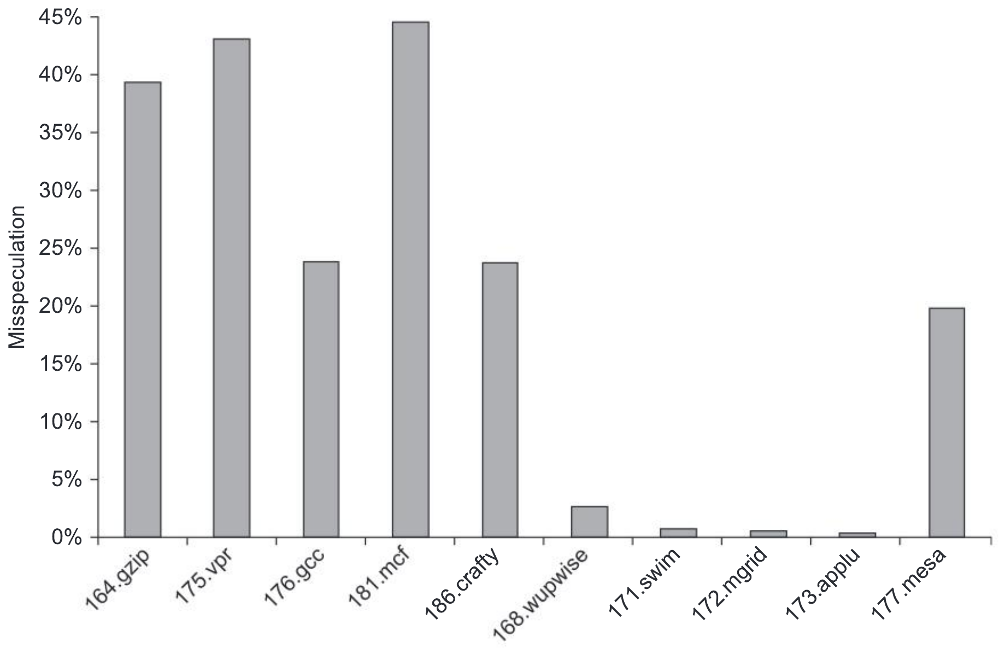{#fig-3-27 width=90%}

### 超标量处理器受什么限制 {-}

本章讨论的硬件技术利用 ILP 特别有效。今天，几乎所有中高性能处理器都建立在宽发射、深流水线、转移预测、寄存器重命名和动态调度之上。然而，过去十年里，超标量处理器的改进速度放慢了：超标量的各项特性只是渐进地改进，发射宽度、流水线深度乃至时钟频率等几个关键特征多年来基本不变。这说明超标量处理器的效果存在局限。

前面已经讨论过两个关键的局限：

* 一是设计复杂、功耗大。非常宽（每周期 4 条或更多指令）、流水线非常深的处理器设计复杂，功耗很大，某些流水段的复杂性随发射宽度的平方增长。为了缓解这一问题，处理器厂商现在把超标量技术与向量技术、多核技术结合起来，分别利用数据级并行和线程级并行，以求进一步提高性能。第 4 章和第 5 章将会看到，这两种并行比 ILP 更规整或粒度更粗，支持它们的硬件也没有那么复杂。
* 二是受转移预测准确率制约。即使预测错误率只有几个百分点，也足以使更宽、更深的流水线失去效果。

第三个局限来自需要由片外 Cache 和主存服务的 Cache 失效。Karkhanis 和 Smith 较早分析了这类可能持续几百个时钟周期的长 Cache 失效的影响 [Karkhanis & Smith 2002]。有意思的是，长失效未完成期间停顿在指令窗口中的相关指令并不是主要问题：这些相关指令只有几十条，能够装进现代处理器的大指令窗口，不会妨碍无关指令就绪后发射。真正的问题是 ROB 阻塞，因为失效未完成期间，任何更年轻的指令都不能提交。这促使人们研究用检查点技术构建具有几千个 ROB 表项的超标量处理器，但这些技术迄今还没有商业应用。最后，长失效取回的数据往往供给与数据相关的转移，导致转移预测不准确。

<!--chapter:end:03-ilp-06.Rmd-->

## 利用多发射和静态调度开发 ILP {#sec-3-9}

前面几节讲的是在多发射处理器中用硬件开发 ILP 的技术。这类处理器上的程序按顺序执行来编译，即假定一次执行一条指令，指令之间没有任何重叠；ILP 由硬件依靠转移预测、寄存器重命名和动态调度去发现和利用。VLIW 处理器则不同：它每次发射固定数目的指令，这些指令或者组成一条大指令，或者组成一个固定的指令包，指令之间的并行性由指令本身显式标明。因此，VLIW 处理器天然是由编译器静态调度的。Intel 和 HP 设计 IA-64 体系结构（见附录 H）时，还给这种体系结构风格起了一个名字，叫 EPIC（explicitly parallel instruction computer，显式并行指令计算机）。

### 基本的 VLIW 方法 {-}

VLIW 使用多个相互独立的功能部件。它不是设法向这些部件发射多条相互独立的指令，而是把多个操作打包成一条很长的指令，或者要求发射包中的指令满足同样的约束。这两种做法没有本质区别，下面只按最初的 VLIW 方法，假定多个操作放在一条指令中。

最大发射率越高，VLIW 的优势越明显，所以这里着重讨论发射宽度较大的处理器。对简单的双发射处理器来说，超标量的开销大概很小；四发射处理器的开销，许多设计者大概也认为可以控制。但本章前面已经看到，开销的增长正是限制发射宽度继续加大的一个主要因素。

以一个每条指令含 5 个操作的 VLIW 处理器为例，这 5 个操作是：1 个整数操作（也可以是转移）、2 个浮点操作和 2 个访存操作。指令为每个功能部件设一组字段，每个部件大概占 16～24 位，指令总长就在 80 位到 120 位之间。作为对比，Intel Itanium 1 和 Itanium 2 的每个指令包含 6 个操作，也就是允许同时发射两个指令束，每个指令束含三条指令（见附录 H）。

要让功能部件都忙起来，代码序列中必须有足够的并行性，把可用的操作槽填满。发掘这种并行性的办法是展开循环，然后在展开后得到的那个大循环体内调度代码。展开后如果得到的是直线型代码，就可以用*局部调度*技术，即只在单个基本块内调度。如果必须跨转移调度代码才能发现和利用并行性，就要用复杂得多的*全局调度*算法。全局调度算法不仅结构更复杂，而且由于跨转移移动代码代价很高，优化时要做的权衡也复杂得多。

附录 H 将讨论*踪迹调度*，它是专为 VLIW 开发的全局调度技术之一。附录 H 还将探讨一种专门的硬件支持，它能消除一部分条件转移，从而扩大局部调度的用武之地，并提高全局调度的性能。

眼下我们先靠循环展开生成较长的直线型代码序列，用局部调度构造 VLIW 指令，把注意力集中在这类处理器的运行效果上。

**例题**　假设一个 VLIW 处理器每个时钟周期可以发射 2 个访存操作、2 个浮点操作和 1 个整数操作或转移。针对这种处理器，写出循环 `x[i] = x[i] + s` 的展开版本（RISC-V 代码见第 158 页）。循环需要展开多少次，就展开多少次，直到消除全部停顿为止。

**解答**　代码见[图 3.28](#fig-3-28)。循环体展开成 7 份后，全部停顿（即完全空闲的发射周期）都消除了，展开并调度后的循环运行 9 个周期。也就是说，9 个周期得到 7 个结果，每个结果 1.29 个周期，速度接近 [3.2 节](#sec-3-2)中运行展开并调度代码的双发射超标量处理器的 2 倍。

[图 3.28　构成内层循环的 VLIW 指令，它们取代了展开后的指令序列。假定转移预测正确，这段代码需要 9 个周期。发射率为 9 个时钟周期 23 个操作，即每个周期 2.5 个操作。效率（含有操作的槽占可用槽的百分比）约为 60%。要达到这样的发射率，需要的寄存器比 RISC-V 在这个循环中通常用的多：上面的 VLIW 代码序列至少需要 8 个浮点寄存器，而同样的代码序列在基本 RISC-V 处理器上展开并调度后，最少只用 2 个浮点寄存器，最多用 5 个。]{#fig-3-28 .caption}

| 访存 1 | 访存 2 | 浮点操作 1 | 浮点操作 2 | 整数操作/转移 |
|---|---|---|---|---|
| `fld f0,0(x1)` | `fld f6,-8(x1)` | | | |
| `fld f10,-16(x1)` | `fld f14,-24(x1)` | | | |
| `fld f18,-32(x1)` | `fld f22,-40(x1)` | `fadd.d f4,f0,f2` | `fadd.d f8,f6,f2` | |
| `fld f26,-48(x1)` | | `fadd.d f12,f0,f2` | `fadd.d f16,f14,f2` | |
| | | `fadd.d f20,f18,f2` | `fadd.d f24,f22,f2` | |
| `fsd f4,0(x1)` | `fsd f8,-8(x1)` | `fadd.d f28,f26,f24` | | |
| `fsd f12,-16(x1)` | `fsd f16,-24(x1)` | | | `addi x1,x1,-56` |
| `fsd f20,24(x1)` | `fsd f24,16(x1)` | | | |
| `fsd f28,8(x1)` | | | | `bne x1,x2,Loop` |

最初的 VLIW 模型有技术和实际推行两方面的问题，降低了这种方法的效率。技术问题有两个：代码量增加，以及锁步操作带来的限制。

**代码量。** VLIW 的代码量大幅增加，原因有两个：一是要在一段直线型代码中凑出足够多的操作，就得大量展开循环（如前面的例子），代码量随之增加；二是指令只要没有填满，空闲的功能部件就成了指令编码中浪费掉的位。附录 H 将介绍软件流水等软件调度方法，它们能得到循环展开的好处，代码膨胀却少得多。

为了抑制代码量的增加，有时会采用巧妙的编码。例如，只设一个大的立即数字段，供任何一个功能部件使用。另一种技术是指令在主存中以压缩形式存放，读入 Cache 或译码时再展开。附录 H 还会介绍其他技术，并用数据说明 IA-64 的代码膨胀相当明显。

**锁步操作。** 早期的 VLIW 以锁步方式工作，完全没有冒险检测硬件。在这种结构中，所有功能部件必须保持同步，任何一条功能部件流水线停顿，整个处理器都得停顿。功能部件的行为是确定的，编译器或许能通过调度避开它们引起的停顿；但哪些数据访问会遇到 Cache 停顿，编译器很难预测，也就很难为之调度。因此，Cache 只能是阻塞式的，一旦停顿，*所有*功能部件都跟着停顿。发射率提高、访存次数增多以后，这种同步限制就无法接受了。在较新的处理器中，功能部件的运行更加独立：发射时由编译器避开冒险，发射之后由硬件检查，允许指令不同步地执行。

**二进制兼容。** 对通用 VLIW，以及运行第三方软件的 VLIW，二进制代码兼容也是实际推行中的一个主要问题。在严格的 VLIW 方法中，代码序列既依赖于指令系统的定义，也依赖于流水线的具体结构，包括有哪些功能部件、各部件的延迟是多少。因此，功能部件的数目不同、延迟不同，就需要不同版本的代码。这样一来，无论是在相继几代实现之间迁移，还是在发射宽度不同的实现之间迁移，都比超标量设计困难。诚然，超标量的新设计要发挥出更高的性能，也可能需要重新编译；但能直接运行旧的二进制文件，毕竟是超标量方法的一个实际优势。第 7 章讨论的领域专用体系结构中，这个问题并不严重，因为那里的应用程序本来就是针对某种特定的体系结构配置编写的。

EPIC 方法以 IA-64 体系结构为主要代表。早期通用 VLIW 设计遇到的许多问题，EPIC 都给出了解决办法，包括为更激进的软件推测执行所做的扩展，以及在保持二进制兼容的前提下克服硬件依赖性的方法。

### 多发射方法综观 {-}

[图 3.29](#fig-3-29) 归纳了多发射的几种基本方法和各自的区别特征，并列出了采用每种方法的处理器。

静态调度的超标量处理器每个时钟发射的指令数可变，而不是固定的；但从概念上说，它其实更接近 VLIW，因为两者都依靠编译器为处理器调度代码。发射宽度越大，静态调度超标量的优势越小，所以它主要用于较窄的发射宽度，通常只有两条指令。有几种低功耗处理器就是发射宽度为 2 的静态调度超标量处理器，本章后面要介绍的 Arm A53 就是一例。发射宽度再大，大多数设计者就会选择 VLIW，或者选择动态调度、推测执行的超标量。

EPIC 体系结构于 2020 年取消之后，动态调度、推测执行的超标量处理器在服务器、桌面、笔记本乃至手机系统中都占据主导地位。所以，「超标量处理器」一词通常就是指动态调度、推测执行的超标量设计。有几种芯片把动态调度和静态调度的超标量处理器组合在一起，称为 big.LITTLE 结构，由软件根据使用场景决定用哪些处理器，以优化性能或降低功耗。VLIW 处理器在信号处理应用中仍然很流行，第 7 章讨论领域专用加速器时还会见到它们。

[图 3.29　多发射处理器目前采用的五种主要方法，以及区分它们的主要特征。本章着重讨论硬件密集型技术，它们都属于某种形式的超标量；附录 H 着重讨论基于编译器的方法。以 IA-64 体系结构为代表的 EPIC 方法扩展了早期 VLIW 方法的许多概念，把静态方法和动态方法结合在一起。]{#fig-3-29 .caption}

| 常用名称 | 发射结构 | 冒险检测 | 调度 | 区别特征 | 实例 |
|---|---|---|---|---|---|
| 静态超标量 | 动态 | 硬件 | 静态 | 顺序执行 | 主要用于嵌入式领域：MIPS 和 ARM，包括 Cortex-A53 |
| 动态超标量 | 动态 | 硬件 | 动态 | 部分乱序执行，但不推测执行 | 目前没有 |
| 超标量（动态调度、推测执行） | 动态 | 硬件 | 动态调度，带推测执行 | 带推测执行的乱序执行 | Intel Xeon 和 Core、AMD EPYC 和 Ryzen、ARM Neoverse 和许多 Cortex-A、苹果 M1 |
| VLIW/LIW | 静态 | 主要靠软件 | 静态 | 所有冒险由编译器确定并标明（常常是隐式的） | 大多数实例用于信号处理，如 TI C6x |
| EPIC | 主要是静态 | 主要靠软件 | 主要是静态 | 所有冒险由编译器确定并显式标明 | Intel Itanium |

所有多发射处理器面临的主要挑战，都是如何开发出大量的 ILP。如果并行性来自展开浮点程序中的简单循环，那么原来的循环在向量处理器（见下一章）上很可能也能高效运行。对这类应用，多发射处理器是否比向量处理器更可取，并无定论：两者成本相近，而向量处理器的速度通常不相上下，甚至更快。与向量处理器相比，多发射处理器可能有两点优势：一是能从结构性较差的代码中提取出一些并行性，二是各种形式的数据都容易放进 Cache。正因为如此，多发射已经成为利用 ILP 的主要方法，向量则主要成为这类处理器的一种扩展。

## 交叉问题 {#sec-3-10}

### 硬件推测执行与软件推测执行 {-}

本章介绍的硬件密集型推测执行，与附录 H 介绍的软件方法，是开发 ILP 的两条不同途径。两者的部分权衡和局限如下：

* 要大量推测执行，就必须能对访存引用消歧。对含有指针的整数程序，编译时很难做到这一点。在基于硬件的方案中，存储地址在运行时动态消歧，用的是前面介绍过的技术。有了这种消歧，load 就能在运行时越过 store 提前执行。对访存引用的推测执行提供支持，也有助于克服编译器的保守；但推测执行如果不加选择，恢复机制的开销就可能抵消它带来的好处。
* 如果控制流难以预测，而且硬件转移预测比编译时的软件转移预测准确，硬件推测执行的效果就更好。许多整数程序都具备这两个条件，在这些程序中，动态预测器的预测错误率通常不到静态预测器的一半。预测错误时，推测执行的指令可能拖慢计算，所以这个差别很重要。由于这个差别，即使是静态调度的处理器，通常也配有动态转移预测器。
* 硬件推测执行即使对推测执行的指令，也能维持完全精确的异常模型。近来的软件方法也增加了专门的支持，同样能做到这一点。
* 硬件推测执行不需要补偿代码或簿记代码，而激进的软件推测执行机制需要这类代码。
* 编译器能看到代码序列中更远的地方，因此基于编译器的方法可能得到比纯硬件方法更好的代码调度。
* 带动态调度的硬件推测执行，不必为一种体系结构的不同实现准备不同的代码序列，就能取得良好的性能。这一优势最难量化，但从长远看可能最重要。有意思的是，这正是当年设计 IBM 360/91 的动机之一。另一方面，IA-64 等较新的显式并行体系结构增加了灵活性，减轻了代码序列对硬件的固有依赖。

用硬件支持推测执行，主要缺点是复杂，而且需要额外的硬件资源。衡量这笔硬件代价时，要拿两样东西来比：一是软件方法所需编译器的复杂度，二是依靠这种编译器的处理器能得到多少简化、这些简化有多大用处。

有些设计者尝试把动态方法和基于编译器的方法结合起来，以兼取两者之长。这种结合可能产生一些有趣而隐蔽的相互作用。例如，条件传送与寄存器重命名结合时，会出现一个微妙的副作用：条件传送即使已经作废，仍然必须把一个值复制到目的寄存器，因为它在流水线前段已经做过重命名。这类微妙的相互作用使设计和验证更加复杂，还可能降低性能。

在依靠软件支持 ILP 和推测执行的计算机中，Intel Itanium 处理器是有史以来设计目标最宏大的一个。但它没有达到设计者的期望，在通用的非科学计算代码上尤其如此。第 244 页列出的种种困难，使设计者降低了开发 ILP 的期望，大多数体系结构最终都采用基于硬件的机制，发射率定在每个时钟 3～4 条指令。

### 推测执行与存储系统 {-}

支持推测执行或条件指令的处理器，本身就有可能产生一些无效地址；如果不推测执行，这些地址根本不会出现。

为这些地址引发保护异常，功能上是错误的，而且很可能抵消推测执行的好处。[3.5 节](#sec-3-5)和[3.6 节](#sec-3-6)讲过，超标量处理器把异常推迟到指令准备提交时，即指令不再处于推测状态时才处理。但 [3.12 节](#sec-3-12)将会说明，哪怕只是执行访问无效地址的 load，而且这些 load 随后会被取消，也可能酿成严重的安全漏洞。

同理，也不能让这类指令在失效时使 Cache 停顿，因为不必要的停顿同样可能抵消推测执行的好处。所以，这类处理器必须配备非阻塞 Cache。

实际上，访问 DRAM 的失效开销太大，只有当下一级是片上 Cache（L2 或 L3）时，才处理推测执行引起的失效。第 84 页的[图 2.5](#fig-2-5) 表明，对一些行为良好的科学计算程序，编译器能维持多个未完成的 L2 失效，从而有效降低 L2 失效开销。同样，要做到这一点，Cache 后面的存储系统能同时处理的访存数目，必须与编译器的目标相匹配。

## 多线程：利用线程级并行提高单核吞吐率 {#sec-3-11}

多线程是一个名副其实的交叉问题，它既与流水线和超标量有关，也与 GPU（第 4 章）和多处理器（第 5 章）有关。软件*线程*与进程相似，有自己的状态和当前 PC；不同的是，线程通常共享一个进程的地址空间，因此一个线程能方便地访问同一进程中其他线程的数据。所谓多线程，是一种硬件技术：一个进程中的多个线程，或者多个进程，共享一条处理器流水线，其间不需要操作系统切换进程。多线程能在线程之间快速切换，或者让不同线程的指令重叠执行，正是凭这一点，它才能用来隐藏流水线延迟和访存延迟。

下一章将会看到，多线程在 GPU 中有同样的好处；第 5 章还将探讨多线程与多处理的结合。这几个主题紧密交织，因为多线程是向硬件暴露更多并行性的一项主要技术。严格地说，多线程利用的是线程级或进程级并行，本应放在第 5 章讨论；但它既能提高流水线的利用率，又在 GPU 中发挥作用，所以在这里先介绍这个概念。

**为什么需要多线程。** 用 ILP 提高性能有一个很大的优点：它对程序员基本上是透明的。但前面已经看到，在某些应用中，ILP 可能相当有限，或者难以开发。特别是在发射率合理的情况下，访问主存或片外 Cache 的 Cache 失效，不太可能靠现有的 ILP 隐藏起来。而处理器停下来等待 Cache 失效时，功能部件的利用率会急剧下降。

靠更多的 ILP 去掩盖较长的访存停顿，效果有限而代价很大。于是很自然地要问：能不能利用应用程序中其他形式的并行性来隐藏访存延迟？例如，联机事务处理系统中，各个请求提出的多个查询和更新之间天然存在并行性。许多科学计算应用也天然含有并行性，因为它们往往模拟自然界三维的并行结构，这种结构可以用不同的线程来开发。即使是桌面应用，在现代基于 Windows 的操作系统上也常常有多个活跃的应用同时运行，这就提供了进程级并行。

*多线程*让多个线程以重叠的方式共享单个处理器的功能部件。利用*线程级并行*（TLP）还有一种更通用的方法，就是使用多处理器：多个相互独立的线程同时在多条处理器流水线上并行运行。与多处理器不同，多线程并不复制整个处理器，而是让一组线程共享处理器核的大部分，只复制寄存器、PC 等私有状态。第 5 章将会看到，许多新近的处理器既在一块芯片上集成多个处理器核，又在每个核内提供多线程。

为每个线程复制处理器核的状态，就是为每个线程设置单独的寄存器堆和单独的 PC。存储器本身可以通过虚拟存储机制共享，这一机制本来就支持多道程序。此外，硬件必须能较快地切换到另一个线程。具体地说，这种线程切换应当比下面两种切换高效得多：一是操作系统的进程切换，通常需要几百到几千个处理器周期；二是用户级协作式线程库中的线程切换，也要几十到几百个时钟周期。

**三种实现方法。** 多线程的硬件实现方法主要有三种：细粒度多线程、粗粒度多线程和同时多线程。

*细粒度多线程*每个时钟周期都切换活跃线程，使多个线程的指令在流水线各级中交错执行。交错通常按轮转方式进行，当时处于停顿状态的非活跃线程则跳过。细粒度多线程的一个主要优点是，长停顿和短停顿造成的吞吐率损失它都能隐藏，因为一个线程停顿时，哪怕只停几个周期，也可以执行其他线程的指令。它的主要缺点是拖慢单个线程的执行：一个已经就绪、本可以无停顿执行的线程，要让其他线程的指令插进来，自己的执行就推迟了。可见，细粒度多线程是用单个线程性能（按延迟衡量）的损失，换取多线程总吞吐率的提高。处理器也必须精心设计：流水线中可能重叠着多个线程的指令，因此转发和停顿的控制逻辑除了寄存器号，还必须考虑线程标识符。

细粒度多线程最早在商业上用于 Denelcor HEP 和 Tera MTA 超级计算机。SPARC T1 到 T5 处理器（最初由 Sun 制造，后来由 Oracle 制造，现在由富士通制造）采用细粒度多线程，面向事务处理、Web 服务这类多线程工作负载。T1 每个处理器有 8 个核，每个核 4 个线程；T5 有 16 个核，每个核 128 个线程。后来的版本（T2～T5）还支持 4～8 个处理器插座。下一章介绍的 NVIDIA GPU 也采用细粒度多线程。

*粗粒度多线程*是作为细粒度多线程的替代方案而发明的。它只在代价高的停顿发生时才切换线程，例如需要访问片外存储器或片外 Cache 的 Cache 失效。既然只有一个线程遇到代价高的停顿时才发射其他线程的指令，线程切换就不必做到几乎没有开销，某个线程的执行被拖慢的可能性也小得多。粗粒度多线程还简化了处理器设计，因为任一时刻流水线中只有一个线程的指令在执行。其他活跃线程的指令可以预取，但要等到发生代价高的停顿时才执行。

不过，粗粒度多线程有一个主要缺点：它弥补吞吐率损失的能力有限，对较短的停顿尤其如此。这一局限来自流水线的启动开销。粗粒度多线程处理器每次只从一个线程发射指令，因此发生停顿时，新线程开始执行之前流水线中会出现气泡。由于有这项启动开销，停顿代价非常高时，粗粒度多线程降低停顿开销的作用要大得多，因为这时重新填充流水线的时间与停顿时间相比可以忽略。有几个研究项目探索过粗粒度多线程，但目前还没有一种主流处理器采用这项技术。

最常见的多线程实现是*同时多线程*（SMT）。SMT 是细粒度多线程的一种变体：在多发射、动态调度的处理器上实现细粒度多线程，自然就得到 SMT。与其他形式的多线程一样，SMT 利用 TLP 隐藏处理器中的长延迟事件，从而提高功能部件的利用率。SMT 的关键思想是：有了寄存器重命名和动态调度，来自独立线程的多条指令执行时可以不管彼此之间的相关，相关交给动态调度去解决。实际上，SMT 是把多个线程的 ILP 编织在一起，尽可能充分地利用流水线。

[图 3.30](#fig-3-30) 从概念上比较了下面四种处理器配置利用超标量资源的能力：

* 不支持多线程的超标量
* 采用粗粒度多线程的超标量
* 采用细粒度多线程的超标量
* 采用 SMT 的超标量

{#fig-3-30 width=90%}

**不支持多线程的超标量。** 发射槽的使用受 ILP 不足的限制，其中也包括用来隐藏访存延迟的 ILP。L2 和 L3 Cache 失效时间很长，处理器流水线的大部分常常处于空闲状态。

**粗粒度多线程的超标量。** 切换到另一个线程去使用处理器资源，可以部分隐藏长停顿，完全空闲的时钟周期因此减少。但粗粒度多线程处理器只在发生停顿时才切换线程，而新线程有一段启动期，所以很可能还会剩下一些完全空闲的周期。

**细粒度多线程的超标量。** 线程交错可以消除完全空闲的槽。而且由于每个时钟周期都更换发射线程，延迟较长的操作也能隐藏起来。但指令的发射和执行是连在一起的，一个线程能发射的指令数不会超过它就绪的指令数。发射宽度较窄时，这不成问题（一个周期要么被占用，要么空闲）。正因为如此，细粒度多线程非常适合单发射处理器，而 SMT 在单发射处理器上毫无意义。Sun T2 每个时钟确实发射两条指令，但这两条指令来自不同的线程。这样就不必实现复杂的动态调度，而是依靠更多的线程来隐藏延迟。

**SMT。** 在推测执行的超标量处理器上实现细粒度多线程，结果就是 SMT。在现有的大多数 SMT 实现中，所有发射都来自一个线程，但不同线程的指令可以在同一个周期开始执行，由动态调度硬件判断哪些指令已经就绪。每个周期，指令调度器从所有线程中挑选就绪的指令去执行。[图 3.30](#fig-3-30) 把这些处理器的实际运作大大简化了，但它确实说明了多线程总体上可能带来的性能优势，以及 SMT 在发射宽度较大的动态调度处理器中可能带来的性能优势。

SMT 依据的认识是：动态调度的处理器已经具备支持多线程所需的许多硬件机制，包括一个很大的虚拟寄存器集合。在超标量处理器上构建多线程，办法是做三件事：为每个线程增加各自的重命名表，为每个线程保留单独的 PC，并让多个线程的指令都能够提交。

**资源分配。** SMT 处理器的一项关键设计决策，是怎样在线程之间分配流水线资源，如重排序缓冲（ROB）、指令调度器或转移目标缓冲（BTB）的表项。一种办法是在线程之间静态划分资源，它能保证性能稳定、各线程公平，代价是限制了单线程性能和硬件的总体利用率。另一种办法是根据每个运行线程的 ILP，按需动态共享表项，它的取舍正好相反。SMT 处理器流水线的不同模块中，两种办法都有采用。有些模块，如返回地址栈（RAS），通常每个线程复制一份，因为它们本来就很小，而共享它们会对性能造成很大影响。

**取指策略。** 每个时钟周期，SMT 处理器的前端都必须决定为哪个线程取指令。一种特别有效的办法是：哪个线程在流水线其余部分中待处理的指令最少，就为哪个线程取指。这种办法兼顾了性能和公平。一个线程如果在一段时间内表现出很高的 ILP，指令执行和提交都很快、没有停顿，它就会在取指时得到优先。同时，这一策略对较慢的线程也是公平的：为快线程取了几个周期的指令以后，较慢线程的待处理指令数就会下降，它的取指优先级随之上升。

### 同时多线程在超标量处理器上的效果 {-}

一个关键问题是：实现 SMT 能得到多少性能？2000—2001 年研究这个问题时，研究人员假定动态超标量在此后 5 年中会变得宽得多：每个时钟发射 6～8 条指令，采用推测动态调度，能同时执行许多 load 和 store，配备大容量的一级 Cache，并有 4～8 个上下文，可以同时从多个上下文发射和退出指令。

所以，当时的模拟研究得出多道程序工作负载性能提高到原来 2 倍或更多的结论，是不现实的。实际上，现有的 x86 和 Arm 的 SMT 实现只提供两个上下文，取指和发射都只来自其中一个，每个时钟最多发射 4 条指令，SMT 带来的收益也就比较有限。只有 IBM Power 处理器实现了 4～8 个 SMT 线程。

Esmaeilzadeh 等人（2011）做了一组广泛而深入的测量，考察在单个 i7 920 核上运行一组多线程应用时，SMT 在性能和能耗两方面的收益。Intel i7 920 支持每个核 2 个线程的 SMT，较新的 i7 6700 也是如此。i7 920 和 6700 之间的改动相对较小，不大可能明显改变本节给出的结果。

所用的基准测试程序包括一组并行科学计算应用，以及 DaCapo 和 SPEC Java 测试套件中的一组多线程 Java 程序，概况见[图 3.31](#fig-3-31)。[图 3.32](#fig-3-32) 给出了这些基准测试程序在 i7 920 的一个核上关闭和打开 SMT 时的性能比和能效比。（图中画的是能效比，即能耗的倒数，这样它与加速比一样，都是比值越高越好。）

**性能。** Java 基准测试程序加速比的调和平均值为 1.28，尽管其中有两个程序收益很小。这两个程序是 pjbb2005 和 tradebeans，它们虽然是多线程程序，但并行性有限。之所以把它们包括进来，是因为它们正是人们可能放到 SMT 处理器上运行、希望多得到一些性能的那类典型多线程基准测试程序，而它们得到的性能确实有限。PARSEC 基准测试程序的加速比比全部 Java 基准测试程序略好（调和平均值为 1.31）。如果去掉 tradebeans 和 pjbb2005，Java 工作负载的加速比（1.39）反而明显好于 PARSEC 基准测试程序。（用调和平均值概括结果意味着什么，见[图 3.32](#fig-3-32) 图注中的讨论。）

[图 3.31　本节用来考察多线程的并行基准测试程序，第 5 章考察 i7 的多处理时也使用这些程序。上半部分是 Bienia 等人（2008）收集的 PARSEC 基准测试程序，它们代表适合多核处理器的计算密集型并行应用。下半部分是 DaCapo 集合中的多线程 Java 基准测试程序（见 Blackburn 等人，2006）和 SPEC 的 pjbb2005。这些基准测试程序都含有一定的并行性；DaCapo 和 SPEC Java 工作负载中的其他 Java 基准测试程序虽然使用多个线程，但几乎没有或者完全没有真正的并行性，因此这里没有采用。这些基准测试程序的特性，以及它们与本节和第 5 章测量结果的关系，详见 Esmaeilzadeh 等人（2011）。]{#fig-3-31 .caption}

| 程序 | 说明 |
|---|---|
| blackscholes | 用 Black-Scholes 偏微分方程为期权组合定价 |
| bodytrack | 无标记人体跟踪 |
| canneal | 用 Cache 感知的模拟退火算法使芯片布线成本最小 |
| facesim | 模拟人脸运动，用于可视化 |
| ferret | 搜索引擎，查找与查询图像相似的一组图像 |
| fluidanimate | 用 SPH 算法模拟流体运动的物理过程，用于动画 |
| raytrace | 用物理模拟实现可视化 |
| streamcluster | 求数据点最优聚类的近似解 |
| swaptions | 用 Heath–Jarrow–Morton 框架为互换期权组合定价 |
| vips | 对图像施加一系列变换 |
| x264 | MPG-4 AVC/H.264 视频编码器 |
| eclipse | 集成开发环境 |
| lusearch | 文本搜索工具 |
| sunflow | 照片级真实感渲染系统 |
| tomcat | Tomcat servlet 容器 |
| tradebeans | Tradebeans Daytrader 基准测试程序 |
| xalan | 用于转换 XML 文档的 XSLT 处理器 |
| pjbb2005 | SPEC JBB2005 的一个版本（但固定的是问题规模，而不是时间） |

**能耗。** 能耗由加速比和功耗增加两者共同决定。在 Java 基准测试程序上，SMT 的平均能效与不用 SMT 时相同（平均值为 1.0），但这个平均值是被两个表现差的程序拉低的；去掉 pjbb2005 和 tradebeans，Java 基准测试程序的平均能效为 1.06，几乎与 PARSEC 基准测试程序一样好。在 PARSEC 基准测试程序上，SMT 使能耗降低了 $1 - (1/1.08) = 7\%$。既提高性能又降低能耗的改进*非常难*找到。当然，两种情况下都要付出 SMT 带来的静态功耗，所以这些结果可能略微高估了能耗上的收益。

这些结果清楚地表明，在激进的推测执行处理器中支持 SMT，能以高能效的方式提高性能。2011 年，在「提供多个较简单的核」和「提供较少但较复杂的核」之间，天平已经偏向更多的核，每个核通常是 3～4 发射的超标量，SMT 支持 2～4 个线程。Esmaeilzadeh 等人（2011）还表明，在 Intel i5（与 i7 相似，但 Cache 较小、时钟频率较低）和 Intel Atom（一种 80×86 处理器，最初为上网本和 PMD 市场设计，现在主要面向低端 PC）上，SMT 带来的能耗改进更大。

<!--chapter:end:03-ilp-07.Rmd-->

{#fig-3-32 width=90%}

## 微结构旁路攻击 {#sec-3-12}

本章介绍的推测执行和多线程技术，让宽发射处理器在各类工作负载上都能取得良好的性能，但也带来了一类新的安全漏洞，称为*微结构旁路攻击*，也称*瞬态执行攻击*。自 Meltdown [Lipp et al., 2018] 和 Spectre [Kocher et al., 2019] 攻击公布以来，新类型、新变种的旁路攻击接连出现，它们利用超标量处理器的性能特性来访问并泄露秘密数据。

微结构旁路攻击与第 2 章介绍的填充—探测攻击相似，但更令人担忧：填充和探测两个阶段之间执行哪些指令，由窥探者控制。后面马上会说明，借助推测执行，这些指令可以直接访问秘密数据，绕过软件边界检查、虚拟存储保护、虚拟机隔离、可信执行的硬件隔离等安全机制，从而快速、准确地在 Cache 中留下标记，供探测阶段观察。SMT 处理器让情况更糟：窥探进程与受害进程共用处理器流水线，由此带来两个问题。

* 一是窥探者可以利用多种缓存结构（包括一级 Cache 和 BTB）建立高带宽的旁路；
* 二是窥探者与受害者并行运行，可以赶在正常的执行活动（如 Cache 回填）覆盖泄露的信息之前，迅速探测旁路，取得这些信息。

推测执行与 SMT 结合，旁路攻击的准确性和有效带宽就有可能超过以往已知的所有攻击。公有云框架等共享基础设施采用超标量和 SMT 处理器，上面运行着大量服务，因此微结构旁路攻击可能造成严重的安全后果。

下面这段伪代码概括了最初的 Meltdown 攻击 [Lipp et al., 2018]，我们借它说明推测执行怎样为旁路攻击提供便利。窥探者在共享的核上运行这段代码，就有可能观察到操作系统内核所用的任意存储地址中的值。

```
---------------------------------
Allocate user_memory[];              // 填充阶段
Flush_caches();
Generate_exception();                // 推测执行并泄露
Value = kernel_array[Address];
Index = (Value & 1) * 256;           // 探测阶段
Value = user_array[Index];
---------------------------------
```

窥探者先填充系统：（1）分配数组 `user_memory`；（2）确保这个数组的元素都不在处理器的一级 Cache 中。接着，（3）发出一条会引发异常的指令，例如除以零引起的算术异常，或者一条 load 指令引起的存储保护错误。

如果处理器一次只执行一条指令，后面的步骤（4～6）根本不会执行。但推测执行的处理器会继续执行后面的代码，直到引发异常的指令到达 ROB 头部。因此，在异常真正发生、步骤 4 到 6 的结果被丢弃之前，后面这些指令很可能已经全部或部分执行。其中，指令（4）访问一个它本无权访问的内核存储单元，办法可以是在窥探者地址空间中的某个指针上加上或减去一个很大的偏移量；指令（5）根据读出的内核单元的最低位，生成索引值 0 或 256；指令（6）用这个索引读取数组 `user_memory` 的一个元素。异常到达 ROB 头部时，指令（4～6）都会取消，但指令（6）对一级 Cache 的影响留了下来：数组 `user_memory` 的一部分已经在 Cache 中。

窥探者从异常中恢复以后，或者在同一个 SMT 处理器的另一个线程上并行运行，就可以测量访问数组 `user_memory` 各元素的时间，以此探测 Cache：元素 0 读得快，说明 Cache 命中，内核存储单元的最低位是 0；元素 256 读得快，这一位就是 1。重复这些步骤，窥探者就能绕过虚拟存储保护，逐步读出内核存储器的大部分内容，以及其中的全部秘密。Meltdown 论文详细解释了每一步，并给出了在 x86 指令系统上的实现 [Lipp et al., 2018]。

大多数微结构旁路攻击的结构都与 Meltdown 相似：在填充和探测之间，窥探者利用推测执行，执行（但不提交）一些访问并泄露秘密数据的指令；这些指令用秘密数据改变某个硬件性能机制的状态，窥探者随即探测这一状态，推断出秘密数据的某些位。近来出现的攻击利用了超标量处理器中的各种性能机制（Cache、BTB 等）或推测事件（异常的延迟报告、转移预测、存储器消歧）。在包括 Spectre 在内的许多攻击中，窥探者通过现有的软件接口调用操作系统或受害进程，并精心挑选输入，让受害者自己的代码推测地访问并泄露秘密数据。受害进程处理这次调用时，窥探进程就用同一个核上的一个 SMT 线程探测泄露出来的数据。微结构旁路攻击的详细综述和分类，请参阅 Guangyuan Hu 等人的综述论文 [Hu et al., 2021]。

微结构旁路攻击很难在不损失性能的前提下防御。

**重新编译。** 第一种办法是重新编译可能处理秘密数据的代码，加以修改。编译器可以插入栅栏（fence）指令，在某个条件判定之前禁止推测执行；也可以在利用推测执行的指令与可能泄露秘密数据的 load 之间引入相关，这种技术称为推测 load 加固（speculative load hardening）。这种办法有两个缺点：一是依赖重新编译，而重新编译并不总是可行；二是在可能存在漏洞的代码上，这些防御措施用到多大范围，需要在性能和安全之间权衡。

**限制共享硬件结构。** 第二种办法是限制访问可能用来传递秘密的共享硬件结构。SMT 处理器上有大量结构由窥探进程与受害进程共用，有些场合干脆关闭了 SMT 多线程，让窥探进程无法轻易观察这些结构。用 Cache 划分技术把不同进程使用的 Cache 空间隔离开，也能削弱某些攻击的效果。

**修改流水线。** 最后，还有几种修改处理器流水线的方案：一是在推测执行时限制访问可能敏感的数据，或推迟使用这些数据；二是消除错误推测的指令对硬件性能机制的影响。Guangyuan Hu 等人的综述也概述了针对微结构旁路攻击的主要防御类别 [Hu et al., 2021]。目前，还没有哪一套防御措施能保证抵御所有可能的攻击。

微结构旁路攻击让人们意识到，现有 ISA 对正确行为的规定不够充分，不足以据此分析安全攻击。ISA 定义可编程处理器的功能行为，与时序无关。所以，一个超标量处理器完全可能正确实现了 ISA，却仍然容易受到安全攻击，今天的推测执行超标量处理器正是如此。我们这个领域还缺少相应的抽象和工具，用来建模和形式化分析：从安全和隐私的角度看，硬件实现的时序行为与正确执行之间怎样相互作用。截至本书写作时，已有几项研究工作在应对这一挑战。

## 融会贯通：Arm Cortex-A53 和 Intel Golden Cove 处理器 {#sec-3-13}

本节考察两款多发射处理器的设计。一是 Arm Cortex-A53 核。手机和平板电脑的芯片往往集成了若干个高性能核（大核）和高能效核（小核），A53 常用作其中的高能效核。二是 Intel Golden Cove 核，它是客户端 CPU 产品线 Alder Lake 和服务器 CPU 产品线 Sapphire Rapids 中的高性能核（p-core）。

### Arm Cortex-A53 {-}

A53 是一款双发射、静态调度的超标量处理器，采用动态发射，每个时钟可以发射两条指令。流水线的基本结构见[图 3.33](#fig-3-33)。非转移的整数指令要经过 8 个流水段：F1、F2、D1、D2、D3/ISS、EX1、EX2 和 WB，各段的作用见图注。流水线是顺序的，一条指令只有在结果可用、并且它前面的指令也已开始执行之后，才能发射执行。所以，如果紧接着的两条指令相关，两条指令都可以进入相应的执行流水线，但到了这条流水线的入口就会串行化：要等基于记分牌的发射逻辑指出第一条指令的结果已经可用，第二条指令才能发射。

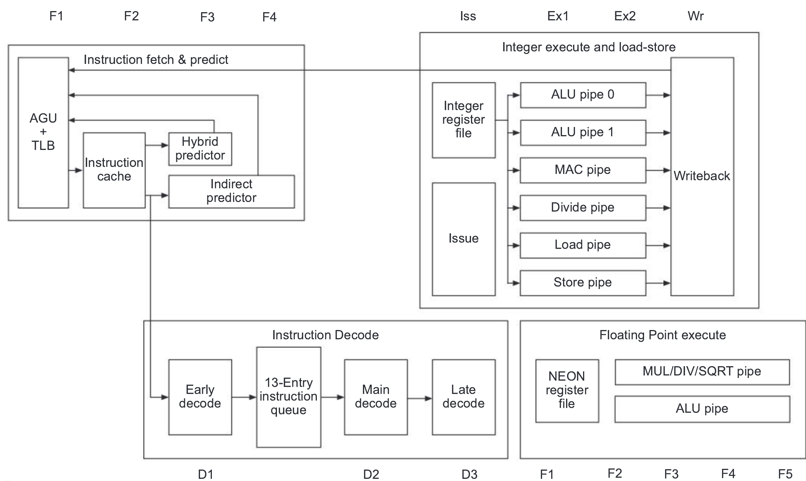{#fig-3-33 width=90%}

取指的四个周期中有一个地址生成部件，负责产生下一个 PC。下一个 PC 要么在上一个 PC 的基础上递增得到，要么来自以下四个预测器之一：

1. 单表项的转移目标 Cache，存放两次指令 Cache 取指的内容，即假定预测正确时，转移后面的两条指令。第一个取指周期检查这个目标 Cache，命中时后面两条指令就由它提供。如果命中而且预测正确，转移的执行没有延迟周期。
2. 3072 项的混合预测器，在 F3 段工作，用于所有在转移目标 Cache 中未命中的指令。由它处理的转移有 2 个周期的延迟。
3. 256 项的间接转移预测器，在 F4 段工作。由它预测的转移，预测正确时有 3 个周期的延迟。
4. 深度为 8 的返回栈，在 F4 段工作，有 3 个周期的延迟。

转移在 ALU 流水线 0 中判定，因此转移误预测开销为 8 个周期。SPECint2006 的误预测率见[图 3.34](#fig-3-34)。浪费的工作量取决于两个因素：一是误预测率，二是误预测的转移之后那段时间内维持的发射率。从[图 3.35](#fig-3-35) 可以看出，浪费的工作量大体随误预测率变化，但可能更大，偶尔也会更小。

#### A53 流水线的性能 {-}

A53 是双发射结构，理想 CPI 为 0.5。流水线停顿有三个来源：

1. 功能冒险：同时选中发射的两条相邻指令要用同一条功能流水线。A53 是静态调度的，编译器应当设法避免这种冲突。这样的指令先后出现时，会在执行流水线入口处串行化，只有第一条指令开始执行。
2. 数据冒险：在流水线前段检测，可能使两条指令都停顿（第一条不能发射时，第二条一定停顿），也可能只使一对指令中的第二条停顿。编译器同样应当尽可能防止这类停顿。
3. 控制冒险：只在转移误预测时发生。

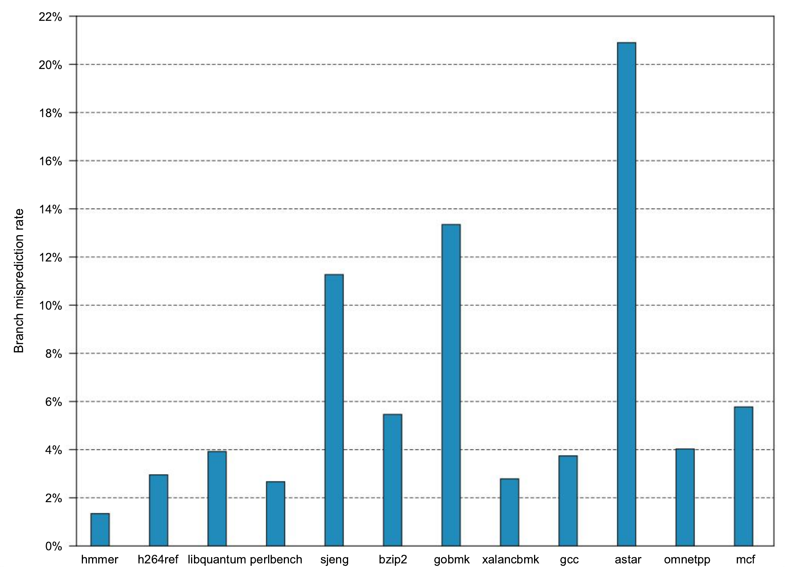{#fig-3-34 width=90%}

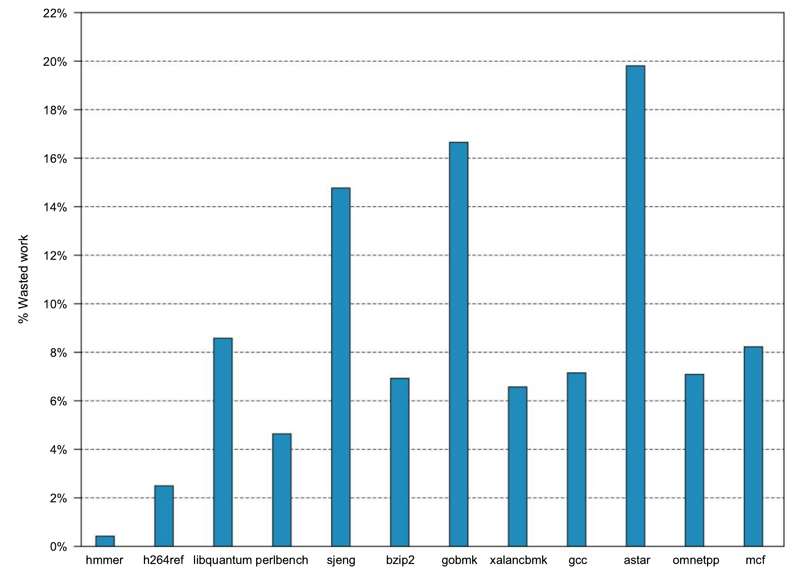{#fig-3-35 width=90%}

TLB 失效和 Cache 失效也会引起停顿。在指令一侧，TLB 或 Cache 失效会推迟指令队列的填充，很可能导致流水线后段停顿。停顿的影响要看失效发生在哪一级：L1 失效时，如果指令队列是满的，延迟可能大部分被掩盖；L2 失效的时间则长得多。在数据一侧，Cache 或 TLB 失效会使流水线停顿，因为引起失效的 load 或 store 无法沿流水线继续前进，后面的指令也就全部随之停顿。CPI 以及各种来源对 CPI 的估计贡献见[图 3.36](#fig-3-36)。

A53 流水线浅，转移预测器相当激进，因此流水线损失不大，处理器又能以不高的功耗达到较高的时钟频率。与 i7 相比，四核 A53 处理器的功耗约为前者的 1/200。总之，A53 是一款非常成功的低功耗超标量处理器，常与性能更高的 Arm 核组成 big.LITTLE 结构。

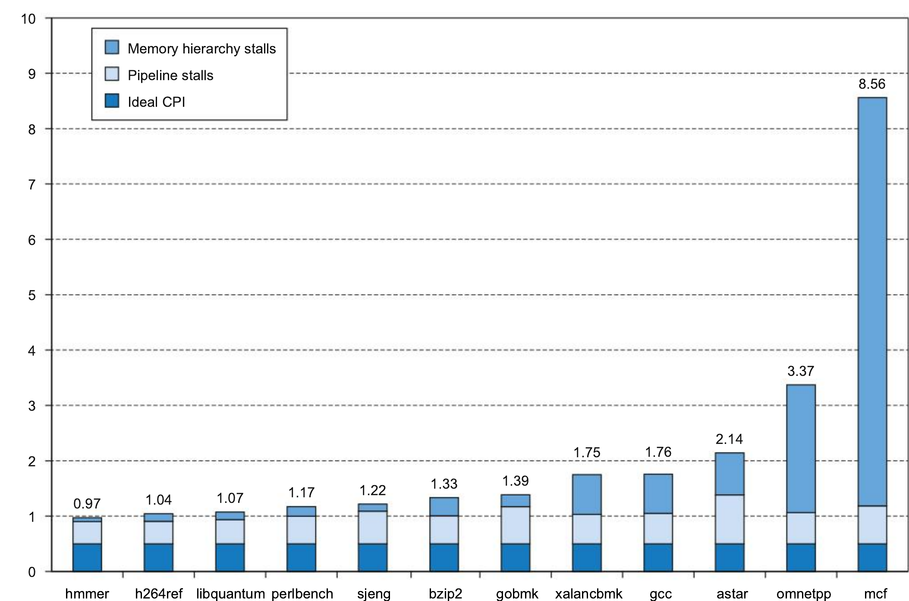{#fig-3-36 width=90%}

### Intel Golden Cove {-}

Golden Cove 是一种激进的 OOO 推测执行微结构，目标是让一个核从单个线程中提取更多的指令级并行（Rotem et al., 2022）。与 2008 年以来 Intel 所有的高端微结构一样，Golden Cove 核也支持 2 个线程的 SMT 执行。Golden Cove 于 2021 年发布，接替 Sunny Cove 微结构。Golden Cove 流水线的总体结构，以及其中许多关键结构的大小，见[图 3.37](#fig-3-37)。

*取指*：x86 指令长 1 到 15 字节不等，所以 x86 处理器的指令供给特别复杂。Golden Cove 的前端每个周期从指令 Cache 取 32 字节，由 6 个译码器把 x86 指令翻译成类似 RISC 的*微操作*（micro-op），暂存在 144 项的*微操作队列*中。这种把 x86 指令翻译成较易流水化的简单操作的做法，1997 年在 Pentium Pro 中引入，此后一直沿用。语义较复杂的 x86 指令由一个微码引擎产生微操作序列，它每个周期最多产生 4 个微操作，直到生成所需的整个序列为止。

前端还有一个*微操作 Cache*，存放 4K 个已译码的微操作，每个周期最多可以向微操作队列送出 8 个微操作。有了它，指令供给可以绕开指令 Cache 和译码器。此外还有一个*循环流检测器*（LSD），负责跟踪能装进微操作队列的循环。有了 LSD，微操作队列可以持续向后端提供指令，直到某次转移误预测不可避免地结束这个循环流。单线程模式下，LSD 可以让前端的其余部分休眠，以节省功耗；SMT 模式下，一个线程使用 LSD 时，更多的前端资源可以用来加快另一个线程的指令供给。

为了更好地支持代码量大的工作负载，Golden Cove 的指令 TLB 是 Sunny Cove 的 2 倍：4 KB 页有 256 项，2 MB/4 MB 页有 32 项。代码预取也有改进。转移预测器的组织是保密的，但已知其中几个结构加大了。第二级转移目标缓冲有 12K 项，Ice Lake 则只有 5K 项。

*乱序引擎*：Golden Cove 用一个 512 项的大 ROB 支持 OOO 执行。每个周期最多可以有 6 个微操作完成重命名，发射到调度器，再由调度器安排到各个功能部件上执行。硬件能识别某些可以优化的 x86 指令惯用法。例如，实际作用是把寄存器清零或在寄存器之间传送值的指令，就不必调度到功能部件上执行。

算术微操作的调度器有 97 项，由整数操作和浮点操作共用。它有 5 个端口，每个周期最多可以向整数功能部件发射 5 个就绪的微操作，向浮点和向量功能部件最多发射 3 个。Golden Cove 实现了几种面向数据中心和高性能计算（HPC）工作负载的 x86 ISA 扩展，其中有 512 位 SIMD 指令（AVX-512），它支持机器学习工作负载所用的数据类型，如 Brain 浮点（BF16）格式和 8 位整数（INT8）。窄数据类型对机器学习的意义在第 7 章讨论。Golden Cove 还是第一个实现*高级矩阵扩展*（AMX）的 Intel 微结构，AMX 面向机器学习工作负载。

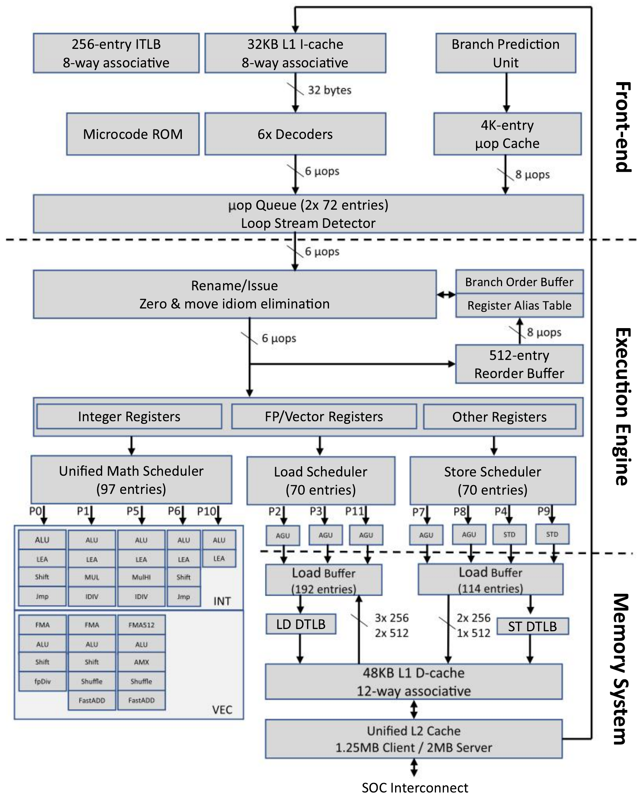{#fig-3-37 width=80%}

AMX 定义了一个新的二维寄存器堆和一组矩阵乘法指令。寄存器堆有 8 个寄存器，每个寄存器是由 16 个 64 字节的行组成的数组；矩阵乘法指令以不同的二维形状对这些寄存器做运算，最高速率为每个周期 2K 个 Int8 操作。load 调度器有 70 项，每个周期可以供给 3 个地址生成部件；store 调度器有 38 项，每个周期可以供给 2 个地址生成部件和 2 个 store 数据部件。

Golden Cove 用一个 128 项的*转移顺序缓冲*（branch order buffer）从转移误预测中恢复（Boggs et al., 2004）。遇到可能误预测的条件转移指令和间接转移指令时，这个缓冲为寄存器重命名状态保存一份快照。一旦检测到转移误预测，处理器就丢弃所有更年轻的指令，恢复这条转移之前的最后一份快照，然后从正确的目标重新开始取指。恢复期间，更老的指令照常执行。这样，处理器既不必等误预测的指令到达 ROB 头部，也不必清空整条流水线。

*存储子系统*：Golden Cove 每个周期最多可以处理 3 个 32 字节的 load 或 2 个 64 字节的 load，同时最多处理 2 个 64 字节的 store。流水线中有 192 项的 load 缓冲和 114 项的 store 缓冲，并采用推测式存储器消歧，发掘 load 与 store 之间的并行性。Golden Cove 支持 store 前递，load 的前一部分字节从 store 前递、其余字节从数据 Cache 读出的情况也支持。

L1 数据 Cache 容量为 48 KB，12 路组相联，命中时 load 到使用的延迟为 5 个周期。*填充缓冲*（fill buffer）最多可以跟踪 16 个未完成的 L1 Cache 失效。L2 Cache 容量为 1.25 MB（客户端芯片）或 2 MB（服务器芯片），每个周期提供 64 字节数据，延迟为 15 个周期。L1 和 L2 两级的预取器都有改进。L2 Cache 有一个基于模式的多路径预取器，能根据反馈自适应地节流预取。L2 Cache 最多可以有 48 个未完成的失效或预取请求。

load 的地址转换使用这样一个 TLB：4 KB 页 96 项（6 路组相联），2 MB/4 MB 页 32 项（4 路组相联），1 GB 页 8 项。store 另有一个 16 项的 TLB，适用于所有页大小。指令和数据的所有一级 TLB 后面，都有一个 2K 项的二级 TLB（STLB）作后援。STLB 失效送往页失效处理部件（PMH），PMH 最多可以并行进行 4 次页表遍历。

*与以往 Intel 微结构的比较*：[图 3.38](#fig-3-38) 比较了 Golden Cove 与 Skylake（2015）、Sunny Cove（2019）两种微结构的关键特性。与前几代相比，Golden Cove 在译码、发射、分派和退出各段每个周期能处理更多的指令，所有关键缓冲结构也都更大，ILP 能力明显提高。同时，Golden Cove 核能达到很高的频率，已公布的客户端产品和服务器产品分别可达 5.5 GHz 和 4.2 GHz。

[图 3.38　Intel 三代乱序微结构的特性。为了提取更多的 ILP，关键流水段（译码、发射、分派、退出）的宽度，以及关键缓冲、队列和寄存器堆的容量，逐年稳步增加。各种缓冲的大小有时看起来是随意定的，但很可能都以大量模拟为依据。]{#fig-3-38 .caption}

| | Skylake（2015） | Sunny Cove（2019） | Golden Cove（2021） |
|---|--:|--:|--:|
| 微操作队列（每个 SMT 线程） | 64 | 70 | 72 |
| 微操作 Cache 容量 | 1,500 | 2,304 | 4,096 |
| 保留站（整数 + 浮点） | 97 | 97 | 80 |
| 整数寄存器 | 180 | 280 | 280 |
| 浮点寄存器 | 168 | 224 | 332 |
| 未完成 load 缓冲 | 72 | 128 | 192 |
| 未完成 store 缓冲 | 56 | 72 | 114 |
| 重排序缓冲 | 256 | 352 | 512 |
| 每周期取指字节数 | 16 | 16 | 32 |
| 指令译码器数 | 1 个复杂 + 5 个简单 | 4 | 6 |
| 每周期发射指令数 | 4 | 5 | 6 |
| 功能部件的调度器端口数 | 8 | 10 | 12 |
| 每周期退出指令数 | 4 | 4 | 8 |

#### Golden Cove 核的性能 {-}

[图 3.39](#fig-3-39) 给出了 Golden Cove 核以单线程模式运行 10 个 SPECCPUint2017 基准测试程序时的性能特征。CPI 在 0.32 到 0.89 之间，即这个核平均每个周期执行 1.11 到 3.14 条指令。CPI 与误预测率、Cache 失效率和 TLB 失效率的相关性很好。

以 `mcf` 为例。这个基准测试程序实现的是网络单纯形法，用来求解公共交通车辆调度这类最小费用流问题。网络单纯形法把一般单纯形算法中的线性代数运算换成找圈、修改生成树等网络操作，这些操作可以很快完成。因此，`mcf` 含有依赖数据的转移和不可预测的指针访问，转移误预测率很高，存储层次各级的 Cache 失效率也很高。单是转移误预测率高，就可能使核缺少可执行的有用指令，`leela` 就是这样，它是一个围棋引擎，采用基于蒙特卡罗方法的局面评估。而在 `perlbench`（用于过滤垃圾邮件的 Perl 脚本）、`x264`（H.264/MPEG-4 AVC 视频编码）和 `exchange2`（编制数独谜题的递归程序）这样的基准测试程序上，Golden Cove 的预测器和 Cache 表现良好，核的后端因此能够利用相当多的 ILP。

[图 3.39　Golden Cove 核以单线程模式运行 SPECCPUint2017 基准测试程序时的关键性能特征。测量在双插座的 Sapphire Rapids 系统上进行，每个插座 56 个核、8 个 DDR5-4800 通道。基准测试程序用 Intel ICC 18 编译，使用了 AVX2 指令。MPKI 指每千条指令失效数。]{#fig-3-39 .caption}

| | perlbench_r | gcc_r | mcf_r | omnetpp_r | xalancbmk_r | x264_r | deepsjeng_r | leela_r | exchange2_r | xz_r |
|---|--:|--:|--:|--:|--:|--:|--:|--:|--:|--:|
| SpecRate | 6.68 | 7.84 | 7.12 | 6.31 | 7.9 | 16.43 | 5.5 | 4.97 | 17.53 | 3.92 |
| CPI | 0.328 | 0.577 | 0.899 | 0.717 | 0.505 | 0.321 | 0.512 | 0.666 | 0.318 | 0.730 |
| L1D 失效率（%） | 1.33% | 7.81% | 14.85% | 8.90% | 14.20% | 2.05% | 1.29% | 1.21% | 0.03% | 5.02% |
| L2 失效率（%） | 14.29% | 39.58% | 32.13% | 46.19% | 24.50% | 11.44% | 15.45% | 20.65% | 40.63% | 23.51% |
| L3 失效率（%） | 8.89% | 23.67% | 59.06% | 23.01% | 2.05% | 31.62% | 66.67% | 1.43% | 0.00% | 24.03% |
| L1D MPKI | 3.88 | 22.08 | 38.25 | 29.33 | 38.2 | 4.33 | 3.04 | 3.19 | 0.1 | 12.51 |
| L2 MPKI | 1.35 | 11.83 | 12.36 | 13.95 | 9.77 | 1.36 | 1.38 | 0.7 | 0.13 | 3.08 |
| L3 MPKI | 0.12 | 2.8 | 7.3 | 3.21 | 0.2 | 0.43 | 0.92 | 0.01 | 0 | 0.74 |
| 数据 TLB MPKI | 0.1 | 0.45 | 1.56 | 3.36 | 0.11 | 0.04 | 0.23 | 0.01 | 0 | 1.43 |
| 转移误预测率（%） | 0.49% | 1.30% | 8.77% | 2.06% | 0.28% | 1.46% | 4.04% | 9.44% | 1.81% | 3.95% |

[图 3.40](#fig-3-40) 给出了以双线程模式运行这 10 个 SPECCPUint2017 基准测试程序的性能收益。与运行单个线程相比，Golden Cove 核运行两个 SMT 线程时，这些基准测试程序的吞吐率提高了 5% 到 46%。单线程性能低的程序，SMT 收益通常较高，如 `mcf`（46%）和 `leela`（45%）。这些程序没有充分利用核的资源，第二个 SMT 线程因此能以合理的吞吐率执行。双插座系统的全部 112 个核都以双线程模式运行时，SMT 收益在 5% 到 37% 之间。以访存密集的 `mcf` 为例，它的 SMT 收益从只有 1 个核活跃时的 46% 降到所有核都活跃时的 27%，原因是每个插座内的 112 个线程要争用共享 L3 Cache 和主存系统中的资源。总的来看，按 SPECCPUint2017 各项 rate 成绩的几何平均值计算，SMT 收益在单核时为 27%，在双插座系统上为 16%。SMT 带来的吞吐率提高相当可观，这证明采用更宽的 OOO 流水线是合理的，尽管在单线程模式下，更宽的流水线并不能使所有工作负载同样受益。

 相同。我们给出了两种情况下的 SMT 收益：只用一个核（最多 2 个 SMT 线程）；使用双插座系统的全部 112 个核（最多 224 个 SMT 线程）。图例中 1 core 为单核，All cores 为全部核。](images/ch03/fig-3-40.png){#fig-3-40 width=90%}

[图 3.41](#fig-3-41) 给出了双插座系统全部 112 个核都以 SMT 模式运行时，每个核的性能特征。[图 3.38](#fig-3-38) 与[图 3.40](#fig-3-40) 之间的差别有两个来源：误预测率以及 L1、L2 失效率的差别，来自核内资源的争用；L3 失效率的差别，来自两个插座中全部线程之间的资源争用。例如，`gcc` 的 L3 Cache 每千条指令失效数（MPKI）从 1 个线程时的 2.8（[图 3.38](#fig-3-38)）增加到 224 个线程时的 20.2（[图 3.40](#fig-3-40)）。这说明，对同时执行数百个线程的多核芯片而言，Cache 和存储系统的设计非常重要。另外，打开 SMT 后，每个线程的 CPI 会增大。例如，从[图 3.38](#fig-3-38) 到[图 3.40](#fig-3-40)，`perlbench` 的 CPI 从 0.328 增大到 0.590。但现在有两个线程以这一速率执行指令，所以核一级的有效吞吐率是原来的 $(2/0.590)/(1/0.328) = 1.111$ 倍，即提高了 11.1%。

[图 3.41　双插座、共 112 个核的系统以双线程模式运行 SPECCPUint2017 基准测试程序时，单个 Golden Cove 核的关键性能特征。基准测试程序的设置与[图 3.39](#fig-3-39) 相同。我们给出的是每个 SMT 线程的 CPI。MPKI 指每千条指令失效数。]{#fig-3-41 .caption}

| | perlbench_r | gcc_r | mcf_r | omnetpp_r | xalancbmk_r | x264_r | deepsjeng_r | leela_r | exchange2_r | xz_r |
|---|--:|--:|--:|--:|--:|--:|--:|--:|--:|--:|
| CPI（每个线程） | 0.590 | 1.260 | 1.420 | 1.950 | 0.958 | 0.556 | 0.794 | 0.934 | 0.552 | 1.150 |
| L1D 失效率（%） | 1.85% | 9.10% | 18.98% | 10.43% | 17.03% | 2.96% | 2.68% | 1.92% | 0.00% | 7.37% |
| L2 失效率（%） | 11.32% | 42.70% | 25.63% | 43.99% | 19.01% | 6.63% | 12.17% | 10.36% | 0.00% | 23.12% |
| L3 失效率（%） | 82.96% | 65.62% | 78.92% | 80.76% | 63.95% | 77.78% | 81.21% | 35.19% | 0.00% | 71.43% |
| L1D MPKI | 5.53 | 26.74 | 48.47 | 35.1 | 47.14 | 6.32 | 6.39 | 5.16 | 0.01 | 17.82 |
| L2 MPKI | 1.35 | 15.27 | 12.43 | 15.85 | 9.32 | 0.9 | 1.49 | 0.54 | 0 | 4.13 |
| L3 MPKI | 1.12 | 10.02 | 9.81 | 12.8 | 5.96 | 0.7 | 1.21 | 0.19 | 0 | 2.95 |
| 数据 TLB MPKI | 0.15 | 0.6 | 1.32 | 4.53 | 0.11 | 0.01 | 0.24 | 0 | 0 | 1.78 |
| 转移误预测率（%） | 0.63% | 1.11% | 9.04% | 1.97% | 0.29% | 1.38% | 4.22% | 9.86% | 1.91% | 4.03% |

<!--chapter:end:03-ilp-08.Rmd-->

## 谬误与陷阱 {#sec-3-14}

下面几条谬误想说明的是：性能和能效很难预测，也不能从时钟频率、CPI 这样的单一指标推算出来。我们还将看到，在不同的基准测试程序上，不同的体系结构方法表现可能截然不同。

**谬误**　*只要工艺不变，同一指令系统结构的两个不同版本在性能和能效上的表现很容易预测。*

2008 年，Intel 推出了两款处理器。一款是面向低端上网本和个人移动设备（PMD）市场的 Atom 230，它同时实现了 x86 体系结构的 64 位和 32 位版本。Atom 是静态调度的双发射超标量处理器，微结构与 Arm A8 十分相似；A8 是单核处理器，是 A53 的前身。另一款是 Core i7 920，基于 OOO 的 Nehalem 微结构。而且，Atom 230 和 Core i7 920 是用同一种 45 nm Intel 工艺制造的。[图 3.42](#fig-3-42) 概括了 Intel Core i7 920、Arm Cortex-A8 和 Intel Atom 230 的特点。指令系统相同，底层制造工艺也相同，这就提供了一个难得的机会，可以直接比较两种截然不同的微结构。比较之前，先进一步介绍一下 Atom 230。

[图 3.42　四核 Intel i7 920、一款典型的 Arm A8 处理器芯片（256 MiB L2、32 KiB L1，无浮点）和 Intel Atom 230 的概况。对比可以清楚地看出，面向 PMD（Arm）或上网本（Atom）的处理器，与面向服务器和高端台式机的处理器，设计理念截然不同。注意 i7 有 4 个核，每个核的性能都高于单核的 A8 或 Atom。这几款处理器都采用相当的 45 nm 工艺。]{#fig-3-42 .caption}

| 领域 | 具体特性 | Intel i7 920（4 个核，均带浮点） | ARM A8（1 个核，无浮点） | Intel Atom 230（1 个核，带浮点） |
|---|---|---|---|---|
| 芯片物理特性 | 时钟频率 | 2.66 GHz | 1 GHz | 1.66 GHz |
| | 热设计功耗 | 130 W | 2 W | 4 W |
| | 封装 | 1366 引脚 BGA | 522 引脚 BGA | 437 引脚 BGA |
| 存储系统 | TLB | 两级；全部 4 路组相联；128 I/64 D；512 L2 | 一级，全相联；32 I/32 D | 两级；全部 4 路组相联；16 I/16 D；64 L2 |
| | Cache | 三级；32 KiB/32 KiB；256 KiB；2–8 MiB | 两级；16/16 或 32/32 KiB；128 KiB–1 MiB | 两级；32/24 KiB；512 KiB |
| | 峰值存储带宽 | 17 GB/s | 12 GB/s | 8 GB/s |
| 流水线结构 | 峰值发射率 | 每时钟周期 4 个操作（含融合） | 每时钟周期 2 个操作 | 每时钟周期 2 个操作 |
| | 流水线调度 | 推测执行，乱序 | 按序动态发射 | 按序动态发射 |
| | 转移预测 | 两级 | 两级；512 项 BTB；4 K 全局历史；8 项返回栈 | 两级 |

**Atom 230 的微结构。** Atom 处理器用标准办法实现 x86 体系结构：把 x86 指令翻译成类似 RISC 的微操作。20 世纪 90 年代中期以来，所有 x86 实现都是这样做的。Atom 的微操作功能稍强一些，允许一个算术操作与一个 load 或 store 配对；后来的 OOO 微结构通过宏融合（macrofusion）也有了这种能力。有了这项优化，在典型的指令组合中，平均只有 4% 的指令需要一个以上的微操作。微操作在一条 16 级流水线中执行，和 Arm A8 一样，每个时钟周期按序发射两条指令。Atom 有两个整数 ALU，浮点加法和其他浮点操作各有一条流水线，另有两条访存流水线。因此，Atom 的双路执行比 Arm A8 更通用，但仍受按序发射的限制。Atom 230 有 32 KiB 指令 Cache 和 24 KiB 数据 Cache，二者共用同一晶片上 512 KiB 的 L2。Atom 230 还支持双线程的多线程，但这里只比较单线程的情况。

i7 和 Atom 230 工艺相同、指令系统也相同，我们也许会以为，二者的相对性能和能耗是可以预测的，也就是说，功耗和性能会接近线性地按比例变化。我们用三组基准测试程序来检验这一假设：

* 第一组是单线程的 Java 基准测试程序，取自 DaCapo 和 SPEC JVM98 两个基准测试程序集（这些程序和测量方法见 Esmaeilzadeh 等（2011）的讨论）；
* 第二组和第三组取自 SPEC CPU2006，分别是其中的整数程序和浮点程序。

从[图 3.43](#fig-3-43) 可以看出，i7 的性能远高于 Atom。在 i7 上，所有基准测试程序的速度都至少是 Atom 的 4 倍，两个 SPECFP 程序超过 10 倍，一个 SPECINT 程序超过 8 倍。两种处理器的时钟频率之比是 1.6，因此 i7 920 的优势主要来自低得多的 CPI：Atom 的 CPI，在 Java 程序上是 i7 920 的 2.8 倍，在 SPECINT 程序上是 3.1 倍，在 SPECFP 程序上是 4.3 倍。

{#fig-3-43 width=90%}

然而，i7 920 的平均功耗略低于 43 W，Atom 的平均功耗只有 4.2 W，约为前者的 1/10。把性能和功耗合起来看，Atom 的能效通常是 i7 的 1.5 倍以上，常常达到 2 倍。两种处理器的底层工艺相同，这一比较清楚地表明：激进的超标量处理器靠动态调度和推测执行取得了性能优势，代价是能效上的*明显劣势*。

**谬误**　*CPI 较低的处理器总是更快。*

**谬误**　*时钟频率较高的处理器总是更快。*

关键在于，决定性能的是 CPI 与时钟频率的乘积。处理器靠深度流水线提高了时钟频率，还必须保持较低的 CPI，才能充分发挥高时钟频率的好处。同样，时钟频率高而 CPI 低的简单处理器，也可能更慢。

上一条谬误已经表明，即使指令系统相同，为不同环境设计的处理器，性能和能效也可能相差很远。实际上，即便是同一家公司同一系列的处理器，而且都面向高端应用，性能也可能相差很大。[图 3.44](#fig-3-44) 给出了 Intel 的两种 x86 实现的整数和浮点性能，以及 Intel 的一种 Itanium 体系结构实现的性能。

[图 3.44　三种 Intel 处理器差别很大。Itanium 处理器有 2 个核，i7 有 4 个核，但基准测试只用了一个核。功耗一列是热设计功耗；对多核处理器，给出的是只有一个核工作时的估计值。]{#fig-3-44 .caption}

| 处理器 | 实现工艺 | 时钟频率 | 功耗 | SPECCInt2006 base | SPECCFP2006 baseline |
|---|---|---|---|--:|--:|
| Intel Pentium 4 670 | 90 nm | 3.8 GHz | 115 W | 11.5 | 12.2 |
| Intel Itanium 2 | 90 nm | 1.66 GHz | 104 W，单核约 70 W | 14.5 | 17.3 |
| Intel i7 920 | 45 nm | 3.3 GHz | 共 130 W，单核约 80 W | 35.5 | 38.4 |

Pentium 4 是 Intel 造过的流水线设计最激进的处理器：流水线超过 20 级，有 7 个功能部件，Cache 中存放的是微操作而不是 x86 指令。实现如此激进，性能却相对较差，这清楚地说明，开发更多 ILP 的尝试（在途指令很容易达到 50 条）已经失败。Pentium 4 的功耗与 i7 相近，晶体管却比 i7 少，因为它的一级 Cache 只有 i7 的一半大，二级 Cache 只有 2 MiB，也没有三级 Cache。

Intel Itanium 是 VLIW 风格的体系结构。与动态调度的超标量处理器相比，它有可能降低复杂度，但时钟频率始终没能达到与主流 x86 处理器竞争的水平（不过它的总体 CPI 看来与 i7 相近）。分析这些结果时要注意，它们采用的实现工艺不同：流水线深度相当时，i7 的晶体管更快，时钟频率也就更高。尽管如此，性能差距之大仍然惊人，i7 的性能是 Pentium 的 3 倍以上。这一优势有相当一部分从何而来，下一条陷阱将给出解释。

**陷阱**　*有时更大、更笨的反而更好。*

21 世纪初，人们的注意力大多放在设计激进的处理器来开发 ILP 上，其中包括 Pentium 4 体系结构和 Intel Itanium：前者的流水线是微处理器中前所未有的最深流水线，后者的每时钟周期峰值发射率也是前所未有的最高水平。人们很快就发现，开发 ILP 的主要限制往往在存储系统。一级 Cache 失效的开销是 10～15 个周期，推测执行的 OOO 流水线能把其中相当大的一部分隐藏起来；末级 Cache（LLC，Last-Level Cache）失效则要访问主存，开销很可能达到 50～100 个时钟周期，OOO 流水线能隐藏的就很少了。

结果，这些设计尽管晶体管很多，技术也极其复杂巧妙，指令吞吐率却始终远未达到峰值。另一个变化也印证了这条陷阱：设计者不再试图用 ILP 隐藏更多的访存延迟，而是干脆把晶体管用来做大得多的 Cache。Pentium 4 是两级 Cache，Itanium 2 和 i7 都是三级 Cache；Itanium 2 和 i7 的三级 Cache 分别是 9 MiB 和 8 MiB，而 Pentium 4 的二级 Cache 只有 2 MiB。显然，做大 Cache 比设计 20 多级的 Pentium 4 流水线容易得多，而且从[图 3.44](#fig-3-44) 的数据来看，效果似乎也更好。

**陷阱**　*有时聪明的又比更大、更笨的好。*

过去十年里，转移预测领域出现了一个比较出人意料的结果：带 tag的混合预测器问世后，人们发现，在位数相同的条件下，较复杂的预测器能够胜过简单的 gshare 预测器（见[图 3.10](#fig-3-10)）。说它出人意料，一个原因是带 tag 的预测器还要拿出一部分位来存 tag，实际存储的预测反而更少，而 gshare 只有一个大的预测数组。尽管如此，不再把一条转移的预测误用到另一条转移上，由此得到的好处看来超过了把位分给 tag 而不分给预测所付出的代价。

**陷阱**　*认为只要有合适的技术，就能获得大量可用的 ILP。*

开发大量 ILP 的尝试之所以失败，原因有好几个。其中最重要的一个起初有些设计者并不接受：在结构常规的程序中，即使采用推测执行，也很难找到大量的 ILP。David Wall 1993 年的一项著名研究（见 Wall，1993）分析了在各种理想化条件下可用的 ILP 有多少。下面概述他针对一种处理器配置得到的结果，这种配置的能力大约是 2023 年最先进处理器的 4 到 8 倍。Wall 的研究详细记录了多种不同的方法，对开发 ILP 这一难题感兴趣的读者应当读一读研究全文。

这种激进的处理器有以下特点：

1. 每个时钟周期最多发射和分派 64 条指令，*没有*任何发射限制。这一发射宽度是 2023 年最宽的处理器 IBM Power10 总发射宽度的 8 倍，每个时钟周期允许的 load 和 store 数最多是后者的 32 倍。前面讨论过，发射率很高时，复杂度和功耗都会成为严重的问题。
2. 采用 1K 项的竞争预测器和 16 项的函数返回预测器。这一预测器与 2016 年最好的预测器相当，不是主要瓶颈。误预测在一个周期内处理完毕，但仍会限制推测执行的能力。
3. 动态地对访存引用完美消歧。这一要求很激进，但窗口较小时或许能够做到。
4. 寄存器重命名另有 64 个整数寄存器和 64 个浮点寄存器，比 2011 年最激进的处理器稍少。但这项研究假设所有指令的延迟都只有一个周期，而在 Golden Cove 这类处理器上，常见指令的延迟是 1～4 个周期，复杂指令最多可达 15 个周期。因此，有效的重命名寄存器数大约是这两种处理器的 5 倍。

[图 3.45](#fig-3-45) 给出了窗口大小变化时这种配置的结果。这种配置比现有的实现更复杂、更昂贵，在指令发射数上尤其如此；尽管如此，它为未来的实现可能达到的水平给出了一个有用的上限。这些数据很可能过于乐观，还有另一个原因：64 条指令之间没有任何发射限制，例如可以全是访存引用。近期内，谁都不会考虑让处理器具备这种能力。另外要记住，这些结果没有考虑 Cache 失效和非单周期延迟，而这两个因素的影响都很大。

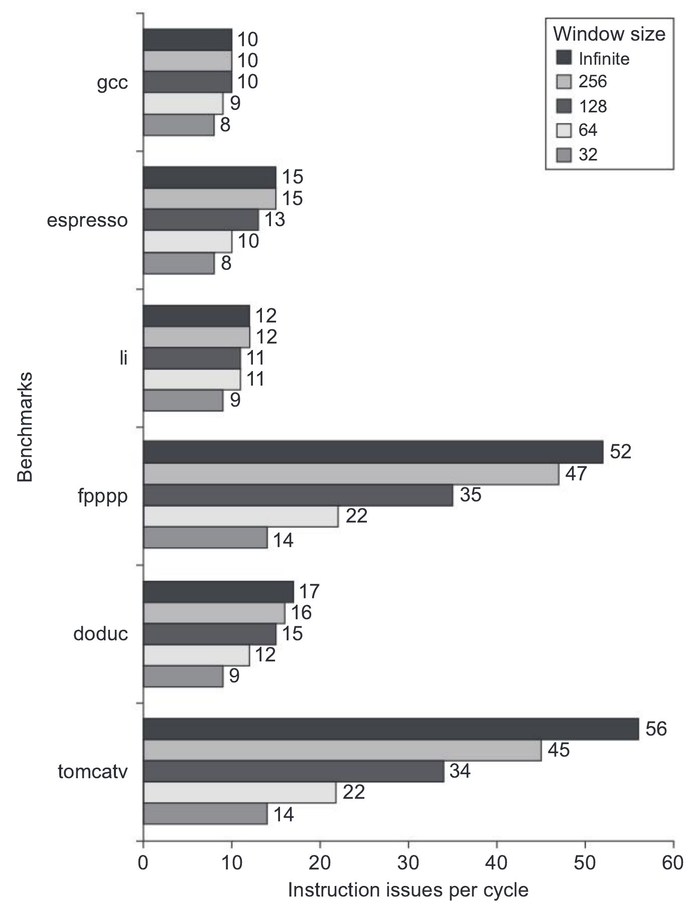{#fig-3-45 width=70%}

[图 3.45](#fig-3-45) 中最令人吃惊的现象是：在上述切合实际的处理器约束下，窗口大小对整数程序的影响不像对浮点程序那样严重。这一结果反映了两类程序的关键区别。有两个浮点程序存在循环级并行，可开发的 ILP 因而较多；整数程序则不同，转移预测、寄存器重命名，以及程序本身的并行性就比较少，这些因素都是重要的限制。这一点至关重要，因为过去十年市场增长的大部分，如事务处理、Web 服务器等，依赖的是整数性能，而不是浮点性能。

Wall 的研究当时有人不相信，但 10 年以后，人们终于认清了现实：投入大量硬件资源只换来有限的性能提高，错误的推测执行又带来严重的能耗问题，两方面合在一起，迫使设计方向发生了转变。我们在结束语中还会回到这一话题。

## 结束语 {#sec-3-15}

进入 2000 年时，人们对开发 ILP 的关注达到了顶峰。新世纪的头 5 年里，情况逐渐明朗：ILP 方法很可能已经到顶，需要新的方法。到 2005 年，Intel 和其他所有主要处理器厂商都已调整方针，转而专注于多核。此后，更高的性能要靠 TLP 而不是 ILP 来获得，高效使用处理器的责任也在很大程度上从硬件转到了软件和程序员身上。这是 25 年多以前流水线和 ILP 发展初期以来，处理器体系结构最重大的一次变化。如今，除了嵌入程度最深的应用领域，已经很难找到单核芯片了。

同一时期，设计者开始探索另一条提高性能的途径：更多地利用数据级并行。SIMD 扩展让台式机和服务器微处理器在图形及类似功能上获得了一定的性能提高。更重要的是，GPU 大力采用 SIMD，在具有大量 DLP 的应用上取得了明显的性能优势。对科学计算应用来说，多核开发的 TLP 更通用，但效率较低，这类 DLP 方法是它之外的一种可行选择。第 4 章讨论 DLP 利用方面的这些进展。2015 年前后，技术方向又一次急剧转变：设计者开始探索领域专用体系结构，以牺牲可编程性为代价，换取机器学习计算等关键应用在性能和功耗效率上的大幅提高。第 7 章专门讨论如何构建领域专用硬件。

许多研究者曾预测，ILP 的使用将大幅收缩，未来属于双发射超标量处理器和更多的核。然而，稍高一些的发射率仍有好处，推测式动态调度又能应对一级 Cache 失效这类不可预测的事件，因此，作为多核设计主要构件的核，在 ILP 上一直缓慢而稳定地改进；即使在 TLP 充足的应用领域（如数据中心）也是如此。SMT 的加入，以及它在性能和能效两方面的效果，进一步巩固了 OOO 推测执行方法的地位。超标量设计的改进速度无疑已经放慢，但 Intel、AMD、Arm、苹果和 IBM 等厂商仍在适时地推出一项又一项改进。实际上，即使在嵌入式市场，最新的处理器也已引入了动态调度、推测执行和更宽的发射。2023 年性能最好的 OOO 核之一是苹果的 Avalanche 核，用于智能手机的 A15 芯片和笔记本电脑的 M2 芯片。

ILP 的改进速度不太可能明显加快，原因很简单：从硅片利用率和功耗效率看，这样做效率太低。不过，ILP 很可能继续缓慢地改进。一是单线程性能对一些工作负载很重要，二是 ILP 技术适用面很广，这两点仍然是需要考虑的重要因素。三是同一块芯片上既可以组合高性能核与高能效核，也可以组合可编程核与定制加速器，从而兼顾效率，不断改进的 OOO 核因此能够继续部署。

以[图 3.46](#fig-3-46) 的数据为例，图中给出了 IBM Power 系列的 7 款处理器。Power 处理器面向银行系统、客户关系管理等企业应用，追求高性能，往往是 ILP 设计的领先者。二十年来，Power 处理器对 ILP 的支持稳步改进，但晶体管数增加的绝大部分（从 Power4 到 Power10，晶体管数增加到原来的 100 多倍）用在了扩大片上 Cache 和增加每个晶片的核数上。具体来看：

* 单个线程每周期最多发射的指令数，从 Power4 的 5 条增加到 Power10 的 8 条。Power10 SMT8 核分成两个执行域，每个域为 8 个线程服务，资源足以每周期发射 8 条指令；
* SMT 支持从无到有，发展到每个处理器 8 个线程。

Intel 的多代高性能微结构也呈现出类似的趋势：新增硅片面积有很大一部分用来支持更多的核、更宽的 SIMD 部件和更大的 Cache。接下来的两章讨论开发数据级并行和线程级并行的方法。

[图 3.46　七代 IBM Power 处理器的特点。除 Power6 是静态调度、按序执行的以外，其余都是动态调度的超标量处理器。Power7 和 Power8 用嵌入式 DRAM 做 L3 Cache。Power9 前面已简要介绍过，它进一步扩大了 Cache，并支持片外 HBM。Power10 SMT8 核包含两个执行资源域，每个域提供的资源最多可为 4 个硬件线程服务。因此，累计发射宽度为每周期 16 条指令，而单个线程每周期最多只能发射 8 条指令。]{#fig-3-46 .caption}

| | Power4 | Power5 | Power6 | Power7 | Power8 | Power9 | Power10 |
|---|--:|--:|--:|--:|--:|--:|--:|
| 推出年份 | 2001 | 2004 | 2007 | 2010 | 2014 | 2017 | 2021 |
| 峰值时钟频率（GHz） | 1.3 | 1.9 | 5.0 | 4.14 | 4.35 | 4.0 | 4.15 |
| 晶体管数（百万） | 174 | 276 | 790 | 1,200 | 4,200 | 8,000 | 18,000 |
| 每时钟周期发射数 | 5 | 5 | 7 | 6 | 8 | 18 | 16 |
| 每个核的功能部件数 | 8 | 8 | 9 | 12 | 16 | 38 | 42 |
| 每个核的 SMT 线程数 | 0 | 2 | 2 | 4 | 8 | 8 | 8 |
| 每片核数 | 2 | 2 | 2 | 8 | 12 | 12 | 16 |
| 片上 Cache 总容量（MiB） | 1.5 | 2 | 8 | 35 | 103.0 | 128 | 163 |

## 历史回顾与参考文献 {#sec-3-16}

M.5 节（可在线获取）讨论流水线和 ILP 的发展历程。我们还给出了大量参考文献，供读者进一步阅读和探索这些主题。M.5 节涵盖第 3 章和附录 H 两部分内容。

<!--chapter:end:03-ilp-09.Rmd-->

## 案例研究与习题（Jason D. Bakos） {- #sec-3-exercises}

### 案例研究：动态调度 {-}

本案例研究分析下面这个简单循环的运行时行为：

```
loop: fld    f2,0(x2)       # load guess
      fmul.d f4,f2,f2       # temp= guess^2
      fsub.d f4,f4,f0       # temp = temp - s
      fmul.d f6,f2,f8       # temp2 = guess * 2
      fdiv.d f4,f4,f6       # temp = temp/temp2
      fsub.d f2,f2,f4       # temp = guess - temp
      fsd    f2,0(x2)       # store guess
      addi   x1,x1,-1       # decrement counter
      addi   x2,x2,8        # increment address
      bne    x1,zero,loop   # loop
```

循环每执行一次，就完成一步 Newton-Raphson 迭代，逐步逼近方程 $x^2 - s$ 的根。寄存器的分配如下：

* 寄存器 f0 存放 $s$；
* 寄存器 f8 存放常数 2.0；
* x1 存放迭代次数；
* 寄存器 x2 存放输入数组的基地址。

3.1　[15] <3.3, 3.6> CPU 为单发射、按序执行，求执行一遍这个循环体所需的周期数。假设：

* load 的延迟为 4 个周期，即产生结果的指令与使用结果的指令之间至少要隔 3 个周期；
* 浮点指令的延迟为 5 个周期；
* 整数指令的延迟为 2 个周期；
* 转移需要 4 个周期才能确定结果；
* store 的有效延迟为 0 个周期；
* 前递总线数量不限，相关指令在它所依赖的最后一条指令完成的那个周期就可以发射；
* 最后一条指令提交的那个周期，算作循环完成的时刻。

求解时，可以填写如下形式的表格：

| 序号 | 指令 | 所依赖的指令 | 使用结果的指令 | 就绪周期 | 分派周期 | 完成周期 | 提交/确定转移结果的周期 |
|---|---|---|---|---|---|---|---|
| 0 | `fld f2,0(x2)` |  |  |  |  |  |  |
| 1 | `fmul.d f4,f2,f2` |  |  |  |  |  |  |
| 9 | `bne x1,zero,loop` |  |  |  |  |  |  |

3.2　[5] <3.3, 3.6> 按你对 3.1 的解答，CPU 发射了指令的周期占全部周期的百分之几？

3.3　[15] <3.3, 3.6> 假设 CPU 可以乱序发射、乱序提交指令，但每个周期只能分派一条指令，也只能提交一条指令。

同一周期如果有多条指令可以分派或提交，最晚取出的那条必须停顿。暂且假设寄存器自动重命名，读后写、写后写这两种名相关不会造成结果不一致；这一假设是否必要，留到后面的题目中考察。

这时执行一遍循环体需要多少个周期？用与 3.1 类似的表格求解。

3.4　[5] <3.3, 3.6> 按你对 3.3 的解答，CPU 发射了指令的周期占全部周期的百分之几？

3.5　[15] <3.4, 3.6> 现在假设转移采用推测执行，转移预测器的准确率为 100%。转移之后取出的指令可以在转移确定结果之前分派，但要等转移确定结果之后才能提交。

按执行两次迭代计算，平均每次迭代需要多少个周期？用与 3.1 类似的表格调度这些指令。

3.6　[5] <3.4, 3.6> 按你对 3.5 的解答，CPU 分派了指令的周期占全部周期的百分之几？

3.7　[15] <3.5> 规定每条指令的目的寄存器从这条指令提交的那个周期开始「活跃」，直到依赖它的最后一条指令分派为止。

按你在 3.5 中得到的调度，求寄存器 x1、x2、f2、f4 和 f6 各自的活跃周期范围。

3.8　[10] <3.5> 从你在 3.7 中求出的寄存器生存期来看，指令动态排序时，代码中是否存在可能引起问题的名相关（读后写、写后写）？说明理由。

3.9　[15] <3.3, 3.6> 现在假设目标体系结构支持双发射和双提交，并且指令窗口无限大，调度时可以从中任意选取指令。按执行两次迭代计算，平均每次迭代需要多少个周期？

3.10　[5] <3.6> 按你对 3.9 的解答，发射槽的利用率是多少？

3.11　[5] <3.6> 3.9 的性能结果与你的预期一致吗？说明理由。

### 习题 {-}

3.12　[25] <3.11> 本题比较三个处理器在性能上的得失，它们分别采用不同类型的多线程（MT）。三个处理器的共同点是：都是超标量处理器，都采用按序流水线，每条 load 和每条转移之后都要固定停顿 3 个周期，L1 Cache 完全相同。同一线程在同一周期发射的几条指令按程序顺序读入，彼此之间不能有任何数据相关或控制相关。

应用程序是一个列表搜索程序：在 x16 和 x17 给出的地址范围内扫描一段内存，查找 x9 中存放的特定值。并行化的方法是把搜索空间平均分成 4 个大小相等的连续块，每块交给一个搜索线程，共 4 个线程。每个线程的运行时间大部分花在下面这个展开后的循环体上：

```
loop: lw     x1,0(x16)
      lw     x2,8(x16)
      lw     x3,16(x16)
      lw     x4,24(x16)
      lw     x5,32(x16)
      lw     x6,40(x16)
      lw     x7,48(x16)
      lw     x8,56(x16)
      beq    x9,x1,match0
      beq    x9,x2,match1
      beq    x9,x3,match2
      beq    x9,x4,match3
      beq    x9,x5,match4
      beq    x9,x6,match5
      beq    x9,x7,match6
      beq    x9,x8,match7
      daddiu x16,x16,#64
      blt    x16,x17,loop
```

假设：

* 用一个屏障保证所有线程同时开始执行；
* 循环执行完两次迭代之后，才发生第一次 L1 Cache 失效；
* BEQAL 转移都不成功；
* BLT 总是成功；
* 三个处理器都按轮转方式调度线程；
* 处理器 A 是超标量同时多线程结构，每个周期最多可以从两个线程发射两条指令；
* 处理器 B 是细粒度多线程结构，每个周期最多可以从一个线程发射四条指令，流水线一出现停顿就切换线程；
* 处理器 C 是粗粒度多线程结构，每个周期最多可以从一个线程发射八条指令，发生 L1 Cache 失效时切换线程。

求每个处理器完成循环前两次迭代所需的周期数。

3.13　[25/25/25] <3.1, 3.2, 3.9> 本题考察怎样用软件技术从一个常见的向量循环中挖掘指令级并行（ILP）。下面的循环就是所谓的 DAXPY 循环（双精度 *aX* 加 *Y*），它是高斯消去法的核心运算。代码对长度为 100 的向量完成 DAXPY 运算 $Y = aX + Y$。开始时，R1 置为数组 *X* 的基地址，R2 置为数组 *Y* 的基地址：

```
      addi   x4,x1,#800  ; x1 = upper bound for X
foo:  fld    F2,0(x1)    ; (F2) = X(i)
      fmul.d F4,F2,F0    ; (F4) = a*X(i)
      fld    F6,0(x2)    ; (F6) = Y(i)
      fadd.d F6,F4,F6    ; (F6) = a*X(i) + Y(i)
      fsd    F6,0(x2)    ; Y(i) = a*X(i) + Y(i)
      addi   x1,x1,#8    ; increment X index
      addi   x2,x2,#8    ; increment Y index
      sltu   x3,x1,x4    ; test: continue loop?
      bnez   x3,foo      ; loop if needed
```

各功能部件的延迟见下表。转移为 1 个周期的延迟转移，在 ID 段确定结果；所有结果都完全旁路。

| 产生结果的指令 | 使用结果的指令 | 延迟（时钟周期） |
|---|---|---|
| 浮点乘 | 浮点 ALU 操作 | 6 |
| 浮点加 | 浮点 ALU 操作 | 4 |
| 浮点乘 | 浮点 store | 5 |
| 浮点加 | 浮点 store | 4 |
| 整数运算和所有 load | 任意 | 2 |

a.　[25] <3.1> 采用单发射流水线。分别写出这个循环未经编译器调度时的代码，以及编译器针对浮点操作延迟和转移延迟调度后的代码，标出所有停顿周期和空闲时钟周期。调度前和调度后，结果向量 Y 的每个元素各需要多少个周期的执行时间？如果不靠编译器调度，单靠处理器硬件来达到同样的性能提高，时钟频率需要提高到原来的多少倍？（时钟频率提高后可能对存储系统性能产生的影响忽略不计。）

b.　[25] <3.2> 采用单发射流水线。把循环展开必要的次数，使调度后不出现任何停顿，并合并循环开销指令。循环需要展开多少次？写出指令调度。结果的每个元素需要多少执行时间？

c.　[25] <3.9> 采用 VLIW 处理器，每条指令含 5 个操作，如[图 3.28](#fig-3-28) 所示。比较两种展开程度：先把循环展开 6 次以挖掘 ILP，调度时不出现任何停顿（即完全空闲的发射周期），并合并循环开销指令；再把循环展开 10 次，重复这一过程。转移延迟槽不予考虑。写出这两种调度，并回答：每种调度下，结果向量的每个元素需要多少执行时间？操作槽的使用率各是多少？两种调度的代码量相差多少？各自总共需要多少寄存器？

3.14　[20/20] <3.3,3.6> 本题考察动态调度的处理器运行习题 3.13 中的循环时的性能。功能部件的配置见下表。

| 功能部件类型 | EX 周期数 | 功能部件数 | 保留站数 |
|---|---|---|---|
| 整数 | 1 | 1 | 5 |
| 浮点加法器 | 10 | 1 | 3 |
| 浮点乘法器 | 15 | 1 | 2 |

假设：

* 功能部件都不流水；
* 功能部件之间没有前递，指令完成时才传送结果；
* load 和 store 的有效地址计算和访存都在执行段（EX）完成，因此流水线为 IF/ID/DIS/EX/WB；
* load 需要 1 个时钟周期；
* 分派段（DIS）和写回结果段（WB）各需要 1 个时钟周期；
* load 缓冲和 store 缓冲各有 5 个槽；
* 不等于零转移指令（BNEZ）需要 1 个时钟周期。

a.　[20] <3.3,3.6> 采用单发射流水线，流水线延迟见上表。给出循环三次迭代中每条指令的停顿周期数，以及每条指令在哪个时钟周期开始执行（即进入它的第一个 EX 周期）。每次循环迭代需要多少个周期？答案用表格给出，各列的表头为：

* 迭代（循环迭代的序号）
* 指令
* 分派（指令分派的周期）
* 执行（指令执行的周期）
* 访存（访问存储器的周期）
* 完成（结果可供其他指令使用的周期）
* 说明（指令在等待什么事件）

表中要列出循环的三次迭代，第一条指令可以不考虑。

b.　[20] <3.3, 3.6> 改为双发射处理器，浮点部件（FPU）完全流水，重做 (a)。

3.15　[10] <3.6> 某动态调度处理器每个周期只能把一个功能部件的结果广播（前递）给等待的指令。沿用上一题（3.14）的硬件配置和延迟，构造一个不超过 10 条指令的代码序列，使处理器因这一限制引起的结构冒险而停顿，并指出停顿发生在序列中的什么位置。

3.16　[20] <3.4> (*m*,*n*) 相关转移预测器根据最近执行的 *m* 条转移的行为，从 $2^m$ 个预测器中选出一个，每个预测器都是 *n* 位预测器。两级局部预测器的工作方式与此类似，区别是它只记录每条转移自身过去的行为，用来预测这条转移将来的行为。

这两种预测器在设计上各有得失。相关预测器保存历史所需的存储很少，因此可以为大量转移各配一个 2 位预测器，不同的转移指令共用同一个预测器的可能性就小；局部预测器保存历史需要多得多的存储，因此只能跟踪数量较少的转移指令。

本题比较两种预测器：一是 (1,2) 相关预测器，能跟踪 4 条转移，需要 16 位存储；二是 (1,2) 局部预测器，用同样多的存储能跟踪 2 条转移。对下面给出的转移结果，写出每次的预测、做出预测所用的表项、这次预测引起的表项更新，以及每个预测器最终的预测错误率。假设此前所有转移都成功。两个预测器的初始状态如下：

**相关预测器**

| 表项 | 转移 | 上一次结果 | 预测 |
|---|---|---|---|
| 0 | 0 | T | T，已有一次预测错误 |
| 1 | 0 | NT | NT |
| 2 | 1 | T | NT |
| 3 | 1 | NT | T |
| 4 | 2 | T | T |
| 5 | 2 | NT | T |
| 6 | 3 | T | NT，已有一次预测错误 |
| 7 | 3 | NT | NT |

**局部预测器**

| 表项 | 转移 | 最近 2 次结果（右边为最近一次） | 预测 |
|---|---|---|---|
| 0 | 0 | T,T | T，已有一次预测错误 |
| 1 | 0 | T,NT | NT |
| 2 | 0 | NT,T | NT |
| 3 | 0 | NT | T |
| 4 | 1 | T,T | T |
| 5 | 1 | T,NT | T，已有一次预测错误 |
| 6 | 1 | NT,T | NT |
| 7 | 1 | NT,NT | NT |

| 转移 PC（字地址） | 结果 |
|---|---|
| 454 | T |
| 543 | NT |
| 777 | NT |
| 543 | NT |
| 777 | NT |
| 454 | T |
| 777 | NT |
| 454 | T |
| 543 | T |

<!--chapter:end:03-ilp-10.Rmd-->

3.17　[10] <3.4> 一台深度流水的处理器只为条件转移设置了转移目标缓冲。已知：预测错误开销总是 4 个周期，缓冲失效开销总是 3 个周期；缓冲命中率为 90%，预测准确率为 90%，转移指令占 15%；不计转移停顿时，基本 CPI 为 1。另有一台处理器，转移开销固定为 2 个周期。前者的速度是后者的多少倍？

3.18　[10/5] <3.4> 某转移目标缓冲在三种情况下的开销是：条件转移预测正确，0 个时钟周期；预测错误，2 个时钟周期；缓冲失效，2 个时钟周期。现在改用一种区分条件转移和无条件转移的设计：条件转移在缓冲中存放目标地址，无条件转移则存放目标指令。

a.　[10] <3.9> 无条件转移在缓冲中命中时，开销是多少个时钟周期？

b.　[10] <3.9> 对无条件转移采用转移折叠，求由此带来的改进。假设命中率为 90%，无条件转移占 5%，缓冲失效开销为 2 个周期。性能能提高多少？命中率至少要多高，这项改进才会提高性能？

3.19　[10] <3.2, 3.7> 下面的代码计算稀疏矩阵 A 与稠密向量 x 的乘积。稀疏矩阵按「压缩稀疏行（CSR）」格式存放：所有非零元素按行主序存放在一块连续的内存中。第 *i* 个非零元素的值存放在 `val[i]` 中，列号存放在 `col[i]` 中；它位于第 `n` 行，`n` 满足 `ptr[n]` <= *i* < `ptr[n+1]`，也就是说，`ptr` 数组存放的是每一行第一个元素的下标。

```asm
loop:  fld f0,0(x1)       # load val[i]
       lw x3,0(x2)        # load col[i]
       slli x3,x3,3       # temp=col[i] * 8
       add x4,x10,x3      # compute eff. address (&x[0]+temp)
       fld f2,0(x4)       # load x[col[i]]
       fmac.d f4,f0,f2    # multiply-accumulate
       addi x1,x1,8       # increment &val[i]
       addi x2,x2,8       # increment &col[i]
       addi x5,x5,1       # increment i
       bne x5,x11,skip    # check for end of row (i!=ptr[i])
       fsd f4,0(x6)       # store dot product
       addi x7,x7,8       # increment &ptr[row]
       beq x7,x12,done    # check if last row was processed
       addi x6,x6,8       # increment &x[row]
       lw x11,(x7)        # load ptr[row]
       fli f4,0           # clear accumulator
       skip:
       b loop
```

a.　[5] <3.7> 哪些 load 指令可能要用到推测式存储器消歧？有没有可能出现经由存储器的 RAW 相关？

b.　[5] <3.2> 第 10 条指令是一条转移指令，你预计转移预测器对它的预测效果如何？

3.20　[10] <3.2, 3.5> 下面的代码用 Horner 方法计算一个多项式在两个输入值处的值，这两个值分别存放在寄存器 `f6` 和 `f8` 中。

```asm
loop:  fld f0,0(x1)       # load coefficient
       fmul.d f2,f6,f10   # temp = x1 * accum
       fadd.d f10,f2,f0   # accum=temp+coeff (f10 is loop-carried)
       fmul.d f2,f8,f12   # temp = x2 * accum
       fadd.d f12,f2,f0   # accum=temp2+coeff(f12 is loop-carried)
       addi x1,x1,8
       bne x1,x2,loop
```

把循环展开 2 次，并对浮点寄存器重新命名，以免名相关造成性能损失。最后给出寄存器映射表。

3.21　[5] <3.7> 分别求下面这段代码在两种 CPU 上的执行周期数：一种 CPU 没有 load 旁路和推测式存储器消歧，另一种两者都有。假设 store 指令与 load 指令之间不存在相关。

流水线为单发射、乱序（OOO）执行，有一个整数部件，延迟为 3 个周期；有一个 load/store 部件，延迟为 4 个周期。一条指令所依赖的最后一条指令在哪个周期完成，这条指令就可以在同一周期发射。如果还需要其他假设，请说明。

```asm
add x8,x10,x11
add x6,x8,x9
add x3,x6,x7
sw x2,0(x3)
lw x4,0(x5)
```

## 补充参考文献 {- #sec-3-additional-references}

Boggs, D., Weiss, S., Kyker, A., 2004. Branch Reorder Buffer. US Patent 6,799,268.

Hu, G., He, Z., Lee, R.B., 2021. SoK: hardware defenses against speculative execution attacks. In: Proceedings of the 2021 International Symposium on Secure and Private Execution Environment Design (SEED), pp. 108–120. <https://doi.org/10.1109/SEED51797.2021.00023>.

Kocher, P., Horn, J., Fogh, A., Genkin, D., Gruss, D., Haas, W., et al., 2019. Spectre attacks: exploiting speculative execution. In: The Proceedings of the 40^th^ IEEE Symposium on Security and Privacy.

Lipp, M., Schwarz, M., Gruss, D., Prescher, T., Haas, W., Fogh, A., et al., 2018. Meltdown: reading kernel memory from user space. In: Proceedings of the 27^th^ USENIX Security Symposium.

Moshovos, A., Breach, S.E., Vijaykumar, T.N., Sohi, G.S., 1997. Dynamic speculation and synchronization of data dependences. In: Proceedings of the 24th Annual International Symposium on Computer Architecture (ISCA '97). Association for Computing Machinery, New York, NY, USA, pp. 181–193. <https://doi.org/10.1145/264107.264189>.

Rotem, E., et al., 2022. Intel Alder Lake CPU Architectures. in IEEE Micro 42 (3), 13–19. <https://doi.org/10.1109/MM.2022.3164338>.

<!--chapter:end:03-ilp-11.Rmd-->

# 向量、SIMD 和 GPU 体系结构中的数据级并行 {#ch-dlp}

> 我们把这些算法称为数据并行算法，因为它们的并行性来自对大量数据同时进行的操作，而不是来自多个控制线程。
>
> ——W. Daniel Hillis 和 Guy L. Steele，「Data parallel algorithms」，*Commun. ACM*（1986）

> 如果你要犁一块地，你愿意用哪一种：两头壮牛，还是 1024 只鸡？
>
> ——Seymour Cray，超级计算机之父（他主张用两台强大的向量处理器，而不是用许多简单的处理器）

## 引言 {#sec-4-1}

第 1 章介绍过单指令流多数据流（SIMD）体系结构。围绕它一直有一个问题：到底有多少应用具有可观的数据级并行（DLP）？SIMD 分类提出（Flynn，1966）至今已近 60 年，答案是：不只是科学计算中的矩阵运算，面向媒体的图像和声音处理、机器学习算法（见第 7 章）也都具有可观的 DLP，而这些其实都是线性代数的变形。从能耗看，多指令流多数据流（MIMD）体系结构每做一次数据操作就要取一条指令，而 SIMD 一条指令就能启动许多次数据操作，因此 SIMD 有可能更节能。这两方面的回答，使 SIMD 对个人移动设备和服务器都很有吸引力。此外，与 MIMD 相比，SIMD 最大的优势也许在于：程序员仍然按顺序的方式思考，靠并行的数据操作就能得到并行加速。

本章介绍 SIMD 的三种变体：向量体系结构、多媒体 SIMD 指令系统扩展和图形处理器（GPU）。^[本章的素材来自以下几处：本书第 5 版中 Krste Asanovic 撰写的附录 F「Vector Processors」和附录 G「Hardware and Software for VLIW and EPIC」；《计算机组成与设计》（*Computer Organization and Design*）第 5 版中 John Nickolls 和 David Kirk 撰写的附录 A「Graphics and Computing GPUs」；另有少部分来自 Joe Gebis 和 David Patterson 的「Embracing and Extending 20th-Century Instruction Set Architectures」（*IEEE Computer*，2007 年 4 月），以及 David Patterson 和 Andrew Waterman 的「SIMD Considered Harmful」（2017 年 9 月）。]

**向量体系结构。** 第一种变体比另外两种早出现 30 多年，它把流水线执行推广到许多次数据操作上。*向量体系结构*比其他 SIMD 变体更容易理解，为它编译也更容易，但直到不久前，人们还认为把它用在微处理器上代价太高。代价一是在晶体管上，二是在于要提供足够的动态随机访问存储器（DRAM）带宽，因为传统微处理器普遍依靠 Cache 来满足对存储器性能的要求。

**多媒体 SIMD 扩展。** 第二种变体借用了 SIMD 这个名字，取的基本是「同时进行的并行数据操作」这层意思。现在，大多数支持多媒体应用的指令系统结构都有这类扩展。x86 的 SIMD 指令扩展始于 1996 年的 MMX（多媒体扩展），此后十年间推出了几个版本的 SSE（流式 SIMD 扩展），一直发展到今天的 AVX（高级向量扩展）和 AMX（高级矩阵扩展）。要让 x86 计算机达到最高的计算速率，往往要用到这些 SIMD 指令，浮点程序尤其如此。

**GPU。** 第三种变体来自图形加速器领域，潜在性能比今天传统的多核计算机更高。GPU 与向量体系结构有一些共同特点，但也有自己的鲜明特征，部分原因在于它所处的生态环境：系统中除了 GPU 及其图形存储器，还有系统处理器和系统存储器。正是为了体现这种区别，GPU 界把这类体系结构称为*异构*体系结构。除了图形，GPU 还在推动机器学习的发展，GPU 在这方面的作用留到第 7 章介绍。

对于数据并行性很强的问题，三种 SIMD 变体有一个共同的优点：比传统的 MIMD 并行编程更省程序员的力气。

本章希望体系结构设计者弄清两个问题：一是向量为什么比多媒体 SIMD 更通用；二是向量体系结构与 GPU 体系结构有哪些异同。向量体系结构是多媒体 SIMD 指令的超集，编译模型也更好；GPU 又与向量体系结构有若干相似之处。所以我们先介绍向量体系结构，为后面两节打基础。下一节介绍向量体系结构，附录 G 对这一主题有更深入的讨论。

## 向量体系结构 {#sec-4-2}

> 执行可向量化应用最高效的方式是向量处理器。
>
> ——Jim Smith，*International Symposium on Computer Architecture*（1994）

向量体系结构的工作方式是：把散布在存储器各处的一组组数据元素取出来，放进大型的顺序寄存器堆，在寄存器堆中完成运算，再把结果分散写回存储器。一条指令处理的是一个向量的数据，相当于对相互独立的数据元素做几十次寄存器—寄存器操作。

这些大型寄存器堆相当于由编译器控制的缓冲区，作用有两个：隐藏访存延迟，充分利用存储带宽。向量 load 和 store 是深度流水的，程序只需每次向量 load 或 store 承受一次较长的访存延迟，而不是每个元素承受一次，于是延迟分摊到了比如 32 个元素上。向量程序的目标，就是让存储器始终保持忙碌。

现代微处理器受功耗限制，体系结构设计者因此看重这样的体系结构：性能好，又不必像高度乱序的超标量处理器那样付出能耗和设计复杂度的代价。向量指令正好符合这一趋势：用它可以提高简单的顺序标量处理器的性能，而能耗和设计复杂度不会大幅增加。Kozyrakis 和 Patterson（2002）的研究表明，许多在复杂乱序处理器上运行良好的程序，实际上都可以改写成向量指令形式的 DLP，而且效率更高。

### RV64V 扩展 {-}

我们从一台向量处理器讲起，它的主要部件如[图 4.1](#fig-4-1) 所示。这台处理器大致以 50 年前的 Cray-1 为蓝本，Cray-1 是最早的超级计算机之一。指令系统采用 RISC-V 的向量扩展 RVV。向量扩展本身叫 RVV，RV64V 则是指 64 位 RISC-V 基本指令加上向量扩展。下面给出 RV64V 的一个简化子集，力求用几页篇幅讲清它的精髓。

RV64V 指令系统结构的主要组成部分如下：

* *向量寄存器*：每个向量寄存器存放一个向量，RV64V 共有 32 个。向量寄存器堆要有足够多的端口，为所有向量功能部件供数，这样，对不同向量寄存器的向量操作才能高度重叠。读写端口合计至少有 16 个读端口和 8 个写端口，通过一对交叉开关与功能部件的输入或输出相连。提高寄存器堆带宽的一个办法是用多个存储体（bank）构成寄存器堆，向量比较长时这种办法效果很好。
* *向量功能部件*：在我们的实现中，每个功能部件都是全流水的，每个时钟周期都能启动一个新操作。另需一个控制部件检测冒险，包括功能部件上的结构冒险和寄存器访问中的数据冒险。从[图 4.1](#fig-4-1) 可以看出，我们假设 RV64V 的实现有 5 个功能部件。为简单起见，本节只讨论浮点功能部件。
* *向量 load/store 部件*：负责把向量从存储器装入，或者存入存储器。在我们假想的 RV64V 实现中，向量 load 和 store 是全流水的，经过初始延迟之后，向量寄存器与存储器之间每个时钟周期可以传送一个字。标量 load 和 store 通常也由这个部件处理。
* *一组标量寄存器*：标量寄存器同样可以为向量功能部件提供输入数据，还可以计算地址，交给向量 load/store 部件。它们就是 RV64G 中普通的 31 个通用寄存器和 32 个浮点寄存器。标量值从标量寄存器堆读出后，由向量功能部件的一个输入端锁存。
* 与下一节的 SIMD 指令不同，一次数据并行操作包含多少个元素，不由指令的操作码决定。这个值称为*最大向量长度*（*VLMAX*），它属于向量体系结构的每一种实现，而不属于每一条指令。两种实现可以有相同的向量指令系统，而 VLMAX 不同。

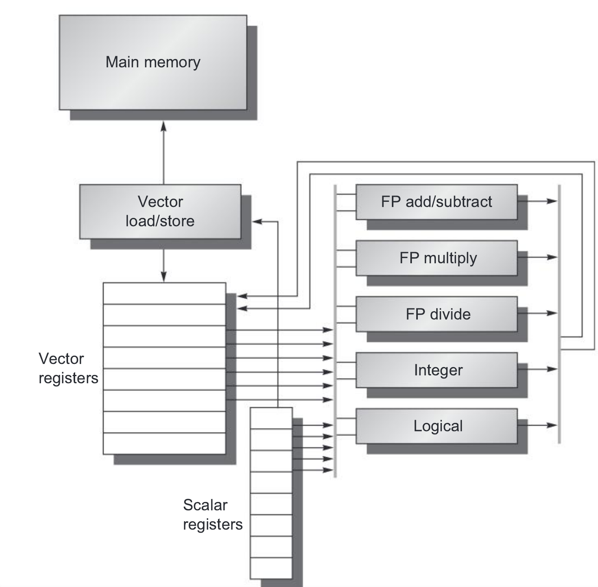{#fig-4-1 width=70%}

**指令的几种版本。** [图 4.2](#fig-4-2) 列出了本节用到的 RV64V 向量指令。[图 4.2](#fig-4-2) 的说明假设输入操作数都是向量寄存器，但这些指令也有某个操作数为标量寄存器（`xi` 或 `fi`）的版本。按源操作数的不同，每种向量指令分为几类：

* 源操作数都是向量寄存器，后缀 `.vv`；
* 一个向量寄存器和一个标量整数寄存器，后缀 `.vx`；
* 一个向量寄存器和一个标量整数立即数，后缀 `.vi`；
* 一个向量寄存器和一个标量浮点寄存器，后缀 `.vf`。

既然版本由操作数决定，我们通常让汇编器自动加上合适的后缀。标量值的副本在指令发射时交给向量功能部件。

[图 4.2　RV64V 向量指令。所有指令都采用 R 型指令格式。表中每个双操作数的向量操作都按两个操作数均为向量（`.vv`）的形式给出，但这些操作还有第二个操作数为标量寄存器的版本（`.vs`）；在有区别时，还有第一个操作数为标量寄存器、第二个操作数为向量寄存器的版本（`.sv`）。操作数的类型和宽度由各个向量寄存器的配置决定，不由指令给出。除了向量寄存器和谓词寄存器，还有两个向量控制和状态寄存器（CSR）`vl` 和 `vctype`，后面会讨论。带步长的数据传送和带索引的数据传送也在后面解释。]{#fig-4-2 .caption}

| 助记符 | 名称 | 说明 |
|---|---|---|
| `vadd` | ADD | 整数加：V[rs1] 与 V[rs2] 的元素相加，每个结果放入 V[rd] |
| `vsub` | SUBtract | 整数减：V[rs1] 的元素减去 V[rs2] 的元素，每个结果放入 V[rd] |
| `vmul` | MULtiply | 整数乘：V[rs1] 与 V[rs2] 的元素相乘，每个结果放入 V[rd] |
| `vdiv` | DIVide | 整数除：V[rs1] 的元素除以 V[rs2] 的元素，每个结果放入 V[rd] |
| `vmacc` | Multiply ACCumulate | 整数乘：V[rs1] 与 V[rs2] 的元素相乘，每个结果累加到 V[rd] |
| `vfadd` | Fp ADD | 浮点加：V[rs1] 与 V[rs2] 的元素相加，每个结果放入 V[rd] |
| `vfsub` | Fp SUBtract | 浮点减：V[rs1] 的元素减去 V[rs2] 的元素，每个结果放入 V[rd] |
| `vfmul` | Fp MULtiply | 浮点乘：V[rs1] 与 V[rs2] 的元素相乘，每个结果放入 V[rd] |
| `vfdiv` | Fp DIVide | 浮点除：V[rs1] 的元素除以 V[rs2] 的元素，每个结果放入 V[rd] |
| `vfmacc` | Fp Multiply ACCumulate | 浮点乘：V[rs1] 与 V[rs2] 的元素相乘，每个结果累加到 V[rd] |
| `vxor` | XOR | V[rs1] 与 V[rs2] 的元素按位异或，每个结果放入 V[rd] |
| `vor` | OR | V[rs1] 与 V[rs2] 的元素按位或，每个结果放入 V[rd] |
| `vand` | AND | V[rs1] 与 V[rs2] 的元素按位与，每个结果放入 V[rd] |
| `vsll` | Shift Left | V[rs1] 的元素左移 V[rs2] 位，每个结果放入 V[rd] |
| `vsrl` | Shift Right | V[rs1] 的元素右移 V[rs2] 位，每个结果放入 V[rd] |
| `vsra` | Shift Right Arithmetic | V[rs1] 的元素右移 V[rs2] 位，同时扩展符号位，每个结果放入 V[rd] |
| `vpeq` | Compare = | 比较 V[rs1] 与 V[rs2] 的元素。相等时，在 V[0] 对应的 1 位元素中置 1，否则置 0 |
| `vpne` | Compare != | 比较 V[rs1] 与 V[rs2] 的元素。不相等时，在 V[0] 对应的 1 位元素中置 1，否则置 0 |
| `vmxor` | Mask XOR | V[rs1] 与 V[rs2] 最低位的 1 位元素按位异或，每个结果放入 V[0] |
| `vmor` | Mask OR | V[rs1] 与 V[rs2] 最低位的 1 位元素按位或，每个结果放入 V[0] |
| `vpmand` | Mask AND | V[rs1] 与 V[rs2] 最低位的 1 位元素按位与，每个结果放入 V[0] |
| `vle`*i* | Contiguous Load（连续装入） | 从地址 R[rs1] 开始的存储器中把向量装入寄存器 V[rd]（*i* 位元素，*i* = 8、16、32 或 64；`vl` 设定元素个数） |
| `vlse`*i* | Strided Load（带步长装入） | 从地址 R[rs1] 开始、按 R[rs2] 中的步长把数据装入 V[rd]，即地址为 R[rs1] + j × R[rs2]，j = 0, 1, … |
| `vloxe`*i* | Indexed Load (Gather)（带索引装入，集中） | 用元素位于 R[rs2] + V[rs2] 处的向量装入 V[rs1]（即 V[rs2] 是索引） |
| `vse`*i* | Contiguous Store（连续存储） | 把向量寄存器 V[rd] 存入从地址 R[rs1] 开始的存储器 |
| `vsse`*i* | Strided Store（带步长存储） | 把 V[rd] 存入地址为 R[rs1]、步长在 R[rs2] 中的存储器（即 R[rs1] + j × R[rs2]，j = 0, 1, …） |
| `vsoxe`*i* | Indexed Store (Scatter)（带索引存储，分散） | 把 V[rs1] 存入元素位于 R[rs2] + V[rs2] 处的存储器向量（即 V[rs2] 是索引） |
| `setvl` | Set vector length | 设置元素宽度和寄存器个数（在 `vtype` 中），并把 `vl` 和目的寄存器设为 `mvl` 与源寄存器两者中的较小值 |

**数据宽度。** 传统的向量体系结构不能高效地支持窄数据类型，但向量本身天然能够容纳不同的数据宽度（Kozyrakis 和 Patterson，2002）。一个向量寄存器如果有 32 个 64 位元素，同样可以看成 128 个 16 位元素，甚至 256 个 8 位元素。正因为硬件能这样一物多用，向量体系结构既能用于多媒体应用，也能用于科学应用。

[图 4.2](#fig-4-2) 中的 RV64V 指令都没有给出数据宽度。这是 RV64V 的一项创新：数据宽度不像通常那样由指令给出，而是附属于*每个向量寄存器*。因此，程序在执行向量指令之前，要先配置所用的向量寄存器，指定它们的宽度。[图 4.3](#fig-4-3) 列出了 RV64V 可选的宽度。指定的办法是设置一个状态寄存器，把其中的标准元素宽度字段 SEW 设为相应的位数，例如 64。

[图 4.3　RV64V 支持的数据宽度，这里假设它还有单精度和双精度浮点扩展 RVS 和 RVD。在这样的 RISC-V 设计中加入 RVV，标量部件也必须加入 RVH。RVH 是一种标量指令扩展，用于支持半精度（16 位）IEEE 754 浮点数。RV32V 没有双字标量操作，因此它的向量部件可以去掉 64 位整数。如果某种 RISC-V 实现不包含 RVS 或 RVD，就可以省去向量浮点指令。]{#fig-4-3 .caption}

| 类型 | 宽度 |
|---|---|
| 整数 | 8、16、32 和 64 位 |
| 浮点 | 16、32 和 64 位 |

**动态寄存器类型的好处。** 这种做法称为*动态寄存器类型*，它有三个好处。

一是指令少。传统向量体系结构要支持这么多种宽度，需要很多条指令。按[图 4.3](#fig-4-3) 中的宽度种数计算，如果没有动态寄存器类型，[图 4.2](#fig-4-2) 会长得多。而且类型一经设定就不再改变，只指定一次，比每条指令都指定更高效。

二是程序员可以更好地利用向量寄存器堆。用不了多少向量寄存器的程序，可以把几个寄存器合起来，组成更长的向量。例如，设向量存储空间共 1024 字节，某个程序只需要 4 个存放 64 位浮点数的向量寄存器，它就可以把这块空间当作 4 个 256 字节的向量来用，每个向量有 256/8 = 32 个元素。具体做法是设置一个状态寄存器，把其中的长度倍增字段 LMUL 设为 8，表示每 8 个寄存器合成一组，于是只有 4 个可用的向量寄存器。

对向量体系结构有一种批评：状态多，上下文切换就慢。我们的 RV64V 实现使状态变为原来的 3 倍，从 2 × 32 × 8 = 512 字节增加到 2 × 32 × 8 + 1024 = 1536 字节。为了降低上下文切换的开销，处理器会记录自上次上下文切换以来软件有没有写过向量寄存器。

三是不同宽度操作数之间的转换，可以根据寄存器的配置，在算术指令中隐式完成，不必另加显式的转换指令。下一节会给出这方面的例子。

**向量访存与控制寄存器。** `vle` 和 `vse` 分别是向量 load 和向量 store，一次装入或存储一整个向量。它们有两个操作数：一个是要装入或存储的向量寄存器，另一个是 RV64G 通用寄存器，存放向量在存储器中的起始地址。除了向量寄存器本身，向量操作还要用到另外几种寄存器：向量的自然长度不等于 VLMAX 时，要用向量长度寄存器 `vl`；向量类型寄存器 `vtype` 记录寄存器的类型；循环中有 IF 语句时，要用谓词寄存器 `p`~*i*~。下面的例子会说明它们的用法。

有了向量指令，系统可以用多种方式对向量中的数据元素执行操作，包括同时处理许多元素。这种灵活性让向量设计可以用速度慢但宽度大的执行部件，以较低的功耗获得较高的性能。而且，向量指令系统中各元素相互独立，扩展功能部件时不必像超标量处理器那样另做代价高昂的相关检查。

### 向量处理器的工作原理：一个例子 {-}

理解向量处理器，最好的办法是看一个 RV64V 的向量循环。本节始终以下面这个典型的向量问题为例：

$$
\mathrm{Y} = \mathrm{a} \times \mathrm{X} + \mathrm{Y}
$$

其中 `X` 和 `Y` 是向量，开始时存放在存储器中，`a` 是标量。这就是 *SAXPY* 循环或 *DAXPY* 循环，它构成 Linpack 基准测试程序的内层循环（Dongarra 等，2003）。SAXPY 是 single-precision a × X plus Y（单精度 a × X 加 Y）的缩写，DAXPY 是 double-precision a × X plus Y（双精度 a × X 加 Y）的缩写。Linpack 是一组线性代数例程，Linpack 基准测试程序由执行高斯消去的例程组成。

暂且假设向量寄存器的元素个数，即*长度*（32），正好等于我们所关心的向量操作的长度。这一限制很快就会去掉。

**例题**　给出 DAXPY 循环的 RV64G 代码和 RV64V 代码。假设 X 和 Y 都有 32 个元素，`X` 和 `Y` 的起始地址分别在 `x5` 和 `x6` 中。（元素个数不是 32 的情况，后面另有例题讨论。）

**解答**　RISC-V 代码如下：

```
      fld    f0,a          # 装入标量 a
      addi   x28,x5,#256   # 要装入的最后一个地址
Loop: fld    f1,0(x5)      # 装入 X[i]
      fmul.d f1,f1,f0      # a × X[i]
      fld    f2,0(x6)      # 装入 Y[i]
      fadd.d f2,f2,f1      # a × X[i] + Y[i]
      fsd    f2,0(x6)      # 存入 Y[i]
      addi   x5,x5,#8      # X 的下标加 1
      addi   x6,x6,#8      # Y 的下标加 1
```

DAXPY 的 RV64V 代码如下：

```
vsetvl a3,a0,e64,m8,ta,ma # 4 个 64 位向量寄存器（SEW=64，LMUL=8）
fld    f0,a               # 装入标量 a
vle64  v0,(x5)            # 装入向量 X
vfmul  v8,v0,f0           # 向量-标量乘
vle64  v16,(x6)           # 装入向量 Y
vfadd  v24,v8,v16         # 向量-向量加
vse64  v24,(x6)           # 存储和
```

向量操作生成哪种版本，由汇编器决定：乘法有一个标量操作数，汇编器就生成 `vfmul.vf`；加法没有标量操作数，就生成 `vfadd.vv`。第一条指令把前 4 个向量寄存器配置成存放 64 位数据。

**指令带宽。** 上面两段代码最显著的区别在于，向量处理器大大降低了动态指令带宽：RV64V 只执行 8 条指令，RV64G 却要执行 258 条。原因有两个：一是向量操作一次处理 32 个元素；二是在 RV64G 上几乎占循环一半的开销指令，在 RV64V 代码中都不需要了。如果编译器为这样的指令序列生成了向量指令，而且生成的代码大部分时间运行在向量模式下，就称这段代码是*向量化*的或*可向量化*的。循环能否向量化，要看各次迭代之间有没有相关；没有相关的循环就可以向量化。迭代之间的相关称为*循环携带相关*（loop-carried dependence，见 4.5 节）。

**流水线互锁。** 两者的另一个重要区别，是 RV64G 简单实现上流水线互锁的频率。在直接写出的 RV64G 标量代码中，每条 `fadd.d` 都要等前面的 `fmul.d`，每条 `fsd` 又要等 `fadd.d`。而在向量处理器上，每条向量指令只在每个向量的第一个元素上停顿，后面的元素随即顺畅地流过流水线。因此，流水线停顿每条向量*指令*只发生一次，而不是每个向量*元素*发生一次。向量体系结构设计者把相关元素操作之间的前递称为*链接*（chaining），意思是把相关的操作「链」在一起。在这个例子中，RV64G 上的流水线停顿频率大约是 RV64V 的 32 倍。软件流水、循环展开（见附录 H）或乱序执行可以减少 RV64G 上的流水线停顿，但指令带宽上的巨大差距无法大幅缩小。

### 向量执行时间 {-}

一个向量操作序列的执行时间主要取决于三个因素：一是操作数向量的长度；二是操作之间的结构冒险；三是数据相关。向量部件接收新操作数、产生新结果的速率称为*发起速率*。已知向量长度和发起速率，就能算出一条向量指令的执行时间。

现代向量计算机的向量功能部件都有多条并行流水线（或称*车道*，lane），每个时钟周期能产生两个或更多结果，不过其中也可能有些功能部件不是全流水的。为简单起见，我们的 RV64V 实现只有一条车道，单个操作的发起速率为每个时钟周期一个元素。这样，一条向量指令的执行时间（以时钟周期计）大约就等于向量长度。

**护航指令组。** 为了简化对向量执行和向量性能的讨论，我们引入*护航指令组*（convoy）的概念。所谓护航指令组，就是一组有可能一起执行的向量指令。组内指令之间*不能*有任何结构冒险；如果有，就必须把它们串行化，放到不同的护航指令组中启动。按这个规定，前面例子中的 `vld` 和紧跟其后的 `vmul` 可以放在同一个护航指令组中。后面很快会看到，只要数一数一段代码有多少个护航指令组，就能估计它的性能。为了让分析简单，我们假设一个护航指令组执行完毕之后，其他指令（标量指令或向量指令）才能开始执行。

看起来，有写后读相关冒险的指令序列，也应该像有结构冒险的序列一样放进不同的护航指令组。但有了链接，它们就可以放在同一个护航指令组中。链接让一个向量操作在源向量操作数的各个元素一旦可用时就开始执行：链中第一个功能部件的结果「前递」给第二个功能部件。实际实现链接时，常常允许处理器同时读写同一个向量寄存器，只要读写的是不同元素。早期的链接实现与标量流水线中的前递完全一样，但这种方法限制了链中源指令和目的指令的时序。近来的实现采用*灵活链接*（flexible chaining）：只要不产生结构冒险，一条向量指令基本上可以与任何其他正在执行的向量指令链接。所有现代向量体系结构都支持灵活链接，本章始终假设采用灵活链接。

**钟鸣。** 要把护航指令组换算成执行时间，还需要一个估计护航指令组执行时间的度量，这就是*钟鸣*（chime），即执行一个护航指令组所用的时间单位。由 *m* 个护航指令组组成的向量序列，执行时间就是 *m* 个钟鸣。例如，向量长度为 *n* 时，在我们简单的 RV64V 实现上，执行时间大约为 *m* × *n* 个时钟周期。

钟鸣近似忽略了一些与具体处理器有关的开销，其中许多开销与向量长度有关。因此，用钟鸣计时对长向量比对短向量更准确。我们用钟鸣而不用每个结果的时钟周期数来度量，就是为了明确表示忽略了某些开销。

知道一个向量序列有多少个护航指令组，也就知道了以钟鸣计的执行时间。钟鸣忽略的开销之一，是在一个时钟周期内启动多条向量指令所受的限制。如果每个时钟周期只能启动一条向量指令（大多数向量处理器的实际情况就是这样），钟鸣数就会低估护航指令组的实际执行时间。不过，向量长度通常远大于护航指令组中的指令条数，因此我们简单地假设一个护航指令组在一个钟鸣内执行完。

**例题**　假设每种向量功能部件只有一个，说明下面的代码序列怎样划分成护航指令组：

```
vle64 v0,x5       # 装入向量 X
vfmul v1,v0,f0    # 向量-标量乘
vle64 v2,x6       # 装入向量 Y
vfadd v3,v1,v2    # 向量-向量加
vse64 v3,x6       # 存储和
```

这个向量序列要用多少个钟鸣？忽略向量指令的发射开销，每个 FLOP（浮点操作）需要多少个时钟周期？

**解答**　第一个护航指令组从第一条 `vle` 指令开始。`vfmul` 与第一条 `vle` 相关，但有了链接，二者可以放在同一个护航指令组中。

第二条 `vle` 指令与前一条 `vle` 指令在 load/store 部件上有结构冒险，必须放到另一个护航指令组中。`vfadd` 与第二条 `vld` 相关，同样可以通过链接与它放在同一个护航指令组中。最后，`vse` 与第二个护航指令组中的 `vld` 有结构冒险，只能放进第三个护航指令组。划分结果如下：

1. `vle`　`vfmul`
2. `vle`　`vfadd`
3. `vse`

这个序列需要 3 个护航指令组，也就是 3 个钟鸣。每个结果有 2 次浮点操作，因此每个 FLOP 需要 1.5 个时钟周期（忽略所有向量指令发射开销）。注意，虽然我们允许 `vld` 和 `vmul` 都在第一个护航指令组中执行，但大多数向量机要用 2 个时钟周期才能启动这两条指令。

这个例子说明，对长向量来说，钟鸣近似相当准确。例如，向量有 32 个元素时，以钟鸣计的时间是 3，这个序列大约要用 32 × 3 = 96 个时钟周期，而分两个时钟周期发射护航指令组带来的开销很小。

**启动时间。** 比发射限制重要得多的开销来源，是向量的*启动时间*，这也是钟鸣模型忽略的最重要的开销。所谓启动时间，是指流水线填满之前的延迟时钟周期数，主要由向量功能部件的流水线延迟决定。RV64V 采用与 Cray-1 相同的流水线深度，虽然更现代的处理器中延迟有增大的趋势，向量 load 尤其如此。所有功能部件都是全流水的，流水线深度如下：浮点加法 6 个时钟周期，浮点乘法 7 个，浮点除法 20 个，向量 load 12 个。

有了这些向量基础知识，下面几小节介绍一些优化。这些优化有的提高性能，有的扩大能在向量体系结构上高效运行的程序范围。具体来说，它们要回答以下问题：

* 向量处理器怎样以每个时钟周期多于一个元素的速度执行一个向量？每个时钟周期处理多个元素，可以提高性能。
* 向量长度与最大向量长度（mvl）不一致的程序，向量处理器怎样处理？大多数应用中的向量与体系结构的向量长度都不一致，这种常见情况需要一个高效的解决办法。
* 要向量化的代码中有 IF 语句时怎么办？条件语句处理得好，能向量化的代码就更多。
* 向量处理器对存储系统有什么要求？存储带宽不够，向量执行可能是白费功夫。
* 向量处理器怎样处理多维矩阵？多维矩阵是常用的数据结构，向量体系结构要得到广泛应用，就必须能把它向量化。
* 向量处理器怎样处理稀疏矩阵？稀疏矩阵也是常用的数据结构，同样必须能向量化。
* 怎样为向量计算机编程？体系结构上的创新如果与程序设计语言及其编译器不相适应，就可能得不到广泛使用。

本节其余部分依次介绍向量体系结构的这些优化，附录 G 有更深入的讨论。

### 多车道：每个时钟周期处理多个元素 {-}

向量指令系统的一个关键优势是：软件只用一条短指令，就能把大量并行工作交给硬件。一条向量指令可以包含几十个相互独立的操作，编码位数却和一条普通标量指令一样。向量指令的语义是并行的，所以实现时可以用多种方式完成这些逐元素的操作：

* 用一个深度流水的功能部件，到目前为止讨论的 RV64V 实现就是这样；
* 用一组并行的功能部件；
* 把并行和流水的功能部件结合起来。

[图 4.4](#fig-4-4) 说明了怎样用并行流水线执行一条向量加法指令，从而提高向量性能。

{#fig-4-4 width=90%}

RV64V 指令系统有一个性质：在所有向量算术指令中，一个向量寄存器的第 *N* 个元素只能与其他向量寄存器的第 *N* 个元素一起运算。这大大简化了高度并行的向量部件的设计：向量部件可以组织成多条并行的*车道*。和公路一样，增加车道就能提高向量部件的峰值吞吐率。[图 4.5](#fig-4-5) 是一个四车道向量部件的结构。在这个例子中，从一条车道增加到四条车道，一个钟鸣的时钟周期数就从 32 降到 8。多车道要发挥作用，应用和体系结构都必须支持长向量。否则，向量指令很短，执行得非常快，指令带宽就会跟不上，还得靠 ILP 技术（见第 3 章）来提供足够的向量指令。

每条车道包含向量寄存器堆的一部分，以及每个向量功能部件中的一条执行流水线。每个向量功能部件用多条流水线（每条车道一条）执行向量指令，速率为每个时钟周期一个元素组。所有向量寄存器的第一个元素（元素 0）都放在第一条车道中，因此任何向量指令的第一个元素，它的源操作数和目的操作数都在第一条车道里。这样分配以后，车道内的算术流水线不必与其他车道通信就能完成运算。车道之间不通信，构建高度并行的执行部件时就能少用布线和寄存器堆端口。这也说明了为什么向量计算机每个时钟周期最多能完成 64 次操作（16 条车道，每条车道 2 个算术部件和 2 个 load/store 部件）。

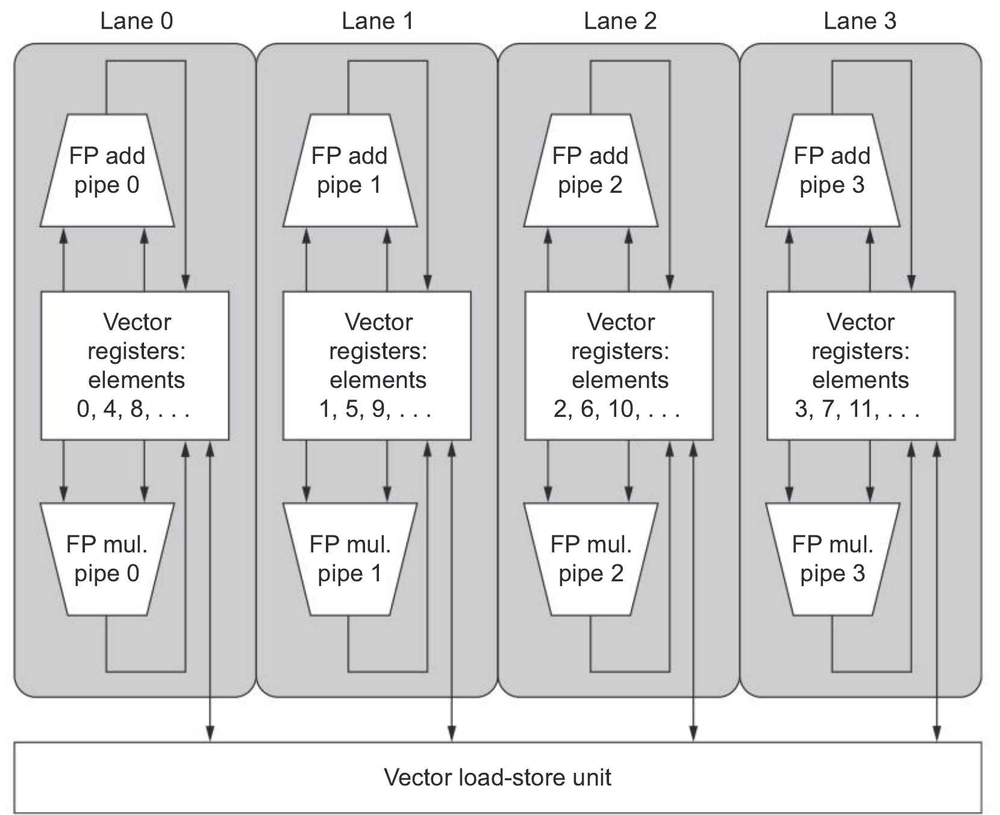{#fig-4-5 width=90%}

增加车道是提高向量性能的常用技术，因为它几乎不增加控制复杂度，也不需要修改已有的机器代码。设计者还可以借此在晶片面积、时钟频率、电压和能耗之间权衡，而不损失峰值性能：向量处理器的时钟频率减半时，把车道数加倍，峰值性能就能保持不变。

<!--chapter:end:04-dlp-01.Rmd-->

### 向量长度寄存器：处理长度不等于 32 的循环 {-}

向量寄存器处理器有一个由最大向量长度（mvl）决定的自然向量长度，上面的例子中是 32。程序中实际的向量长度不大可能正好等于这个值，而且某个向量操作的长度往往在编译时*无法确定*，同一段代码甚至可能要处理长度不同的向量。例如：

```c
for (i=0; i < n; i=i+1)
    Y[i] = a * X[i] + Y[i];
```

这里所有向量操作的长度都取决于 n，而 n 可能要到运行时才知道。n 还可能是包含这个循环的某个过程的参数，在执行过程中会发生变化。

**向量长度寄存器。** 解决办法是增加一个*向量长度寄存器*（`vl`），由它控制所有向量操作的长度，向量 load 和向量 store 也不例外。`vl` 中的值不能超过最大向量长度（mvl，RISC-V 中保存在 `VLMAX` 寄存器里）。所以，只要实际长度小于或等于 mvl，问题就解决了。有了 mvl 这个参数，后续各代计算机可以加长向量寄存器，而不必改动指令集。下一节将会讲到，多媒体 SIMD 扩展中没有与 mvl 相当的参数，每加长一次向量就要扩充一次指令集。

**分段开采。** 第二个问题是：`n` 的值在编译时未知，因而可能大于 mvl，即向量比最大长度还长，这时怎么办？传统的办法是*分段开采*（strip mining），见[图 4.6](#fig-4-6)。所谓分段开采，就是生成这样的代码：每个向量操作处理的长度都不超过 mvl。代码分成两部分：一个循环处理 mvl 整数倍的迭代；另有一段修正代码处理剩下的迭代，剩下的迭代次数必然小于 mvl。

RISC-V 不必单独写一个分段开采循环，它有更好的办法：指令 `setvl` 把 `VLMAX` 和循环变量 `n` 中较小的一个写入 `vl`（同时写入另一个寄存器）。具体分两种情况：

* 如果循环的迭代次数大于 `n`，循环每次最多只能计算 `VLMAX` 个值，`setvl` 就把 `vl` 设为 `VLMAX`；
* 如果 n 小于 `VLMAX`，循环最后一次迭代只应计算最后 `n` 个元素，`setvl` 就把 `VLMAX` 设为 `n`。

`setvl` 写入的另一个标量寄存器供后面的循环记账使用。下面是对任意 `n` 值都适用的向量 DAXPY 的 RV64V 代码。

{#fig-4-6 width=90%}

```
      vsetvl a3,a0,e64,m16,ta,ma # 2 个 64 位向量寄存器（SEW=64,LMUL=16）
      fld    f0,a                # 取标量 a
loop: vsetvl t0,a0               # vl = t0 = min(mvl,n)
      vle64  v0,x5               # 取向量 X
      slli   t1,t0,3             # t1 = vl * 8（以字节为单位）
      add    x5,x5,t1            # 指向 X 的指针增加 vl*8
      vfmul  v0,v0,f0            # 向量—标量乘法
      vle64  v1,x6               # 取向量 Y
      vfadd  v1,v0,v1            # 向量—向量加法
      sub    a0,a0,t0            # n -= vl (t0)
      vse64  v1,x6               # 把和存入 Y
      add    x6,x6,t1            # 指向 Y 的指针增加 vl*8
      bnez   a0,loop             # 若 n != 0 则重复
```

### 掩码寄存器：处理向量循环中的 IF 语句 {-}

根据 Amdahl 定律，程序的向量化程度只有低到中等时，加速比非常有限。向量化程度低的主要原因有两个：一是循环中有条件语句（IF 语句），二是使用了稀疏矩阵。IF 语句给循环引入了控制相关，所以循环中含有 IF 语句的程序，用前面讨论过的技术都无法在向量模式下运行。同样，前面介绍的功能也都不能高效地实现稀疏矩阵。这里先讨论如何处理条件执行，稀疏矩阵留到后面再讲。

看下面这个 C 语言循环：

```c
for (i = 0; i < 64; i=i+1)
    if (X[i] != 0)
        X[i] = X[i] - Y[i];
```

循环体是条件执行的，所以这个循环通常不能向量化。但如果内层循环只对 X[i] $\neq$ 0 的那些迭代执行，其中的减法就可以向量化。

**向量掩码控制。** 支持这种功能的常用扩展称为*向量掩码控制*。RV64V 用谓词寄存器保存掩码，实际上就是让向量指令中的每个元素操作都可以条件执行。条件执行指令用一个布尔条件决定是否执行一条标量指令（见第 3 章）；谓词寄存器则用一个布尔向量控制一条向量指令的执行，道理相同。设置了掩码寄存器以后，后续的向量指令只对谓词寄存器中对应项为 1 的那些元素操作；掩码为 0 的位置，目标向量寄存器中对应的项不受影响。RVV 并不另设掩码寄存器，而是用向量寄存器 v0 充当：指令带掩码执行时，v0 中每个元素的最低有效位（第 63 位）指出该元素的操作是否有效。

假设 `X` 和 `Y` 的起始地址分别在 `x5` 和 `x6` 中，上面的循环可以写成：

```
vsetvl  a3,a0,e64,m8,ta,ma # 4 个 64 位向量寄存器（SEW=64,LMUL=8）
vle64   v8,(x5)            # 把向量 X 取到 v8
vle64   v16,(x6)           # 把向量 Y 取到 v16
fmv.d.x f0,x0              # 把（浮点）0 放入 f0
vfne    v0,v8,f0           # 若 v8(i)!=f0，则把 v0<63>(i) 置 1
vfsub   v8,v8,v16, v0.t    # 在向量 v0 的掩码下做减法
vse64   v8,x5              # 把结果存入 X
```

利用条件执行把 IF 语句变成直线代码序列，编译器设计者称之为 *IF 转换*（IF-conversion）。

**掩码的开销。** 使用向量掩码寄存器是有开销的。在标量体系结构中，条件不满足时，条件执行指令照样要占用执行时间；不过它消除了转移和由此带来的控制相关，所以即使有时做的是无用功，速度仍可能更快。向量指令也一样：带掩码执行时，掩码为 0 的元素同样要花执行时间。即便掩码中有相当多的 0，向量掩码控制仍可能比标量模式快得多。

4.4 节将会看到，向量处理器和 GPU 的区别之一就在于处理条件语句的方式。向量处理器把谓词寄存器作为体系结构状态的一部分，由编译器显式地操作掩码寄存器；GPU 则由硬件操作内部的掩码寄存器来达到同样的效果，这些掩码寄存器对 GPU 软件不可见。两种做法中，不论掩码位是 0 还是 1，硬件都要花时间执行对应的向量元素，因此使用掩码时，每秒浮点操作数（FLOPs/second）都会下降。

### 存储体：为向量 load/store 部件提供带宽 {-}

向量 load/store 部件的行为比算术功能部件复杂得多。load 的*启动时间*是把第一个字从存储器取到寄存器所需的时间。如果向量的其余部分能够不停顿地供给，向量的*发起速率*就等于取出或存入新字的速率。与较简单的功能部件不同，这个发起速率不一定是每个时钟周期一个，因为存储体停顿会降低实际的吞吐率。

load/store 部件的启动开销通常比算术部件大，在许多处理器上超过 100 个时钟周期。对 RV64V，我们假设启动时间为 12 个时钟周期，与 Cray-1 相同。（近来的向量计算机用 Cache 来降低向量 load 和 store 的延迟。）

要维持每个时钟周期取出或存入一个字的发起速率，存储系统就必须能产生或接收这么多数据。把访问分散到多个独立的存储体（bank）上，通常就能达到这一速率。后面很快就会看到，存储体数量足够多，对访问数据行或数据列的向量 load 和 store 很有帮助。大多数向量处理器采用存储体，而不是简单的存储交叉，因为存储体允许多个独立的访问。原因有三：

1. 许多向量计算机每个时钟周期支持多个 load 或 store，而存储体的周期时间通常是处理器周期时间的好几倍。要让多个 load 或 store 同时访问，存储系统就需要多个存储体，并且能独立地控制送往各个存储体的地址。
2. 大多数向量处理器支持取出或存入不连续的数据字，这时需要对各存储体独立寻址，交叉访问不能满足要求。
3. 大多数向量计算机支持多个处理器共享同一个存储系统，每个处理器都会产生自己独立的地址流。

这几点合在一起，就要求有大量独立的存储体，下面的例题说明了这一点。

**例题**　Cray T90 的最大配置（Cray T932）有 32 个处理器，每个处理器每个时钟周期能产生 4 个 load 和 2 个 store。处理器时钟周期为 2.167 ns，存储系统所用 SRAM 的周期时间为 15 ns。要让所有处理器都以满存储带宽运行，至少需要多少个存储体？

**解答**　每个处理器每周期 6 次访存，32 个处理器每周期最多共 192 次访存。每个 SRAM 存储体的忙时间为 15/2.167 = 6.92 个时钟周期，向上取整为 7 个处理器时钟周期。因此至少需要 192 × 7 = 1344 个存储体！

Cray T932 实际只有 1024 个存储体，所以早期型号无法同时为所有处理器维持满带宽。后来的一次存储器升级把 15 ns 的异步 SRAM 换成了流水化的同步 SRAM，存储周期时间缩短到原来的一半以下，带宽才够用。

从更高的层次看，向量 load/store 部件与标量处理器中的预取部件作用相似：两者都是通过向处理器输送数据流来提供数据带宽。

### 步长：在向量体系结构中处理多维数组 {-}

一个向量中相邻的元素，在存储器中的位置不一定连续。看下面这段简单的 C 语言矩阵乘法代码：

```c
for (i = 0; i < 100; i=i+1)
    for (j = 0; j < 100; j=j+1) {
        A[i][j] = 0.0;
        for (k = 0; k < 100; k=k+1)
            A[i][j] = A[i][j] + B[i][k] * D[k][j];
    }
```

我们可以把 B 的每一行与 D 的每一列相乘的运算向量化，并以 k 为下标变量对内层循环做分段开采。

这样做就必须考虑：B 中的相邻元素、D 中的相邻元素分别怎样寻址。数组分配存储空间时要线性化，按*行主序*（如 C 语言）或*列主序*（如 Fortran）排列。线性化以后，同一行的元素和同一列的元素，总有一种在存储器中不相邻。例如，上面的 C 代码按行主序分配，内层循环各次迭代访问的 D 的元素，彼此相隔行的大小乘以 8（每项的字节数），共 800 字节。第 2 章讲过，在有 Cache 的系统中，可以用分块来改善局部性；没有 Cache 的向量处理器则需要另一种技术，来取出在存储器中不相邻的向量元素。

**步长。** 要收集到同一个向量寄存器中的各元素，在存储器中相隔的距离称为*步长*。本例中，矩阵 D 的步长为 100 个双字（800 字节），矩阵 B 的步长为 1 个双字（8 字节）。如果按 Fortran 的列主序存放，情况正好相反：矩阵 D 相邻元素的步长为 1，即 1 个双字（8 字节）；矩阵 B 的步长为 100，即 100 个双字（800 字节）。可见，不对循环重新排序，编译器就无法同时掩盖 B 和 D 中相邻元素之间的长距离。

向量一旦装入向量寄存器，各元素在逻辑上就是相邻的。因此，向量处理器只要有带步长功能的向量 load 和向量 store，就能处理大于 1 的步长，这种步长称为*非单位步长*。能够访问不连续的存储单元，并把它们整理成紧凑的结构，是向量体系结构的主要优势之一。

Cache 天生适合处理单位步长的数据。对单位步长的大型科学数据集，增大块可以降低失效率；但对以非单位步长访问的数据，增大块甚至会起反作用。分块技术能解决其中一部分问题（见第 2 章），但在某些问题上，能高效访问不连续的数据仍是向量处理器的优势，4.7 节会讲到这一点。

RV64V 的编址单位是字节，所以本例的步长是 800。步长必须动态计算，因为矩阵的大小在编译时可能未知，也可能像向量长度一样，同一条语句每次执行时都不同。向量步长和向量起始地址一样，可以放在通用寄存器中，然后用 RV64V 指令 `vlse`（带步长的向量 load）把向量取到向量寄存器中。同样，存储非单位步长的向量时，用指令 `vsse`（带步长的向量 store）。

**存储体冲突。** 支持大于 1 的步长会使存储系统变得复杂。有了非单位步长，就可能频繁地请求访问同一个存储体。多个访问争用同一个存储体，称为*存储体冲突*，其中一个访问必须停顿。满足下面的条件时，就会发生存储体冲突，从而引起停顿：

$$
\frac{\text{存储体数}}{\text{最小公倍数}(\text{步长}, \text{存储体数})} < \text{存储体忙时间}
$$

**例题**　假设有 8 个存储体，存储体忙时间为 6 个时钟周期，存储器总延迟为 12 个周期。以步长 1 完成一次 64 个元素的向量 load 需要多长时间？步长为 32 时呢？

**解答**　存储体数大于存储体忙时间，所以步长为 1 时，这次 load 需要 12 + 64 = 76 个时钟周期，即每个元素 1.2 个时钟周期。最坏的步长是存储体数的倍数，本例中步长为 32、存储体数为 8，正是这种情况。这时（第一次之后的）每次访存都会与前一次冲突，必须等待 6 个时钟周期的存储体忙时间。总时间为 12 + 1 + 6 * 63 = 391 个时钟周期，即每个元素 6.1 个时钟周期，速度降为原来的 1/5！

### 集中—分散：在向量体系结构中处理稀疏矩阵 {-}

前面说过，稀疏矩阵很常见，因此需要有相应的技术，让使用稀疏矩阵的程序也能在向量模式下执行。稀疏矩阵中，向量的元素通常以某种压缩形式存放，再间接访问。假设采用一种简化的稀疏结构，代码可能是这样的：

```c
for (i = 0; i < n; i=i+1)
    A[K[i]] = A[K[i]] + C[M[i]];
```

这段代码对数组 A 和 C 做稀疏向量求和，索引向量 K 和 M 分别指出 A 和 C 中的非零元素。（A 和 C 的非零元素个数必须相同，都是 `n` 个，所以 `K` 和 `M` 一样大。）

**集中与分散。** 支持稀疏矩阵的主要机制是使用索引向量的*集中—分散操作*，用来在稀疏矩阵的压缩表示（不含 0）和普通表示（含 0）之间转换：

* *集中*（gather）操作取一个*索引向量*，把基地址分别加上索引向量给出的各个偏移量得到一组地址，再取出这些地址上的元素组成一个向量，结果是向量寄存器中的一个稠密向量；
* 以稠密形式对这些元素运算以后，再用*分散*（scatter）store 按同一个索引向量，把稀疏向量以展开形式存回去。

对这类操作的硬件支持称为*集中—分散*，几乎所有现代向量处理器都提供这种支持。相应的 RV64V 指令是 `vloxe`（按索引取向量，即集中）和 `vsoxe`（按索引存向量，即分散）。例如，若 `x5`、`x6`、`x7` 和 `x28` 中存放的是上面代码中各向量的起始地址，内层循环可以用下面的向量指令编写：

```
vsetvl  a3,a0,e64,m8,ta,ma # 4 个 64 位向量寄存器（SEW=64,LMUL=8）
vle64   v0, x7             # 取 K[]
vloxe64 v8,x5,(v0)         # 取 A[K[]]
vle64   v16,x28            # 取 M[]
vloxe64 v24, x6, (v2)      # 取 C[M[]]
vadd    v8, v8, v24        # 相加
vsoxe64 v8, x5,(v0)        # 存 A[K[]]
```

有了这项技术，使用稀疏矩阵的代码就能在向量模式下运行。不过，简单的向量化编译器无法自动把上面的源代码向量化：编译器不知道 K 的各元素互不相同，也就无法断定其中不存在相关。这时需要程序员给出编译指示，告诉编译器在向量模式下运行这个循环是安全的。

**集中—分散的代价。** 带索引的 load 和 store（集中和分散）虽然可以流水化，但通常比不带索引的 load 和 store 慢得多，因为指令开始执行时还不知道要访问哪些存储体。此外，为了支持集中和分散，寄存器堆还必须在向量部件的各条车道之间提供通信。

集中或分散的每个元素都有各自的地址，不能成组处理，而且整个存储系统中的许多地方都可能发生冲突。因此，即使在有 Cache 的系统中，每个单独的访问延迟也相当大。不过，4.7 节将说明，体系结构设计者如果专门针对这种情况设计存储系统，并投入更多的硬件资源，就能获得比对这类不可预测的访问采取放任态度时更好的性能。

4.4 节将会看到，GPU 没有专门把地址限定为连续的指令，所以它的 load 全都是集中，store 全都是分散。为了把可能很慢的集中和分散变成效率更高的单位步长访存，GPU 硬件会在执行过程中设法识别连续的地址。

### 向量体系结构的编程 {-}

向量体系结构的一个优点是，编译器可以在编译时告诉程序员某段代码能否向量化，而且常常提示没能向量化的原因。这种执行模型简单明了，其他领域的专家也能学会如何改进性能：一是修改自己的代码，二是在可以假定操作之间互相独立时（例如集中—分散数据传送）给编译器提示。编译器和程序员之间这样对话，双方互相提示如何改进性能，向量计算机的编程因此变得简单。

今天，一个程序能否顺利地在向量模式下运行，主要取决于程序本身的结构：循环中是否存在真数据相关（见 4.5 节）？能否改写循环的结构来消除这种相关？这又取决于所选的算法，在一定程度上也取决于编码方式。

科学程序能达到怎样的向量化程度，可以从 Perfect Club 基准测试程序上观察到的数据看出来。[图 4.7](#fig-4-7) 给出了两个版本的代码在 Cray Y-MP 上运行时，以向量模式执行的操作所占的百分比：第一个版本只对原始代码做编译器优化；第二个版本采用了 Cray Research 程序员团队给出的大量提示。关于应用程序在向量处理器上性能的几项研究表明，编译器的向量化程度差别很大。

原来编译器自己向量化得不好的代码，在加了大量提示的版本中向量化程度明显提高，所有代码的向量化程度都在 50% 以上，中位数从约 70% 提高到约 90%。

<!--chapter:end:04-dlp-02.Rmd-->

[图 4.7　Perfect Club 基准测试程序在 Cray Y-MP 上运行时的向量化程度（Vajapeyam，1991）。第一列是编译器在没有提示时达到的向量化程度；第二列是 Cray Research 的程序员团队根据提示改进代码以后的结果。]{#fig-4-7 .caption}

| 基准测试程序 | 以向量模式执行的操作（编译器优化） | 以向量模式执行的操作（程序员协助） | 提示优化带来的加速比 |
|---|--:|--:|--:|
| BDNA | 96.1% | 97.2% | 1.52 |
| MG3D | 95.1% | 94.5% | 1.00 |
| FLO52 | 91.5% | 88.7% | N/A |
| ARC3D | 91.1% | 92.0% | 1.01 |
| SPEC77 | 90.3% | 90.4% | 1.07 |
| MDG | 87.7% | 94.2% | 1.49 |
| TRFD | 69.8% | 73.7% | 1.67 |
| DYFESM | 68.8% | 65.6% | N/A |
| ADM | 42.9% | 59.6% | 3.60 |
| OCEAN | 42.8% | 91.2% | 3.92 |
| TRACK | 14.4% | 54.6% | 2.52 |
| SPICE | 11.5% | 79.9% | 4.06 |
| QCD | 4.2% | 75.1% | 2.15 |

## 面向多媒体的 SIMD 指令系统扩展 {#sec-4-3}

多媒体 SIMD 扩展的出发点很简单：许多媒体应用处理的数据，比 32 位处理器所针对的数据类型要窄。例如，图形系统用 8 位表示一种基色，三基色之外再用 8 位表示透明度；音频采样视应用不同，通常用 8 位或 16 位表示。把加法器内部的进位链分割开，处理器就能同时对短向量做运算。以 256 位加法器为例，它可以同时处理 32 个 8 位操作数、16 个 16 位操作数、8 个 32 位操作数或 4 个 64 位操作数，而这种分割式加法器增加的成本很小。典型的多媒体 SIMD 指令见[图 4.8](#fig-4-8)。

SIMD 指令与向量指令相同的地方是，一条指令对一组数据指定同一种操作。不同的是寄存器堆的规模：向量计算机的寄存器堆很大，例如 RISC-V RV64V 有 32 个向量寄存器，每个可以存放比如 32 个 64 位元素；SIMD 指令指定的操作数往往较少，寄存器堆也就小得多。

[图 4.8　典型的 256 位宽操作的多媒体 SIMD 支持。IEEE 754-2008 浮点标准增加了半精度（16 位）和四精度（128 位）浮点操作。]{#fig-4-8 .caption}

| 指令类别 | 操作数 |
|---|---|
| 无符号加/减 | 32 个 8 位、16 个 16 位、8 个 32 位或 4 个 64 位 |
| 最大值/最小值 | 32 个 8 位、16 个 16 位、8 个 32 位或 4 个 64 位 |
| 平均值 | 32 个 8 位、16 个 16 位、8 个 32 位或 4 个 64 位 |
| 右移/左移 | 32 个 8 位、16 个 16 位、8 个 32 位或 4 个 64 位 |
| 浮点 | 16 个 16 位、8 个 32 位、4 个 64 位或 2 个 128 位 |

向量体系结构本来就是作为向量化编译器的目标设计的，指令系统简洁、优雅。与之相比，SIMD 扩展缺了三样主要的东西：向量长度寄存器，带步长的和集中—分散的数据传送指令，以及掩码寄存器。

1. **没有向量长度寄存器。** 多媒体 SIMD 扩展把数据操作数的个数固定在操作码里，结果 x86 体系结构的 MMX、SSE、AVX 和 AMX 扩展一共增加了数百条指令。向量体系结构则用向量长度寄存器指定当前操作的操作数个数。有些程序的向量天然就比体系结构支持的最大长度短，这种可变长度的向量寄存器很容易适应它们。此外，向量体系结构中隐含了一个最大向量长度，它和向量长度寄存器配合，就不必设置大量操作码。
2. **没有复杂的寻址方式。** 直到不久以前，多媒体 SIMD 都不支持向量体系结构那些更复杂的寻址方式，即带步长的访问和集中—分散访问。有了这两种访问，向量编译器能够成功向量化的程序就更多（见 [4.7 节](#sec-4-7)）。
3. **没有掩码寄存器。** 向量体系结构用掩码寄存器支持元素的条件执行，多媒体 SIMD 通常不提供，不过这一情况正在改变。

缺了这些，编译器生成 SIMD 代码就更难，用 SIMD 汇编语言编程也更费力。

**MMX。** x86 体系结构在 1996 年增加了 MMX 指令。MMX 借用了原有的 64 位浮点寄存器，基本指令可以同时完成 8 个 8 位操作或 4 个 16 位操作。随同加入的还有：并行的 MAX 和 MIN 操作，各种屏蔽指令和条件指令，数字信号处理器中常见的操作，以及一些被认为对重要媒体库有用的专用指令。MMX 访存用的也是原有的浮点数据传送指令。

**SSE。** 1999 年，MMX 的后继者流式 SIMD 扩展（SSE）问世。SSE 增加了 16 个独立的 128 位寄存器（`XMM` 寄存器），指令可以同时完成 16 个 8 位操作、8 个 16 位操作或 4 个 32 位操作，还能做并行的单精度浮点运算。寄存器是独立的，所以 SSE 需要单独的数据传送指令。此后不久，Intel 又通过 2001 年的 SSE2、2004 年的 SSE3 和 2007 年的 SSE4 增加了双精度 SIMD 浮点数据类型。只要程序员把操作数并排存放，一条指令就能完成 4 个单精度浮点操作或 2 个并行的双精度操作，x86 计算机的峰值浮点性能由此提高。每一代扩展还都加入了一些专用指令，用来加速当时被认为重要的特定多媒体功能。

**AVX。** 2010 年加入的高级向量扩展（AVX）再次把寄存器宽度加倍，达到 256 位（`YMM` 寄存器）。对所有较窄的数据类型，新指令每条完成的操作次数都比原来多一倍。[图 4.9](#fig-4-9) 列出了对双精度浮点计算有用的 AVX 指令。2013 年的 AVX2 增加了 30 条新指令，例如集中指令（`VGATHER`）和向量移位指令（`VPSLL`、`VPSRL`、`VPSRA`）。2017 年的 AVX-512 又把宽度加倍到 512 位（`ZMM` 寄存器），寄存器个数也再加倍到 32 个，并增加了大约 250 条新指令，其中包括分散指令（`VPSCATTER`）和掩码寄存器（`OPMASK`）。AVX 还为今后的版本把寄存器扩展到 1024 位做了准备。

**AMX。** 最新的扩展是高级矩阵扩展（AMX），2022 年问世的微处理器开始加入。AMX 的目标是支持矩阵乘法，这是机器学习最基本的运算（见第 7 章）。它增加了 8 个二维向量寄存器，称为 *tile*。每个 tile 为 16 × 256，即 16 行，每行 256 位，所以 AMX 增加的状态共 8 × 16 × 256/8 = 4096 字节。tile 矩阵乘法（TMUL）部件可以对 8 位整数或 BF16 格式的 16 位浮点数（见第 7 章）做矩阵乘法，因此一个 256 位的行可以存放 32 个 int8 数据或 16 个 BF16 数据。

[图 4.9　x86 体系结构中对双精度浮点程序有用的 AVX 指令。对 256 位 AVX 而言，紧缩双精度（packed-double）是指以 SIMD 方式执行的 4 个 64 位操作数。AVX 加宽以后，数据重排指令越来越重要，这类指令能把宽寄存器中不同部分的窄操作数组合起来。AVX 有在 256 位寄存器内混洗 32 位、64 位或 128 位操作数的指令，例如 BROADCAST 把一个 64 位操作数在 AVX 寄存器中复制 4 份。AVX 还有大量融合乘加/乘减指令，这里只列出两条。]{#fig-4-9 .caption}

| AVX 指令 | 说明 |
|---|---|
| `VADDPD` | 4 个紧缩双精度操作数相加 |
| `VSUBPD` | 4 个紧缩双精度操作数相减 |
| `VMULPD` | 4 个紧缩双精度操作数相乘 |
| `VDIVPD` | 4 个紧缩双精度操作数相除 |
| `VFMADDPD` | 4 个紧缩双精度操作数乘加 |
| `VFMSUBPD` | 4 个紧缩双精度操作数乘减 |
| `VCMPxx` | 比较 4 个紧缩双精度操作数，条件为 `EQ`、`NEQ`、`LT`、`LE`、`GT`、`GE`、… |
| `VMOVAPD` | 传送 4 个对齐的紧缩双精度操作数 |
| `VBROADCASTSD` | 把一个双精度操作数广播到 256 位寄存器中的 4 个位置 |

总的来说，这么多扩展的目的一直是加速精心编写的库，而不是让编译器来生成这类代码（见附录 H）。不过，近来的 x86 编译器已经在尝试生成这类代码，尤其是针对浮点密集型应用。SIMD 寄存器的宽度由操作码决定，因此宽度每加倍一次，SIMD 指令的条数也必须加倍。

多媒体 SIMD 扩展有这些缺点，为什么还如此流行？原因有以下几点：

- 一是成本低。最初在标准运算部件上增加这些扩展花费很少，实现也容易。
- 二是几乎不增加处理器状态。与向量体系结构相比，SIMD 扩展需要的额外处理器状态很少，而处理器状态总会影响上下文切换的时间。
- 三是对存储带宽要求不高。支持向量体系结构需要很高的存储带宽，许多计算机达不到。
- 四是避开了虚拟存储的问题。向量体系结构中一条指令可能产生 32 次访存，其中任何一次都可能引起缺页；SIMD 不必处理这类问题。最初的 SIMD 扩展对每组 SIMD 操作数分别做数据传送，这些操作数在存储器中是对齐的，因此不会跨越页边界。
- 五是容易扩充指令。SIMD 的「向量」短而定长，便于引入有助于新媒体标准的指令，例如做数据重排的指令，或者所需操作数比向量所能提供的更少或更多的指令。
- 最后，人们曾担心向量体系结构不能很好地与 Cache 配合。

较新的向量体系结构已经解决了上述所有问题。但最根本的一点在于，向后二进制兼容压倒一切，一种体系结构一旦走上 SIMD 这条路，就很难再回头。

**例题**　为了看看多媒体指令是什么样子，假设给 RISC-V 增加一个 256 位的 SIMD 多媒体指令扩展，暂且称为 RVP，P 表示「紧缩」（packed）。本例只考虑浮点。同时处理 4 个双精度操作数的指令，加后缀「`4D`」。与向量体系结构一样，可以把 SIMD 处理器看作有若干条车道，这里是 4 条。RV64P 把 F 寄存器扩展到全宽，这里是 256 位。下面给出 `DAXPY` 循环的 RISC-V SIMD 代码，为 SIMD 对 RISC-V 代码所做的改动加了下划线。假设 `X` 和 `Y` 的起始地址分别在 `x5` 和 `x6` 中。

**解答**　RISC-V SIMD 代码如下：

```
      fld       f0,a           #取标量 a
      splat.4D  f0,f0          #把 a 复制 4 份
      addi      x28,x5,        #256 #最后一个要取的地址
Loop: fld.4D    f1,0(x5)       #取 X[i] … X[i+3]
      fld.4D    f2,0(x6)       #取 Y[i] … Y[i+3]
                               # a×X[i+3]+Y[i+3]
      fsd.4D    f2,0(x6)       #存 Y[i]… Y[i+3]
      addi      x5,x5,#32      #X 的下标增量
      addi      x6,x6,#32      #Y 的下标增量
      bne       x28,x5,Loop    #检查是否完成
```

改动有三处：

- 每条 RISC-V 双精度指令都换成对应的 `4D` 指令；
- 增量从 8 改为 32；
- 增加一条 `splat` 指令，在 `f0` 的 256 位中放入 `a` 的 4 个副本。

RV64V 能把动态指令带宽降为原来的 1/32；RISC-V SIMD 的效果没有这样显著，但也降为原来的将近 1/4：它执行 67 条指令，RV64G 则要执行 258 条。这段代码事先知道元素的个数。而元素个数常常要到运行时才能确定，那样就需要再加一个分段开采循环，处理元素个数不是 4 的倍数的情况。

### 多媒体 SIMD 体系结构的编程 {-}

多媒体 SIMD 扩展是零散地、针对具体需要加进来的，所以使用这些指令最简单的办法，一直是调用库或者直接写汇编语言。

近来的扩展规整了许多，编译器有了更合适的目标。编译器借鉴向量化编译器的技术，已经开始自动生成 SIMD 指令。例如，今天的先进编译器能为科学计算代码生成 SIMD 浮点指令，使性能大大提高。但程序员必须保证存储器中的全部数据都按运行代码的 SIMD 部件的宽度对齐；否则，即使代码本来可以向量化，编译器也只会生成标量指令。

### Roofline 可视化性能模型 {-}

Roofline 模型（Williams 等，2009）可以直观地比较各种 SIMD 体系结构可能达到的浮点性能。这个模型很简单，画出来的图由水平线和斜线组成，模型因此得名，它的用处也正体现在这些线上（见[图 4.11](#fig-4-11)）。Roofline 模型用一张二维图把浮点性能、存储性能和运算强度联系起来。所谓*运算强度*，就是每访问 1 字节存储器所做的浮点操作次数，计算方法是用程序的浮点操作总数，除以程序执行期间与主存之间传送的数据总字节数。[图 4.10](#fig-4-10) 给出了几个示例计算内核（kernel）的相对运算强度。

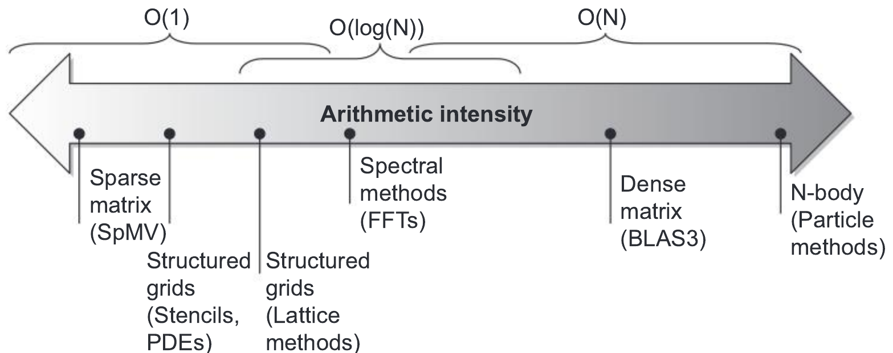{#fig-4-10 width=90%}

峰值浮点性能可以从硬件规格中查到。本案例研究中的许多内核放不进片上 Cache，所以峰值存储性能由 Cache 后面的存储系统决定。这里要的是处理器实际能得到的峰值存储带宽，而不只是 DRAM 引脚处的带宽（如第 328 页的[图 4.30](#fig-4-30)）。测定（实际提供的）峰值存储性能，一种办法是运行 Stream 基准测试程序。

[图 4.11](#fig-4-11) 左边是 NEC SX-9 向量处理器的 Roofline 模型，右边是 Intel Core i7 920 多核处理器的 Roofline 模型。两张图的纵轴 y 都是可达到的浮点性能，范围从 2 GFLOPS/s 到 256 GFLOPS/s；横轴 x 都是运算强度，范围从每访问 1 字节 DRAM 做 1/8 次浮点操作，到每访问 1 字节 DRAM 做 16 次浮点操作。图采用双对数坐标。每台计算机的 Roofline 只需画一次。

**怎样画 Roofline。** 对一个给定的内核，先按它的运算强度在 x 轴上找到一点，过这一点作竖线，这个内核在这台计算机上的性能必定落在这条竖线上的某处。再画一条水平线，表示这台计算机的峰值浮点性能。水平线是硬件的极限，实际浮点性能显然不可能超过它。

峰值存储性能又怎样画呢？x 轴是 FLOPs/byte，y 轴是 FLOPs/second，所以 bytes/second 在图中就是一条 45° 的斜线。

这样，Roofline 模型中就可以画出第三条线：对给定的运算强度，这台计算机的存储系统所能支持的最大浮点性能。把这几种极限写成公式，就能画出[图 4.11](#fig-4-11) 中的这些线：

$$
\text{可达到的 GFLOPs/s} = \text{Min}(\text{峰值存储带宽} \times \text{运算强度},\ \text{峰值浮点性能})
$$

{#fig-4-11 width=90%}

如果觉得上面的结论来得太快，可以换个方式再推一遍。设曲线 y = f(x) 表示存储带宽被充分利用时的性能极限。曲线上任意一点 (x, y) 都对应一个计算速率（y 轴）和一个存储带宽。存储带宽在图上是隐含的：x 轴（FLOPs/byte）反映的是计算量与完成这些计算所需存储量之间的权衡。具体地说，图上给定一点 (x, y)，它的存储带宽为 m = y/x，因为 y 轴的单位是 FLOPs/second，x 轴的单位是 FLOPs/byte，两者相除得到 bytes/second，正是存储带宽的单位。把这个式子改写成 y = m \* x，再令 m 为系统恒定的峰值存储带宽，它描述的就是一条斜率为 m 的直线。

「Roofline」（屋顶线）按内核的运算强度给出其性能的上界。把运算强度想象成一根顶到屋顶的柱子：柱子顶在屋顶的平坦部分，说明性能受计算能力限制；顶在倾斜部分，说明性能最终受存储带宽限制。[图 4.11](#fig-4-11) 中，右边的竖直虚线（运算强度为 4）属于前一种情况，左边的竖直虚线（运算强度为 1/4）属于后一种情况。一台计算机的 Roofline 模型与内核无关，画好以后可以反复使用。

**脊点。** 斜屋顶与平屋顶的交点称为「脊点」（ridge point），从它可以看出一台计算机的特点。脊点很靠右，说明只有运算强度很高的内核才能达到这台计算机的最高性能；脊点很靠左，说明几乎任何内核都有可能达到最高性能。下面会看到，与其他 SIMD 处理器相比，这台向量处理器不仅存储带宽高得多，脊点也很靠左。

从[图 4.11](#fig-4-11) 可以看出，SX-9 的峰值计算性能是 Core i7 的 2.4 倍，存储性能则是 Core i7 的 10 倍。对运算强度为 0.25 的程序，SX-9 的性能是 Core i7 的 10 倍（40.5 GFLOP/s 对 4.1 GFLOP/s）。存储带宽更高，脊点就从 Core i7 的 2.6 左移到 SX-9 的 0.6。这意味着在这台向量处理器上，能达到峰值计算性能的程序要多得多。

### 向量体系结构与多媒体 SIMD 计算机的异同 {-}

前面说过，SIMD 的一个优点是，最初支持数据并行非常容易，成本也低。体系结构设计者只需把现有的寄存器和 ALU 分割成许多 8 位、16 位或 32 位的片段，再并行地对它们计算。数据宽度和操作由操作码给出，数据传送就是对单个寄存器的 load 和 store。

为了支持更多的数据并行、进一步加速 SIMD，设计者随后又把寄存器宽度加倍，以便同时计算更多的片段。ISA 历来坚持向后二进制兼容，而数据宽度又由操作码规定，所以扩展 SIMD 寄存器的同时，SIMD 指令集也跟着扩展。SIMD 寄存器的宽度和 SIMD 指令的条数一次次加倍，ISA 的规模随之不断膨胀，代价由处理器设计者、编译器编写者和汇编语言程序员承担。从 1978 年到现在，x86 指令集从 80 条指令增加到大约 1400 条，主要就是 SIMD 造成的。

向量计算机的做法不同。它从主存中把数据集中起来，放进长而连续的向量寄存器，由流水化的执行部件在向量寄存器上高效地计算，再把结果从向量寄存器分散存回主存。load/store 的操作数在主存中可以连续存放，也可以不连续存放（非单位步长），还可以随机存放（集中—分散）；进入向量寄存器以后，操作数总是连续的。简单的向量处理器可能每次只执行一个向量元素，但各元素的操作按定义相互独立，所以理论上处理器可以同时计算所有元素。今天的向量处理器通常每个时钟周期执行 2 个、4 个或 8 个字元素；向量长度不是每个时钟周期所执行元素数的整数倍时，剩下的边缘情况由硬件处理。向量也和 SIMD 一样能处理不同的数据宽度：每个寄存器有 N 个 64 位元素的向量处理器，也能对 2N 个 32 位元素、4N 个 16 位元素或 8N 个 8 位元素的向量做计算。

[图 4.12](#fig-4-12) 汇总了 DAXPY 程序在 x86 AVX2 和 RV32V 上的指令数（Patterson 和 Waterman，2017）。在 SIMD 代码中，真正做计算的部分与记账代码相比只占很小一部分，x86 AVX2 的代码有 2/3 到 3/4 是 SIMD 开销。记账代码要做三件事：一是复制标量变量 a，供 SIMD 执行使用；二是分段开采，处理 n 不是 SIMD 寄存器宽度整数倍的情况；三是在 n 为 0 时跳过主循环。RV32V 代码不需要这些记账代码，静态指令数因此大大减少。这是因为 RV32V 与 SIMD 不同，它有向量长度寄存器 `vl`，向量指令对任何 `n` 值都能正确工作；它还有 `vsetvl` 指令，能自动处理 `n` 不是向量车道数整数倍的情况和 `n` 为 0 的情况。

[图 4.12　DAXPY 程序的指令数，以及 n = 1000 时执行的总指令数。]{#fig-4-12 .caption}

| ISA | IA-32 AVX2 | RV32 V |
|---|--:|--:|
| 指令数（静态） | 29 | 13 |
| 每次主循环的指令数 | 6 | 10 |
| 记账指令数 | 23 | 3 |
| 每次主循环得到的结果数 | 4 | 64 |
| 指令数（动态，n = 1000） | 1517 | 163 |

不过，SIMD 与向量处理最大的差别并不在静态代码量，而在执行的指令数：SIMD 执行的指令数是 RV32V 的 10～20 倍，因为 SIMD 每次循环只处理 2 个或 4 个元素，向量则处理 64 个。取指和译码多了，完成同样的任务就要消耗更多的能量。

再与 DAXPY 的标量版本比较。SIMD 版本的主循环大小不变，但代码量（按指令数和字节数计）大约是标量版本的 2 倍；动态执行的指令数降为原来的 1/2 或 1/4，取决于 SIMD 寄存器的宽度。RV32V 向量代码的静态代码量只是标量版本的 1.2 倍，动态指令数却降为原来的 1/43。

动态指令数的差别虽然很大，但可能还不是 SIMD 与向量之间最重要的差别，更重要的也许是 ISA 和记账代码的规模急剧膨胀。x86 这类 ISA 奉行向后二进制兼容的原则，指令系统采用演进式设计，每改变一次 SIMD 宽度，都必须把为较窄 SIMD 寄存器定义的所有旧 SIMD 指令重新定义一遍。多代 SIMD ISA 已经造出了数百条 x86 指令，今后还会再造出数百条。汇编语言程序员的认知负担因此很重：`vfmadd213pd` 是什么意思？什么时候该用它？这也意味着第三方应用程序必须重新编写代码，才能用上这些新指令，而这在很多情况下并不容易。

RV64V 代码则不受向量寄存器存储容量的影响。向量存储容量扩大时，RV64V 代码不用修改，甚至不用重新编译。最大向量长度 `VLMAX` 的值由处理器提供给 RV64V，因此处理器设计者把向量存储容量加倍也好、减半也好，代码都无须改动。

SIMD ISA 直接规定了硬件，要获得更多的 DLP，就必须修改指令集和编译器。向量 ISA 则允许处理器设计者针对自己的应用选择数据并行所需的资源，而不影响程序员和编译器。在遵循「体系结构与实现相分离」这一设计原则方面，向量体系结构做得好得多。

<!--chapter:end:04-dlp-03.Rmd-->

## 图形处理器 {#sec-4-4}

花几百美元就能买到一块 GPU 芯片，插到桌边的 PC 上，得到数千个并行的浮点部件。价格低、使用方便，高性能计算因此走进了许多人的手中。后来又出现了让 GPU 更容易编程的程序设计语言，两者一结合，GPU 计算便兴盛起来。

今天说到用 GPU 计算，可能指三种用途：

1. 用 GPU 生成图形；
2. 用 GPU 做科学计算或多媒体计算；
3. 用 GPU 做机器学习计算。

在图形生成上，GPU 的地位无可争议。在科学计算和多媒体应用领域，如今许多程序员都在权衡该用 GPU 还是 CPU；例如，截至 2022 年，全球最快的 500 台超级计算机中有 30% 依靠 GPU 完成大部分计算。做机器学习（第 7 章的主题）的程序员则更倾向于 GPU。

在计算机体系结构的谱系中，GPU 和 CPU 追溯不到同一个祖先，也不存在一个能把两者联系起来的「缺失环节」。[4.10 节](#sec-4-10) 将会讲到，GPU 的主要祖先是图形加速器，GPU 正是为了把图形做好而诞生的。GPU 虽然在向主流计算靠拢，却不能丢掉继续出色地处理图形这一本职。因此，从架构师的角度来理解 GPU 的设计会更清楚：为了做好图形，已经投入了这么多硬件，怎样再加以补充，才能让更多种类的应用也获得更高的性能？

本节只讨论用 GPU 做计算。GPU 计算怎样与图形加速这一传统角色结合，可参阅 John Nickolls 和 David Kirk 撰写的「Graphics and Computing GPUs」，即本书作者所著《计算机组成与设计》（*Computer Organization and Design*）第 6 版的附录 C。

GPU 的术语和一些硬件特性与向量体系结构、SIMD 体系结构差别很大。我们认为，先介绍 GPU 的简化编程模型，再讲它的体系结构，读者会更容易理解。

### GPU 编程 {-}

> CUDA 为算法中并行性的表达问题提供了一个优雅的解决方案。它不能解决所有算法，但能解决的已经足够多，足以产生重要影响。它似乎在某种程度上契合我们思考和编写代码的方式，让我们能更容易、更自然地表达任务级以外的并行性。
>
> ——Vincent Natol，「Kudos for CUDA」，*HPC Wire*（2010）

GPU 程序员面对的难题不只是让程序在 GPU 上跑出好的性能，还要协调两件事：一是计算在系统处理器和 GPU 上如何调度，二是数据在系统存储器和 GPU 存储器之间如何传送。此外，本节后面会看到，编程环境所能表达的各种并行性，GPU 几乎全都具备：多线程、MIMD、SIMD，乃至指令级并行。

为了同时应对异构计算和多种形式并行性这两方面的难题，提高 GPU 程序员的开发效率，NVIDIA 决定开发一种类 C 的语言和编程环境，命名为 *CUDA*，即 Compute Unified Device Architecture（计算统一设备体系结构）。CUDA 为系统处理器（*主机*）生成 C/C++ 代码，为 GPU（*设备*，CUDA 中的 D 即由此而来）生成一种 C 和 C++ 的方言。在 NVIDIA 看来，所有这些形式的并行性都可以统一到 *CUDA 线程*（CUDA Thread）上。CUDA 线程是最低层次的并行，以它作为编程原语，编译器和硬件就能把成千上万个 CUDA 线程组织起来，利用 GPU 中的各种并行：多线程、MIMD、SIMD 和指令级并行。所以，NVIDIA 把 CUDA 编程模型归为单指令多线程（*SIMT*）。这些线程按块组织、成组执行，一组线程称为一个*线程块*（Thread Block），原因后面很快会讲到。执行一整个线程块的硬件，我们称为*多线程 SIMD 处理器*（multithreaded SIMD Processor）。

给出 CUDA 程序的例子之前，还要交代几个细节：

- CUDA 用 `__device__` 或 `__global__` 标明 GPU（设备）上的函数，用 `__host__` 标明系统处理器（主机）上的函数，以示区分。
- 用 `__device__` 声明的 CUDA 变量分配在 GPU 存储器中（见下文），所有多线程 SIMD 处理器都能访问。
- 调用在 GPU 上运行的函数 *name*，采用扩展的函数调用语法：

  *name*`<<<dimGrid, dimBlock>>>`(…*参数列表*…)

  其中 `dimGrid` 指定代码的维数（以线程块为单位），`dimBlock` 指定块的维数（以线程为单位）。
- 块的标识符为 `blockIdx`，块内每个线程的标识符为 `threadIdx`；此外，CUDA 还提供关键字 `blockDim` 表示每块的线程数，它的值来自上一条中的参数 `dimBlock`。

先来看 [4.2 节](#sec-4-2) 中 `DAXPY` 循环的普通 C 代码：

```c
// 调用 DAXPY
daxpy(n, 2.0, x, y);
// C 语言的 DAXPY
void daxpy(int n, double a, double *x, double *y)
{
    for (int i = 0; i < n; ++i)
        y[i] = a*x[i] + y[i];
}
```

下面是 CUDA 版本。程序启动 `n` 个线程，每个向量元素对应一个线程；每个线程块有 256 个 CUDA 线程，在一个多线程 SIMD 处理器上执行。GPU 函数先由块 ID、每块线程数和线程 ID 算出对应的元素下标 `i`，只要下标没有越出数组（`i < n`），就做乘法和加法。

```c
// 以每个线程块 256 个线程调用 DAXPY
__host__int nblocks = (n + 255) / 256;
daxpy<<<nblocks, 256>>>(n, 2.0, x, y);
// CUDA 的 DAXPY
__global__
void daxpy(int n, double a, double *x, double *y)
{
    int i = blockIdx.x*blockDim.x + threadIdx.x;
    if (i < n) y[i] = a*x[i] + y[i];
}
```

对比两段代码，可以看出把数据并行代码改写成并行 CUDA 代码的常用模式。C 版本的循环中，每次迭代都与其他迭代无关，因此可以直接把它变换成并行代码：每次迭代成为一个独立的线程。（前面提到过，[4.5 节](#sec-4-5) 还会详细讨论：向量化编译器同样要求循环的各次迭代之间没有相关，这种相关称为*循环携带相关*（loop-carried dependence）。）在 CUDA 中，程序员通过指定网格的维数和每个 SIMD 处理器的线程数，显式地确定并行性。由于每个元素分配一个线程，各线程把结果写回存储器时不必相互同步。

并行执行和线程管理都由 GPU 硬件负责，不由应用程序或操作系统完成。为了简化硬件调度，CUDA 要求各线程块能够独立地、以任意顺序执行。不同的线程块之间不能直接通信，但可以借助全局存储器中的原子访存操作相互*协调*。

后面很快会看到，许多 GPU 硬件概念在 CUDA 中是看不出来的。追求性能的程序员用 CUDA 写程序，心里必须装着 GPU 硬件：CUDA 编程模型看起来像 MIMD，但要写出高效的 GPU 代码，程序员必须按 SIMD 操作来思考。这样做可能降低开发效率，不过大多数程序员之所以用 GPU 而不用 CPU，本来就是为了性能。他们知道（原因稍后解释）：一是要让每组 32 个线程在控制流上保持一致，多线程 SIMD 处理器才能发挥最佳性能；二是每个多线程 SIMD 处理器上要创建多得多的线程，才能隐藏 DRAM 的延迟；三是数据地址要集中在一个或少数几个存储块内，才能得到预期的存储器性能。

与许多并行系统一样，CUDA 在开发效率和性能之间的折中办法是提供内建函数（intrinsics），让程序员能够显式地控制硬件。一边是开发效率，一边是让程序员能表达硬件所能做的一切，两者之间的较量在并行计算中屡见不鲜。在这场经典的效率与性能之争中，CUDA 语言会怎样演变，它会不会在其他 GPU 乃至其他风格的体系结构上流行起来，都值得关注。

### NVIDIA GPU 的计算结构 {-}

上面说的这种与众不同的渊源，有助于解释 GPU 为什么有自己的体系结构风格，有一套独立于 CPU 的术语。理解 GPU 的一大障碍就是它的行话，有些术语的名字甚至会让人误解。这个障碍出人意料地难以跨越，本章的多次改写就是明证。

我们要兼顾两个目标：一是让 GPU 的体系结构易于理解，二是让读者掌握许多定义不同寻常的 GPU 术语。为此，我们的做法是：软件方面用 CUDA 术语；硬件方面先用描述性更强的术语，有时借用 OpenCL 的术语。用我们的术语讲清 GPU 体系结构之后，再把它们对应到 NVIDIA GPU 的官方行话。

[图 4.13](#fig-4-13) 从左到右依次列出四项内容：本节使用的描述性名称、主流计算中最接近的术语、NVIDIA GPU 的官方行话（供有兴趣的读者参考），以及术语的简要说明。本节其余部分都用图中左列的描述性术语来讲解 GPU 的微结构特性。

[图 4.13　本章所用 GPU 术语速查。硬件术语用第一列的名称。这 11 个术语分为四组，从上到下依次是：程序抽象、机器对象、处理硬件和存储硬件。第 312 页的[图 4.21](#fig-4-21) 把向量术语与这里最接近的术语对应起来；第 317 页的[图 4.24](#fig-4-24) 和第 318 页的[图 4.25](#fig-4-25) 给出 CUDA/NVIDIA 和 AMD 的官方术语及定义，以及 OpenCL 所用的术语。]{#fig-4-13 .caption}

| 类型 | 描述性名称 | GPU 以外最接近的旧术语 | CUDA/NVIDIA 官方 GPU 术语 | 简要说明 |
|---|---|---|---|---|
| 程序抽象 | 可向量化循环 | 可向量化循环 | Grid | 在 GPU 上执行的可向量化循环，由一个或多个能够并行执行的线程块（向量化循环的循环体）组成 |
| | 向量化循环的循环体 | （经过分段开采的）向量化循环的循环体 | Thread Block | 在一个多线程 SIMD 处理器上执行的向量化循环，由一个或多个 SIMD 指令线程组成，这些线程可以通过局部存储器通信 |
| | SIMD 车道操作序列 | 标量循环的一次迭代 | CUDA Thread | SIMD 指令线程的一个纵向切片，对应由一个 SIMD 车道执行的一个元素。结果是否保存，取决于掩码和谓词寄存器 |
| 机器对象 | SIMD 指令线程 | 向量指令线程 | Warp | 传统意义上的线程，但只包含在多线程 SIMD 处理器上执行的 SIMD 指令。结果是否保存，取决于每个元素的掩码 |
| | SIMD 指令 | 向量指令 | PTX Instruction | 在各 SIMD 车道上执行的一条 SIMD 指令 |
| 处理硬件 | 多线程 SIMD 处理器 | （多线程）向量处理器 | Streaming Multiprocessor | 执行 SIMD 指令线程，与其他 SIMD 处理器相互独立 |
| | 线程块调度器 | 标量处理器 | Giga Thread Engine | 把多个线程块（向量化循环的循环体）分配给多线程 SIMD 处理器 |
| | SIMD 线程调度器 | 多线程 CPU 中的线程调度器 | Warp Scheduler | 一个硬件部件，在 SIMD 指令线程就绪时调度并发射它们；内含记分牌，用来跟踪 SIMD 线程的执行 |
| | SIMD 车道 | 向量车道 | Thread Processor | 在单个元素上执行 SIMD 指令线程中的操作。结果是否保存，取决于掩码 |
| 存储硬件 | GPU 存储器 | 主存 | Global Memory | GPU 中所有多线程 SIMD 处理器都能访问的 DRAM 存储器 |
| | 私有存储器 | 栈或线程局部存储（OS） | Local Memory | DRAM 存储器中为每个 SIMD 车道私有的部分 |
| | 局部存储器 | 局部存储器 | Shared Memory | 供一个多线程 SIMD 处理器使用的快速局部 SRAM，其他 SIMD 处理器不能访问 |
| | SIMD 车道寄存器 | 向量车道寄存器 | Thread Processor Registers | 单个 SIMD 车道中的寄存器，在整个线程块（向量化循环的循环体）范围内分配 |

NVIDIA 的系统是 GPU 体系结构的代表，所以我们以它为例。具体来说，术语沿用前面介绍的 CUDA 并行编程语言，实例采用 NVIDIA Pascal GPU（见 [4.7 节](#sec-4-7)）。后续的 NVIDIA GPU 基本微结构相同，一般只是复制了 Pascal 的某些特性。

**与向量体系结构的异同。** 与向量体系结构一样，NVIDIA GPU 只适合数据级并行问题。两者都有集中—分散数据传送和掩码寄存器，而 NVIDIA GPU 处理器的寄存器比向量处理器还多。有些功能，向量处理器用软件实现，NVIDIA GPU 却用硬件实现，原因在于向量处理器带有一个标量处理器，可以执行软件函数。与大多数向量体系结构不同，NVIDIA GPU 还依靠单个多线程 SIMD 处理器内部的多线程来隐藏访存延迟（见第 2 章和第 3 章）。不过，无论是向量体系结构还是 GPU，程序员都要按成组的 SIMD 操作来思考，才能写出高效的代码。

**网格与线程块。** 在 NVIDIA GPU 上运行的代码称为*网格*（Grid），一个网格由一组*线程块*组成。[图 4.13](#fig-4-13) 把网格比作向量化的循环，把线程块比作这个循环的循环体（经过分段开采，成为一个完整的计算循环）。下面举一个具体例子，本节会一直用它：两个向量相乘，`A = B * C`，每个向量长 8192 个元素。[图 4.14](#fig-4-14) 给出这个例子与上面两个 GPU 术语的关系。完成全部 8192 个元素乘法的 GPU 代码称为一个*网格*（相当于向量化的循环）。为了分解成便于管理的规模，网格由若干*线程块*（相当于向量化循环的循环体）组成，每个线程块最多处理 512 个元素。注意，一条 GPU SIMD 指令一次处理 32 个元素。向量共有 8192 个元素，8192 ÷ 512 = 16，所以这个例子有 16 个线程块。网格和线程块是在 GPU 硬件中实现的编程抽象，用来帮助程序员组织 CUDA 代码。（线程块类似于向量长度为 32 的分段开采向量循环。）

{#fig-4-14 width=75%}

执行线程块代码的处理器，我们称为*多线程 SIMD 处理器*；把线程块分配给它的是*线程块调度器*（Thread Block Scheduler）。线程块调度器由硬件实现，程序员只需告诉它要运行多少个线程块。在这个例子中，线程块调度器会把 16 个线程块发给多线程 SIMD 处理器，由这 16 个线程块算出循环的全部 8192 个元素。

[图 4.15](#fig-4-15) 是多线程 SIMD 处理器的简化框图。它与向量处理器相似，区别在于功能部件：向量处理器只有少数几个深度流水的功能部件，多线程 SIMD 处理器则有许多并行的功能部件。在[图 4.14](#fig-4-14) 的编程例子中，每个多线程 SIMD 处理器分到向量中的 512 个元素。SIMD 处理器是完整的处理器，各有独立的 PC，用线程来编程（见第 3 章）。

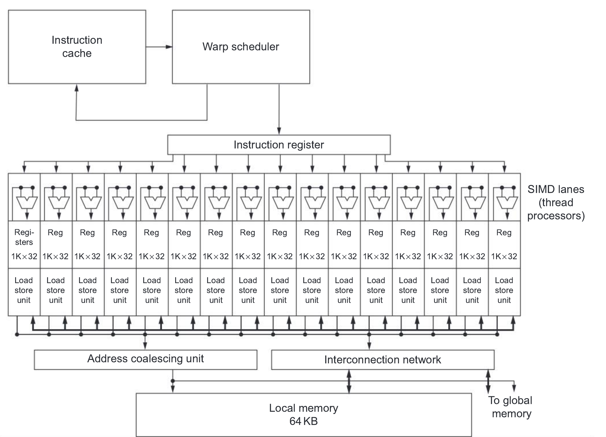{#fig-4-15 width=90%}

GPU 硬件包含一组多线程 SIMD 处理器，由它们执行由线程块（相当于向量化循环的循环体）组成的网格。换句话说，GPU 是一个由多线程 SIMD 处理器构成的多处理器。

一个 GPU 可以有 1 个到几十个多线程 SIMD 处理器。例如，Pascal P100 系统有 56 个，Hopper H100 有 132 个，较小的芯片可能只有一两个。各型号 GPU 的多线程 SIMD 处理器数目不同，为了在各型号之间实现透明的可扩展性，线程块（向量化循环的循环体）由线程块调度器分配给多线程 SIMD 处理器。[图 4.16](#fig-4-16) 是 Pascal 体系结构的 P100 实现的布局图。

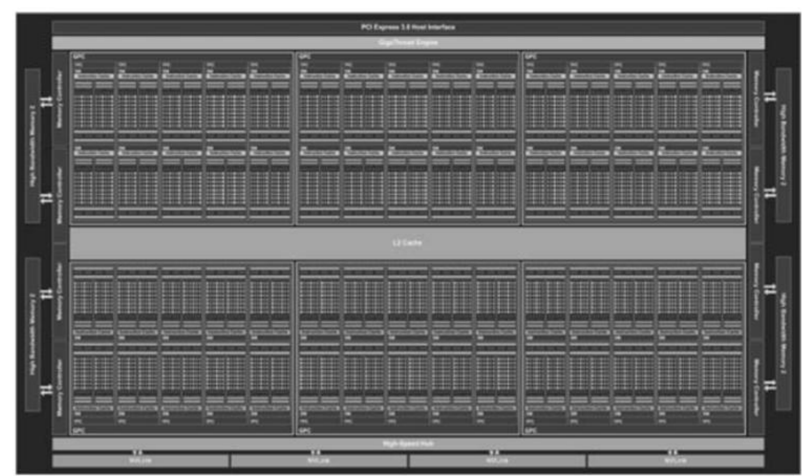{#fig-4-16 width=90%}

**SIMD 指令线程与两级调度。** 再深入一层，硬件创建、管理、调度和执行的机器对象是 *SIMD 指令线程*。它就是传统的线程，只不过全部由 SIMD 指令组成。每个 SIMD 指令线程有自己的 PC，在多线程 SIMD 处理器上运行。*SIMD 线程调度器*（SIMD Thread Scheduler）掌握哪些 SIMD 指令线程已经就绪，把它们送到分派部件，在多线程 SIMD 处理器上运行。因此，GPU 有两级硬件调度器：

（1）*线程块调度器*，把线程块（向量化循环的循环体）分配给多线程 SIMD 处理器；

（2）SIMD 处理器*内部*的 SIMD 线程调度器，决定 SIMD 指令线程何时在处理器内运行。

这些线程的 SIMD 指令宽度为 32，所以在这个例子中，每个 SIMD 指令线程计算其中的 32 个元素，每个线程块包含 512/32 = 16 个 SIMD 线程（见[图 4.14](#fig-4-14)）。

**SIMD 车道。** 线程由 SIMD 指令组成，SIMD 处理器就必须有并行的功能部件来执行这些操作。我们把这些功能部件称为 *SIMD 车道*（SIMD Lane），它们与 [4.2 节](#sec-4-2) 中的向量车道非常相似。

Pascal GPU 把每个 32 宽的 SIMD 指令线程映射到 16 个物理 SIMD 车道上，因此 SIMD 指令线程中的每条 SIMD 指令要用 2 个时钟周期才能完成。每个 SIMD 指令线程都以锁步方式执行，只在开始时调度一次。如果继续把 SIMD 处理器比作向量处理器，可以说它有 16 个车道，向量长度为 32，钟鸣（chime）为 2 个时钟周期。（正因为它这样又宽又浅，我们才选用更准确的说法「SIMD 处理器」，而不说「向量处理器」。）

注意，GPU SIMD 处理器的车道数可以取任何值，只要不超过线程块中的线程数，正如向量处理器的车道数可以在 1 到最大向量长度之间变化。例如，在各代 GPU 中，每个 SIMD 处理器的车道数在 8 到 32 之间变动。

**SIMD 线程调度器。** 按照定义，各 SIMD 指令线程相互独立，所以 SIMD 线程调度器可以挑选任何一个已就绪的 SIMD 指令线程，不必拘泥于某个线程内顺序上的下一条 SIMD 指令。SIMD 线程调度器内含一个记分牌（见第 3 章），最多跟踪 64 个 SIMD 指令线程，用来判断哪条 SIMD 指令可以执行，因为这些线程中各 SIMD 指令的执行时间长短不一。访存指令的延迟尤其不固定：Cache 和 TLB 时而命中、时而失效，所以要靠记分牌判断这些指令何时完成。[图 4.17](#fig-4-17) 表示 SIMD 线程调度器随着时间推移，以不同的顺序挑选 SIMD 指令线程。GPU 架构师的假设是：GPU 应用有大量的 SIMD 指令线程，因而多线程既能隐藏 DRAM 延迟，又能提高多线程 SIMD 处理器的利用率。

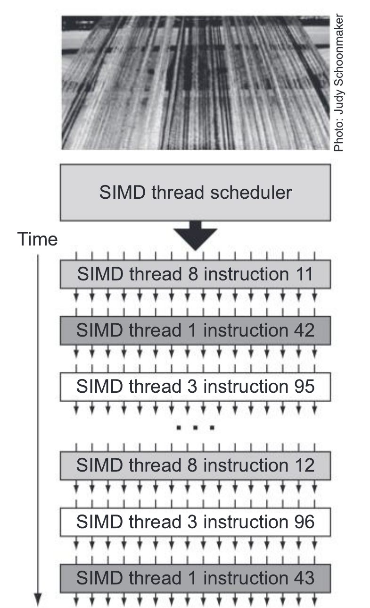{#fig-4-17 width=50%}

**寄存器。** 回到向量乘法的例子：每个多线程 SIMD 处理器先要把两个向量的 32 个元素从存储器装入寄存器，再读写寄存器完成乘法，最后把乘积从寄存器存回存储器。为了容纳这些存储器元素，一个 SIMD 处理器有多达 32,768～65,536 个 32 位寄存器（[图 4.15](#fig-4-15) 中每个车道 1024 个），具体数目取决于 Pascal GPU 的型号。与向量处理器一样，这些寄存器在逻辑上分布在各个向量车道上，在这里就是分布在各个 SIMD 车道上。

每个 SIMD 线程最多只能使用 256 个寄存器。因此，可以把一个 SIMD 线程看成最多有 256 个向量寄存器，每个向量寄存器有 32 个元素，每个元素 32 位宽。（双精度浮点操作数占用两个相邻的 32 位寄存器，所以也可以看成每个 SIMD 线程有 128 个向量寄存器，每个有 32 个元素，每个元素 64 位宽。）

寄存器用量和最大线程数之间存在权衡：每个线程用的寄存器少，能容纳的线程就多；用的寄存器多，线程就少。也就是说，并非所有 SIMD 线程都要用到最大数量的寄存器。Pascal 的架构师认为，如果所有线程都配最大数量的寄存器，这块宝贵的硅片面积会有很大一部分闲置。

为了能执行许多 SIMD 指令线程，物理寄存器采用动态分配：SIMD 指令线程创建时，在各 SIMD 处理器上分到一组物理寄存器；SIMD 线程退出时再释放。例如，程序员可以让一个线程块每个线程用 36 个寄存器、有比如 16 个 SIMD 线程，同时让另一个线程块每个线程用 20 个寄存器、有 32 个 SIMD 线程。之后的线程块可能以任意顺序到来，寄存器只能按需分配。这种可变性可能造成碎片，使一些寄存器无法使用；但在实践中，同一个可向量化循环（「网格」）中的大多数线程块使用的寄存器数相同。硬件必须知道每个线程块的寄存器位于大寄存器堆的什么位置，这一信息按线程块记录。一个线程块的某个寄存器可能落在寄存器堆中的任何位置，所以要实现这种灵活性，硬件必须具备路由、仲裁和分体（banking）功能。

注意，CUDA 线程只是 SIMD 指令线程的一个纵向切片，对应由一个 SIMD 车道执行的一个元素。要当心，CUDA 线程与 POSIX 线程大不相同：CUDA 线程不能随意发起系统调用。

有了这些准备，就可以来看 GPU 指令是什么样子了。

<!--chapter:end:04-dlp-04.Rmd-->

### NVIDIA GPU 的指令系统结构 {-}

大多数系统处理器的编译器直接面向硬件指令集，NVIDIA 的编译器则不同，它面向的是硬件指令集的一个抽象，即 *PTX*（*Parallel Thread Execution*，并行线程执行）。PTX 给编译器提供了一套稳定的指令集，也保证了各代 GPU 之间的兼容；硬件指令集则对程序员隐藏。一条 PTX 指令描述单个 CUDA 线程上的操作，通常与一条硬件指令一一对应，但也可能一条 PTX 指令展开成多条机器指令，或者多条 PTX 指令对应一条机器指令。PTX 的一次写入寄存器数量不限，而实际设备上的硬件寄存器数量固定、可以反复读写，所以编译器必须运行寄存器分配过程，把 PTX 寄存器映射到硬件寄存器上。之后运行的优化器还能进一步减少寄存器的使用，同时删除死代码、合并指令，并找出转移可能分叉的位置和分叉路径可能汇合的位置。

x86 微结构与 PTX 有相似之处：两者都要把指令转换成一种内部形式（x86 转换成微指令）。区别在于转换的时机和手段：x86 在执行时由硬件转换，GPU 则在装入时由软件转换。

PTX 指令的格式为

```
opcode.type d, a, b, c ; comment
```

其中 `d` 是目的操作数，`a`、`b`、`c` 是源操作数，分号右边全是注释。操作类型 `opcode.type` 取下列之一：

| 类型 | .type 说明符 |
|---|---|
| 无类型位，8、16、32 和 64 位 | `.b8`、`.b16`、`.b32`、`.b64` |
| 无符号整数，8、16、32 和 64 位 | `.u8`、`.u16`、`.u32`、`.u64` |
| 有符号整数，8、16、32 和 64 位 | `.s8`、`.s16`、`.s32`、`.s64` |
| 浮点数，16、32 和 64 位 | `.f16`、`.f32`、`.f64` |

源操作数可以是 32 位或 64 位寄存器，也可以是常数。目的操作数除 store 指令外都是寄存器。

[图 4.18](#fig-4-18) 列出了基本的 PTX 指令集。所有指令都可以受 1 位谓词寄存器控制，谓词寄存器由设置谓词指令 `setp` 设置。控制流指令包括函数调用 `call` 与返回 `return`、线程退出 `exit`、转移 `branch`，以及线程块内各线程之间的栅栏同步 `bar.sync`。转移指令前面加上谓词，就成了条件转移。虚拟寄存器由编译器或 PTX 程序员声明，分为 32 位和 64 位，可以有类型，也可以无类型。例如 `R0`、`R1`、……存放 32 位值，`RD0`、`RD1`、……是 64 位寄存器。前面说过，PTX 的虚拟寄存器在装入时才分配到物理寄存器。

第 292 页 DAXPY 循环的一次迭代可以写成下面的 PTX 指令序列：

```
shl.u32 R8, blockIdx, 8      ; Thread Block ID * Block size
                             ; (256 or 28)
add.u32 R8, R8, threadIdx    ; R8 = i = my CUDA Thread ID
shl.u32 R8, R8, 3            ; byte offset
ld.global.f64 RD0, [X+R8]    ; RD0 = X[i]
ld.global.f64 RD2, [Y+R8]    ; RD2 = Y[i]
mul.f64 RD0, RD0, RD4        ; Product in RD0 = RD0 * RD4
                             ; (scalar a)
add.f64 RD0, RD0, RD2        ; Sum in RD0 = RD0 + RD2 (Y[i])
st.global.f64 [Y+R8], RD0    ; Y[i] = sum (X[i]*a + Y[i])
```

CUDA 程序员为每次循环迭代分配一个 CUDA 线程。CUDA 给每个线程块一个唯一的编号 `blockIdx`，给块内每个 CUDA 线程也一个唯一的编号 `threadIdx`。这样，程序创建 8192 个 CUDA 线程，用各自唯一的编号去寻址数组元素，不需要递增和转移的代码。前三条 PTX 指令在 `R8` 中算出本线程元素的字节偏移量，这个偏移量再加上数组的基地址。其后的 PTX 指令装入两个双精度浮点操作数，做乘法和加法，再把和存回去。（CUDA 代码 `if (i < n)` 对应的 PTX 代码后面再介绍。）

从这个例子可以看出 GPGPU 程序员的一般做法：先设法创建尽可能多的线程，然后可能再针对已知的低效来源（如未合并的访存）进一步优化。NVIDIA 提供的一些 CUDA 示例就是这样：先给出简单但不一定高效的核函数，再逐步改成更高效的代码，归约就是一例。

{#fig-4-18 width=100%}

**地址合并。** 向量体系结构为顺序、按步长和集中—分散三种数据传送分别设置了指令，GPU 则没有这种区分，它的所有数据传送都是集中—分散方式。为了找回顺序（单位步长）传送的效率，GPU 设有专门的地址合并（Address Coalescing）硬件。这个硬件在运行时检测一个 SIMD 指令线程中的各个 SIMD 车道是否在共同发出顺序的地址；如果是，就通知存储接口部件发出一次块传送请求，传送 32 个连续的字。要获得这项重要的性能提升，GPU 程序员必须保证相邻的 CUDA 线程同时访问相近的地址，使这些访问能合并成一个或少数几个存储块或 Cache 块。前面的例子正是这样做的。

### GPU 中的条件转移 {-}

处理 IF 语句与处理单位步长数据传送一样，向量体系结构和 GPU 的做法十分相似。区别在于：向量体系结构主要靠软件实现，硬件支持有限；GPU 则更多地依靠硬件。后面会看到，GPU 的转移硬件除了显式的谓词寄存器，还用到内部掩码、转移同步栈和指令标记，用来管理转移何时分叉成多条执行路径、这些路径又何时汇合。

**PTX 汇编层次。** 在这一层，一个 CUDA 线程的控制流由 PTX 的 branch、call、return 和 exit 指令描述，再加上逐条指令、逐个线程车道的谓词控制；谓词由程序员通过每个线程车道各自的 1 位谓词寄存器指定。PTX 汇编器分析 PTX 的转移图，把它优化成最快的 GPU 硬件指令序列。每个线程都可以对转移自行判断，不必与其他线程步调一致。

**GPU 硬件指令层次。** 在这一层，控制流指令有转移、跳转、变址跳转、调用、变址调用、返回、退出，以及管理转移同步栈的专用指令。早期的一些 GPU 为每个 SIMD 线程配备一个自己的栈，栈表项包括一个标识令牌、一个目标指令地址和一个目标线程活跃掩码。有一些 GPU 专用指令为 SIMD 线程压入栈表项；另一些专用指令和指令标记则弹出一个栈表项，或者把栈回退到指定的表项，然后带着目标线程活跃掩码转移到目标指令地址。GPU 硬件指令同样可以逐个车道施加谓词控制（允许或禁止），每个车道由一个 1 位谓词寄存器指定。Volta GPU 及其后继产品取消了这个栈，允许 warp 拆分。

PTX 汇编器对控制流的处理分几种情况：

* 简单的外层 IF-THEN-ELSE 语句：即使用 PTX 转移指令编写，PTX 汇编器通常也把它优化成纯粹受谓词控制的 GPU 指令，其中没有任何 GPU 转移指令。
* 较复杂的控制流：通常生成谓词控制与 GPU 转移指令的混合体，并带有使用转移同步栈的专用指令和标记。当一部分车道转移到目标地址、另一部分车道顺序执行下去时，就压入一个栈表项，NVIDIA 称这种情况为转移*分叉*。当某个 SIMD 车道执行到同步标记或汇合时，也使用这种混合方式：弹出一个栈表项，按表项中的线程活跃掩码转移到表项给出的地址。
* 循环：PTX 汇编器识别出循环转移，生成转移到循环顶部的 GPU 转移指令，同时生成专用的栈指令，用来处理个别车道跳出循环的情况，并在所有车道都完成循环后让各 SIMD 车道汇合。
* switch 语句和函数调用：GPU 的变址跳转和变址调用指令向栈中压入表项，等所有车道都完成 switch 语句或函数调用后，SIMD 线程再汇合。

**谓词控制的执行过程。** GPU 的设置谓词指令（[图 4.18](#fig-4-18) 中的 `setp`）计算 IF 语句的条件，随后的 PTX 转移指令依据这个谓词执行。如果 PTX 汇编器生成的是不含 GPU 转移指令的谓词控制指令，它就用每个车道的谓词寄存器，逐条指令地允许或禁止各个 SIMD 车道：

* THEN 部分：线程中的 SIMD 指令把操作广播给所有 SIMD 车道，谓词为 1 的车道执行操作并保存结果，其余车道既不执行也不保存。
* ELSE 部分：指令使用（相对 THEN 部分）取反的谓词，原来空闲的车道现在执行操作、保存结果，原来活跃的车道则不执行。
* ELSE 部分之后：指令不再受谓词控制，原来的计算继续进行。

因此，两条路径长度相等时，IF-THEN-ELSE 的效率只有 50%，甚至更低。

IF 语句可以嵌套，所以要用栈。遇到复杂的控制流，PTX 汇编器通常生成谓词控制指令、GPU 转移指令和专用同步指令的混合体。嵌套很深时，执行嵌套的条件语句期间大多数 SIMD 车道可能都处于空闲状态。两条路径长度相等时，两层嵌套的 IF 语句效率为 25%，三层为 12.5%，依此类推。向量处理器也有类似情况：嵌套的 if 语句会把各层条件组合起来设置向量掩码寄存器，结果只有少数掩码位为 1。

**转移同步标记。** 再深入一层细节。PTX 汇编器在适当的条件转移指令上设置「转移同步」标记，把当前活跃掩码压入每个 SIMD 线程内部的栈中。如果条件转移发生分叉（一部分车道转移，另一部分顺序执行下去），就压入一个栈表项，并根据条件设置当前的内部活跃掩码。在 ELSE 部分之前，另一个转移同步标记弹出分叉转移的表项，并把掩码位取反。（IF-ELSE 语句嵌套时，调整掩码位比简单取反要复杂一些。）在 IF 语句末尾，PTX 汇编器再加一个转移同步标记，把栈中先前的活跃掩码弹出，作为当前活跃掩码。

**全 1 和全 0 掩码的优化。** 如果掩码位全为 1，THEN 部分末尾的转移指令就跳过 ELSE 部分的指令。THEN 部分也有类似的优化：掩码位全为 0 时，条件转移直接跳过 THEN 部分的指令。并行的 IF 语句和 PTX 转移常常使用一致的转移条件，即所有车道都同意走同一条路径，这样 SIMD 线程就不会分叉成各车道各自的控制流。PTX 汇编器对这类转移作了优化，跳过 SIMD 线程中没有任何车道执行的指令块。这种优化对条件错误检查之类的代码很有用：检查必须做，但条件很少成立。

一条与 4.2 节类似的条件语句如下：

```c
if (X[i] != 0)
  X[i] = X[i] – Y[i];
else X[i] = Z[i];
```

这条 IF 语句可以编译成下面的 PTX 指令（假设 `R8` 中已经是按比例换算过的线程 ID）。其中 `*Push`、`*Comp`、`*Pop` 是 PTX 汇编器插入的转移同步标记，作用分别是压入旧掩码、对当前掩码取反、弹出以恢复旧掩码：

```
        ld.global.f64 RD0, [X+R8]   ; RD0 = X[i]
        setp.neq.s32 P1, RD0, #0    ; P1 is predicate reg 1
        @!P1, bra ELSE1, *Push      ; Push old mask, set new
                                    ; mask bits if P1 false, go to ELSE1
        ld.global.f64 RD2, [Y+R8]   ; RD2 = Y[i]
        sub.f64 RD0, RD0, RD2       ; Difference in RD0
        st.global.f64 [X+R8], RD0   ; X[i] = RD0
        @P1, bra ENDIF1, *Comp      ; complement mask bits
                                    ; if P1 true, go to ENDIF1
ELSE1:ld.global.f64 RD0, [Z+R8]     ; RD0 = Z[i]
        st.global.f64 [X+R8], RD0   ; X[i] = RD0
ENDIF1:< next instruction >, *Pop   ; pop to restore old mask
```

再强调一次：SIMD 处理器通常会执行 IF-THEN-ELSE 语句中的全部指令，只是执行 THEN 部分时只有一部分 SIMD 车道处于允许状态，执行 ELSE 部分时则是另一部分车道。前面提到，有一种情况出人意料地常见：各车道对谓词控制的转移判断一致，例如按一个对所有车道都相同的参数值转移，所有活跃掩码位全为 0 或全为 1。这时转移会跳过 THEN 部分或 ELSE 部分的指令。

**灵活性的代价。** 这种灵活性让每个元素看起来都有自己的程序计数器。但在最慢的情况下，每 2 个时钟周期只有一个 SIMD 车道能保存结果，其余车道都空闲。向量体系结构中对应的最慢情况，是只有一个掩码位为 1。不熟悉 GPU 的程序员可能因为这种灵活性写出性能很差的程序，不过在程序开发的早期阶段，它也可能有帮助。要记住的是，一个 SIMD 车道在一个时钟周期内只有两种选择：要么执行 PTX 指令指定的操作，要么空闲；两个 SIMD 车道不能同时执行不同的指令。（后面几段会把这种方案与向量方法作对比。）

把 SIMD 指令线程中的每个元素称为 *CUDA 线程*，部分原因也在于这种灵活性：它让人觉得每个元素都在独立行动。不熟悉 GPU 的程序员可能以为，有了线程这层抽象，GPU 处理条件转移就更从容：一些线程走这条路，其余线程走那条路。只要不在乎速度，看起来确实如此。实际上，每个 CUDA 线程要么在执行与线程块中其他所有线程相同的指令，要么空闲。正因为各线程同步执行，带条件转移的循环反而更容易处理：掩码机制可以关闭 SIMD 车道，还能自动检测循环何时结束。

所以，实际性能有时与这种简单的抽象并不相符。让 SIMD 车道以这种高度独立的 MIMD 方式运行，就好比在物理内存较小的计算机上运行占用大量虚拟地址空间的程序：两种程序都是正确的，但很可能慢得让程序员无法满意。

**与向量体系结构的对比。** 条件执行这件事，GPU 在运行时用硬件完成，向量体系结构则在编译时完成。向量编译器做两次 IF 转换，生成四个不同的掩码。执行过程与 GPU 基本相同，只是向量方式要多执行一些额外开销指令。向量体系结构的优势在于它与标量处理器集成在一起：当 0 的情况在计算中占多数时，可以避开这些情况所花的时间。何时改用标量更好，要看标量处理器与向量处理器的速度之比，交叉点大概在掩码位为 1 的比例低于 20% 的时候。反过来，GPU 也有一项优化是向量体系结构在编译时做不到的：在运行时发现掩码位全为 0 或全为 1，就跳过 THEN 部分或 ELSE 部分。

可见，GPU 执行条件语句的效率，归根到底取决于转移分叉的频繁程度。例如，有一个特征值计算程序条件嵌套很深，但对代码的测量表明，大约 82% 的时钟周期发射中，32 个掩码位里有 29 到 32 个为 1。因此，GPU 执行这段代码的效率比人们预想的要高。

同样的机制也用来处理向量循环的分段开采，即元素个数与硬件不完全匹配的情况。本节开头的例子中，有一条 IF 语句检查本 SIMD 车道的元素编号（前面的例子中存放在 `R8` 中）是否小于上限（`i < n`），并据此设置掩码。两种方法的关键区别是：向量编译器设置掩码寄存器，并生成不同的循环（n 层嵌套时最多 2^n^ 个）；GPU 则由硬件跟踪掩码和嵌套。两种方法的运行时间相近。

### NVIDIA GPU 的存储结构 {-}

[图 4.19](#fig-4-19) 给出了 NVIDIA GPU 的存储结构。

**私有存储器。** 多线程 SIMD 处理器中的每个 SIMD 车道都分得片外 DRAM 中的一块私有区域，我们称之为*私有存储器*，用来存放栈帧、溢出的寄存器，以及寄存器中放不下的私有变量。各 SIMD 车道*不*共享私有存储器。GPU 把私有存储器缓存在 L1 和 L2 Cache 中，以方便寄存器溢出，并加快函数调用。

**局部存储器。** 每个多线程 SIMD 处理器独有的片上存储器，我们称之为*局部存储器*。它是一个小容量的便笺存储器，延迟低（几十个时钟周期），带宽高（每个时钟周期 128 字节）。需要重复使用的数据，不论是由同一个线程使用，还是由同一线程块中的其他线程使用，程序员都可以放在这里。局部存储器的容量有限，通常为 48 KiB；同一处理器上先后执行的线程块之间，它不保留任何状态。一个多线程 SIMD 处理器内的各个 SIMD 车道共享局部存储器，不同的多线程 SIMD 处理器之间则不共享，「局部」之名即由此而来。多线程 SIMD 处理器在创建线程块时为它动态分配一部分局部存储器，等线程块的所有线程退出后再释放。这部分局部存储器为该线程块私有。

{#fig-4-19 width=80%}

**GPU 存储器。** 片外 DRAM 中由整个 GPU 和所有线程块共享的区域，我们称之为 *GPU 存储器*。前面的向量乘法例子只用到了 GPU 存储器。

系统处理器称为*主机*，它可以读写 GPU 存储器，但不能访问局部存储器和私有存储器，因为局部存储器只属于各个多线程 SIMD 处理器。

**GPU 的 Cache。** GPU 传统上不靠大容量 Cache 装下应用程序的全部工作集，而是使用较小的流式 Cache。GPU 的工作集可能达到几百 MB，它依靠大量 SIMD 指令线程的多线程执行来隐藏 DRAM 的长延迟。既然 DRAM 延迟由多线程隐藏，系统处理器中用于大容量 L2、L3 Cache 的芯片面积，GPU 就改用在计算资源上，以及用来保存大量 SIMD 指令线程状态的寄存器上。前面讲过，向量 load 和 store 的做法不同：它们只付出一次延迟，其余访问流水进行，从而把延迟分摊到许多元素上。

用大量线程隐藏访存延迟虽然是 GPU 最初的设计思想，但近来所有的 GPU（以及向量处理器）都设有 Cache 来降低延迟。依据是排队论中的 Little 定律：延迟越长，一次访存期间需要运行的线程就越多，所需的寄存器也就越多。因此，GPU 增设 Cache 是为了降低平均延迟，从而缓解寄存器可能不够用的问题。需要注意，GPU 的数据常常直接从高带宽存储器流入，所以 GPU Cache 在设计时假定的命中率比 CPU Cache 低得多。

**访存请求的合并。** 前面提到，为了提高存储带宽、减少开销，当地址落在同一个块中时，PTX 数据传送指令会与存储控制器配合，把同一个 SIMD 线程中各并行线程的请求合并成一个存储块请求。这是对 GPU 程序提出的限制，有点像系统处理器的程序为了用上硬件预取而要遵循的准则（见第 2 章）。GPU 存储控制器还会暂存请求，把发往同一个已打开页的请求集中在一起发送，以提高 DRAM 带宽（见 [4.6 节](#sec-4-6)）。（第 2 章对 DRAM 介绍得已经足够详细，读者可以据此理解把相关地址归并在一起有什么好处。）

### 近期 GPU 体系结构的创新 {-}

实际 GPU 中的多线程 SIMD 处理器比[图 4.15](#fig-4-15) 中的简化版本稍复杂一些。为了提高硬件利用率，每个 SIMD 处理器有两个 SIMD 线程调度器，每个调度器带有多个指令分派部件（有些 GPU 的线程调度器还要多）。双 SIMD 线程调度器选出两个 SIMD 指令线程，从每个线程中各发射一条指令，送往两组各 16 个 SIMD 车道、16 个 load/store 部件或 8 个特殊功能部件。执行部件有多个，所以每个时钟周期可以调度两个 SIMD 指令线程，让 64 个车道同时活跃。这两个线程相互独立，不需要检查指令流中的数据相关。这项创新相当于把多线程向量处理器的车道数加倍，并让它能从两个独立的线程中发射向量指令。[图 4.20](#fig-4-20) 给出了双调度器发射指令的情形，[图 4.21](#fig-4-21) 给出了 Pascal GP100 GPU 多线程 SIMD 处理器的框图。

 中的单 SIMD 线程设计对照](images/ch04/fig-4-20.png){#fig-4-20 width=75%}

从[图 4.22](#fig-4-22) 可以看到，每一代新 GPU 通常都会增加一些新特性，或者提高性能，或者方便程序员。以 Pascal GPU 为例，它有四项主要创新：

* *快速的单精度、双精度和半精度浮点运算*：Pascal GP100 芯片在三种字长上都有很高的浮点性能，这三种字长都属于 IEEE 浮点标准。单精度浮点运算的峰值速度为 10 TeraFLOP/s；双精度约为单精度的一半，即 5 TeraFLOP/s；半精度以 2 元素向量表示时约为单精度的 2 倍，即 20 TeraFLOP/s。原子存储操作包括全部三种字长的浮点加法。Pascal GP100 是第一款半精度性能如此之高的 GPU。

* *高带宽存储器*：Pascal GP100 GPU 的第二项创新是采用堆叠式高带宽存储器（*HBM2*）。这种存储器的总线很宽，有 4096 根数据线，工作频率为 0.7 GHz，峰值带宽达 732 GB/s，是以往 GPU 的 2 倍以上。后来的 GPU 采用了更新、更快的 HBM 版本。

* *高速芯片间互连*：GPU 是协处理器，一个 CPU 配多个 GPU 使用时，PCI 总线可能成为通信瓶颈。为此，Pascal GP100 引入了 *NVLink* 通信通道，每个方向的数据传送速率最高 20 GB/s。每块 GP100 有 4 个 NVLink 通道，每块芯片的芯片间聚合峰值带宽为 160 GB/s。面向多 GPU 应用，有 2 个、4 个和 8 个 GPU 的系统可供选用，每个 GPU 都可以对经 NVLink 连接的任何 GPU 执行 load、store 和原子操作。在某些情况下，NVLink 通道还可以与 CPU 通信，例如 IBM Power9 及以后的 CPU 就支持 CPU 与 GPU 之间的通信。在这种芯片中，NVLink 让连接在一起的所有 GPU 和 CPU 看到一致的存储器视图，并提供 Cache 到 Cache 的通信，而不是存储器到存储器的通信。

{#fig-4-21 width=100%}

[图 4.22　四代 NVIDIA GPU 的关键参数。较新的 GPU 引入了适用于机器学习的窄浮点操作（8 位和 16 位），第 7 章介绍它们的用法]{#fig-4-22 .caption}

| GPU 型号 | P100 | V100 | A100 | H100 |
|---|---|---|---|---|
| 发布年份 | 2016 | 2017 | 2020 | 2022 |
| SM 数 | 56 | 80 | 108 | 132 |
| 基础时钟频率（GHz） | 1.19 | 1.12 | 1.10 | 1.13 |
| Turbo 模式时钟频率（GHz） | 1.48 | 1.53 | 1.41 | 1.98 |
| 晶片面积（mm^2^） | 610 | 815 | 826 | 814 |
| 工艺（TSMC） | 16 nm | 12 nm FinFET+ | 7 nm N7 | 4N |
| 功耗（W） | 300 | 300 | 400 | 700 |
| 晶体管数（十亿） | 15.3 | 21.1 | 54.2 | 80 |
| 存储带宽（GB/s） | 732 | 900 | 2000 | 3350 |
| L2 Cache 容量（MB） | 4 | 6 | 40 | 50 |
| 单精度 SIMD 宽度 | 8 | 32 | 32 | 32 |
| 双精度 SIMD 宽度 | 4 | 32 | 32 | 32 |
| 单精度峰值 FLOPs/sec（GFLOP/s） | 10,608 | 15,700 | 19,500 | 66,900 |
| 双精度峰值 FLOPs/sec（GFLOP/s） | 5,304 | 7,800 | 9,700 | 33,500 |
| 16 位峰值 FLOPs/sec（用于 ML 的 GFLOP/s） | N.A. | 125,000 | 312,000 | 989,000 |
| 8 位峰值 FLOPs/sec（用于 ML 的 GFLOP/s） | N.A. | N.A. | N.A. | 1,979,000 |

* *统一虚拟存储和分页支持*：Pascal GP100 GPU 在统一的虚拟地址空间中增加了页故障处理能力。有了这项特性，每个数据结构只有一个虚拟地址，而且这个地址在同一系统的所有 GPU 和 CPU 中都相同。线程访问远程地址时，相应的存储页会传送到本地 GPU，供以后使用。统一存储器用请求调页代替 CPU 与 GPU 之间、GPU 与 GPU 之间显式的存储器复制，从而简化了编程模型。它还允许分配远多于 GPU 实际容量的存储器，用来求解存储需求很大的问题。与所有虚拟存储系统一样，使用时必须注意避免页的过度移动。

[图 4.22](#fig-4-22) 列出了四代 GPU 的关键参数，[图 4.23](#fig-4-23) 以 Pascal P100 GPU 为基准把它们画成图。变化最大的是 L2 Cache 容量，其次是单精度和双精度峰值 FLOPs/second，再次是晶体管数。A100 的晶体管数增加很多，FLOPs/second 却只是小幅提高，因为它的重点主要放在提高机器学习的性能上（见[图 4.22](#fig-4-22) 的最后两行），这部分内容在第 7 章讨论。H100 的 FLOPs/second 大幅提高，一方面是因为功耗几乎是原来的 2 倍，另一方面是因为采用了 4 nm 工艺。

{#fig-4-23 width=90%}

<!--chapter:end:04-dlp-05.Rmd-->

### 向量体系结构与 GPU 的异同 {-}

前面的讨论表明，向量体系结构与 GPU 确实有许多相似之处。正是这些相似之处，再加上 GPU 那套古怪的术语，让体系结构界的一些人对 GPU 究竟有多少新意感到困惑。读者现在已经了解了向量计算机和 GPU 的内部构造，既能看出两者的相同点，也能看出不同点。两种体系结构都是为执行数据级并行程序而设计的，只是走了不同的路线；把它们仔细比较一番，有助于弄清 DLP 硬件到底需要什么。[图 4.24](#fig-4-24) 先列出向量术语，再给出 GPU 中与之最接近的术语。

SIMD 处理器类似于向量处理器。GPU 中的多个 SIMD 处理器各自作为独立的 MIMD 核工作，就像许多向量计算机配有多个向量处理器一样。照这样看，NVIDIA H100 就是一台 132 核的机器，硬件支持多线程，每个核有 64 个车道。两者最大的区别在于多线程：多线程是 GPU 的根本，大多数向量处理器却没有。

[图 4.24　与向量术语对应的 GPU 术语]{#fig-4-24 .caption}

| 类型 | 向量术语 | 最接近的 CUDA/NVIDIA GPU 术语 | 说明 |
|---|---|---|---|
| 程序抽象 | 向量化循环（Vectorized Loop） | 网格（Grid） | 概念相似，GPU 的术语描述性较差 |
| | chime | — | Pascal 上一条向量指令（PTX 指令）只需 2 个周期即可完成，因此 GPU 的 chime 很短。Pascal 有两个执行部件，都支持最常用的浮点指令，两者交替使用，所以有效发射速率为每个时钟周期 1 条指令 |
| 机器对象 | 向量指令（Vector Instruction） | PTX 指令（PTX Instruction） | SIMD 线程的一条 PTX 指令广播到所有 SIMD 车道，因此与向量指令相似 |
| | 集中/分散（Gather/Scatter） | 全局 load/store（`ld.global`/`st.global`） | GPU 的 load 和 store 全部是集中和分散操作，因为每个 SIMD 车道都发出各自的地址。SIMD 车道给出的地址允许时，由 GPU 的合并部件实现单位步长的性能 |
| | 掩码寄存器（Mask Registers） | 谓词寄存器和内部掩码寄存器（Predicate Registers and Internal Mask Registers） | 向量掩码寄存器明确属于体系结构状态，GPU 的掩码寄存器则位于硬件内部。GPU 的条件执行硬件在谓词寄存器之外还增加了一项新特性，用来动态管理掩码 |
| 处理与存储硬件 | 向量处理器（Vector Processor） | 多线程 SIMD 处理器（Multithreaded SIMD Processor） | 两者相似。区别是：SIMD 处理器的车道往往很多，每个车道只需几个时钟周期就能处理完一个向量；向量体系结构的车道少，处理完一个向量需要很多周期。此外，SIMD 处理器是多线程的，向量处理器通常不是 |
| | 控制处理器（Control Processor） | 线程块调度器（Thread Block Scheduler） | 最接近的是线程块调度器，它把线程块分配给多线程 SIMD 处理器。但 GPU 没有标量—向量操作，也没有单位步长或带步长的数据传送指令，而向量体系结构的控制处理器通常提供这些指令 |
| | 标量处理器（Scalar Processor） | 系统处理器（System Processor） | GPU 没有共享存储器，经 PCI 总线通信的延迟又很高（数千个时钟周期），所以 GPU 的系统处理器很少承担向量体系结构中标量处理器所做的那些任务 |
| | 向量车道（Vector Lane） | SIMD 车道（SIMD Lane） | 非常相似，两者本质上都是带寄存器的功能部件 |
| | 向量寄存器（Vector Registers） | SIMD 车道寄存器（SIMD Lane Registers） | 多线程 SIMD 处理器运行一个 SIMD 指令线程时，全部 16 个 SIMD 车道中的同一个寄存器合起来，相当于一个向量寄存器。每个 SIMD 线程的寄存器数可以变化，Pascal 中最多 256 个，因此向量寄存器最多也是 256 个 |
| | 主存（Main Memory） | GPU 存储器（GPU Memory） | GPU 用的是 GPU 自己的存储器，向量计算机用的是系统存储器 |

**寄存器。** 两种体系结构组织寄存器的方式不同。在我们的实现中，RV64V 寄存器堆存放的是完整的向量，即一段连续的元素；GPU 则把一个向量分散存放在所有 SIMD 车道的寄存器中。RV64V 处理器有 32 个向量寄存器，每个大概有 32 个元素，共 1024 个元素；GPU 的一个 SIMD 指令线程最多有 256 个寄存器，每个 32 个元素，共 8192 个元素。GPU 多出的这些寄存器用于支持多线程。

**执行部件。** [图 4.25](#fig-4-25) 是执行部件的框图，左边是向量处理器，右边是 GPU 的多线程 SIMD 处理器。为便于讲解，我们假设向量处理器有 4 个车道，多线程 SIMD 处理器也有 4 个 SIMD 车道。从图中可以看出，4 个 SIMD 车道协同工作，与一个 4 车道的向量部件非常相似；一个 SIMD 处理器的行为也与一个向量处理器非常相似。

![图 4.25　左边是有 4 个车道的向量处理器，右边是有 4 个 SIMD 车道的 GPU 多线程 SIMD 处理器（GPU 通常有 16 个或 32 个 SIMD 车道）。控制处理器的工作有三项：为标量—向量操作提供标量操作数；在单位步长和非单位步长访存时递增地址；完成其他记账类的操作。GPU 只有在地址合并部件发现访存地址集中在局部时，才能达到存储性能的峰值；同样，只有全部内部掩码位都设置得相同时，才能达到计算性能的峰值。注意，SIMD 处理器为每个 SIMD 线程配备一个 PC，以支持多线程。图中 Instruction cache 为指令 Cache，Instruction register 为指令寄存器，Control processor 为控制处理器，Vector registers 为向量寄存器，Registers 为寄存器，Mask 为掩码，FU 为功能部件，Vector load/store unit 和 SIMD load/store unit 分别为向量 load/store 部件和 SIMD load/store 部件，Address coalescing unit 为地址合并部件，Memory interface unit 为存储接口部件，SIMD thread scheduler 为 SIMD 线程调度器，Dispatch unit 为分派部件](images/ch04/fig-4-25.png){#fig-4-25 width=100%}

实际的 GPU 车道要多得多，所以 GPU 的「chime」更短。向量处理器可能有 2 到 8 个车道，向量长度假设为 32，一个 chime 就是 4 到 16 个时钟周期；多线程 SIMD 处理器可能有 8 个或 16 个车道，而一个 SIMD 线程宽 32 个元素，所以 GPU 的一个 chime 只有 2 个或 4 个时钟周期。正因为有这一区别，我们才采用「SIMD 处理器」这个描述性更强的名称：它更接近 SIMD 设计，而不是传统的向量处理器设计。

与向量化循环最接近的 GPU 术语是网格。与向量指令最接近的是 PTX 指令，因为 SIMD 线程会把一条 PTX 指令广播到所有 SIMD 车道。

**访存指令。** GPU 的 load 都是集中指令，store 都是分散指令。如果各个 CUDA 线程的数据地址彼此相近，并且同时落在同一个 Cache 块或存储块中，GPU 的地址合并部件就能保证很高的存储带宽。向量体系结构有*显式的*单位步长 load 和 store 指令，在 GPU 编程中单位步长则是*隐式的*。所以，尽管 CUDA 编程模型看起来像 MIMD，程序员要写出高效的 GPU 代码，仍然必须按 SIMD 操作来思考。CUDA 线程可以自己生成地址，既可以带步长，也可以是集中—分散方式，因此向量体系结构和 GPU 都具备这两种向量寻址方式。

**隐藏访存延迟。** 前面多次提到，两种体系结构隐藏访存延迟的方法截然不同。向量体系结构让访存深度流水，把延迟分摊到向量的全部元素上，每次向量 load 只需付出一次延迟，因此向量 load 和 store 相当于在存储器与向量寄存器之间做一次块传送。GPU 则靠多线程隐藏访存延迟。（有些研究人员正在研究给向量体系结构加上多线程，希望兼得两者之长。）

**条件转移。** 两种体系结构都用掩码寄存器实现条件转移指令；即使不保存结果，条件转移的两条路径也都要占用时间和（或）空间。区别在于掩码由谁管理：向量编译器在软件中显式管理掩码寄存器；GPU 则由硬件和汇编器隐式管理，所用的是转移同步标记和一个内部栈，这个栈用来保存、取反和恢复掩码。

**控制处理器。** 向量计算机的控制处理器在执行向量指令时作用很重要：一是把操作广播到所有向量车道；二是为向量—标量操作广播一个标量寄存器的值；三是隐式完成一些在 GPU 中需要显式完成的计算，例如在单位步长和非单位步长的 load、store 中自动递增存储地址。GPU 没有控制处理器，与之最接近的是线程块调度器，它把线程块（向量循环的循环体）分配给多线程 SIMD 处理器。GPU 靠运行时的硬件机制先生成地址，再检查这些地址是否相邻，地址相邻在许多 DLP 应用中很常见。与使用控制处理器相比，这种机制的能效很可能更低，在常见的单位步长访问中尤其如此。

**标量处理器。** 向量计算机中的标量处理器执行向量程序里的标量指令，也就是那些放在向量部件上执行会太慢的操作。与 GPU 相连的系统处理器是最接近向量体系结构中标量处理器的部件，但两者的地址空间各自独立，数据还要经 PCIe 总线传送，所以让它们协同工作要付出数千个时钟周期的开销。在向量计算机中，标量处理器做浮点计算可能比向量处理器慢，但不会像系统处理器与多线程 SIMD 处理器那样相差悬殊（考虑到上述开销）。

因此，在向量计算机中本该由标量处理器完成的计算，在 GPU 中必须由每个「向量部件」自己完成。具体地说，用谓词寄存器和内建掩码关闭其他所有 SIMD 车道，只用剩下的一个 SIMD 车道完成标量工作，可能比在系统处理器上计算再把结果传回来更快。向量计算机中相对简单的标量处理器，很可能比 GPU 的这种做法更快、能效更高。将来如果系统处理器与 GPU 结合得更紧密，例如像 NVIDIA Grace 处理器那样，系统处理器能否发挥标量处理器在向量体系结构和多媒体 SIMD 体系结构中的作用，值得关注。

### 多媒体 SIMD 计算机与 GPU 的异同 {-}

在高层次上，带多媒体 SIMD 指令扩展的多核计算机与 GPU 确实有共同之处。[图 4.26](#fig-4-26) 总结了两者的异同。

[图 4.26　带多媒体 SIMD 扩展的多核处理器与近期 GPU 的异同]{#fig-4-26 .caption}

| 特征 | 带 SIMD 扩展的多核 | GPU |
|---|:-:|:-:|
| SIMD 处理器数 | 4–8 | 8–32 |
| 每个处理器的 SIMD 车道数 | 2–4 | 最多 64 |
| SIMD 线程的多线程硬件支持 | 2–4 | 最多 64 |
| 单精度与双精度性能的典型比值 | 2:1 | 2:1 |
| 最大 Cache 容量 | 40 MB | 4 MB |
| 存储地址长度 | 64 位 | 64 位 |
| 主存容量 | 最多 1024 GB | 最多 24 GB |
| 页级存储保护 | 有 | 有 |
| 按需调页 | 有 | 有 |
| 标量处理器与 SIMD 处理器集成 | 是 | 否 |
| Cache 一致 | 是 | 部分系统是 |

**相同之处。** 两者的共同点如下：

- 都是多处理器，处理器都使用多个 SIMD 车道，但 GPU 的处理器更多，车道也多得多；
- 都用硬件多线程提高处理器利用率，但 GPU 硬件支持的线程数多得多；
- 单精度与双精度浮点运算的峰值性能之比都大约为 2:1；
- 都使用 Cache，但 GPU 用的是较小的流式 Cache，多核计算机则用大容量的多级 Cache，力求把整个工作集完全装下；
- 都使用 64 位地址空间，但 GPU 的物理主存要小得多；
- 都支持页级存储保护和按需调页，因此能寻址的存储器都远多于板上实际配置的存储器。

**不同之处。** 除了处理器数、SIMD 车道数、硬件线程支持和 Cache 容量在数量上相差很大之外，两者在体系结构上还有许多不同。传统计算机中，标量处理器与多媒体 SIMD 指令紧密集成；GPU 中，两者隔着一条 I/O 总线，甚至各有各的主存。GPU 中的多个 SIMD 处理器共用一个地址空间；在有些系统上，只要有 CPU 厂商的支持（如 IBM Power9），还能提供全部存储器的一致视图。另外，GPU 支持集中—分散访存，多媒体 SIMD 指令过去却不支持，[4.7 节](#sec-4-7)将说明这是一个重大缺失。

向量体系结构的一个关键，是由编译器报告哪些循环实现了向量化，再根据这些反馈修改代码。GPU 编译器则几乎不提供代码运行效率方面的信息，程序员只能借助性能分析工具（如 NVIDIA Parallel Nsight）获得动态执行行为的反馈，从中了解可以怎样改进代码。

CUDA/SIMT 之所以比一些人预想的更成功，是因为它在程序员和系统之间划分了利用并行性的工作：容易但繁琐的优化交给系统，程序员则集中精力解决难题，即找出足够的外层循环并行性。这种分工还可能促使程序员去寻找全新的算法。

CUDA/SIMT 刚问世时，许多计算机体系结构设计者相当怀疑。他们假定程序或算法（相对）不变，要做的是针对这个不变的输入优化系统的其余部分。照这种看法，不大会有很多开发者愿意花时间重写大量代码，GPU 计算也就只能是计算领域中的一个小众方向。体系结构设计者的注意力集中在为现有平台编写的标准基准测试程序上，因此很难想象会出现一类经济上很重要的新应用，而且这类应用主要是为一种不同于 CPU 的新体系结构从头编写的。

对 GPU 来说幸运的是，机器学习应用并不依赖成千上万名程序员编写数百万行代码，所以从头编写新应用更为可行。机器学习的巧妙之处在于用一个相对较小的程序从数据中学习，而不是把巧妙的思路写成一个庞大的程序。有价值的 DNN 可以出自用标准 Python 框架（JAX、PyTorch、TensorFlow）编写的小内核，这些内核可能要在数千个 GPU 上分析海量数据，训练几个星期。

### 小结 {-}

揭开面纱之后，我们可以看到，GPU 其实就是多线程 SIMD 处理器，只是与传统的多核计算机相比，它的处理器更多，每个处理器的车道更多，多线程硬件也更多。例如，Hopper H100 GPU 有 132 个 SIMD 处理器，每个处理器有 64 个车道，硬件支持 64 个 SIMD 线程。Pascal GPU 还利用了指令级并行：它从两个 SIMD 线程向两组 SIMD 车道发射指令。GPU 的 Cache 也较少（Hopper 的 L2 Cache 为 50 MiB），并且可以与协作的远程标量处理器或远程 GPU 保持 Cache 一致性。

CUDA 编程模型把所有这些形式的并行性都归结到一个抽象上，即 CUDA 线程。CUDA 程序员可以认为自己在为成千上万个线程编程，实际上这些线程每 32 个组成一块，在许多 SIMD 处理器的许多车道上执行。要想获得好的性能，CUDA 程序员需要记住两点：一是线程按块组织，每次执行 32 个；二是地址必须相邻，存储系统才能提供好的性能。

本节虽然以 CUDA 和 NVIDIA GPU 为例，但读者尽可放心：OpenCL 编程语言和其他公司的 GPU 中也有同样的思想。

读者对 GPU 的工作原理已经有了更深的理解，现在我们来揭示真正的行话。[图 4.27](#fig-4-27) 和[图 4.28](#fig-4-28) 把本节使用的描述性术语及定义，与 CUDA/NVIDIA 和 AMD 的官方术语及定义一一对应起来，另外还列出了 OpenCL 的术语。我们认为，GPU 的学习曲线之所以陡峭，部分原因就在于这些术语：SIMD 处理器叫「流式多处理器」，SIMD 车道叫「线程处理器」，局部存储器叫「共享存储器」，而局部存储器在 SIMD 处理器之间偏偏*不*共享！这种分两步走的讲法虽然有些迂回，我们仍希望它能帮读者更快地爬上这条学习曲线。

<!--chapter:end:04-dlp-06.Rmd-->

## 循环级并行的检测与增强 {#sec-4-5}

前面讨论过的多种并行性都源自程序中的循环，第 5 章讨论的并行性也是如此。本节讨论两方面内容：一是编译器技术，用来发现程序中有多少并行性可供向量体系结构和 SIMD 体系结构利用；二是支持这些编译器技术的硬件。（前面讲过，GPU 把这项优化交给程序员，而不是交给 CUDA 编译器。）我们将准确定义什么样的循环是并行的（或可向量化的），说明相关怎样使循环无法并行，并介绍消除某些类型相关的技术。要利用 DLP 和 TLP，或者采用附录 H 讨论的更激进的静态 ILP 方法（如 VLIW），都离不开发现并处理循环级并行。

ILP 的分析大多在编译器生成指令之后进行，循环级并行则通常在源程序层次或接近源程序的层次上研究。循环级分析要确定：循环中的操作数在各次迭代之间存在哪些相关。目前只考虑数据相关，即一个操作数先在某处写入、后在某处读出所产生的相关。名相关也存在，可以用第 3 章介绍的重命名技术消除。

[图 4.27　本章术语与 NVIDIA/CUDA 官方术语和 AMD 术语的对照。OpenCL 的名称在本书的定义中给出]{#fig-4-27 .caption}

| 类别 | 本书采用的描述性名称 | CUDA/NVIDIA 官方术语 | 简要解释及 AMD、OpenCL 术语 | CUDA/NVIDIA 官方定义 |
|---|---|---|---|---|
| 程序抽象 | 可向量化循环 | Grid | 在 GPU 上执行的可向量化循环，由一个或多个可以并行执行的「线程块」（即向量化循环的循环体）组成。OpenCL 称为「index range」，AMD 称为「NDRange」 | Grid 是线程块组成的阵列，这些线程块可以并发执行、顺序执行，或者两者混合 |
| 程序抽象 | 向量化循环的循环体 | Thread Block | 在一个多线程 SIMD 处理器上执行的向量化循环，由一个或多个 SIMD 指令线程组成。这些 SIMD 线程可以通过局部存储器通信。AMD 和 OpenCL 称为「work group」 | Thread Block 是 CUDA 线程组成的阵列，这些线程并发执行，可以通过共享存储器和栅栏同步来协作和通信。每个线程块在它所属的 Grid 中有一个线程块 ID |
| 程序抽象 | SIMD 车道操作序列 | CUDA Thread | SIMD 指令线程的一个纵向切片，对应由一个 SIMD 车道执行的一个元素。结果是否保存取决于掩码。AMD 和 OpenCL 把 CUDA 线程称为「work item」 | CUDA Thread 是一个轻量级线程，执行一段顺序程序，可以与同一线程块中执行的其他 CUDA 线程协作。每个 CUDA 线程在它所属的线程块中有一个线程 ID |
| 机器对象 | SIMD 指令线程 | Warp | 一种传统的线程，但只包含在多线程 SIMD 处理器上执行的 SIMD 指令。结果是否保存取决于每个元素的掩码。AMD 称为「wavefront」 | warp 是一组并行的 CUDA 线程（例如 32 个），它们在一个多线程 SIMT/SIMD 处理器中一起执行同一条指令 |
| 机器对象 | SIMD 指令 | PTX instruction | 在各个 SIMD 车道上执行的一条 SIMD 指令。AMD 称为「AMDIL」或「FSAIL」指令 | 一条 PTX 指令规定了由一个 CUDA 线程执行的一条指令 |

[图 4.28　本章术语与 NVIDIA/CUDA 官方术语和 AMD 术语的对照。注意，本书的描述性术语「局部存储器」和「私有存储器」采用的是 OpenCL 的术语。NVIDIA 描述流式多处理器时用的是 *SIMT*（*单指令多线程*），而不是 SIMD。之所以选用 SIMT，是因为流式多处理器按线程进行转移和控制流，这一点与任何 SIMD 机器都不同]{#fig-4-28 .caption}

| 类别 | 本书采用的描述性名称 | CUDA/NVIDIA 官方术语 | 简要解释及 AMD、OpenCL 术语 | CUDA/NVIDIA 官方定义 |
|---|---|---|---|---|
| 处理硬件 | 多线程 SIMD 处理器 | Streaming multiprocessor | 执行 SIMD 指令线程的多线程 SIMD 处理器，独立于其他 SIMD 处理器。AMD 和 OpenCL 都称为「compute unit」。不过，CUDA 程序员编写的是针对一个车道的程序，而不是针对由多个 SIMD 车道构成的「向量」的程序 | 流式多处理器（SM）是一个多线程 SIMT/SIMD 处理器，执行由 CUDA 线程组成的 warp。一个 SIMT 程序规定的是一个 CUDA 线程的执行，而不是由多个 SIMD 车道构成的向量的执行 |
| 处理硬件 | 线程块调度器 | Giga Thread Engine | 把多个向量化循环的循环体分配给多线程 SIMD 处理器。AMD 称为「Ultra-Threaded Dispatch Engine」 | 在资源可用时，把一个 Grid 的各个线程块分发到各个流式多处理器并加以调度 |
| 处理硬件 | SIMD 线程调度器 | Warp scheduler | 一个硬件部件，在 SIMD 指令线程准备好执行时调度并发射它们；其中包含一个记分牌，用来跟踪 SIMD 线程的执行。AMD 称为「Work Group Scheduler」 | 流式多处理器中的 warp 调度器在 warp 的下一条指令准备好执行时，调度这个 warp 执行 |
| 处理硬件 | SIMD 车道 | Thread processor | 硬件 SIMD 车道，对单个元素执行 SIMD 指令线程中的操作。结果是否保存取决于掩码。OpenCL 称为「processing element」，AMD 也称为「SIMD Lane」 | thread processor 是流式多处理器中的数据通路和寄存器堆部分，为 warp 的一个或多个车道执行操作 |
| 存储硬件 | GPU 存储器 | Global memory | GPU 中所有多线程 SIMD 处理器都能访问的 DRAM 存储器。OpenCL 称为「global memory」 | 全局存储器可以由任何 Grid 中任何线程块的所有 CUDA 线程访问；它实现为 DRAM 中的一个区域，可以缓存 |
| 存储硬件 | 私有存储器 | Local memory | DRAM 存储器中为每个 SIMD 车道私有的部分。AMD 和 OpenCL 都称为「private memory」 | 一个 CUDA 线程私有的「线程局部」存储器；实现为 DRAM 中一个可缓存的区域 |
| 存储硬件 | 局部存储器 | Shared memory | 一个多线程 SIMD 处理器专用的快速局部 SRAM，其他 SIMD 处理器不能使用。OpenCL 称为「local memory」，AMD 称为「group memory」 | 由组成一个线程块的 CUDA 线程共享的快速 SRAM 存储器，为这个线程块私有。用于线程块内的 CUDA 线程在栅栏同步点上相互通信 |
| 存储硬件 | SIMD 车道寄存器 | Registers | 单个 SIMD 车道中的寄存器，在整个向量化循环体范围内分配。AMD 也称为「registers」 | 一个 CUDA 线程私有的寄存器；对每个 thread processor 而言，实现为多线程寄存器堆，供若干个 warp 的特定车道使用 |

循环级并行的分析，重点是判断后面迭代中的数据访问是否依赖前面迭代产生的数据值。这种跨迭代的相关称为*循环携带相关*。第 2 章和第 3 章讨论的例子大多没有循环携带相关，因而都是循环级并行的。下面先从源程序看一个并行循环：

```c
for (i=999; i>=0; i=i-1)
    x[i] = x[i] + s;
```

循环中 `x[i]` 的两次使用之间有相关，但这个相关发生在同一次迭代之内，不是循环携带的。不同迭代对 `i` 的先后使用之间有循环携带相关，不过它涉及的是归纳变量，很容易识别和消除。第 2 章 [2.2 节](#sec-2-2)已经介绍过在循环展开时怎样消除涉及归纳变量的相关，本节后面还有更多例子。

发现循环级并行，需要识别循环、数组引用和归纳变量计算这样的结构。因此，编译器在源程序层次或接近源程序的层次上做这种分析比较容易，在机器代码层次上则比较困难。下面看一个复杂一些的例子。

**例题**　考虑下面的循环：

```c
for (i=0; i<100; i=i+1) {
    A[i+1] = A[i] + C[i];   /* S1 */
    B[i+1] = B[i] + A[i+1]; /* S2 */
}
```

假设 `A`、`B` 和 `C` 是互不相同、互不重叠的数组。（实际上这些数组有时可能是同一个数组，或者相互重叠。数组可能作为参数传给含有这个循环的过程，所以要判断数组是否重叠或相同，往往需要对程序做复杂的过程间分析。）循环中语句 `S1` 和 `S2` 之间存在哪些数据相关？

**解答**　

1. 存在两种不同的相关。一是 `S1` 使用 `S1` 自己在前一次迭代中算出的值：第 `i` 次迭代计算 `A[i+1]`，第 `i+1` 次迭代读取它。`S2` 对 `B[i]` 和 `B[i+1]` 也是如此。
2. 二是 `S2` 使用 `S1` 在同一次迭代中算出的值 `A[i+1]`。

这两种相关性质不同，影响也不同。为了看清区别，假设每次只存在其中一种。语句 `S1` 依赖于 `S1` 的前一次迭代，因此这种相关是循环携带的，它迫使循环的各次迭代依次串行执行。

第二种相关（`S2` 依赖于 `S1`）发生在一次迭代之内，不是循环携带的。如果只有这一种相关，那么只要每次迭代中的两条语句保持原来的顺序，循环的多次迭代就可以并行执行。[2.2 节](#sec-2-2)的一个例子中出现过这类相关，那里通过循环展开暴露出了并行性。这类循环内的相关很常见，例如，采用链接（chaining）的向量指令序列表现出的正是这种相关。

循环携带相关也不一定妨碍并行，下面就是一个例子。

**例题**　考虑下面的循环：

```c
for (i=0; i<100; i=i+1) {
    A[i] = A[i] + B[i];   /* S1 */
    B[i+1] = C[i] + D[i]; /* S2 */
}
```

`S1` 和 `S2` 之间存在哪些相关？这个循环是并行的吗？如果不是，说明怎样把它变成并行的。

**解答**　语句 `S1` 使用语句 `S2` 在前一次迭代中赋的值，所以 `S2` 和 `S1` 之间存在循环携带相关。尽管如此，这个循环仍然可以改写成并行的。与前一个循环不同，这里的相关不构成环：两条语句都不依赖于自身；`S1` 依赖于 `S2`，`S2` 却不依赖于 `S1`。一个循环只要能写成相关之间没有环的形式，就是并行的，因为没有环，相关关系就给出了语句之间的一个偏序。

上面的循环虽然没有环形相关，但必须先做变换，使它符合这个偏序，才能暴露出并行性。变换依据两点观察：

1. 不存在从 `S1` 到 `S2` 的相关。否则相关之间就会形成环，循环也就不是并行的。正因为没有这个反方向的相关，交换两条语句不会影响 `S2` 的执行。
2. 在循环的第一次迭代中，语句 `S2` 依赖于循环开始之前算出的 `B[0]` 的值。

据此，可以把上面的循环换成下面的代码序列：

```c
A[0] = A[0] + B[0];
for (i=0; i<99; i=i+1) {
    B[i+1] = C[i] + D[i];
    A[i+1] = A[i+1] + B[i+1];
}
B[100] = C[99] + D[99];
```

现在两条语句之间的相关不再是循环携带的。只要每次迭代中的语句保持原来的顺序，循环的各次迭代就可以重叠执行。

分析的第一步是找出所有的循环携带相关。这样得到的相关信息是*不精确*的，它只说明这种相关*可能*存在。看下面的例子：

```c
for (i=0; i<100; i=i+1) {
    A[i] = B[i] + C[i]
    D[i] = A[i] * E[i]
}
```

这里对 `A` 的第二次引用不必翻译成 load 指令，因为这个值已经由前一条语句算出并存储，第二次引用直接使用存放 `A` 计算结果的寄存器就可以了。做这项优化有两个前提：两次引用*总是*访问同一个存储地址；两次引用之间没有对同一单元的其他访问。通常，数据相关分析只能说明一次引用*可能*依赖于另一次引用；要确定两次引用*一定*访问完全相同的地址，需要更复杂的分析。上例中两次引用位于同一个基本块中，用这种分析的简单形式就够了。

循环携带相关常常以*递推*的形式出现。所谓递推，就是一个变量的定义依赖于它在前面某次迭代（通常是紧挨着的前一次迭代）中的值，例如下面的代码段：

```c
for (i=1; i<100; i=i+1) {
    Y[i] = Y[i-1] + Y[i];
}
```

检测递推之所以重要，原因有两个：一是有些体系结构（特别是向量计算机）对执行递推有专门的支持；二是在 ILP 的背景下，递推中仍然可能有相当多的并行性可供利用。

### 寻找相关 {-}

找出程序中的相关，一方面可以确定哪些循环可能含有并行性，另一方面可以用来消除名相关。相关分析的复杂性还来自语言本身：C、C++ 有数组和指针，Fortran 有按引用传递的参数。标量变量的引用显式地指向一个名字，因此通常相当容易分析，指针和引用参数造成的别名只给分析带来很少的复杂性和不确定性。

那么，编译器一般怎样检测相关呢？几乎所有的相关分析算法都假设数组下标是*仿射*的。简单地说，一维数组的下标如果能写成 $a \times i + b$ 的形式（$a$ 和 $b$ 是常数，$i$ 是循环下标变量），就是仿射的；多维数组每一维的下标都是仿射的，整个下标就是仿射的。稀疏数组的访问通常是 `x[y[i]]` 的形式，这是非仿射访问的主要例子之一。

这样，判断循环中对同一数组的两次引用之间是否存在相关，就等价于判断两个仿射函数能否在循环边界之内、在不同的下标处取相同的值。例如，设循环向一个数组中下标为 $a \times i + b$ 的元素存数，又从同一数组中下标为 $c \times i + d$ 的元素取数，其中 $i$ 是 for 循环的下标变量，取值从 $m$ 到 $n$。存在相关的条件是下面两条同时成立：

1. 存在两个迭代下标 $j$ 和 $k$，都在 for 循环的范围之内，即 $m \le j \le n$，$m \le k \le n$。
2. 循环向下标为 $a \times j + b$ 的数组元素存数，后来又在下标为 $c \times k + d$ 时从*同一个*数组元素取数，即 $a \times j + b = c \times k + d$。

一般来说，相关是否存在无法在编译时确定。例如，$a$、$b$、$c$ 和 $d$ 的值可能是未知的（它们可能是其他数组中的值），这时就无法判断。另一些情况下，相关测试在编译时是可判定的，但代价可能很高，例如访问依赖于多层嵌套循环的迭代下标。不过，许多程序中主要是简单的下标，$a$、$b$、$c$ 和 $d$ 都是常数。对这些情况，可以设计出合理的编译时相关测试。

*最大公约数*（*GCD*）测试就是其中一种，它是判断不存在相关的一种简单的充分测试，依据的是这样一个事实：如果存在循环携带相关，那么 GCD($c$, $a$) 一定能整除 $(d - b)$。（回忆一下，整数 $x$ *整除*整数 $y$，是指做除法 $y/x$ 得到的商是整数，没有余数。）

**例题**　用 GCD 测试判断下面的循环中是否存在相关：

```c
for (i=0; i<100; i=i+1) {
    X[2*i+3] = X[2*i] * 5.0;
}
```

**解答**　已知 $a = 2$，$b = 3$，$c = 2$，$d = 0$，则 GCD($a$, $c$) $= 2$，$d - b = -3$。2 不能整除 $-3$，因此不可能存在相关。

GCD 测试足以保证不存在相关，但也有 GCD 测试通过、实际却不存在相关的情况。原因之一是 GCD 测试不考虑循环边界。

一般来说，判断相关是否确实存在是 NP 完全问题。但在实际中，许多常见情况都能以很低的代价精确分析。近来的研究表明，采用一组通用性和代价逐级递增的精确测试，既准确又高效。（所谓*精确*测试，是指能准确判定相关是否存在的测试。一般情况虽然是 NP 完全的，但在受限的情况下，存在代价低得多的精确测试。）

编译器除了要检测相关是否存在，还要对相关的类型分类。有了分类，编译器就能识别出名相关，在编译时通过重命名和复制消除它们。

**例题**　下面的循环中有多种类型的相关。找出所有的真相关、输出相关和反相关，并用重命名消除输出相关和反相关。

```c
for (i=0; i<100; i=i+1) {
    Y[i] = X[i] / c; /* S1 */
    X[i] = X[i] + c; /* S2 */
    Z[i] = Y[i] + c; /* S3 */
    Y[i] = c - Y[i]; /* S4 */
}
```

**解答**　

1. 四条语句之间存在下列相关：由于 `Y[i]`，存在从 `S1` 到 `S3` 和从 `S1` 到 `S4` 的真相关。这两个相关不是循环携带的，所以不妨碍把这个循环看作并行的；它们迫使 `S3` 和 `S4` 等待 `S1` 完成。
2. 由于 `X[i]`，存在从 `S1` 到 `S2` 的反相关。
3. 由于 `Y[i]`，存在从 `S3` 到 `S4` 的反相关。
4. 由于 `Y[i]`，存在从 `S1` 到 `S4` 的输出相关。

下面这个版本的循环消除了这些假相关（或称伪相关）。

```c
for (i=0; i<100; i=i+1 {
    T[i] = X[i] / c;  /* Y 重命名为 T，消除输出相关 */
    X1[i] = X[i] + c; /* X 重命名为 X1，消除反相关 */
    Z[i] = T[i] + c;  /* Y 重命名为 T，消除反相关 */
    Y[i] = c - T[i];
}
```

循环结束后，变量 `X` 已经重命名为 `X1`，编译器只需在循环后面的代码中把名字 `X` 换成 `X1`。在这个例子中，重命名可以通过替换名字或寄存器分配完成，不需要真正的复制操作；但在其他情况下，重命名需要复制。

相关分析是利用并行性的关键技术，也是第 2 章介绍的分块这类变换的关键技术。检测循环级并行，基本工具就是相关分析；为向量计算机、SIMD 计算机或多处理器有效地编译程序，也在很大程度上依赖这种分析。相关分析的主要缺点是适用范围有限：只适用于单个循环嵌套之内、使用仿射下标函数的引用。因此，很多情况下，面向数组的相关分析*无法*提供我们需要的信息。例如，分析用指针（而不是数组下标）完成的访问可能要困难得多。（许多面向并行计算机的科学应用仍然选用 Fortran 而不选用 C 和 C++，这是原因之一。）同样，分析跨越过程调用的引用也极其困难。所以，对顺序语言编写的代码做分析固然仍然重要，我们也需要 OpenMP 和 CUDA 这类显式编写并行循环的方法。

### 消除相关的计算 {-}

前面提到，相关计算最重要的形式之一是递推。点积就是一个典型的递推：

```c
for (i=9999; i>=0; i=i-1)
    sum = sum + x[i] * y[i];
```

这个循环在变量 `sum` 上有循环携带相关，因此不是并行的。不过，可以把它变换成一组循环，其中一个完全并行，另一个部分并行。第一个循环执行原循环中完全并行的部分：

```c
for (i=9999; i>=0; i=i-1)
    sum[i] = x[i] * y[i];
```

这里 `sum` 由标量扩展成了向量，这种变换称为*标量扩展*，它使新循环完全并行。不过，做完之后还需要一个归约步骤，把向量的各个元素加起来：

```c
for (i=9999; i>=0; i=i-1)
    finalsum = finalsum + sum[i];
```

这个循环虽然不是并行的，但具有一种非常特殊的结构，称为*归约*。归约在线性代数中很常见；第 6 章还会讲到，归约也是仓库级计算机（WSC）所用的主要并行原语 MapReduce 的关键组成部分。一般来说，任何函数都可以用作归约运算符，常见的有 max、min 等。

向量体系结构和 SIMD 体系结构有时用专门的硬件处理归约，使归约步骤比在标量模式下快得多。这类加速硬件采用的技术与多处理器环境中的做法类似。这种通用变换适用于任意数目的处理器，为简单起见，设有 10 个处理器。求和归约的第一步，每个处理器执行下面的代码（`p` 是处理器编号，取值从 0 到 9）：

```c
for (i=999; i>=0; i=i-1)
    finalsum[p] = finalsum[p] + sum[i+1000*p];
```

这个循环让 10 个处理器各自对 1000 个元素求和，是完全并行的。之后再用一个简单的标量循环把最后的 10 个和加起来。向量处理器和 SIMD 处理器也采用类似的方法。

需要注意，上面的变换依赖于加法的结合律。范围和精度不受限制的算术满足结合律，计算机算术却不满足：整数运算是因为范围有限，浮点运算是因为范围和精度都有限。所以，使用这些重构技术有时会产生错误的结果，尽管这种情况很少见。正因为如此，大多数编译器都要求显式开启依赖结合律的优化。

## 交叉问题 {#sec-4-6}

### 能耗与 DLP：慢而宽与快而窄 {-}

数据级并行体系结构在功耗上的根本优势来自第 1 章的能耗公式。假设 DLP 充足，那么把时钟频率减半、执行资源加倍，性能保持不变。所谓执行资源加倍，对向量计算机是车道数加倍，对多媒体 SIMD 是寄存器和 ALU 加宽，对 GPU 是 SIMD 车道增多。如果降低时钟频率的同时还能降低电压，就能在峰值性能不变的前提下，真正降低计算的能耗和功耗。因此，GPU 的时钟频率一般低于系统处理器，后者靠高时钟频率获得性能（见 [4.7 节](#sec-4-7)）。

与乱序处理器相比，DLP 处理器用较简单的控制逻辑就能在每个时钟周期启动大量操作。例如，向量处理器中所有车道的控制完全相同，也不需要决定多发射的逻辑或推测执行逻辑。DLP 处理器取指和译码的指令也少得多。此外，向量体系结构更容易关闭芯片上暂时不用的部分，因为每条向量指令在发射时就显式地说明了它在之后若干个时钟周期内需要的全部资源。

### 分体存储器与高带宽存储器 {-}

[4.2 节](#sec-4-2)指出，向量体系结构要支持单位步长、非单位步长和集中—分散访问，必须有充足的存储带宽。

为了获得最高的存储性能，AMD 和 NVIDIA 的顶级 GPU 采用了堆叠 DRAM，Intel 的 Xeon Phi 产品也是如此。堆叠 DRAM 又称高带宽存储器（HBM、HBM2、HBM3、HBM4）：存储器芯片堆叠起来，堆叠体与处理芯片并排放在同一个插座中。这种存储器的位宽很大（通常有 4096～5120 根数据线），因而带宽很高；存储器芯片和处理器芯片放在同一个封装中，又降低了延迟和功耗。堆叠 DRAM 的容量通常为 8～32 GB。

计算任务和图形加速任务都会向存储器提出各种需求，因此存储系统可能面对大量互不相关的请求，而这种多样性会降低存储性能。为此，GPU 的存储控制器为发往不同存储体的访存流量分别维护队列，等积累的流量多到值得打开一行时，再一次传送所有请求的数据。这种延后提高了带宽，但拉长了延迟。控制器还必须保证没有处理部件因等待数据而陷入饥饿，否则相邻的处理器可能会空闲下来。[4.7 节](#sec-4-7)将表明，与传统的基于 Cache 的体系结构相比，集中—分散技术和考虑存储体的访问技术能大幅提高性能。

### 带步长访问与 TLB 失效 {-}

无论是向量体系结构还是 GPU，带步长访问都有一个问题：它与虚拟存储所用的 TLB 之间会相互影响。（GPU 也用 TLB 做存储映射。）根据 TLB 的组织方式和所访问数组的大小，甚至可能每访问一个数组元素就发生一次 TLB 失效。Cache 中也可能发生同类冲突，但对性能的影响可能小一些。

<!--chapter:end:04-dlp-07.Rmd-->

## 融会贯通：嵌入式 GPU 与服务器 GPU，Tesla 与 Core i7 {#sec-4-7}

图形应用十分普及，如今从移动客户端、笔记本电脑、高性能台式计算机到传统服务器，都能见到 GPU。[图 4.29](#fig-4-29) 列出了两种 GPU 的主要特性：一种是面向平板电脑和笔记本电脑等客户端的片上系统 Intel Xe GPU，另一种是面向服务器的 NVIDIA Hopper GPU。

[图 4.29　面向嵌入式客户端和服务器的 GPU 的主要特性]{#fig-4-29 .caption}

| GPU 型号 | Core i7-1195G7 中的 Intel Xe GPU | NVIDIA Hopper H100 |
|---|---|---|
| 发布年份 | 2021 | 2022 |
| 核数 | 96 | 132 |
| 基准时钟频率（GHz） | 0.30 | 1.13 |
| 睿频模式时钟频率（GHz） | 1.40 | 1.98 |
| 晶片面积（mm^2^） | N.A. | 814 |
| 工艺 | Intel 10 nm SF | TSMC 4N |
| 功耗（W） | 最高 28（含 CPU、Cache 等） | 700 |
| 晶体管数（十亿） | N.A. | 80 |
| 存储器技术 | LPDDR4x-4267 | HBM3 |
| 存储器容量（GB） | 32 | 80 |
| 存储带宽（GB/s） | 68 | 3350 |
| 片上存储器（MB） | 12 | 50 |
| 单精度 SIMD 宽度 | 8 | 32 |
| 双精度 SIMD 宽度 | N.A. | 32 |
| 峰值单精度 FLOPS（GFLOP/s） | N.A. | 66,900 |
| 峰值双精度 FLOPS（GFLOP/s） | N.A. | 33,500 |
| 峰值 16 位 FLOPS（GFLOP/s，用于机器学习） | 4,300 | 989,000 |

**Intel Iris Xe。** Iris Xe ICX 是 Intel 一个 GPU 微结构系列中的低功耗型号，它的基本构件是*执行单元*（EU，Execution Unit）。EU 是一个 7 路多线程的 SIMD 处理器，每个线程有 128 个 32 字节宽的寄存器。EU 有两个计算部件：主计算部件是 8 路宽的 SIMD 部件，执行浮点和整数运算；辅助部件是 2 路宽的 SIMD 部件，执行扩展数学运算。每个 EU 每个时钟周期可以完成 16 个 16 位浮点操作或 8 个 32 位浮点操作。[图 4.29](#fig-4-29) 中的这款芯片有 96 个 EU、12 MB L3 Cache，与 DRAM 之间每个时钟周期传送 128 字节数据。

**NVIDIA Hopper H100。** H100 的睿频时钟频率为 2.0 GHz，共有 132 个 SIMD 处理器。它通向 HBM3 存储器的数据通路宽 5120 位，在 2.62 GHz 时钟的上升沿和下降沿都传送数据，因此峰值存储带宽为 3330 GB/s。H100 晶片的各项物理指标都很大：有 800 亿个晶体管，采用 TSMC 4 nm 工艺，晶片面积为 814 mm^2^，典型功耗为 700 W。

### GPU 与带多媒体 SIMD 的 MIMD 的比较 {-}

Intel 的一组研究人员发表过一篇论文（Lee 等，2010），比较了带多媒体 SIMD 扩展的四核 Intel i7 和 Tesla GTX 280。这项研究比较的并不是最新的 CPU 和 GPU，但它是对这两种风格最深入的一次比较，因为它解释了性能差异背后的原因。而且，这两种体系结构的现行版本与研究中的版本有许多相似之处。

[图 4.30](#fig-4-30) 列出了两个系统的特性。两种产品都是 2009 年秋季购买的，Core i7 采用 Intel 的 45 nm 半导体工艺，GPU 采用 TSMC 的 65 nm 工艺。如果由中立的第三方或者由双方共同来做比较，也许更公平一些。不过，本节的目的*不是*确定哪种产品比另一种快多少，而是弄清这两种对立的体系结构风格中各项特性的相对价值。

[图 4.30　Intel Core i7-960 与 NVIDIA GTX 280。最右一列是 GTX 280 与 Core i7 的比值。GTX 280 的单精度 SIMD FLOPs/s 中，较高的数值（933）来自一种很少出现的情况，即同时双发射融合乘加和乘法；比较合理的数值是只用单条融合乘加时的 622。注意，这里的存储带宽比[图 4.28](#fig-4-28) 中的高，因为这里给的是 DRAM 引脚带宽，而[图 4.28](#fig-4-28) 中给的是用基准测试程序在处理器端测得的带宽。引自 Lee, W.V., et al., 2010. Debunking the 100× GPU vs. CPU myth: an evaluation of throughput computing on CPU and GPU. In: Proc. 37th Annual Int'l. Symposium on Computer Architecture (ISCA), June 19–23, 2010, Saint-Malo, France 中的表 2。]{#fig-4-30 .caption}

| | Core i7-960 | GTX 280 | GTX 280 与 i7 之比 |
|---|---:|---:|---:|
| 处理部件数（核数或 SM 数） | 4 | 30 | 7.5 |
| 时钟频率（GHz） | 3.2 | 1.3 | 0.41 |
| 晶片面积 | 263 | 576 | 2.2 |
| 工艺 | Intel 45 nm | TSMC 65 nm | 1.6 |
| 功耗（芯片，不含模块） | 130 | 130 | 1.0 |
| 晶体管数 | 700 M | 1400 M | 2.0 |
| 存储带宽（GB/s） | 32 | 141 | 4.4 |
| 单精度 SIMD 宽度 | 4 | 8 | 2.0 |
| 双精度 SIMD 宽度 | 2 | 1 | 0.5 |
| 峰值单精度标量 FLOPS（GFLOP/s） | 26 | 117 | 4.6 |
| 峰值单精度 SIMD FLOPS（GFLOP/s） | 102 | 311–933 | 3.0–9.1 |
| （单精度，1 个加法或乘法） | N.A. | （311） | （3.0） |
| （单精度，1 条融合乘加指令） | N.A. | （622） | （6.1） |
| （单精度，很少出现的融合乘加与乘法双发射） | N.A. | （933） | （9.1） |
| 峰值双精度 SIMD FLOPS（GFLOP/s） | 51 | 78 | 1.5 |

**Roofline 比较。** [图 4.31](#fig-4-31) 给出了 Core i7 920 和 GTX 280 的 Roofline，从中可以看出两台计算机的差别。920 的时钟频率比 960 低（2.66 GHz 对 3.2 GHz），系统的其余部分相同。GTX 280 不仅存储带宽和双精度浮点性能高得多，双精度的脊点也靠左得多：GTX 280 的双精度脊点是 0.6，Core i7 是 2.6。前面讲过，Roofline 的脊点越靠左，就越容易达到峰值计算性能。单精度的脊点则大大右移，因为单精度性能的屋顶高得多，要达到它也就难得多。

![图 4.31　Roofline 模型（Williams 等，2009）。上面一行是双精度浮点（DP FP）性能的 Roofline，下面一行是单精度性能的 Roofline（为便于对照，下面一行也画出了 DP FP 的性能上限）。左边的 Core i7 920 峰值 DP FP 性能为 42.66 GFLOP/s，单精度浮点（SP FP）峰值为 85.33 GFLOP/s，峰值存储带宽为 16.4 GB/s。NVIDIA GTX 280 的 DP FP 峰值为 78 GFLOP/s，SP FP 峰值为 624 GFLOP/s，存储带宽为 127 GB/s。左边的竖直虚线表示运算强度为 0.5 FLOP/字节，在 Core i7 上，它受存储带宽限制，不超过 8 DP GFLOP/s 或 8 SP GFLOP/s。右边的竖直虚线表示运算强度为 4 FLOP/字节，它只受计算能力限制：在 Core i7 上为 42.66 DP GFLOP/s 和 64 SP GFLOP/s，在 GTX 280 上为 78 DP GFLOP/s 和 512 SP GFLOP/s。要在 Core i7 上达到最高计算速率，必须用满 4 个核，并使用乘法和加法数量相等的 SSE 指令；在 GTX 280 上，必须在所有多线程 SIMD 处理器上都使用融合乘加指令。](images/ch04/fig-4-31.png){#fig-4-31 width=90%}

需要注意两点。一是内核的运算强度按访问主存的字节数计算，而不是按访问 Cache 的字节数计算。因此，只要大多数访问确实落在 Cache 中，Cache 就能改变一个内核在某台计算机上的运算强度。Roofline 有助于解释本案例研究中两者的相对性能。二是这里的带宽针对的是两种体系结构上的单位步长访问。后面会看到，真正的集中—分散访问如果地址无法合并，在 GTX 280 和 Core i7 上都会更慢。

**基准测试程序。** 研究人员说，他们分析了最近提出的四个基准测试程序集的计算特性和存储特性，然后「构造出一组能体现这些特性的吞吐计算内核」。[图 4.32](#fig-4-32) 描述了这 14 个内核，[图 4.33](#fig-4-33) 给出了性能结果，数值越大表示越快。

[图 4.32　吞吐计算内核的特性。括号中的名称是本节使用的基准测试程序名。作者认为两种机器的代码在优化上投入了相同的工作量。引自 Lee, W.V., et al., 2010. Debunking the 100× GPU vs. CPU myth: an evaluation of throughput computing on CPU and GPU. In: Proc. 37th Annual Int'l. Symposium on Computer Architecture (ISCA), June 19–23, 2010, Saint-Malo, France 中的表 1。]{#fig-4-32 .caption}

| 内核 | 应用 | SIMD | TLP | 特点 |
|---|---|---|---|---|
| SGEMM（**SGEMM**） | 线性代数 | 规则 | 在二维分块之间 | 分块后受计算限制 |
| Monte Carlo（**MC**） | 计算金融 | 规则 | 在路径之间 | 受计算限制 |
| 卷积（**Conv**） | 图像分析 | 规则 | 在像素之间 | 受计算限制；滤波器较小时受带宽限制 |
| FFT（**FFT**） | 信号处理 | 规则 | 在较小的 FFT 之间 | 受计算限制或受带宽限制，取决于规模 |
| SAXPY（**SAXPY**） | 点积 | 规则 | 在向量元素之间 | 向量较大时受带宽限制 |
| LBM（**LBM**） | 时间迁移 | 规则 | 在单元之间 | 受带宽限制 |
| 约束求解器（**Solv**） | 刚体物理 | 集中/分散 | 在约束之间 | 受同步限制 |
| SpMV（**SpMV**） | 稀疏求解器 | 集中 | 在非零元之间 | 对典型的大矩阵受带宽限制 |
| GJK（**GJK**） | 碰撞检测 | 集中/分散 | 在对象之间 | 受计算限制 |
| 排序（**Sort**） | 数据库 | 集中/分散 | 在元素之间 | 受计算限制 |
| 光线投射（**RC**） | 体绘制 | 集中 | 在光线之间 | 第一级工作集 4～8 MB；末级工作集超过 500 MB |
| 搜索（**Search**） | 数据库 | 集中/分散 | 在查询之间 | 树较小时受计算限制；树较大时在树的底层受带宽限制 |
| 直方图（**Hist**） | 图像分析 | 需要冲突检测 | 在像素之间 | 受归约/同步限制 |
| 双边滤波（**Bilat**） | 图像分析 | 规则 | 在像素之间 | 受计算限制 |

[图 4.33　在两个平台上测得的原始性能和相对性能。这项研究中的 SAXPY 只用来衡量存储带宽，所以合适的单位是 GB/s，而不是 GFLOP/s。依据 Lee, W.V., et al., 2010. Debunking the 100× GPU vs. CPU myth: an evaluation of throughput computing on CPU and GPU. In: Proc. 37th Annual Int'l. Symposium on Computer Architecture (ISCA), June 19–23, 2010, Saint-Malo, France 中的表 3。]{#fig-4-33 .caption}

| 内核 | 单位 | Core i7-960 | GTX 280 | GTX 280/i7-960 |
|---|---|---:|---:|---:|
| SGEMM | GFLOP/s | 94 | 364 | 3.9 |
| MC | 十亿条路径/s | 0.8 | 1.4 | 1.8 |
| Conv | 百万像素/s | 1250 | 3500 | 2.8 |
| FFT | GFLOP/s | 71.4 | 213 | 3.0 |
| SAXPY | GB/s | 16.8 | 88.8 | 5.3 |
| LBM | 百万次查找/s | 85 | 426 | 5.0 |
| Solv | 帧/s | 103 | 52 | 0.5 |
| SpMV | GFLOP/s | 4.9 | 9.1 | 1.9 |
| GJK | 帧/s | 67 | 1020 | 15.2 |
| Sort | 百万元素/s | 250 | 198 | 0.8 |
| RC | 帧/s | 5 | 8.1 | 1.6 |
| Search | 百万次查询/s | 50 | 90 | 1.8 |
| Hist | 百万像素/s | 1517 | 2583 | 1.7 |
| Bilat | 百万像素/s | 83 | 475 | 5.7 |

**性能差异的原因。** 从原始性能指标看，GTX 280 的时钟频率只有 Core i7 的 1/2.5，每片核数则是 Core i7 的 7.5 倍；从实测性能看，GTX 280 慢的为 Core i7 的 1/2.0（Solv），快的是 Core i7 的 15.2 倍（GJK）。Intel 的研究人员从以下几个方面分析了差异的原因。

* *存储带宽*。GPU 的存储带宽是 Core i7 的 4.4 倍，这在一定程度上解释了 LBM 和 SAXPY 为什么分别快到 Core i7 的 5.0 倍和 5.3 倍：它们的工作集有几百 MB，Core i7 的 Cache 装不下。（为了让 SAXPY 密集访存，研究人员没有对它做 Cache 分块。）所以，这两个内核的性能由 Roofline 的斜线部分决定。SpMV 的工作集也很大，但只快到 1.9 倍，原因是 GTX 280 的双精度浮点性能只是 Core i7 的 1.5 倍。

* *计算带宽*。其余内核中有 5 个受计算限制：SGEMM、Conv、FFT、MC 和 Bilat，GTX 280 的速度分别是 Core i7 的 3.9、2.8、3.0、1.8 和 5.7 倍。前三个使用单精度浮点运算，GTX 280 的单精度性能是 Core i7 的 3～6 倍。（[图 4.30](#fig-4-30) 中 9 倍于 Core i7 的数值，只有在 GTX 280 每个时钟周期能同时发射一条融合乘加和一条乘法这种非常特殊的情况下才能达到。）MC 使用双精度，而 GTX 280 的双精度性能只是 Core i7 的 1.5 倍，所以 MC 只快到 1.8 倍。Bilat 要用到超越函数，GTX 280 直接支持超越函数（见[图 4.18](#fig-4-18)），而 Core i7 有三分之二的时间花在计算超越函数上，所以 GTX 280 快到 5.7 倍。这说明，工作负载中出现的操作，如双精度浮点乃至超越函数，值得由硬件直接支持。

* *Cache 的作用*。光线投射（RC）在 GTX 上只快到 1.6 倍，原因是 Core i7 利用 Cache 做了 Cache 分块，RC 因此不会像在 GPU 上那样受存储带宽限制。Cache 分块对 Search 也有帮助：索引树较小、能装进 Cache 时，Core i7 的速度是 GTX 280 的 2 倍；索引树较大时，Search 受存储带宽限制。总体来看，GTX 280 运行 Search 的速度是 Core i7 的 1.8 倍。Cache 分块对 Sort 同样有帮助。大多数程序员不会在 SIMD 处理器上运行排序，但排序可以用一种称为 *split* 的 1 位排序原语来写。split 算法执行的指令比标量排序多得多，结果 GTX 280 的速度只有 Core i7 的 0.8 倍。此外，Cache 对 Core i7 上的其他内核也有帮助：有了 Cache 分块，SGEMM、FFT 和 SpMV 都变成了受计算限制。这再次说明了第 2 章中 Cache 分块优化的重要性。

* *集中—分散*。如果数据分散在主存各处，多媒体 SIMD 扩展就帮不上什么忙，只有数据按 16 字节边界对齐，才能获得最佳性能。因此，GJK 在 Core i7 上从 SIMD 中得益很少。前面讲过，GPU 提供了向量体系结构中有、而 SIMD 扩展中没有的集中—分散寻址。地址合并单元也有帮助：它把对同一 DRAM 行的访问合并起来，从而减少集中和分散的次数。存储控制器还会把对同一 DRAM 页的访问集中成批处理。几方面合在一起，GTX 280 运行 GJK 的速度达到 Core i7 的 15.2 倍，超过了[图 4.30](#fig-4-30) 中任何一项物理参数的比值。这进一步说明，SIMD 扩展所缺少的集中—分散，对向量体系结构和 GPU 体系结构十分重要。

* *同步*。Hist 的同步性能受原子更新的限制。尽管 Core i7 有硬件的取数加一（fetch-and-increment）指令，原子更新仍占 Core i7 总运行时间的 28%。因此，GTX 280 运行 Hist 的速度只是 Core i7 的 1.7 倍。Solv 先用少量计算求解一批相互独立的约束，然后进行屏障同步。Core i7 得益于原子指令和存储一致性模型：即使之前对存储层次的访问没有全部完成，这种模型也能保证结果正确。GTX 280 没有这样的存储一致性模型，它的版本要从系统处理器启动一部分批次，结果速度只有 Core i7 的一半。这说明，对某些数据并行问题，同步性能可能很重要。

有意思的是，向量体系结构的集中—分散支持比 SIMD 指令早出现几十年，却对这些 SIMD 扩展能否真正发挥作用如此重要。早在这次比较之前，就有人这样预言过（Gebis 和 Patterson，2007）。Intel 的研究人员指出，如果 Core i7 有更高效的集中—分散支持，14 个内核中有 6 个能更好地利用 SIMD。

这次比较遗漏了一项重要内容：没有说明为两个系统得到这些结果各花了多少工作量。理想的做法是，今后的比较公开在两个系统上使用的代码，这样别人就可以在不同的硬件平台上重做同样的实验，还有可能改进结果。

### 比较的更新 {-}

此后几年，Core i7 和 Tesla GTX 280 的弱点都在它们的后继产品中得到了弥补。Intel 的 AVX2 增加了集中指令，AVX/512 增加了分散指令，Intel Skylake 系列中二者都有。NVIDIA Pascal 的双精度浮点性能达到单精度的一半，而不再是 1/8，并且有快速的原子操作和 Cache。

[图 4.34](#fig-4-34) 列出了这两种后继产品的特性；[图 4.35](#fig-4-35) 用原论文 14 个基准测试程序中的 3 个比较了它们的性能（我们只找到了这 3 个程序的源代码）；[图 4.36](#fig-4-36) 给出了两个新的 Roofline 模型。新的 GPU 芯片是前代的 15～50 倍，新的 CPU 芯片是前代的 50 倍，新 GPU 是新 CPU 的 2～5 倍。

[图 4.34　Intel Xeon 8180 与 NVIDIA P100。最右一列是 P100 与 Xeon 的比值。注意，这里的存储带宽比[图 4.28](#fig-4-28) 中的高，因为这里给的是 DRAM 引脚带宽，而[图 4.28](#fig-4-28) 中给的是用基准测试程序在处理器端测得的带宽。]{#fig-4-34 .caption}

| | Xeon Platinum 8180 | P100 | P100 与 Xeon 之比 |
|---|---:|---:|---:|
| 处理部件数（核数或 SM 数） | 28 | 56 | 2.0 |
| 时钟频率（GHz） | 2.5 | 1.3 | 0.52 |
| 晶片面积 | N.A. | 610 mm^2^ | – |
| 工艺 | Intel 14 nm | TSMC 16 nm | 1.1 |
| 功耗（芯片，不含模块） | 80 W | 300 W | 3.8 |
| 晶体管数 | N.A. | 15.3 B | – |
| 存储带宽（GB/s） | 199 | 732 | 3.7 |
| 单精度 SIMD 宽度 | 16 | 8 | 0.5 |
| 双精度 SIMD 宽度 | 8 | 4 | 0.5 |
| 峰值单精度 SIMD FLOPS（GFLOP/s） | 4480 | 10,608 | 2.4 |
| 峰值双精度 SIMD FLOPS（GFLOP/s） | 2240 | 5304 | 2.4 |

[图 4.35　两个平台的现代版本测得的原始性能和相对性能，并与原平台的相对性能对照。与[图 4.30](#fig-4-30) 一样，SAXPY 和 DAXPY 只用来衡量存储带宽，所以合适的单位是 GB/s，而不是 GFLOP/s。]{#fig-4-35 .caption}

| 内核 | 单位 | Xeon Platinum 8180 | P100 | P100/Xeon | GTX 280/i7-960 |
|---|---|---:|---:|---:|---:|
| SGEMM | GFLOP/s | 3494 | 6827 | 2.0 | 3.9 |
| DGEMM | GFLOP/s | 1693 | 3490 | 2.1 | — |
| FFT-S | GFLOP/s | 410 | 1820 | 4.4 | 3.0 |
| FFT-D | GFLOP/s | 190 | 811 | 4.2 | — |
| SAXPY | GB/s | 207 | 544 | 2.6 | 5.3 |
| DAXPY | GB/s | 212 | 556 | 2.6 | — |

{#fig-4-36 width=100%}

**SGEMM 与深度神经网络。** 从历史的角度看，GPU 上的 SGEMM 达到 CPU 的 3.9 倍，加上 CUDA 的推出，对 Intel 和 NVIDIA 两家公司的前途都起了决定性作用。SGEMM 是单精度通用矩阵乘法（Single precision GEneral Matrix Multiply）的缩写，它是深度神经网络（DNN）的核心计算。Alex Krizhevsky 是多伦多大学的一名博士生，选修过一门用 GPU 进行计算的研究生课程。2012 年，他在 GPU 上训练了一个名为 AlexNet 的神经网络，并用它参加了计算机视觉领域的 ImageNet 竞赛。AlexNet 不仅拿到了第一名，还大幅降低了视觉识别的错误率。2012 年参赛的 DNN 只有 AlexNet 一个，而仅仅两年后，所有参赛作品都依靠 DNN。这一结果促使 GPU 成为 DNN 的首选引擎，此后 DNN 的重要性急剧上升。

2012 年，Intel 的市值是 NVIDIA 的 10 倍以上。到我们 2024 年修订本章时，DNN 的日益普及使两家公司的地位颠倒过来，NVIDIA 的市值已是 Intel 的 30 倍以上。需要指出的是，NVIDIA 在 2012 年并没有把 DNN 作为什么总体规划的目标。NVIDIA 的成功在于，它通过 CUDA 把 GPU 的潜力开放给尽可能多的程序员，让任何人都能在任何领域自发地造就一个杀手级应用。

## 谬误与陷阱 {#sec-4-8}

从程序员的角度看，DLP 是仅次于 ILP 的最容易利用的并行；从体系结构设计者的角度看，DLP 大概也是最简单的。尽管如此，DLP 仍有许多谬误和陷阱。

**谬误**　*GPU 因为是协处理器而处于不利地位。*

主存与 GPU 存储器分开固然有缺点，但与 CPU 保持一定距离也有好处。

例如，PTX 之所以存在，部分原因就在于 GPU 是一种 I/O 设备。编译器和硬件之间多了这一层间接，GPU 的体系结构设计者就比系统处理器的设计者灵活得多。一项体系结构创新能否得到编译器和库的良好支持、对应用是否重要，事先往往很难知道；有时一种新机制只在一两代产品中有用，随着 IT 领域的变化，它的重要性就逐渐减弱了。有了 PTX，GPU 设计者可以尝试性地引入创新，如果效果令人失望或重要性减弱，就在后续产品中去掉，这就鼓励了探索。系统处理器则不同：发布二进制机器码通常意味着这种体系结构的所有后续产品都必须支持新特性，因此加入新特性的门槛要高得多，这可以理解，能做的探索也就少得多。

PTX 的价值有一个证明：NVIDIA 在不同代的体系结构中彻底改变了硬件指令集，从 x86 那样面向存储器的指令集改成了 RISC-V 那样面向寄存器的指令集，还把地址宽度加倍到 64 位，却没有打乱 NVIDIA 的软件栈。

**陷阱**　*在向量体系结构中只关注峰值性能而忽视启动开销。*

早期存储器—存储器型的向量处理器，如 TI ASC 和 CDC STAR-100，启动时间都很长。对某些向量问题，向量长度要超过 100，向量代码才能比标量代码快。CYBER 205 由 STAR-100 发展而来，它执行 DAXPY 的启动开销为 158 个时钟周期，这大大提高了向量代码与标量代码的盈亏平衡点。假如 Cray-1 和 CYBER 205 的时钟频率相同，那么向量长度不超过 64 时，Cray-1 都更快。实际上 Cray-1 的时钟频率还更高（尽管 205 是较新的机器），所以两者的交叉点在向量长度超过 100 处。

**陷阱**　*提高向量性能，而不相应地提高标量性能。*

许多早期的向量处理器都有这种不平衡的问题，Seymour Cray（Cray 系列计算机的设计者）正是在这一点上改写了规则。许多早期向量处理器的标量部件相对较慢（启动开销也较大）。即使在今天，一个向量性能较低而标量性能较好的处理器，也可能胜过峰值向量性能较高的处理器。标量性能好，就能压低各种额外开销（例如分段开采的开销），并减轻 Amdahl 定律的影响。

比较一台快速的标量处理器和一台标量性能较低的向量处理器，就能很好地说明这一点。Livermore Fortran 内核是由 24 个科学计算内核组成的程序集，各内核的可向量化程度不同。[图 4.37](#fig-4-37) 给出了两台处理器在这组基准测试程序上的性能。向量处理器的峰值性能虽然较高，但标量性能低，按调和平均衡量，它反而比快速的标量处理器慢。

[图 4.37　两台处理器上 Livermore Fortran 内核的性能测量结果。MIPS M/120-5 和 Stardent-1500（前身是 Ardent Titan-1）的主 CPU 都是 16.7 MHz 的 MIPS R2000 芯片。Stardent-1500 用向量部件执行标量浮点运算，它的标量性能（按最低速率衡量）约为 MIPS M/120-5 的一半，后者使用 MIPS R2010 浮点芯片。对高度可向量化的循环（最高速率），向量处理器的速度是标量处理器的 2.5 倍以上。但按全部 24 个循环的调和平均衡量总体性能时，Stardent-1500 较低的标量性能抵消了它较高的向量性能。]{#fig-4-37 .caption}

| 处理器 | 任一循环的最低速率（MFLOPS） | 任一循环的最高速率（MFLOPS） | 全部 24 个循环的调和平均（MFLOPS） |
|---|---:|---:|---:|
| MIPS M/120-5 | 0.80 | 3.89 | 1.85 |
| Stardent-1500 | 0.41 | 10.08 | 1.72 |

今天，这种危险的另一面是：提高向量性能（比如增加车道数），却不提高标量性能。这种短视同样会造成计算机失衡。

下一条谬误与此密切相关。

**谬误**　*不提供存储带宽，也能获得良好的向量性能。*

从 DAXPY 循环和 Roofline 模型可以看到，存储带宽对所有 SIMD 体系结构都十分重要。DAXPY 每个浮点操作需要 1.5 次访存，许多科学计算代码都是这个比例。在 Cray-1 上，即使浮点操作不花时间，所用的这段向量序列的性能也不能提高，因为它受存储器限制。后来，编译器用分块改变了 Linpack 的计算方式，使数据可以保存在向量寄存器中，Cray-1 运行 Linpack 的性能随之大幅提高。这种做法减少了每个 FLOP 的访存次数，使性能提高到原来的近 2 倍。于是，对原先需要更多带宽的循环，Cray-1 的存储带宽也够用了。

**谬误**　*在 GPU 上，存储性能不够时，只要增加线程就行。*

GPU 用大量 CUDA 线程来隐藏主存延迟。如果各 CUDA 线程的访存很分散，或者彼此不相关，存储系统响应每个请求的速度就会越来越慢，到最后，线程再多也掩盖不了延迟。要让「增加 CUDA 线程」的策略奏效，不仅需要大量 CUDA 线程，这些 CUDA 线程本身的访存还必须有良好的局部性。

## 结束语 {#sec-4-9}

音频、视频和游戏类应用在个人移动设备上十分普及，数据级并行（DLP）对这类设备也就越来越重要。DLP 的编程模型比任务级并行简单，能效还可能更高，所以不难理解，DLP 在这十年中重新兴盛起来。

我们看到，系统处理器越来越多地具备 GPU 的特征，GPU 也越来越多地具备系统处理器的特征。传统处理器与 GPU 在性能上最大的差别之一在于集中—分散寻址。传统的向量体系结构表明了如何在 SIMD 指令中加入这种寻址，我们预计，随着时间推移，会有更多久经考验的向量体系结构思想加入 SIMD 扩展。

正如 [4.4 节](#sec-4-4)开头所说，GPU 面临的问题不只是哪种体系结构最好，而是：既然为了做好图形已经投入了硬件，怎样增强这些硬件，使它支持更通用的计算？向量体系结构在纸面上有许多优点，但它能否像 GPU 一样成为图形处理的良好基础，还有待证明。RISC-V 选择了向量而不是 SIMD。与以往的体系结构之争一样，两种数据并行体系结构风格各有长短，哪些长处和短处更重要，市场会帮助作出判断。到目前为止，DNN 日益普及，DNN 的训练又依赖 NVIDIA GPU 和 CUDA（见第 7 章），这已经让 DLP 的天平倒向了 GPU。

## 历史回顾与参考文献 {#sec-4-10}

M.6 节（可在线获取）讨论了 ILLIAC IV（早期 SIMD 体系结构的代表）和 Cray-1（向量体系结构的代表），还回顾了多媒体 SIMD 扩展和 GPU 的发展历程。

<!--chapter:end:04-dlp-08.Rmd-->

## 案例研究与习题（Jason D. Bakos） {- #sec-4-exercises}

### 案例研究：低运算强度机器学习任务上的 GPU 与向量处理器 {-}

*本案例研究涉及的概念*

* 运算强度与性能瓶颈
* GPU（SIMT）编程模型与并行性
* 向量处理器编程模型与并行性

考虑这样一种情形：我们正在执行一个内核，完成神经网络中批归一化层和修正线性单元（ReLU）层的计算。两层合并后的 C 代码如下：

```c
for (uint32_t i=0 ; i < n_channels; i++) {
      temp1 = max(in[i],0);
      temp2 = (temp1 - mean[i]) / stddev[i];
      out[i] = temp2 * scale[i] + offset[i];
}
```

设所有变量都是 float16 类型。

4.1　[5] <4.3> 输入数组和输出数组每访问 1 字节，执行多少次算术运算？

4.2　[15] <4.4> 用 PTX 实现循环体。设数组「in」和「out」存放在全局存储器中，数组「mean」「stddev」「scale」和「offset」存放在共享存储器中。

4.3　[5] <4.4> 设你的 GPU 上 load 的延迟为 10 个周期，其余浮点指令的延迟均为 4 个周期；核的寄存器数量不限，存储系统的带宽也不限。要隐藏全部指令延迟，也就是让核保持 100% 的利用率，GPU 核上需要有多少个 warp 在执行？若每个 warp 有 32 个线程，相应的线程数是多少？

4.4　[4] <4.4> 代码结构如下。设在一个 warp 内，$P(\text{cond1}) = 35\%$，$P(\text{cond2}) = 10\%$，$P(\text{cond3}) = 40\%$；codeblock1、codeblock2、codeblock3 的延迟分别为 100、200、300 个周期。求执行时间的期望值。

```c
if (cond1) {
  if (cond2) {
      codeblock1
  } else {
      codeblock2
  }
} else {
   if (cond3) {
       codeblock3
   } else {
     codeblock4
   }
}
```

4.5　[15] <4.2> 用 RV64V 汇编实现 a 部分的代码。设该体系结构支持 16 位浮点数，各寄存器的初值如下：

* x1：数组「in」的基地址
* x2：数组「mean」的基地址
* x3：数组「stddev」的基地址
* x4：数组「scale」的基地址
* x5：数组「offset」的基地址
* x6：数组「out」的基地址
* x7：n_channels

你可能要用到下面这条 RV64V 指令，[图 4.2](#fig-4-2) 中没有列出它。

```
vfmax.vf vd, vs2, rs1, vm # vector-scalar max, performs vd(*) = max([vs2(*)],
[rs1]), set vm=1 to disable masking
```

4.6　[10] <4.2> 设有两个 load/store 部件、五个向量浮点部件。把你在 e 部分写出的代码重新排列，将指令分成若干护航指令组（convoy）。

4.7　[5] <4.2> 向量长度为 32 时，f 部分的向量指令序列需要多少个 chime？每个 FLOP 需要多少个周期？

4.8　[10/20/20/15/15] <4.2> 下面的代码把两个单精度复数向量相乘：

```c
for (i=0;i < 300;i++) {
 c_re[i] = a_re[i] * b_re[i] - a_im[i] * b_im[i];
 c_im[i] = a_re[i] * b_im[i] + a_im[i] * b_re[i];
}
```

4.9　设处理器的时钟频率为 700 MHz，最大向量长度为 64。各部件的启动开销为：load/store 部件 15 个周期，乘法部件 8 个周期，加/减法部件 5 个周期。

a.　[10] <4.3> 这个内核的运算强度是多少？说明理由。

b.　[20] <4.2> 用分段开采把这个循环改写成 RV64V 汇编代码。

c.　[20] <4.2> 设采用链接，且只有一条存储流水线。需要多少个 chime？计入启动开销，每个复数结果需要多少个时钟周期？

d.　[15] <4.2> 如果向量指令序列采用链接，计入开销，每个复数结果需要多少个时钟周期？

e.　[15] <4.2> 现在设处理器有三条存储流水线，并采用链接。如果循环的访存没有存储体冲突，每个结果需要多少个时钟周期？

4.10　[30] <4.2,4.3,4.4> 本题比较两种系统的性能：一种是向量处理器，下面称为向量计算机；另一种是混合系统，由一个标量处理器和一个基于 GPU 的协处理器组成，下面称为混合计算机。混合系统中，主机处理器的标量性能优于 GPU，因此标量代码全部在主机处理器上执行，向量代码全部在 GPU 上执行。设目标应用包含一个向量内核，运算强度为每访问 1 字节 DRAM 执行 0.5 次 FLOP。应用中还有标量部分，必须在内核之前执行以准备输入向量，在内核之后执行以准备输出向量。对一个样本数据集，标量部分无论在向量处理器上还是在混合系统的主机处理器上，执行时间都是 400 ms。内核读入的输入向量共 200 MB，输出数据共 100 MB。峰值存储带宽：向量处理器为 30 GB/s，GPU 为 150 GB/s。混合系统还有一项额外开销：调用内核之前和之后，所有输入向量都要在主机存储器与 GPU 局部存储器之间传送；混合系统的直接存储器访问（DMA）带宽为 10 GB/s，平均延迟为 10 ms。设向量处理器和 GPU 的性能都受存储带宽限制，分别计算两台计算机执行这个应用所需的时间。

4.11　[15/25/25] <4.4, 4.5> [4.5 节](#sec-4-5)讨论过归约运算，即反复施加某种运算，把一个向量归约成一个标量。归约是一种特殊的循环递推，例如：

```c
dot=0.0;
for (i=0;i < 64;i++) dot = dot + a[i] * b[i];
```

向量化编译器可能采用一种称为*标量扩展*的变换：把 dot 扩展成向量，并把循环拆开，乘法就能用向量操作完成，归约则留作单独的标量操作：

```c
for (i=0;i < 64;i++) dot[i] = a[i] * b[i];
for (i=1;i < 64;i++) dot[0] = dot[0] + dot[i];
```

[4.5 节](#sec-4-5)提到，只要允许浮点加法满足结合律，就有几种技术可以把归约并行化。

```c
unsigned int tid = threadIdx.x;
for(unsigned int s=1; s < blockDim.x; s * = 2) {
  if ((tid % (2*s)) == 0) {
    sdata[tid] += sdata[tid + s];
  }
__syncthreads();
}
```

改写这个循环，使它满足上述准则，并去掉取模运算符。设每个 warp 有 32 个线程；同一 warp 中只要有两个或更多线程访问的下标对 32 取模相等，就会发生存储体冲突。

a.　[15] <4.4, 4.5> 一种技术称为递推倍增（recurrence doubling），做法是把越来越短的向量两两相加：先把两个 32 元素的向量相加，再把两个 16 元素的向量相加，依此类推。用这种方法执行第二个循环，写出相应的 C 代码。

b.　[25] <4.4, 4.5> 有些向量处理器的向量寄存器可以按元素寻址，这时一个向量操作的两个操作数可以取自同一个向量寄存器的两个不同部分。利用这种灵活性，归约还有另一种解法，称为*部分和*：把向量归约成 *m* 个和，*m* 是数据通过向量功能部件的总延迟，包括读操作数和写结果的时间。设 RV64 的向量寄存器可以按元素寻址（例如，可以用操作数 `V1(16)` 发起向量操作，表示输入操作数从元素 16 开始），加法的总延迟（包括读操作数和写结果）为 8 个周期。写出一段 RV64V 代码，把 `V1` 的内容归约成 8 个部分和。

c.　[25] <4.4, 4.5> 在 GPU 上做归约时，输入向量的每个元素对应一个线程。第一步，每个线程把自己对应的值写入共享存储器；然后，每个线程进入一个循环，把输入值两两相加。每迭代一次，元素个数减半，活跃线程数也随之减半。要使归约的性能最高，应满足两条准则：一是在整个循环过程中让满员的 warp 尽可能多，也就是说，活跃线程应当连续；二是每个线程访问共享数组时，下标的安排要避免共享存储器的存储体冲突。下面这个循环只违反了第一条准则，而且用了取模运算符，取模在 GPU 上代价很高：

4.12　[10/10/10/10] <4.3> 下面的内核完成时域有限差分（FDTD）法的一部分计算，用于在三维空间中求解 Maxwell 方程组，取自 SPEC06fp 中的一个基准测试程序：

```c
for (int x=0; x < NX - 1; x++) {
 for (int y=0; y < NY - 1; y++) {
  for (int z=0; z < NZ - 1; z++) {
    int index = x*NY*NZ + y*NZ + z;
    if (y > 0 && x > 0) {
      material = IDx[index];
      dH1 = (Hz[index] - Hz[index-incrementY])/dy[y];
      dH2 = (Hy[index] - Hy[index-incrementZ])/dz[z];
      Ex[index] = Ca[material]*Ex[index]+Cb[material]* (dH2 - dH1);
    }}}}
```

设 `dH1`、`dH2`、`Hy`、`Hz`、`dy`、`dz`、`Ca`、`Cb` 和 `Ex` 均为单精度浮点数组，`IDx` 为 unsigned int 数组。

a.　[10] <4.3> 这个内核的运算强度是多少？

b.　[10] <4.3> 这个内核适合向量执行或 SIMD 执行吗？为什么？

c.　[10] <4.3> 设这个内核在存储带宽为 30 GB/s 的处理器上执行，它受存储带宽限制，还是受计算能力限制？

d.　[10] <4.3> 设该处理器的峰值计算吞吐率为 85 GFLOP/s，为它建立 Roofline 模型。

<!--chapter:end:04-dlp-09.Rmd-->

4.13　[10/15] <4.4> 某 GPU 有 10 个 SIMD 处理器，时钟频率为 1.5 GHz。SIMD 指令的宽度为 32；每个 SIMD 处理器有 8 个车道，用来执行单精度算术指令和 load/store 指令，所以一条没有分叉的 SIMD 指令每 4 个周期产生 32 个结果。在这个 GPU 上运行一个内核，内核中的转移会分叉，平均只有 80% 的线程处于活跃状态。执行的全部 SIMD 指令中，单精度算术指令占 70%，load/store 指令占 20%。访存延迟没有被全部掩盖，因此 SIMD 指令的平均发射率只有 0.85。

4.14　下面每一项改进带来的吞吐率加速比各是多少？

a.　[10] <4.4> 计算这个内核在这个 GPU 上的吞吐率，以 GFLOP/s 为单位。

b.　[15] <4.4> 假设有以下几种选择：

(1) 把单精度车道数增加到 16 个；

(2) 把 SIMD 处理器数增加到 15 个（假设这一改动不影响其他任何性能指标，而且代码能够扩展到增加的处理器上）；

(3) 增加一个 Cache，访存延迟实际降低 40%，指令发射率随之提高到 0.95。

4.15　[10/15/15] <4.5> 本题考察几个循环，分析它们并行化的潜力。

a.　[10] <4.5> 下面的循环有没有循环携带相关？

```
for (i=0;i < 100;i++) {
  A[i] = B[2*i+4];
  B[4*i+5] = A[i];
}
```

b.　[15] <4.5> 找出下面循环中的全部真相关、输出相关和反相关，然后用重命名消除其中的输出相关和反相关。

```
for (i=0;i < 100;i++) {
  A[i] = A[i] * B[i]; /* S1 */
  B[i] = A[i] + c; /* S2 */
  A[i] = C[i] * c; /* S3 */
  C[i] = D[i] * A[i]; /* S4 */
}
```

c.　[15] <4.5> 考虑下面的循环：

```
for (i=0;i < 100;i++) {
  A[i] = A[i] + B[i]; /* S1 */
  B[i+1] = C[i] + D[i]; /* S2 */
}
```

`S1` 和 `S2` 之间是否存在相关？这个循环是不是并行循环？如果不是，说明怎样改写才能使它并行。

4.16　[10] <4.4> 影响 GPU 内核性能的因素有哪些？列出至少四个，并逐一说明。也就是说，内核代码会引起哪些运行时行为，使内核执行期间的资源利用率下降？

4.17　[10] <4.4> 设想有这样一个 GPU：

* 时钟频率为 1.5 GHz；
* 包含 16 个 SIMD 处理器，每个 SIMD 处理器有 16 个单精度浮点部件；
* 片外存储带宽为 100 GB/s。

先不考虑存储带宽，并假设所有访存延迟都能被掩盖，求这个 GPU 的单精度浮点峰值吞吐率（GFLOP/s）。再考虑存储带宽的限制，这个吞吐率能否持续保持？

4.18　[60] <4.4> 本题是编程题：编写一个 CUDA 内核，并分析它的行为特征。这个内核既含有大量的数据级并行，又含有条件执行。具体要求是：使用 NVIDIA CUDA Toolkit，配合不列颠哥伦比亚大学的 GPU-SIM（<http://www.gpgpu-sim.org/>）或 CUDA Profiler，编写并编译一个 CUDA 内核，在 256 × 256 的棋盘上执行 100 次 Conway 生命游戏迭代，最后把棋盘的最终状态返回给主机。棋盘由主机初始化；每个格子对应一个线程；每次游戏迭代之后一定要加一个栅栏。游戏规则如下：

* 活格子的活邻居少于两个，就死亡；
* 活格子的活邻居有两个或三个，就存活到下一代；
* 活格子的活邻居多于三个，就死亡；
* 死格子的活邻居恰好有三个，就变成活格子。

内核写好后，回答下列问题：

a.　[60] <4.4> 用 −ptx 选项编译代码，查看内核的 PTX 表示。内核的 PTX 实现共有多少条 PTX 指令？内核中条件执行的部分用到了转移指令，还是只有谓词控制的非转移指令？

b.　[60] <4.4> 在模拟器中运行代码，回答：动态指令数是多少？实际达到的每周期指令数（IPC）或指令发射率是多少？动态指令中，控制指令、算术逻辑部件（ALU）指令和访存指令各占多少？共享存储器有没有存储体冲突？有效片外存储带宽是多少？

c.　[60] <4.4> 实现内核的改进版本，让片外访存能够合并，并观察运行时性能有什么差别。

## 参考文献 {- #sec-4-references}

David Patterson and Andrew Waterman, 2017. SIMD Instructions Considered Harmful. Computer Architecture Today Blog.

<!--chapter:end:04-dlp-10.Rmd-->

# 线程级并行 {#ch-tlp}

> 到 20 世纪 60 年代中期，人们开始放弃传统的组成方式。这时，为提高计算机运算速度所作的努力已经出现收益递减……电子电路的运算速度最终受到光速的限制……而许多电路的工作速度已经进入纳秒量级。
>
> ——W. Jack Bouknight 等，《ILLIAC IV 系统》（1972）

> 我们未来所有产品的开发都将转向多核设计。我们相信，这是整个产业的一个关键转折点。
>
> ——Intel 总裁 Paul Otellini，2005 年在 Intel 开发者论坛上介绍 Intel 未来的方向

> 2004 年以来，处理器设计者不再着力提高单核性能，而是增加核数，以利用摩尔定律带来的缩放。转向多核在一定程度上是对 Dennard 缩放失效的回应，但 Dennard 缩放的失效很快也可能限制多核的扩展，正如单核的扩展已经受到抑制一样。
>
> ——Hadi Esmaeilzadeh 等，《功耗限制与暗硅挑战多核的未来》（2012）

## 引言 {#sec-5-1}

本章开头的引语表明，多年来一直有研究者认为单处理器体系结构的进步已经接近尽头。显然，其中有些看法下得太早了。实际上，1986—2003 年间，在微处理器的推动下，单处理器性能的增长速度是 20 世纪 50 年代末、60 年代初出现第一批晶体管计算机以来最快的。

尽管如此，多处理器在整个 20 世纪 90 年代越来越重要。设计者希望既能利用商品化微处理器巨大的性价比优势，又能造出比单个微处理器性能更高的服务器和超级计算机，多处理器正是这样一条途径。第 1 章和第 3 章讲过，开发指令级并行（ILP）的收益不断递减，单处理器性能的提高随之放缓；与此同时，人们对功耗的担忧也在加深。这两方面合在一起，把计算机体系结构带进了一个新时代：从低端到高端，多处理器都扮演着重要角色。第二段引语说的就是这个明确的转折点。

多处理器越来越重要，主要有以下几方面的原因：

* 2000—2005 年间，设计者试图找到并利用更多的 ILP，结果发现这条路效率很低：功耗和硅片成本的增长比性能更快，硅片和能量的利用效率大幅下降。除了 ILP，我们所知道的唯一一种可扩展的通用方法，能让性能的提高快于基础工艺所允许的速度（从开关速度的角度看），就是多处理，包括 SIMD 和 MIMD 两类方法。
* 云计算和软件即服务越来越重要，人们对高端服务器的兴趣随之增加。
* 互联网上有了海量数据，数据密集型应用由此增多。
* 人们认识到，提高桌面性能已经不那么重要了（图形和 AI 加速器除外，它们利用的是其他形式的并行）。原因有二：一是现有性能已经够用，二是计算密集和数据密集的应用都放到云上去做了。
* 人们更懂得如何有效地使用多处理器，在服务器环境中尤其如此。这类环境本身就有大量并行性，来源有三：一是大数据集，通常表现为数据并行；二是「自然世界」中的并行，见于科学和工程计算程序；三是大量独立请求之间的并行，即请求级并行。
* 通过复制同一个设计，而不是另做一个独特的设计，可以充分发挥设计投入的作用；所有多处理器设计都有这种好处。
* 多核处理器可以集成不同类型的核（大核/小核），系统既可以使用高性能（功耗也较高）的核，也可以使用能效更高的低功耗核，还可以集成领域专用加速器。
* 每个芯片内部都集成了互连和 Cache 一致性支持，用多个多核芯片构建系统也就容易了。

第三段引语则提醒我们，多核在提升性能方面的潜力可能有限。Amdahl 定律的作用，再加上 Dennard 缩放的终结，意味着多核的前景可能是有限的，至少作为提高单个应用性能的手段是这样。异构处理器和领域专用处理器也许能提供另外的出路。本章后面还会回到这个话题。

本章讨论如何利用*线程级并行*（*TLP*）。TLP 意味着有多个程序计数器，因此主要通过 MIMD（多指令流多数据流）处理器来利用。MIMD 已经存在了几十年，但从嵌入式应用到高端服务器，TLP 在整个计算领域走到前台，主要是近 30 年的事。同样，TLP 广泛用于各类通用应用，而不只是事务处理或科学计算，也是比较晚近的事。

本章的重点是*多处理器*。所谓多处理器，就是由紧密耦合的处理器构成的计算机，这些处理器通常由一个操作系统（可能有多个副本）协调和管理，并通过共享地址空间共享存储器。这类系统用两种软件模式来利用 TLP：

* 一是执行一组紧密耦合、协作完成同一任务的线程，这通常称为*并行处理*；
* 二是执行多个相对独立的进程，这些进程可能来自一个或多个用户。这是*请求级并行*的一种形式，只是规模比下一章讨论的要小得多。请求级并行可以由运行在多个处理器上的单个应用来利用，例如响应查询的数据库；也可以由多个独立运行的应用来利用，这通常称为*多道程序设计*。

本章考察的多处理器，规模通常从 8 核的单插座处理器，到几十个、有时几百个核不等，这些核主要通过共享存储器来通信和协调。通过存储器共享意味着共享地址空间，但不一定只有一个物理存储器。这类多处理器既包括有多个核的单芯片系统，即*多核*处理器，也包括由多个芯片构成的计算机，其中每个芯片通常也是一个多核处理器。

除了真正的多处理器，本章还会回到*多线程*这个话题。多线程技术让多个线程在一个多发射处理器上交替执行。许多多核处理器也支持多线程。

下一章讨论数据中心。数据中心通常由数量极多的处理器（几千到几十万个）构成，处理器之间用网络技术连接（不一定是计算机接入互联网所用的那种网络技术）。这类大规模系统用于云计算，主要任务是并行执行海量的独立任务。本章讨论的多核处理器和多处理器，就是构建这些更大规模系统的基本部件。此外，容易并行化的计算密集型任务，如搜索和某些机器学习算法，也使用集群。集群扩展到几万台甚至更多服务器时，也称为*仓库级计算机*。阿里巴巴、亚马逊、谷歌、微软和 Facebook 都在构建和使用仓库级计算机。这类系统有时也称为多计算机，用于科学计算时尤其如此。

Culler 等（1999）以及其他许多书籍详细介绍了这类系统。多处理这一领域内容庞杂，而且变化很快（刚才提到的 Culler 等的书超过 1000 页，讲的还只是多处理），因此本书只关注我们认为计算领域中最重要、最通用的部分。附录 I 讨论构建更大规模计算机时出现的一些问题，以及这类计算机在计算密集型科学应用中的使用。

本章的重点是大约有 8～1024 个处理器核的多处理器。这些核可能分布在 1～64 个独立的芯片上，一个插座中可能封装一个模块，模块里有几个 CPU 和存储器。无论按台数还是按金额计算，这类设计都占绝对主导地位。在大规模多处理器中，互连网络是设计的关键部分，附录 F 专门讨论这个问题。

### 多处理器体系结构：问题与方法 {-}

一台有 $n$ 个处理器的 MIMD 多处理器，要充分发挥作用，通常至少要有 $n$ 个线程或进程可以执行；如果采用多线程（今天大多数高端多核芯片都支持），所需的线程数还要再增加到 2～8 倍。

线程的来源有两种极端情况。一种是单个进程中的独立线程，通常由程序员指定，或者由操作系统（根据多个独立请求）创建。另一种是并行编译器利用循环中的数据并行生成的线程，一个线程可能只包含循环的几十次迭代。分配给一个线程的计算量称为*粒度*，它对能否高效地利用 TLP 很重要。但 TLP 与 ILP 在性质上的重要区别在于：TLP 由软件系统或程序员在高层识别，而且每个线程由几千到几十亿条指令组成，这些线程可以并行执行。

线程也可以用来利用数据级并行，但开销通常高于向量部件、GPU 这类 SIMD 处理器（见第 4 章）。由于开销较高，粒度必须足够大，才能高效地利用并行性。例如，向量处理器或 GPU 能高效地并行处理短向量上的操作；但在 MIMD 中，如果把这样的并行性分给许多线程，每个线程的粒度可能非常小，开销大到利用这种并行性的代价无法承受。

**按存储器组织分类。** 传统上，共享存储多处理器按处理器数目分为两类，处理器数目又决定了存储器的组织方式和互连策略。处理器多少才算「少」、多少才算「多」，标准一直在变，所以我们按存储器的组织方式来称呼这两类多处理器。

早期的多处理器常常只有一个共享存储器，用一条总线连接处理器和存储器。所有处理器访问存储器的时间都相同，所以这类多处理器称为 *UMA*（Uniform Memory Access，均匀存储访问）多处理器。一些早期的多核处理器也是 UMA。公共总线简化了设计，但核数和单核性能不断提高以后，总线就成了瓶颈。因此，大多数多核处理器改用了[图 5.1](#fig-5-1) 那样的结构：多个核共享末级 Cache（LLC，Last-Level Cache），LLC 通常是分布式的。各个核通过互连网络访问存储器接口，各部分 LLC 之间也通过互连网络通信；后面会看到，这种通信是维持一致的存储器视图所必需的。有些设计中，一小组处理器共享 LLC 的一个分片。

{#fig-5-1 width=80%}

由多个多核芯片构成的多处理器，可以既使用多个存储器，又用互连网络连接各个多核芯片，如[图 5.2](#fig-5-2) 所示。这种体系结构称为*分布式共享存储器*（DSM），它表现出非均匀存储访问（NUMA）的特点：访存延迟取决于发起访问的核与存放数据的物理存储器之间的相对位置。存储器在物理上是分布的，但各个处理器共享同一个地址空间，可以访问全部存储器，「分布式*共享*存储器」这个名称说的就是这一点。需要通信的进程和线程请求操作系统，把各自虚拟地址空间的某一部分映射到物理地址空间的共享部分。然后由存储系统保证各个处理器能够正确地访问和共享存储器，这是本章要深入讨论的问题。

下一章的集群和仓库级计算机则不同，它们看上去是用网络连接起来的一台台独立计算机（每台计算机可能是由多核处理器构成的多处理器）。一台计算机要访问另一台计算机的存储器，必须借助两台计算机上都运行的软件协议。这类设计用消息传递协议在计算机之间传送数据。

{#fig-5-2 width=90%}

### 并行处理的挑战 {-}

多处理器的应用范围很广，一端是运行基本上不需要通信的独立任务，另一端是运行并行程序，其中的线程必须相互通信才能完成任务。对于相互依赖、相互作用的线程，并行处理面临两大障碍，两者都可以用 Amdahl 定律来解释。要克服这些障碍，通常必须统筹考虑多个方面：算法的选择和实现，底层编程语言和系统，操作系统及其支持功能，以及体系结构和硬件实现。在许多情况下，其中某一方面是关键瓶颈；但扩展到较多的处理器（比如 32 个或更多）时，软件和硬件的*所有*方面往往都需要关注。

第一个障碍是程序中可用的并行性有限，第二个障碍是通信的代价比较高。可用并行性有限，任何并行处理器都难以获得好的加速比，下面第一道例题说明了这一点。

**例题**　要用 100 个处理器获得 80 的加速比，原计算中可以串行执行的部分最多占多大比例？

**解答**　第 1 章讲过，Amdahl 定律为：

$$
\text{加速比} = \frac{1}{\dfrac{\text{比例}_\text{改进}}{\text{加速比}_\text{改进}} + (1 - \text{比例}_\text{改进})}
$$

为简单起见，假设程序只有两种运行模式：一种是并行模式，所有处理器都得到充分利用，这就是改进后的模式；另一种是串行模式，只用一个处理器。这样简化以后，改进模式的加速比就是处理器的个数，改进模式所占的比例就是并行模式下所用时间的比例。代入上式得：

$$
80 = \frac{1}{\dfrac{\text{比例}_\text{并行}}{100} + (1 - \text{比例}_\text{并行})}
$$

化简：

$$
\begin{aligned}
0.8 \times \text{比例}_\text{并行} + 80 \times (1 - \text{比例}_\text{并行}) &= 1 \\
80 - 79.2 \times \text{比例}_\text{并行} &= 1 \\
\text{比例}_\text{并行} &= \frac{80 - 1}{79.2} \\
\text{比例}_\text{并行} &= 0.9975
\end{aligned}
$$

由此可见，要用 100 个处理器获得 80 的加速比，原计算中串行的部分只能占 0.25%！要获得线性加速比（$n$ 个处理器加速比为 $n$），整个程序通常必须全部并行，不能有任何串行部分。实际上，程序并不是只在完全并行和串行两种模式下运行，在并行模式下也常常用不满全部处理器。对于加速比各不相同的多个部分，同样可以用 Amdahl 定律来分析，下面的例题就是这样。

**例题**　一个应用运行在有 100 个处理器的多处理器上，它可以使用 1 个、50 个或 100 个处理器。假设 95% 的时间能使用全部 100 个处理器，要获得 80 的加速比，在其余 5% 的执行时间中，有多大比例必须使用 50 个处理器？

**解答**　采用多项形式的 Amdahl 定律：

$$
\text{加速比} = \frac{1}{\dfrac{\text{比例}_{100}}{\text{加速比}_{100}} + \dfrac{\text{比例}_{50}}{\text{加速比}_{50}} + (1 - \text{比例}_{100} - \text{比例}_{50})}
$$

代入数据：

$$
80 = \frac{1}{\dfrac{0.95}{100} + \dfrac{\text{比例}_{50}}{50} + (1 - 0.95 - \text{比例}_{50})}
$$

化简：

$$
\begin{aligned}
0.76 + 1.6 \times \text{比例}_{50} + 4.0 - 80 \times \text{比例}_{50} &= 1 \\
4.76 - 78.4 \times \text{比例}_{50} &= 1 \\
\text{比例}_{50} &= 0.048
\end{aligned}
$$

也就是说，如果应用 95% 的时间能充分利用 100 个处理器，要获得 80 的加速比，其余时间中必须有 4.8% 使用 50 个处理器，串行部分只能占 0.2%！

并行处理的第二个主要挑战是：在并行处理器中，远程访问的延迟很长。在现有的共享存储多处理器中，不同核之间传送数据可能要花 50～100 多个时钟周期；不同芯片上的核之间，则要花 500 个时钟周期到 1000 个甚至更多时钟周期（大规模多处理器的情形）。具体数值取决于通信机制、互连网络的类型和多处理器的规模。通信延迟这么长，影响显然很大。下面看一个简单的例子。

**例题**　一个应用运行在有 32 个处理器的多处理器上，处理一次远程存储器访问的延迟为 200 ns。假设除涉及通信的访问以外，这个应用的所有访问都在本地存储层次中命中，这个假设显然是乐观的。处理器在远程请求期间停顿，时钟频率为 4 GHz。如果基本 CPI（假设所有访问都在 Cache 中命中）为 0.5，那么没有通信时的多处理器，与 0.2% 的指令涉及远程通信访问时相比，速度是后者的多少倍？

**解答**　先求每条指令的时钟周期数比较简单。远程访问占 0.2% 时，多处理器的有效 CPI 为：

$$
\begin{aligned}
\text{CPI} &= \text{基本 CPI} + \text{远程请求率} \times \text{远程请求开销} \\
&= 0.5 + 0.2\% \times \text{远程请求开销}
\end{aligned}
$$

远程请求开销为：

$$
\frac{\text{远程访问开销}}{\text{时钟周期}} = \frac{200\ \text{ns}}{0.25\ \text{ns}} = 800\ \text{个时钟周期}
$$

因此 CPI 为：

$$
\begin{aligned}
\text{CPI} &= 0.5 + 0.20\% \times 800 \\
&= 2.6
\end{aligned}
$$

所有访问都在本地的多处理器，速度是前者的 2.6/0.5 = 5.2 倍！实际的性能分析要复杂得多：一方面，有一部分不涉及通信的访问会在本地存储层次中失效；另一方面，远程访问时间也不是一个固定值。例如，许多访问同时争用全局互连，会使延迟加大，远程访问的代价可能更高；反过来，如果存储器是分布式的，而访问恰好落在本地存储器上，访问时间可能更短。

这个问题也可以用 Amdahl 定律来分析，留给读者作为练习。

**应对思路。** 并行性不足和远程通信延迟长，是使用多处理器时性能上最大的两个挑战。应用并行性不足的问题，主要靠软件来解决：一是采用并行性能更好的新算法，二是由软件系统尽量延长用满全部处理器执行的时间。远程延迟长的影响，则可以从体系结构和程序员两方面来降低：

* 降低远程访问的频率。可以用硬件机制，如缓存共享数据；也可以用软件机制，如重新组织数据，让更多的访问落在本地。
* 容忍延迟。可以采用多线程（见第 3 章）或预取（第 2 章已详细讨论）。

本章的大部分内容都是降低远程通信长延迟影响的技术：[5.2 节](#sec-5-2)～[5.4 节](#sec-5-4)讨论如何用缓存来降低远程访问的频率，同时保持一致的存储器视图；[5.5 节](#sec-5-5)讨论同步，同步本身就要在处理器之间通信，而且会限制并行性，因此是一个潜在的主要瓶颈；[5.6 节](#sec-5-6)介绍延迟隐藏技术和共享存储器的存储一致性模型。附录 I 主要讨论更大规模的多处理器及其在科学计算中的应用。

## 多处理器的 Cache 一致性 {#sec-5-2}

两个处理器都通过各自的 Cache 来看存储器，因此对同一个存储单元，它们最终可能看到不同的值，[图 5.3](#fig-5-3) 就是一个例子。这个问题一般称为 *Cache 一致性问题*。一致性问题之所以存在，是因为系统中既有全局状态，又有局部状态：全局状态主要由主存决定，局部状态由各个 Cache 决定，而这些 Cache 是每个处理器核私有的。所以，在多核处理器中，即使有某一级 Cache 是共享的（如 LLC），只要另一些级是私有的（如 L1 和 L2），一致性问题就依然存在，必须解决。

[图 5.3　两个处理器（A 和 B）读写同一个存储单元（X）时的 Cache 一致性问题。假设开始时两个 Cache 中都没有这个变量，X 的值为 1。还假设 Cache 采用写直达方式；如果采用写回 Cache，还会带来一些类似的复杂问题。A 写入 X 以后，A 的 Cache 和存储器中都是新值，B 的 Cache 中却不是；这时如果 B 读 X，得到的将是 1！]{#fig-5-3 .caption}

| 时刻 | 事件 | 处理器 A 的 Cache 内容 | 处理器 B 的 Cache 内容 | 存储单元 X 的内容 |
|---|---|--:|--:|--:|
| 0 | | | | 1 |
| 1 | 处理器 A 读 X | 1 | | 1 |
| 2 | 处理器 B 读 X | 1 | 1 | 1 |
| 3 | 处理器 A 把 0 存入 X | 0 | 1 | 0 |

非正式地说，如果对任何一个数据项的任何一次读都返回该数据项最近一次写入的值，存储系统就是一致的。这个定义直观易懂，但含糊而且过于简单，实际情况要复杂得多。这个简单的定义其实包含了存储系统行为的两个不同方面，要写出正确的共享存储程序，两者都至关重要：

* 第一个方面称为 *Cache 一致性*（coherence），它规定读操作可以返回哪些值；
* 第二个方面称为*存储一致性*（consistency），它规定写入的值什么时候能被读操作返回。

先看 Cache 一致性。满足以下三条性质的存储系统是一致的：

1. *单处理器读一致性*：处理器 P 写单元 X 之后又读 X，如果在这次写和读之间没有其他处理器写 X，那么这次读总是返回 P 写入的值。
2. *多处理器读一致性*：一个处理器写单元 X 之后，另一个处理器读 X，如果读和写在时间上相隔足够远，而且两次访问之间没有其他对 X 的写，那么这次读返回写入的值。
3. *多处理器写串行化*：对同一单元的写是*串行化*的，也就是说，任意两个处理器对同一单元的两次写，在所有处理器看来顺序都相同。例如，如果先后向某个单元写入 *y* 和 *z*，那么任何处理器都不可能先读到 *z*、后来又读到 *y*。

单处理器读一致性保持的是程序顺序，即使在单处理器中，我们也要求这条性质成立。多处理器读一致性定义了「一致的存储器视图」是什么意思：如果一个处理器可以一直读到旧的数据值，我们当然要说存储器是不一致的。

多处理器写串行化的必要性不那么直观，但同样重要。设想不对写进行串行化：处理器 P1 先写单元 X，然后 P2 也写 X。写串行化保证每个处理器迟早都会看到 P2 的写。如果不串行化，就可能出现这样的情况：有些处理器先看到 P2 的写，后看到 P1 的写，于是一直保留 P1 写入的值。避免这类问题最简单的办法，就是保证对同一单元的所有写在各处理器看来顺序都相同，这一性质称为*写串行化*。

上述三条性质足以保证 Cache 一致性，但写入的值什么时候能被看到，同样是个重要问题。原因在于，我们不能要求读 X 时立即看到其他处理器刚写入 X 的值。例如，一个处理器写 X，另一个处理器紧接着读 X，两者只相隔很短的时间，这时可能根本无法保证读到写入的值，因为写入的数据此刻可能还没有离开写它的处理器。写入的值究竟什么时候必须被读者看到，由*存储一致性模型*规定，这个问题在 [5.6 节](#sec-5-6)讨论。

Cache 一致性与存储一致性是互补的：*Cache 一致性*规定对同一存储单元的读写行为，*存储一致性*则规定读写相对于对其他存储单元的访问如何排序。目前先作以下两点假设：

* 一是一次写要等到所有处理器都看到它的效果以后才算完成（才允许下一次写进行）；
* 二是处理器不改变任何一次写相对于其他任何访存操作的顺序。

这两个条件意味着：如果一个处理器先写单元 A、再写单元 B，那么任何看到 B 的新值的处理器，也一定能看到 A 的新值。这些限制允许处理器对读重新排序，但强制处理器按程序顺序完成写。在 [5.6 节](#sec-5-6)之前，我们一直采用这个假设；到了 5.6 节，再来具体看这个定义的含义以及其他可选方案。

### 实现一致性的基本方案 {-}

多处理器和 I/O 的一致性问题来源相似，但各有特点，适用的解决方案也就不同。在 I/O 中，同一数据有多个副本是很少见的情况，应当尽量避免；而在多个处理器上运行的程序，同一数据通常在好几个 Cache 中都有副本。在一致的多处理器中，Cache 为共享数据项提供了*迁移*和*复制*两种功能。

**迁移。** 数据项可以移到本地 Cache 中，并在那里以透明的方式使用，因此一致的 Cache 提供了迁移功能。迁移既降低了访问分配在远程的共享数据项的延迟，也降低了对共享存储器的带宽需求。迁移还能节省能量，因为访问本地 Cache 比访问片外存储器的能效高得多。

**复制。** 对于同时被读的共享数据，一致的 Cache 会在本地 Cache 中制作一个副本，因此也提供了复制功能。复制既降低了访问延迟，也减少了对被读的共享数据项的争用。

支持迁移和复制对共享数据的访问性能至关重要，还能节省能量。因此，多处理器并不试图在软件中回避这个问题，而是采用硬件方案，引入一种协议来维持 Cache 的一致性。

#### 保证一致性：作废与更新 {-}

维持一致性要求的方法有两种。

一种方法是保证处理器在写一个数据项之前，先获得对它的独占访问权。这种协议称为*写作废协议*，因为它在写之前作废其他副本。这是迄今为止最常用的协议。独占访问保证了写发生时，该数据项不存在其他可读或可写的副本：所有其他 Cache 中的副本都已作废。

[图 5.4](#fig-5-4) 是一个在写回 Cache 上工作的作废协议的例子。下面看这个协议怎样保证一致性。考虑一个处理器写、另一个处理器随后读的情形：由于写要求独占访问，读处理器持有的任何副本都必须作废。因此，读操作在原来存有旧副本的 Cache 中进行时，就会失效，只能去取数据的新副本。对于写，我们也要求写处理器拥有独占访问权，这样其他处理器就不可能同时写。如果两个处理器确实试图同时写同一数据，其中一个会在竞争中获胜（稍后会看到怎样决定谁获胜），另一个处理器的副本随之作废。另一个处理器要完成写，必须取得数据的新副本，其中已经是更新后的值。所以，这个协议保证了写串行化。

[图 5.4　单个 Cache 块（X）在监听总线上采用写回 Cache 时作废协议的工作示例。假设开始时两个 Cache 中都没有 X，存储器中 X 的值为 0。处理器和存储器的内容是处理器操作和总线操作都完成以后的值。空白表示没有操作或者没有缓存副本。B 第二次失效时，由处理器 A 提供数据，并取消存储器的响应；同时，B 的 Cache 内容和存储器中 X 的内容都要更新。在块变为共享时更新存储器，可以简化协议；也可以只跟踪所有权，等到块被替换时才强制写回。这需要再引入一个状态位，表示块的所有权。所有权位表示块可以被共享读，但只有拥有它的处理器才能写；这个处理器修改或替换该块时，负责更新其他处理器和存储器。如果多核处理器使用共享 Cache（如 L3），那么所有存储器都通过共享 Cache 来看；这时 L3 的作用就相当于本例中的存储器，一致性只需对每个核私有的 L1 和 L2 Cache 来处理。正是这一点，促使一些设计者在多核处理器内部采用目录协议。要做到这一点，L3 Cache 必须是包含的。第 2 章讲过，如果较高一级 Cache（这里是 L1 和 L2）中的任何单元也都在 L3 中，这个 Cache 就是包含的。[5.7 节](#sec-5-7)再讨论包含性问题。]{#fig-5-4 .caption}

| 处理器操作 | 总线操作 | 处理器 A 的 Cache 内容 | 处理器 B 的 Cache 内容 | 存储单元 X 的内容 |
|---|---|--:|--:|--:|
| | | | | 0 |
| 处理器 A 读 X | X 的 Cache 失效 | 0 | | 0 |
| 处理器 B 读 X | X 的 Cache 失效 | 0 | 0 | 0 |
| 处理器 A 向 X 写 1 | X 的作废 | 1 | | 0 |
| 处理器 B 读 X | X 的 Cache 失效 | 1 | 1 | 1 |

作废协议之外的另一种方法是：一个数据项被写时，更新它在所有 Cache 中的副本。这种协议称为*写更新协议*或*写广播协议*。写更新协议必须把对共享 Cache 行的所有写都广播出去，因此占用的带宽要多得多。正因为如此，近来的多处理器都选择默认采用写作废协议，本章其余部分也只讨论作废协议。

#### Cache 一致性协议 {-}

实现 Cache 一致性协议的关键，是跟踪每一个共享数据块的状态。Cache 块的状态用与块相关联的状态位来保存，这和单处理器 Cache 中的有效位、脏位类似。目前使用的协议有两类，分别用不同的技术来跟踪共享状态：

* *基于目录*：物理存储器中某个块的共享状态保存在一个地方，这个地方称为*目录*。目录通常放在共享的 LLC 中，或者放在该块所在存储器对应的存储器接口处。出于可扩展性的考虑，由多个芯片构成的多处理器大多使用多个分布式目录，常常是每个芯片一个。许多多核处理器把目录信息与 LLC 放在一起。由于 LLC 分成了多个存储体，单个多核处理器内部的目录也是分布式的！分布式目录比单一目录复杂，这类设计是 [5.4 节](#sec-5-4)的内容。
* *监听*：不把共享状态保存在单一的目录中，而是由每个持有物理存储器某块数据副本的 Cache 来跟踪这个块的共享状态。由于这些信息只保存在本地，每一个一致性事务都必须广播给所有 Cache。在总线这样的广播介质上，每个 Cache 控制器都监视（即*监听*）介质，判断自己是否持有被请求的块的副本。

监听协议最早在由单核微处理器构成的多处理器中流行起来，这类系统用一条总线把各个 Cache 连接到同一个共享存储器上。今天，大多数多核设计采用混合协议：用监听来保持各个非共享 Cache（L1 和 L2）的一致，同时在 LLC 或存储器接口处采用目录方案，决定为了保证一致性需要监听哪些处理器。有些多核处理器的做法正好相反：在一组 2～4 个插座之间（用广播介质连接）采用监听，再用目录指明每个插座内需要监听哪些核。[5.4 节](#sec-5-4)末尾再回到混合方案。

<!--chapter:end:05-tlp-01.Rmd-->

## 用监听维护 Cache 一致性 {#sec-5-3}

前面讲过，监听既可以用来维护单个处理器（及其私有 Cache）的一致性，也可以用来维护由广播介质连接起来的一小组处理器的一致性。下面假定广播介质是总线，并以多个处理器挂在一条总线上的情形来讲解协议；只有一个处理器及其各级 Cache 时，基本的监听操作完全相同。

总线的主要优点在于它能广播。一致性协议中有两项关键操作：一是作废，二是找到共享数据项的最新值。有了广播能力，这两项操作都容易实现。以作废为例，处理器只需取得总线使用权，把要作废的地址广播到总线上。所有处理器都不停地监听总线，观察总线上的地址，检查这个地址对应的数据项是否在自己的 Cache 中；如果在，就把 Cache 中的相应项置为无效。

**写操作的串行化。** 写一个共享块时，写的处理器必须先取得总线使用权，才能广播作废请求。如果两个处理器同时要写共享块，它们必须为总线仲裁，各自的作废广播也就因此被串行化。先取得总线的处理器会使它要写的那个块的其他所有副本无效。如果两个处理器写的是同一个块，总线强制的串行化也就把这两次写串行化了。这种方案的一个推论是：对共享数据项的写，在取得总线使用权之前不能完成（后面讨论实现细节时还会回到这个问题）。所有一致性方案都要以某种方法把对同一 Cache 块的访问串行化，办法有两种：一是把对通信介质的访问串行化，二是把对另一种共享结构的访问串行化，例如下一节将要介绍的目录。

**找到最新值。** 除了使正在被写的 Cache 块的其他副本无效，发生 Cache 失效时还要找到数据项的最新值。写直达 Cache 中这件事很容易：所有写入的数据总会送到存储器，数据项的最新值总能从存储器取得（写缓冲会带来一些额外的复杂性，实际上必须当作额外的 Cache 项来处理）。写回 Cache 中就难一些，因为数据项的最新值可能在某个私有 Cache 中，而不在共享 Cache 或存储器中。好在写回 Cache 处理 Cache 失效和处理写可以使用同一套监听机制：每个处理器都监听放到共享总线上的每一个地址；如果某个处理器发现自己有所请求的 Cache 块的脏副本，就由它提供这个块来响应读请求，并中止对存储器或末级 Cache（LLC，Last-Level Cache）的访问。增加的复杂性在于，要从另一个处理器的私有 Cache（L1 或 L2）中取回 Cache 块，这通常比从 LLC 中取要慢。写回 Cache 对存储带宽的需求较低，能支持更多、更快的处理器。因此，所有多核处理器的 L2、L3 Cache 都采用写回方式，下面讨论的也是写回 Cache 中一致性的实现。

**用 Cache 状态位实现监听。** 监听可以借助普通的 Cache tag（标签）来实现，每个块的有效位则让作废容易实现。读失效也很简单，不论它是由作废还是由其他事件引起的，只需依靠监听能力即可。对于写，我们希望知道这个块在别的 Cache 中有没有副本：在写回 Cache 中，如果没有其他副本，写就不必放到总线上。不发送这次写，既缩短了写的时间，也减少了所需的带宽。

为了记录一个 Cache 块是否共享，可以像有效位、脏位那样，给每个 Cache 块再加一个状态位，指明这个块是否共享，据此判断一次写是否必须产生作废。写一个处于共享状态的块时，Cache 在总线上发出作废，并把这个块标记为独占。此后，这个核对这个块不再发送作废。持有某个 Cache 块唯一副本的核称为这个 Cache 块的*所有者*（owner）。

作废发出以后，所有者的这个 Cache 块就从共享状态变为非共享（或称独占）状态。如果以后另一个处理器请求这个 Cache 块，它的状态必须重新变为共享。监听 Cache 能看到所有失效，所以它知道这个独占块什么时候被另一个处理器请求、状态什么时候应当改为共享。

**减少监听对处理器的干扰。** 每次总线事务都要检查 Cache 的地址 tag，这可能干扰处理器对 Cache 的访问。减少干扰的办法有两种：

* 一是把 tag 复制一份，让监听访问去查这份副本；
* 二是利用包含式 LLC。如果 LLC 是包含式的（即 L1 或 L2 中的任何数据项在 LLC 中也有），就可以用 LLC 判断是否需要监听。这样，包含式 LLC 就把失效分成两类：一类可以直接访问存储器，另一类需要监听。

近来许多多核处理器对 L2 保证包含性（但 LLC 不保证）。这时可以监听 L2，只在 L2 命中时才监听 L1。L2 可以分成多个存储体来提高带宽，从而减少争用。

### 协议举例 {-}

监听一致性协议通常的实现办法是在每个核中加一个有限状态控制器。这个控制器响应两方面的请求：一是本核处理器的请求，二是总线（或其他广播介质）上的请求。它改变选中的 Cache 块的状态，并通过总线访问数据或使数据无效。从逻辑上可以认为每个块各有一个控制器，也就是说，对不同块的监听操作或 Cache 请求可以独立进行。实际实现时，一个控制器允许对不同块的多个操作交错进行，即一个操作还没有完成，另一个操作就可以开始，尽管每次只允许一次 Cache 访问或一次总线访问。采用非阻塞 Cache 的处理器中，这些事务可以重叠进行，可以用 MSHR（失效状态处理寄存器）确定完成一个事务需要更新哪个 Cache 块。还要说明两点：一是下面的描述虽然以总线为例，但只要互连网络能向所有一致性控制器及其私有 Cache 广播，就可以用来实现监听；二是同一个协议也可以用来维护各个核之间的一致性，再把这些核连接到目录机制上，以获得更好的可扩展性。

下面考虑的简单协议有三个状态：无效、共享和修改。共享状态表示私有 Cache 中的这个块可能是共享的；修改状态表示这个块已经在私有 Cache 中被更新。注意，修改状态意味着这个块是独占的。[图 5.5](#fig-5-5) 列出了核产生的请求（表的上三分之二）和来自总线的请求（表的下三分之一）。对这个基本协议最常见的扩展是增加一个*独占*状态，表示一个块没有被修改，但只在一个私有 Cache 中。这一扩展和其他扩展在后面「基本一致性协议的扩展」中介绍。

[图 5.5　Cache 一致性机制既接收本核处理器的请求，也接收共享总线上的请求，并根据请求的类型、在本地 Cache 中命中还是失效以及请求所指的本地 Cache 块的状态作出响应。第四列说明 Cache 操作的类型：普通命中或失效（与单处理器 Cache 所见的相同）、替换（单处理器 Cache 的替换失效）、一致性（为维持 Cache 一致性所必需）。普通操作或替换操作可能引起一致性操作，这取决于这个块在其他 Cache 中的状态。对于从总线上监听到的读失效、写失效或作废，*只有*读或写的地址与本地 Cache 中的某个块匹配、而且这个块有效时，才需要采取动作。]{#fig-5-5 .caption}

| 请求 | 来源 | 所访问 Cache 块的状态 | Cache 操作类型 | 功能与说明 |
|---|---|---|---|---|
| 读命中 | 处理器 | 共享或独占 | 普通命中 | 读本地 Cache 中的数据。 |
| 读失效 | 处理器 | 无效 | 普通失效 | 在总线上发出读失效。 |
| 读失效 | 处理器 | 共享 | 替换 | 地址冲突失效：在总线上发出读失效。 |
| 读失效 | 处理器 | 独占 | 替换 | 地址冲突失效：写回该块，然后在总线上发出读失效。 |
| 写命中 | 处理器 | 独占 | 普通命中 | 把数据写入本地 Cache。 |
| 写命中 | 处理器 | 共享 | 一致性 | 在总线上发出作废。这类操作常称为升级失效或*所有权*失效，因为它们并不取数据，只改变状态。 |
| 写失效 | 处理器 | 无效 | 普通失效 | 在总线上发出写失效。 |
| 写失效 | 处理器 | 共享 | 替换 | 地址冲突失效：在总线上发出写失效。 |
| 写失效 | 处理器 | 独占 | 替换 | 地址冲突失效：写回该块，然后在总线上发出写失效。 |
| 读失效 | 总线 | 共享 | 无动作 | 让共享 Cache 或存储器为读失效提供服务。 |
| 读失效 | 总线 | 独占 | 一致性 | 试图读共享数据：把该 Cache 块放到总线上，写回该块，并把状态改为共享。 |
| 作废 | 总线 | 共享 | 一致性 | 试图写共享块：使该块无效。 |
| 写失效 | 总线 | 共享 | 一致性 | 试图写共享块：使该 Cache 块无效。 |
| 写失效 | 总线 | 独占 | 一致性 | 试图写在别处独占的块：写回该 Cache 块，并在本地 Cache 中把它的状态置为无效。 |

总线上出现作废或写失效时，凡是私有 Cache 中有这个块副本的核，都要使这个副本无效。对于写回 Cache 中的写失效，如果这个块只在一个私有 Cache 中、处于独占状态，那么这个 Cache 还要把块写回；否则，数据可以从共享 Cache 或存储器中读取。

**状态转换图。** [图 5.6](#fig-5-6) 是采用写无效协议和写回 Cache 时，单个私有 Cache 块的有限状态转换图。为简单起见，协议的三个状态画了两遍：左边是由处理器请求引起的转换，对应[图 5.5](#fig-5-5) 中表的上半部分；右边是由总线请求引起的转换，对应表的下半部分。图中用粗体表示总线动作，以区别于状态转换所依据的条件。每个结点中的状态，是处理器请求或总线请求所指定的那个私有 Cache 块的状态。

![图 5.6　私有写回 Cache 的写无效 Cache 一致性协议，图中给出了 Cache 中每个块的状态和状态转换。Cache 状态画在圆圈中；本地处理器无须改变状态即可进行的访问，写在状态名下方的括号里。引起状态变化的激励用常规字体标在转换弧上，状态转换过程中产生的总线动作用*粗体*标在转换弧上。这些激励作用于私有 Cache 中的块，而不是 Cache 中的某个特定地址。因此，对一个处于共享状态的块发生读失效，是这个 Cache 块的失效，但访问的是另一个地址。图的左边是由与这个 Cache 相连的处理器的动作引起的状态转换，右边是由总线操作引起的状态转换。处理器请求的地址与本地 Cache 块中的地址不匹配时，就会在独占或共享状态下发生读失效，在独占状态下发生写失效，这样的失效就是普通的 Cache 替换失效。试图写一个处于共享状态的块时，会产生作废。每当总线上发生一次事务，凡是包含该总线事务所指 Cache 块的私有 Cache，都要执行图中右半部分规定的动作。这个协议假定：一个块在所有本地 Cache 中都是干净的时候，读失效的数据由存储器（或共享 Cache）提供。实际实现时，这两组状态图是合在一起的。在实践中，写无效协议有许多细微的变体，包括引入独占未修改状态，以及失效时由处理器还是由存储器提供数据。在多核芯片中，共享的包含式 LLC 起着相当于存储器的作用，这里的总线是各核私有 Cache 与共享 Cache 之间的总线，共享 Cache 再与存储器相连。](images/ch05/fig-5-6.png){#fig-5-6 width=95%}

这个 Cache 协议中的所有状态，在单处理器 Cache 中也都需要，分别对应无效、有效（且干净）和脏三种状态。[图 5.6](#fig-5-6) 左半部分用弧表示的状态变化，除了写命中共享块时的作废以外，大都是单处理器写回 Cache 也需要的；右半部分用弧表示的状态变化则只是为了一致性，在单处理器的 Cache 控制器中根本不会出现。

前面说过，每个 Cache 实际只有一个有限状态机，激励来自与它相连的处理器或总线。[图 5.7](#fig-5-7) 把[图 5.6](#fig-5-6) 右半部分的状态转换与左半部分的合在一起，形成每个 Cache 块的单一状态图。

 一样，转换时的动作用*粗体*表示。](images/ch05/fig-5-7.png){#fig-5-7 width=85%}

**协议为什么正确。** 要理解这个协议为什么能工作，可以看到，任何有效的 Cache 块，要么在一个或多个私有 Cache 中处于共享状态，要么恰好在一个 Cache 中处于独占状态。处理器要写一个块，必须先让它转到独占状态，而任何到独占状态的转换都要求在总线上发出作废或写失效，使所有本地 Cache 中的这个块变为无效。此外，如果另有某个本地 Cache 持有这个块的独占副本，这个 Cache 就会产生一次写回，把含有所需地址的块提供出来。最后，如果总线上出现对一个独占块的读失效，持有独占副本的本地 Cache 就把这个块的状态改为共享。

[图 5.7](#fig-5-7) 中灰色的动作处理总线上的读失效和写失效，它们实际上就是协议中的监听部分。这个协议（以及其他大多数协议）还保持了一个性质：任何处于共享状态的存储块，在共享 LLC 或存储器中总是最新的。这一性质简化了实现。

**原子性问题。** 这个简单的 Cache 协议虽然正确，但省略了若干复杂情况，而这些情况使实现困难得多。其中最重要的一点是，协议假定操作都是*原子的*，即一个操作进行期间不会插入其他操作。实际情况并非如此，因为许多操作要花好几个时钟周期。例如，上面的协议假定，检测到写失效、取得总线、收到响应这三件事是一个原子动作，而在实际实现中这是做不到的。事实上，即使读失效也可能不是原子的：多核处理器的某个核在 L2 中检测到失效以后，必须先为连接共享 L3 或存储器的总线仲裁。后面很快会讨论如何克服这一困难。

### 基本一致性协议的扩展 {-}

上面介绍的一致性协议是一个简单的三状态协议，常用三个状态的首字母称为 MSI（Modified、Shared、Invalid，即修改、共享、无效）协议。这个基本协议有许多扩展，办法是增加一些状态和事务，以优化某些行为，从而可能提高性能。最常见的扩展有两种：

1. *MESI*。MESI 在基本的 MSI 协议上增加独占（Exclusive）状态，共有修改、独占、共享、无效四个状态。独占状态表示一个 Cache 块只驻留在一个 Cache 中，而且是干净的。处于 E 状态的块可以直接写，不产生任何作废。一个块先由某个 Cache 读、再由同一个 Cache 写，是常见的情形，独占状态就是为这种情形而做的优化。块一旦被写，状态就从独占变为修改。如果对处于 E 状态的块发生读失效，这个块必须改为 S 状态，以维持一致性。由于后续的所有访问都会被监听，这个状态能够始终保持准确。增加这个新状态也很容易：用编码一致性状态的那一位表示独占状态，用脏位表示块已被修改。CXL 标准采用的就是 MESI 协议，CXL 是一种互连标准，支持在处理器与加速器之间维持存储器的一致性。Intel i7 和 i9 采用 MESI 的一种变体，称为 MESIF。它增加了一个转发（Forward）状态，指定由哪一个共享该块的处理器响应失效、提供数据，目的是提高分布式存储组织的性能。

2. *MOESI*。MOESI 在 MESI 协议上增加拥有（Owned）状态，表示相应的块由这个 Cache 拥有，存储器中的副本已经过时。在 MSI 和 MESI 协议中，有处理器试图共享一个处于修改状态的块时，这个块的状态（在原来的 Cache 和新共享的 Cache 中）都改为共享，而且必须把块写回存储器。在 MOESI 协议中，原来的 Cache 可以把这个块从修改状态改为拥有状态，不必写回存储器。新共享这个块的其他 Cache 让它处于共享状态；O 状态只有原来的 Cache 持有，表示主存中的副本已经过时，并且指定的这个 Cache 是所有者。由于存储器中的数据不是最新的，块的所有者在发生失效时必须提供块的值；块被替换时，所有者还必须把它写回存储器。

    AMD Opteron 处理器系列采用 MOESI 协议。近来的 AMD 处理器采用一种基于 MOESI 的协议，其中既有前面提到的 F 状态，又有 D（Dirty，脏）状态。D 状态是拥有状态的一种变体，表示存储器中的副本已经过时。

### 对称共享存储多处理器与监听协议的局限 {-}

多处理器中的处理器数目增多，或者每个处理器的访存需求增大，系统中任何集中的资源都可能成为瓶颈。对多核处理器来说，只有几个核，单条共享总线就已经成为瓶颈。因此，多核处理器的设计转而采用带宽更高的互连方案，以及多个独立的存储器，以容纳更多的核。5.8 节考察的几款多核芯片采用了三种不同的做法：

1. IBM Power 10 处理器单芯片最多有 15 个核，用 16 条并行的环连接分布式的 L3 Cache 和最多 16 个独立的存储通道。

2. Xeon Platinum 系列有两种形式：一种是单芯片，最多 40 个核；另一种是芯粒形式，由 4 个处理器芯片和 HBM 存储器或 Cache 组成。它用多条环把一个芯片上最多 40 个核、分布式的 60 MiB LLC 和最多 8 个存储通道连接起来（具体数目取决于配置）。最新的 Xeon 服务器处理器 Sapphire Rapids 已经发布，有 56 个核，每个芯粒有 4 个芯片，总共 224 个核。

3. AMD EPYC 采用基于芯粒的设计，每个芯粒 8 个核，每个插座最多 4 个芯粒，最多两个插座，总共 64 个核。每个芯粒上的 LLC 由这个芯粒共享，每个芯粒也有自己的存储通道。芯粒内部和芯粒之间的核用 Infinity Path 连接。下一代将支持最多 12 个芯粒，总共 96 个核。

Cache 失效和一致性通信会造成对共享互连网络的争用。除此以外，Cache 的监听带宽也可能成为问题，因为每个 Cache 都可能要检查每一次失效。所以，增加互连带宽可能只是把争用推到了 Cache 那里。下面的例题说明这个问题。

**例题**　一个 16 处理器的多核处理器，每个处理器有自己的 L1 和 L2 Cache，在 L2 Cache 一级通过共享总线进行监听。假设 L2 请求（无论是一致性失效还是其他失效）平均需要 15 个周期；时钟频率为 4.0 GHz，CPI 为 0.5，load/store 指令的频度为 40%。如果目标是一致性通信占用的 L2 带宽不超过 50%，那么每个处理器的一致性失效率（CMR）最大是多少？

**解答**　先写出可用的 Cache 周期数（其中 CMR 是一致性失效率）：

$$
\begin{aligned}
\text{可用的 Cache 周期数} &= \frac{\text{时钟频率}}{\text{每次请求的周期数}} = \frac{4.0\ \text{GHz}}{15} = 0.27 \times 10^9 \\
\text{占用的 Cache 周期数} &= \text{每个处理器每个时钟的访存次数} \times \text{时钟频率} \times \text{处理器数} \times 2 \times \text{CMR} \\
&= \frac{0.4}{0.5} \times 4.0\ \text{GHz} \times 16 \times 2 \times \text{CMR} = 102 \times 10^9 \times \text{CMR} \\
\text{CMR} &= \frac{0.27}{102} = 0.0026 = 0.26\%
\end{aligned}
$$

也就是说，CMR 必须不超过 0.26%。下一节和附录 I 中会看到，有好几个应用的 CMR 超过 1%。反过来，如果假定 CMR 可以达到 1%，那么只能支持 4 个处理器。可见，即使是小规模的多核处理器，也需要某种扩展监听带宽的方法。

**提高监听带宽的技术。** 提高监听带宽的技术有以下几种：

1. 复制 tag。这样，Cache 一级的有效监听带宽提高到原来的 2 倍，但 Cache 很大时代价很高；而且，如果复制的 tag 表明监听命中，仍然要访问主 tag。如果 L2 有多个存储体（近来的许多设计都是这样），监听带宽也能有效提高。

2. 如果多核处理器上的 LLC 是共享的、包含式的，可以先把监听送到 LLC，只有在 LLC 中命中时才去查询 L2 Cache（如果不命中，就可以断定数据不可能在 L2 中）。把 LLC 分成多个存储体，还能提高 LLC 的带宽。IBM Power 10 就采用这种做法，它形成一种非一致 Cache 访问（NUCA，NonUniform Cache Access）设计，但能使 LLC 一级的监听带宽随存储体数成比例地扩展。如果在 LLC 中监听命中，仍然必须向所有 L2 Cache 广播，各 L2 Cache 再监听自己的内容。注意，这种做法要求 LLC 必须是包含式的。后面将会看到，Power 10 采用了一种复杂的一致性方案（继承自早期的 Power 处理器），力求尽量减少广播监听。

目录方案避开了监听和广播，是扩展一致性带宽的另一种方法。目录方案不依靠共享的广播机制来串行化操作，因此必须用请求—响应机制来获知一次一致性操作何时完成。5.4 节介绍基于目录的方案如何工作。

AMD Opteron 代表了监听协议与目录协议之间的另一个中间点。在 Opteron 中，存储器直接连到每个多核插座上，最多可以连接 4 个多核插座。由于本地存储器要快一些，这种系统属于 NUMA（NonUniform Memory Access，非均匀存储访问）。Opteron 用点对点链路向最多 3 个其他芯片广播，以此实现一致性协议。由于处理器间的链路不是共享的，处理器要知道一次作废操作何时完成，唯一的办法是显式应答。因此，这个一致性协议像监听协议一样用广播找到可能共享的副本，又像目录协议一样用应答来给操作排序。在 Opteron 的实现中，本地存储器只比远程存储器略快，所以有些软件把 Opteron 多处理器当作均匀存储访问的系统来对待。

### 监听 Cache 一致性的实现 {-}

> 魔鬼藏在细节中。
>
> ——经典谚语

1990 年我们写本书第 1 版时，最后一节「融会贯通」介绍的是一台 30 个处理器的单总线多处理器，采用基于监听的一致性；它的总线容量只有 50 MiB/s 多一点，放到 2023 年，连 Intel i9 的一个核都不够用。1995 年写第 2 版时，第一批采用多条总线的 Cache 一致性多处理器刚刚出现，我们为此增加了一个附录，介绍多总线系统中监听的实现。到 2024 年，所有超过 4 个核的多核系统，在封装内部都采用间接的片上互连（既不是总线，也不是交叉开关），这种间接网络还扩展到多个芯片，以把它们连接成 Cache 一致的多处理器。因此，即使在单个芯片内部，设计者也必须面对这样的挑战：没有总线来串行化事件，同样要实现监听（或目录方案）。

实现前面给出的一致性协议，需要两个性质：

1. *原子性*：一致性事件（如取得独占访问权）虽然要花多个时钟周期才能完成，看起来却必须是原子的。所谓一个事件看起来是原子的，就是其他任何插入的事件都不能改变它的结果。

2. *可串行性*：一致性事件看起来必须按某种串行顺序发生，并且所有处理器看到的都是同一个顺序。

两个性质只要有一个不成立，两个处理器就可能看到同一数据项的不同值，说明系统不一致。

**可串行性**比较容易做到。一致性协议必须保证：对某一特定地址的所有访问都经过一个公共点，这个公共点可以是总线、共享 LLC 或者某个存储模块。公共点迫使可能冲突的访问排出先后，从而保证这些访问被串行化。此外，协议在代表 CPU 发起一个新事务之前，还应当先处理完总线（或其他通信网络）上所有待处理的请求。

**原子性**是实际实现监听一致性协议时更大的困难。在近来的任何多处理器中，写失效和升级失效本身都不是原子的。处理一次写失效或升级失效要经过几个步骤：检测到失效；与其他处理器和存储器通信；对写失效，取得最新的值，并确保所有作废都已处理；最后更新 Cache。这些步骤不可能像在一个周期内完成那样进行。

在单总线的多核处理器中，办法是先为通往共享 Cache 或存储器的总线仲裁（在改变 Cache 状态之前），并且一直占住总线，直到所有动作完成，这样这些步骤实际上就成了原子的。处理器怎样知道所有作废都已完成呢？早期的设计用一根状态线来发出信号，表明所有必要的作废都已收到、正在处理。收到这个信号后，产生失效的处理器就可以释放总线，因为它知道，所有必需的动作都会在与下一次失效有关的任何活动之前完成。处理器在这些步骤期间独占总线，实际上就使各个步骤成为原子的。注意，没有共享总线，这种做法根本不可能实现；而且它与非阻塞 Cache 也不相容。

没有共享总线时，正在处理读失效或写失效（包括升级失效）的处理器，必须能够接收外来的事务，使这个块无效，然后重新发起读请求或写请求。

**瞬态。** 理解和实现这种协议最简单的办法，是在协议中增加额外的*瞬态*。需要通信的核在每个事务中设置这些额外的「隐藏」状态。称它们为瞬态，是因为它们等待的是存储系统中某个动作的完成，而不是核的新请求。处于瞬态时，如果从系统收到（由另一个核产生的）写失效或作废，就把 Cache 块的状态改为无效，核重新执行这次访问（这时必定失效）。隐藏状态的作用和工作方式用表来说明更容易理解，见[图 5.8](#fig-5-8)。这些瞬态让被其他动作打断的动作重新开始，从而实际上使协议动作成为原子的。

<!--chapter:end:05-tlp-02.Rmd-->

### 共享存储多处理器的性能 {-}

采用监听一致性协议的多核处理器，性能由几种不同的现象共同决定。就 Cache 而言，总体性能取决于两部分流量：一部分是单处理器本来就有的 Cache 失效流量，另一部分是一致性事务引起的流量，这些事务会作废其他 Cache 中的块，从而造成后续的 Cache 失效。处理器数目、Cache 容量和块大小发生变化时，对失效率的这两个组成部分影响各不相同，系统的总体行为是两方面效果叠加的结果。

[图 5.8　隐藏的瞬态及其操作。表中列出了需要增加的 7 个状态。这些状态是瞬态：「等待」一栏中的事务完成后，状态就变为「成功后的状态」一栏所列的状态，这与基本一致性协议中的状态变化相同。但如果在挂起的事务完成之前，收到了针对同一块的写失效或作废，该块的状态就变为无效，事务必须从无效状态重新开始。由于块已经无效，此时只可能发生读失效或写失效。注意，[图 5.6](#fig-5-6) 和[图 5.7](#fig-5-7) 中的写回操作也必须完成。先完成写回比较简单；如果把写回放进缓冲，那么到来的事务还必须监听缓冲中的内容。]{#fig-5-8 .caption}

| Cache 状态 | 核的操作 | 等待 | 成功后的状态 |
|---|---|---|---|
| 无效（Invalid） | 读失效 | 失效返回 | 共享（Shared） |
| 无效（Invalid） | 写失效 | 失效返回 | 独占（Exclusive） |
| 共享（Shared） | 读失效 | 失效返回 | 共享（Shared） |
| 共享（Shared） | 写命中 | 作废完成 | 独占（Exclusive） |
| 共享（Shared） | 写失效 | 失效返回 | 独占（Exclusive） |
| 独占（Exclusive） | 读失效 | 失效返回 | 共享（Shared） |
| 独占（Exclusive） | 写失效 | 失效返回 | 独占（Exclusive） |

**一致性失效的两个来源。** 附录 B 把单处理器的失效按 3C 分为容量失效、强制失效和冲突失效三类，借此既能看清应用程序的行为，也能找到改进 Cache 设计的方向。处理器之间通信引起的失效通常称为*一致性失效*，同样可以按来源分成两类。

第一类是*真共享失效*，它是数据经由 Cache 一致性机制进行通信而产生的。在基于作废的协议中，处理器第一次写一个共享的 Cache 块时，要发出作废，以取得该块的所有权；此后另一个处理器读这个 Cache 块中被修改过的字时，会发生失效，并把相应的块传送过来。这两种失效都直接来自处理器之间的数据共享，所以都归为真共享失效。

第二类称为*伪共享*。一致性算法基于作废、而每个 Cache 块只有一个有效位时，就会出现伪共享。所谓伪共享，是指一个块中被读的字本身没有被写，但块中其他某个字被写了，于是整个块被作废，随后的访问因此失效。判断的方法是看被写的字：

* 如果被写的字正是收到作废的那个处理器要使用的，那么这次访问属于真共享访问，不管块多大都会失效；
* 如果被写的字与被读的字不同（只是位于同一个 Cache 块中），作废并没有传递任何新值，只是多造成了一次 Cache 失效，这就是伪共享失效。

发生伪共享失效时，块是共享的，但块中没有任何一个字真正被共享；如果块大小只有一个字，这次失效就不会发生。下面的例子可以把这几种共享模式说清楚。

**例题**　假设字 z1 和 z2 位于同一个 Cache 块中，该块在 P1 和 P2 的 Cache 中都处于共享状态。对于下面的事件序列，判断每次失效是真共享失效、伪共享失效，还是命中。凡是块大小为一个字时也会发生的失效，都算作真共享失效。

| 时间 | P1 | P2 |
|---|---|---|
| 1 | 写 z1 | |
| 2 | | 读 z2 |
| 3 | 写 z1 | |
| 4 | | 写 z2 |
| 5 | 读 z2 | |

**解答**　按时间步逐一分类如下：

1. 真共享失效。z1 在 P2 中处于共享状态，必须从 P2 中作废。
2. 伪共享失效。z2 所在的块因 P1 写 z1 而被作废，但 P2 并不使用 z1 的这个值。
3. 伪共享失效。由于 P2 的读，含有 z1 的块被标记为共享，但 P2 读的并不是 z1。P2 读过之后，含有 z1 的 Cache 块处于共享状态，P1 要取得对该块的独占访问，就需要一次写失效。有些协议把这种情况作为升级请求处理，只产生一次总线作废，不传送 Cache 块。
4. 伪共享失效，理由与第 3 步相同。
5. 真共享失效，因为读的值是 P2 写入的。

商业工作负载中也能看到真共享失效和伪共享失效的影响，但一致性失效对紧密耦合、共享大量用户数据的应用影响更大。附录 I 讨论并行科学计算工作负载的性能时，将详细考察这些影响。

### 小规模多处理器上的商业工作负载 {-}

本节考察一台 4 处理器共享存储多处理器在运行联机事务处理工作负载时的存储系统行为。所依据的研究是 1998 年在一台 4 处理器 Alpha 系统上完成的，但直到今天，对多处理器在这类工作负载下的性能，它仍是最全面、最有见地的研究。我们关注的是多处理器的 Cache 活动，尤其是 L3 的行为，因为 L3 中的流量有很大一部分与一致性有关。

研究结果有的是在 AlphaServer 4100 上实测的，有的是用一个以 AlphaServer 4100 为原型、可配置的模拟器得到的（见 Barroso 等人 [1998]）。AlphaServer 4100 中的每个处理器都是 Alpha 21164，每个时钟周期最多发射 4 条指令，时钟频率为 300 MHz。这个系统中 Alpha 处理器的时钟频率比近年设计的系统低得多，但系统的基本结构与多核的 Intel i7、i9 等处理器非常相似：都由四发射的处理器和三级 Cache 层次构成，只是 Cache 比新的多核处理器小（见[图 5.9](#fig-5-9)）。我们不关注性能细节，而是考察模拟得到的 L3 行为数据，L3 容量从每个处理器 2 MiB 变化到 8 MiB。

原始研究考察了三种工作负载，这里只讨论其中的联机事务处理（OLTP）工作负载。它以 TPC-B 为模型（TPC-B 的存储行为与第 1 章介绍的较新的 TPC-C 相似），底层数据库为 Oracle 7.3.2。该工作负载由两组进程组成：一组客户进程产生请求，一组服务器进程处理请求。服务器进程占用 85% 的用户时间，其余用户时间归客户进程。经过仔细调优，并且有足够多的请求让处理器保持忙碌，I/O 延迟得以隐藏；但服务器进程通常每执行大约 25000 条指令就会因 I/O 而阻塞。从总的执行时间看，71% 花在用户态，18% 花在操作系统中，11% 处于空闲，空闲主要是在等待 I/O。在所研究的几种商业应用中，OLTP 应用对存储系统的压力最大，即使用容量大得多的 L3 Cache 来评估，也仍然面临相当大的困难。例如，在 AlphaServer 上，处理器大约 90% 的周期处于停顿状态；在停顿时间中，L3 失效引起的访存占了将近一半，L2 失效占了 25%。

[图 5.9　本研究所用 Alpha 21164 与 Intel i7 的 Cache 层次特性。i7 的 Cache 容量更大、相联度更高，但失效开销也更大，因此两者的行为可能只有细微差别。两个系统从私有 Cache 传送数据都需要很高的开销（125 个周期或更多）。一个关键区别是：i7 的 L3 是共享的，而 Alpha 服务器中是 4 个各自独立、不共享的 L3 Cache。]{#fig-5-9 .caption}

| Cache 级 | 特性 | Alpha 21164 | Intel i7 |
|---|---|---|---|
| L1 | 容量 | 8 KB I/8 KB D | 32 KB I/32 KB D |
| | 相联度 | 直接映射 | 8 路 I/8 路 D |
| | 块大小 | 32 B | 64 B |
| | 失效开销 | 7 | 10 |
| L2 | 容量 | 96 KB | 256 KB |
| | 相联度 | 3 路 | 8 路 |
| | 块大小 | 32 B | 64 B |
| | 失效开销 | 21 | 35 |
| L3 | 容量 | 2 MiB（共 8 MiB，不共享） | 每核 2 MiB（共 8 MiB，共享） |
| | 相联度 | 直接映射 | 16 路 |
| | 块大小 | 64 B | 64 B |
| | 失效开销 | 80 | 约 100 |

**L3 容量的影响。** 先考察 L3 Cache 容量变化的影响。研究中 L3 的容量从每个处理器 1 MiB 变化到 8 MiB；每个处理器 2 MiB 时，L3 的总容量与 Intel i7 6700 相同。不过 i7 的 L3 是共享的，这样做有利也有弊。共享的 8 MiB Cache 不大可能比总容量为 16 MiB 的几个独立 L3 Cache 性能更好。[图 5.10](#fig-5-10) 给出了增大 Cache 容量的效果，这里采用两路组相联 Cache，以减少大量的冲突失效。L3 增大后，L3 失效减少，执行时间随之缩短。出人意料的是，几乎全部的收益都出现在从 1 MiB 增大到 2 MiB 这一步（4 个处理器的 Cache 总容量从 4 MiB 增大到 8 MiB）。再往上增大，收益就很小了，尽管在 2 MiB 和 4 MiB 时，Cache 失效仍然造成相当大的性能损失。这是为什么？

{#fig-5-10 width=70%}

要回答这个问题，需要弄清哪些因素构成了 L3 失效率，以及 L3 增大时这些因素怎样变化。[图 5.11](#fig-5-11) 给出了这些数据，显示五种来源各自贡献的每条指令访存周期数。L3 为 1 MiB 时，L3 访存周期的两个最大来源是指令失效和容量/冲突失效；L3 增大后，这两个来源都缩小为次要因素。然而，强制失效、伪共享失效和真共享失效并不随 L3 增大而减少。因此，在 4 MiB 和 8 MiB 时，真共享失效在失效中占了主要部分；真共享失效没有变化，所以 L3 超过 2 MiB 以后再增大容量，总失效率下降得很有限。

{#fig-5-11 width=70%}

**处理器数目的影响。** 增大 Cache 容量消除了大部分单处理器失效，多处理器失效却丝毫未减。那么，增加处理器数目对各类失效有什么影响？[图 5.12](#fig-5-12) 给出了这方面的数据，基本配置为 2 MiB、两路组相联的 L3 Cache（每个处理器的有效 Cache 容量与 i7 相同，但相联度较低）。不出所料，真共享失效率上升了，而单处理器失效并没有相应减少来抵消，所以每条指令的访存周期数总体增加。

{#fig-5-12 width=70%}

**块大小的影响。** 最后考察的问题是：增大块对这个工作负载是否有帮助？块增大后，指令失效率和冷失效率应当下降；在一定范围内，容量/冲突失效率也会下降，真共享失效率也可能下降。[图 5.13](#fig-5-13) 给出了块大小从 32 字节增大到 256 字节时每 1000 条指令的失效次数。块从 32 字节增大到 256 字节，影响了失效率的四个组成部分：

* 真共享失效率降为原来的 1/2 以下，说明真共享模式具有一定的局部性；
* 强制失效率显著下降，这在意料之中；
* 冲突/容量失效略有下降（块大小增大到原来的 8 倍，冲突/容量失效只降为原来的 1/1.26），说明 L3 大于 2 MiB 时，剩下的单处理器失效空间局部性不高；
* 伪共享失效率虽然绝对值不大，却增加到原来的将近 2 倍。

{#fig-5-13 width=70%}

指令失效率几乎不受影响，这一点令人吃惊。假如有一个只存指令的 Cache 表现出这种行为，我们就会得出结论：指令的空间局部性非常差。L2 和 L3 是指令和数据混合的 Cache，块较大时，指令与数据之间的冲突等其他因素也可能导致指令失效率居高不下。其他研究也证实，大型数据库和 OLTP 工作负载的指令流空间局部性很低，因为这类负载有大量短小的基本块和专用代码序列。根据这些数据，块较大的 L3 要与 32 字节块的 L3 性能相当，所需的失效开销可以表示为 32 字节块失效开销的倍数：

| 块大小 | 失效开销与 32 字节块失效开销之比 |
|---|---|
| 64 字节 | 1.19 |
| 128 字节 | 1.36 |
| 256 字节 | 1.52 |

现代 DDR SDRAM 能够快速进行块访问，这些数字是可以达到的，64 字节（i7/i9 的块大小）和 128 字节的块尤其如此。当然，还必须考虑访存流量增加的影响，以及与其他核争用存储器的可能。后一种影响很容易抵消单个处理器性能提高带来的收益。5.4 节将考察规模更大、基于 NUMA 的多处理器在一种可扩展性很好但耦合松散的工作负载下的性能特点。

<!--chapter:end:05-tlp-03.Rmd-->

## 用目录维护 Cache 一致性 {#sec-5-4}

[5.3 节](#sec-5-3)讲过，监听协议每发生一次 Cache 失效，都要与所有 Cache 通信，对可能共享的数据的写操作也是如此。监听协议没有任何集中的数据结构来记录各个 Cache 的状态，这既是它的根本优点，也是它的致命弱点：优点是实现代价低，弱点是难以扩展。

把存储器分布到各个节点上（见[图 5.2](#fig-5-2)），可以提高存储带宽和互连带宽。这样一来，本地访存流量与远程访存流量立即分开，存储系统和互连网络的带宽需求都随之降低。但是，只要一致性协议还需要在每次 Cache 失效时广播，分布式存储带来的好处就很有限。

前面提到过，监听协议之外的另一种选择是目录协议。*目录*记录每个可能被缓存的块的状态，包括：哪些 Cache（或哪些 Cache 组）可能有这个块的副本，这个块是否已被修改。

**单个多核芯片中的目录。** 如果一个多核芯片有共享的包含式末级 Cache（LLC，Last-Level Cache），在 LLC 处实现目录很容易：给 LLC 的每个块配一个位向量，位数等于核数。由于所有 L2 块都必定在 LLC 中，位向量就能指出哪些私有 L2 Cache 可能有该块的副本，作废请求只需发给这些 Cache。只要 LLC 是包含式的，这个办法用在单个多核芯片上就非常有效，Intel i7 采用的正是这种方案。LLC 不是包含式的，目录信息也仍然可以放在 LLC 处，做法有两种：一是另设一个独立的目录结构（Intel Xeon 的方案）；二是保存一份 L2 tag的副本（AMD EPYC 的方案）。

只有一个目录还有一个好处：事件的定序比较简单，而实现各种存储一致性模型都需要定序（见 6.6 节）。目录只有一个时，可以先把后续请求压住，等当前正在处理的请求（如作废，或取回远程 Cache 中的数据）完成以后再处理。但核数增多后，这种阻塞的办法效率很低；目录不止一个时，这种办法就根本行不通。

**分布式目录。** 因此，目录也必须像存储器一样分布开，而且分布的方式要让一致性协议知道：任何一个被缓存的存储块，其目录信息在什么地方。最直接的办法是让目录随存储器一起分布。这样，不同的一致性请求可以发往不同的目录，就像不同的访存请求可以发往不同的存储器一样。

分布以后，一个块的共享状态仍然总是保存在唯一的一个已知位置。正是这个性质，加上目录记录了哪些其他节点可能缓存了这个块，一致性协议才能免去广播。[图 5.14](#fig-5-14) 给出了每个节点都加上目录以后的分布式存储多处理器。

{#fig-5-14 width=90%}

**目录的开销。** 最简单的目录实现给每个存储块配一个目录项。这时目录的信息量与「存储块数 × 节点数」成正比，其中每个存储块的大小与 L2 块或 LLC 块相同；一个*节点*是一个多核处理器，或者是在内部用监听实现一致性的一小组处理器。处理器（每个处理器可能是多核的）不超过几百个时，只要块的大小合理，目录开销都可以接受，不成问题。更大的多处理器需要采用能高效扩展目录结构的方法，但只有超级计算机规模的系统才需要考虑这一点。

### 基于目录的 Cache 一致性协议：基础 {-}

与监听协议一样，目录协议必须实现两种主要操作：一是处理读失效，二是处理对共享的干净 Cache 块的写。对当前处于共享状态的块发生写失效，只是这两种操作的简单组合。为了实现这些操作，目录必须记录每个 Cache 块的状态。简单协议中的状态可以是：

* *共享*（Shared）：一个或多个节点缓存了该块，存储器中的值是最新的（所有持有副本的 Cache 中的值也是最新的）；
* *未缓存*（Uncached）：没有任何节点持有该块的副本；
* *已修改*（Modified）：恰好有一个节点持有该块的副本，并且写过这个块，因此存储器中的副本已经过时。这个处理器称为该块的*属主*（owner）。

除了每个可能共享的存储块的状态，目录还必须记录哪些节点持有该块的副本，因为写操作发生时要作废这些副本。最简单的办法是给每个可能被缓存的存储块配一个位向量。块处于共享状态时，位向量的每一位表示对应的核（也可能是一组核）是否有该块的副本；块处于独占状态时，也可以用这个位向量记录属主。出于效率考虑，各个 Cache 中也要记录每个 Cache 块的状态。

**与监听协议的异同。** 每个 Cache 上状态机的状态和状态转换与监听 Cache 完全相同，只是转换时执行的动作稍有不同。不同之处在于作废副本和找到数据项的独占副本这两个过程：在目录协议中，两者都既要在请求节点与目录之间通信，又要在目录与一个或多个远程节点之间通信；在监听协议中，这两步合并为一次向所有节点的广播。也就是说，目录系统不向所有节点广播，而是在请求核、目录控制器和响应核之间传送点到点消息。

**节点的角色。** 看协议状态图之前，先列出核与目录之间为处理失效和维护一致性而可能传送的消息类型，见[图 5.15](#fig-5-15)。消息涉及三种节点：

* *本地节点*：发出请求的节点。
* *宿主节点*：某个地址的存储单元和目录项所在的节点。物理地址空间是静态分布的，所以每个物理地址的存储器和目录在哪个节点上是已知的，例如可以用高位地址给出节点号，用低位地址给出该节点存储器内的偏移。本地节点也可以就是宿主节点。即使宿主节点就是本地节点，也必须访问目录，因为副本可能存在于第三个节点上，即远程节点。
* *远程节点*：持有某个 Cache 块副本的节点，这个副本可以是独占的（此时是唯一的副本），也可以是共享的。远程节点可以与本地节点或宿主节点是同一个节点。这时基本协议不变，只是处理器之间的消息可能变成处理器内部的消息。

[图 5.15　为维护一致性而在节点之间传送的消息，包括源节点和目标节点、消息内容（P 为请求节点号，A 为请求的地址，D 为数据）以及消息的功能。前三种消息是本地节点发给宿主节点的请求。第四到第六种消息是宿主节点为满足读失效或写失效请求而需要数据时，发给远程节点的消息。数据值应答用来把数据从宿主节点送回请求节点。数据值写回有两种情况：一是块在 Cache 中被替换，必须写回宿主存储器；二是应答宿主节点发来的取数或取数/作废消息。块一旦变为共享就写回数据，可以减少协议的状态数，因为这样任何脏块都必定是独占的，而任何共享块在宿主存储器中总能取到。最后两行是确认消息，分别用来知道远程 Cache 何时完成了一次作废，以及本地 Cache 完成写操作所需的全部作废何时都已完成。作废本身并不要求应答，而一致性模型又要求知道写操作何时可以继续，因此需要确认消息。]{#fig-5-15 .caption}

| 消息类型 | 源节点 | 目标节点 | 消息内容 | 消息功能 |
|---|---|---|---|---|
| 读失效 | 本地 Cache | 宿主目录 | P, A | 节点 P 在地址 A 读失效；请求数据，并把 P 设为读共享者 |
| 写失效 | 本地 Cache | 宿主目录 | P, A | 节点 P 在地址 A 写失效；请求数据，并把 P 设为独占属主 |
| 作废 | 本地 Cache | 宿主目录 | A | 请求向所有缓存了地址 A 处块的远程 Cache 发送作废 |
| 作废 | 宿主目录 | 远程 Cache | A | 作废地址 A 处数据的一个共享副本 |
| 取数 | 宿主目录 | 远程 Cache | A | 取出地址 A 处的块，送往它的宿主目录；把远程 Cache 中 A 的状态改为共享 |
| 取数/作废 | 宿主目录 | 远程 Cache | A | 取出地址 A 处的块，送往它的宿主目录；作废 Cache 中的该块 |
| 数据值应答 | 宿主目录 | 本地 Cache | D | 从宿主存储器返回一个数据值 |
| 数据值写回 | 远程 Cache | 宿主目录 | A, D | 写回地址 A 的数据值 |
| 确认 | 宿主目录 | 本地 Cache | A | 表示针对地址 A 请求的全部作废都已完成（确认消息到达时目录逐一记录，所有共享副本都作废以后再发出本消息） |
| 确认 | 远程 Cache | 宿主目录 | P, A | 表示处理器 P 已完成对地址 A 的一次作废。确认消息到达时目录逐一记录，然后再向本地请求 Cache 发送确认 |

**本节的假设。** 本节假定一种简单的存储一致性模型。为了尽量减少消息类型、降低协议的复杂度，我们假定接收方按消息发送的顺序接收和处理消息。[5.8 节](#sec-5-8)考察的多处理器和多核处理器满足这个假设，但很大规模的多处理器未必满足。不满足这种严格定序时，问题会更复杂，其中一部分留到 [5.6 节](#sec-5-6)讨论存储一致性模型时再讲。本节借助这个假设来保证：一个节点发出的作废先得到执行，然后才传送新消息。这与前面讨论监听协议的实现时所作的假设相同。

与监听协议一样，这里也省略了实现一致性协议所需的一些细节。其中大多数问题的解决办法，也与监听协议一样，是增加瞬态来处理非原子的动作。

**确认消息。** 有一项关键的补充已经作为一种消息类型列入[图 5.15](#fig-5-15)，原因是我们无法知道所需的作废何时全部完成。作废不需要返回任何数据，因此发出作废以后，必须靠确认消息才能知道作废何时完成。而且，在确认所有作废都已完成之前，不能让写操作继续进行。[5.6 节](#sec-5-6)讨论存储一致性时将说明为什么需要这项限制，附录 I 对这些问题有更详细的讨论。

### 目录协议举例 {-}

在基于目录的协议中，Cache 块的基本状态与监听协议完全相同，目录中的状态也与前面给出的状态类似。因此，下面先看单个 Cache 块的状态转换图，再看与存储器中每个块对应的目录项的状态转换图。与监听协议一样，这些状态转换图并没有表示出一致性协议的全部细节。实际的控制器在很大程度上取决于多处理器的许多细节，如消息传递的特性、缓冲结构等。本节只给出基本的协议状态图，实现这些状态转换图时遇到的棘手问题在附录 I 中讨论。

**单个 Cache 的状态转换。** [图 5.16](#fig-5-16) 给出了单个 Cache 所响应的协议动作，记法与上一节相同：来自节点外部的请求用灰色表示，动作用粗体表示。引起单个 Cache 状态转换的是读失效、写失效、作废和数据取数请求，[图 5.16](#fig-5-16) 画出了这些操作。单个 Cache 也会产生读失效、写失效和作废消息，发往宿主目录。读失效和写失效都需要数据值应答，这些事件要等到应答到达以后才改变状态。与监听协议一样，这些事务需要瞬态。此外还要在目录处记录作废，才能知道作废何时全部完成。

{#fig-5-16 width=80%}

[图 5.16](#fig-5-16) 中 Cache 块状态转换图的工作方式，与监听协议基本相同：状态完全相同，激励也几乎相同。区别在于，监听方案在总线（或其他网络）上广播的写失效操作，换成了由目录控制器有选择地发送的取数和作废操作。与监听协议一样，任何 Cache 块被写时都必须处于独占状态，任何共享块在存储器中都必须是最新的。在许多多核处理器中，最外一级 Cache 由各个核共享（如 Intel i7 和 i9、AMD Opteron 和 EPYC、IBM Power 系列的 L3），这一级的硬件用内部目录或监听来维护同一芯片上各核私有 Cache 之间的一致性。这样，目录信息就可以存放在 LLC 中。超出一个插座以后，LLC 不再是共享的，需要作一些扩展，稍后讨论。

**目录的状态转换。** 在目录协议中，一致性协议的另一半由目录实现。发给目录的消息会引起两类动作：一是更新目录状态，二是发出其他消息来满足请求。目录中的状态是块的三种标准状态，但与监听方案不同，目录状态表示的是一个存储块所有缓存副本的状态，而不是某一个 Cache 块的状态。

一个存储块可能有三种情况：没有被任何节点缓存；被多个节点缓存，并且可读（共享）；只被一个节点独占缓存，并且可写。除了每个块的状态，目录还必须记录持有该块副本的节点集合，我们用一个名为 Sharers 的集合来记录。节点数少于 64 的多处理器（每个节点可能包含多个处理器，处理器总数可达节点数的 4～8 倍）通常用位向量保存这个集合。处理目录请求时，既要更新 Sharers 集合，也要读这个集合来执行作废。

[图 5.17](#fig-5-17) 给出了目录收到消息后所执行的动作。目录收到的请求有三种：读失效、写失效和数据写回。目录作为响应发出的消息用粗体表示，对 Sharers 集合的更新用粗斜体表示。所有激励消息都来自外部，所以所有动作都用灰色表示。这个简化的协议假定有些动作是原子的，例如请求一个值并把它发往另一个节点。实际的实现不能采用这个假设，而需要像监听方案那样引入瞬态。

{#fig-5-17 width=80%}

下面逐个状态看目录收到的请求和执行的动作。

**块处于未缓存状态。** 这时存储器中的副本就是当前值，该块只可能收到两种请求：

* *读失效*：从存储器把所请求的数据发给请求节点，请求节点成为唯一的共享节点，块的状态改为共享。
* *写失效*：把值发给请求节点，请求节点成为共享节点。块的状态改为独占，表示唯一有效的副本在 Cache 中，Sharers 指明属主是谁。

**块处于共享状态。** 这时存储器中的值是最新的，可能收到同样的两种请求：

* *读失效*：从存储器把所请求的数据发给请求节点，并把请求节点加入共享集合。
* *写失效*：把值发给请求节点，向 Sharers 集合中的所有节点发送作废消息，Sharers 集合改为只含请求节点。目录确知所有作废都已完成后，把块的状态改为独占。

**块处于独占状态。** 这时块的当前值保存在 Sharers 集合所指节点（即属主）的 Cache 中，目录可能收到三种请求：

* *读失效*：向属主发送数据取数消息，使属主 Cache 中该块的状态变为共享，并使属主把数据送到目录；目录把数据写入存储器，再送回请求处理器。把请求节点加入 Sharers 集合，集合中仍保留原属主处理器，因为它仍有一个可读的副本。
* *数据写回*：属主要替换这个块，因此必须把它写回。写回以后，存储器中的副本成为最新的（实际上宿主目录成了属主），块变为未缓存状态，Sharers 集合为空。
* *写失效*：这个块有了新的属主。目录向原属主发送消息，使它的 Cache 作废该块，并把值送到目录；目录再把值发给请求节点，请求节点成为新的属主。Sharers 改为只含新属主，块的状态仍为独占。

**实际协议中的优化。** 实际多处理器所用的目录协议还有一些优化。例如，在本协议中，对处于独占状态的块发生读失效或写失效时，块先送到宿主节点的目录，在那里写入宿主存储器，再发给最初的请求节点。商用多处理器的许多协议则把数据从属主节点直接转发给请求节点，同时写回宿主节点。这类优化增加了需要处理的消息类型，协议也就更复杂。此外，前面为监听协议介绍的扩展（如增加 O 状态和 I 状态），目录协议同样可以采用。

实现目录方案时，需要解决的挑战大多与前面讨论的监听协议相同。不过，如果 CPU 数目不受限制，还会有另外一些问题（见附录 I）。

### 在多核处理器中实现目录一致性 {-}

所有多芯片多处理器都选择了监听与某种目录相结合的混合方案，以便在处理器数目较多时维护一致性。实际上，随着单个芯片上的核数增加，许多设计即使在单个芯片内部也采用了混合方案，把目录信息与共享 LLC 的各个分片联系起来。

**芯片内部。** 如果 LLC 是包含式的，目录信息可以与每个 LLC 块的 tag 信息放在一起。目录信息可以指明哪些 L2 Cache 有共享数据的副本；如果有连接多个 L2 的共享结构（如 Power 处理器中的环形总线），只需指明必须监听的那一组处理器即可。另外两种做法是：让 LLC 对所有共享行（而不是其他行）保持包含性；或者建一个目录，指明需要监听哪些 L2 或 L2 簇。AMD EPYC 通过复制 L2 tag 来构建目录。

**芯片之间。** 一旦超出共享 LLC 的范围，就需要为每个块的目录信息指定唯一的存放位置。这类设计中存储器也是分布的，所以把目录放在存储器接口处最简单。假设一致性在 LLC 这一级实现，目录只需记录哪些核的 LLC 可能有共享块的副本，因此每个存储块的目录信息很少（1～16 位）。这些目录信息还可以用 Cache 的形式保存，不必为每个存储块都保存一份。当然，目录采用 Cache 结构以后，就必须处理目录 Cache 的失效。最简单的处理办法是假定该块存在，向每个簇发送作废。

**角色互换。** 大多数设计只用目录，或者在目录之下对一部分核进行监听，但两者的角色也可以反过来。芯片数少时，可以对保存在 LLC 一级的目录进行监听，LLC 目录命中后，再向持有副本的 L2 Cache 发出显式的作废。EPYC 最多只有两个插座、两个 LLC，采用的就是这种方案。

### NUMA 多处理器在 WWW 搜索应用上的性能 {-}

到 2022 年，所有新的多核处理器都是 NUMA 结构，其中许多还是 LLC 分布式的 NUCA 结构；核数越多，访问的不均匀程度当然也越大。这类系统的大规模版本主要用于服务器，通常提供交互式服务，因此性能既要求高吞吐率，又要求快速响应（通常有服务质量要求）。

为了考察性能和系统折中，我们以交互式搜索中最耗时的部分为基础构造一个负载（这个负载和下面总结的数据详见 Ayers 等［2018］）。这部分计算主要发生在搜索树的根部，检查 Web 索引的各个分段（称为*分片*，shard）；索引本身是离线以批处理方式建立的。搜索过程的其他几个部分与这一部分类似，只是耗时较少。

**负载的特点。** 与 SPECint 等其他负载相比，搜索负载的 L2 指令失效率更高；它的总体 CPI 和 LLC 失效率介于访存最密集的基准测试程序（如 mcf）和 SPECint 中较典型的基准测试程序之间。这个负载的并行性很高：在 72 核的 Intel Xeon E7 系统上，相对于 8 核系统的加速比是线性的。之所以能达到线性加速比，是因为这个负载由请求级并行构成（见第 6 章），进程之间的通信极少，因而共享数据的读写引起的一致性流量也很少。

数据是在 Intel Xeon E788xx 上收集的，它的主要参数如下：

| 项目 | 参数 |
|---|---|
| 核数 | 每个芯片 18 个 |
| 总核数（2 个芯片） | 36 |
| 每个核的 SMT 线程数 | 2 |
| Cache 块大小 | 64 B |
| L1I（每个核） | 32 KiB，4 路 |
| L1D（每个核） | 32 KiB，8 路 |
| L2（每个核） | 256 KiB，8 路 |
| 共享 L3（每个插座） | 45 MiB，16 路 |

**失效的构成。** 这个搜索应用的一致性流量虽然很少，对存储系统的压力却很大。[图 5.18](#fig-5-18) 给出了 L1、L2 和 L3 的每千条指令失效数（MPKI），以及失效代价的估计值，后者等于平均失效开销乘以 MPKI。由于处理器能掩盖一部分失效时间，这个估计值高于实际的停顿时间。L3 失效影响很大，所以 CPI 与 L3 失效率高度相关，第 2 章讨论硬件预取时也观察到了这一点。还要记得，L3 失效要访问片外 DRAM，能耗是 L3 命中的 10 倍以上。

{#fig-5-18 width=80%}

Cache 采用组相联，所以冲突失效很少：改用全相联 Cache，把冲突失效全部消除，两个 L1 Cache 的失效率也只降低 7%，L2 和 L3 的降低不到 1%。这个应用运行时间很长，强制失效很少，一致性失效也很少，因此占主导地位的是容量失效。考虑到 WWW 搜索引擎所用的数据规模，这个结论在意料之中。

**增大块的效果。** 采用大容量的 L3 Cache 是减少容量失效的一种办法。如果空间局部性好，增大块也能降低容量失效率。[图 5.19](#fig-5-19) 给出了在这个负载下改变各级 Cache 块大小的影响。前面说过，这个负载的共享很少，因此一致性失效的影响很小；一般情况下，块增大会引起伪共享，一致性失效随之增加。不出所料，增大块对 L1 指令 Cache 失效的影响最大，但大容量的 L3 Cache 也有明显收益。L1 数据 Cache 对块大小最敏感：失效率先降低约 25%，块再增大时失效率又上升。

{#fig-5-19 width=80%}

块增大往往能降低失效率，但也会增加到存储层次下一级的流量。因此，增大块能否提高性能，取决于三个因素：

* 访存流量增加后可能引起的争用；
* 失效代价的增大，而这又取决于存储系统是否先返回关键字，并允许访存继续进行；
* 对功耗的影响，功耗主要取决于失效次数，而不是块的大小。

[图 5.20](#fig-5-20) 给出了块增大后访存流量相对于 32 B 块的倍数。即使只考虑这一个基准测试程序，选择最佳块大小也很复杂。

* L1I 用较大的块似乎是合理的：块增大到 64 B 时，失效率降低很多，流量只增加一点。
* 由于包含性的存在，L1D 和 L2 难以采用不同的块大小。把 L2 的块增大到 64 B，到 L2 的流量是原来的 1.5 倍，从 L2 到 L3 的流量是原来的 1.3 倍。这个折中是否值得，要在更多基准测试程序上分析整个系统的行为才能判断。
* 假设不要求包含性，增大 L3 的块看起来更有吸引力，但同时也要考虑怎样记录各个 L2 Cache 的一致性信息。尽管如此，流量只增加到 1.2 倍，失效率却明显降低（降为原来的 1/1.7），这样的收益很有说服力。

{#fig-5-20 width=90%}

数据共享更密集的应用（附录 I 分析了科学计算应用中的失效）增大块可能会产生更多的一致性失效，L1D 和 L2 采用较大块的好处就更小了。

<!--chapter:end:05-tlp-04.Rmd-->

## 同步：基础 {#sec-5-5}

同步机制通常由用户级的软件例程实现，这些例程又依赖硬件提供的同步指令。在规模较小的多处理器上，或者竞争不激烈的情况下，硬件需要提供的关键能力是一条不可中断的指令或指令序列，它能够原子地取出一个值并修改它。软件同步机制就建立在这一能力之上。本节主要讨论加锁（lock）和解锁（unlock）这两种同步操作的实现。用加锁和解锁可以直接实现互斥，也可以实现更复杂的同步机制。

竞争激烈时，同步可能成为性能瓶颈：一是竞争本身会带来额外的延迟，二是多处理器规模越大，延迟可能越长。怎样把本节的基本同步机制扩展到处理器数目很多的系统，在附录 I 中讨论。

### 基本硬件原语 {-}

在多处理器上实现同步，最关键的是要有一组能够*原子地读取并修改*存储单元的硬件原语。没有这种能力，构造基本同步原语的代价就会过高，而且处理器越多，代价越高。

基本硬件原语有几种不同的形式。它们都能原子地读取并修改一个存储单元，同时还有办法判断这次读和写是不是原子地完成的。用这些硬件原语可以构造出各种用户级同步操作，如锁和栅障（barrier）。一般来说，体系结构设计者并不指望普通用户直接使用这些硬件原语，而是希望由系统程序员用它们构造同步库，这项工作往往既复杂又容易出错。下面先介绍一种硬件原语，再说明怎样用它构造一些基本的同步操作。

**原子交换。** 构造同步操作的一种典型操作是*原子交换*（atomic exchange），即把寄存器中的值与存储器中的值互换。下面用它来构造一个简单的锁：锁变量为 0 表示锁空闲，为 1 表示锁已被占用。处理器要加锁时，把寄存器中的 1 与锁对应的存储单元做交换。如果交换指令返回 1，说明已经有别的处理器取得了锁；如果返回 0，说明锁原本空闲，而这时锁变量也已经变成 1，其他与之竞争的交换操作就不可能再取回 0。

例如，两个处理器同时执行交换操作。这场竞争总会有结果：两个处理器中恰好有一个先完成交换，得到 0；另一个后完成交换，得到 1。用交换（swap）原语实现同步，关键在于这个操作是原子的：交换不可分割，两个同时发生的交换会由写串行化机制排出先后。因此，两个处理器用这种方式设置同步变量时，不可能都认为是自己设置成功的。

**其他原子原语。** 能用来实现同步的原子原语还有几种。它们的共同点是：读取并更新一个存储单元时，我们能够判断这两个操作是否是原子地执行的。

* *测试并置位*（test-and-set）：许多早期的多处理器都提供这种操作。它测试一个值，如果测试通过就设置这个值。例如，可以定义一个操作，测试值是否为 0，若是则把它置为 1，用法和原子交换类似。
* *取并加一*（fetch-and-increment）：返回一个存储单元的值，并原子地把它加 1。如果用 0 表示同步变量未被占用，就可以像使用交换操作那样使用取并加一。取并加一这类操作还有别的用途，后面很快就会看到。

**load 保留与 store 条件。** 实现单个原子访存操作有一定难度，因为它要求在一条不可中断的指令中完成一次读和一次写。这使 Cache 一致性的实现变得复杂：硬件在读和写之间不能插入任何其他操作，同时又不能出现死锁。

另一种办法是用一对指令来实现：由第二条指令返回一个值，根据这个值可以判断这对指令是否像原子操作一样执行。所谓一对指令*在效果上是原子的*，是指看起来所有处理器执行的其他操作要么都发生在这对指令之前，要么都发生在之后。这样，只要一对指令在效果上是原子的，在这两条指令之间就没有别的处理器能改变那个值。MIPS 处理器和 RISC-V 都采用这种办法。

RISC-V 的这对指令是一条特殊的 load 和一条特殊的 store：

* *load 保留*（load reserved，也称 load linked 或 load locked）：把 rs1 所给地址处的存储单元内容装入 rd，同时在这个地址上建立一个*保留*；
* *store 条件*（store conditional）：把 rs2 中的值存入 rs1 所给的地址。如果这次 load 建立的保留因为有写操作写了同一存储单元而被破坏，store 条件就失败，并向 rd 写入一个非零值；如果成功，就写入 0。如果处理器在两条指令之间做了上下文切换，store 条件一定失败。

这两条指令要配合使用。load 保留返回存储单元原来的值，store 条件只有成功时才返回 0，因此下面的指令序列就能把 x1 所指存储单元的内容与 x4 中的值做原子交换：

```
try: mov x3,x4       ;取交换值
     lr  x2,0(x1)    ;从 x1 所指单元 load 保留
     sc  x3,0(x1),x5 ;存 x3，成功则 x5 = 0
     bnez x5,try     ;store 失败则转移，重试
     mov x4,x2       ;把 load 得到的值放入 x4
```

这段序列执行完后，x4 的内容与 x1 所指存储单元的内容就完成了原子交换。只要有别的处理器在 lr 和 sc 之间插进来修改了这个存储单元，sc 就在 x5 中返回非零值，代码序列重新执行。

load 保留/store 条件机制的一个好处是还能用来构造其他同步原语。例如，原子的取并加一可以这样写：

```
try: lr   x2,0(x1)    ;load 保留 0(x1)
     addi x3,x2,1     ;加 1
     sc   x3,0(x1),x4 ;store 条件
     bnez x4,try      ;store 失败则转移
```

这两条指令的实现方法通常是：用一个寄存器记下 lr 指令给出的地址，这个寄存器常称为*保留寄存器*。如果发生中断，或者与保留寄存器中地址对应的 Cache 块被作废（例如被另一条 sc 作废），就清除保留寄存器。sc 指令只需检查自己的地址与保留寄存器中的地址是否相同，相同就成功，否则失败。

由于对 load 保留地址的任何一次其他 store 尝试，以及任何一次异常，都会使 store 条件失败，所以在这两条指令之间插入什么指令要慎重。只有寄存器—寄存器指令可以安全地放在中间；否则可能造成死锁，使处理器永远无法完成 sc。此外，load 保留和 store 条件之间的指令应当尽量少，以减小因无关事件或竞争的处理器而使 store 条件频繁失败的概率。

### 利用 Cache 一致性实现锁 {-}

有了原子操作，就可以利用多处理器的 Cache 一致性机制来实现*自旋锁*。所谓自旋锁，就是处理器不断尝试获取的锁：处理器在一个循环里反复「自旋」，直到获得锁为止。程序员预计锁只会被占用很短的时间，并且希望锁空闲时加锁的延迟很低，这时就使用自旋锁。自旋锁在等待锁释放期间一直占着处理器空转，所以有些场合并不适用。

**不缓存锁变量的实现。** 如果没有 Cache 一致性，最简单的实现是把锁变量放在存储器中。处理器用原子操作（比如原子交换）不断尝试获取锁，并检查交换返回的值是否表示锁空闲。释放锁时，处理器只需向锁变量存入 0。下面的代码对地址在 x1 中的自旋锁加锁，其中 EXCH 是一个宏，代表前面给出的原子交换指令序列：

```
lockit: addi x2,R0,#1  ;加锁值
        EXCH x2,0(x1)  ;原子交换
        bnez x2,lockit ;已加锁？
```

**缓存锁变量的好处。** 如果多处理器支持 Cache 一致性，就可以把锁放进 Cache，由一致性机制保持锁值的一致。缓存锁变量有两个好处：

* 一是「自旋」（在一个紧凑的循环里反复测试并尝试获取锁）可以在本地 Cache 的副本上进行，不必每次尝试获取锁都访问一次全局存储器；
* 二是锁的访问往往有局部性，即上次使用锁的处理器很快又会再次使用它。这时锁值可能就在这个处理器的 Cache 中，获取锁的时间可以大大缩短。

**只读自旋。** 要得到第一个好处，即在本地 Cache 副本上自旋，而不是每次尝试都产生一次访存请求，就必须修改上面那个简单的自旋过程。在上面的循环中，每次尝试交换都要做一次写操作。如果有多个处理器在争夺锁，每个处理器都会产生写操作；而每个处理器都要以独占状态获得锁变量，所以这些写大多会造成写失效。

因此，自旋过程应当改成：先在锁的本地副本上反复读，直到看到锁空闲，再用交换操作去获取锁。处理器不断地读取并测试，直到读出的值表明锁已打开；然后它和其他同样在「自旋等待」的进程竞争，看谁先锁住锁变量。所有进程都用交换指令读出旧值，同时向锁变量存入 1。唯一的胜者看到的是 0，败者看到的则是胜者刚放进去的 1。（败者也会把锁变量继续置为加锁值，但这无关紧要。）获胜的处理器执行加锁之后的代码，完成后向锁变量存入 0，释放锁，于是新一轮竞争又开始了。实现这种自旋锁的代码如下（0 表示未加锁，1 表示已加锁）：

```
lockit: ld   x2,0(x1)  ;load 锁变量
        bnez x2,lockit ;锁不可用，自旋
        addi x2,R0,#1  ;装入加锁值
        EXCH x2,0(x1)  ;交换
        bnez x2,lockit ;锁不为 0 则转移
```

**自旋锁与一致性操作。** 下面看看这种自旋锁是怎样利用 Cache 一致性机制的。[图 5.21](#fig-5-21) 给出了多个进程用原子交换争夺一个锁变量时，各处理器的操作和总线或目录上的操作。持有锁的处理器向锁变量存入 0 后，其他所有 Cache 中的副本都被作废，这些 Cache 必须取回新值来更新自己的锁副本。其中某个 Cache 先得到未加锁的值（0），并执行交换。等其他处理器的 Cache 失效得到响应时，它们发现锁变量已经被锁住，只好回去继续测试、自旋。

[图 5.21　三个处理器 P0、P1、P2 的 Cache 一致性操作步骤和总线流量。本图假定采用写作废一致性协议。开始时 P0 持有锁（第 1 步），锁的值为 1（即已加锁）；在第 1 步开始之前，锁处于独占状态，由 P0 拥有。P0 退出临界区并释放锁（第 2 步）。P1 和 P2 竞争，看谁在交换时读到未加锁的值（第 3～5 步）。P2 获胜，进入临界区（第 6、7 步）；P1 的尝试失败，于是开始自旋等待（第 7、8 步）。在实际系统中，这些事件所用的时间远不止 8 个时钟周期，因为获得总线和响应失效所需的时间要长得多。到第 8 步之后，这一过程可以由 P2 重复：P2 最终获得独占访问权，并把锁置为 0。]{#fig-5-21 .caption}

| 步骤 | P0 | P1 | P2 | 本步结束时锁的一致性状态 | 总线/目录活动 |
|---|---|---|---|---|---|
| 1 | 持有锁 | 开始自旋，测试 lock = 0 是否成立 | 开始自旋，测试 lock = 0 是否成立 | 共享 | P1 和 P2 的 Cache 失效先后得到响应，顺序任意。锁的状态变为共享 |
| 2 | 将锁置为 0 | （收到作废） | （收到作废） | 独占（P0） | P0 对锁变量发出写作废 |
| 3 | | Cache 失效 | Cache 失效 | 共享 | 总线/目录响应 P2 的 Cache 失效；P0 写回；状态变为共享 |
| 4 | | （总线/目录忙，等待） | 测试 lock = 0 成功 | 共享 | P2 的 Cache 失效得到响应 |
| 5 | | lock = 0 | 执行交换，产生 Cache 失效 | 共享 | P1 的 Cache 失效得到响应 |
| 6 | | 执行交换，产生 Cache 失效 | 完成交换：返回 0，并置 lock = 1 | 独占（P2） | 总线/目录响应 P2 的 Cache 失效；产生作废；锁变为独占 |
| 7 | | 交换完成，返回 1，并置 lock = 1 | 进入临界区 | 独占（P1） | 总线/目录响应 P1 的 Cache 失效；发出作废，并使 P2 写回 |
| 8 | | 自旋，测试 lock = 0 是否成立 | | | 无 |

**用 lr/sc 实现自旋锁。** 这个例子还显示出 load 保留/store 条件原语的另一个好处：读操作和写操作是明确分开的，load 保留不必产生任何总线流量。于是可以写出下面这段简单的代码，它与前面用交换实现的优化版本具有同样的特性（x1 中是锁的地址，lr 代替了 LD，sc 代替了 EXCH）：

```
lockit: lr   x2,0(x1)    ;load 保留
        bnez x2,lockit   ;锁不可用，自旋
        addi x2,R0,#1    ;加锁值
        sc   x2,0(x1),x3 ;store
        bnez x3,lockit   ;store 失败则转移
```

第一条转移指令构成自旋循环；第二条转移指令用来解决两个处理器同时看到锁空闲时的竞争。

## 存储一致性模型简介 {#sec-5-6}

Cache 一致性保证多个处理器看到的存储器视图是一致的，但它没有回答存储器视图*在多大程度上*必须一致。所谓「多大程度上一致」，实际上是问：一个处理器必须在什么时候看到另一个处理器更新过的值。处理器之间通过共享变量通信（共享变量既用于传递数据，也用于同步），所以问题归结为：一个处理器必须按什么顺序观察到另一个处理器对数据的写？而「观察另一个处理器的写」只能通过读来实现，于是问题又变成：不同处理器对不同存储单元的读和写之间，必须满足哪些性质？

这个问题看似简单，实际上非常复杂。来看一个简单的例子，下面是进程 P1 和 P2 中的两段代码，左右并排列出：

```
P1:  A = 0;              P2:  B = 0;
     .....                    .....
     A = 1;                   B = 1;
L1:  if (B == 0)...      L2:  if (A == 0)...
```

假定这两个进程在不同的处理器上运行，存储单元 A 和 B 原来都缓存在两个处理器的 Cache 中，初值都是 0。如果写操作总是立即生效，并且*立即*被其他处理器看到，那么两个 IF 语句（标号为 L1 和 L2）的条件就不可能*都*为真，因为执行到 IF 语句时，A 或 B 至少有一个已经被赋值为 1。但是，假如写作废被推迟了，而处理器在推迟期间可以继续执行，那么 P1 和 P2 就有可能在读取 B 和 A *之前*，分别都还没有看到对 B 和 A 的作废。问题在于：这种行为应不应该允许？如果允许，在什么条件下允许？

**顺序一致性。** 最直观的存储一致性模型称为*顺序一致性*（sequential consistency）。顺序一致性要求：任何一次执行的结果，都与这样一种执行的结果相同——每个处理器的访存操作保持各自的程序顺序，不同处理器的访存操作之间任意交错。在上面的例子中，顺序一致性要求赋值语句必须在 IF 语句开始之前完成，从而排除了那种不直观的执行结果。

实现顺序一致性最简单的办法是：处理器的每一次访存，都要等到这次访存引起的所有作废都完成以后才算完成。也可以等前一次访存完成之后再开始下一次访存，效果完全相同。要记住，存储一致性涉及的是不同变量之间的操作：必须保持先后顺序的两次访问，针对的是不同的存储单元。在上面的例子中，必须等前面的写（B = 1 或 A = 1）完成后，才能读 A 或读 B（A == 0 或 B == 0）。例如，在顺序一致性下，不能简单地把写放进写缓冲，然后继续往下执行读。

顺序一致性给出了一种简单的编程范式，但降低了可能达到的性能，在处理器很多或互连延迟很长的多处理器上尤其如此。请看下面的例题。

**例题**　假设某处理器上，一次写失效需要 60 个周期来取得所有权；取得所有权后，需要 40 个周期来发出作废；每个作废发出后，需要 80 个周期才能完成并得到确认。如果另外有 4 个处理器共享同一个 Cache 块，在处理器满足顺序一致性的情况下，一次写失效会使执行写操作的处理器停顿多长时间？假定作废必须得到显式确认，一致性控制器才知道作废已经完成。如果写失效取得所有权之后就可以继续执行，不必等待作废，这次写需要多长时间？

**解答**　如果要等待作废完成，每次写所需的时间就是取得所有权的时间加上完成作废的时间，所以这次写总共需要 60 + 40 + 80 = 180 个周期。相比之下，取得所有权只需要 60 个周期。如果写缓冲实现得当，甚至可以在取得所有权之前就继续执行。

为了提高性能，研究人员和体系结构设计者探索了两条不同的途径：

* 一是开发更激进的实现，保持顺序一致性，但用隐藏延迟的技术来减小损失，[5.7 节](#sec-5-7)将讨论这些技术；
* 二是开发限制较少的存储一致性模型，使硬件可以做得更快。

这类模型会影响程序员眼中的多处理器，所以在讨论这些限制较少的模型之前，先看看程序员期望的是什么。

### 程序员的视角 {-}

顺序一致性模型在性能上有缺点，但从程序员的角度看，它的优点是简单。难点在于找到这样一种编程模型：既容易讲清楚，又允许高性能的实现。

**同步程序。** 有一种编程模型可以带来更高效的实现，那就是假定程序是*同步的*。如果对共享数据的所有访问都由同步操作排定了顺序，这个程序就是同步的。一次数据访问由同步操作排定顺序，是指在每一种可能的执行中，一个处理器对某个变量的写，与另一个处理器对该变量的访问（读或写）之间，都隔着一对同步操作：一个由写的处理器在写之后执行，另一个由第二个处理器在访问之前执行。变量在没有同步操作排定顺序的情况下被更新，这种情况称为*数据竞争*（data race），因为执行结果取决于各处理器的相对速度；与硬件设计中的竞争一样，结果是不可预测的。由此，同步程序又称为*无数据竞争*（data-race-free）程序。

举一个简单的例子：两个处理器读取并更新同一个变量。每个处理器在读取和更新的前后分别加锁和解锁，一方面保证更新的互斥，另一方面保证读到的值是一致的。这样，每次写与另一个处理器的读之间，都隔着一对同步操作：一个解锁（在写之后）和一个加锁（在读之前）。当然，如果两个处理器先后写同一个变量，中间没有读，那么这两次写之间也必须用同步操作隔开。

人们普遍认为，大多数程序是同步的。主要原因是：如果访问不加同步，程序的行为很可能不可预测，因为哪个处理器赢得数据竞争取决于执行速度，从而会影响程序的结果。即使在顺序一致性下，要推断这种程序的行为也非常困难。

程序员也可以自己构造同步机制来保证访问顺序，但这样做极易出错，写出的程序可能有缺陷，而且体系结构不一定支持，也就是说在以后各代多处理器上可能无法正确运行。因此，几乎所有程序员都会选择使用同步库，这些库是正确的，并且针对具体的多处理器和同步原语类型做了优化。

最后，使用标准的同步原语还能保证：即使体系结构实现的是比顺序一致性更宽松的一致性模型，同步程序的行为也与在顺序一致的硬件上完全一样。

### 宽松一致性模型：基础与释放一致性 {-}

宽松一致性模型的基本思想是：允许读和写乱序完成，但用同步操作来强制顺序，使同步程序的行为与在顺序一致的处理器上一样。宽松模型有多种，按照放松了哪些读写顺序来分类。我们用一组形如 X → Y 的规则来表示顺序，意思是操作 X 必须在操作 Y 执行之前完成。顺序一致性要求保持全部四种可能的顺序：

$$
R \rightarrow W,\quad R \rightarrow R,\quad W \rightarrow R,\quad W \rightarrow W
$$

各种宽松模型由它们放松了这四种顺序中的哪几种来定义：

* 只放松 W → R 顺序，得到的模型称为*全存储定序*（total store ordering）或*处理器一致性*（processor consistency）。这种模型保持了写与写之间的顺序，因此许多在顺序一致性下能正确运行的程序，不必增加同步，在这种模型下也能正确运行。
* 同时放松 W → R 和 W → W 顺序，得到的模型称为*部分存储定序*（partial store order）。
* 四种顺序全部放松，得到的模型有多种，包括*弱定序*（weak ordering）、PowerPC 的一致性模型，以及 RISC-V 采用的*释放一致性*（release consistency）。

放松这些顺序，处理器可能获得明显的性能好处。正因为如此，RISC-V、ARMv8 以及 C++ 和 C 语言标准都选择了释放一致性模型。

**释放一致性。** *释放一致性*把同步操作分成两类：一类用来*获取*（acquire）对共享变量的访问权，记作 S~A~；另一类用来*释放*（release）一个对象，让其他处理器能够获取访问权，记作 S~R~。释放一致性基于这样一个事实：在同步程序中，获取操作必须在使用共享数据之前进行，释放操作必须在对共享数据的所有更新之后、下一次获取之前进行。利用这一性质，顺序可以再放松一些：获取之前的读或写不必在获取之前完成，释放之后的读或写也不必等待释放。这样，需要保持的顺序只涉及 S~A~ 和 S~R~，如[图 5.22](#fig-5-22) 所示。[图 5.23](#fig-5-23) 的例子表明，在这五种模型中，释放一致性施加的顺序最少。

[图 5.22　各种一致性模型对普通访问和同步访问施加的顺序。这些模型从限制最多的（顺序一致性）到限制最少的（释放一致性）依次排列，实现的灵活性逐步增大。较弱的模型依靠同步操作形成的栅栏（fence），而不是在每个访存操作处隐含一道栅栏。S~A~ 和 S~R~ 分别表示获取操作和释放操作，定义释放一致性时需要用到。如果对每个 S 都一律改用 S~A~ 和 S~R~ 表示，那么每个含一个 S 的顺序都会变成两个顺序（例如 S → W 变成 S~A~ → W 和 S~R~ → W），每个 S → S 都会变成表中右下角一格最后一行所示的四个顺序。]{#fig-5-22 .caption}

| 模型 | 使用者 | 普通访问的顺序 | 同步访问的顺序 |
|---|---|---|---|
| 顺序一致性 | 大多数机器的一种可选模式 | R → R，R → W，W → R，W → W | S → W，S → R，R → S，W → S，S → S |
| 全存储定序或处理器一致性 | IBM S/370、DEC VAX、SPARC | R → R，R → W，W → W | S → W，S → R，R → S，W → S，S → S |
| 部分存储定序 | SPARC | R → R，R → W | S → W，S → R，R → S，W → S，S → S |
| 弱定序 | PowerPC | | S → W，S → R，R → S，W → S，S → S |
| 释放一致性 | MIPS、RISC-V、Armv8、C 和 C++ 规范 | | S~A~ → W，S~A~ → R，R → S~R~，W → S~R~，<br>S~A~ → S~A~，S~A~ → S~R~，S~R~ → S~A~，S~R~ → S~R~ |

{#fig-5-23 width=90%}

释放一致性是限制最少的模型之一，它容易检查，又能保证同步程序看到的执行是顺序一致的。大多数同步操作要么是获取，要么是释放：获取通常读取一个同步变量并原子地更新它，释放通常只是写这个同步变量。但也有一些操作，如栅障，既是获取又是释放，这时的顺序就等同于弱定序。

同步操作总能保证此前的写都已完成。但有时我们希望在没有明确的同步操作时也能保证写已经完成。这时要用一条显式的指令，RISC-V 中称为 FENCE，来保证该线程中此前的所有指令都已完成，包括所有对存储器的写及其引起的作废都已完成。前面讲过，在没有广播介质的较大规模多处理器上，必须跟踪作废操作，才能知道它们什么时候完成。关于宽松模型的复杂性、实现问题和可能带来的性能好处，我们推荐阅读 Adve 和 Gharachorloo（1996）的出色教程。

<!--chapter:end:05-tlp-05.Rmd-->

## 交叉问题 {#sec-5-7}

多处理器改变了系统的许多特性，例如性能怎样评估、存储延迟有多大、可扩展性有多重要。因此，多处理器带来了一些贯穿整个设计范围、同时牵涉硬件和软件的设计问题。本节先举几个与存储一致性有关的例子，然后考察在多处理器上再加入多线程能带来多少性能提升。

### 编译器优化与一致性模型 {-}

定义存储一致性模型还有一个原因：规定编译器对共享数据可以合法地做哪些优化。在显式并行的程序中，除非同步点有明确的定义，并且程序是同步的，否则编译器不能交换对两个不同共享数据项的读和写，因为这种变换可能改变程序的语义。这一限制使一些相对简单的优化也无法进行，例如为共享数据分配寄存器，因为寄存器分配通常要交换读和写的顺序。隐式并行的程序（例如用 High Performance Fortran（HPF）编写的程序）不存在这个问题，因为这类程序必须是同步的，同步点也是已知的。

编译技术在优化共享变量的访存上能取得多大成功，目前还没有定论。这类优化至今用得不多，原因有两个：一是优化技术本身的水平有限，二是共享数据常常通过指针或数组下标来访问。如果这种技术成熟起来，并且能带来明显的性能好处，编译器开发者就会希望利用更宽松的编程模型。考虑到这种可能，也为了给将来留出尽可能大的灵活性，RISC-V 的设计者经过长时间的反复讨论，最终选择了释放一致性。

### 在严格一致性模型中用推测执行隐藏延迟 {-}

第 3 章讲过，推测执行可以隐藏访存延迟。它同样可以隐藏严格一致性模型带来的延迟，从而获得宽松存储模型的大部分好处。基本思路是：处理器用动态调度对访存重新排序，让访存有可能乱序执行。访存乱序执行可能违反顺序一致性，进而影响程序的执行结果；推测执行处理器的延迟提交机制可以避免这种情况。假定一致性协议基于作废。如果某次访存还没有提交，处理器就收到了针对它的作废，处理器就用推测恢复机制撤销已经做的计算，从地址被作废的那次访存开始重新执行。当然，处理器还必须保证，这种做法不会为借助推测执行实施旁路攻击创造新的机会（见第 3 章）。

也就是说，处理器对访存重新排序以后，如果得到的执行顺序可能产生与顺序一致性下不同的结果，处理器就重新执行。这种方法的关键在于：处理器只需保证结果与所有访问都按顺序完成时相同，而要做到这一点，只需检测结果什么时候可能不同。这种方法很有吸引力，因为推测重启很少触发，只有未同步的访问真正引起竞争时才会触发（Gharachorloo 等，1992）。

Hill（1998）主张把顺序一致性或处理器一致性与推测执行结合起来，作为首选的一致性模型。他的论据有三条：

* 一是顺序一致性或处理器一致性只要实现得足够激进，就能获得更宽松模型的大部分好处；
* 二是在推测执行处理器上，这样的实现几乎不增加实现成本；
* 三是程序员可以按较简单的顺序一致性或处理器一致性编程模型来推理程序。

MIPS R10000 的设计团队在 20 世纪 90 年代中期就认识到了这一点，并利用 R10000 的乱序执行能力，支持这种激进的顺序一致性实现。

### 包含性及其实现 {-}

所有多处理器都采用多级 Cache 层次，目的是既减少对全局互连的需求，又降低 Cache 失效的延迟。监听操作和处理器的 Cache 访问要争用同一个 Cache，于是一致性流量与处理器流量之间会产生竞争。如果 Cache 还具有*多级包含性*，即 Cache 层次的每一级都是离处理器更远一级的子集，就可以利用多级结构来减少这种竞争。许多采用多级 Cache 的多处理器都保证包含性，不过近来也有几种多处理器选择不保证包含性。

乍看起来，保持多级包含性似乎很简单。以两级 Cache 为例：L1 的任何一次失效，要么在 L2 中命中，要么在 L2 中也失效，后一种情况下该块会同时调入 L1 和 L2。同样，在 L2 中命中的任何作废都必须发给 L1，L1 中如果有这个块，就把它作废。

问题出在 L1 和 L2 的块大小不同的时候。块大小不同是很合理的选择：L2 容量大得多，失效开销中的延迟部分也长得多，因此 L2 要用更大的块。那么，块大小不同时，上面这种「自动」保持的包含性会怎样呢？L2 的一个块对应 L1 的多个块，L2 的一次失效所替换的数据相当于 L1 的多个块。例如，L2 的块大小是 L1 的 4 倍时，L2 的一次失效会替换相当于 L1 中 4 个块的数据。下面看一个具体的例子。

**例题**　假设 L2 的块大小是 L1 的 4 倍。说明对某个地址的一次失效如果在 L1 和 L2 中都引起替换，怎样会破坏包含性。

**解答**　假设 L1 和 L2 都是直接映射，L1 的块大小为 $b$ 字节，L2 的块大小为 $4b$ 字节。设 L1 中有两个块，起始地址分别为 $x$ 和 $x+b$，并且 $x \bmod 4b = 0$，即 $x$ 也是 L2 中某个块的起始地址；于是 L2 中的这一个块包含了 L1 的 $x$、$x+b$、$x+2b$ 和 $x+3b$ 四个块。现在处理器访问块 $y$，$y$ 在两个 Cache 中都映射到包含 $x$ 的那个块，因此发生失效。L2 失效后取回 $4b$ 字节，替换包含 $x$、$x+b$、$x+2b$、$x+3b$ 的块；L1 则取回 $b$ 字节，只替换包含 $x$ 的块。这时 L1 中还有 $x+b$，L2 中却已经没有了，包含性不再成立。

由此可见，块大小不同时，要保持包含性，就必须在较低一级发生替换时探查层次中较高的各级，确保较低一级替换掉的字在较高一级的 Cache 中都被作废。各级相联度不同，也会带来同类问题。Baer 和 Wang（1988）详细论述了包含性的好处和难点。2017 年，大多数设计者选择了实现包含性，常用的办法是各级 Cache 统一采用一种块大小。近来的 Intel 处理器（包括 i9 和高端 Xeon）以及 AMD EPYC 对 L1 和 L2 保证包含性，对 L3 则不保证。这样，L2 和 L3 可以存放不同的数据，L3 的效用随之提高。这一点很重要，因为按每个核计算，L3 只比 L2 稍大一点。

### 多线程为多处理器带来的性能提升 {-}

本节简要介绍一项研究，它考察了在两种多核处理器上使用多线程的效果：一种是 Intel Xeon E7 8800，另一种是 Power8 系统。所用的基准测试程序是 [5.4 节](#sec-5-4)末尾讨论过的网页搜索，它的并行度很高。SMT 能带来多少好处，取决于处理器数、支持的线程数和 ILP 流水线。两种处理器与此最相关的特性如下：

| 特性 | Intel Xeon E7 | IBM Power8 |
|---|--:|--:|
| 核数 | 18 | 12 |
| 每核 SMT 线程数 | 2 | 8 |
| 每时钟周期发射数 | 4 | 8 |
| 功能部件数 | 8 | 16 |

前面讲过，网页搜索应用的请求级并行很多，进程间通信很少，所以在 Xeon E7 上从 8 个核扩展到 72 个核，加速比是线性的。[图 5.24](#fig-5-24) 给出了线程数增加后相对于单线程版本的加速比。Power8 支持 8 个线程，总体收益更大，不过这一收益可能与它更高的发射率和更多的功能部件密切相关。

{#fig-5-24 width=80%}

## 融会贯通：多核处理器及其性能 {#sec-5-8}

大约 15 年来，多核一直是提高性能的主要途径。不过，各种多核的实现方式差别很大，对更大规模的多芯片多处理器的支持也各不相同。本节考察三种多核的设计、它们对更大规模多处理器的支持，以及其中一些系统在性能和能效两方面的可扩展性。

### 三种多核服务器处理器 {-}

[图 5.25](#fig-5-25) 列出了三种面向服务器应用的多核处理器的主要特性，2019 年至 2022 年间都有采用这些处理器的系统产品。

* Intel Xeon Platinum 的核与 Skylake 微结构类似，但时钟频率比桌面处理器略低（受功耗限制），L3 Cache 更大，核数也多得多。
* Power10 是 IBM Power 系列的最新产品，核数更多，Cache 更大。
* 本例中的 AMD EPYC Milan 系列每个芯粒有 8 个核，每个插座有 4 个芯粒。

这些处理器都面向多核、多处理器服务器，因此都以产品系列的形式提供，处理器数、Cache 容量等参数各不相同，如图中所示。

[图 5.25　三种近期面向服务器的高端多核处理器（2020～2023 年发布）的特性汇总。表中给出了每个处理器系列中处理器数、时钟频率和 Cache 容量的范围。这些处理器既具有 NUCA（非一致 Cache 访问）结构，也具有 NUMA 结构。L3 访问时间分别给出了本地片和远程片的数值；存储器访问时间分别给出了访问本地存储器和远程存储器的时间。所有访问时间都是平均值。最后一行给出了有已发表性能数据（如 SPECintRate）的系统配置范围，包括处理器芯片数和总核数。注意，Intel Xeon 虽有 56 核的型号，但采用最新微结构的处理器最多只有 40 个核。这些系统大多以芯粒形式提供，其中 IBM 和 Intel 的设计还支持由多个芯粒构成的更大规模多处理器。]{#fig-5-25 .caption}

| 特性 | IBM Power10 | Intel Xeon Platinum | AMD EPYC |
|---|---|---|---|
| 每芯片 / 每 MCM 核数 | 每芯片 4～15 个；每插座 8～30 个 | 每芯片 4～60 个；每插座 8～120 个 | 每芯片 8 个；每插座 64 个 |
| 多线程 | SMT | SMT | SMT |
| 每核线程数 | 8 | 2 | 2 |
| 时钟频率 | 4.15 GHz | 2.2～3.6 GHz | 3.5 GHz |
| L1 指令 Cache | 每核 96 KiB | 每核 32 KiB | 每核 32 KiB |
| L1 数据 Cache | 每核 64 KiB | 每核 32 KiB | 每核 32 KiB |
| L2 Cache | 每核 2 MiB | 每核 1 MiB | 每核 512 KiB |
| L3 Cache | 每核 8 MiB；共享，访问时间不一致 | 22～77 MiB，每核 1.375 MiB；共享，核数越多容量越大 | 每核 4 MiB，采用堆叠存储器时可达每核 12 MiB；共享 |
| 包含性 | L2 包含 | L2 包含 | L3 对共享块包含 |
| 多核一致性协议 | 扩展的 MESI，带行为提示和局部性提示（13 个状态） | MESIF：MESI 的扩展形式，允许直接传送干净块 | MDOEFSI：MOESI 的扩展形式，增加了脏状态和转发状态 |
| 多芯片一致性的实现 | 混合策略，以监听为主，辅以有限的目录 | 混合策略，监听加 L3 处的目录 | 混合策略，监听加 L3 处的目录（目录是 L2 tag的副本） |
| 多处理器互连支持 | 最多可连接 16 个处理器芯片，经 1 跳或 2 跳可到达任一处理器 | 通过 UPI 最多直接连接 8 个处理器芯片 | Infinity Fabric 每插座连接 4 个芯粒，最多 2 个插座 |
| 处理器芯片数范围 | 1～16 | 2～8 | 1～2 |
| 核数范围 | 4～240 | 8～480 | 8～128 |

这三种系统采用了各不相同的技术，既有连接片上各核的，也有连接多个处理器芯片或芯粒的。

[图 5.26](#fig-5-26) 是 Power10 和 Xeon Platinum 芯片的组成。Power10 的每个核直接连接一个 8 MiB 的 L3 存储体；其他存储体要经互连网络访问，这个互连网络有 8 条独立的总线。

[图 5.26](#fig-5-26) 的 (B) 部分是核数较多时 Xeon Platinum 处理器芯片的组成（图中画的是 24 个核）。两组环把一组核连接起来，每个核带有自己的那一段 L3，以及负责一部分地址空间的一致性逻辑。任何一个核经过一个或两个环，就能访问任一 Cache 存储体或任一其他核。Xeon Platinum 提供 3 条 UPI 互连链路，用来连接多个 Xeon。

单芯片版的 AMD EPYC Milan 最简单，因为每个芯粒只有 8 个核。8 个核和一个由 8 个存储体组成的 L3 通过一条 32 字节宽的双向环连接。同一插座中其他芯粒的连接由 Infinity Path 提供，它把一个插座中的 8 个多核芯片全连接起来。三种多核都属于 NUCA，因为访问 L3 的时间取决于访问的是哪个存储体。

{#fig-5-26 width=90%}

由这些多核芯片构成的多处理器采用了多种不同的互连策略，如[图 5.27](#fig-5-27) 所示。

* Power10 的设计支持连接 16 个 Power10 芯片，共 240 个核。组内连接把 4 个处理器芯片构成一个全连接的模块；组间链路则把每个处理器芯片与其他每个模块中的 3 个芯片相连。
* 多个 Xeon 芯片之间用 UPI 互连。在 8 插座的多处理器中（采用最新发布的 Xeon，可以有 448 个核），每个处理器的 3 条 UPI 链路分别连到 3 个相邻的处理器。[图 5.27](#fig-5-27) 给出了 8 个 Xeon 处理器的连接方式；与 Power10 一样，任意两个处理器之间都只相隔一跳或两跳。有几家公司制造了基于 Xeon 的多处理器，它们接入 UPI 网络，并扩展了网络和一致性机制，以支持更多的处理器。
* EPYC 的设计用 Infinity Path 连接一个插座中的 8 个芯粒。从[图 5.27](#fig-5-27) 可以看到，同一插座中的各芯粒是全连接的。两个插座之间可以用空闲的 Infinity Path 连接，形成任意两个芯粒之间都只相隔一跳或两跳的拓扑。

{#fig-5-27 width=80%}

### 多核多处理器在多道程序负载上的性能 {-}

首先用 SPECintRate 比较三种多核处理器的性能可扩展性，一直比到提交给 SPEC 的最大单系统配置（128～220 个核）。[图 5.28](#fig-5-28) 以 15 核或 16 核的最小配置为基准，假定最小配置的加速比是理想的 15 或 16，给出性能随核数扩展的情况。这张图*不*比较不同处理器之间的性能。比如，16 核 AMD EPYC 的性能是 Intel Xeon 的 1.14 倍，这一点图中就看不出来。[图 5.28](#fig-5-28) 只反映每个处理器系列在增加核数时性能如何扩展。

AMD 和 Intel 系统的加速比都随核数增加而下降。例如，240 核的 Xeon 系统相对于 16 核系统的加速比是 157.8，而不是 240。与 8 核的结果相比（8 核相对于单核当然不太可能达到理想加速比），这相当于约 70% 的效率。AMD EPYC 系统在核数少时更快，但到 64 核时遇到了性能上的限制，原因既可能是系统方面的问题，也可能是体系结构上的局限。在 128 核时，EPYC 系统相对于 16 核版本的效率约为 66%。按这种相对于最小配置的加速比来衡量，IBM Power10 的可扩展性最好，220 核时效率达到 97%。SPECintRate 受 Cache 一致性问题的影响不大，因此起重要作用的可能是存储器带宽和互连带宽。

{#fig-5-28 width=90%}

### Xeon Platinum 在两种不同负载上的可扩展性 {-}

本节简要考察 Xeon Platinum 多处理器在两种负载上的可扩展性：一种是科学计算的并行处理负载，另一种是基于 Java 服务器的服务器负载，后者既测量性能，也测量功耗。

**SPEComp2012。** SPEComp2012 由 14 个科学和工程程序组成。这些程序按共享存储并行处理的 OpenMP 标准编写，所用语言为 Fortran、C 和 C++，内容从流体力学到分子建模，再到图像处理。与 SPECintRate 不同，这些程序的进程经常通过共享地址空间通信。和前面一样，[图 5.29](#fig-5-29) 以最小配置（28 核）为基准，假定最小配置为线性加速比，给出性能。在 72 核以内的较小配置上，系统相对于 28 核系统的加速比是线性的；在 92～108 核范围内，效率降到约 90%；到 172～220 核时，效率进一步降到约 50%。

**SPECpower2008。** 最后一项比较用 SPECpower2008 基准测试程序考察 Xeon 系统的性能和能效。SPECpower 模拟一台运行多个 Java 流的服务器，考验的是 Java 虚拟机、垃圾回收和即时（JIT）编译器。负载随系统规模扩展，以模拟实际使用中的服务器。测试报告从 10% 到 100% 各级负载下的性能和功耗。所谓 100% 负载，是系统在保证服务质量的前提下能处理的最大负载，它按计算机的能力确定规模（配置越大，运行的负载越大）。[图 5.30](#fig-5-30) 给出了从 28 核到 224 核，最大负载下吞吐率的增长和能效（性能/平均功耗）。这个基准测试并行度高、负载按规模扩展，Xeon Platinum 从 28 核到 224 核基本上达到了理想加速比。乍看这张图，读者可能会以为 224 核配置的能效急剧下降；请仔细看图，并对照图注。

SPECpower 还测量从空闲到 100% 各级负载下的平均功耗，以此衡量能效。[图 5.31](#fig-5-31) 给出了 224 核 Xeon Platinum 配置的这一指标。可以看到，在 50% 负载下，系统的平均功耗是满载功耗的 60%，相对能效约为 85%。

分析 SPECpower 的结果时要记住，这个基准测试由许多独立的任务组成，任务数又随处理器规模增加。因此，它得到的性能提升要比以下两种情况好得多：一是并行任务之间的交互较多，二是负载不随规模扩展。例如，SPECintRate 虽然也主要由独立任务组成，扩展性却只有理想值的 60%～70%；SPECOMP 扩展到大核数时，效率只有 50% 左右。扩展问题及其对应用和性能的影响，附录 I 有更详细的讨论。

<!--chapter:end:05-tlp-06.Rmd-->

{#fig-5-29 width=90%}

{#fig-5-30 width=90%}

{#fig-5-31 width=90%}

## 谬误与陷阱 {#sec-5-9}

人们对并行计算的认识还很有限，其中埋着许多陷阱，有的会被细心的设计者发现，有的则要等不走运的人踩中才暴露出来。多年来，围绕多处理器的炒作很多，常见的谬误也就随处可见。下面选了其中几条。

**陷阱**　*用线性加速比而不是执行时间来衡量多处理器的性能。*

[图 5.28](#fig-5-28) 和[图 5.29](#fig-5-29) 这类图画出性能随处理器数的变化，曲线先是线性加速，然后进入平台，最后下降。长期以来，人们一直用这样的图来评判并行处理器是否成功。但加速比只是并行程序的一个侧面，并不能直接衡量性能。

**一是被扩展的处理器本身有多强。** 一个程序在 100 个 Intel Atom 处理器（上网本所用的低端处理器）上取得了线性加速，它的速度仍可能不如在 8 核 Xeon 上运行的版本。浮点密集的程序尤其要小心：处理单元如果没有硬件辅助，可扩展性可能非常好，总体性能却很差。同样，像 SPECpower 这样的基准测试含有大量独立的并行性，问题规模又随多处理器规模扩大，很容易取得很高的效率。

**二是比较的算法是否对等。** 只有在每台计算机上都用最好的算法，比较执行时间才公平。在两台计算机上运行完全相同的代码，看似公平，其实不然：并行程序在单处理器上可能比串行版本还慢。而且，编写并行程序有时会带来算法上的改进，于是拿以前已知最好的串行程序与并行代码比较，看似公平，比较的却不是等价的算法。为了反映这一问题，人们有时区分两种加速比：*相对加速比*（同一程序）和*真实加速比*（最好的程序）。

**三是超线性加速比。** 如果结果显示出*超线性*性能，即程序在 $n$ 个处理器上的速度超过等价单处理器的 $n$ 倍，可能说明比较不公平，不过确实也遇到过「真正」的超线性加速比。例如，处理器数小幅增加（从 2 或 4 增加到 8 或 16）时，有些科学应用经常取得超线性加速比。原因往往是：关键数据结构装不进 2 个或 4 个处理器的多处理器的 Cache 总容量，却能装进 8 个或 16 个处理器的多处理器的 Cache 总容量。

总之，通过比较加速比来比较性能，往好里说是难以把握，往坏里说是误导。上一节已经看到，比较两种多处理器的加速比，不一定能说明两者的相对性能。即使在同一台多处理器上比较两种算法也不容易，因为必须用真实加速比而不是相对加速比，比较才有效。

**陷阱**　*Amdahl 定律不适用于并行计算机。*

1987 年，一家研究机构的负责人宣称，一台 MIMD 多处理器打破了 Amdahl 定律（见 [1.9 节](#sec-1-9)）。但这并不意味着这条定律对并行计算机已经失效，程序中被忽略的那部分仍然会限制性能。要弄清媒体报道的依据，先看 Amdahl（1967）的原话：

> 至此可以得出一个相当明显的结论：除非串行处理速率也取得几乎同样量级的提高，否则为获得高并行处理速率所付出的努力都是白费。［第 483 页］

对这条定律有一种解读：每个程序都有一部分必须串行执行，因此能经济有效地利用的处理器数有一个上限，比如 100 个。用 1000 个处理器取得线性加速比，就推翻了这种解读。

所谓 Amdahl 定律被「突破」，依据的是*按比例扩展的加速比*（scaled speedup），也称*弱扩展*（weak scaling）。研究人员把基准测试的数据集扩大到原来的 1000 倍，然后比较扩大后的基准测试在单处理器和并行机上的执行时间。对这个特定算法来说，程序的串行部分是常数，与输入规模无关，其余部分完全可以并行，因此用 1000 个处理器取得了线性加速比。由于运行时间的增长快于线性，即使用了 1000 个处理器，扩大规模后的程序实际运行时间也更长了。

假定输入规模随之扩大的加速比并不等于真实加速比，把它当成真实加速比来报告是误导。并行基准测试常常在规模不同的多处理器上运行，因此必须说明允许哪种应用扩展方式，以及具体怎样扩展。单纯让数据规模随处理器数增大，很少是合适的；但在处理器数多得多时仍假定问题规模不变（称为*强扩展*，strong scaling），往往也不合适，因为用户拿到大得多的多处理器后，很可能会选择运行规模更大或更精细的应用版本。这个重要问题的进一步讨论见附录 I。

**陷阱**　*多处理器必须达到线性加速比才有好的性价比。*

并行计算的一大好处是比最快的单处理器「求解时间更短」，这一点已经得到公认。但也有许多人认为，并行处理器除非达到完全线性的加速比，否则性价比不可能与单处理器相当。他们的理由是：多处理器的成本是处理器数的线性函数，因此加速比只要低于线性，性能/成本比就会下降，并行处理器的性价比就不如单处理器。

这种观点的问题在于，成本不只取决于处理器数，还取决于存储器、I/O 和系统的其他开销（机箱、电源、互连等）。到了多核时代，一个芯片上有多个处理器，这种观点就更站不住了。

Wood 和 Hill（1995）指出了把存储器计入系统成本的影响。我们用 TPC-C 和 SPECrate 基准测试较新的数据举例说明；用并行的科学应用负载也能说明同样的道理，而且说服力可能更强。

[图 5.32](#fig-5-32) 给出了 IBM eServer p5 多处理器配置 4～64 个处理器时，TPC-C、SPECintRate 和 SPECfpRate 的加速比。从图中可以看出，只有 TPC-C 的加速比优于线性。SPECintRate 和 SPECfpRate 的加速比低于线性，但成本也低于线性，因为与 TPC-C 不同，它们所需的主存容量和磁盘容量的增长都低于线性。

{#fig-5-32 width=90%}

如[图 5.33](#fig-5-33) 所示，处理器数较多的配置，性价比可能高于 4 处理器配置。比较两台计算机的性价比时，必须准确评估系统的总成本和能够达到的性能。对于许多存储需求较大的应用，这样比较之后，多处理器的吸引力会大大增加。

{#fig-5-33 width=90%}

**陷阱**　*不为发挥或优化多处理器体系结构的性能而开发软件。*

长期以来，多处理器软件的发展一直落后于单处理器软件，原因可能是问题要难得多。这方面的例子很多，下面只举一个，说明问题有多微妙。

一个常见的问题出现在把为单处理器设计的软件移植到多处理器环境的时候。例如，2000 年的 SGI 操作系统起初假定页分配不频繁，于是只用一把锁保护页表数据结构。在单处理器上，这不构成性能问题；在多处理器上，对某些程序来说却可能成为主要的性能瓶颈。

设想一个程序使用大量页，这些页在启动时初始化，UNIX 对静态分配的页就是这样处理的。假设这个程序经过并行化，由多个进程分配这些页。页分配要使用页表数据结构，而页表在使用期间总是加锁的。因此，如果各进程同时分配自己的页（初始化时恰恰会出现这种情况），即使操作系统内核允许多个线程同时在内核中运行，这些分配也会被串行化。

页表的串行化消除了初始化阶段的并行性，对整体并行性能影响很大。即使在多道程序的情况下，这个性能瓶颈依然存在。例如，把并行程序拆成彼此独立的进程，每个处理器运行一个，进程之间没有任何共享。（有一位用户正是这样做的，因为他有理由认为，性能问题是由应用中意料之外的共享或干扰造成的。）遗憾的是，这把锁仍然把所有进程串行化，连多道程序的性能也很差。

这个陷阱说明，软件在多处理器上运行时，可能出现一类不易察觉却影响很大的性能缺陷。和许多其他关键软件组件一样，操作系统的算法和数据结构也必须放到多处理器的背景下重新考虑。改为对页表的较小部分分别加锁，就能有效地解决这个问题。存储结构中也存在类似的问题，在实际上并没有共享的情况下增加了一致性流量。

从桌面计算机到服务器，多核成为各个领域的主流之后，并行软件投入不足的问题就显现出来了。由于对这方面重视不够，我们所用的软件系统很可能要过好几年才能充分利用越来越多的核。

## 多核扩展的未来 {#sec-5-10}

40 多年来，研究人员和设计者一直预言单处理器将走到尽头，由多处理器取而代之。直到本世纪初，这一预言总是落空。第 3 章讲过，进一步发掘和利用 ILP 的代价越来越高，在效率上（无论是硅面积还是功耗）已经难以承受。不过，多核并不能神奇地解决功耗问题，因为它显然既增加了晶体管总数，也增加了处于开关状态的晶体管数，而这两者正是功耗的两个主要来源。本节将会看到，能耗问题已经在限制多核的扩展，而且限制可能比以前预想的更严重。

ILP 的扩展之所以失败，一是可用的 ILP 有限，二是利用 ILP 的效率不高。与此类似，单纯靠增加核数来提高性能，至少作为让单个程序运行得更快的方法，不大可能普遍成功，这也是两个因素共同作用的结果：一是 Amdahl 定律带来的挑战，它决定了利用并行性的效率；二是 Dennard 缩放的终结，它决定了多核处理器所需的能耗。

为了理解这些因素，我们采用一个简单的工艺缩放模型（依据 Esmaeilzadeh 等人（2012）广泛而详尽的分析）。先回顾一下 CMOS 的能耗和功耗。第 1 章讲过，晶体管开关一次的能耗为：

$$
\text{能耗} \propto \text{电容负载} \times \text{电压}^2
$$

CMOS 缩放主要受热功耗的限制。热功耗由静态漏电功耗和动态功耗两部分组成，其中动态功耗往往占主导地位。功耗为：

$$
\begin{aligned}
\text{功耗} &= \text{每个晶体管的能耗} \times \text{频率} \times \text{开关的晶体管数} \\
&= \text{电容负载} \times \text{电压}^2 \times \text{频率} \times \text{开关的晶体管数}
\end{aligned}
$$

为了说明能耗和功耗的缩放会带来什么后果，下面比较两代工艺：一是早先的 Xeon E5（2014/2015 年）所用的 22 nm 工艺，二是 Xeon Platinum（2021 年）所用的 10 nm 工艺。[图 5.34](#fig-5-34) 根据工艺预测给出了这一比较，以及由此得到的能耗和功耗缩放情况。注意，功耗缩放大于 1.0，表示未来的器件功耗更大，在这里是原来的 1.79 倍。

[图 5.34　2014/2015 年的 22 nm 工艺与 Intel 在 2021 年 Xeon Platinum 中采用的当前 11 nm 工艺的比较。数据来自《国际半导体技术路线图》（International Technology Roadmap for Semiconductors），多年来，这份路线图一直为未来各代半导体工艺指明方向。由于继续缩放面临挑战，新工艺随之变得不确定，路线图在 2015 年版之后就停止发布了。这一比较反映了六年间 Dennard 缩放放缓的影响，也反映了摩尔定律的放缓：按照摩尔定律，11 nm 工艺本应在 2018/2019 年就可以使用。]{#fig-5-34 .caption}

| 项目 | 缩放比例 |
|---|---|
| 器件数缩放（晶体管尺寸为原来的 1/4） | 4 |
| 频率缩放（依据器件速度的预测） | 1.75 |
| 电压缩放预测 | 0.81 |
| 电容缩放预测 | 0.39 |
| 每个开关晶体管的能耗缩放（$CV^2$） | 0.26 |
| 功耗缩放（假定开关晶体管所占比例不变，且芯片的频率完全按比例提高） | 1.79 |

再看这对 Intel 最新的 Xeon Platinum 8380 处理器意味着什么。这款处理器有 40 个核，近 100 亿个晶体管（包括 60 MiB 的 Cache），工作频率为 2.3 GHz，热设计功耗为 270 W，晶片面积为 600 mm^2^。它的时钟频率已经受到散热功耗的限制：8 核版本（Xeon Gold）的时钟频率为 3.2 GHz，功耗为 140 W。比较 2017 年到 2022 年间生产的各款 Xeon 可以发现：如果核数不增加，时钟频率会提高（约 50%）；如果核数增加，时钟频率基本不变。散热功耗是主要的限制因素。此外，还可能受到 Amdahl 定律的影响，下面的例题就说明了这一点。

**例题**　假设未来某一代处理器有 96 个核，但平均只能有 54 个核同时工作。假设 90% 的时间可以使用所有可用的核；9% 的时间可以使用 50 个核；1% 的时间完全串行。预计能得到多大的加速比？假设不用的核可以关闭，关闭后不消耗功耗；并假设使用不同核数的时间是分散分布的，因此只需考虑平均功耗。另有一个 24 处理器的版本，99% 的时间都能用上全部处理器。96 核处理器的加速比与它相比如何？

**解答**　先求在可用核数超过 54 的那 90% 的时间里，最多能用多少个核：

$$
\begin{aligned}
\text{平均使用的处理器数} &= 0.09 \times 50 + 0.01 \times 1 + 0.90 \times \text{最大处理器数} \\
54 &= 4.51 + 0.90 \times \text{最大处理器数} \\
\text{最大处理器数} &= 55
\end{aligned}
$$

于是加速比为：

$$
\text{加速比} = \frac{1}{\dfrac{\text{比例}_{55}}{55} + \dfrac{\text{比例}_{50}}{50} + (1 - \text{比例}_{55} - \text{比例}_{50})}
$$

$$
\text{加速比} = \frac{1}{\dfrac{0.90}{55} + \dfrac{0.09}{50} + 0.01} = 35.5
$$

再计算 24 个处理器时的加速比：

$$
\text{加速比} = \frac{1}{\dfrac{\text{比例}_{24}}{24} + (1 - \text{比例}_{24})}
$$

$$
\text{加速比} = \frac{1}{\dfrac{0.99}{24} + 0.01} = 19.5
$$

同时考虑功耗约束和 Amdahl 定律的影响，96 处理器版本相对于 24 处理器版本的加速比还不到 2。实际上，提高时钟频率带来的加速比，与处理器数增加到 4 倍带来的加速比几乎相当。结束语中还会进一步讨论这些问题。

### 多核的未来是异构 {-}

多核如果只是简单地增加核数，很可能会撞上刚才讨论的功耗墙。多核的未来是走向异构程度更高的系统。对 PMD 和桌面计算机来说，这类系统很可能采用片上系统（SoC）设计，既有多个通用核，也有领域专用的加速器。苹果的 M1 和 M2 就是这类系统的典型，稍后将考察 M1 的设计。

对数据中心所用的大规模多核来说，采用领域专用体系结构的片外加速器正成为一种日益明显的趋势。把计算中最密集的部分（如神经网络的训练或推理）以能效更高的方式实现，多核内部的通用处理器就能得到更有效的利用。面向数据中心应用的多核是否会集成不同类型的通用核，目前还没有定论，但散热功耗的限制可能会推动它朝这个方向发展。

### 苹果 M1：一种异构的 SoC 多核 {-}

M1 于 2020 年年底推出，包含以下部件：

* 通用 ARM 核，其中 4 个是高性能核（功耗也较高），4 个是能效核；
* 一个 8 核 GPU，图形任务的性能可达 2.6 teraops；
* 一个 16 核神经网络引擎，执行机器学习推理任务的速度是通用核的 10～15 倍，功耗却更低；
* 信号处理引擎，负责图像处理功能和媒体编解码；
* 一个加密引擎，用于支持安全隔区（security enclave）。

对许多应用来说，M1 能以更低的功耗提供更高的性能。

苹果 M1 推出约一年后，Intel 也推出了多款新处理器，具备 M1 的部分能力，特别是同时采用性能核和能效核。苹果没有公布两种核的相对性能和功耗数据。Intel i9 系列采用了性能核和能效核，对这类 Intel 设计的测量表明：不使用 SMT 时，性能核的速度约为能效核的 1.5 倍（SMT 只在性能核中提供）；在能够利用 SMT 的并行负载上，性能核的速度是能效核的 1.8～2.0 倍。性能核的功耗是能效核的 1.3～1.7 倍，具体取决于是否使用 SMT。

## 结束语 {#sec-5-11}

上一节讲过，多核并不能神奇地解决功耗问题，因为它显然既增加了晶体管总数，也增加了处于开关状态的晶体管数，而这两者正是功耗的两个主要来源。Dennard 缩放的放缓只会让这个问题更加突出。

但多核确实改变了局面。本章的结果已经表明，让空闲的核进入节能模式，并集成性能/功耗特性不同的核，就能提高能效。例如，在 Intel Xeon 或 i9 中关闭一些核，其他核就可以工作在 Turbo 模式。这样就可以在两种方案之间权衡：一是较少的处理器、较高的时钟频率，二是较多的处理器、较低的时钟频率。同样，用 M1 的能效核处理要求不高的任务，可以降低功耗、延长电池续航时间。与此类似，SoC 设计集成了专用处理器或加速器，它们执行关键功能时，性能比通用核更高，功耗也更低。

多核还转移了让处理器保持忙碌的责任：更多地依靠线程级并行和请求级并行，由应用和程序员负责发掘；而不再像 ILP 那样由硬件负责。因此，能够避开 Amdahl 定律影响的多道程序负载和高度并行负载更容易受益。同样，领域专用的加速器，如 GPU 或深度学习处理器（见第 7 章），一方面采用效率更高的组织方式（SIMD 而不是 MIMD，程序控制的存储器而不是 Cache），另一方面暴露出更多的并行性，从而突破瓶颈。

在 2012 年出版的那一版中，我们提出过一个问题：是否值得考虑异构处理器？当时还没有交付或发布过这样的多核，异构多处理器只在专用计算机或嵌入式系统中取得过有限的成功。把第 4 章和第 7 章讨论的那类领域专用处理器与通用处理器结合起来，也许是今后的最佳道路：既能提高性能和能效，又能保留通用处理器的一部分灵活性。

## 历史回顾与参考文献 {#sec-5-12}

M.7 节（可在线获取）回顾了多处理器和并行处理的历史。这一节按时间段和体系结构分别叙述，讨论了早期的实验性多处理器和并行处理领域的一些重大争论，也介绍了近年来的进展，并列出了进一步阅读的参考文献。

<!--chapter:end:05-tlp-07.Rmd-->

## 案例研究与习题（Amr Zaky） {- #sec-5-exercises}

### 案例研究 1：单芯片多核多处理器 {-}

*本案例研究涉及的概念*

* 监听一致性协议的状态转换与动作
* 监听一致性协议的性能
* 监听一致性协议实现上的优化
* 同步及其对 Cache 一致性支持的利用

**事务记号。** 本案例研究用如下记号表示一次访存：

「Pi, r/w, Mj」表示处理器核 i 读/写第 j 号存储块。例如，「P2, r, M3」表示处理器核 2 读第 3 号存储块。

**Cache 的配置和策略。** 本案例研究中的 Cache（L1 和 L2）都是直接映射、写回、写分配的 Cache。L2 Cache 对与它相连的各个 L1 Cache 是*包含*的。**所有 L1 Cache 和 L2 Cache 的行大小都相同，都等于一个存储块的大小。**

**一致性协议。** 采用写作废的监听协议，状态有 M、S、I 三种，与 [5.3 节](#sec-5-3)相同。

**存储器的分布和编址。**

5.1　[20] <5.3> [图 5.35](#fig-5-35) 是一个 4 处理器的 SMP。每个处理器核有一个私有的 L1 Cache，所有核共享一个 L2 Cache。各 Cache 的配置和策略见本案例研究开头的说明。L2 各 Cache 行的初始状态和数据见图：L2 某个块项中标有 Mi，表示该项缓存的是第 i 号存储块。

{#fig-5-35 width=80%}

* 对下面这个读写序列，说明随着序列的执行，各 Cache 行的状态如何变化，各 Cache 和监听逻辑分别执行什么动作。序列中「x || y」表示操作 x 之后是操作 y，Mi 指第 i 号物理存储块。

```
<P0, r, M0 || P3, w, M1 || P1, r, M5 || P2, r, M5 || P0, r, M0 || P3, r, M1 || P2, w, M5>
```

5.2　[30] <5.3> [图 5.36](#fig-5-36) 给出了所用监听协议实现中各项操作的延迟（以处理器周期计）。

[图 5.36　监听协议各项操作的延迟。tag访问与读数据访问同时进行，如果读失效，读出的数据就丢弃。写则不同，必须等 tag 访问确认写命中之后才能访问数据阵列，所以一次写命中需要两个周期。这样做的前提是：时钟周期太短，容纳不下先访问 tag、再访问数据这样串行的两步。]{#fig-5-36 .caption}

| 访问 | 处理器周期数 | 用途 |
|---|---|---|
| L1 tag 访问 | 1 | L1 读/写命中；失效的第一个周期；来自一致性逻辑的监听查询 |
| L1 数据访问 | 1 | L1 读（与 tag 访问同时进行）；L1 写 |
| L2 tag 访问 | 6 | L1 失效 |
| L2 数据访问 | 12 | L1 写回；L1 重填 |
| 一致性逻辑访问 | 1 | L1 失效；L1 升级失效（作废）；L1 对一致性逻辑的响应 |

例如，P1 写失效，而所写的存储块在 P2 的 L1 Cache 中处于已修改状态，这时各步的延迟如[图 5.37](#fig-5-37) 所示。

[图 5.37　写失效的延迟]{#fig-5-37 .caption}

| 步骤 | 延迟 |
|---|---|
| P1 访问 tag | 1 个周期 |
| P1（失效）发出作废请求 | 1 个周期 |
| 一致性逻辑向 P2（及所有核）的 tag 发监听查询 | 1 个周期 |
| P2 写回 L2 | 12 个周期 |
| L2 重填 P1 | 12 个周期 |
| 合计 | 27 个周期 |

假定总线上的各处理器在一个周期内就能报告自己对被作废的那一行所处的状态（L1 命中共享行、L1 命中已修改行、L1 失效）。

* 计算题 5.1 中读写序列的总延迟周期数。

5.3　[10/10] <5.3> 设 Cache 行的大小正好容纳数组 A 的一个元素，数组 A 全部在 L2 中，但不在 P0 的 L1 Cache 中。

```
for (…) A[i] = A[i]+1;
```

* 上面这个 for 循环每次迭代有两次访存，它们共需多少个周期？
* 如果协议由 MSI 改为 MESI，这些访存需要多少个周期？

5.4　[15] <5.3> 为了进一步考察 MSI 和 MESI 协议的性能，请解释：采用 MSI 协议时，下面两个循环的数据访问所需周期数为什么不同（假定 A[i] 起初不在 L1 Cache 中，但数组 A 全部在 L2 中）；而采用 MESI 协议时，两者的周期数应当相差不大。

```
for (…) A[i] = A[i-1] +1;
for (…) A[i] = A[i]+1;
```

5.5　[15/15] <5.3> 考虑下面的读写序列：

```
<P0, r, M0 || P3, w, M1 || P1, r, M5 || P2, r, M5 || P2, r, M0 || P0, r, M1 || P2, w, M1>
```

* 假定所访问的存储块都不在 L1 Cache 中，而全部在 L2 Cache 中。
    - 计算上述读写序列的总延迟周期数。
    - 如果一个处理器核可以直接把数据提供给另一个核，不必等待 L2 来提供，总延迟周期数是多少？假定从一个处理器的 L1 向另一个 L1 Cache 传送数据需要 4 个周期。

下面改用另一种 L2 Cache 结构，如[图 5.38](#fig-5-38) 所示：每两个核共享一个私有的 L2 Cache。私有 L2 对它所连接的各核的 L1 Cache 是**包含**的；同时假定末级 Cache（LLC，Last-Level Cache）对这两个 L2 Cache 也是**包含**的。L1 中某个 Cache 行失效时，由 L2 提供；如果 L2 也失效，就从 LLC 取（LLC 可能还要从存储器取）。从 LLC 取来的 Cache 行先写入 L2，再转交给提出请求的 L1。有一致性逻辑时，如果这一行还在其他某个 Cache（L1、L2 或 LLC）中，这个过程通常需要执行一致性动作，还可能改变该 Cache 行的状态。

。](images/ch05/fig-5-38.png){#fig-5-38 width=85%}

5.6　[20] <5.3> 针对这种新配置，讨论监听协议如何实现。例如，访问存储块 M38 时 L1 和 L2 都失效，此后 P0 的 L1 和（P0/P1 共享的）L2 中相应的行分别处于什么状态？我们也许会想完全不要 L1 一致性逻辑（L1 与 L2 之间），只用 L2 一致性逻辑（L2 与 LLC 之间）；但实现了 L1/L2 一致性逻辑，就有机会做一些性能优化。请举一个例子。

5.7　[10] <5.3> 解释为什么在这种配置下，L2 Cache 采用 MESI 协议、同时 L1 Cache 采用写一次（write-once）协议，能够减少一致性流量。所谓写一次的 L1 Cache 策略，就是对一个 Cache 行的第一次写按写直达方式处理，此后的写按写回方式处理。

5.8　[20] <5.3> 计算下面这个访存序列的读写延迟总周期数。假定采用 MSI 协议。

```
<P0, r, M0 || P3, w, M1 || P1, r, M5 || P2, r, M5 || P1, r, M0 || P0, r, M1 || P2, w, M1>
```

5.9　[20] <5.5> 下面是 [5.5 节](#sec-5-5)讨论过的自旋锁循环的两种实现。

```
lockit: addi x2, x0, #1          lockit: ld   x2, 0(x1)
        EXCH x2,0(x1)                    bnez x2, lockit
        bnez x2, lockit                  bnez x2, lockit
                                         addi x2, x0, #1
                                         EXCH x2,0(x1)
```

* 锁由 P2 持有，P0 和 P1 争用这把锁。分别给出两种实现中自旋锁循环的时序。

### 案例研究 2：简单的基于目录的一致性 {-}

*本案例研究涉及的概念*

* 目录一致性协议的状态转换
* 一致性协议的性能
* 一致性协议的优化

(a) 所示的分布式共享存储器系统，它由 16 个处理器核节点组成，节点之间用互连网络（IN）相连。[图 5.39](#fig-5-39)(b) 是一个节点的内部结构。从图中看，每个节点可以有多个核（以 SMP 方式相连），但开始时可以假定每个节点只有一个核。如果节点有多个核，可以假定这些核之间用监听来维护一致性。图中 Interconnection Network 为互连网络，SMP Cores + Local Caches 为 SMP 核加本地 Cache，Memory 为存储器，Inter-node Link Logic 为节点间链路逻辑，Directory + Logic 为目录及其逻辑。](images/ch05/fig-5-39.png){#fig-5-39 width=90%}

**一致性协议。** 采用基于目录的写作废协议，状态有 M、S、I 三种，与 [5.4 节](#sec-5-4)相同。

**存储器的分布和编址。** 存储器平均分配给各个节点。存储块地址的最高 4 位表示该存储器所在的节点号。除非题目中另有说明，存储块的大小和每个分布式存储器中的块数都不作规定。

**事务记号。** 本案例研究用如下记号表示一次访存：

「Ni, r/w, M (m, n)」表示节点 i 读/写节点 m 上的第 n 号存储块。例如，「N2, r, M (3,7)」表示节点 2 读节点 3 上的第 7 号存储块。

**Cache 的配置和策略。** 本案例研究中的 Cache（L1、L2……）都是直接映射、写回、写分配的 Cache。每一级 Cache 对它上面各级（更靠近处理器的）Cache 都是*包含*的。**所有 Cache 的行大小都相同，都等于一个存储块的大小。**

5.10　[20] <5.4> 假定所有 Cache 块起初都处于无效状态。对下面的访存序列，说明随着序列的执行，各 Cache 行的状态如何变化，各目录控制器执行什么动作，以及交换了哪些一致性消息。序列中「x || y」表示操作 x 之后是操作 y。

```
<N0, r, M (0, 4) || N3, w, M (1, 5) || N7, r, M (1,5) || N2, r, M (5,2) || N0, w, M (0,4) || N13, r, M (1,5) || N2, w, M(5,2)>
```

5.11　[5/10] <5.4> 设每个节点分配 1 GiB 的分布式存储器，存储块大小为 128 字节。

a. 给出节点目录数据结构的一种直接的布局，计算实现它总共需要多少位，并计算目录大小占存储器容量的百分比。

b. 按 (a) 中给出的布局，画出节点 1 的目录内容示意。注意，凡是访问存储块 M(1, \*) 的操作，访问的都是节点 1 的目录。

5.12　[5/5/5] <5.4> 为了缩小目录，可以对目录结构做下面两项修改，可以只做一项，也可以两项都做：

* 让每个目录项记录比一个块更大的一段存储器的一致性状态，从而减少每个目录的项数；
* 让目录项记录的是多个节点组成的组对存储器的使用情况，而不是单个节点的使用情况，从而缩小每个目录项。

a. 每个目录项负责 4 KiB 存储器的使用情况（每个节点分配 1 GiB 分布式存储器），计算目录数据结构的项数。

b. 系统的 16 个节点分为 4 组（每组 4 个节点），目录项记录的是一组节点（而不是单个节点）对存储块的拥有情况，计算一个目录项的大小。

c. 同时采用上述两项优化，计算目录的大小。

5.13　[15/5] <5.4> 按题 5.11 中目录的直接实现，画出实现 MSI 协议所需的一致性消息集合，写清地址、源/目的节点、数据和命令等细节。

a. 画出每类消息包含的各个字段，并计算每类消息的大小（以位计）。

b. 必要时用额外的位填充消息，使消息大小为字节的整数倍，重做 (a)。

5.14　[10/10/10/10/5] <5.4> 题 5.12 提出的目录缩小优化是有代价的：实现基于目录的一致性协议所需的消息数会增加。

用下面的访存序列比较不同优化下交换的消息数：

```
<N0, r, M (0, 4) || N3, w, M (0, 5) || N7, r, M (1,60) || N5, r, M (1,59) || N0, w, M (0,5)>
```

a. 不做目录缩小优化（如题 5.11），说明执行的动作和交换的一致性消息。

b. 实施题 5.12 (a) 的修改（每个目录项管理 4 KiB 的存储块），说明执行的动作和交换的一致性消息。

c. 实施题 5.12 (b) 的修改（节点分为四组：(G0: N0, N1, N2, N3)、(G1: N4, N5, N6, N7)、(G2: N8, N9, N10, N11)、(G3: N12, N13, N14, N15)），说明执行的动作和交换的一致性消息。

d. 同时实施题 5.12 (a) 和 (b) 的修改（节点分为四组：(G0: N0, N1, N2, N3)、(G1: N4, N5, N6, N7)、(G2: N8, N9, N10, N11)、(G3: N12, N13, N14, N15)），说明执行的动作和交换的一致性消息。

e. 填写下表：给出每个节点的目录大小（位）和执行上述事务序列所交换的消息数，二者都是一致性组中节点数和每个目录项所管理块大小的函数。

| 一致性组中的节点数 | 每个目录项管理的存储块大小 | 每个节点的目录大小（位） | 上述事务序列交换的消息数 |
|---|---|---|---|
| 1 | 128 字节 |  |  |
| 1 | 4 KiB |  |  |
| 4 | 128 字节 |  |  |
| 4 | 4 KiB |  |  |

5.15　[10] <5.4> 把题 5.12 (c) 的优化推到逻辑上的极端，就可以取消节点目录，不再记录哪个节点在使用哪个存储块。假定仍保留部分目录逻辑，这种组织方式需要交换的一致性消息非常多。消息开销虽然这么大，使用目录逻辑还有没有价值？提示：假定从任一节点 i 发往任一节点 j 的消息在互连网络中走确定的路径，并按顺序处理；再假定节点 i 和 j 都要访问（读或写）节点 k 中的一个存储块。

### 案例研究 3：存储一致性 {-}

*本案例研究涉及的概念*

* 顺序一致性（SC）模型下程序的合法行为
* SC 模型所允许的硬件优化
* 用同步原语使一种存储一致性模型模拟更严格的模型

5.16　[10/5/5] <5.6> 下面的代码段是两个进程在两个处理器上运行的 Peterson 互斥算法。这个算法是为了说明：不使用硬件同步原语，也可以实现互斥。

初始条件：enter0、enter1 = false（起初 P0、P1 两个进程都不打算进入临界区）。

```
P0: enter0 ← true                        P1: enter1 ← true
    turn ← 0                                 turn ← 1
    wait-for ((not enter1) OR turn == 1)     wait-for ((not enter0) OR turn == 0)
    begin                                    begin
    /* critical section */                   /* critical section */
    end                                      end
    enter0 ← false                           enter1 ← false
```

a. 证明：两个进程都要进入临界区，而且处理器遵循顺序一致性（SC）模型时，每次只有一个进程能进入临界区。

b. 给出 P0、P1 读写操作的一种 SC 次序，使 P0 先于 P1 进入临界区。

c. 给出 P0、P1 读写操作的一种 SC 次序，使 P1 先于 P0 进入临界区。

5.17　[10] <5.6> 证明：处理器实现的是释放一致性（RC）模型时，不能保证 Peterson 算法行为正确。给出某种 RC 次序，使进程 P1 和 P2 能同时进入临界区。

5.18　[5/5/5] <5.6> 假定 a 和 b 的初值都是 0。

```
P0: a=1
    while (b == 0)
    print ("p0 done\n")

P1: b=1
    while (a == 0)
    print ("p1 done\n")
```

a. 采用 SC 模型时，上面两个进程可能打印出哪些结果？

b. 在采用 RC 模型的系统上原样执行这段代码，两个进程有可能都永远跳不出 while 循环，解释其原因。

c. 给出一种编译器的代码重排，使采用 SC 模型的系统也可能出现 (b) 中描述的现象。

5.19　[10] <5.6> 在题 5.18 中，如果 P0 在 P1 把 b 置为 1 之前就把 b 预取到自己的 Cache 中，在采用 SC 模型的系统上会不会产生意外的结果？假定系统有 Cache 一致性机制。

5.20　[10/10] <5.6> 给题 5.15 的互斥代码加上同步原语，使它在实现 RC 模型的系统上行为正确。

5.21　[20/20/20] <5.6> 顺序一致性（SC）要求所有的读和写看起来都按某种全序执行。为此，处理器在某些情况下必须先停顿，然后才能提交一条读指令或写指令。考虑下面的代码序列：

```
write A
read B
```

其中 write A 引起 Cache 失效，read B 则 Cache 命中。在 SC 下，处理器必须让 read B 停顿，直到能够为 write A 排定次序（从而执行它）为止。SC 的简单实现会让处理器一直停顿，直到 Cache 收到数据、能够执行这次写为止。

较弱的存储一致性模型放松了对读写次序的约束，处理器需要停顿的情况也就少了。全存储定序（TSO，Total Store Order）模型要求所有的写看起来按某种全序发生，但允许处理器的读越过它自己的写。于是处理器可以采用写缓冲，用来存放已经提交、但相对于其他处理器的写还没有排定次序的写。在 TSO 下，读可以越过写缓冲（还可能从写缓冲中旁路取得数据），这在 SC 下是不允许的。

假定每个周期可以执行一次存储器操作；在 Cache 中命中的操作，以及可以由写缓冲满足的操作，都不引入停顿周期；失效的操作要经历 100 个周期的存储器延迟。

在 SC 和 TSO 两种模型下，每个操作*之前*分别有多少个停顿周期？（写缓冲最多只能存放一个写。）访存操作用题 5.1 引入的记号描述。

a. [20] <5.6>

```
P0, W, M110    //assume miss (no other cache has the line)
P0, R, M108    //assume miss (no other cache has the line)
```

b. [20] <5.6>

```
P0, R, M110    //assume miss (no other cache has the line)
P0, W, M100    // assume hit.
```

c. [20] <5.6>

```
P0, W, M100    //assume miss.
P0, W, M100    // assume hit.
```

各操作后的注释含义：「assume miss (no other cache has the line)」表示假定失效（其他 Cache 中都没有这一行），「assume hit」表示假定命中，「assume miss」表示假定失效。

<!--chapter:end:05-tlp-08.Rmd-->

### 习题 {-}

5.22　[15/20/10] <5.1> 本题考察互连网络拓扑对程序 CPI 的影响。程序运行在一台有 64 个处理器的分布式存储多处理器上，处理器时钟频率为 2.0 GHz。某应用在所有访问都命中 Cache 时，基本 CPI 为 0.75。假设：

* 0.2% 的指令涉及一次远程通信访问；
* 一次远程通信访问的代价为 $(100 + 10h)$ ns，其中 $h$ 是这次访问往返远程处理器存储器所经过的通信网络跳数；
* 所有通信链路都是双向的。

a.　[15] <5.1> 64 个处理器分别连成环、$8 \times 8$ 的处理器网格和超立方体时，远程通信在最坏情况下的代价各是多少？（提示：$2^n$ 超立方体上最长的通信路径有 $n$ 条链路。）

b.　[20] <5.1> 把该应用在没有远程通信时的基本 CPI，与 (a) 中三种拓扑下各自达到的 CPI 作比较。

5.23　[15] <5.2> 对写直达 Cache 而言，[图 5.6](#fig-5-6) 的基本监听协议应当怎样修改？与写回 Cache 相比，写直达 Cache 不再需要的主要硬件功能是什么？

5.24　[20/20] <5.2> 回答下列问题：

a.　[20] <5.2> 在基本的监听 Cache 一致性协议（[图 5.6](#fig-5-6)）中增加一个干净的独占状态，并按该图所用的有限状态机形式画出协议。

b.　[20] <5.2> 在 (a) 的协议中再增加一个「拥有」（owned）状态，同样按[图 5.6](#fig-5-6) 的有限状态机形式加以描述。

5.25　[15] <5.2> 针对伪共享问题，有人提出给每个字设一个有效位。这样，协议可以只作废一个字，而不必把整个块逐出；一个处理器写块中的某一部分时，另一个处理器仍可以在自己的 Cache 中保留块的其余部分。这一改动会给基本的监听 Cache 一致性协议（[图 5.6](#fig-5-6)）带来哪些额外的复杂性？请考虑协议所有可能的动作。

5.26　[15/20] <5.3> 本题研究：在共享存储多处理器系统中，处理器采用激进的指令级并行技术会产生什么影响。考虑两个系统，除处理器外完全相同：

* 系统 A 的处理器采用简单的单发射、按序流水线；
* 系统 B 的处理器四发射、乱序执行，重排序缓冲（ROB）有 64 项。

a.　[15] <5.3> 按照[图 5.11](#fig-5-11) 的做法，把执行时间分为指令执行、Cache 访问、访存和其他停顿几部分。你预计系统 A 和系统 B 的这几部分各有什么差别？

b.　[10] <5.3> 根据 [5.3 节](#sec-5-3)对 OLTP 工作负载行为的讨论，OLTP 工作负载与其他基准测试程序有一个重要区别，使它从更激进的处理器设计中得到的好处有限。这个区别是什么？

5.27　[15] <5.3> 为了避免伪共享，应当怎样修改应用程序的代码？哪些工作可以由编译器完成，哪些可能需要程序员给出编译指示？

5.28　[15] <5.3> 某应用要统计某个单词在大量文档中出现的次数。数量很多的处理器分担这项工作，各自搜索不同的文档，得到一个由 32 位整数构成的大数组 word_count，每个元素是该单词在某一篇文档中出现的次数。第二阶段，计算转移到一台只有 4 个处理器的小型 SMP 服务器上进行：每个处理器对大约 1/4 的数组元素求和，最后由一个处理器算出总和。代码如下：

```
for (int p = 0; p<=3; p++) // Each iteration of is executed on a separate processor.
{
sum [p] = 0;
for (int i = 0; i < n/4; i++) // n is size of word_count and is divisible by 4
sum[p] = sum[p] + word_count[p+4*i];
}
total_sum = sum[0] + sum[1]+sum[2]+sum[3] //executed only on processor.
```

代码注释的意思依次是：外层循环的每次迭代在一个单独的处理器上执行；n 是 word_count 的大小，能被 4 整除；最后一行只在一个处理器上执行。

a.　假设每个处理器有一个 32 字节的 L1 数据 Cache，指出这段代码存在哪些 Cache 行共享（真共享或伪共享）。

b.　改写代码，减少对数组 word_count 元素的失效次数。

c.　给出一种手工修改代码的办法，消除其中所有的伪共享。

5.29　[15] <5.4> 假设采用基于目录的 Cache 一致性协议。目录中现有的信息表明，处理器 P1 以「独占」方式持有数据。如果此时目录又收到 P1 对同一 Cache 块的请求，这可能意味着什么？目录控制器应当怎样处理？（这类情况称为「竞争条件」，一致性协议之所以很难设计和验证，原因就在这里。）

5.30　[20] <5.4> 本地 Cache 控制器已经替换掉的行，目录控制器仍可能向它发送作废。为了避免这类消息，同时保持目录的一致，可以采用替换提示，即通知目录控制器某个块已被替换的消息。修改 [5.4 节](#sec-5-4)的目录一致性协议，使它使用这种替换提示。

5.31　[20/15/20/15] <5.4> 用全位向量直接实现目录有一个缺点：目录信息的总量与「处理器数 × 存储块数」成正比。如果存储器容量随处理器数线性增长，目录总量就随处理器数的平方增长。实际上，目录每个存储块只需要 1 位（存储块通常为 32～128 字节），所以处理器数为中小规模时，这个问题并不严重。例如，块大小为 128 字节、处理器数为 $P$ 时，目录存储量与主存容量之比为 $P/(128 \times 8) = P/1024$；$P = 128$ 时，开销为 12.5%。我们注意到，需要保存的信息量其实只需与每个处理器的 Cache 容量成正比，据此就能避免这个问题。下面几小题考察几种解决办法。

a.　[20] <5.4> 获得可扩展目录协议的一种办法，是把多处理器组织成一个逻辑上的层次结构：处理器是层次结构的叶节点，每棵子树的根上设一个目录。每个子树的目录记录两类信息：一是哪些后代缓存了哪些存储块；二是宿主在该子树中、却被缓存在子树之外的存储块。假设每个目录都是全相联的，计算各目录记录处理器信息所需的存储量。答案中既要包含层次结构每一层的节点数，也要包含节点总数。

b.　[15] <5.4> 减小目录规模的另一种办法，是在任一时刻只允许目录中有限数量的存储块处于共享状态。把目录实现为一个四路组相联的 Cache，其中存放完整的位向量。目录 Cache 发生失效时，选出一个目录项并将其作废。说明这种组织怎样工作，具体讲清块被读、被写、被替换以及写回存储器时会发生什么。修改[图 5.20](#fig-5-20) 中的协议，反映这种目录组织所需要的新转换。

c.　[20] <5.4> 也可以不减少目录项的数量，而是采用非稠密的位向量。例如，每个目录项都设为 9 位：块只缓存在宿主之外的一个节点中时，这个字段存放该节点的编号；块缓存在宿主之外的多个节点中时，这个字段是一个位向量，每一位代表一组 8 个处理器，表示其中至少有一个处理器缓存了该块。以一台由 8 个 8 处理器组构成的 64 处理器 DSM 机器为例，说明这种方案怎样工作。

d.　[15] 减小目录规模的一种极端做法，是实现一个「空」目录：每个处理器中的目录都不存储任何存储器状态，只负责接收请求，并视情况转发出去。对 DSM 系统来说，有这样的目录与根本没有目录相比，好处是什么？

5.32　[10] <5.5> 用 load linked/store conditional 指令对实现经典的 compare-and-swap（比较并交换）指令。

5.33　[15] <5.5> 一种常用的性能优化是对同步变量进行填充，使同一个 Cache 行中不再有其他有用数据。构造一个例子，说明这一优化在某些情况下非常有用。假设采用监听式写作废协议。

5.34　[30] <5.5> 在多核处理器上实现 load linked/store conditional 指令对，一种可能的做法是限定这两条指令只使用不经 Cache 的存储器操作。一个监视单元截获所有核对存储器的读和写，记录每条 load linked 指令来自哪里，并记录在 load linked 与对应的 store conditional 之间是否插入了其他 store。对于会失败的 store conditional，监视单元可以阻止它写入任何数据，并通过互连信号通知处理器这次 store 失败了。

为支持四核 SMP 的存储系统设计这样一个监视单元。要考虑到：

* 读请求和写请求的数据大小一般各不相同（4、8、16、32 字节）；
* 任何存储单元都可能是 *load linked/store conditional* 指令对的目标，监视单元应当假定，对任一单元的 *load linked/store conditional* 访问，都可能与对同一单元的普通访问交错进行；
* 监视单元的复杂度应当与存储器容量无关。

5.35　[25] <5.5> 在两级 Cache 层次中，L1 离处理器较近。证明：如果 L2 的相联度不低于 L1，两级 Cache 都采用 LRU 替换，并且块大小相同，那么不需要任何额外操作就能保持包含性。

[讨论] <5> 对多处理器系统作详细的性能评估时，系统设计者使用的工具有三种：

* *解析模型*：用数学表达式为程序的行为建模；
* *踪迹驱动模拟*：在真实机器上运行应用，生成踪迹（通常是访存操作的踪迹），再把这些踪迹送入 Cache 模拟器或带简单处理器模型的模拟器中重放，预测各种参数改变后系统的性能；
* *执行驱动模拟*：模拟整个执行过程，为处理器状态等维护等价的结构。

a.　这几种方法在准确度和速度上各有什么取舍？

b.　CPU 踪迹如果采集得不仔细，会带上采集所用系统的痕迹。以转移预测和自旋等待同步为例讨论这个问题。（提示：纯 CPU 踪迹中没有程序本身，只有踪迹。）

5.36　[40] <5.7, 5.9> 增加处理器数目时，多处理器和机群的性能通常会提高，理想情况是 $n$ 个处理器得到 $n$ 倍的加速比。这个「有偏」基准测试程序的目标正相反：编写一个程序，处理器加得越多，性能越差。也就是说，在多处理器或机群上，用一个处理器运行这个程序最快，用两个处理器慢一些，用四个处理器比两个更慢，依此类推。对每种组织结构而言，造成这种反线性加速比的关键性能特征是什么？

<!--chapter:end:05-tlp-09.Rmd-->

# 面向效用计算的仓库级体系结构 {#ch-wsc}

> 数据中心就是计算机。
>
> ——Luiz André Barroso，谷歌（2007）

> 一百年前，企业不再用蒸汽机和发电机自己发电，而是接入了新建成的电网。电力公司源源不断地输送廉价电力，改变的不只是企业的经营方式，它还引发了一连串经济和社会变革，造就了现代世界。今天，一场类似的革命正在发生。大型信息处理工厂接入互联网这张全球计算网，开始把数据和软件代码源源不断地输送到家庭和企业。这一次，变成公用事业的是计算。
>
> ——Nicholas Carr，《大转换：重连世界，从爱迪生到谷歌》（2008）

## 引言 {#sec-6-1}

> 谁都能造出快速的 CPU，难的是造出快速的系统。
>
> ——Seymour Cray，公认的超级计算机之父

搜索、社交网络、在线地图、视频流、网上购物、网络游戏、软件即服务等互联网服务，每天有几十亿人在用，它们的基础就是*仓库级计算机*（WSC，Warehouse-Scale Computer）。智能手机作为一种随处可用、始终在线的瘦客户端设备普及开来，这些极受欢迎的互联网服务因此需要一个可扩展、可靠、成本合理的后端平台，WSC 正是为此而建的。WSC 还催生了*云计算*：计算硬件、软件乃至数据都可以像公用事业一样按用量取用，任何有信用卡的人都能使用。

WSC 看起来只是规模很大的集群，但后面会看到，它的体系结构和运行方式与集群有很大不同。一个 WSC 有 50,000 台以上的服务器，要在这样的规模上同时做到成本合理、性能良好，WSC 的各个方面都必须协同设计，包括硬件、软件、网络，甚至容纳 WSC 的建筑中的配电和冷却设施。在这一最前沿的位置上，WSC 是超级计算机的现代传人，Seymour Cray 也就成了今天 WSC 架构师的教父。Cray 的超级计算机同样是纵向协同设计的，用来为科学家和工程师提供别处无法完成的高性能计算（HPC）。但 Cray 的计算机价格极高，只有少数几家公司买得起。今天的 WSC 作为一台巨型机器运转，造价数亿美元，却能以出人意料的低成本为广泛的用户提供各种各样的计算。因此可以说，WSC 今天对社会所起的作用，比当年 Cray 的超级计算机更重要。

WSC 架构师与服务器架构师有许多共同的目标和要求：

* **性价比。** 每美元完成的工作量至关重要，部分原因在于规模。一批 WSC 的成本只要降低几个百分点，就可能节省几千万美元。
* **能效。** 除了离开 WSC 的光子，WSC 基本上是一个封闭系统，消耗的能量几乎全部变成热量，必须排出去。因此，峰值功耗和实际消耗的功率决定了配电系统和冷却系统的成本，还决定了一个 WSC 能容纳多少硬件，从而决定了它的峰值性能和用户容量。建造 WSC 的基础设施成本，大部分花在供电和冷却上。此外，能效也是保护环境的重要一环。
* **靠冗余实现可信性。** 互联网服务长期运行，全天候使用，因此 WSC 中的硬件和软件合起来至少要提供 99.99% 的可用性（称为「4 个 9」），也就是说，服务每年的停机时间不能超过 1 小时。无论对 WSC 还是对服务器，冗余都是可信性的关键。不同的是，服务器架构师通常用更多、更贵的硬件来达到高可用性，而 WSC 架构师依靠的是用网络连接起来的大量低成本服务器，冗余由软件管理。除了 WSC 内部的本地冗余，一个机构还需要多个冗余的 WSC，以掩盖可能使整个 WSC 瘫痪的事件。事实上，每项云服务的可用时间都至少要达到 99.99%，而像亚马逊、谷歌、微软这样完整的互联网公司，可信性还要更高。如果这些公司中有一家每年完全掉线 1 小时（即可用性为 99.99%），就会上头版新闻。多个 WSC 还有一个附带的好处：对于广泛部署的服务，可以降低延迟。
* **网络 I/O。** 服务器架构师必须提供与外部世界的良好网络连接，WSC 架构师也一样。WSC 架构师还面临另一项挑战：要提供高带宽、往往是定制的内部网络，用来在 WSC 内部实现可靠的分布式服务，并在多个 WSC 之间保持数据一致。

WSC 也有一些与服务器体系结构不同的特点：

* **工作负载种类繁多。** 通过云计算，WSC 承载着各种类型、各种规模的工作负载。其中有传统的服务器应用，如单节点数据库和科学计算；也有规模最大的分布式工作负载，包括社交网络、搜索等交互式服务，视频流平台，以及为这些服务计算元数据的大规模并行批处理程序。机器学习（ML）计算在 WSC 计算周期中所占的比例越来越大，既有服务（推理）负载，也有批处理（训练）负载。
* **并行性充足。** 服务器架构师要担心的问题是：目标市场上的应用是否有足够的并发性，值得配置那么多并行硬件；为利用这些并行性所需的通信硬件，成本是否太高。WSC 架构师没有这样的担心。一是进程级并行性充足，越来越多的用户和工作负载正在转向云平台。二是批处理应用可以利用数据级并行性，因为它们通常要处理大量相互独立的数据集。这与第 4 章讲的数据级并行性相似，只是这里面对的是存放在存储设备中的海量数据集，而不是内存中较小的数据集，因此可以用多台机器以分布式方式利用数据级并行性。三是交互式互联网服务有数千到数百万个相互独立的用户在使用。不同用户的读写很少相互依赖，因此交互式服务可以利用*请求级并行性*：许多独立的请求可以并行处理，几乎不需要通信或同步。
* **运营成本不可忽略。** 服务器架构师通常不考虑服务器的运营成本，认为它与购置成本相比微不足道。WSC 规模巨大，使用寿命也更长，建筑和供电、冷却设施往往要分 10～20 年摊销，运营成本很快就会累积起来：在 10 年中，能源、配电和冷却可能占到 WSC 成本的 30% 以上。
* **选址很重要。** 建造 WSC 的第一步是建一座仓库，于是就有了建在哪里的问题。房地产经纪人强调地段，而对 WSC 来说，地段意味着：能用上廉价的电力；有水或温度适中的空气可用于冷却；靠近互联网主干光纤；附近有人能到 WSC 工作；地震、洪水、飓风等自然灾害的风险低。更直接的考虑是土地的成本，包括留出足够的空间供 WSC 扩建。对拥有许多 WSC 的公司来说，还要考虑选址在地理上是否靠近现有或未来的互联网用户群，以降低访问互联网服务的延迟。其他因素还包括税收、物业成本、社会问题（人们有时希望本国有这样的设施）、数据主权（有些司法管辖区要求数据在本地托管）、网络的成本和可靠性、电力的成本和来源（如水电还是煤电）、气候（越凉爽成本越低）以及总体的互联网连通性。
* **在各种利用率下都要高效计算。** 服务器架构师通常在成本预算内按峰值性能设计系统，考虑功耗只是为了保证不超出机箱的冷却能力。6.7 节将会讲到，由于种种原因，WSC 中的服务器很少满负荷运行。高利用率很难做到，因为它可能使外部用户看到的延迟变长，或者使共享 WSC 计算、存储和网络部件的各个工作负载相互干扰。既然运营成本不可忽略，WSC 服务器就必须在低、中、高各种利用率下都能高效计算。
* **规模及其带来的机遇和问题。** 极端的计算机往往极其昂贵，因为它们需要定制硬件，而这类计算机造得很少，定制的成本无法有效摊销。但一次采购几千台服务器时，可以得到很大的批量折扣。WSC 内部的规模非常大，即使 WSC 的数量不多，也有规模经济。正是这种规模经济催生了商业云计算：WSC 的单位成本低，公司出租服务器时既能盈利，价格又低于外部用户自己购置的成本。规模大也有另一面：10 万台服务器意味着频繁的故障。[图 6.1](#fig-6-1) 列出了一个只有 2400 台服务器的小集群中出现的停机和异常。即使一台服务器的平均无故障时间（MTTF）高达 25 年（200,000 小时），WSC 架构师也要按每天 5 台服务器发生故障来设计。[图 6.1](#fig-6-1) 给出的磁盘年故障率是 2%～10%。如果每台服务器有两块磁盘，年故障率取 4%，那么有 100,000 台服务器时，WSC 架构师应当预计每*小时*就有一块磁盘发生故障。不过，[图 6.1](#fig-6-1) 也表明，软件故障远比硬件故障多，因此系统设计必须能够承受软件缺陷引起的服务器崩溃，这类崩溃比磁盘故障还要频繁。在这样大的设施中有几万台服务器，WSC 的运维人员更换磁盘非常熟练，因此 WSC 中磁盘故障的代价比小型数据中心低得多。DRAM 也是如此。可以设想，如果有更便宜的部件，WSC 甚至可以采用可靠性更低的部件。

[图 6.1　一个由 2400 台服务器组成的新集群在第一年中出现的停机和异常及其大致发生次数。根据 Barroso, L.A., 2010. Warehouse Scale Computing [keynote address]. In Proceedings of ACM SIGMOD, June 8–10, 2010, Indianapolis, IN.]{#fig-6-1 .caption}

| 第一年大致发生次数 | 原因 | 后果 |
|---|---|---|
| 1 或 2 | 电力公司供电故障 | 整个 WSC 断电；如果 UPS 和发电机正常工作，WSC 不会瘫痪（发电机大约 99% 的时间能正常工作） |
| 4 | 集群升级 | 为升级基础设施而进行的计划停机，多次是为了满足不断变化的联网需求，如重新布线、交换机固件升级等。每发生一次计划外的集群停机，大约有九次计划停机 |
| 数千 | 硬盘故障 | 磁盘年故障率 2%～10%（Pinheiro et al., 2007） |
| | 慢速磁盘 | 仍能工作，但速度降为原来的 1/20～1/10 |
| | 内存故障 | 每年一次不可纠正的 DRAM 错误（Schroeder et al., 2009） |
| | 机器配置错误 | 约 30% 的服务中断由配置引起（Barroso and Hölzle, 2009） |
| | 不稳定的机器 | 1% 的服务器每周重启一次以上（Barroso and Hölzle, 2009） |
| 5000 | 单台服务器崩溃 | 机器重启，通常需要约 5 分钟（由软件或硬件问题引起） |

**例题**　计算运行在[图 6.1](#fig-6-1) 中 2400 台服务器上的一项服务的可用性。与真实 WSC 中的服务不同，本例中的服务不能容忍硬件或软件故障。假设重启软件需要 5 分钟，修复硬件需要 1 小时。

**解答**　计算各部件故障造成的停机时间，就可以估算出服务的可用性。我们保守地取[图 6.1](#fig-6-1) 中每一类的最小数，并把 1000 次停机平均分给四个部件。慢速磁盘是这 1000 次停机中的第五个部件，我们不计它，因为它影响性能但不影响可用性；电力公司的供电故障也不计，因为不间断电源（UPS）系统能掩盖其中的 99%。

$$
\begin{aligned}
\text{停机小时数}_\text{服务} &= (4 + 250 + 250 + 250) \times 1\ \text{h} + (250 + 5000) \times 5\ \text{min} \\
&= 754 + 438 = 1192\ \text{h}
\end{aligned}
$$

一年有 365 × 24 = 8760 小时，因此可用性为：

$$
\text{可用性}_\text{系统} = \left(\frac{8760 - 1192}{8760}\right) = \frac{7568}{8760} = 86\%
$$

可见，如果没有软件冗余来掩盖这么多次停机，这 2400 台服务器上的服务平均每周要停机一天，可用性连一个「9」都没有，远低于 WSC 99.99% 的可用性目标。

**集群。** *计算机集群*是 WSC 的前身。集群由多台独立的计算机组成，计算机之间用局域网（LAN）和交换机连接。对于不需要密集通信的工作负载，集群比共享存储多处理器的性价比更高，因此在 20 世纪 90 年代末先在科学计算中流行起来，后来又用于互联网服务。（共享存储多处理器是第 5 章讨论的多核计算机的前身。）有一种观点认为，WSC 不过是集群从几百台服务器顺理成章地发展到几万台服务器的结果。

但两者有重要区别。传统集群的运营者通常把机构内各个部门的机器和第三方软件收集起来集中运行，主要目标往往是把众多服务整合到较少的机器上，同时让这些机器相互隔离，以保护敏感信息。因此，容纳这些集群的设施往往在硬件和软件上都高度异构，以便为机构内部各种各样的客户服务。WSC 则不同：WSC 架构师对第三方软件做定制，或者自己开发软件，硬件也同构得多。总的来说，WSC 的目标是让仓库中的硬件和软件像一台计算机那样工作，这台计算机通常运行着多种应用。传统集群最大的成本往往是维护它的人员；而在设计良好的 WSC 中，最大的成本是服务器硬件，人员成本则从最高降到了最低。此外，集群通常没有 WSC 那样的规模，也就得不到前面讲的规模经济效益。

**高性能计算系统。** WSC 在规模和成本上与高性能计算系统也很相似：有的 HPC 系统有 100 万个处理器，造价数亿美元。但 HPC 应用之间相互依赖更强，通信更频繁，因此 HPC 系统历来采用同构的体系结构，处理器比 WSC 中的更强，节点之间网络的延迟也比 WSC 低得多。HPC 系统针对少数几个长时间运行的作业做了优化，这些作业能让服务器保持满负荷运行，甚至一连几周。相比之下，WSC 的体系结构要支持各种各样的工作负载，其中包括许多负载多变的交互式服务。WSC 中服务器的利用率在 10% 到 80% 之间，而且一天之中不断变化。WSC 的硬件异构性也更高，因为 WSC 是逐步填充起来的，而且会引入多代硬件，以便更好地服务于不同的工作负载。WSC 的工作负载比科学计算更偏重存储和 I/O，因此分布式存储是 WSC 体系结构的主要组成部分。HPC 系统中常用的容错技术，如检查点和恢复，对 WSC 的许多工作负载并不实用。不过，近来 WSC 中引入了面向 ML 的领域专用加速器（DSA），还配备了在几百到几千个加速器上运行长时间训练负载所需的网络，这使 WSC 和 HPC 的体系结构越来越接近。近来的 WSC 中有很大一部分是为承载 ML 超级计算机而设计的。

## 云计算：效用计算的回归 {#sec-6-2}

> 如果我所倡导的那种计算机成为未来的计算机，那么有一天，计算也许会像电话系统那样，作为一种公用事业来组织。……这种计算公用事业可能成为一个重要新产业的基础。
>
> ——John McCarthy，MIT 百年校庆（1961）

*效用计算*可以追溯到 20 世纪 60 年代和 70 年代的商用分时系统，甚至批处理系统。那时，公司只需要购买终端、租用电话线，然后按使用了多少计算付费。分时系统消失以后，有许多尝试想提供这种按使用付费的服务，但往往以失败告终。云计算是效用计算的现代版本，而且取得了成功，推动这一变化的是 21 世纪初开始互联网服务的空前普及。商务、娱乐、教育等在线服务，主要通过流行的瘦客户端访问：要么是个人计算机上的浏览器应用，要么是智能手机上的界面应用。互联网服务的应用逻辑和数据管理运行在后端服务器上，这些服务器必须高度可用、足够快，并且可扩展，以满足服务不断变化的需求。有了云计算，各种类型、各种规模的互联网服务提供商都可以按当时的需要租用服务后端所需的资源。云提供商在多个地理区域维护着多个 WSC，为客户提供支持。

对用户来说，云计算有以下几个明显的优势：

* **门槛低。** 任何有信用卡的人都可以启动一台有几个核的小型虚拟机，几秒钟内就能开始使用，每小时只需几美分，而且不需要长期承诺。相比之下，自建后端时，视起点不同，采购计算、存储和网络设备可能要花几周时间、几千美元，还需要签订场地和运维支持的长期合同。
* **按用量付费（可伸缩）。** 云用户可以迅速增减所用虚拟机的数量和类型，使之与服务的负载和性质紧密匹配。在大多数云计费模式下，用户按秒为所用的资源付费。相比之下，自建的后端在负载变化时，不是配置过大（太贵），就是配置不足（不够用）。按用量付费对初创公司尤其重要，因为它们的产品可能一夜之间走红。能够用上更多资源，为不断增长的客户群提供良好的服务质量，又不需要预先投入巨额的 IT 支出，这会彻底改变它们的商业模式。
* **运营成本低。** 场地租金、保险、运维人员工资等运营成本，在自建基础设施的总成本中占很大比重。即使一家服务提供商只有 10 台服务器，也必须雇用一名计算机管理员，他要在安全、网络、软件配置和可靠性方面有足够的专业知识，才能维持服务运行。云计算大大降低了运营成本：基本的网络、安全和可靠性等许多运维任务由云提供商负责；运营成本分摊到几千个用户和几千台服务器上，又通过自动化和协同设计进一步降低。本章后面会讨论这些内容。
* **可靠性和安全性更好。** 除了成本更低，大多数云用户在云上还能得到好得多的可靠性和安全性。小型服务商没有、也负担不起可靠、安全地运行自建基础设施所需的专业人才。云提供商有这方面的专长，所提供的安全和可靠性功能有的内置在基本服务中（如自动恢复并重启出故障的虚拟机），有的按用量收费（如为灾难恢复自动复制数据）。不过，云基础设施是共享的，这带来了新的安全挑战，云提供商必须加以应对。
* **用上最新技术。** 云提供商有动力尽快采购和部署最新的硬件或软件技术，以提高效率或取得对竞争对手的优势。由于采购量大，云提供商往往能优先得到新技术，如最新的芯片。云提供商自己也在开发一些最新的硬件和软件技术。云用户即使只运行几台虚拟机，也能从最新技术中受益。

云提供商之所以能够盈利，原因有以下几点：

* **规模经济。** AWS、Microsoft Azure、Google Cloud Platform、阿里云、腾讯云等大型云提供商，在各地运行着数百万台服务器，因此能从多方面获得规模经济效益。例如，采购芯片等部件时能得到很大的批量折扣；优化的供应链、新的自动化工具、针对自身用例的定制芯片、新型分布式系统，或者能长期降低资本支出或运营支出的 WSC 协同设计，这些研发成本都能轻松摊销。
* **协同设计带来的效率。** 本章将会看到，WSC 的芯片、系统、软件、冷却和供电等所有方面都是协同设计的，从而大幅改善各项效率指标，例如降低功耗或降低云管理开销。
* **靠复用提高利用率。** 云提供商把众多用户和工作负载复用在同一套基础设施上，使基础设施的利用率远高于任何一个云用户单独所能达到的水平。这样，计算、存储和网络硬件的购置成本等在总成本中占主导地位的资本支出，就能更好地摊销。本章后面将讨论在 WSC 中复用工作负载面临的一些挑战，以及云提供商开发的一些解决办法。
* **更高层次的服务。** 云平台起初出租的是一台或一组服务器的部分或全部原始计算周期。多年来，云提供商开始提供许多更高层次的服务，如数据库即服务、ML 即服务、跨地域分布的内容分发网络（CDN）。这些服务减少了客户必须自己部署和运维的软件，因此定价比它们所消耗的原始计算周期的成本高出不少。

云提供商运营 IT 基础设施的成本比客户自己运营低得多，因此既能为客户节约成本，自己又有可观的利润。Hamilton（2010）根据 2006 年的一项研究，比较了一个 WSC 和一个只有 1000 台服务器的传统 IT 数据中心，报告了 WSC 的以下优势：

* **存储成本降为原来的 1/5.7。** 当时，WSC 的磁盘存储成本是每 GB 每年 4.6 美元，而数据中心是每 GB 26 美元。
* **管理成本降为原来的 1/7.1。** WSC 中每个管理员负责的服务器超过 1000 台，而数据中心只有 140 台。
* **网络成本降为原来的 1/7.3。** 当时，WSC 的互联网带宽成本是每月每 Mbit/s 13 美元，而数据中心是 95 美元。这并不奇怪：订购 1000 Mbit/s 带宽时，每 Mbit/s 能谈到的价格比订购 10 Mbit/s 时低得多。

云计算让每个人都能享受到 WSC 的好处。云计算提供了*成本结合性*，并让用户感觉到可以无限扩展而无须额外付费：1000 台服务器用 1 小时的费用，不超过 1 台服务器用 1000 小时的费用。保证有足够的服务器、存储和互联网带宽满足需求，是云提供商的责任。前面提到的优化供应链把新计算机的交付时间缩短到一周，这对维持这种无限扩展的感觉帮助很大，又不至于让云提供商破产。风险的转移、成本结合性、按用量付费的定价，加上更好的可靠性和安全性，有力地说明了各种规模的公司为什么应该使用云计算，而不是自己的本地系统。

目前，云计算已经非常成功，而且越来越普及。据估计，2021 年全球最终用户在公有云上的支出超过 4000 亿美元（Gartner 2022）。预计未来几年的增长率接近 20%，因此到 2025 年，云服务上的支出将超过传统 IT 上的支出。也就是说，云计算已经是、而且很可能将继续是推动计算机体系结构发展的主要力量。

### 云计算模式 {-}

[图 6.2](#fig-6-2) 给出了云计算服务的三种主要模式。它们的区别在于：哪些基础设施部件由云提供商而不是云用户来管理。

{#fig-6-2 width=90%}

* **基础设施即服务（IaaS）。** 在这种模式下，云提供商为用户提供虚拟化的计算、存储和网络资源。这些资源的规模可以灵活选择（例如虚拟机可以有 1～256 个核、0.5～1024 GB 内存），在功能上与物理硬件资源等价，但实际上是用 6.3 节将要讨论的虚拟化技术把物理硬件切分出来实现的。用户在这些虚拟硬件之上启动自己选用的软件栈，包括操作系统、一个或多个中间件和运行时框架，以及一个或多个应用。计算资源按规模和使用时间定价；存储资源按容量和预配的吞吐率定价；网络带宽通常与计算资源的规模挂钩，虚拟机越大，配置的网络带宽越高。
* **平台即服务（PaaS）。** 在这种模式下，云提供商管理操作系统、中间件的各个方面，往往还管理运行用户代码所用的运行时框架。例如，AWS 的 Elastic MapReduce 服务管理 Hadoop 集群，用户可以在上面编写分布式分析作业；AWS 的 Elastic Kubernetes Service 管理运行 Kubernetes 编排框架的集群，用户可以在上面运行容器化的应用。PaaS 服务的定价方式与 IaaS 相似，按使用时间和虚拟机规模计费，再加上管理额外软件组件的溢价。
* **函数即服务（FaaS）。** 这种模式常称为*无服务器计算*。它与 PaaS 相似，云提供商管理操作系统和应用运行时，如容器执行框架或托管的语言运行时系统。两者的区别在于：在 PaaS 中，用户代码作为一项长时间运行的服务执行，可以接收和处理多个外部请求；在 FaaS 中，用户代码在一个短生命期的函数中执行，这个函数是为响应单个外部事件或一小批事件而启动的。FaaS 让用户可以迅速把自己在云上的规模从零扩展到几千，随应用负载的变化优化成本和性能。因此，FaaS 对负载变化很大的应用很有吸引力，如物联网（IoT）应用和交互式分析负载。
* **软件即服务（SaaS）。** 在这种模式下，提供商提供完整的应用，用户通过客户端设备访问。提供商管理应用的所有方面，包括核心逻辑和应用所处理的用户数据。许多云客户用 IaaS 和 PaaS 资源运行应用，再把这些应用作为 SaaS 服务提供给他们的消费者客户或企业客户。云提供商自己也提供一些 SaaS 服务，如电子邮件和基于云的办公套件。SaaS 按用户数、数据量以及其他与应用相关的功能和指标定价。

IaaS 是最早的云计算模式，后来逐步增加了许多简化虚拟机管理的功能。例如：

* 提供商精选常用操作系统的稳定版本，制作成镜像，用户可以在虚拟机上自动启动，省去了安装和更新操作系统的麻烦；
* 云提供商的基础设施跟踪机器级或应用级的指标，据此自动增加（*横向扩展*）或减少（*横向收缩*）分布式应用所用的虚拟机数量；
* 用户可以配置可靠性选项，如定期为虚拟机状态做快照，或采用主动/被动、主动/主动复制来实现故障恢复；
* 用户可以配置让虚拟机分布在不同的机架、独立的集群或多个地理区域，以提高容错能力。

这些功能在 PaaS 模式中同样可用。

**云安全。** 在所有模式下，物理机器都可能由多个用户共享，因此云安全是一个重要问题。云安全的基石是硬件辅助的虚拟化技术，它在同时运行的各个虚拟机之间提供存储隔离（见 6.3 节）。网络虚拟化也有网络接口芯片中的硬件支持（见 6.5 节），云提供商和用户可以用它有选择地开放 WSC 内部或跨互联网的网络连接。存储服务对静态数据和传输中的数据都提供加密。在最新硬件支持的实例中，内存中的数据也是加密的。云提供商监控自己管理的软件，必要时更新软件以修补安全漏洞。此外，云提供商还提供身份管理服务，企业客户可以用它对自己的员工或客户进行认证和授权，实现访问控制。

尽管如此，有些用例对云的多租户安全风险特别敏感，如处理金融或医疗数据的应用。人们发现，微结构旁路攻击有可能绕过存储隔离机制，这又带来了新的安全担忧。目前，云提供商用两种办法来缓解这些问题。

第一种办法是提供*使用硬件飞地的可信执行环境*（TEE），如 Intel SGX 和 Arm TrustZone。硬件飞地对部分内存加密，并保护进出那些获准处理加密数据的函数的转换过程。实际上，它多提供了一层保护：万一攻击者绕过了操作系统和虚拟化的存储隔离机制，或者云提供商的某个不法员工能够探测共享机器的存储总线，数据仍然受到保护。飞地越来越多地用于实现 TEE 和更高层次的机密计算框架。这项技术发展很快，目标是满足新出现的需求、降低开销、扩大适用范围，并应对微结构攻击也可能绕过飞地保护的担忧。

第二种办法是*裸金属*云模式，即让用户使用云 WSC 中的一整台物理机器。这台机器不与他人共享，也不运行虚拟化软件栈。云提供商只管理网络，以保护这台裸金属机器不受其他云用户的影响，反过来也保护其他云用户不受它的影响。网络隔离通常用网络交换机实现，或者在裸金属机器和数据中心网络结构之间串接一个额外的线路中设备（bump-in-the-wire）来实现。裸金属模式还让专业用户可以把机器上软件栈的方方面面都调到最优，而不必担心虚拟化开销。

**存储与计算分离。** 无论云客户用的是 PaaS 容器、FaaS 函数，还是在 IaaS 虚拟机或裸金属机器上运行自己偏好的软件栈，都可以从云提供商管理的分布式存储服务中读写数据。这些服务提供多种接口（块、文件系统或键值存储），并针对不同的速度做了优化和定价（基于 Flash 的、基于磁盘的，或面向归档优化的）。云中计算与存储的分离是一个基本概念。有了它，数据接口保持稳定，在逻辑上与计算分开，云用户就可以方便地扩展计算资源，在各种云计算模式之间灵活切换，并改变应用的组织方式。

### 深入了解 IaaS 云服务 {-}

IaaS 是其他所有云计算模式和服务的基础。IaaS 依靠虚拟化技术把一台物理机器切分开，在上面运行多个虚拟机实例。云提供商从配置各不相同的物理机器出发，构造出类型和规模多种多样的 IaaS 实例。[图 6.3](#fig-6-3) 给出了 AWS EC2 服务中几种实例类型的主要特点。EC2 是 AWS 的 IaaS 产品，2006 年首次推出。EC2 有 600 多种实例类型和规格，我们从四个实例系列中选了 19 种：

* 通用实例，适用于各种工作负载；
* 计算优化实例，适用于游戏、媒体转码等计算密集型负载；
* 内存优化实例，适用于高性能数据库；
* 存储优化实例，适用于分布式文件系统和 MapReduce 等负载；
* 加速计算实例，可以使用 GPU、FPGA、ML 加速器等设备。

用户选择合适的实例系列、类型和规格，就能使虚拟基础设施的性能和成本恰好符合应用的需求。

[图 6.3　AWS EC2 上若干实例示例的成本和主要特点。每小时成本是 2022 年 12 月美国弗吉尼亚区域（usa-east-1）按需实例的价格。注意，两种裸金属实例与对应的虚拟机实例价格相同（m6id.metal 与 m6id.32xlarge，r6i.metal 与 r6i.32xlarge）。6.8 节将介绍使虚拟机实例与裸金属实例成本和性能相近的技术。]{#fig-6-3 .caption}

| 系列 | 实例 | vCPU 数 | 内存（GiB） | 存储（GB） | 网络（Gbps） | EBS（Gbps） | 加速器 | 每小时成本 |
|---|---|--:|--:|---|--:|--:|---|--:|
| 通用 | t4g.nano | 2 | 0.5 | 仅 EBS | ≤5 | ≤2.1 | | \$0.0042 |
| | t4g.large | 2 | 8 | 仅 EBS | ≤5 | ≤2.7 | | \$0.0672 |
| | m6i.8xlarge | 32 | 128 | 仅 EBS | 12.5 | 10 | | \$1.5360 |
| | m6id.8xlarge | 32 | 128 | 1× 1900 NVMe SSD | 12.5 | 10 | | \$1.8984 |
| | m6id.32xlarge | 128 | 512 | 4× 1900 NVMe SSD | 50 | 50 | | \$7.5936 |
| | m6id.metal | 128 | 512 | 4× 1900 NVMe SSD | 50 | 40 | | \$7.5936 |
| 计算优化 | c6in.8xlarge | 32 | 64 | 仅 EBS | 50 | 20 | | \$1.8144 |
| | c6in.32xlarge | 128 | 256 | 仅 EBS | 200 | 80 | | \$7.2576 |
| 内存优化 | r6i.large | 2 | 16 | 仅 EBS | ≤12.5 | ≤10 | | \$0.1260 |
| | r6i.32xlarge | 128 | 1,024 | 仅 EBS | 50 | 40 | | \$8.0640 |
| | r6i.metal | 128 | 1,024 | 仅 EBS | 50 | 40 | | \$8.0640 |
| 存储优化 | h1.16xlarge | 64 | 256 | 8× 2000 HDD | 25 | | | \$3.7440 |
| | im4gn.large | 2 | 8 | 1× 937 Nitro SSD | ≤25 | ≤9.5 | | \$0.1819 |
| | im4gn.16xlarge | 64 | 256 | 4× 7500 Nitro SSD | 100 | 38 | | \$5.8206 |
| 加速计算 | p4de.24xlarge | 96 | 1152 | 8× 1000 NVMe SSD | 400 | 19 | 8 个 A100 GPU，320GB HBM2，600GB/s NVSwitch | \$40.9657 |
| | trn1.32xlarge | 128 | 512 | 4× 2000 NVMe SSD | 8 × 100 | 80 | 16 个 Trainium 芯片，512GB HBM2 | \$21.5000 |
| | inf1.xlarge | 4 | 8 | 仅 EBS | ≤25 | ≤4.75 | 1 个 Inferentia 芯片 | \$0.0280 |
| | inf1.24xlarge | 16 | 96 | 仅 EBS | 25 | 4.75 | 16 个 Inferentia 芯片，带直接互连 | \$4.7210 |
| | f1.16xlarge | 64 | 976 | 4× 940 NVMe SSD | 25 | 14 | 8 个 Xilinx VU9p FPGA | \$13.2000 |

IaaS 实例有四种购买方式：

* **按需实例**：用户随时启动实例，按秒计费；
* **预留实例和节省计划**：比按需实例便宜得多，但需要对单个实例或一组实例做出长期使用承诺；
* **竞价实例**：用户以很大的折扣租用当前尚未分配的计算容量，但如果其他类型的实例需要这些资源，竞价实例可能被抢占；
* **专用主机和专用实例**：保证用户的实例运行在不与其他用户共享的硬件上。

用户可以为长时间运行的工作负载选择预留实例，为不规则的负载使用按需实例或竞价实例。

**持久存储。** AWS 提供多种与 EC2 实例解耦的持久存储：

* AWS S3 是一种简单的对象存储，它实现了*最终一致*的分布式存储，可用于 WSC 内部和跨互联网的各种工作负载。S3 提供多个数据层级：*标准层*用于频繁访问的数据，*低频层*用于不常用的数据，*Glacier 层*用于可能需要快速恢复的备份数据，*Glacier 深度归档层*用于数字化长期保存的数据。每个层级代表存储系统在性能与成本折中上的一个不同设计点。
* AWS Elastic Block Storage（EBS）实现了高性能的分布式块存储，基于固态盘（SSD 层级）或硬盘驱动器（HDD 层级）。
* AWS Elastic File Storage（EFS）支持与 NFS 类似的完整文件系统语义。EFS 完全由 AWS 管理，存储容量是弹性的，随文件的创建和删除自动增减。
* AWS FSx 是一种 HPC 文件系统，支持 Lustre、ZFS、ONTAP 和 Windows File Server 等文件系统的接口。

持久存储按容量、预配的吞吐率和突发吞吐率定价。

### 云计算的指标与 WSC 体系结构的驱动因素 {-}

6.7 节将分析 WSC 的效率。在此之前，有必要先了解云计算的几项关键商业指标，因为它们直接影响 WSC 的优化方向。

**总拥有成本与利用率。** 只要提供商能持续以低于客户愿意支付的价格建设和运营共享基础设施，效用计算就是一门可行的生意。因此，*总拥有成本*（TCO）是 WSC 的首要指标。TCO 既包括一次性的资本支出，如购买建筑和服务器；也包括经常性的运营支出，如支付电费和人员工资。其次，共享基础设施带来的收入与利用率直接相关，利用率越高，收入越多。因此，WSC 的硬件和软件必须设计成能够应对把工作负载紧密排布在共享服务器上所带来的挑战，如安全隔离和性能隔离问题。

**快速部署新技术。** 能够快速部署新的硬件和软件组件，体系结构上的这种灵活性也很重要。例如，一种新的 ML 加速器芯片可能使客户工作负载的性价比提高到原来的 10 倍。如果能在这种芯片发布后几周内就把它集成到云基础设施中，而不是等到几个月以后，对云提供商的利润和客户的收益都会有很大影响。

**可靠性与可用性。** 客户还期望云服务高度可靠、高度可用。这一要求决定了云体系结构的几个关键方面：多个地理位置；每个位置有多个独立的 WSC；每个 WSC 内部采用分布式体系结构；计算与存储分离。这一要求还意味着，云硬件和软件偶尔的维护在大多数情况下必须对云用户透明。有些客户的工作负载是分布式应用，能够应对偶尔的实例故障；但也有许多客户的工作负载是传统的企业应用，依赖单台机器的高可靠性。因此，云提供商的目标是对软件做无中断升级：在更新 WSC 中管理虚拟机、交换机或存储的软件时，客户的实例可以继续运行。

**公有云与私有云。** 本节主要讨论承载客户工作负载的公有云框架，如亚马逊、微软、谷歌、阿里巴巴、甲骨文、腾讯等公司运营的公有云。也有少数计算需求很大的公司，为自己的工作负载和互联网服务建设并运营私有云。例如，谷歌在 21 世纪头十年率先开发了许多 WSC 硬件和软件技术，用来支撑其私有云上网页搜索、在线地图、YouTube、广告投放等海量工作负载。Meta 也运营着一个大型私有云，为 Facebook、Instagram 等社交网络服务提供支持。一家公司如果能严格控制所有工作负载，就可以简化云框架的某些方面。例如：

* 如果所有工作负载都设计成分布式的，那么支持单台服务器的无中断升级就没那么重要了；
* 用进程级和容器级隔离就足以保证安全，不再需要虚拟机；
* 如果所有程序都基于同一个远程过程调用（RPC）库，就可以由这个库来实现一些安全功能，否则这些功能需要网络虚拟化来提供。

尽管如此，私有云和公有云的 WSC 非常相似，硬件体系结构尤其如此，因此本章后面不再区分两者。

<!--chapter:end:06-wsc-01.Rmd-->

## 虚拟化的硬件支持 {#sec-6-3}

> 虚拟机是真实机器的一个高效、相互隔离的副本。我们借助虚拟机监控器（VMM）这一概念来解释这些含义。VMM 有三个基本特征：第一，VMM 为程序提供的环境与原来的机器基本相同；第二，程序在这个环境中运行，最坏情况下速度也只是略有下降；第三，VMM 完全控制着系统资源。
>
> ——Gerald Popek 和 Robert Goldberg，《可虚拟化第三代体系结构的形式化要求》，*Communications of the ACM*（1974 年 7 月）

虚拟化技术最早出现在 20 世纪 60 年代末，此后一直是大型机计算的重要组成部分。20 世纪八九十年代，单用户计算机和服务器领域基本不用虚拟化；到了 21 世纪头十年，虚拟化又流行起来。它最初的成功在于让开发人员在一台机器上运行多个操作系统（如 Windows 的多个版本），不必购买多台物理机器，就能在各种不同的场景下测试自己的应用代码。不久，应用的重点转向企业机房的服务器整合，目的一是提高利用率，二是让旧的软件栈在它不直接支持的新硬件上运行。这些企业应用又推动了效用计算在 WSC 规模上的复兴，虚拟化成为支撑云计算的核心技术。

**系统虚拟机。** 虚拟化就是增加一层或几层硬件或软件，为被虚拟化的底层资源制造出一个或多个虚拟副本。以一台物理机器为基础，虚拟化可以创建多个*虚拟机*（VM），每个 VM 呈现的指令系统与底层硬件相同。这类 VM 称为（操作）*系统虚拟机*，IBM VM/370、VMware ESX Server 和 Xen 都属于这一类。如果对「机器」一词另作定义，还可以构造出其他类型的 VM。例如，Java 虚拟机和 JavaScript 引擎等基于语言的虚拟机，就是把用户级的应用二进制接口（ABI）定义为「机器」。本章只讨论系统 VM：它让用户觉得自己独占一整台计算机，可以运行包括操作系统在内的整个软件栈。一台计算机可以运行多个 VM，支持多种不同的操作系统（OS）。没有虚拟化时，所有硬件资源归一个 OS 所有；有了虚拟化，多个 OS 共享硬件资源。

**VMM。** 管理 VM 的软件层称为*虚拟机监控器*（VMM，Virtual Machine Monitor），也称 *hypervisor*。被虚拟化的底层硬件平台，即物理机器，称为*宿主机*（host），它的资源由各个*客户*（guest）VM 共享。VMM 负责把物理资源映射为虚拟资源，这一点与操作系统的下半部分相似。VMM 管理资源主要综合运用三种技术：分时、划分和仿真。例如：

* CPU 核可以由多个 VM 分时使用，就像 OS 让多个进程分时使用一个核一样；在多核芯片中，还可以把各个核划分给不同的 VM；
* 物理内存采用划分的方式，任一时刻每个 VM 只能访问其中一部分页；
* I/O 硬件通常采用仿真的方式：VM 发出的 I/O 调用由 VMM 居中处理，VMM 访问 I/O 设备，再把结果返回给 VM。

VMM 中负责核心隔离功能的部分大约 10000 行代码。VMM 不包含图形、用户界面、高层 API 和库等上半部分功能，因此比传统 OS 小得多。后面会讲到，目前所有主流的指令系统结构（ISA）都为 VMM 提供了相当多的硬件支持。此外，云服务提供商正在逐步把 VMM 软件卸载到智能网卡（SmartNIC）等专用硬件上，把宿主机 CPU 核的周期腾出来留给用户的 VM。

对效用计算而言，虚拟化带来了几项根本性的能力：

* *聚合*：虚拟化让软件栈各不相同的多个 VM 共享一台宿主机。云服务提供商因此可以部署总拥有成本（TCO）最低的物理机器（通常是多核的大型服务器），在每台机器上聚合多个大小不一的用户 VM。
* *更好的容错、恢复和维护*：虚拟化把用户自己拥有的物理机器换成了运行在云服务器上的 VM。VM 把一台机器及其软件栈的全部状态封装成一组二进制位，这些位可以操作，也可以搬移。例如，云服务提供商可以定期把 VM 状态保存到持久存储上，形成 VM 快照，用于故障恢复；也可以把 VM 状态从一台宿主机复制到另一台（即 VM *热迁移*），从而在不中断业务的情况下维护原来的宿主机，或者支持主备式容错。
* *更好的调度*：用户 VM 可以在宿主机之间迁移，云服务提供商因此可以不时地尝试把正在运行的 VM 集中到少数几台高利用率的宿主机上。腾出来的宿主机可以进入低功耗模式以节省能源，也可以留给那些独占宿主机或使用相邻宿主机时效果最好的大型负载。云服务提供商还可以迁移 VM，使 WSC 网络和存储系统的负载更加均衡，或者把相互之间存在性能干扰的 VM 分开放置。
* *软件灵活性与隔离*：VM 提供的抽象可以运行完整的软件栈，包括 DOS 这样的老操作系统和定制的操作系统。典型的部署中，可能有一些 VM 运行遗留的 OS，许多 VM 运行当前的稳定版 OS，还有少数 VM 在测试下一个 OS 版本。这些软件栈可以并存，又不会使 WSC 的运维复杂化。一个 VM 中发生的崩溃、错误或安全事件，不会波及同一宿主机上的其他 VM。

### 怎样的体系结构才能虚拟化 {-}

VMM 虚拟化底层硬件时必须满足三个条件：

* *安全性*：VMM 与客户 VM 相互隔离，各个客户 VM 之间也相互隔离；客户 VM 不能直接改变物理资源的分配。
* *等价性*：客户 VM 上运行的软件，其行为应当与在原生硬件上运行时完全一样，任何计算的输出（包括所有副作用）都应相同。由性能相关因素或资源可用性（如分配给每个客户 VM 的物理内存大小）引起的差别除外。
* *高效性*：客户 VM 中运行的软件，性能应尽可能接近在原生硬件上运行时的性能。多个 VM 共享或划分固定的硬件资源，资源的复用或仿真本身也有开销，这些都可能使性能下降。

**安全性和等价性。** 先看硬件如何支持安全性和等价性的要求。要虚拟化一个处理器，VMM 必须控制几乎一切：特权状态的访问、地址转换、I/O、异常和中断。即使当前正在运行的客户 VM 暂时在使用这些资源（无论运行的是 OS 代码还是用户代码），控制权也必须在 VMM 手中。以定时器中断为例，VMM 必须挂起当前运行的客户 VM，保存它的状态，处理中断，决定下一个运行哪个客户 VM，再装入那个 VM 的状态。对于依赖定时器中断的客户 VM，VMM 为它提供一个可编程的虚拟定时器和仿真的定时器中断。为了掌握控制权，VMM 的特权级必须高于任何 VM 中的用户代码和 OS 代码，并且能够截获客户 VM 中所有操纵物理硬件资源（如核、内存或中断）的操作。

**Popek–Goldberg 定理。** 1974 年，Gerald Popek 和 Robert Goldberg 给出了一个 ISA 及其各种实现能够虚拟化的形式化条件（Popek 和 Goldberg，1974）。他们的著名定理指出，只要满足以下两点，就可以构造出 VMM：

* ISA 至少定义了两种处理器模式：系统模式和用户模式；
* 能够观察或修改系统状态的*敏感指令*，构成了*特权指令*集合的一个子集。特权指令只有处理器在系统模式下运行时才能使用。

所谓系统状态，是指反映或管理处理器状态、中断、虚拟存储（MMU）、安全和资源分配等功能的全部配置寄存器和存储器结构。如果所有能观察或修改这些状态的指令在用户模式下执行时都会产生异常，使处理器进入系统模式，那么独自运行在系统模式下的 VMM 就完全控制了整个系统。客户 VM 中运行的代码（如操作系统）一旦试图执行敏感指令，VMM 就有机会介入，根据需要管理或虚拟化物理资源。

**早期的 x86 虚拟化。** 20 世纪 90 年代末，虚拟化重新流行起来，而当时的 x86 ISA 并不满足 Popek–Goldberg 定理的条件：有 17 条指令是敏感的，却不是特权指令（Robin 和 Irvine，2000）。例如，客户操作系统运行在 ring 1 或 ring 3（x86 中供用户代码使用的两种模式）时，可以用 push 指令观察寄存器 %cs 的值，而 %cs 的内容之一就是当前的处理器模式。这样，客户 OS 能够发现自己并没有运行在内核模式（x86 的 ring 0）下。尽管如此，早期的 VMM 还是用两种办法实现了 x86 系统的虚拟化：

* VMware Workstation 依靠*动态二进制翻译*（DBT）运行操作系统未经修改的客户 VM。VMM 为 VM 装入代码页时，扫描其中有问题的指令，把它们替换成等价、安全而且性能好的代码序列（Bugnion 等，2012）。
* Xen VMM 依靠*半虚拟化*：修改客户操作系统，去掉有问题的指令，并让它与底层的 VMM 高效地交互（Barham 等，2003）。

下面讨论的虚拟化硬件支持使 x86 体系结构符合了 Popek–Goldberg 定理，但 DBT 和半虚拟化在弥补虚拟化环境的性能缺陷方面仍然有用。

### 虚拟化的体系结构支持 {-}

体系结构增加虚拟化支持，出于三方面的原因：

* 一是让所有敏感指令都成为特权指令，使 VMM 的设计不再需要 DBT 和半虚拟化。
* 二是在只有用户和系统两种运行模式的系统中，VMM 必须运行在系统模式，客户 OS 和应用程序只好共用用户模式，两者之间的隔离因此减弱。这种现象称为*模式压缩*（在 x86 中称为*环压缩*）。
* 三是模式压缩还会造成性能损失。未经修改的操作系统往往通过敏感指令频繁访问系统状态，客户 VM 与 VMM 之间的切换次数因此过多。

目前所有主要的指令系统都提供了虚拟化的体系结构支持。下面简要介绍 x86 的做法，再指出 Arm 和 RISC-V 的主要不同。

**VT-x 的根模式。** x86 ISA 的 VT-x 扩展为 VMM 定义了一种新的运行模式，称为*根模式*。如[图 6.4](#fig-6-4) 所示，根模式与 x86 原有的各种模式是正交的。客户 VM 运行在*非根模式*下，其中 OS 运行在 ring 0（x86 的系统模式），用户应用运行在 ring 3（x86 的用户模式）。这种附加的正交模式消除了模式压缩，同时又不改变现有操作系统看到的硬件。VT-x 还把一个虚拟机的全部状态封装在物理内存中的一个结构里，称为*虚拟机控制结构*（VMCS）。VMCS 包含 OS 在非根模式 ring 0 下能够使用的全部配置寄存器。借助 VMCS，VMM 可以操纵 VM 的状态（保存、恢复、读、写），并调度 VM 执行，方式与 OS 管理用户进程及其状态相似。

{#fig-6-4 width=60%}

**VM 的进入与退出。** VMM 准备启动或恢复某个 VMCS 所描述的虚拟机时，执行 *vmlaunch* 或 *vmresume* 指令。这两条指令以原子方式把 VMCS 结构的内容从内存复制到处理器寄存器中，并把处理器切换到非根模式。随后 VM 开始执行，根据需要在它的 OS（ring 0）和应用（ring 3）之间切换。多数情况下，OS 用 x86 的特权指令读写自己的配置寄存器，并不会把控制权转交给 VMM。只有发生下面几种 *vmexit* 事件时，处理器才切换到根模式并调用 VMM：

1. VM 的代码试图访问根模式的敏感状态（如读 CPU 的某个型号专用寄存器），或者使用根模式的特权指令（如 vmlaunch）；
2. 处理器收到外部中断，或者收到 VM 无法处理的中断（如复位）；
3. VM 用 *vmcall* 指令调用 VMM。vmcall 指令相当于用户进程调用操作系统时所用的 syscall 指令。

VT-x 扩展满足了 Popek–Goldberg 定理对安全性和等价性的要求，只是方式不那么直接。所有能观察或修改根模式状态的指令都是根模式特权指令，执行时都会引起 vmexit 事件。但在非根模式下，许多操作敏感状态的指令执行时并不引起 vmexit，因为硬件保证这些指令操作的是该 VM 独占的一份状态副本。这样就减少了 VMM 与客户 VM 之间的切换次数，提高了性能。

**RISC-V 和 Arm。** 与 VT-x 类似，RISC-V ISA 的 H 扩展为 VMM 定义了 H 模式，它与 S（系统）模式和 U（用户）模式正交。Arm ISA 通过新增的 EL2 执行模式支持虚拟化。EL2 的特权严格高于 Arm 的用户模式（EL0）和系统模式（EL1），但与它们不正交。Arm 还有一个由 TrustZone 安全扩展定义的 EL3 模式。EL3 与其他所有模式都正交，安全监控程序可以在 EL3 下把系统资源划分给可信执行环境和非可信执行环境。TrustZone 系统的可信一侧可以用来实现纯软件的可信平台模块（TPM）。

### 内存虚拟化 {-}

内存的虚拟化方式，对 VMM 和虚拟机的安全性和性能都至关重要。讨论具体做法之前，先定义几个术语，以便弄清第 2 章讨论的虚拟存储与 VM 的内存虚拟化之间的区别和相互关系：

* 系统中实际存在的半导体存储器（通常由 DRAM 芯片构成）称为*宿主物理内存*（HPM）。VMM 把 HPM 的不同部分分配给不同的 VM，并保证各个 VM 不能读写彼此分到的内存，除非明确允许。
* 每个 VM 中的客户 OS 管理*客户物理内存*（GPM）。GPM 是一个线性地址空间。客户 OS 看不到 VMM 用 HPM 的哪些部分来支持 GPM。GPM 中不常用的部分也可能通过分页暂时存放在外存中。
* VM 中运行的每个进程都有自己的*客户虚拟内存*（GVM）地址空间，由客户 OS 管理，建立在 GPM 之上。

因此，一个虚拟化的系统中只有一个 HPM 地址空间，每个 VM 有一个 GPM，每个 VM 中的每个客户进程有一个 GVM。

**影子页表。** ISA 支持虚拟化之前，VMM 用*影子页表*为未经修改的客户系统管理内存。进程的页表把 GVM 映射到 GPM，由客户 OS 管理。VMM 截获 OS 的所有存储管理操作（如 MMU 和 TLB 管理指令），构造一个把 GVM 直接映射到 HPM 的影子页表。程序执行时，影子页表用来重填 TLB，为 load 和 store 指令访问的 GVM 地址提供地址转换。在管理影子页表的过程中，VMM 决定每个 VM 可以使用多少内存，以及一个 GVM 页由 HPM 页支持还是由外存支持。影子页表要依靠 DBT 或半虚拟化来截获 OS 的所有存储管理事件，并减少调用 VMM 的次数。影子分页很可能是 VMM 中最复杂的部件。

**扩展页表。** x86 的 VT-x 扩展定义了*扩展页表*（EPT）的硬件支持，软件不再需要影子页表。MMU 和 TLB 的指令和逻辑都作了扩展，能够识别两种页表的结构：一种由 OS 管理，把 GVM 地址映射到 GPM 地址；另一种由 VMM 管理，把 GPM 地址映射到 HPM 地址。执行 load 或 store 指令时，硬件用 TLB 把 GVM 地址快速转换为 HPM 地址。TLB 失效时，硬件页表遍历器同时使用 GVM/GPM 和 GPM/HPM 两种页表找到正确的转换并重填 TLB，通常既不调用客户 OS，也不调用 VMM。只有 GVM/GPM 转换中发生缺页时才调用客户 OS，GPM/HPM 转换中发生缺页时才调用 VMM。

**EPT 下的页表遍历。** 使用 EPT 时，页表遍历比较复杂，因为两种页表（GVM/GPM 和 GPM/HPM）都是多级结构，而 GPM 地址必须先转换成 HPM 地址才能使用。[图 6.5](#fig-6-5) 给出了 x86 转换 64 位地址所需的步骤：

* TLB 命中时，无论是否虚拟化，地址转换都能很快完成，不需要任何访存。
* 非虚拟化系统中 TLB 失效时，硬件遍历器从基址寄存器 CR3 所指的地址开始，进行四级页表查找，依次访问 PML4、PDPT、PD 和 PT 四个表，每级查找用虚拟地址的不同部分作索引。每级查找访存一次，转换代价是 4 次访存。
* 虚拟化系统中，转换代价是 24 次访存。CR3 的值和四级查找（PML4、PDPT、PD 和 PT）的输出都是 GPM 地址，都要用 VMM 维护的 GPM 到 HPM 转换表再转换一次，而这个表也是四级页表。因此要额外增加 5 × 4 步查找，共 24 次访存。

开启虚拟化后，页表遍历的代价是原来的 6 倍，这就对 TLB 的命中率提出了更高的要求，也促使人们使用更大的页，以扩大 TLB 的覆盖范围，减少页表遍历的步数。多级页表、多种页大小的支持、页表缓存等存储转换的关键优化，附录 L 有深入的介绍。

Arm 和 RISC-V 定义的内存虚拟化支持与 x86 的 EPT 相似。

{#fig-6-5 width=95%}

**例题**　一个非虚拟化的 x86 系统，在典型负载下的基准平均访存时间（AMAT）为 2.2 个周期。这一基准计入了指令和数据的 Cache 失效以及 L1 TLB 失效，但不包括 L2 TLB 失效。假设 L2 TLB 失效率为 0.2%，每次页表访存需要 50 个周期（L2、L3 和主存访问大致各占三分之一）。问：

1. 这个系统的总 AMAT 是多少？
2. 开启虚拟化后，要保持 AMAT 不变，L2 TLB 失效率应降到多少？
3. 如果 L2 TLB 失效率最多只能优化到 0.005%，要使 AMAT 与非虚拟化系统相同，虚拟化后四级页表遍历的目标延迟应是多少？

**解答**　对非虚拟化系统，总 AMAT 包括基准 AMAT 和 L2 TLB 失效的影响，每次页表遍历访存 4 次：

$$
\begin{aligned}
\text{AMAT} &= \text{基准 AMAT} + \text{L2 TLB 失效开销} \\
&= \text{基准 AMAT} + \text{L2 TLB 失效率} \times \text{页表访问代价} \\
&= 2.2 + 0.002 \times 50 \times 4 = 2.2 + 0.4 = 2.6\ \text{个周期}
\end{aligned}
$$

可见，页表遍历的代价很高，即使 L2 TLB 失效率很低，对性能的影响也相当大。第 2 章提到过，硬件页表遍历器能够同时处理多个未完成的 TLB 失效，可以抵消一部分开销。

对虚拟化系统，由[图 6.5](#fig-6-5) 可知，页表访问代价是原来的 6 倍。要得到同样的 AMAT（2.6），L2 TLB 失效率必须降到 0.2%/6 = 0.033%。

要减小虚拟化对 AMAT 的影响，可以采用更大的 L2 TLB 和更大的页来降低 TLB 失效率。例如，Intel 和 AMD 都支持 2 MiB 的页。如果 L2 TLB 失效率降到 0.05%，使 AMAT 为 2.6 的页表遍历时间为：

$$
\begin{aligned}
&\text{AMAT} = 2.6 \\
&2.2 + 0.0005 \times 24 \times \text{页表访问代价} = 2.6 \\
&\text{页表访问代价} = 0.4/(0.0005 \times 24) = 33.33\ \text{个周期}
\end{aligned}
$$

降低页表访问代价的一种办法是增设专门存放页表项的 MMU Cache。MMU Cache 存放的不是顺序的地址，而是多级页表项，一次访问就能返回几个相互链接的页表项。详见附录 L。

### I/O 虚拟化 {-}

**VMM 居中处理 I/O。** 虚拟化存储、网络等 I/O 系统的基本办法，是由 VMM 截获 VM 与 I/O 硬件之间的全部交互。具体可以在三类事件上产生 *vmexit*：执行程序控制 I/O（PIO）指令时，对存储器映射 I/O（MMIO）地址执行 load/store 时，以及发生 I/O 中断时。也可以用 DBT 或半虚拟化，在 I/O 处插入调用 VMM 的 *vmcall*。由 VMM 居中处理所有 I/O 操作有几方面的好处：

* 一是 VMM 可以把客户 OS 所设想的 I/O 接口转换成实际可用硬件的接口。这样，老的 VM 可以借助仿真的 I/O 设备运行；未经修改的 VM 也能用上新硬件的功能，即使它们的老设备驱动程序无法配置和利用这些功能。
* 二是 VMM 能够观察和控制所有 I/O 操作的状态，因此可以在物理机器之间迁移 VM，而不必重新引导 VM。VMM 先让所有 I/O 操作静止下来，暂停 VM，再把记录其状态的全部数据位（寄存器、内存以及 VMM 跟踪的状态）传送到另一台机器，然后恢复执行。前面讲过，这种*热迁移*操作给云计算带来了关键的好处。
* 三是 VMM 可以居中实施策略，规定多个 VM 如何安全地共享一个 I/O 设备的能力，例如限制每个 VM 能产生的网络带宽。

**直接访问 I/O 设备。** 但是，居中处理会带来延迟和吞吐率上的开销，对依赖 SSD 或高速网络接口（NIC）的 I/O 密集型应用来说，这种开销可能相当大。例如，一块 200 Gbps 的 NIC 每秒最多可以传送 4 亿个以太网包，逐包居中处理的代价相当高。这个问题推动了 I/O 虚拟化的体系结构支持，使 VM 能够直接而又安全地访问 I/O 设备。以发送一个网络包为例，理想的 I/O 操作过程是：

1. 客户 OS 或用户进程用 MMIO 指令直接对 I/O 设备编程；
2. I/O 设备的 DMA 引擎直接从 VM 的内存中复制要发送的数据，不需要 VMM 帮助；
3. 包发送完毕后，I/O 设备直接向客户 VM 发出中断，同样不需要 VMM 帮助。

对第一步的支持前面已经讲过：利用 EPT，可以把 I/O 设备的 HPM 地址映射到客户的 GPM 或 GVM 地址空间中。下面通过 x86 的 VT-d（IOMMU）扩展，介绍对后两步的支持，即 DMA 虚拟化和中断虚拟化。Arm 和 RISC-V 定义了类似的机制。另外还有一项要求：允许多个 VM 直接、安全地访问同一个 I/O 设备。针对 PCIe I/O 设备的 SRIOV 方案将在 [6.5 节](#sec-6-5)讨论。

**DMA 重映射。** VT-d 定义的 IOMMU 部件包括两部分：DMA 重映射（DMAR）和中断重映射（IR）。DMAR 让 VM 中运行的软件可以用 GPM 或 GVM 地址对 I/O 设备的 DMA 引擎编程。DMA 引擎发出存储器读或写访问时，用设备标识查找一个上下文标识符。对于通过 PCIe 接口连接的设备，设备标识包括总线号（8 位）、设备号（5 位）和功能号（3 位）。上下文标识符中有一个指针，指向转换该存储地址（如从 GPM 到 HPM）所用的页表。利用这些页表，地址转换按通常的方式进行。IOMMU 中有一个 TLB，缓存最近用过的转换，以加快转换过程。早期的 IOMMU 设计其实没有硬件页表遍历器，TLB 失效时要调用 VMM，由它把 DMA 引擎所用的地址转换为 HPM 地址，并更新 TLB 供以后使用。IOMMU 的 TLB 设计难度相当大：一方面要求失效率低，这对容量提出了要求；另一方面吞吐率必须足够高，能够支持一个或多个高性能 I/O 设备，例如一块 200 Gbps 的 NIC 每个方向每秒要为多达 4 亿个包产生 DMA 访问。

**中断重映射。** IR 部件的工作过程如下。I/O 设备要产生消息信号中断时，向系统中某个核的高级可编程中断控制器（APIC）发送一条消息。使用 VT-d 时，每个 VM 都关联一个虚拟 APIC，它是由相应 VMCS 标识的一个存储器结构。设备在 VT-d 下产生中断时，IR 用 I/O 设备标识查出接收中断的 VM（VMCS）的信息，以及中断消息应当如何改写。相应 VMCS 中的虚拟 APIC 随即更新，记下这个待处理的中断。虚拟 APIC 还会通知当前正在运行该 VM 的核，由它考虑是否递交这个中断。物理 APIC 根据核的状态和 VM 的状态，决定这个中断是立即发出还是等待。例如，客户 OS 可能正在处理一个优先级更高的中断，必须等它处理完才能触发后续中断。中断发出后，直接调用客户 OS 中对应中断向量的中断处理程序，VMM 完全不参与。这种不引起 VM 退出、直接向运行中的 VM 递交中断的方式称为*投递中断*（posted interrupt）。投递中断也可以用于两个 VM 之间或同一个 VM 中两个进程之间的处理器间中断（IPI）。

### 一个 VMM 实例：Xen 项目 {-}

Xen VMM 是一个开源项目，2003 年首次推出，AWS 最初使用的 VMM 就是它。Xen 是裸机 VMM，也称第 1 类 VMM，即机器引导时首先运行的软件就是 VMM。与之相对，VMware Workstation 等第 2 类 VMM 先引导一个基础操作系统，VMM 是一个用户级进程，依靠这个宿主 OS 提供的服务，在同一硬件上运行另外的 VM。

**半虚拟化。** 在 VT-x 和 VT-d 扩展出现之前，Xen 引入半虚拟化来解决 x86 系统虚拟化在安全性和性能方面的难题（Barham 等，2003）。Xen 的开发者修改了 Linux，改动了大约 3000 行代码，约占 x86 专用代码的 1%。这些改动去掉了敏感但非特权的指令，并替换掉了在虚拟化下效率很低的代码。例如，为了避免清空与影子页表相关的 TLB，Xen 把自己映射到每个 VM 地址空间最高的 64 MiB 中。Xen 允许客户 OS 分配页，只检查客户 OS 是否违反保护限制。为了保护客户 OS 不受 VM 中用户程序的影响，最初的 Xen 利用了 x86 提供的三个保护级：Xen VMM 运行在最高特权级（0），客户 OS 运行在次一级（1），应用程序运行在最低特权级（3）。而 x86 体系结构上的大多数 OS 只用特权级 0 和 3 运行所有程序。这些改动都不影响 VM 负载所依赖的 Linux ABI。从 2011 年起，Linux 已经原生支持 Xen 半虚拟化。

**域。** Xen 把 VM 称为「域」。一个具有特权的初始域 Dom0 首先引导，负责管理普通的 VM，即*客户域*。Dom0 中有硬件 I/O 设备的驱动程序（后端驱动）。客户域使用虚拟磁盘和虚拟网络设备的驱动程序（前端驱动），由它们调用 Dom0 完成 I/O 请求。Dom0 的部分功能还可以分离出来，交给*驱动域*。驱动域是没有特权的 VM，各自负责一个特定的 I/O 设备及其后端驱动。有了驱动域，Dom0 不会成为系统瓶颈，可靠性也提高了：驱动程序崩溃不会影响 Dom0 的运行。

**利用硬件支持。** 多年来，Xen 不断演进，利用了虚拟化的体系结构支持。从 2006 年起，Xen 用 VT-x 支持 Microsoft Windows 等未经修改的客户 OS。后来又利用 VT-d 改进 I/O 性能和安全性，例如驱动域借助 IOMMU 保护其他域，使它们免受后端驱动程序中的错误和漏洞利用的影响。Xen 还支持轻量级 VM，混合使用硬件辅助虚拟化和半虚拟化，以提高 VM 性能并减少 VM 占用的内存。VM 越小，云 WSC 中一台服务器的内存就能容纳越多计算需求不高的 VM。

### 机密计算与安全飞地 {-}

**安全隐患。** 公有云系统得到广泛采用，金融、医疗等关键应用的数据安全也随之引起关注。进程之间（虚拟存储）或 VM 之间（EPT）由硬件辅助的内存隔离，可能因应用、客户 OS 或 VMM 本身的错误被人利用而遭到绕过。云计算扩大了攻击面，原因有三：

* 云基础设施是公共的，攻击者可能运行在同一个 WSC 中，甚至同一台机器上（同驻的 VM）；
* 许多云负载实现的是互联网服务，恶意用户可以与之交互，寻找代码注入或其他安全漏洞的可乘之机；
* 有些云用户并不完全信任云服务提供商，一方面担心有内部人员作恶，另一方面他们可能与云服务提供商的某种产品存在直接竞争。

**机密计算平台。** 这些挑战推动了*机密计算*平台的发展：在公有云上运行、实现互联网服务时，平台对数据的机密性和完整性提供强有力的保证。这类平台可以用同态加密、多方计算、零知识证明等新兴的密码技术构建。由于这些密码技术的计算开销仍然很大，CPU 厂商推出了可信执行的硬件支持，如 Intel 的软件防护扩展（SGX）。更细粒度保护的课题已经提出了几十年，但过去开销高，又有其他更高效、侵入性更小的方案可用，所以在商业上几乎没有推广开。网络攻击日益增多，在线的机密信息越来越多，人们才开始重新审视提高这种细粒度安全性的技术。

**安全飞地。** SGX 以及其他 ISA 中的类似扩展允许用户程序创建*安全飞地*（secure enclave）。放进飞地的代码和数据始终用用户代码提供的密钥加密，只有在 CPU 芯片内使用时才解密。程序通过一个很窄的接口调用飞地中的函数，所用的专门指令会把处理器切换到安全飞地模式。飞地不处理中断、缺页或任何 vmexit 事件。发生这类事件时，处理器先把程序状态保存在加密的内存中，用合成的值覆盖寄存器，退出安全模式，再调用预先指定的处理程序处理中断。SGX 还有一个值得注意的特点：用代码和数据初始化飞地时，会生成飞地状态的密码散列值，外部的证明服务可以检查这个散列值，确认代码和数据此前都没有被修改过。

有了飞地，执行某些函数时只需要信任 CPU 厂商，就能做到机密执行。由于飞地始终是加密的，VMM 或 OS 为虚拟存储或 I/O 进行的常规操作虽然可以访问飞地（如移动一页），却提取不出任何明文信息。飞地要发挥作用，函数所需的全部代码和全部数据都必须放在飞地中。与 Intel 的 SGX 类似，IBM 和 AMD 近来的处理器也支持对主存进行实时加密。

<!--chapter:end:06-wsc-02.Rmd-->

## 仓库级计算机的体系结构 {#sec-6-4}

一台 WSC 由 50 000～100 000 台计算服务器和存储块组成，它们通过一个分层的网络连接起来。计算设备、存储设备和网络设备都装在机架里，同一个机架中还装有供电设备，如交流—直流电源变换器和备用电池。[图 6.6](#fig-6-6) 是谷歌 WSC 中的一个机架。

{#fig-6-6 width=90%}

机架的尺寸差别很大。传统机架宽 19 英寸、深 48 英寸；近来的几种设计则做得更浅、更宽，以便每层水平托盘能放下多台服务器。机架高度通常为 70～84 英寸，以*机架单元*（RU）计量，1 RU = 1.75 英寸 = 4.44 cm。一个机架能装多少台服务器，还受三方面的限制：一是可用的供电能力（例如每个机架 10～30 kW），二是散热和气流条件，三是机架接入网络交换结构的可用带宽。机架在仓库建筑内排成一行一行，如[图 6.7](#fig-6-7) 所示。[图 6.8](#fig-6-8) 是一个 WSC 园区，园区里有多栋仓库大小的建筑，用来容纳机架以及运行机架所需的电气设备和冷却设备。

{#fig-6-7 width=80%}

{#fig-6-8 width=80%}

本节介绍 WSC 的计算、存储和网络部件，并从*开放计算项目*（OCP，Open Compute Project，<https://www.opencompute.org/>）中选取几个实例重点说明。Meta、谷歌、微软、阿里巴巴等 WSC 运营商自行设计硬件部件，OCP 维护着这些部件的详细规范。供电和冷却设备对 WSC 的运行至关重要，而且是和电子部件协同设计的，这部分内容留到 [6.6 节](#sec-6-6)介绍。

### WSC 的计算 {-}

与传统的企业数据中心相比，WSC 的硬件相对单一，但其中的服务器配置仍有多种。之所以要有这种异构性，主要是为了让硬件的能力和成本与 WSC 关键负载的特点更好地匹配。[图 6.9](#fig-6-9) 汇总了 2017 年 Meta 的 WSC 所用的 7 种服务器，以及各种配置所对应的负载。一个机架可以只装一种服务器，也可以混装多种，只要总体上满足供电和冷却的约束即可，所以有些机架并没有装满。仓库的使用年限内，硬件是逐步安装、逐步更换的，因此一个 WSC 中会同时存在好几代服务器和机架。

[图 6.9　Meta 的 WSC 所用的 7 种服务器，见 2017 年 OCP 峰会的介绍（<https://engineering.fb.com/2017/03/20/networking-traffic/ocp-summit-2017-facebook-news-recap/>）。I 型服务器实际上是一个机箱，内装 4 台单插座服务器，共用一个网络接口；其余各型都是双插座服务器，CPU、内存和存储的配置各不相同。VI、V、VII 和 VIII 型把一台双插座服务器与一个或多个存储托盘组合在一起。]{#fig-6-9 .caption}

| | I 型 | III 型 | IV 型 | V 型 | VI 型 | VII 型 | VIII 型 |
|---|---|---|---|---|---|---|---|
| 用途 | Web 服务 | 数据库 | 数据分析 | 照片 | 多种服务 | 冷存储 | 分离式 Flash |
| CPU | 4 个 Xeon D | 2 个 Xeon E5 | 2 个 Xeon E5 | 2 个 Xeon E5 | 2 个 Xeon E5 | 2 个 Xeon E5 | 2 个 Xeon E5 |
| 内存 | 32 GB | 256 GB | 128 GB | 32 GB | 256 GB | 256 GB | 32 GB |
| 存储 | 1 个 500 GB SATA | 2 个 3.2 TB PCIe Flash | 15 个 5 TB PCIe Flash | 30 个 4 TB SAS HDD | 1 个 1.8 TB PCIe Flash | 240 个 4 TB SATA HDD | 15 个 5 TB SATA/PCIe Flash |

**双插座服务器。** [图 6.10](#fig-6-10) 是一台 1 RU 的双插座服务器。这是 WSC 中常见的服务器配置，因为它的计算能力和内存容量可以配得恰到好处，能够承担范围很广的应用。服务器的固定成本（金属机壳、主板、风扇、NIC）由两个 CPU 插座分摊，所以这种配置的性价比高，即使把服务器切分开来运行多个小虚拟机（VM），效果也很好。

{#fig-6-10 width=90%}

**多节点服务器。** 还有一些服务器设计在成本和模块化方面更进一步。[图 6.11](#fig-6-11) 是 Meta 的 Yosemite 多节点服务器设计。4U 机箱中有 3 个滑架（sled），每个滑架可以插 1～4 块不同配置的服务器刀片。基本配置下，一个滑架装 4 台单插座服务器，顶部还有一块小板，上面是 4 块刀片共用的基板管理控制器（BMC）和 NIC。BMC 负责安全启动、风扇、电压调节器和各种系统传感器；NIC 内含一个 4 路 PCIe 交换器，为每台服务器各提供一个物理上独立的接口来使用 NIC 的资源。

{#fig-6-11 width=90%}

有些负载的会话级并行性充足、内存需求小，如前端 Web 服务器、横向扩展的微服务、中小规模的虚拟机，这种配置对它们来说性价比高。这类负载用两台单插座服务器和用一台双插座服务器，得到的吞吐率相同，因此没有必要使用双插座服务器所需的、更昂贵的 CPU 芯片。Yosemite 设计让多台单 CPU 服务器分摊 BMC 和 NIC 的成本。Yosemite 滑架还可以装其他配置的刀片，包括带共享存储或共享领域专用加速器（DSA）的刀片。

**DSA 服务器。** 小型 DSA，如用于机器学习推理或视频转码的芯片，可以做成 PCIe 或 M.2 外设板，装在上述服务器中。但是，大型机器学习模型（如大语言模型，LLM）的训练和服务意义重大、规模巨大、计算密集，于是出现了专门部署 DSA 的服务器。这种服务器装有 4～16 块高端 DSA 芯片，每块芯片的功耗在 800 W 以上。每台服务器连接三个网络：

* 一是普通的数据中心网络，把服务器连到分布式存储和公共互联网；
* 二是高带宽网络，把服务器内部的各个 DSA 直接连起来；
* 三是一个独立的服务器间互连网络，支持跨多台服务器的分布式训练和推理。

这类服务器是构建 DSA 超级计算机的基本单元，第 7 章将讨论 DSA 超级计算机。

[图 6.12](#fig-6-12) 是 NVIDIA 用于 GPU 机器学习训练的 DGX H100 服务器。这台 3U 服务器装有 8 个 H100 Tensor Core GPU，每个 GPU 配 80 GB HBM 存储器，FP8 运算性能最高可达 8 PFLOPS，BF16 或 FP16 运算最高可达 2 PFLOPS。8 个 GPU 通过 NVLink 互连直接通信，互连用了 4 块交换芯片，每个 GPU 的峰值带宽为 900 GB/s（每个 GPU 18 条链路，每条链路 50 GB/s）。4 个交换器另外向外引出 72 条链路，用来构建更大的系统：

* 再加一层 NVLink 交换器，可以把最多 32 台 DGX 服务器（256 个 GPU）连成 DGX pod 系统；
* 更大的系统用 Infiniband 网络把多个 DGX pod 连起来，每个 GPU 配一块 400 Gbps 的 CX7 NIC。

GPU 由两个 x86 CPU 管理，CPU 另配最多 2 TB 内存，并通过单独的 NIC 连接普通的 WSC 网络。一台 DGX 服务器的功耗最高可达 10 kW。类似的 GPU 服务器在公有云和私有 WSC 中都很常见。第 7 章将从端到端的角度考察 DSA 的系统设计。

{#fig-6-12 width=80%}

**Arm 服务器。** 除了 DSA 的广泛采用，WSC 的计算还有两个重要趋势。第一个趋势是 Arm 服务器的兴起。x86 垄断了二十年之后，所有主要的云服务商现在都提供采用 Arm CPU 的服务器。AWS 和阿里巴巴已经自行研发了 Arm CPU 芯片，它们借助自身的巨大用量，也获得了针对自家 WSC 环境进一步优化的机会。与十年前的预期相反，这些 Arm CPU 采用了强大的乱序核，性能可以与同类 x86 CPU 竞争（见 6.9 节的陷阱）。

**主存系统。** 第二个趋势是主存系统也将发生重大变化。随着半导体工艺继续微缩，CPU 芯片上的核数增长很快。不仅如此，CPU 厂商还把多个芯粒封装在一起，构成 64 核甚至更多核的大型 CPU 插座，每个插座的功耗最高可达 400 W，需要很高的存储带宽。目前的 CPU 集成了内存控制器，通过 DDR 通道直接与 DRAM 内存条通信。用 DRAM 工艺很难设计出更快的收发器，所以每个 DDR 引脚的速率只有 3.2～8.4 Gb/s；而制造 CPU 所用的逻辑工艺可以做出每引脚 64 Gb/s（PCIe）或 100 Gb/s（以太网）的收发器。

于是出现了一种新的趋势：把部分或全部 DRAM 控制器移到一块独立的缓冲芯片上，用 PCIe 速率的链路连接 CPU 和缓冲芯片，就像 21 世纪头十年中期以前的做法那样。缓冲芯片再连接大量 DDR 通道，构成容量大、带宽高的存储系统。与 GPU 和其他 DSA 一样，CPU 封装中也可能集成一定数量的堆叠 HBM DRAM。Compute Express Link（CXL）联盟（<https://www.computeexpresslink.org/>）推动了片外内存控制器这一趋势，它还为存储系统设计带来了几方面的新机会：

* CXL 缓冲芯片让新型非易失存储技术更容易部署；
* CXL 缓冲芯片还可以让少数几台服务器共享 DRAM 容量（Li 等，2023），就像 Yosemite 滑架让 4 台服务器共享 NIC 一样；
* 采用交换方式的 CXL 互连结构可以实现更大规模的内存分离（disaggregation）。

### WSC 的存储 {-}

**本地存储。** 有些 WSC 服务器带有本地存储，如 1～8 个 HDD 或 Flash SSD。企业负载需要本地存储，原因有二：一是有些负载本来就预期在带本地设备的服务器上运行；二是有些负载需要的存储吞吐率，超出了 WSC 网络能为每台服务器提供的水平。例如，8 个基于 NVMe 的 SSD 的峰值读带宽为 400 Gbps。使用本地存储的虚拟机必须清楚：磁盘或服务器一旦出故障，数据就会丢失。如果用本地存储保存非临时性数据，就要由虚拟机软件负责数据的持久性，例如在多个实例之间复制数据。本地存储中的数据用客户提供的密钥加密，这样，同一套物理硬件先后由不同的虚拟机使用，也不会泄露数据。

**分布式存储。** 大多数 WSC 负载把持久数据存放在分布式存储系统中。云服务商提供多种存储框架，有块、文件和对象三类接口，底层由 HDD 或 SSD 支撑，性能和价格各有不同档次。分布式存储系统有几方面的优点：

* 计算硬件与持久存储在物理上分开，管理更简单；
* 虚拟机可以迁移，也可以出故障后重启，但仍然通过网络连接原来的存储卷或文件系统；
* 数据持久性、故障恢复和灾难恢复、所分配存储容量和吞吐率的扩展，这些责任都转给了云服务商。

**磁盘阵列。** 实现分布式存储的硬件部件是磁盘阵列，称为 *JBOD*（just a bunch of disks，简单磁盘捆绑）。[图 6.13](#fig-6-13) 是 Meta 的 Grand Canyon JBOD 阵列，一个 4U 机柜中装 72 个 HDD。按每个 HDD 16 TB 计算，这是一台 PB 级的存储设备。[图 6.14](#fig-6-14) 是 Meta 的 Lightning JBOF 阵列，它有两个独立的 Flash 托盘，每个托盘 15 个槽位，每个槽位可以装 2 个 M.2 规格（2.5 英寸）的 SSD，或 1 个 U.2 规格（3.5 英寸）的 SSD。

{#fig-6-13 width=90%}

{#fig-6-14 width=90%}

JBOD 和 JBOF 阵列包含保证电源完整性和信号完整性、遥测和管理所需的器件，也支持热插拔；但阵列内部不实现任何可靠性机制，如复制或 RAID 编码。这些阵列用 PCIe 电缆连接机架中位于其上方或下方的服务器，这些服务器通常称为*头节点*。

**由软件保证可靠性。** 头节点上运行的 WSC 存储软件实现分布式存储功能，包括跨机架、跨行、跨集群的复制或纠删码。这样，WSC 中发生各种各样的故障时都能恢复数据，包括磁盘故障、机柜故障、服务器硬件或软件故障、机架故障和网络故障。只要副本或编码块分布在整个 WSC 中，无论是一个磁盘出了故障，还是为 JBOD 阵列服务的网络链路出了故障，分布式存储软件都用同样的方式恢复数据。用统一的机制应对多种故障，所需副本或编码块的总数也更少。

**存储的调优。** WSC 架构师可以调整存储阵列的部署，针对从热数据快速存储到低成本归档存储的各种用途分别优化，手段有三：

* 一是部署不同类型的 HDD 和 SSD，有的为吞吐率优化，有的为容量优化。
* 二是调整头节点的数量、阵列与头节点之间连接的带宽，以及为连接 WSC 网络而分配的网络带宽。例如，一个 Lightning JBOF 托盘可以由 1 个头节点通过一条 x8 PCIe 连接服务，也可以由 4 个节点通过 4 条 PCIe 连接服务。
* 三是调整容错方案，在速度与存储开销之间折中。3 副本方案可以容忍 2 个磁盘故障，恢复是即时的，但存储开销为 200%。Reed-Solomon 码可以降低容错的开销，但会带来恢复延迟。例如，RS(9,6) 码每 6 个块增加 3 个冗余块，存储开销为 50%，重建任何一个故障块都要读 6 个块；RS(14,10) 码的开销为 40%，但重建任何一个故障块都要读 10 个块。

<!--chapter:end:06-wsc-03.Rmd-->

### WSC 网络 {-}

WSC 的节点越来越多，每个节点的计算能力和存储能力也越来越强，网络流量因此增长很快。[图 6.15](#fig-6-15) 表明，谷歌 WSC 中服务器之间的网络流量在短短 10 年里增加到原来的 235 倍。如果设计时不下功夫，WSC 网络很容易成为性能或成本的瓶颈。

{#fig-6-15 width=90%}

**理想的网络与现实。** 理想的 WSC 网络是一个完美的交叉开关，能以全*对分带宽*连接 5 万～10 万个节点，也就是说，任意两个节点组成的所有节点对都能同时以各自 NIC 的全速（如 100 Gbps）通信。此外，WSC 网络还必须有弹性：大型系统中偶尔会有网络链路和交换机发生故障，服务器之间仍应能以高带宽通信。可惜这样的理想交换机并不现实，因为 $n$ 个端口（节点）的交叉开关，成本按 $n^2$ 增长。到 21 世纪 10 年代初，人们已经清楚，没有哪种企业级网络方案能够满足 WSC 在规模和成本上的要求。于是，云服务提供商为 WSC 开发了一类新的网络，它结合了超级计算的思想（拓扑结构）和商用网络的思想（交换芯片和传输协议）。

**Clos 拓扑。** 现代 WSC 网络采用多级拓扑，例如 Clos 拓扑。Clos 拓扑最初是为电路交换的电话网络发明的，以形式化描述其性质的电信专家 Clos 命名（Clos，1953）。这种拓扑用多级交换机来近似一个大型交叉开关的连通性，成本却低得多。[图 6.16](#fig-6-16) 是 WSC 中 Clos 网络的一般结构：

* 第一级是每个机架上都有的*架顶（TOR，top-of-the-rack）交换机*，也称 *L1 交换机*。每个 TOR 交换机用下行链路连接服务器，用上行链路连接一组*叶交换机*（*L2 交换机*）；
* 每个叶交换机都与所有*脊交换机*（*L3 交换机*）相连。

这种拓扑是模块化的，增加叶交换机组就能扩展到数万个节点；按照叶到脊的连接方式再增加层级，还可以进一步扩展。附录 L 深入讨论了互连网络，包括拓扑结构和交换机的微结构。

{#fig-6-16 width=85%}

**Jupiter 网络。** Clos 拓扑的性价比高，原因是三级交换系统都用同样的商用交换芯片搭建。[图 6.17](#fig-6-17) 是谷歌 Jupiter 互连网络所用的交换机。Jupiter 是谷歌自行设计的第五代 WSC 网络，2012 年首次部署（Singh 等，2015）。TOR、叶、脊三种交换机都由一块或多块电路板构成，每块板上有 4 个 16 端口的交叉开关芯片。Jupiter 在最大规模时，对分带宽高达 1.3 Pbit/s（1 Pbit = 10^15^ 位）。相比之下，整个因特网的对分带宽可能只有 0.2 Pbit/s，原因之一是 Jupiter 就是为高对分带宽而建的，因特网则不是。[图 6.18](#fig-6-18) 回顾了谷歌五代自研 WSC 网络中各级交换机的演变。

![图 6.17　谷歌 Jupiter Clos 网络的基本构件，取自 Singh 等（2015）的图 13（a）和图 14（b）。图（a）中的 Merchant silicon 是 Jupiter 所用的商用交换芯片，即一个 16 端口、链路速率 40 Gbps 的交叉开关芯片。关键构件是 4U 的 Centauri 机箱，内有 4 个交叉开关芯片，64 个端口都可以从前面板接入。Centauri 用作 TOR（L1）交换机，一种可能的配置是 48 条下行链路连接服务器，16 条上行链路连接网络核心。叶（L2）交换机在谷歌内部也称中间块（middle box，图中 Middle block，MB），由 4 个 Centauri 机箱按两级结构组成，有 64 条上行链路和 64 条下行链路。图（b）是装在一个机架中的 4 个中间块。叶块也称汇聚块（Aggregation block），包含 8 个叶交换机，有 512 条下行链路连接 32 个 TOR 交换机，512 条上行链路连接 256 个脊交换机。每个脊（L3）交换机（Spine block）由 6 个 Centauri 机箱按两级拓扑组成，提供 128 条下行链路，连接 64 个叶块。图内的 up、down 分别指上行、下行。](images/ch06/fig-6-17.png){#fig-6-17 width=85%}

[图 6.18　谷歌 WSC 部署过的六代网络交换机（Singh 等，2015）。Four-Post CR 使用商用的 512 端口 1 Gbit/s 以太网交换机和 48 端口 1 Gbit/s 以太网架顶（ToR）交换机，一个 WSC 可容纳 20000 台服务器。其余各代都采用自行设计的交换机。Firehose 1.0 的目标是为 10000 台服务器中的每一台提供 1 Gbps 的无阻塞对分带宽，但 ToR 交换机的连通性低，链路出故障时会引发问题。Firehose 1.1 是第一种自行设计、ToR 交换机连通性更好的交换机。Watchtower 和 Saturn 沿用同样的思路，但采用了更新、更快的商用交换芯片。Jupiter 采用 40 Gbps 的链路和交换机，对分带宽超过 1 Pbit/s。]{#fig-6-18 .caption}

| 数据中心交换机代 | 首次部署 | 商用芯片 | 架顶（ToR）交换机配置 | 边缘汇聚块 | 脊块 | 网络速率 | 主机速率 | 对分带宽 |
|---|---|---|---|---|---|---|---|---|
| Four-Post CRs | 2004 | 厂商产品 | 48 × 1 Gbps | — | — | 10 Gbps | 1 Gbps | 2 Tbps |
| Firehose 1.0 | 2005 | 8 × 10 Gbps；4 × 10 Gbps（ToR） | 上行 2 × 10 Gbps；下行 24 × 1 Gbps | 2 × 32 × 10 Gbps | 32 × 10 Gbps | 10 Gbps | 1 Gbps | 10 Tbps |
| Firehose 1.1 | 2006 | 8 × 10 Gbps | 上行 4 × 10 Gbps；下行 48 × 1 Gbps | 64 × 10 Gbps | 32 × 10 Gbps | 10 Gbps | 1 Gbps | 10 Tbps |
| Watchtower | 2008 | 16 × 10 Gbps | 上行 4 × 10 Gbps；下行 48 × 1 Gbps | 4 × 128 × 10 Gbps | 128 × 10 Gbps | 10 Gbps | n × 1 Gbps | 82 Tbps |
| Saturn | 2009 | 24 × 10 Gbps | 24 × 10 Gbps | 4 × 288 × 10 Gbps | 288 × 10 Gbps | 10 Gbps | n × 10 Gbps | 207 Tbps |
| Jupiter | 2012 | 16 × 40 Gbps | 16 × 40 Gbps | 8 × 128 × 40 Gbps | 128 × 40 Gbps | 10/40 Gbps | n × 10 Gbps / n × 40 Gbps | 1300 Tbps |

**超额订阅与拥塞。** Clos 拓扑通常不提供全对分带宽。在上面介绍的 Jupiter 配置中，每个 TOR 交换机的下行带宽与上行带宽之比为 3:1，称为 3:1 的*超额订阅比*（oversubscription ratio）。任意两台服务器之间都能以链路的最高速率（40 Gbps）通信；但如果一个机架内的所有服务器同时向其他机架的服务器发送数据，每台服务器的有效带宽就只有 1/3。WSC 中各条通信路径还会相互重叠，叶交换机和脊交换机中的拥塞也会限制有效带宽。WSC 运营商用多种技术把超额订阅和拥塞的影响降到最低：

* 把不太可能同时向网络核心全速发送数据的负载放在同一个机架里；
* 尽量把分布式负载的各个进程调度得靠近一些，让它们的大部分流量只经过一个 TOR 交换机或一个叶交换机。但从容错的角度看，这些进程又应当均匀地分散到整个 WSC 中，以保证任何一条链路或一个机架出故障时，对它们可用性的影响都最小，两种考虑互相矛盾；
* 每条连接在多路径的 Clos 网络中走哪条路径，随机选择，使流量尽可能均匀地分布，避免核心出现拥塞。

**容错。** [图 6.17](#fig-6-17) 中的 Clos 实现本身就是容错的：任意两个 TOR 交换机之间都有多条经过叶块和脊块的路径，叶块或脊块中任何一条链路或一个芯片出故障，都不会使某个 TOR 交换机断开。有些云部署还在每个机架中配置一对冗余的 TOR 交换机，使不能容错的应用不受 TOR 交换机故障或交换机维护停机的影响。

**新一代交换芯片。** 用更新的商用交换芯片也能设计出类似的 Clos 拓扑。例如，Broadcom 2022 年发布的 Tomahawk 5 芯片，可以用作 64 端口的 800 Gbps 交叉开关，也可以用作 128 端口的 400 Gbps 交叉开关或 256 端口的 200 Gbps 交叉开关。这为芯片的用法提供了更多灵活性：WSC 架构师可以在拓扑的核心部分使用较高的链路速率，在机架内部则使用每条 200 Gbps 的链路，使系统中的服务器端口数最多。

**例题**　用[图 6.17](#fig-6-17) 中的构件搭建 Jupiter 拓扑，最多能支持多少台服务器？假设每台服务器用一条 40 Gbps 链路连接 TOR 交换机，TOR 一级的超额订阅比为 3:1；每个 TOR 与每个中间块之间、每个汇聚块与每个脊块之间，都用一对冗余的 40 Gbps 链路连接。如果 TOR 一级的超额订阅比改为 1:1，容量又是多少？

**解答**　先回顾[图 6.17](#fig-6-17) 中的构件：

* 脊块（L3）向汇聚块提供 128 条 40 Gbps 的下行链路。每个汇聚块都用一对冗余链路连接每个脊块，因此系统中最多有 128/2 = 64 个汇聚块。
* TOR 交换机（L1）有 64 个 40 Gbps 端口。超额订阅比为 3:1 时，有 48 条下行链路连接服务器，16 条上行链路连接汇聚块。用一对冗余链路连接一个中间块，16 条上行链路正好连接一个汇聚块中的 8 个中间块。
* 在汇聚块（L2）一级，每个中间块有 64 条连向 TOR 交换机的下行链路，所以每个中间块可以连接 32 个 TOR 交换机。

系统中最多可容纳的服务器数为：

$$
\begin{aligned}
& 64\ \text{个汇聚块} \times 32\ \text{个 TOR 交换机/汇聚块} \\
& \quad \times 48\ \text{台服务器/TOR 交换机} \\
& = 98304\ \text{台服务器}
\end{aligned}
$$

实际的服务器数要少一些，因为一部分汇聚块要用于对外连接，连到其他 WSC 集群和公共因特网。不过，每条 40 Gbps 链路可以拆成 4 条 10 Gbps 链路，这样就能以较低的单服务器带宽连接更多的服务器。

超额订阅比为 1:1 时，每个 TOR 有 32 条上行链路和 32 条下行链路。汇聚块的设计不变，每个 TOR 交换机与每个中间块之间有 4 条链路，于是每个汇聚块只能容纳 16 个 TOR 交换机。系统中最多可容纳的服务器数为：

$$
\begin{aligned}
& 64\ \text{个汇聚块} \times 16\ \text{个 TOR 交换机/汇聚块} \\
& \quad \times 32\ \text{台服务器/TOR 交换机} \\
& = 32768\ \text{台服务器}
\end{aligned}
$$

要容纳更多的服务器，就得使用更多的汇聚块和更大的脊块。一个机架内的大量服务器同时高速发送数据时，超额订阅可能造成拥塞；但对于给定数量的服务器，它能大大降低所需 WSC 网络的成本。

**布线。** WSC 网络中的链路数量很多，电缆成本和布线的复杂性都是必须认真考虑的问题。目前，服务器与 TOR 交换机之间的链路通常是成束的铜缆。例如，一条 200 Gbps 的链路可以是 4 根各 50 Gbps 的电缆，也可以是 2 根各 100 Gbps 的电缆。距离短（1～3 m）、链路速率为 100～400 Gbps 时，铜缆既实用，成本又低。L1、L2、L3 交换机之间的链路则长得多（数十米到数百米），速率也更高，因此首选光缆。光缆往往预先成束，以降低在 WSC 中部署的复杂性。配有 GPU 或其他 DSA 的服务器需要的带宽越来越大，服务器到 TOR 的链路继续使用铜缆也越来越难。下面两种技术可能很快就会在数据中心中广泛部署：

* 有源铜缆，内含中继器，用来延长铜缆的传输距离，提高带宽；
* 与计算芯片共封装在插座内的光收发器，用来降低服务器到 TOR 链路上光收发器的成本和功耗。

**增量部署与光路交换。** 为一个 WSC 装满 10 万台服务器需要几个月到几年；装满以后，还要不断用最新的硬件逐步升级。叶交换机可以根据需要增加和更换，不影响 WSC 网络的其余部分。脊交换机则带来一个两难的折中：

* 如果随着 WSC 逐步装机而逐步增加脊交换机，每增加一次，都要在叶交换机和脊交换机之间大量重新布线，网络性能会在很长一段时间内下降；
* 如果一开始就装好全部脊交换机，就可以预先为将来的叶交换机布好所有连线。但这样一来，脊交换机用的就是数据中心里最老的技术。假如 Clos 网络起初使用 100 Gbps 链路，把一部分叶交换机升级到 200 Gbps 链路，在脊交换机也升级之前，带宽不会有任何提高。

为了摆脱这一困境，WSC 运营商在叶交换机和脊交换机之间加了一层*光路交换机*（OCS，optical circuit switch）。OCS 是一种微机电系统（MEMS），可以在几毫秒内重新编程，改变输入光纤与输出光纤之间的连接。OCS 只是反射光，不做包一级的决策，因此与速率无关。[图 6.19](#fig-6-19) 表明，谷歌在 Jupiter 网络中用一层 OCS 来方便叶块和脊块的增量部署，每一步都能针对现有的叶交换机采用尽可能好的拓扑（Poutievski 等，2022）。随着时间推移逐步增加叶交换机和脊交换机，布线也都是增量进行的。

{#fig-6-19 width=90%}

**用 OCS 取代脊交换机。** 谷歌的工程师把这个思路又推进了一步，用 OCS 完全取代脊交换机。叶交换机只与 OCS 相连，OCS 之间也直接相连。[图 6.20](#fig-6-20) 表明，谷歌通过对 OCS 内部的连接编程，来配置叶交换机之间所需的拓扑和连接速率（Poutievski 等，2022）。注意，两个采用 200 Gbps 链路的新叶交换机之间现在可以直接全速通信，尽管它们与其他所有较老的叶交换机通信时仍须降速到 100 Gbps。之所以能这样，是因为 OCS 与脊交换机不同，它只是反射光，与速率无关。

![图 6.20　谷歌 WSC 中用光路交换机取代脊交换机，取自 Poutievski 等（2022）的图 5。OCS 除了支持增量部署，还支持根据流量模式动态配置的直连拓扑。(1) 起初加入汇聚块 A、B，各有 512 条上行链路。(2) 加入有 512 条上行链路的块 C。每个块向外的需求为 50T，均匀分布到其他各块。拓扑工程构成一个均匀的网状拓扑，与均匀的稳态需求矩阵相匹配。(3) 流量工程（TE）根据 (2) 中更细粒度的需求，调整加权代价多路径（WCMP）的权重：A 发往 B 的全部流量（20T）都走直接路径（粉色）；发往 C 的流量（青色）按 5:1（25T:5T）分到直接路径和间接路径（经由 B）上。(4) 加入有 256 条上行链路的块 D（D 中只装了一部分机器机架）。(5) 块 D 扩充到 512 条上行链路。(6) 块 C、D 更新为 200 G 链路速率。图内标注：DCNI（4x failure domains），DCNI（4 个故障域）；512x100Gbps block，512 × 100 Gbps 的块；256x100Gbps block，256 × 100 Gbps 的块；512x200Gbps，512 × 200 Gbps 的块；Block-to-block，块到块（需求矩阵）；100Gbps / 200Gbps block-to-block logical links，100 Gbps / 200 Gbps 的块到块逻辑链路；右下角说明：这些逻辑链路所对应的物理链路条带化地分布在 DCNI 层的所有 OCS 上。](images/ch06/fig-6-20.png){#fig-6-20 width=90%}

**拓扑工程。** 从总体上看，Clos 拓扑中的脊层提供了一种手段，把流量分散、均衡到包含接收节点的叶块的所有链路上。这种分散能很好地处理多种流量模式，即使是最坏情况下的全互换（all-to-all）置换也能应对，代价是脊交换机需要大量光收发器。谷歌的工程师观察到，他们的网络流量模式相对可以预测，与脊层所针对的最坏情况置换模式相去甚远。因此，他们不再分散流量，而是利用 OCS 层做*拓扑工程*：根据当前的应用模式，每天对叶交换机之间所需的连接和带宽编程。

**控制平面与传输协议。** WSC 网络推动了控制平面系统的发展，这类系统负责所有网络设备的配置、路由、管理和实时控制。因特网依靠分布式的独立管理；WSC 的控制平面则不同，它利用逻辑上集中的网络状态视图，对性能、可扩展性、安全性和活性进行优化，效果超出了每次只考虑一条网络连接所能达到的程度（Ferguson 等，2021）。控制平面的决策由网络各级每台交换设备所附的、基于 CPU 的控制器执行。WSC 网络也促使通信应用所用的传输协议迅速演进。WSC 网络是同构的、集中控制的系统，因此可以从交换机中提取拥塞和遥测信息，或者精确测量往返时间，从而构造更好的拥塞控制算法；还可以部署*远程直接内存访问*（RDMA，remote direct memory access）协议，实现低延迟、低开销的通信。

### 程序员眼中的 WSC {-}

WSC 体系结构对所有类型的负载都有影响。即使是只用单个 VM 的负载，也需要了解从远程服务器访问存储意味着什么。分布式负载或*云原生*负载则必须针对 WSC 中大量机器和网络的性能与可靠性特点进行优化。

程序员了解 WSC 的存储层次。[图 6.21](#fig-6-21) 给出了 WSC 内部存储层次的延迟、带宽和容量，[图 6.22](#fig-6-22) 把同样的数据画成了图。这两幅图基于以下假设：

* 服务器的两个插座合计有 16 个存储通道，都插上 32 GB 的 DDR4-3200 内存条。内存总容量为 512 GB，访问延迟为 100 ns，所有通道合计的峰值内存带宽为 409.6 GB/s。
* 服务器有一块 3.84 TB 的 NVMe Flash 驱动器，最大读带宽为 6.9 GB/s，无负载时的读延迟为 100 μs。服务器还有一块 20 TB 的硬盘，平均访问时间为 5 ms，持续传输率为 300 MB/s。两个 CPU 插座共用一块 100 Gbps 的以太网 NIC。
* 本例中一个机架有 48 台服务器。NIC、交换机和网络软件使 DRAM 和 Flash 的访问延迟增加 100 μs，磁盘的访问延迟增加 500 μs。100 Gbps 的 NIC 把远程接收的带宽限制在 12.5 GB/s，但数据可以来自机架上的多个设备。整个机架的存储容量约为 DRAM 24.5 TB、Flash 184.3 TB、磁盘 960 TB。
* WSC 的一行有 30 个机架，所以一行（阵列）的存储容量是一个机架的 30 倍：DRAM 735 TB、Flash 5.5 PB、磁盘 29.8 PB。在一行之内，多级网络中的网络设备和可能出现的拥塞使 DRAM 的访问延迟增加 200 μs，Flash 增加 300 μs，磁盘增加 1 ms。由于超额订阅，每台服务器远程访问 DRAM、阵列 Flash 或阵列磁盘时可用的带宽限制在 20 Gbps，即 2.5 GB/s。

[图 6.21　WSC 存储层次的延迟、带宽和容量。[图 6.22](#fig-6-22) 画出了同样的数据。]{#fig-6-21 .caption}

| | 本地 | 机架 | WSC 行 |
|---|--:|--:|--:|
| DRAM 延迟（μs） | 0.1 | 100.0 | 200.0 |
| Flash 延迟（μs） | 100.0 | 200.0 | 300.0 |
| 磁盘延迟（μs） | 5000.0 | 5500.0 | 6000.0 |
| DRAM 带宽（MB/s） | 409600 | 12500 | 2500 |
| Flash 带宽（MB/s） | 6900 | 12500 | 2500 |
| 磁盘带宽（MB/s） | 300 | 12500 | 2500 |
| DRAM 容量（GB） | 512 | 24500 | 735000 |
| Flash 容量（GB） | 3840 | 184320 | 5500000 |
| 磁盘容量（GB） | 20000 | 960000 | 29800000 |

 中 WSC 存储层次的延迟、带宽和容量数据的图示。图内标注：Latency (μs)，延迟（μs）；Bandwidth (MB/s)，带宽（MB/s）；Capacity (GB)，容量（GB）；横轴依次为本地 DRAM、本地 Flash、本地磁盘、机架 DRAM、机架 Flash、机架磁盘、WSC DRAM、WSC Flash、WSC 磁盘。](images/ch06/fig-6-22.png){#fig-6-22 width=90%}

**计算与存储分离。** 从[图 6.21](#fig-6-21) 和[图 6.22](#fig-6-22) 可以看出，硬盘和 Flash 设备本身的延迟比网络额外增加的延迟大得多，所以从本地访问改为远程访问，总延迟增加得并不多。如果数据来自多个远程磁盘，远程磁盘带宽比本地磁盘带宽高得多。Flash 的带宽在机架内较高，跨行时较低。正是这些现象推动了 WSC 中计算与存储的分离，这种分离在可扩展性和可靠性上有很大优势。许多分布式应用发起的是无状态的计算任务，这些任务在整个 WSC 范围内调度，输入和输出都依靠分布式（远程）存储。计算很容易扩展；分布式存储系统则通过在存储节点之间对数据*分片*（sharding）或*分区*（partitioning），达到所需的容量、带宽和可靠性。计算和存储都可以各自独立地扩展，并从大型 WSC 的并行性中获益。

**远程 DRAM 与键值存储。** DRAM 的情况则相反。[图 6.21](#fig-6-21) 和[图 6.22](#fig-6-22) 表明，无论是在机架内还是在一行之内，网络开销都使远程 DRAM 的访问延迟急剧增加。即便如此，远程 DRAM 和远程 Flash 的访问速度仍是本地磁盘的 10 倍以上。此外，网络抹平了机架内 DRAM、Flash 和磁盘之间的带宽差别，阵列内三者之间的带宽差别也同样被抹平。这些现象促使许多 WSC 应用采用基于 DRAM 或 Flash 的分布式*键值存储*（KVS，key-value store），以快速访问海量数据。例如，Facebook 社交网络用基于 DRAM 的 Memcache KVS，每天以交互式的延迟为数以亿计的用户提供服务（Nishtala 等，2013）。

**RDMA 与 CXL。** 从本地 DRAM 到远程 DRAM 的延迟急剧增加，正在推动 WSC 部署新的技术。RDMA 是一种网络技术，可以消除网络软件的开销和不可预测性。网络开销大多来自两个方面：一是超额订阅造成的网络拥塞，二是网络软件的延迟。网络交换机本身的直通（cut-through）延迟只有每跳 200～500 ns。RDMA 使用 Infiniband 和 RoCE 等在 NIC 硬件中实现的网络协议，可以把远程内存访问延迟降到几微秒。新兴的 CXL 交换网络也有望在 WSC 内实现快速的内存共享（解耦，disaggregation）。

<!--chapter:end:06-wsc-04.Rmd-->

## 高性能 I/O 设备的体系结构 {#sec-6-5}

本节进一步考察 NIC 和 Flash 存储设备的体系结构，它们分别是 WSC 网络和存储中的关键 I/O 部件。为提高这两种设备的带宽、降低延迟而采用的许多软硬件优化，同样适用于其他 I/O 设备，无论这些设备连接在 CPU 宿主机上，还是直接连接在 DSA 上。

### 网络接口 {-}

[图 6.23](#fig-6-23) 是一个简单网络接口（NIC）的框图。它有 2 个以太网端口，每个端口的速率为 100 Gbps。每个端口配有一个以太网介质访问控制（MAC）模块和一组发送/接收队列。MAC 模块用硬件实现网络协议栈中的两层：

* 物理层，负责编码和信号传输；
* 数据链路层，负责底层的位发送和接收。

其余各层都可以在宿主机上用软件实现，包括互联网通信中常用的 IP 协议和 TCP 协议。下面会讲到，现代 NIC 为其中一些软件任务提供了全部或部分的加速器。软件通过以太网设备驱动程序与 NIC 交互。

发送队列和接收队列在两个方向上把 MAC 层与软件协议栈解耦。每个队列至少要能存放两个以太网包，而一个包最长可达 9000 字节。实际的 NIC 片上缓冲区比这还要大。

{#fig-6-23 width=90%}

**发送过程。** 通过网络发送一个包，要经过以下步骤：

1. 用户级软件把要发送的数据准备在一个内存缓冲区中，然后调用 write() 或 send() 这样的系统调用，通过一条事先建立好的连接（如 TCP/IP 套接字）发送数据。
2. OS 一般会把数据复制到自己的内存缓冲区，再依次执行一系列网络协议，如 TCP 和 IP。每个协议都会给数据加上包头和包尾信息，如源地址和目的地址、序号、纠错信息等。
3. 包准备好以后，OS 的设备驱动程序通过两个 FIFO 数据结构与 NIC 通信：发送队列（SQ）和完成队列（CQ）。两者都实现为宿主机内存中的循环缓冲区，用头指针和尾指针管理。驱动程序向 SQ 写入一个描述符，其中包括包在内存中的地址和目的以太网端口，然后把 SQ 的尾指针加 1。
4. 驱动程序「按门铃」通知 NIC，也就是写 NIC 的一个寄存器，这个寄存器映射在宿主机的物理地址空间中。
5. NIC 读取 SQ 中的第一个包描述符，把头指针加 1，并配置直接存储器访问（DMA）引擎，把包从宿主机内存复制到所选以太网端口的发送缓冲区。
6. 以太网 MAC 清空自己的缓冲区，按照与上游以太网交换机协商好的速率（如 100 Gbps）把包发到链路上。
7. 发送完成后，NIC 把包描述符写入 CQ，把 CQ 的尾指针加 1，并向宿主机 OS 发出中断。OS 响应中断时，可以决定释放这个包所占的内存缓冲区。对于 TCP 等某些协议，OS 可能要等收到接收方的确认之后才释放缓冲区。如果发送失败，这个包可能会重传。

**接收过程。** 通过网络接收一个包，要经过以下步骤。NIC 与 OS 驱动程序之间用一对 FIFO 数据结构通信：接收队列（RQ）和完成队列（CQ），两者同样实现为宿主机内存中的循环缓冲区，用头指针和尾指针管理。OS 分配一些内存缓冲区用于接收包，并定期把这些缓冲区的地址填入 RQ。

1. 包到达时，NIC 从 RQ 中读出一个缓冲区地址，并把 RQ 的头指针加 1。
2. NIC 对 DMA 引擎编程，把包从 NIC 的接收队列复制到 OS 的缓冲区。
3. DMA 传输完成后，NIC 释放接收队列中的相应空间，向 CQ 写入一个包描述符并更新 CQ 的尾指针，最后向宿主机 OS 发出中断。
4. OS 在随后某个时刻用一系列协议（如 IP 和 TCP）处理这个包：用检错码确认包已正确接收，并去掉所有包头和包尾。
5. OS 把数据复制到正在监听这条连接的应用程序的用户级缓冲区。
6. OS 释放或回收这个包用过的自己的缓冲区，还可能生成一个确认消息，告诉发送方这个包已经收到，以及接收时是否出错。

上面概括的发送和接收过程是简化过的，其中有几处低效之处，导致网络带宽低、延迟高。

**挑战一：网络协议处理的 CPU 开销很大。** NIC 用所谓*无状态卸载*（stateless offload）部分缓解了这个问题，也就是用硬件加速器完成一部分网络协议任务。最常见的卸载是：对以太网、IP、TCP、UDP 等常用网络协议，在发送时生成检错码，在接收时检查检错码。包在发送或接收的过程中，NIC 就随即生成或检查检错码，并把结果告知宿主机 OS。

NIC 还提供*大段卸载*（large segment offload）。它的逻辑在发送端把一个大消息拆分成网络所支持的较小的包，在接收端再把这些小包重新组装成大消息，即使这些小包是乱序到达的。这样，发送和接收一块 1 MB 的数据只需要执行 1 次网络协议，而不是 1 MB/9000 B ≈ 112 次。大段卸载要求 NIC 上有更大的缓冲区，实现起来也比较复杂，因为以太网包在穿过 WSC 网络时可能被重新排序，偶尔还会丢失。

**挑战二：中断处理的开销。** 一块 100 Gbps 的 NIC 如果接收的都是最小的以太网包（64 B），每秒可能产生 2 亿次中断。为了不让 CPU 不堪重负，NIC 采取了以下几种措施：

* *中断调节*（interrupt moderation）：限制中断的频率上限，一次中断可以通知多个包的到达。
* *中断导向*（interrupt steering）：由 NIC 中的逻辑选择由哪个 CPU 核接收中断。一种简单的做法是所有包都只中断同一个核，这样这个核的指令 Cache 和数据 Cache 里始终有网络处理要用的内容。但网络速率很高时，这个核会成为瓶颈。因此，NIC 还实现了把中断分散到多个核上的机制：对每个包的连接信息做哈希，按哈希结果选择核，这种机制称为*接收端扩展*（receive side scaling）。哈希保证同一条连接的所有中断都由同一个核接收，从而把同步开销降到最低。
* OS 完成网络处理之后，可能还需要再产生一次中断，才能调度正在等待这个包的应用进程。为此，有些 NIC 设有专门的逻辑，记录每条活跃连接最近是由哪个核发出发送类系统调用的；同一条连接的包到达时，就中断这个核。如果这个核仍在运行建立这条网络连接的应用程序，那次额外的中断就不需要了。

OS 和应用程序也可以通过轮询 NIC 来获取到达的网络包，从而完全避免中断。有些操作系统采用折中的办法：NIC 中断使它们开始运行网络子系统的代码以后，就在轮询模式下停留一段时间，以分摊中断的开销。

**挑战三：存储和 Cache 的开销。** 发送和接收包都要在 NIC、OS 缓冲区和应用程序缓冲区之间多次复制。在未经优化的系统中，消耗的存储带宽是网络带宽的 5 到 8 倍。相应的优化有以下几种：

* *数据直接 I/O*（DDIO，data direct I/O）：把到达的包直接放进 CPU 的末级 Cache（LLC，Last-Level Cache）。如果包很快就得到处理，DDIO 既能加快网络处理，又能减少所用的存储带宽；否则，这些包会逐渐被替换到主存中。
* *包头分离*（header splitting）：把包的元数据和包的数据放在不同的缓冲区。OS 一般只处理包头，数据则由应用程序自己处理，所以分离以后网络处理的局部性更好。
* *零拷贝网络*（zero-copy networking）：把有效载荷直接从 NIC 复制到应用程序的缓冲区，省去经由 OS 缓冲区的多余复制。零拷贝网络必须以包头分离为前提，还要求接收方应用程序事先提交好用于接收数据的缓冲区地址。如果包会被重新排序或丢失，零拷贝的实现就比较复杂。

WSC 中使用的 NIC 大多数是以太网设备，实现了上面讨论的几种优化。近几年，NIC 出现了两种新趋势：

* 一是一些为机器学习（ML）优化的集群使用 InfiniBand（IB）或 RoCE（RDMA over Converged Ethernet，基于融合以太网的 RDMA）网络设备。RoCE 是在以太网上实现的 InfiniBand 协议。IB 和 RoCE 把全部网络协议处理都卸载到 NIC 上，并实现了到应用程序缓冲区的零拷贝网络，缓冲区可以在 CPU 内存中，也可以在 GPU 内存中。
* 二是部署智能网卡（SmartNIC）。SmartNIC 集成了可编程的核，能够卸载各种各样的任务，包括网络协议处理、远程存储协议处理和各种虚拟机监控器任务。

公有云框架中使用的 NIC 还带有用于网络虚拟化的硬件模块，即一些可编程逻辑。这些逻辑可以添加和去除支持私有虚拟网络所需的各层包头，并在共享的 WSC 中执行安全规则（Firestone 等，2018）。

### NVMe Flash 盘 {-}

WSC 中广泛使用 NVMe（Nonvolatile Memory Express）盘，构建针对高吞吐率和低延迟优化的存储系统。如果存储系统追求的是每位存储成本低，硬盘驱动器仍然很常用。

[图 6.24](#fig-6-24) 是 NVMe 盘的组成。它的核心部件是由垂直堆叠的 Flash 存储芯片构成的封装，每个堆叠有 100 多个芯片，整个封装相当于一个高密度的芯片。多个这样的封装组织成若干个通道，以获得并行性。每个通道同一时刻只能进行一次访问，但设备控制器可以让不同通道上的访问重叠进行。

**读写特性。** 对一个封装的访问以页为单位，一页 1 到 8 KB，其中包括一些用于纠错编码的冗余存储空间。读一页需要几十微秒，写一页则既慢又复杂：

* 若干页组成一个*块*，每块 64 到 256 页；
* 写之前要先用擦除操作把整个块复位，擦除需要几毫秒；
* 然后按顺序（0, 1, 2, ...）写入各页，每写一页需要 1 到 2 毫秒。

写入慢的原因有三：一是 Flash 存储单元本身的特性，它的状态以浮栅上的电荷来保存；二是为了增加 Flash 的容量，常常采用多级单元（MLC）；三是 Flash 单元阵列的结构（NAND 排列）。此外，Flash 块的*耐久性*有限，每个块擦除 10 万到 100 万次以后，就不能再作为存储器正常工作了。

{#fig-6-24 width=90%}

**Flash 转换层。** 由于这些特性，操作系统很难直接使用 Flash 设备。因此，NVMe 控制器实现了一个 *Flash 转换层*（FTL，Flash translation layer）。FTL 把块存储的读写访问转换成 Flash 的读、擦除和写操作，并把写操作造成的*磨损*均匀地分摊到所有可用的块上。[图 6.25](#fig-6-25) 给出了 FTL 维护的主要数据结构：

* 一是映射表，它把宿主机 OS 可见的*逻辑块地址*（LBA）映射到 Flash 设备地址，设备地址包括通道号、封装号、块号和页号。每次读都要查这张表，以确定要访问的物理页。
* 二是块信息表，记录设备上每个块的状态，包括块是否完好、是否已擦除，以及块中存有多少个有效页。
* 三是一个指向当前*写入点*的指针，它指明当前接收写操作的块，以及这个块中下一个可用的页。

写一个逻辑块时，控制器把新数据写到当前写入点，更新映射表，记下这个逻辑块与物理页之间的新对应关系；最后，原来存放这个逻辑块数据的 Flash 块，其有效页计数要减 1，控制器相应地更新这个块的信息。选择下一个写入点时，控制器挑选擦除次数少的 Flash 块，以此均衡磨损。

[图 6.25　Flash NVMe 设备中 FTL 的主要数据结构。所有数据结构都存放在 NVMe 设备上的 DRAM 中，并定期保存到 Flash 存储器中，以保证非易失性。块信息表中每个块还可以包含其他信息。]{#fig-6-25 .caption}

块映射表（Block Map）：

| LBA | 物理页地址 <通道, 封装, 块, 页> |
|---|---|
| 0 | <2, 4, 59, 3> |
| 1 | <2, 5, 12, 8> |
| … | … |
| 8k | <4, 0, 33, 129> |

块信息表（Block Information Table）：

| 块 | 已擦除 | 擦除次数 | 有效页数 | 坏块标志 |
|---|---|---|---|---|
| 0 | False | 15 | 15 | False |
| 1 | True | 33 | 0 | False |
| … | … | … | … | … |
| 2 | False | 1 | 4 | False |

写入点（Write point）：

| | 物理页地址 <通道, 封装, 块, 页> |
|---|---|
| 写入点 | <3, 1, 12, 24> |

**垃圾回收。** NVMe 控制器在后台定期扫描块信息表，决定是否要对有效页数少的块做垃圾回收。被回收的块中的有效页都复制到写入点，腾空的块则安排擦除。要用上全部可用容量，这一压缩步骤必不可少，但它会带来*写放大*问题：一方面加剧磨损，另一方面，排在这些额外写操作后面的读操作会被推迟。针对不同的访问模式和目标，垃圾回收和写入点选择有多种折中方案和不同的调优算法。

**FTL 的实现。** FTL 通常实现为 NVMe 设备中一个或多个嵌入式核上运行的固件。[图 6.25](#fig-6-25) 中的数据结构存放在 Flash 板上的 DRAM 中，并定期保存到 Flash 存储器中，以保证非易失性。NVMe 设备通常带有一个超级电容，掉电时控制器可以靠它迅速把全部数据结构保存到 Flash 中。FTL 还实现了对待处理访问的调度逻辑，并用 DRAM 缓存经常访问的数据。

**与宿主机的接口。** NVMe 设备与宿主机 CPU 上运行的软件之间的接口和 NIC 类似：通过 PCIe 接口实现，使用成对的命令队列和完成队列。发给 NVMe 设备的读写命令延迟不固定，可能乱序完成。控制器可以对命令排队和调度。有些读命令很快就能完成，另一些则可能被推迟几毫秒，原因是相应的 Flash 块、封装或通道上有待处理的写操作或垃圾回收任务。

**NVMe 设备与磁盘的对比。** NVMe 设备的典型参数是：容量 0.5～10 TB，无负载时的读延迟 50～100 μs，吞吐率每秒 100 万～200 万次操作，功耗 5～10 W。相比之下，典型磁盘的容量为 1～25 TB，无负载时的读延迟为 5000～10 000 μs，吞吐率为每秒 100～200 次操作，功耗为 5～10 W。

### I/O 设备虚拟化 {-}

[6.3 节](#sec-6-3)讲过，I/O 设备可以由 VMM 截获客户虚拟机的全部 I/O 请求来实现虚拟化，办法有两种：一是半虚拟化，二是对访问存储器映射 I/O 地址的 load 和 store 设陷。如今，NIC、NVMe 驱动器这类高性能 I/O 设备在设计上就允许客户虚拟机直接访问 I/O，不需要 VMM 介入。

**设备一侧：PCIe 接口的虚拟化。** 按照 PCIe 标准的单根 I/O 虚拟化（SR-IOV）扩展，I/O 设备实现多个接口功能：

* *物理功能*（PF）只有一个，包含管理 I/O 设备全部功能所需的寄存器。在非虚拟化系统中，唯一的操作系统运行设备驱动程序，通过 PF 完成 I/O 操作。
* *虚拟功能*（VF）有多个。在虚拟化系统中，VMM 使用 PF，并把设备实现的众多 VF 接口之一映射到每个客户虚拟机的客户物理地址空间，供其操作系统使用。每个 VF 都包含实现设备基本操作所需的全部寄存器：对 NIC 来说是收发数据包，对 NVMe 驱动器来说是读写数据块。VF 接口不暴露管理功能，例如启用或禁用 VF、配置每个 VF 可以访问的存储块范围、设定每个 VF 可以使用的网络带宽比例等。

**宿主一侧：IOMMU。** 要让虚拟机直接访问 I/O 设备，宿主一侧的关键技术是 [6.3 节](#sec-6-3)介绍过的 IOMMU。VMM 配置 IOMMU，对 I/O 设备中每个 PF/VF 使用的 DMA 地址进行转换，并正确地重新映射中断，这样客户虚拟机就能直接访问 VF。

在每个 PF/VF 内部，I/O 设备通常还支持多个队列对，用于网络或存储访问。利用这些队列对，可以把客户虚拟机内多个应用的 I/O 请求进一步分开、相互隔离。以网络为例，为每个应用使用单独的队列对，操作系统就能控制每个应用使用多少带宽，还有可能把到达的数据直接送入应用的虚拟地址空间。

<!--chapter:end:06-wsc-05.Rmd-->

## WSC 的配电与冷却 {#sec-6-6}

最先进的 WSC，关键负载功率可以超过 100 MW，大致相当于美国 75,000 户家庭的用电量。因此，有必要了解 WSC 设施怎样供电、怎样散热。事实表明，WSC 规模虽然庞大，却仍然能做到成本合理，一个重要原因就是对供电和冷却系统做了优化，并把它们与 WSC 的硬件和软件协同设计。

**PUE。** 评价 WSC 供电和冷却基础设施的效率，常用一个简单而有效的指标，称为*电能使用效率*（PUE，power utilization effectiveness）：

$$
\text{PUE} = \frac{\text{设施总功率}}{\text{IT 设备功率}}
$$

其中，IT 设备功率是指安装计算、存储和网络设备的机架所消耗的功率；设施总功率则还包括供电和冷却的开销：供电环节因多次电能转换而产生损耗，冷却环节则有空调机组等设备耗电。PUE 总是大于或等于 1，PUE 越大，WSC 的供电和冷却效率就越低。

Uptime Institute 对大型设施的平均 PUE 已经跟踪了 15 年（Uptime Institute，2022）。2007 年，平均 PUE 为 2.5，也就是说，每向 IT 设备送去 1 W，供电和冷却就要额外消耗 1.5 W，其中 2/3 或更多是冷却的开销。开销这么高，会带来三方面的问题：

* 一是增加 WSC 设施的运营成本，主要是电费。此外，配电和冷却基础设施的费用本身也占 WSC 设施建造成本的大部分。
* 二是限制 WSC 的规模。设施可用的总功率一定，电能开销越大，能容纳的 IT 设备就越少。
* 三是浪费能源，对环境有害，在发电来源不是可再生能源时尤其如此（见下一章的 7.8 节）。

据报道，到 2021 年，平均 PUE 已经降到 1.57。最大型的 WSC 效率还要高得多。[图 6.26](#fig-6-26) 给出了谷歌所有 WSC 的平均 PUE，2020 年以来大致在 1.10 左右。本节下面介绍供电和冷却是怎样一步步优化、把开销降到 10% 的。PUE 并不是常数：一年之中，每个 WSC 周围的环境条件不断变化，影响冷却系统的效率，PUE 也随之变化。

{#fig-6-26 width=90%}

### WSC 的供电 {-}

[图 6.27](#fig-6-27) 是一个 WSC 供电基础设施的例子，从市电线路到服务器要经过多次转换：

* 为了冗余，通常有两路左右的外部电源，经由高压线路（115 kV 交流）输送电能。
* 公用变电站把电压降到 10～50 kV 交流，在园区内配送。
* 若干个单元变电站再把电压降到 400～500 V 交流，并接入一种*不间断电源*（UPS），保证外部电源中断时 WSC 的一部分仍能继续运行。
* 每个单元变电站为若干个*配电单元*（PDU）供电。PDU 把电压降到 IT 硬件所接受的 110 V 交流（北美）或 220 V 交流（欧洲）。

UPS 系统通常包括一组柴油发电机，外部电源中断后 10～15 秒内就能供电；另外还有某种形式的储能装置（电、机械或化学储能），用来支撑发电机启动之前的这段时间。UPS 还能平滑供电，消除电压的尖峰和跌落。

每个 PDU 可以支持 100～200 kW 的功耗，内含多个断路器，每个断路器约承担 6 kW。这样，一台服务器发生短路，波及的范围也很小。发电机和 UPS 单元按 N + 1 或 N + 2 冗余配置，连接方式保证即使有一台发电机或一个 UPS 单元因故障或维护而离线，所有 PDU 也都能正常工作。

![图 6.27　WSC 中的供电，包括备用发电机和 UPS 系统。引自 Hamilton, J., 2010. Cloud computing economies of scale. In: Paper Presented at the AWS Workshop on Genomics and Cloud Computing, June 8, 2010, Seattle, WA. http://mvdirona.com/jrh/TalksAndPapers/JamesHamilton_GenomicsCloud20100608.pdf。图中标注：High voltage utility distribution 为高压市电输电；Substation 为变电站，效率 99.7%；UPS: Rotary or Battery 为 UPS（旋转式或电池式），效率 94%；2.5MW Generator ~180 Gallons/hour 为 2.5 MW 发电机，每小时耗油约 180 加仑；UPS & Gen often on 480V 表示 UPS 和发电机通常接在 480 V 上；Transformers 为变压器，两级效率均为 98%；PDUs 为配电单元；~1% loss in switch Gear and conductors 表示开关设备和导线约有 1% 的损耗；IT load – servers, storage, network 为 IT 负载，即服务器、存储和网络；Note: Two more levels of power conversion at server level 表示服务器内部还有两级电能转换；11% distribution loss 为配电损耗 11%，即 0.997 × 0.94 × 0.98 × 0.98 × 0.99 = 89%。](images/ch06/fig-6-27.png){#fig-6-27 width=90%}

**转换损耗。** 上面的每一次电压转换都会带来损耗。UPS 系统往往是最难处理的一环，效率只有 94%～97%（损耗 3%～6%），原因是接入电池等储能装置需要两次转换：先把交流转成直流，再把直流转回交流。传统设计的总损耗可能高达 11%，即效率只有 89%。遗憾的是，每台 IT 设备内部还有损耗，PUE 指标并没有把它们算进去。典型的服务器有一个电源，把 110 V 或 220 V 交流转换成 12 V 直流；此外还有若干电压调节器，把电压进一步降到半导体芯片所需的值，例如 CPU 可能需要 1.1 V 直流。服务器内部的总损耗也可能达到 10%。正因为如此，有人建议在 PUE 之外再使用*服务器级电能使用效率*（sPUE）。

**减少转换次数。** 减少供电损耗的关键是减少电压转换的次数。一项重要改进是采用分布式 UPS：集中式 UPS 接在变电站一级，需要两次转换，改为分布式后就省去了这两次转换。常见的设计是在每个机架内放置一组电池，作为本地 UPS，为机架内的所有设备供电。这种 UPS 方案的效率可达 99%；而且其中某一块电池失效时，整组电池仍能工作，容错能力也提高了。

改用直流配电还能进一步改进。例如，变电站输出 380 V 直流，机架级电源把电压降到 12～48 V，配送给 IT 设备。机架内采用直流配电，机架级 UPS（电池组）也就不再需要两次转换。

### WSC 的冷却 {-}

WSC 的设备产生大量热量，这些热量经由多级闭合和开放的冷却回路，最终排到 WSC 设施之外。[图 6.28](#fig-6-28) 给出了完整的冷却回路，包括传统的架空地板冷却设计，以及 IT 设备机房之外所需的系统，如热交换器和冷却塔。

**CRAC 机组与冷热通道。** 机房空气由*机房空调*（CRAC，computer room air-conditioning）机组冷却。冷空气经由架空地板下的空间在设施内输送，这个空间位于混凝土楼板与架高地板砖之间，地板砖由钢结构支撑。冷空气从设施*冷通道*中的穿孔地板砖送出。相邻两排机架中的服务器朝向相反，热排风也就朝相反方向吹出，于是机房形成冷通道与热通道交替排列的布局。服务器中的风扇推动冷空气流过芯片和散热器，把热量带向*热通道*。热空气上升到顶部，流向 CRAC 机组的进风口，在那里用冷冻水重新冷却。这与冰箱的道理相似：冰箱把热量释放到箱体外面，从而带走箱内的热量。液体吸热时蒸发，放热时凝结。空调把液体以低压泵入盘管，让它蒸发吸热，然后把它送到外部的冷凝器，在那里把热量释放出去。因此，在 CRAC 机组中，风扇推动热空气流过一组充满冷水的盘管，再由水泵把变热的水送到冷水机组降温。

![图 6.28　WSC 冷却系统的机械设计。引自 Hamilton, J., 2010. Cloud computing economies of scale. In: Paper Presented at the AWS Workshop on Genomics and Cloud Computing, June 8, 2010, Seattle, WA. http://mvdirona.com/jrh/TalksAndPapers/JamesHamilton_GenomicsCloud20100608.pdf。图中标注：Cooling tower 为冷却塔；CWS pump 为冷却水泵；Heat exchanger (Water-side economizer) 为热交换器（水侧节能器）；Primary pump 为一次泵；A/C condenser、A/C compressor、A/C evaporator 分别为空调冷凝器、压缩机和蒸发器；Computer room air handler 为机房空气处理机；Air impeller 为送风叶轮；Server fans 6 to 9 W each 表示服务器风扇每个 6～9 W；Fans 为风扇；Cold、Hot 为冷、热气流；Leakage 为泄漏；Diluted hot/cold mix 为稀释后的冷热混合气流；Blow down & evaporative loss at 8 MW facility: ~200,000 gal/day 表示 8 MW 设施的排污和蒸发损失约为每天 200,000 加仑。](images/ch06/fig-6-28.png){#fig-6-28 width=90%}

这种基于 CRAC 的设计效率特别低，是早期数据中心 PUE 偏高（大于 2.5）的主要原因。过去 15 年里，经过一系列改进，WSC 的冷却开销已经大幅降到 10%～20%。

**提高运行温度，隔离冷热通道。** 提高效率最简单又很重要的一个办法，是让 IT 设备在较高的温度下运行，这样空气就不必冷却得那么多。传统 IT 设施的冷通道温度低于 68°F（20°C），WSC 把它提高到了 80°F（27°C）。IT 设备还能在更高的温度下工作，但温度再高可能影响出错的频率和设备的总体寿命。另一个简单的优化是把热通道和冷通道在物理上隔开，避免冷热空气在机架顶部附近混合而造成损失。[图 6.29](#fig-6-29) 是谷歌 WSC 中隔离开来的热通道。

{#fig-6-29 width=90%}

**整体优化气流。** 接下来，WSC 架构师从整体上优化了气流。在传统数据中心中，每台服务器依靠内部风扇，保证有足够的冷空气流过发热的芯片，使芯片维持在一定温度。这些机械风扇是服务器中最薄弱的部件之一，例如风扇的 MTBF 是 150,000 小时，而磁盘是 1,200,000 小时。风扇本身耗电也不少，每个 6～9 W。以谷歌为例，它把服务器风扇设计成与机房中几十台巨型风扇（[图 6.30](#fig-6-30)）协同工作，由巨型风扇保证整个机房的气流。有了这样的分工，小的服务器风扇在最坏的功耗和环境条件下也能发挥最大性能，同时耗电尽可能少。大风扇以气压为控制变量，通过调节转速，使热通道与冷通道之间保持一个最小压差。

{#fig-6-30 width=90%}

**节能器：减少机械制冷。** 下一批优化针对的是空调冷水机组中的机械制冷。基本思路是利用 WSC 设施附近的低温空气或低温水，几乎免费地获得冷却。*空气节能*是用大型风扇把室外的冷空气送进设施，空气先经过过滤以防污染，热空气则排到 WSC 建筑之外。*水节能*利用数据中心附近的冷水，如湖泊、河流或海洋：在冷却 WSC 内部空气的水回路与外部冷水源之间设置热交换系统，取代冷水机组（[图 6.31](#fig-6-31)）。空气节能和水节能可以完全取代机械制冷，也可以把冷水机组的使用减少到一年中仅有的几个炎热天。所以，PUE 会像[图 6.26](#fig-6-26) 所示的那样随时间变化。

{#fig-6-31 width=90%}

**液冷。** 处理器芯片的功耗一直在稳步增加，最新的 CPU 已经达到 400 W，GPU 达到 800 W。装有这类设备的机架很难用空气冷却，于是液冷用得越来越广泛。第 7 章将会介绍一些机器学习加速器，它们采用闭环液冷，冷却液直接送到处理器芯片。WSC 运营者还在研究把 IT 设备浸没在专用冷却液中，以增强散热，从而让芯片运行得更快、时钟频率更高，或者在每个芯片上集成更多的并行处理单元（Jalili 等，2021）。

<!--chapter:end:06-wsc-06.Rmd-->

## 仓库级计算的成本与效率 {#sec-6-7}

前面介绍了 WSC 的体系结构，包括其中的机械部件。下面讨论 WSC 的成本：这类设施造价很高，为什么仍被认为具有成本效益。

### WSC 的成本 {-}

引言中提到，WSC 的设计者既关心建造成本，也关心运营成本。会计上把前者称为*资本支出*（CAPEX，capital expenditure），把后者称为*运营支出*（OPEX，operational expenditure）。

**Hamilton 的案例研究。** 为了说明能源成本在其中占多大分量，Hamilton（2010）做了一项估算 WSC 成本的案例研究。按他的估算，一个 8 MW 设施的 CAPEX 为 8800 万美元；约 46,000 台服务器及相应的网络设备又使 WSC 的 CAPEX 增加了 7900 万美元。案例研究的其余假设见[图 6.32](#fig-6-32)。

[图 6.32　一个 WSC 的案例研究，数据四舍五入到 5000 美元。因特网带宽的成本随应用而不同，这里没有计入。设施 CAPEX 中其余的 18% 包括购买地产和建造楼房的费用。安保和设施管理的人员成本不在原案例研究中，是我们在图 6.14 中加上的。注意，Hamilton 的估算是在他加入 Amazon 之前做的，并不以某一家公司的 WSC 为依据。资料来源：Hamilton, J., 2010. Cloud computing economies of scale. In: Paper Presented at the AWS Workshop on Genomics and Cloud Computing, June 8, 2010, Seattle, WA. <http://mvdirona.com/jrh/TalksAndPapers/JamesHamilton_GenomicsCloud20100608.pdf>。]{#fig-6-32 .caption}

| 项目 | 数值 |
|---|--:|
| 设施规模（关键负载功率，W） | 8,000,000 |
| 平均功率使用率（%） | 80% |
| 电能使用效率（PUE） | 1.45 |
| 电价（\$/kWh） | \$0.07 |
| 供电和冷却基础设施所占比例（占设施总成本的 %） | 82% |
| **设施 CAPEX（不含 IT 设备）** | **\$88,000,000** |
| 服务器数量 | 45,978 |
| 每台服务器成本 | \$1450 |
| **服务器 CAPEX** | **\$66,700,000** |
| 机架交换机数量 | 1150 |
| 每台机架交换机成本 | \$4800 |
| 阵列交换机数量 | 22 |
| 每台阵列交换机成本 | \$300,000 |
| 三层交换机数量 | 2 |
| 每台三层交换机成本 | \$500,000 |
| 边界路由器数量 | 2 |
| 每台边界路由器成本 | \$144,800 |
| **网络设备 CAPEX** | **\$12,810,000** |
| **WSC 的 CAPEX 总计** | **\$167,510,000** |
| 服务器摊销期 | 3 年 |
| 网络设备摊销期 | 4 年 |
| 设施摊销期 | 10 年 |
| 年资金成本 | 5% |

按 Hamilton 的研究折算，楼房、供电和冷却每瓦的成本为 11 美元。Barroso 等人（2018）报告了几个案例，结果与此一致，每瓦成本在 9～13 美元之间。

**把 CAPEX 折算成 OPEX。** 按照美国会计规则的标准惯例，假定借款成本为 5%，就可以通过资本成本折算把 CAPEX 转换成 OPEX，也就是在设备的有效寿命内，把 CAPEX 按每月固定的金额摊销。[图 6.33](#fig-6-33) 是 Hamilton 案例研究中每月 OPEX 的构成。注意，这个案例中各项的摊销期差别很大：设施 10 年，网络设备 4 年，服务器 3 年。也就是说，WSC 设施可以用 10 年，而服务器每 3 年更换一次，网络设备每 4 年更换一次。Hamilton 把 CAPEX 摊销到每月，并计入为建设 WSC 借款的成本（年利率 5%），得出每月 OPEX 为 380 万美元，约为 CAPEX 的 2%（每年约 24%）。

[图 6.33　[图 6.32](#fig-6-32) 对应的每月 OPEX，数据四舍五入到 5000 美元。注意，服务器按 3 年摊销，意味着每 3 年要购买一批新服务器，而设施按 10 年摊销，因此服务器每月摊销的资本成本约为设施的 3 倍。人员成本包括 3 个安保岗位，每天 24 小时、每年 365 天不间断值守，每人每小时 20 美元；另有 1 名设施管理人员，同样全年每天 24 小时值守，每小时 30 美元。福利按工资的 30% 计。计算中没有包括接入因特网的网络带宽费用，因为它随应用而不同；也没有包括厂商的维护费，因为它随设备和谈判结果而不同。]{#fig-6-33 .caption}

| 支出（占总额的 %） | 类别 | 每月成本 | 占每月成本的比例 |
|---|---|--:|--:|
| 摊销的 CAPEX（85%） | 服务器 | \$2,000,000 | 53% |
| | 网络设备 | \$290,000 | 8% |
| | 供电和冷却基础设施 | \$765,000 | 20% |
| | 其他基础设施 | \$170,000 | 4% |
| OPEX（15%） | 每月电费 | \$475,000 | 13% |
| | 每月人员工资和福利 | \$85,000 | 2% |
| | OPEX 总计 | \$3,800,000 | 100% |

**每瓦每年的成本。** 由这张图可以算出一条实用的准则，在关注能耗、选择采用哪些部件时可以作为参考。计入供电和冷却基础设施的摊销之后，WSC 中 1 W 功率每年的全部成本为：

$$
\frac{\text{每月基础设施成本} + \text{每月电费}}{\text{设施规模（W）}} \times 12 = \frac{\$765\text{K} + \$475\text{K}}{8\text{M}} \times 12 = \$1.86
$$

即每瓦每年约 2 美元。从短期的经济角度看，通过节能来降低成本时，每瓦每年的花费不应超过 2 美元（见 6.9 节）；从长期的环境角度看，为节能付出高得多的成本也可能是值得的（见 7.8 节）。

**成本构成的特点。** 从[图 6.33](#fig-6-33) 可以看出：

* 与电力有关的成本占 OPEX 的三分之一以上，而且呈上升趋势；服务器成本则随时间呈下降趋势；
* 网络设备的成本相当可观，占 OPEX 总额的 8%，相当于服务器 CAPEX 的 19%；网络设备成本下降得不如服务器快，原因可能是对更高网络带宽的需求一直存在。这一差别在网络层次中机架以上的交换机上尤其明显，而这些交换机占了网络成本的大部分；
* 安保和设施管理的人员成本只占 OPEX 的 2%。

把[图 6.33](#fig-6-33) 中的 OPEX 除以服务器数量和每月的小时数，得到每台服务器每小时的成本约为 0.11 美元。

**按每瓦每月计算成本。** Barroso 等人（2018）用每瓦每月的成本来评估 CAPEX 和 OPEX：

* 设施：一个 12 MW 的 WSC 按 12 年折旧，折旧成本为每瓦每月 0.08 美元。他们假定公司以年利率 8% 贷款来建设 WSC（企业贷款利率通常在 7% 到 12% 之间），利息又增加 0.05 美元，合计每瓦每月 0.13 美元；
* 服务器：用同样的方法计算。一台 500 W、价格 4000 美元的服务器，每瓦 8 美元，按 4 年折旧为每瓦每月 0.17 美元；服务器贷款 8% 的利息再增加 0.02 美元；
* 网络：估计为每瓦每月 0.03 美元；
* 运营：多兆瓦级 WSC 典型的 OPEX 为每瓦每月 0.02～0.08 美元。

总计为每瓦每月 0.37～0.43 美元。对一个 8 MW 的 WSC 来说，除去电费，每月成本约为 300 万到 350 万美元。从 Hamilton 的计算结果中减去每月电费，他估算的月成本为 330 万美元。两种成本预测方法不同，估算结果却相当一致。

**例题**　美国各地区的电价从每千瓦时 0.03 美元到 0.15 美元不等。这两种极端电价对服务器每小时的成本有什么影响？

**解答**　用 8 MW 的关键负载乘以 PUE，再乘以[图 6.32](#fig-6-32) 第二行的平均功率使用率，得到平均用电功率：

$$
8 \times 1.45 \times 80\% = 9.28\ \text{MW}
$$

于是，每月电费由[图 6.33](#fig-6-33) 中的 475,000 美元变为 205,000 美元（每千瓦时 0.03 美元）或 1,015,000 美元（每千瓦时 0.15 美元）。电价的这一变化使服务器每小时的成本由 0.11 美元分别变为 0.10 美元和 0.13 美元。

**例题**　如果所有摊销期都统一，比如都取 5 年，每月成本会怎样变化？每台服务器每小时的成本又会怎样变化？

**解答**　计算用的电子表格可以在线获取：<http://mvdirona.com/jrh/TalksAndPapers/PerspectivesDataCenterCostAndPower.xls>。摊销期都改为 5 年后，[图 6.33](#fig-6-33) 的前四行变为：

| 类别 | 每月成本 | 占每月成本的比例 |
|---|--:|--:|
| 服务器 | \$1,260,000 | 37% |
| 网络设备 | \$242,000 | 7% |
| 供电和冷却基础设施 | \$1,115,000 | 33% |
| 其他基础设施 | \$245,000 | 7% |

每月 OPEX 总计为 3,422,000 美元。如果所有设备都每 5 年更换一次，每台服务器每小时的成本为 0.103 美元；与[图 6.33](#fig-6-33) 相比，摊销成本中设施所占的部分变多，服务器所占的部分变少。

**规模带来的成本优势。** 许多公司自己拥有和运营（规模较小的）传统数据中心，它们的成本可能远高于每台服务器每小时约 0.10 美元。正是凭借 WSC 的成本优势，大型互联网公司才把计算作为一种效用来提供：像用电一样，用多少付多少。

多年来，WSC 的规模显著扩大，大型设施的功耗如今已超过 100 MW，但上面介绍的 TCO 计算方法和结论仍然适用。现代 WSC 的建造成本为每瓦 7～10 美元。[图 6.34](#fig-6-34) 是一个研究实例：装满服务器的 WSC，其 TCO 以资本支出为主，特别是计算、网络和存储设备的成本（60%～65%）和设施成本（10%）；电力和 PUE 开销所占的比例要低得多（分别为 5% 和 3%）。

{#fig-6-34 width=75%}

### 通过功率配置提高效率 {-}

即使按每瓦 7 美元计算，一个 100 MW 的 WSC 建造成本也要 7 亿美元。要提高 WSC 的成本效益，第一个办法是让它容纳尽可能多的服务器，以摊薄这笔成本。然而，扣除配电和冷却的开销之后，一个 WSC 究竟能支持多少台服务器，并不像想象的那样显而易见。

**实际峰值功率。** 服务器厂商给出的*铭牌额定功率*总是偏保守的：它是服务器所有部件同时达到最大功耗时可能消耗的最大功率。因此，第一步是在准备部署到 WSC 中的各种工作负载下测量单台服务器，负载从功耗病毒（power virus）基准测试程序到更接近实际的工作负载。网络通常只占功耗的 5% 左右，一开始可以忽略。由这些测量结果可以估计出服务器的*实际峰值功率*，它往往比铭牌功率低 60%，WSC 中可以部署的服务器数量因此大大增加。

**功率超配。** Fan 等人（2007）指出，按服务器的实际峰值功率配置仍然过于保守。他们发现，成千上万台服务器在最坏情况下理论上可能消耗的功率，与它们实际消耗的功率之间存在很大差距，因为没有哪种实际工作负载会让成千上万台服务器同时处于峰值。他们发现，以单台服务器实测的峰值功率为基准，服务器数量可以安全地超配多达 40%。这种功率超配（power oversubscription）如今在 WSC 中很常见，但它需要一套完善的监测框架，用来发现一个机架内、一个配电单元（PDU）后面或者整个 WSC 中的服务器同时出现的功率峰值。为了缓解机架、PDU 或 WSC 的供电能力被暂时突破的问题，可以采用以下技术：

a) 降低部分服务器的时钟频率，从而降低它们的功耗；

b) 暂时从每个机架都配有的电池中汲取额外的电力；

c) 暂停低优先级任务，或者把它们调度出去；

d) 在机架、PDU 或 WSC 之间迁移任务，以平衡电力需求，避免同时出现功率尖峰。

如果这些技术很少用到，它们对工作负载性能和电池寿命的影响都很小。

**领域专用体系结构。** 充分利用 WSC 中可用的每一瓦电力，也是为 ML 等 WSC 关键工作负载开发 DSA 的一个主要原因。第 7 章将会讲到，DSA 的每瓦性能比通用 CPU 高两个数量级。有了 DSA，为满足工作负载的性能需求而新建 WSC 的需要大大减少。由此节省的费用足以抵消开发一款大型定制 ASIC 的硬件和软件成本，这笔成本在 2022 年为 5000 万～1 亿美元。

### 通过提高利用率提高效率 {-}

服务器的 CAPEX 在 TCO 中占主导地位，因此让服务器在大部分时间里保持较高的利用率，对整体效率很重要。WSC 提供的效用计算，服务对象或者是公众（公有云），或者是一家大公司自己的工作负载（私有云）。把众多用户和工作负载复用在一个服务器池上，各种工作负载需求的高峰和低谷相互抵消，利用率就能提高。

**利用率难以长期保持在高位。** 尽管如此，要让 WSC 长时间保持接近满负荷的利用率仍然很难。[图 6.35](#fig-6-35) 是谷歌的两个集群在 3 个月内平均利用率的分布：

* 集群 (a) 运行混合工作负载，其中包括几个面向用户的服务。这些服务呈现出昼夜规律：工作时间或有重大事件时活动多，夜间或节假日活动少，因此利用率在 10% 到 50% 之间变化；
* 集群 (b) 运行大型的持续批处理工作负载，这类负载的需求在长时间内变化不大，因此利用率在 50% 到 85% 之间变化。

{#fig-6-35 width=90%}

**资源预留过大。** 用户负载的波动是许多 WSC 利用率处于中低水平的一个主要原因，但不是唯一的原因。开发人员也很难确定自己的应用需要多少资源，以及需要多少个、什么类型的实例。WSC 中的硬件是异构的，会带来性能波动；同时调度在一起的其他工作负载偶尔也会造成干扰。为了避开这些问题，开发人员往往给自己的工作负载申请过多的资源（Delimitrou & Kozyrakis 2014）。例如，一个工作负载如果占用一颗 CPU 中的大部分核，同一台机器上调度访存密集型工作负载的可能就小，它也就不太容易因对方引起的 Cache 失效而受影响。大多数开发人员对性能问题看得不全、理解有限，因此把资源预留得大一些，对他们来说是一种务实的做法。

**提高利用率的技术。** 多年来，人们开发了多种有助于提高利用率的技术，主要有三类：

* 按实际需要自动确定和调整分配给云工作负载的资源规模的工具，即*规格适配*（right sizing）和*自动伸缩*（autoscaling）；
* 预测或跟踪工作负载之间的干扰，并调整任务分配以减少干扰的调度器，即*干扰感知调度*（interference-aware scheduling）；
* 让低优先级任务（如运行批量分析的可抢占竞价实例）安全地运行在已预留但当前空闲的资源上的调度器，即*资源收割*（resource harvesting）。

这些技术的设计空间很大，用启发式方法难以安全、高效地探索，因此常常借助 ML 和在线学习技术。在硬件层面，人们越来越重视同时调度的工作负载之间的性能隔离，采用的技术包括 Cache 和存储带宽划分（Lo et al., 2016），以及网络和存储系统的服务质量（QoS）技术。

### 通过提高性能提高效率 {-}

最终的指标是每美元的性能，因此仍然需要衡量性能。分布式工作负载的性能会受到多方面的影响，例如随着与数据之间距离的不同，带宽会下降，延迟会增加。在 WSC 中，服务器内的 DRAM 带宽是机架内带宽的 40 倍，而机架内带宽又是 WSC 内带宽的 4～10 倍（见[图 6.21](#fig-6-21)）。因此，在 WSC 中放置数据和程序时，还要考虑另一种局部性。

**响应时间与用户行为。** 延迟是用户看得见的，因此互联网服务的开发人员同样关心延迟。用户的满意度和工作效率都与服务的响应时间有关。分时系统时代的几项研究表明，用户的工作效率与一次交互的时间成反比。一次交互的时间通常分成三部分：人输入的时间、系统响应的时间，以及人在输入下一项之前思考响应结果的时间（Doherty and Thadhani, 1982）。实验结果表明，系统响应时间缩短 30%，一次交互的时间就能缩短 70%（Brady, 1986）。这个看似不可能的结果可以用人的天性来解释：响应越快，人越不容易分心，能保持「顺手」的状态，所需的思考时间也就越短。

[图 6.36](#fig-6-36) 是一项较新的实验结果。实验在 Bing 搜索引擎的搜索服务器上人为插入 50～2000 ms 的延迟（Schurman and Brutlag, 2009）。与以前的研究预期的一样，到下一次点击的时间增加量大致是所插入延迟的 2 倍，例如服务器端 200 ms 的延迟使到下一次点击的时间增加了 500 ms。收入随延迟的增加而线性下降，用户满意度也是如此。另一项针对谷歌搜索引擎的研究发现，这些影响在为期 4 周的实验结束后还持续了很久：5 周以后，经历过 200 ms 延迟的用户每天的搜索次数仍少 0.1%，经历过 400 ms 延迟的用户则少 0.2%。搜索带来的收入数额巨大，即使是这么小的变化也令人担忧。事实上，由于结果过于负面，他们提前终止了实验。

[图 6.36　Bing 搜索服务器上的延迟对用户行为的负面影响（Schurman and Brutlag, 2009）。]{#fig-6-36 .caption}

| 服务器延迟（ms） | 到下一次点击的时间增加量（ms） | 每用户查询数 | 每用户任意点击数 | 用户满意度 | 每用户收入 |
|--:|--:|--:|--:|--:|--:|
| 50 | — | — | — | — | — |
| 200 | 500 | — | −0.3% | −0.4% | — |
| 500 | 1200 | — | −1.0% | −0.9% | −1.2% |
| 1000 | 1900 | −0.7% | −1.9% | −1.6% | −2.8% |
| 2000 | 3100 | −1.8% | −4.4% | −3.8% | −4.3% |

**服务等级目标。** 互联网服务极其看重所有用户的满意度，因此性能目标通常不是只给出平均延迟的目标值，而是规定很高比例的请求必须低于某个延迟阈值。这种阈值形式的目标称为*服务等级目标*（SLO，service-level objective），例如规定 99% 的请求必须在 100 ms 以内完成。正因为如此，Amazon 的 Dynamo 键值存储系统的设计者认为，要让构建在 Dynamo 之上的服务获得良好的延迟，存储系统必须在 99.9% 的时间里达到自己的延迟目标（DeCandia et al., 2007）。例如，Dynamo 的一项改进对第 99.9 百分位延迟的帮助远大于对平均情况的帮助，这正体现了他们的优先次序。

**容忍尾延迟。** Dean 和 Barroso（2013）提出用*尾部容忍*（tail tolerant）一词来描述为实现这类目标而设计的系统：

> 正如容错计算要用不那么可靠的部件构建出可靠的整体，大型在线服务也需要用响应时间不那么可预测的部件构建出响应时间可预测的整体。

造成不可预测性的原因很多，包括：对共享资源（Cache、网络等）的争用；排队；Turbo 模式之类的优化和 DVFS 之类的节能技术导致微处理器性能不稳定；软件的垃圾回收；等等。谷歌的结论是，与其设法在 WSC 中消除这种波动，不如开发尾部容忍技术，把暂时的延迟尖峰掩盖掉或绕过去。例如，细粒度的负载均衡可以在服务器之间迅速迁移少量工作，从而减少排队延迟。

### 通过能耗正比性提高效率 {-}

[6.6 节](#sec-6-6)提到，PUE 衡量的是 WSC 的能效，但它反映不出 IT 设备内部的情况。

**电源效率低。** 电能效率低的另一个来源是服务器内部的电源。电源把输入的高压交流电或直流电转换成芯片和磁盘使用的低电压。2007 年，许多电源的效率只有 60%～80%，因此服务器内部的损耗，比电力从供电塔的高压线路经过多级变换、最终送到服务器低压线路这一路上的损耗还要大。原因之一是，电源的额定功率往往远大于主板上部件实际需要的功率。而且，这类电源通常在负载为 25% 或更低时效率最差，可是从[图 6.35](#fig-6-35) 可以看出，WSC 中的许多服务器恰恰工作在这个范围。计算机主板上还有电压调节模块（VRM），它们的效率也可能比较低。

**能耗正比性。** Barroso 和 Hölzle（2007）提出，整台服务器的目标应当是*能耗正比性*（energy proportionality），即服务器消耗的能量应与完成的工作量成正比。15 年过去了，我们已经接近这一理想目标，但还没有达到。例如，第 1 章中 SPECpower 评分最高的服务器，空闲时仍要消耗满载功率的 20% 左右，负载只有 20% 时消耗的功率接近满载功率的 50%。与 2007 年相比，这已经是巨大的进步，当时空闲的计算机要消耗满载功率的 60%，20% 负载时消耗 70%；但仍有改进的余地。

**系统软件的作用。** 传统上，只要可能提高性能，系统软件就会用尽所有可用资源，而不考虑能耗。例如，操作系统会把全部内存都用来存放程序数据或作为文件缓存，尽管其中很多数据很可能永远不会用到。近来，WSC 的软件架构师开始针对能耗和能耗正比性做优化。例如，Lo 等人（2014）设计了一种进行细粒度功耗管理的动态控制器，使一组服务器刚好满足在线服务的 SLO 要求。这样可以改善能耗正比性，服务器在 10%～60% 的利用率下运行时，可节能 20%～30%。

<!--chapter:end:06-wsc-07.Rmd-->

## 融会贯通：AWS 云中的定制芯片 {#sec-6-8}

亚马逊云服务（AWS，Amazon Web Services）2006 年上线，是第一家提供 IaaS 云实例的提供商。到 2023 年初，AWS 是规模最大的公有云提供商，提供 200 多种云服务，年化营收达 800 亿美元。AWS 的云基础设施遍布全球，已开通 30 个地理区域，另有 410 个接入点（边缘站点和缓存节点）。这 30 个区域内共有 96 个可用区，每个可用区由一个或多个相互独立的 WSC 组成，这些 WSC 分别位于不同的设施中，各自配有冗余的供电、网络和连接。

AWS 一直在为自己的云基础设施开发硬件和软件技术，总目标是降低 TCO，同时为客户的工作负载提高性能、降低成本。除了 [6.7 节](#sec-6-7)讨论的效率优化，AWS 云系统近年来的发展还围绕以下几个目标：

* **消除虚拟化开销。** 这样既降低了基础设施成本，又能让客户把全部可用的计算周期都用在自己的应用上；能耗以及运行碳排放和内含碳排放也会大幅减少。
* **缩短新技术的部署和维护时间，降低相应成本。** 新的 CPU、加速器、DRAM 或 Flash 芯片等新技术，能让云运营商和客户都在成本和性能上得到很大的改进。要让收益尽可能大，就必须把部署时间从几个月缩短到几周，并把客户负载能察觉到的维护停机时间降到几乎为零。
* **提高可用性和可靠性。** 云设施正在像电力系统和电信系统一样成为关键的公用设施，不能说停就停。
* **扩展用例和目标市场。** 例如，AWS 设计了 Outpost 机架，可以把一组 AWS 计算和存储单元安全地放到客户或第三方的场地中，用来支持因延迟、安全或监管原因必须在本地或边缘部署的应用。

过去十年间，定制芯片在 AWS 基础设施中的作用越来越大。2015 年，AWS 收购了无晶圆厂半导体公司 Annapurna Labs，此后该公司开发了一系列为云计算基础设施优化的芯片和系统。AWS 的采购量足够大，可以自己开发芯片。与在 WSC 系统中使用商用芯片相比，自研芯片有以下好处：

* **纵向创新。** 在横向分工的 IT 生态中，芯片厂商、硬件厂商和软件厂商各自只在自己交付的产品范围内优化。AWS 自己设计芯片，就可以纵向创新，例如在芯片中加入能在系统级或 WSC 级节省成本的功能。
* **专用化。** AWS 的芯片设计优先实现那些对其用例端到端效果影响大的功能。商用芯片则不同，它必须照顾许多潜在客户的用例，功能清单很长，结果是设计上要做折中，设计时间、硅面积和功耗也都随之增加。
* **开发速度。** 对一款新的商用芯片，软件团队通常要等芯片部署之后才开始开发。AWS 同时掌控芯片和软件的设计周期，可以让两者并行开发，保证硬件一部署，软件就已经就绪。这样，每一款新芯片的价值都能得到最充分的发挥。
* **安全性。** 有了定制芯片，AWS 可以从整体上设计整个系统，减小攻击面。AWS 用自己的芯片提供硬件信任根，对其上运行的固件做形式化验证，并用这些芯片把服务器内部的交互限制在一小组安全的 API 之内。
* **成本更低。** 商用芯片的售价比成本高 20%～100%。以 AWS 的采购量，不必支付芯片厂商的利润就能节省大量开支，足以抵偿自研芯片的开发成本。

到 2023 年初，AWS 已在自己的 WSC 中部署了以下定制芯片：

* **Nitro**：一个芯片系列，用来卸载和加速 VMM 及 I/O 任务，如 VM 网络、VM 存储和 RDMA。
* **Nitro 安全芯片**：部署在 AWS 主板上的一块小芯片，用于对硬件接口做主动的安全监控，并支持安全的固件升级。
* **Graviton**：面向云负载的 CPU 产品线，在性能、功耗和成本上都有较高的效率。
* **Trainium 和 Inferentia**：用于 ML 训练和推理的 DSA 系列。ML DSA 芯片的体系结构留到第 7 章讨论。

### Nitro 系统 {-}

**VMM 的开销。** VMM 要居中处理每一次 I/O 操作，因此是云负载性能开销的一个主要来源。以网络为例，VMM 要完成虚拟私有网络（VPC）所需的封装和解封装，执行安全规则和限速，还要实现路由。现代 I/O 设备速度很高，如 200 Gbps 的以太网 NIC 和 5 Gbps 的 NVMe 驱动器，现代服务器上能容纳的客户 VM 数量又很多，因此 VMM 的这些任务可能要占用宿主 CPU 的好几个核。这就带来了两难：如果把这些核留给 VMM 专用，宿主机的有效容量会大幅下降；如果不专门预留，随着总的 I/O 流量随时间变化，客户负载的性能就可能出现明显的不可预测性（抖动）。此外，在客户 VM 所用的同一 CPU 上运行一个复杂的 VMM，还会带来安全风险。

**Nitro VMM。** Nitro 项目的目标是把几乎全部 VMM 任务都卸载到 AWS 的定制芯片上，把 CPU 周期全部留给 VM 负载。AWS 从 2013 年起逐步朝这个目标推进，到 2017 年，用精简的 Nitro VMM 取代了原来基于 Xen 的 VMM。Nitro VMM 基于 KVM，只在 VM 启动或调整 VM 规模时，通过配置 VT-x、VT-d 等 CPU 功能来分配核、内存和中断。如果 CPU 支持投递中断，其他所有事件，包括频繁的 I/O 流量，都不需要 VMM 介入。Nitro VMM 的职责范围很小，因此占用的 CPU 资源可以忽略不计；它与 VM 之间的接口也随之变小，安全性得到提高。

**Nitro 卡。** 其余的 VMM 任务由一系列 Nitro 卡完成，这些卡都基于 AWS 的定制芯片：

* **弹性网络适配器（ENA，Elastic Network Adapter）控制器**：一块 PCIe 以太网 NIC，利用 SR-IOV 让客户 VM 直接访问 ENA 的虚拟功能。ENA 接口使用 [6.5 节](#sec-6-5)讨论过的提交队列和完成队列。这块 NIC 完成 VPC 数据平面的各项任务，如封装和解封装、安全规则、限速、路由、时间同步和流量加密。
* **弹性结构适配器（EFA，Elastic Fabric Adapter）控制器**：一块为数据密集型 ML 和 HPC 应用优化的 PCIe NIC。与 RoCE 和 IB NIC 类似，EFA 在 NIC 中实现完整的网络传输协议，从而支持绕过 OS。AWS 的 SRD 协议提供可靠的数据报服务，它利用 WSC 网络交换结构的多路径特性，获得高吞吐率和低延迟（Shalev 等，2020）。应用通过 OFI Libfabric、NVIDIA 集合通信库（NCCL）等常用通信框架使用 EFA。这块 NIC 支持面向 GPU 和其他 DSA 的零拷贝网络，也完成所有基本的 VPC 数据平面任务。
* **弹性块存储（EBS，Elastic Block Storage）控制器**：这块 PCIe 卡向客户 VM 提供一组 NVMe 虚拟功能，VM 通过它们经网络访问块存储卷。因此，VM 可以动态地添加、删除卷，也可以调整卷的大小；VM 还可以暂时关机，或迁移到另一台机器上，再重新连接到自己的持久 EBS 卷。这块控制器实现了经网络访问远程存储所需的全部系统软件，包括零拷贝、数据完整性检查、屏障和快照，以及加密存储卷所用的密码算法。
* **实例存储控制器**：这块 PCIe 卡向客户 VM 提供一组 NVMe 虚拟功能，VM 通过它们访问本地的 Flash 和硬盘。控制器实现透明加密：VM 终止时，加密密钥随即销毁，盘上的临时数据也就无法再访问。控制器为共享盘提供限速，并实现完整性检查、快照和驱动器监控。对 Flash 存储，控制器还实现 FTL 逻辑（Nitro-SSD）。
* **Nitro 控制器卡**：这块卡通过被动的 API 端点与 EC2 控制平面交互，并协调其他所有 Nitro 卡和 Nitro VMM，完成资源分配和实例生命周期管理。

到目前为止，AWS 已经为 Nitro 卡做了五代芯片。所有芯片都含有 Arm 核，这样芯片的功能可以不断演进。每一代都有多种板卡，有时还有多个芯片版本，以支持特定用途。每种板卡一般有专门的库存单位（SKU），例如：EFA 网络专用 SKU；EBS 专用 SKU；把全部功能集成在一块芯片上的主流「一体化」SKU，用于大批量的服务器配置；以及不带 Nitro 功能的简单 NIC SKU。Nitro 卡支持无中断升级，即更新卡上的固件时，宿主 CPU 上运行的 VM 不必停止。

**启动一个 VM 实例。** [图 6.37](#fig-6-37) 表示 Nitro 卡与 VMM 如何配合启动一个 VM 实例。EC2 控制平面收到客户请求后，先找到一台能够承接该请求的服务器，然后按以下步骤进行：

1. EC2 控制平面向该服务器上的 Nitro 控制器发送命令，要求启动 VM；
2. Nitro 控制器为这个 VM 分配具体的核和内存区域；
3. Nitro 控制器请 VMM 按这次分配配置 CPU；
4. Nitro 控制器映射一个 EBS 卷，卷中存有该 VM 的引导映像；
5. Nitro 控制器通过 NVMe 接口把这个卷提供给宿主机；
6. Nitro 控制器设置与该 VM 关联的其他所有 EFA、ENA、EBS 和本地实例存储设备；
7. Nitro 控制器把实例置为可运行状态，实例随即可以引导。

VM 运行起来以后，只有在该 VM 的核、内存或设备分配发生变化，或者 VM 自己发起 VMM 调用时，VMM 才会执行。VMM 基本上不再介入，因此如[图 6.38](#fig-6-38) 所示，VM 实例与裸金属实例的性能几乎完全相同。

{#fig-6-37 width=90%}

{#fig-6-38 width=80%}

**加快新技术的部署。** 几乎所有虚拟化任务都由 Nitro 卡完成，因此部署新的 CPU、DSA 和存储系统、支持新的操作系统时，都不需要花大力气移植或扩展 VMM。以裸金属方式运行一台服务器，就等于启动一个宿主 CPU 上没有 VMM 运行的 VM。实例和服务器都统一通过 Nitro 卡管理。在 Nitro 系统出现之前，AWS 提供大约 70 种 EC2 实例；到 2023 年初，AWS 已提供 600 多种实例，可选的 CPU 有 Intel 和 AMD 的 x86、AWS 和苹果的 Arm，加速器有 GPU、ML DSA、视频 DSA 和 FPGA，还有多种存储和网络选项，操作系统有 Linux、Windows、Unix 和 macOS。

### Nitro 安全芯片 {-}

Nitro 安全芯片是装在服务器主板上的一块小芯片。它通过 SPI、I2C 总线等接口监视对本地非易失性存储设备的所有操作，以便发现异常。主板的固件由它下发并认证。在 x86 宿主机上，安全芯片还位于 BMC 和 CPU 之间。安全芯片有两个重要作用：

* 一是禁止 CPU 上运行的任何软件更新任何固件，如 BMC 的固件。固件更新一律经由 Nitro 控制器下发，主板上不存放任何固件。这就杜绝了针对 SPI Flash 等存储设备的零日攻击和供应链攻击。
* 二是协助 Nitro 控制器完成安全引导和认证过程。

**安全引导。** 引导过程开始时，安全芯片让服务器的 CPU 和 BMC 保持在复位状态，直到 Nitro 控制器完成自身的安全引导和服务器认证。Nitro 控制器用一个防篡改的可信平台模块（TPM）对自己的引导 ROM 做密码学度量，验证其完整性和有效性。TPM 中存有密钥，这些密钥曾用来对一组已知良好的度量值做数字签名。如果引导 ROM 有效，Nitro 控制器就可以延伸信任链：度量并验证引导过程后续各步所用的固件，以及服务器运行期间所用的软件映像。一旦发现无效固件，该服务器立即退出服务，在问题解决之前不再承载客户负载。AWS 已经对 Nitro 系统早期引导代码的存储安全性质做了形式化验证（Cook 等，2021）。Nitro 系统完成安全引导后，再下载服务器主板上的固件并加以认证。这时，安全芯片才允许 CPU 和 BMC 引导。

Nitro 的安全引导过程有三方面的作用：

* 它保护了裸金属服务器，因为 CPU 上运行的 OS 无法修改服务器中的 BIOS、BMC 或其他任何固件；
* 它阻止部署任何未经正确签名、未经生产部署流程发布的固件，无论这种部署是出于失误还是出于恶意；
* 它使基于 Nitro 的系统可以部署在 AWS 的设施之外，Outpost 机架和边缘部署就是这种情况。AWS 可以通过远程认证过程，确保 Nitro 服务器运行的是一组经过批准的固件和软件映像，然后才允许它们运行客户负载、连接 AWS 数据中心中的服务。

**不接触用户数据的云管理。** 除了安全引导，Nitro 系统还有一项重要的安全特性：AWS 员工无须直接访问用户数据就能管理云。具体措施包括：

* 本地存储和主存用 VM 专属的密钥加密，VM 终止时密钥随即销毁；
* 持久存储卷可以用客户提供的密钥加密；
* AWS 数据中心之间的所有网络流量都在物理层做透明加密；
* 对大多数 EC2 实例类型，VPC 内部的所有流量都在 Nitro 卡中做透明加密；
* 所有 AWS 管理 API 都经过加密、认证和授权，并留有日志。

### Graviton CPU 芯片 {-}

AWS 开发基于 Arm 的 Graviton CPU，目的是让 EC2 实例的性价比尽可能高，并推动服务器提高能效。2018 年，Graviton1 成为大型云提供商中第一款用于 IaaS 实例的 Arm CPU，它证明了 Arm 的硬件和软件生态能够大规模地支撑云应用。

**三代 Graviton。** [图 6.39](#fig-6-39) 列出了三代 Graviton 的主要特点。借助第 3 章和第 4 章讨论的乱序执行和 SIMD 技术，每个核的性能稳步提高：Graviton2 核的速度约为 Graviton1 核的 2 倍，Graviton3 核的整数性能和浮点性能又在此基础上分别提高了 30% 和 60%。这些年来，每个核的性能提高了，核数也增加到原来的 4 倍，为了支撑这两方面的增长，每块芯片的存储带宽从 50 GB/s 提高到 300 GB/s。

[图 6.39　三代 AWS Graviton CPU 的主要特点。Graviton3 本可以改用 5 nm 工艺来降低功耗，但需要与 7 nm 工艺的成熟度权衡。Graviton3 的设计本身功耗就低，因此在该芯片量产的两年里，7 nm 工艺的成本效益更好。Graviton3 的末级 Cache（LLC，Last-Level Cache）相对较小，因为芯片的 DRAM 带宽充裕，负载下的延迟也控制得很好。此外，DRAM 带宽高，复杂的预取引擎就能发挥特别好的效果。]{#fig-6-39 .caption}

| | Graviton 1 | Graviton 2 | Graviton 3（E） |
|---|---|---|---|
| 发布年份 | 2018 | 2019 | 2021 |
| 工艺 | 16 nm | 7 nm | 7 nm |
| 晶体管数（十亿） | 5 | 30 | 55 |
| 指令系统 | ARMv8.0a | ARMv8.2a + fp16、rcpc、dotprod、crypto | ARMv8.4 + sve、rng、bf16、int8、crypto |
| 时钟频率 | 2.3 GHz | 2.5 GHz | 2.6 GHz |
| 核数 | 16 | 64 | 64 |
| 核类型 | Cortex-A72 | Neoverse-N1 | Neoverse-V1 |
| 取指/译码/发射宽度 | 3/3/5 | 4-8/4/8 | 8/5-8/15 |
| 功能部件（整数、浮点/SIMD、load/store、转移） | 3/2/2/1 | 3/2/2/1 | 4/4/5/2 |
| SIMD 功能部件 | 2 个 128 位（Neon） | 2 个 128 位（Neon） | 4 个 128 位（Neon）、2 个 256 位（SVE） |
| ROB 大小 | 128 | 128 | 256 |
| 每核 L1I/L1D/L2 | 48 KB/32 KB/-- | 64 KB/64 KB/1 MB | 64 KB/64 KB/1 MB |
| LLC 容量 | 8 MB | 32 MB | 32 MB |
| DRAM 类型 | DDR4-2633 | DDR4-3200 | DDR5-4800 |
| DRAM 控制器数 | 2 | 8 | 8 |
| DRAM 带宽 | 40 GB/s | 200 GB/s | 300 GB/s |
| DRAM 加密 | 无 | 有 | 有 |
| PCIe 类型 | Gen4 | Gen4 | Gen5 |
| PCIe 通道数 | 32 | 48 | 64 |

**Graviton3 的结构。** [图 6.40](#fig-6-40) 是 Graviton3 芯片的体系结构。一个封装内有 7 个芯粒：主芯粒包含 64 个核及其 Cache，由对分带宽为 2 TB/s 的网格互连连接起来；左右两侧各有 2 个芯粒，包含存储控制器和卸载功能；下方的 2 个芯粒包含 PCIe 接口和其他 I/O 功能。

{#fig-6-40 width=90%}

**面向云部署的优化。** Graviton3 有几方面是专门为云部署优化的：

* 一是采用不支持 SMT 的核。这样可以避免共享一个 SMT 核的两个线程之间相互干扰性能，还能提高 L1 Cache、转移预测器和 TLB 的效率。
* 二是 CPU 不支持双插座服务器配置。这一选择限制了单个 VM 能用的核数，但软件栈不再需要做 NUMA 优化，成本和功耗也随之降低。与 [6.3 节](#sec-6-3)讨论的 Meta Yosemite 服务器类似，Graviton3 的一个机箱内装 3 台单插座服务器，共用 Nitro 卡、BMC 和电源，从而分摊系统级的成本。
* 三是采用 DDR5-4800 内存。存储带宽提高了 50%，因此 L3 Cache 可以做得相对较小；云实例使用大量核时，这样的带宽对性能至关重要。
* 四是实现了多项安全功能，包括始终开启的主存加密。CPU 还实现了 Arm 的指针认证扩展，并为 Arm 的 TRNG 指令提供真随机数发生器。Graviton3 支持投递中断，I/O 中断可以直接递交给客户 VM，不需要 VMM 介入。

**为什么还要提供多种 CPU。** AWS 虽然自己生产 CPU，但仍然部署 x86 CPU 和苹果的 CPU。AWS 为数以百万计的客户服务，这些客户在软件兼容性上的约束和对性能的要求各不相同：有的 CPU 最适合代码量大、访存随机的负载，有的 CPU 则最适合 I/O 密集型负载。AWS 提供多种多样的实例，CPU 体系结构、时钟频率、网络和存储配置各不相同，客户可以为自己的负载选出最合适的一种。

**CPU 规格的确定。** 确定自研 CPU 的规格时，AWS 的目标是优化性价比。有些 CPU 只要一半的核满载就会达到热设计功耗（TDP）上限，云提供商只能二选一：要么让其余的核闲置（成本更高），要么让所有核以较低的时钟频率运行，或者开启降频机制（性能更低）。AWS 考察整个机群中负载分布的第 50、第 90 和第 99 百分位上 CPU 的功耗和性能功耗比，优先选择在第 50 和第 90 百分位上功耗（按性能归一化）较低的设计。Graviton CPU 按能耗正比的原则设计，负载为 50% 时，功耗约为 TDP 的 50%。AWS 还对 CPU、网络和存储系统做协同优化，追求端到端的效率。应用在每个实例上都能达到尽可能高的性能，承担同样的负载所需的实例就更少，这意味着客户节省开支，云提供商降低 TCO，运行碳排放和内含碳排放也随之减少。

### 云计算中的 CPU 效率 {-}

为了弄清云计算中选择 CPU 时的各种权衡，我们来看 SPECCPU2017 基准测试程序集在 6 种 AWS 计算实例上的性能估计值，这些实例都是 2022 年第四季度可以使用的。[图 6.41](#fig-6-41) 列出了这些实例的配置及其所用的 CPU 芯片。每个实例都独占一整台物理服务器，服务器为单插座或双插座。这 6 种 CPU 分别是 Intel、AMD 和 AWS 各自的两代 CPU，它们在乱序核的数量、存储层次和功耗上有很大差别。

[图 6.41　6 种 AWS 实例的配置及其所用的 CPU 芯片。这 6 种实例在 2022 年第四季度可以使用，每个实例都独占一整台有一个或两个 CPU 插座的服务器，这些服务器由 AWS 定制设计。表中的功耗是所有核都运行 SPECCPU2017 基准测试程序时每个插座的估计功耗。全核睿频频率是所有插座的所有核都运行 SPECCPU2017 基准测试程序时，服务器能维持的最高时钟频率；单核睿频频率是只有一个核运行 SPECCPU2017 基准测试程序、其余核全部空闲时，服务器能维持的最高时钟频率。]{#fig-6-41 .caption}

| | c5.metal | c5a.24xlarge | c6g.metal | m6i.32xlarge | m6a.48xlarge | c7g.16xlarge |
|---|---|---|---|---|---|---|
| **实例信息** | | | | | | |
| CPU 芯片插座数 | 2 | 1 | 1 | 2 | 2 | 1 |
| 每个实例的总核数 | 48 | 48 | 64 | 64 | 96 | 64 |
| 每个实例的 vCPU 总数 | 96 | 96 | 64 | 128 | 192 | 64 |
| **CPU 芯片信息** | | | | | | |
| CPU 芯片 | Intel Xeon 8275L | AMD EPYC 7R32 | AWS Graviton2 | Intel Xeon 8375C | AMD EPYC 7R13 | AWS Graviton3 |
| 体系结构 | Cascade Lake | Rome | Graviton2 | Ice Lake | Milan | Graviton3 |
| 推出年份 | 2019 | 2019 | 2019 | 2021 | 2021 | 2021 |
| 工艺 | 14 nm | 7 nm | 7 nm | 10 nm | 7 nm | 7 nm |
| 每块芯片的核数 | 24 | 48 | 64 | 32 | 48 | 64 |
| 每核 SMT 线程数 | 2 | 2 | 1 | 2 | 2 | 1 |
| 全核睿频频率（GHz） | 3.00 | 2.80 | 2.50 | 3.50 | 2.90 | 2.60 |
| 最高单核睿频频率（GHz） | 3.90 | 3.30 | 2.50 | 3.50 | 3.60 | 2.60 |
| L3 Cache 容量（MB） | 36 | 192 | 32 | 54 | 256 | 32 |
| 每插座 DRAM 通道数 | 6 | 8 | 8 | 8 | 8 | 8 |
| DRAM 类型 | DDR4-2933 | DDR4-3200 | DDR4-3200 | DDR4-3200 | DDR4-3200 | DDR5-4800 |
| 每插座 DRAM 带宽（GB/s） | 141 | 205 | 205 | 205 | 205 | 300 |
| 每插座估计功耗（W） | 240 | 280 | 130 | 280 | 300 | 170 |

**单个 vCPU 的性能。** [图 6.42](#fig-6-42) 是每个实例只用一个虚拟核（vCPU）时 SPECCPU2017 的性能估计值。对支持 SMT 的 CPU 微结构（AMD Milan 和两款 Intel CPU），这相当于测量一个核在单线程模式下的性能。不出所料，基于 2021 年芯片的实例（Intel 的 m6i、AMD 的 m6a 和 AWS 的 c7g）都比同一厂商基于 2019 年芯片的实例（依次为 c5、c5a 和 c6g）性能高。各家 CPU 厂商都在逐步增强处理器利用 ILP 的能力，采用更长的向量指令，有时还提高时钟频率。整数负载上性能最好的是采用 Intel Ice Lake CPU 的 m6i 实例，浮点负载上性能最好的是采用 AMD Milan CPU 的 m6a 实例。不过，具体到单个基准测试程序，哪个核性能最好差别很大：在 520.omnetpp 上 Intel Ice Lake 最好，在 519.lbm 上 AMD Milan 最好，在 549.fotonik3d 上 AWS Graviton3 最好，三者都比另外两种 2021 年的核高出 25% 以上。这种差异正说明了云平台提供多种 CPU 供选择的好处：客户可以在不同实例上对自己的具体负载做基准测试，选出硬件与负载特点最匹配的实例。

[图 6.42　SPECCPU2017 基准测试程序在 6 种 AWS 实例的单个虚拟 CPU 上运行时的性能估计值。这些用 AWS 实例得到的估计值不代表相应 CPU 芯片的官方 SPECCPU2017 结果。对采用 SMT 核的 CPU，这些结果是用一个核在单线程模式下测得的。所有二进制代码都用 GCC10 编译。每个基准测试程序上性能最好的实例用粗体标出。]{#fig-6-42 .caption}

| | 基准测试程序 | c5.metal | c5a.24xlarge | c6g.metal | m6i.32xlarge | m6a.48xlarge | c7g.16xlarge |
|---|---|---|---|---|---|---|---|
| 整数 | 500.perlbench_r | 5.88 | 4.27 | 3.68 | **6.55** | 5.02 | 5.09 |
| | 502.gcc_r | 6.79 | 6.01 | 4.58 | **7.68** | 7.07 | 7.27 |
| | 505.mcf_r | 5.63 | 5.55 | 4.95 | 5.90 | 6.70 | **7.15** |
| | 520.omnetpp_r | 5.95 | 3.49 | 3.81 | **6.76** | 5.07 | 5.37 |
| | 523.xalancbmk_r | 6.54 | 6.04 | 4.40 | 6.76 | **8.30** | 6.64 |
| | 525.x264_r | 9.49 | 9.14 | 7.35 | 10.39 | 10.85 | **11.76** |
| | 531.deepsjeng_r | 4.27 | 4.07 | 3.92 | 4.33 | **5.10** | 4.80 |
| | 541.leela_r | 4.00 | 3.56 | 3.54 | 4.13 | **4.32** | 4.23 |
| | 548.exchange2_r | 11.2 | 10.15 | 8.05 | **11.90** | 11.83 | 11.58 |
| | 557.xz_r | 3.65 | 2.88 | 2.58 | **3.78** | 3.67 | 3.25 |
| 浮点 | 503.bwaves_r | 36.49 | 61.14 | 35.68 | 45.33 | **74.52** | 74.39 |
| | 507.cactuBSSN_r | 5.44 | 6.31 | 4.75 | 6.24 | 7.68 | **8.78** |
| | 508.namd_r | 3.91 | 4.03 | 3.30 | 4.38 | 4.74 | **4.98** |
| | 510.parest_r | 6.44 | 7.43 | 5.64 | 6.68 | **8.86** | 8.71 |
| | 511.povray_r | 6.53 | 5.73 | 4.46 | **7.50** | 6.98 | 6.41 |
| | 519.lbm_r | 3.93 | 6.21 | 3.62 | 4.71 | **7.55** | 6.00 |
| | 521.wrf_r | 9.05 | 9.92 | 6.42 | 9.95 | **12.2** | 9.65 |
| | 526.blender_r | 5.76 | 5.49 | 4.41 | 6.71 | **6.83** | 6.36 |
| | 527.cam4_r | 7.41 | 8.25 | 5.12 | 8.33 | **9.85** | 8.16 |
| | 538.imagick_r | 7.20 | 6.94 | 5.68 | 7.86 | 8.46 | **9.60** |
| | 544.nab_r | 6.20 | 5.97 | 4.51 | 6.96 | **7.75** | 6.47 |
| | 549.fotonik3d_r | 10.22 | 16.27 | 10.28 | 12.31 | 18.09 | **24.46** |
| | 554.roms_r | 6.43 | 9.42 | 4.78 | 7.30 | **10.83** | 8.02 |
| | 整数几何平均 | 5.98 | 5.09 | 4.44 | **6.39** | 6.33 | 6.21 |
| | 浮点几何平均 | 7.22 | 8.48 | 5.84 | 8.23 | **10.22** | 9.69 |

**全部 vCPU 的性能。** [图 6.43](#fig-6-43) 是使用每个实例全部虚拟核时 SPECCPU2017 的性能估计值。在所有整数基准测试程序上，m6a 实例的吞吐率都是最高的，因为它能同时执行的 vCPU 最多：96 个 AMD Milan 核，每核 2 个线程，共 192 个 vCPU。在浮点基准测试程序上，m6i 实例有 128 个 vCPU，运行在 64 个 Intel Ice Lake 核上，它在三分之一的程序上与 m6a 不相上下。由此可见，对高吞吐率计算来说，线程数并不是唯一要考虑的因素，Cache、片上互连、功耗管理等系统结构问题同样重要。

[图 6.43　SPECCPU2017 基准测试程序在 6 种 AWS 实例的全部虚拟 CPU 上运行时的性能估计值。这些用 AWS 实例得到的估计值不代表相应 CPU 芯片的官方 SPECCPU2017 结果。对采用 SMT 核的 CPU，这些结果是每个核运行两个 SMT 线程时测得的。所有二进制代码都用 GCC10 编译。每个基准测试程序上性能最好的实例用粗体标出。]{#fig-6-43 .caption}

| | 基准测试程序 | c5.metal | c5a.24xlarge | c6g.metal | m6i.32xlarge | m6a.48xlarge | c7g.16xlarge |
|---|---|---|---|---|---|---|---|
| 整数 | 500.perlbench_r | 230 | 226 | 198 | 333 | **478** | 272 |
| | 502.gcc_r | 233 | 199 | 127 | 330 | **436** | 166 |
| | 505.mcf_r | 151 | 124 | 106 | 236 | **261** | 204 |
| | 520.omnetpp_r | 146 | 126 | 104 | 200 | **249** | 124 |
| | 523.xalancbmk_r | 227 | 224 | 177 | 327 | **540** | 259 |
| | 525.x264_r | 442 | 487 | 440 | 625 | **1041** | 722 |
| | 531.deepsjeng_r | 226 | 255 | 237 | 315 | **572** | 299 |
| | 541.leela_r | 232 | 259 | 222 | 337 | **570** | 270 |
| | 548.exchange2_r | 511 | 593 | 502 | 828 | **1214** | 738 |
| | 557.xz_r | 166 | 164 | 119 | 223 | **346** | 140 |
| 浮点 | 503.bwaves_r | 486 | 285.92 | 360 | **716** | 597 | 630 |
| | 507.cactuBSSN_r | 213 | 183.81 | 171 | 305 | **384** | 332 |
| | 508.namd_r | 190 | 224.05 | 204 | 276 | **462** | 315 |
| | 510.parest_r | 127 | 91.15 | 98 | 200 | **264** | 183 |
| | 511.povray_r | 258 | 313.94 | 276 | 401 | **641** | 407 |
| | 519.lbm_r | 54 | 32.55 | 36 | **75** | 71 | 63 |
| | 521.wrf_r | 223 | 157.71 | 163 | **344** | 327 | 268 |
| | 526.blender_r | 265 | 285.33 | 239 | 392 | **632** | 331 |
| | 527.cam4_r | 296 | 271.04 | 227 | 410 | **661** | 368 |
| | 538.imagick_r | 321 | 416.57 | 341 | 441 | **892** | 611 |
| | 544.nab_r | 349 | 376.27 | 279 | 526 | **820** | 409 |
| | 549.fotonik3d_r | 143 | 95.36 | 107 | **209** | 195 | 183 |
| | 554.roms_r | 96 | 69.3 | 58 | **150** | 138 | 118 |
| | 整数几何平均 | 236 | 234 | 192 | 340 | **503** | 266 |
| | 浮点几何平均 | 202 | 174 | 164 | 298 | **380** | 276 |

**其他效率指标。** 云提供商和客户看重的效率指标，不只是单台机器的绝对性能。云提供商多半会优化每瓦性能，目的是在 WSC 有限的功耗预算内服务尽可能多的客户。云客户多半会考虑每单位成本的性能，寻找以最低成本达到一定性能水平的办法；云客户也可能考虑每个虚拟 CPU 的性能，因为 vCPU 是云实例扩展规模的单位。[图 6.44](#fig-6-44) 用 SPECCPU2017 中的整数和浮点基准测试程序，在这几项指标上比较了 m6i、m6a 和 c7g 三种实例。基于 Graviton3 CPU 的 c7g 实例在每瓦性能和每单位成本的性能上优势明显，是另外两种实例的 2～3 倍，而这两项正是 Graviton3 的优化目标。对横向扩展的负载，无论是客户的应用，还是数据库、分析即服务之类的云服务，只要要用到几十乃至几千个实例，这一优势都很重要。这一结果还说明，即使从现有的硬件 IP 起步（这里是商用的 Arm 核），云提供商自研 CPU 芯片也能获得可观的端到端收益。

 中 SPECCPU2017 整数和浮点基准测试程序的全系统几何平均值；功耗采用[图 6.41](#fig-6-41) 中每个插座的估计值；实例成本采用 2022 年 12 月 AWS 按需实例的每小时价格。横轴各组依次为整数性能、浮点性能、每 vCPU 的整数性能和浮点性能、每瓦的整数性能和浮点性能、每美元的整数性能和浮点性能。](images/ch06/fig-6-44.png){#fig-6-44 width=90%}

<!--chapter:end:06-wsc-08.Rmd-->

## 谬误与陷阱 {#sec-6-9}

WSC 问世不过 25 年，但谷歌等公司的 WSC 架构师已经发现了不少关于 WSC 的陷阱和谬误，其中很多是付出了代价才认识到的。引言里说过，WSC 架构师就是今天的 Seymour Cray。

**谬误**　*云计算服务商在亏钱。*

AWS 刚推出时，人们常问：价格这么低，云计算能盈利吗？如今 AWS 的规模已经大到必须在亚马逊的季度财报中单独列出。出乎一些人意料的是，AWS 成了亚马逊最赚钱的部门：

* 2021 年，AWS 收入 620 亿美元，营业利润 185 亿美元；亚马逊其他所有业务合计收入 4070 亿美元，营业利润只有 65 亿美元；
* 2016 年，AWS 收入 122 亿美元，营业利润率为 25%，而亚马逊零售业务的营业利润率不到 3%。

AWS 一直贡献着亚马逊四分之三的利润。

**陷阱**　*只关注平均性能，不关注第 99 百分位的性能。*

Dean 和 Barroso（2013）指出，WSC 服务的开发者更担心的是尾部，而不是平均值。如果有些用户遇到的性能很差，这样的体验可能把他们推向竞争对手，而且再也不会回来。

**陷阱**　*为了提高 WSC 的性价比，采用性能过弱的处理器。*

Amdahl 定律在 WSC 中依然适用。每个请求都有一部分串行工作，如果这部分工作在速度慢的服务器上运行，请求的延迟就会增加（Hölzle，2010；Lim 等，2008）。一旦串行工作使延迟增加，采用弱处理器的成本就必须算上软件开发的成本，即为了把延迟重新降下来而优化代码的成本。此外，大量慢速服务器意味着线程数更多，调度和负载均衡都更困难，线程性能的波动也会造成更长的延迟。如果必须等待最慢的那个任务完成，那么千分之一的调度失误概率对 10 个任务来说大概不成问题，对 1000 个任务来说就成了问题。

十年前，有人预计定制 CPU 会采用数量更多、结构比最新乱序核更简单的处理器核。事实证明这一预期是错的。云服务商仍在部署采用最新乱序核的最新 x86 芯片。有些服务商还用乱序 Arm 核自行设计了 CPU 芯片，在单线程性能上与 x86 乱序核竞争，AWS 的 Graviton CPU 就是一例。对于迁移到云上的单机负载，乱序核显然是首选；即使是有充足请求级并行性的分布式负载，乱序核也能提供良好的吞吐率和延迟，而开发者不必花很大力气去优化代码。尽管乱序核效率不高、性能改进的速度也很慢，它对 WSC 系统仍然非常重要。有意思的是，高端乱序核如今在智能手机中又变得常见了，以大小核的方式与较简单的核搭配使用。

服务器数量多、单台规模小，还可能导致利用率下降，因为要调度的对象越少，调度显然越容易。最后，问题划分得太细时，有些并行算法的效率也会下降。谷歌的经验法则是：采用服务器级计算机中的低端型号（Barroso 和 Hölzle，2009）。

举一个具体的例子。Reddi 等（2010）比较了运行 Bing 搜索引擎的嵌入式微处理器（Atom）和服务器微处理器（Nehalem Xeon），发现一次查询在 Atom 上的延迟大约是 Xeon 上的 3 倍。而且 Xeon 更稳健：Xeon 上的负载增加时，服务质量是逐渐、小幅下降的；Atom 则在试图承接额外负载时很快就达不到服务质量目标。Atom 的设计能效虽然更高，但响应时间会影响收入，收入的损失很可能远大于节省下来的能源成本。达不到响应时间目标的高能效设计不大可能得到部署。下一章（7.9 节）还会看到这一陷阱的另一个版本。

这种表现会直接影响搜索质量。延迟对用户非常重要（见[图 6.37](#fig-6-37)），因此 Bing 搜索引擎在查询延迟尚未超过截止延迟时，会采用多种策略来改进搜索结果。规模较大的 Xeon 节点延迟较低，可以花更多时间改进搜索结果。于是，即使 Atom 几乎没有负载，它也有 1% 的查询给出的答案比 Xeon 差；在正常负载下，答案较差的比例为 2%。Kanev 等（2015）给出了更新的结果，结论与此一致。

**陷阱**　*各家公司测量 PUE 的口径不一致。*

谷歌从电力进入变电站之前开始测量 PUE。有的公司在 WSC 入口处测量，这样就略过了降压环节，而降压的损耗占 6%。如果 WSC 借助外界空气来冷却系统，PUE 还会随季节不同而变化。还有的公司报告的是 WSC 的设计目标，而不是建成后系统的实测值。最保守、也最好的 PUE 测量方法是：从公用电网的馈电处开始测量，取过去 12 个月实测 PUE 的滑动平均值。

**谬误**　*WSC 设施的资本成本高于其中容纳的服务器。*

粗看[图 6.33](#fig-6-33)，可能会得出这个结论，但这样粗略的一瞥忽略了 WSC 各部分摊销年限的不同。设施可以使用长达 20 年，而服务器每 3～4 年就要重新购买。按[图 6.33](#fig-6-33) 中设施 10 年、服务器 3 年的摊销期计算，10 年间设施的资本支出为 7200 万美元，服务器为 3.3 × 6700 万美元，即 2.21 亿美元。因此，10 年间 WSC 中服务器的资本成本是 WSC 设施的 3 倍。图 3.34 中的 TCO 构成也印证了这一点。

**陷阱**　*试图用非活动低功耗模式而不是活动低功耗模式来节省功耗。*

[图 6.35](#fig-6-35) 表明，一般集群中服务器的平均利用率在 10% 到 50% 之间。考虑到 6.7 节讨论的 WSC 运营成本问题，人们会以为低功耗模式能帮上大忙。

但第 1 章讲过，DRAM 和磁盘处于非活动低功耗模式时不能访问，无论读写频率多低，都必须先回到完全活动模式才能读写。陷阱就在于：回到完全活动模式所需的时间和能量，使非活动低功耗模式失去了吸引力。[图 6.35](#fig-6-35) 表明，几乎所有服务器的平均利用率都至少有 10%，因此可以预期会有长时间的低活动期，但不会有长时间的完全不活动期（Lo 等，2014）。

处理器则不同，它在低功耗模式下仍能以正常速率的几分之一运行，因此活动低功耗模式用起来容易得多。注意，处理器转入完全活动模式的时间也是以微秒计的，因此活动低功耗模式也解决了人们对低功耗模式延迟的顾虑。

**谬误**　*DRAM 的可信性已经提高，WSC 的系统软件又能容错，因此 WSC 没有必要多花钱使用 ECC 内存。*

ECC 每 64 位 DRAM 要增加 8 位，去掉纠错码（ECC）有可能省下大约九分之一的 DRAM 成本。何况有测量数据声称，DRAM 的故障率为每兆位 1000～5000 FIT（每十亿小时运行中的故障数）（Tezzaron Semiconductor，2004）。

Schroeder 等（2009）研究了谷歌大多数 WSC 中带 ECC 保护的 DRAM 的测量数据，涉及的服务器肯定有几十万台，时间跨度为 2.5 年。他们发现：

* FIT 是此前公布数值的 15～25 倍，即每兆位 25,000～70,000 次故障；
* 受故障影响的 DIMM 超过 8%，平均每个 DIMM 每年有 4000 次可纠正错误和 0.2 次不可纠正错误；
* 按服务器统计，每年大约三分之一的服务器出现 DRAM 错误，平均每台每年有 22,000 次可纠正错误和 1 次不可纠正错误。也就是说，对这三分之一的服务器而言，每 2.5 小时就要纠正一次内存错误。

注意，这些系统采用的是纠错能力更强的 Chipkill 码，而不是较简单的 SECDED 码。如果采用较简单的方案，不可纠正错误率将是现在的 4～10 倍。

如果 WSC 只有奇偶校验保护，每出现一次内存奇偶校验错误，服务器就得重启一次。假设重启需要 5 分钟，三分之一的机器就会有 20% 的时间花在重启上！这会使这座昂贵设施的性能降低大约 6%。而且，这些系统会遭遇许多不可纠正错误，操作人员却得不到任何通知。

谷歌早期使用的 DRAM 连奇偶校验保护都没有。2000 年，谷歌在发布下一版搜索索引之前进行测试，测试查询返回的却是随机的文档（Barroso 和 Hölzle，2009）。原因是部分 DRAM 存在固定为 0 的故障，破坏了新索引。此后谷歌增加了一致性检查，以便今后检测这类错误。随着 WSC 规模扩大、ECC DIMM 的价格变得能够承受，ECC 成了谷歌 WSC 的标准配置。ECC 还有一个附带的好处：维修时更容易找出损坏的 DIMM。

这些数据说明了 Fermi GPU（见第 4 章）为什么要给存储器加上 ECC，而它的前几代产品连奇偶校验保护都没有。这样高的 FIT 也让人怀疑在 WSC 中采用 Intel Atom 处理器的做法：人们看中的是 Atom 能效更高，但它的芯片组不支持 ECC DRAM。

**陷阱**　*有效应对微秒级的延迟，而不只是纳秒级或毫秒级的延迟。*

Barroso 等（2017）指出，现代计算机系统让程序员很容易掩盖纳秒级和毫秒级的延迟，例如几十纳秒的 Cache 和 DRAM 访问、几毫秒的磁盘访问，但对微秒级事件却明显缺乏支持。

* 对存储层次，程序员面对的是同步接口，硬件做了大量艰苦的工作，让这些访问看起来满足存储一致性和 Cache 一致性（见第 2 章）；
* 对磁盘读，操作系统也给程序员提供了类似的同步接口，由大量操作系统代码负责在等待磁盘时安全地切换到另一个进程，数据就绪后再切换回原来的进程。

而 Flash 这类存储技术和 200 Gbit/s 以太网这类快速网络接口带来的是微秒级的延迟，我们需要新的机制来应对。

**谬误**　*在低活动期关闭硬件可以提高 WSC 的性价比。*

[图 6.33](#fig-6-33) 表明，配电和冷却基础设施的摊销成本比每月的全部电费还高 50%。因此，把负载集中起来、关闭空闲机器固然能省一些钱，但即使省下一半的电，每月的运营支出也只减少 7%。这样做还要克服一些实际问题：WSC 庞大的监控基础设施要靠探测设备并观察其响应来工作。能耗正比性和活动低功耗模式的另一个优点是与 WSC 的监控基础设施兼容，正是这套基础设施让一个操作员能够负责 1000 台以上的服务器。还要注意，预防性维护也是在空闲时间进行的重要工作之一。

WSC 的传统做法是在活动较少的时候运行其他有价值的任务，以收回配电和冷却设施的投资。最典型的例子是为搜索建立索引的 MapReduce 批处理作业。另一个从低利用率中获取价值的例子是 AWS 的竞价定价。对任务何时运行要求不严的 AWS 用户，可以使用竞价实例，让 AWS 更灵活地调度这些任务，例如安排在 WSC 本来利用率较低的时候运行，这样计算费用最多可以降为原来的 1/4。

**谬误**　*只有存放经常访问的温数据时，采用 Flash 设备在成本上才是合理的。*

Flash 的每位成本比硬盘高一个数量级，但在某些存放冷数据的存储系统中，采用 Flash 在成本上也可能是合理的。以社交网络上发布的照片的存储系统为例：大多数旧照片很少有人访问，但用户一旦请求某张旧照片，就希望以交互速度看到。用硬盘构成的冷存储系统为了满足 SLO 的延迟要求，必须让磁盘一直旋转，每块盘的代价大约是 5 W。基于 Flash 的冷存储系统没有机械运动部件，半导体芯片退出低功耗模式也更快，因此空闲时能效更高。节省下来的能源成本有可能抵消 Flash 设备多出来的成本。

## 结束语 {#sec-6-10}

建造世界上最大的计算机，这一称号如今传给了 WSC 的架构师。他们设计的是未来 IT 的很大一部分，支撑着云计算以及我们用手机访问的所有在线服务。我们认为，WSC 正在改变系统设计的目标和原则，就像移动客户端和物联网的需求正在改变微处理器设计的目标和原则一样，两者也都在给硬件和软件产业带来革命性的变化。无论是移动客户端硬件还是 WSC 硬件，驱动设计的都是每美元性能和每焦耳性能，而实现这些目标的关键是并行性和领域专用加速器。在这个令人振奋的未来世界里，架构师在这两部分中都扮演着至关重要的角色。

展望未来，WSC 既有令人振奋的机遇，也面临严峻的挑战。

**机遇。** 越来越多的负载迁移到云上，WSC 技术的投资持续不断，包括为各种 WSC 任务定制的芯片和定制的软件栈。用机器学习技术来设计、优化和管理 WSC 的硬件和软件，初步结果已经很有希望。

**挑战。** 半导体工艺的难题依然存在。晶体管的特征尺寸仍在缩小，但半导体制造的复杂度和成本都很高，而且由于 Dennard 缩放已经失效（见第 1 章），工艺进步带来的能耗收益正在减少。存储器和铜互连的缩放也面临类似的工艺挑战。与此同时，WSC 架构师已经消除了 WSC 各层中许多容易解决的低效问题。因此，这一领域很可能需要寻找一批新的创新，既要来自构成 WSC 的芯片的体系结构，也要来自与这些芯片协同设计的软件栈。下一章讨论的 DSA，以及芯粒、三维集成和协同设计的光互连，都是能为 WSC 带来持续改进的硬件发展方向。

最后，WSC 的能耗巨大，因此必须减少、并尽可能消除这些系统对环境的影响。第 7 章将介绍最先进的 WSC 的运营者如何把计算调度到能源非常清洁的地点，这样可以把二氧化碳排放降为原来的 1/10～1/5。尽管 WSC 面临这些环境挑战，把计算从客户端设备转移到 WSC，仍能更好地利用生产过程对环境危害很大的硅芯片。众所周知，手机等客户端设备中硅芯片的利用率很低。

## 历史回顾与参考文献 {#sec-6-11}

M.8 节（在网上提供）介绍了集群的发展历程，集群是 WSC 和效用计算的基础。想进一步了解的读者，可以从 Barroso 等（2018）以及 James Hamilton 的博客 <http://perspectives.mvdirona.com> 读起，再看看他在每年亚马逊 re:Invent 大会上的演讲。

<!--chapter:end:06-wsc-09.Rmd-->

## 案例研究与习题（Parthasarathy Ranganathan） {- #sec-6-exercises}

### 案例研究 1：总拥有成本对仓库级计算机设计决策的影响 {-}

*本案例研究涉及的概念*

* 总拥有成本（TCO）
* 服务器成本和功耗对整个 WSC 的影响
* 低功耗服务器的利与弊

6.1　衡量一台仓库级计算机（WSC）的效益，总拥有成本（TCO）是一个重要指标。TCO 既包括 [6.7 节](#sec-6-7)介绍的 CAPEX，也包括 OPEX，反映的是整个数据中心达到一定性能水平所需的拥有成本。数据中心的所有者比较不同的服务器、网络和存储体系结构时，TCO 往往是决定取舍最重要的指标。不过，TCO 的计算是多维的，要考虑许多不同的因素。本案例研究的目的是细致地考察 WSC，看不同的体系结构怎样影响 TCO，并理解 TCO 怎样左右运营者的决策。本案例研究使用[图 6.32](#fig-6-32)、[图 6.33](#fig-6-33) 和 [6.7 节](#sec-6-7)中的数据，并假定所描述的 WSC 达到了运营者的目标性能。TCO 常用来比较在多个维度上各不相同的服务器方案。本案例研究的习题考察在 WSC 中怎样作这类比较，以及作出决策有多复杂。

[5/5/10] <6.7> 本章讨论过，WSC 可以利用数据级并行在大规模问题上获得高性能。可以设想，换用高端服务器还能得到更高的性能。但是，性能更高的服务器，价格往往不是按比例增加，而是增加得更多。

a.　[5] <6.7> 假设服务器在利用率相同的情况下快 10%，价格贵 20%，WSC 的 CAPEX 是多少？

b.　[5] <6.7> 如果这些服务器的功耗还高出 15%，WSC 的 OPEX 是多少？

c.　[10] <6.7> 在上述速度提高和功耗增加的条件下，新服务器的价格应为多少，才能与原来的集群相当？（提示：按这个 TCO 模型，可能需要改变设施的关键负载。）

6.2　[5/10] <6.7, 6.9> 要降低 OPEX，一个有吸引力的办法是采用低功耗版本的服务器，减少运行服务器所需的总电量。但是，与高端服务器类似，高端部件的低功耗版本在得失上也不是线性关系。

a.　[5] <6.7, 6.9> 如果低功耗服务器在性能相同的情况下功耗低 15%，价格贵 20%，这是一个好的折中吗？

b.　[10] <6.7, 6.9> 这种服务器的价格为多少时，才能与原来的集群相当？如果电价翻一番，结果又如何？

6.3　[5/10/15] <6.7> 服务器如果有多种工作模式，集群就可以根据工作负载的使用情况，动态地以不同配置运行。某种低功耗服务器的功耗—性能模式见[图 6.45](#fig-6-45)。

a.　[5] <6.7> 如果服务器运营者为了节省电费，决定让所有服务器都以中等性能运行，要达到同样的性能水平需要多少台服务器？

b.　[10] <6.7> 这种配置的 CAPEX 和 OPEX 各是多少？

c.　[15] <6.7> 如果还有一种方案可以选择：购买一种便宜 20% 的服务器，它慢 x%，功耗低 y%。求出使 TCO 与基准服务器相当的性能—功耗曲线。

[图 6.45　低功耗服务器的功耗—性能模式]{#fig-6-45 .caption}

| 模式 | 性能 | 功耗 |
|---|---|---|
| 高 | 100% | 100% |
| 中 | 75% | 60% |
| 低 | 59% | 38% |

6.4　[讨论] <6.7> 假设服务器上运行的工作负载保持不变，讨论习题 6.3 中两种方案各自的得失和好处。

6.5　[讨论] <6.1, 6.7> 与高性能计算（HPC）集群不同，WSC 的工作负载在一天之内往往有很大的波动。这次假设工作负载是变化的，再讨论习题 6.3 中两种方案各自的得失和好处。

6.6　[讨论] <6.7> 前面给出的 TCO 模型把大量较低层次的细节抽象掉了。讨论这些抽象对 TCO 模型整体准确性的影响。在什么情况下可以放心地作这些抽象？在什么情况下，考虑更多细节会得出明显不同的答案？

### 案例研究 2：WSC 中的资源分配与 TCO {-}

*本案例研究涉及的概念*

* WSC 内部服务器和电力的配置
* 工作负载随时间的变化
* 这种变化对 TCO 的影响

6.7　部署高效的 WSC，主要的难题之一是恰当地配置资源，并把资源充分利用起来。WSC 规模很大，所运行的工作负载又可能有很大变化，所以这个问题很复杂。本案例研究的习题说明，资源的使用方式不同，对 TCO 的影响也不同。需要时采用[图 6.32](#fig-6-32) 和[图 6.33](#fig-6-33) 中的数据。

[5/5/10] <6.7> 配置 WSC 的难题之一，是在设施规模给定的情况下确定合适的电力负载。本章讲过，铭牌功率往往是一个很少达到的峰值。

a.　[5] <6.7> 如果服务器的铭牌功率为 200 W，价格为 3000 美元，估计每台服务器的 TCO 怎样变化。

b.　[5] <6.7> 再考虑一种功率更高、价格更低的服务器：功率 300 W，价格 2000 美元。

c.　[10] <6.7> 如果服务器的实际平均功耗只有铭牌功率的 70%，每台服务器的 TCO 怎样变化？

6.8　[15/10] <6.7> TCO 模型的一个假设是：设施的关键负载固定不变，服务器的数量正好与这一关键负载相配。实际上，服务器的功耗随负载变化，设施所用的关键功率在任一时刻都可能不同。运营者起初必须根据数据中心的关键电力资源，以及对数据中心各组成部分用电量的估计，来配置数据中心。

a.　[15] <6.7> 扩展 TCO 模型：以铭牌功率为 300 W 的服务器为依据，对 WSC 作初始配置；再假设服务器的平均利用率为 40%，因而只消耗 225 W，计算每月实际使用的关键功率和 TCO。有多少容量没有用上？

b.　[10] <6.7> 换成平均利用率为 20%、只消耗 300 W 的 500 W 服务器，重做本题。

6.9　[10] <6.2, 6.7> [6.7 节](#sec-6-7)讲过，WSC 常常以与最终用户交互的方式使用。交互式使用往往造成一天之内随时段的波动，高峰出现在特定的时段。例如，Netflix 的租看在晚上 8 点到 10 点出现高峰。这些随时段变化的效应合起来相当可观。比较两种数据中心的单台服务器 TCO：一种的容量按凌晨 4 点的利用率配置，另一种按晚上 9 点的利用率配置。

6.10　[讨论/15] <6.2, 6.7> 讨论在非高峰时段更好地利用多余服务器、或者节省成本的一些办法。WSC 具有交互的性质，要激进地降低功耗会遇到哪些困难？

6.11　[讨论/25] <6.7, 6.9> 提出一种着眼于降低服务器功耗来改善 TCO 的办法。评估你的方案会遇到哪些困难？根据你的方案估计 TCO 能改善多少。这一方案有哪些优点和缺点？

### 习题 {-}

6.12　[10/10/10] <6.1> WSC 得以实现的一个重要条件，是有充足的请求级并行性，这与指令级并行性和线程级并行性不同。本题探讨不同类型的并行性对计算机体系结构和系统设计的影响。

a.　[10] <6.1> 讨论在哪些场景下，提高指令级或线程级并行性带来的好处，比利用请求级并行性所能得到的更大。

b.　[10] <6.1> 增加请求级并行性对软件设计有什么影响？

c.　[10] <6.1> 增加请求级并行性可能有哪些缺点？

6.13　[讨论/15/15] <6.3, 6.4> 云计算服务提供商收到由多个虚拟机（VM）组成的作业（如 MapReduce 作业）时，有多种调度方式可选：一种是轮转调度，把这些 VM 分散到所有可用的处理器和服务器上；另一种是合并调度，让它们使用尽可能少的处理器。例如，提交了一个有 24 个 VM 的作业，云中有 30 个处理器可用（每个处理器最多可运行 3 个 VM），轮转调度会用到 24 个处理器，而合并调度只用 8 个处理器。调度器还可以在不同的范围内寻找可用的处理器核：插座、服务器、机架和机架阵列。

a.　[讨论] <6.4> 假设提交的作业都是计算密集型工作负载，对存储带宽的要求可能各不相同。从功耗和冷却成本、性能、可靠性几方面看，轮转调度与合并调度各有什么优缺点？

b.　[15] <6.4> 假设提交的作业都是 I/O 密集型工作负载，在不同的范围内，轮转调度与合并调度各有什么优缺点？

c.　[15] <6.4> 假设提交的作业都是网络密集型工作负载，在不同的范围内，轮转调度与合并调度各有什么优缺点？

6.14　[15/15/10/10] <6.4> MapReduce 之类的分布式计算框架让数据上彼此独立的任务在多个节点上运行，这些节点通常采用商用硬件，从而获得大量的并行性。不过，并行的程度是有限的。例如，MapReduce 为了冗余，会把数据块写到多个节点上，这要消耗磁盘带宽，可能还要消耗网络带宽。假设：

* 数据集总大小为 300 GB；
* 网络带宽为 1 Gb/s；
* map 速率为 10 s/GB，reduce 速率为 20 s/GB；
* 30% 的数据必须从远程节点读取；
* 为了冗余，每个输出文件都要写到另外两个节点上。

其余参数都采用[图 6.21](#fig-6-21) 中的数据。

a.　[15] <6.4> 假设所有节点都在同一个机架中。用 5 个节点时，预计运行时间是多少？10 个节点、100 个节点、1000 个节点呢？讨论每种节点规模下的瓶颈。

b.　[15] <6.4> 假设每个机架有 40 个节点，任何一次远程读写落到任一节点上的机会均等。100 个节点时预计运行时间是多少？1000 个节点呢？

c.　[10] <6.4> 一个重要的考虑是尽量减少数据移动。从本地访问到机架内访问、再到阵列内访问，速度下降得很厉害，所以软件必须大力优化，尽量提高局部性。假设每个机架有 40 个节点，MapReduce 作业使用 1000 个节点。如果远程访问有 20% 落在同一机架内，运行时间是多少？50% 呢？80% 呢？

6.15　[20/20/10/20/20/20] <6.1, 6.4> WSC 程序员常用数据复制来克服软件中的故障。例如，Hadoop 分布式文件系统（HDFS）采用三路复制：一个本地副本，一个机架内的远程副本，一个另一机架中的远程副本。不过，值得考察的是，什么时候才需要这样的复制。

a.　[20] <6.1> 假设 Hadoop 集群规模较小，不超过 10 个节点，数据集不超过 10 TB。用[图 6.1](#fig-6-1) 中的故障频率数据计算：一个 10 节点的 Hadoop 集群，在一路、两路和三路复制下各有怎样的可用性？

b.　[20] <6.1> 仍用[图 6.1](#fig-6-1) 中的故障数据，对一个 1000 节点的 Hadoop 集群，一路、两路和三路复制下各有怎样的可用性？从中可以推断出，在大规模下复制有什么好处？

c.　[10] <6.1, 6.4> 复制的相对开销随每个本地计算小时写入的数据量而变。一个 1000 节点的 Hadoop 作业对 1 PB 数据排序，数据混洗的中间结果写入 HDFS。计算额外的 I/O 流量和网络流量（机架内和跨机架）。

d.　[20] <6.1, 6.4> 用[图 6.21](#fig-6-21) 计算两路和三路复制的时间开销。再用[图 6.1](#fig-6-1) 所示的故障率，比较不复制与两路、三路复制时的预期执行时间。

e.　[20] <6.1, 6.4> 现在考虑一个对日志实施复制的数据库系统，假设每个事务平均访问硬盘一次，产生 1 KB 日志数据。计算两路和三路复制的时间开销。如果事务在内存中执行，耗时 10 ms，结果又如何？

f.　[20] <6.1, 6.4> 再考虑另一个数据库系统，它为两阶段提交（为了满足 ACID 一致性）需要两次网络往返。维持一致性和复制的时间开销是多少？

6.16　[15/15/20/讨论] <6.1, 6.9> 利用请求级并行性，可以让许多台机器并行地处理同一个问题，从而获得更高的整体性能。困难之一在于如何避免把问题划分得过细。从服务等级协议（SLA）的角度看，划分得越细、每个子问题越小，为达到目标 SLA 所要付出的努力可能越大。假设 SLA 要求 95% 的查询在 0.5 秒以内响应，并行体系结构类似 MapReduce，可以启动多个冗余作业来得到同一个结果。以下各问都采用[图 6.46](#fig-6-46) 所示的查询—响应时间曲线。该曲线给出了响应延迟与每秒查询数的关系，有两条：一条对应基准服务器，一条对应采用较慢处理器型号的「小」服务器。

a.　[15] <6.1, 6.9> 按[图 6.46](#fig-6-46) 所示的查询—响应时间曲线，WSC 每秒收到 30,000 个查询，要达到这一 SLA 需要多少台服务器？按这条响应时间概率曲线，需要多少台「小」服务器？只看服务器成本，「小」服务器要比普通服务器便宜多少，才能在目标 SLA 下具有成本优势？

b.　[15] <6.1, 6.9> 「小」服务器的部件更便宜，可靠性往往也更差。采用[图 6.1](#fig-6-1) 中的数据，假设由不稳定的机器和坏内存引起的事件数增加 30%。现在需要多少台「小」服务器？这些服务器要比标准服务器便宜多少？

c.　[20] <6.1, 6.9> 现在假设是批处理环境。「小」服务器的整体性能是普通服务器的 30%。仍采用习题 6.15 (b) 中的可靠性数据，假设性能随节点规模完全线性扩展，每个节点上任务的平均长度为 10 min，要提供与 2400 个节点的标准服务器阵列相同的预期吞吐率，需要多少个「小」节点？如果扩展效率是 85% 呢？60% 呢？

d.　[讨论] <6.1, 6.9> 扩展往往不是线性函数，而是对数函数。一种自然的应对办法是改为购买更大的节点，每个节点计算能力更强，从而尽量缩小阵列规模。讨论这种体系结构的一些得失。

{#fig-6-46 width=60%}

6.17　[10/10/15/讨论] <6.4, 6.9> 考虑把非易失的 Flash 存储器纳入存储层次，可以采用固态盘（SSD），也可以采用 PCI Express 接口的扩展卡。典型的 SSD 带宽为 250 MB/s，延迟为 75 µs；PCIe 卡的带宽为 600 MB/s，延迟为 35 µs。

a.　[10] 把这两种器件加到[图 6.22](#fig-6-22) 的本地服务器存储层次中。假设它们在不同层次上被访问时，性能的缩放系数与 DRAM 相同，比较这两种 Flash 存储设备在跨机架访问和跨阵列访问时的性能。

b.　[10] 讨论能够利用这一新的存储层次的一些软件优化。

c.　[15] 「谬误与陷阱」（[6.9 节](#sec-6-9)）中讲过，把所有磁盘都换成 SSD，未必是一种合算的策略。考虑一个用 WSC 提供云服务的运营者，讨论在哪些场景下使用 SSD 或其他 Flash 存储器是合理的。

d.　[讨论] 讨论存储层次中是否还有机会增加其他层次：更慢的内存（如分解式内存），或者更慢的 Flash（成本更优化的技术）。

6.18　[20/20/讨论] <6.4> 存储层次：有些 WSC 设计大量使用缓存来降低延迟，而且有多种缓存方案，可以适应不同的访问模式和需求。

a.　[20] 考虑从 Web 上播放富媒体流（如 Netflix 或 YouTube）的设计方案。首先需要估计视频的数量、每个视频的编码格式数，以及同时观看的用户数。假设某视频流服务提供商有 12,000 部影片在线播放，每部影片至少有四种编码格式（500、1000、1600 和 2200 kbps）。再假设整个网站同时有 100,000 名观众，视频平均长 75 min（既有 30 min 的节目，也有 2 h 的影片）。估计总存储容量、I/O 带宽和网络带宽，以及视频流相关的计算需求。

b.　[20] 按每个用户、每个视频以及全部视频来看，访问模式和访存局部性各有什么特点？（提示：随机还是顺序，时间局部性和空间局部性好还是差，工作集相对较小还是较大。）

c.　[讨论] 利用 DRAM、SSD 和硬盘，有哪些影片存储方案？从性能和 TCO 两方面比较这些方案。习题 6.17 (d) 中那类替代存储技术会有用吗？

6.19　[20/讨论/讨论/讨论] <6.4> 考虑一个有 1 亿活跃用户的社交网站。用户发布关于自己的动态（文字和图片），也浏览社交圈中的动态并与之互动。为了降低延迟，Facebook 和许多其他网站在后端存储/数据库层之前用 memcached 作为缓存层。假设任一时刻，平均每个用户在浏览若干 MB 的内容；任一天中，平均每个用户上传若干 MB 的内容。

a.　[20] 对这里讨论的社交网站，容纳其工作集需要多少 DRAM？如果每台服务器有 96 GB DRAM，估计生成一个用户的主页需要多少次本地内存访问、多少次远程内存访问。

b.　[讨论] 现在考虑两种候选的 memcached 服务器设计：一种采用面向性能、能耗较高的核，另一种采用较小的高能效核（例如 Intel 和 AMD 发布的 E 核和 P 核）。memcached 需要很大的物理内存，但 CPU 利用率很低。在这一前提下，这两种设计各有什么优缺点？

c.　[讨论] 目前内存模块与处理器耦合得很紧，要支持大内存，往往需要增加 CPU 插座的数量。列出其他一些能提供大物理内存、又不必按比例增加服务器插座数的设计，并从性能、功耗、成本和可靠性几方面加以比较。

d.　[讨论] 同一个用户的信息可以同时存放在 memcached 服务器和存储服务器中，这些服务器在物理上可以有不同的部署方式。讨论 WSC 中以下几种服务器布局的优缺点：(1) memcached 与存储服务器放在同一台服务器上；(2) memcached 服务器和存储服务器放在同一机架的不同节点上；(3) memcached 服务器放在同一些机架上，存储服务器集中放在另外的机架上。

6.20　[5/5/10/10/讨论/讨论/讨论] <6.2, 6.4, 6.7> 数据中心网络：MapReduce 之类的分布式框架与仓库级计算机结合起来，是处理大规模数据的有力手段。本题假设用 4000 台服务器和 48,000 块硬盘，在 6 小时内对 1 PB 的记录排序。

a.　[5] 根据[图 6.21](#fig-6-21) 及相关正文推算磁盘带宽。把数据读入主存、再把排好序的结果写回，需要多少秒？

b.　[5] 假设每台服务器有两块 1 Gb/s 的以太网网络接口卡（NIC），WSC 交换基础设施的超额订阅比为 4，把整个数据集在 4000 台服务器之间混洗一遍需要多少秒？

c.　[10] 假设网络传输是 PB 级排序的性能瓶颈，你能估计出谷歌数据中心的超额订阅比是多少吗？

d.　[10] 现在考察采用无超额订阅的 10 Gb/s 以太网有什么好处，例如采用 48 端口的 10 Gb/s 以太网（2010 年 Indy 排序基准测试的冠军 TritonSort 就采用了这种网络）。混洗 1 PB 数据需要多长时间？

e.　[讨论] 比较这里的两种做法：(1) 大规模横向扩展，网络超额订阅比高；(2) 规模相对较小的系统，网络带宽高。两者各有哪些潜在瓶颈？从可扩展性和 TCO 来看，各有哪些优缺点？

f.　[讨论] 排序和许多重要的科学计算工作负载通信量很大，而其他许多工作负载并非如此。列出三个不能从高速网络中获益的工作负载实例。对这两类工作负载，你分别推荐使用哪些 EC2 实例？

g.　[讨论] 查阅 www.sortbenchmark.org 上的各项基准测试以及各类别最近的冠军。这些结果与 (e) 中讨论得出的认识是否吻合？CloudSort 最近一届冠军所用的云实例，与你在 (f) 中的答案相比如何？

6.21　[10/25/讨论] <6.4, 6.7> WSC 规模巨大，根据预期要运行的工作负载恰当地分配网络资源非常重要。不同的分配方式，对性能和总拥有成本都会有很大影响。

a.　[10] 用[图 6.32](#fig-6-32) 中详细列出的电子表格数据，求每台接入层交换机的超额订阅比。如果超额订阅比减半，对 TCO 有什么影响？如果加倍呢？

b.　[25] 如果工作负载受网络限制，降低超额订阅比就可能提高性能。假设一个计算作业使用 120 台服务器，读取 5 TB 数据。读入数据、中间数据和输出数据之间的比例与[图 6.47](#fig-6-47) 中 Sep-09 一行相同，存储层次各级的带宽按[图 6.21](#fig-6-21) 确定。读数据时，假设 50% 的数据从远程磁盘读取，其中 80% 在机架内读取，20% 在阵列内读取。对中间数据和输出数据，假设 30% 的数据使用远程磁盘，其中 90% 在机架内，10% 在阵列内。超额订阅比减半时，整体性能提高多少？超额订阅比加倍时，性能如何？分别计算各种情况下的 TCO。

c.　[讨论] 你认为新兴的技术趋势会怎样影响未来 WSC 的设计？例如，每个系统的核数越来越多（包括采用芯粒），光互连带来更高的带宽和更好的能效。

[图 6.47　谷歌 2004 年到 2016 年每月的 MapReduce 使用情况。12 年间，MapReduce 作业数增加到原来的 3300 倍。根据 [Dean, J., 2009] 更新]{#fig-6-47 .caption}

| 月份 | MapReduce 作业数 | 平均完成时间（s） | 每个作业平均服务器数 | 每台服务器平均核数 | CPU 核年 | 输入数据（PB） | 中间数据（PB） | 输出数据（PB） |
|---|---:|---:|---:|---:|---:|---:|---:|---:|
| Sep-16 | 95,775,891 | 331 | 130 | 2.4 | 311,691 | 11,553 | 4095 | 6982 |
| Sep-15 | 115,375,750 | 231 | 120 | 2.7 | 272,322 | 8307 | 3980 | 5801 |
| Sep-14 | 55,913,646 | 412 | 142 | 1.9 | 200,778 | 5989 | 2530 | 3951 |
| Sep-13 | 28,328,775 | 469 | 137 | 1.4 | 81,992 | 2579 | 1193 | 1684 |
| Sep-12 | 15,662,118 | 480 | 142 | 1.8 | 60,987 | 2171 | 818 | 874 |
| Sep-11 | 7,961,481 | 499 | 147 | 2.2 | 40,993 | 1162 | 276 | 333 |
| Sep-10 | 5,207,069 | 714 | 164 | 1.6 | 30,262 | 573 | 139 | 37 |
| Sep-09 | 4,114,919 | 515 | 156 | 3.2 | 33,582 | 548 | 118 | 99 |
| Sep-07 | 2,217,000 | 395 | 394 | 1.0 | 11,081 | 394 | 34 | 14 |
| Mar-06 | 171,000 | 874 | 268 | 1.6 | 2002 | 51 | 7 | 3 |
| Aug-04 | 29,000 | 634 | 157 | 1.9 | 217 | 3.2 | 0.7 | 0.2 |

6.22　[5/15/15/20/25/讨论/讨论] <6.2> 发挥云的能力：设想你是 Alexa.com 排名靠前的某个网站的站点运营和基础设施经理，正在考虑使用亚马逊 Web 服务（AWS）。决定是否迁移到 AWS 时，需要考虑哪些因素？可以使用哪些服务和实例类型？能节省多少成本？你可以利用 Alexa 和网站流量信息（例如 Wikipedia 提供页面浏览统计）来估计一个排名靠前的网站收到的流量，也可以采用 Web 上的具体例子，如下面这个：http://2bits.com/sites/2bits.com/files/drupal-single-server-2.8-million-page-views-a-day.pdf。

这份幻灯片介绍了一个 Alexa 排名第 3400 的网站，它每天有 280 万次页面浏览，只用一台服务器。这台服务器有两个四核 2.5 GHz Xeon 处理器、8 GB DRAM，以及三块 15K RPM 的 SAS 硬盘，组成 RAID1，每月费用约 400 美元。该网站大量使用缓存，CPU 利用率在 50% 到 250% 之间（大致相当于 0.5～2.5 个核处于忙碌状态）。

a.　[5] 查看现有的 EC2 实例（http://aws.amazon.com/ec2/instance-types/），哪些实例类型达到或超过这台服务器目前的配置？

b.　[15] 查看 EC2 的价格信息（http://aws.amazon.com/ec2/pricing/），选出在 AWS 上托管该网站最具成本效益的 EC2 实例（可以组合）。EC2 每月的费用是多少？

c.　[15] 再把 IP 地址和网络流量的费用算进去，假设该网站每天在 Internet 上传入和传出 100 GB 数据。现在网站每月的费用是多少？

d.　[20] AWS 还为新客户免费提供一年的微型实例，以及进出 AWS 的流量各 15 GB 的带宽。根据你对所在系 Web 服务器峰值流量和平均流量的估计，能否在 AWS 上免费托管它？

e.　[25] 根据各项服务的特点，如果 Netflix.com 这样大得多的网站把它的流媒体和编码基础设施迁移到 AWS，Netflix 可以使用哪些 AWS 服务？分别用于什么目的？

f.　[讨论] 查看其他云提供商（谷歌、微软、阿里巴巴等）的类似产品。(a)～(e) 的答案会有什么变化？

g.　[讨论] 利用「无服务器计算」，可以构建和运行更高层的应用和服务，而不必考虑具体的服务器。例子有 AWS Lambda、Google Cloud Functions、Microsoft Azure Functions 等。仍以站点运营和基础设施经理的身份考虑：什么时候你会考虑采用无服务器计算？

6.23　[讨论/讨论/20/20/讨论] <6.7, 6.9> [图 6.36](#fig-6-36) 给出了用户感受到的响应时间对收入的影响，说明有必要在保持低延迟的同时达到高吞吐率。

a.　[讨论] 以 Web 搜索为例，有哪些可能的办法降低查询延迟？

b.　[讨论] 可以收集哪些监测统计数据，来帮助了解时间花在了哪里？你打算怎样实现这样一个监测工具？

c.　[20] 假设每个查询的磁盘访问次数服从正态分布，均值为 2，标准差为 3。要满足「95% 的查询延迟不超过 0.1 s」的 SLA，磁盘访问延迟需要达到什么水平？

d.　[20] 内存缓存可以减少长延迟事件（如访问硬盘）的频率。假设稳态命中率为 40%，命中延迟为 0.05 s，失效延迟为 0.2 s，缓存是否有助于满足「95% 的查询延迟不超过 0.1 s」的 SLA？

e.　[讨论] 缓存的内容什么时候会过时，甚至不一致？这种情况多久会发生一次？怎样检测这样的内容并使之作废？

6.24　[15/15/20/讨论] <6.6, 6.7> 典型电源（PSU）的效率随负载变化。例如，负载在 40% 以上时（如从 100 W 的电源输出 40 W），PSU 效率约为 80%；负载在 20% 到 40% 之间时为 75%；负载低于 20% 时为 65%。

a.　[15] 假设服务器是功耗成比例的，实际功耗与 CPU 利用率成正比，利用率分布曲线如[图 6.48](#fig-6-48) 所示。PSU 的平均效率是多少？

b.　[15] 假设服务器的 PSU 采用 2N 冗余（即 PSU 数量加倍），以便在一个 PSU 故障时保证供电稳定。PSU 的平均效率是多少？

c.　[20] 刀片服务器厂商使用共享的 PSU 池，不仅用来提供冗余，还用来动态地使 PSU 的数量与服务器的实际功耗相匹配。假设一个刀片机柜用最多六个 PSU 为总共 16 台服务器供电。对于利用率曲线相同的服务器，这时机柜的 PSU 平均效率是多少？

d.　[讨论] 结合[图 6.32](#fig-6-32) 和[图 6.33](#fig-6-33) 中更宏观的 TCO 讨论，考虑这些不同的效率数值有什么影响：不同的设计对总 TCO 有什么影响？据此，你会怎样优化未来仓库级计算机的设计？

 右起第三列按正负 5% 的区间计算百分比，作为权重；因此，90% 那一行的 1.2% 表示有 1.2% 的服务器利用率在 85% 到 95% 之间。引自 [Barroso and Hölzle, 2007] 中的图 1。横轴为 CPU 利用率，纵轴为时间所占比例。](images/ch06/fig-6-48.png){#fig-6-48 width=80%}

6.25　[5/讨论/10/15/讨论/讨论/讨论] <6.6, 6.9> 所谓*电力搁浅*（power stranding），是指数据中心中已经配置、却没有用上的电力容量。考虑[图 6.49](#fig-6-49) 中给出的不同机器分组的数据 [Fan, Weber, and Barroso, 2007]。（注意，该论文所说的「集群」就是本章所说的「阵列」。）

a.　[5] 在 (1) 机架级、(2) 配电单元级和 (3) 阵列（集群）级，搁浅的电力各是多少？机器分组越大，电力容量的超额订阅呈现什么趋势？

b.　[讨论] 你认为不同机器分组之间电力搁浅程度的差别是什么原因造成的？

c.　[10] 考虑一个阵列级的机器集合，所有机器合计使用的功率从不超过总功率的 72%（这一比值有时也称为「和的峰值」与「峰值的和」之比）。用本案例研究中的成本模型，比较按峰值容量配置的数据中心和按实际用量配置的数据中心，计算可节省的成本。

d.　[15] 假设数据中心设计者决定在阵列级增加服务器，以利用搁浅的电力。采用 (a) 中的示例配置和假设，计算在配置的总电力不变的情况下，仓库级计算机现在可以多容纳多少台服务器。

e.　[讨论] 要让 (d) 中的优化在实际部署中行得通，需要什么条件？（提示：想一想，在阵列中所有服务器都以峰值功率运行这种罕见情况下，要限制功率需要做些什么。）

f.　[讨论] 管理功率上限可以设想两类策略 [Ranganathan et al., 2006]：(1) 预防式策略，功率预算事先确定（「不要以为可以用更多的电，用之前先申请！」）；(2) 反应式策略，一旦违反功率预算就对功率预算加以节流（「需要多少电就用多少，直到被告知不能再用为止！」）。讨论这两种做法的得失，以及分别在什么情况下使用。

g.　[讨论] 如果系统的能耗变得更加成比例，搁浅的总电力会有什么变化？

<!--chapter:end:06-wsc-10.Rmd-->

{#fig-6-49 width=90%}

6.26　[5/20/讨论] <6.6, 6.7> 6.6 节讨论过用每个机架配置的电池充当本地 UPS。这一思路还可以再推进一步：给每台服务器配一块电池。下面考察这种设计的影响。

a.　[5] 用电池充当服务器级的小型 UPS，效率为 99.99%，这样就不再需要效率只有 92% 的设施级 UPS。再假设变电站切换的效率为 99.7%，配电单元（PDU）、降压环节和其他断路器的效率分别为 98%、98% 和 99%。改用每台服务器各自的电池备份后，供电基础设施的总效率提高了多少？

b.　[20] 假设 UPS 的成本是 IT 设备成本的 10%，其余假设沿用案例研究中的成本模型。电池成本（用单台服务器成本的几分之几表示）的盈亏平衡点是多少？即电池成本低于多少时，基于电池的方案的总拥有成本才优于设施级 UPS？

c.　[讨论] 这两种做法在其他方面还有哪些权衡？特别是，你认为两种设计的可管理性和故障模型会有什么不同？

6.27　[5/5/讨论] <6.6, 6.7> 本题把 WSC 的总运行功率简化为下式：

$$
\text{总运行功率} = (1 + \text{冷却低效系数}) \times \text{IT 设备功率}
$$

a.　[5] 一个 8 MW 的数据中心，功率使用率为 80%，电价为每千瓦时 0.10 美元，冷却低效系数为 0.8。比较两种优化各能节省多少成本：(1) 把冷却效率提高 20%；(2) 把 IT 设备的能效提高 20%。

b.　[5] IT 设备的能效要提高百分之几，节省的成本才能与冷却效率提高 20% 相当？

c.　[讨论] 着眼于服务器能效的优化和着眼于冷却能效的优化，两者的相对重要性如何？你能得出什么结论？

6.28　[5/5/讨论] <6.6, 6.7> 本章讲过，WSC 中的冷却设备本身就可能消耗大量能量。主动管理温度可以降低冷却成本，温度感知的负载放置就是为此提出的一种优化。它的思路是：先摸清某个机房的冷却分布情况，再把发热较多的系统安排到较凉的位置，从而在 WSC 一级降低总的冷却需求。

a.　[5] 机房空调（CRAC）机组的*性能系数*（COP）用来衡量它的效率，定义为排出的热量（Q）与排出这些热量所需的功（W）之比。CRAC 机组送入静压箱的空气温度越高，COP 就越大。如果空气以 20 °C 返回 CRAC 机组，COP 为 1.9，要排出 10 kW 的热量，CRAC 机组要消耗多少能量？如果空气以 25 °C 返回，冷却同样体积的空气 COP 为 3.1，这时 CRAC 机组要消耗多少能量？

b.　[5] 假设某种负载分配算法能把发热多的负载很好地安排到较凉的位置，使 CRAC 机组可以在较高的温度下运行，像上一问那样提高冷却效率。上面两种情况相比，节省了多少功率？

c.　[讨论] WSC 系统规模庞大，功率管理可能是一个复杂的、涉及多个方面的问题。提高能效的优化可以在硬件中实现，也可以在软件中实现；可以在系统级实现，也可以在集群级实现；对象可以是 IT 设备，也可以是冷却设备，等等。为 WSC 设计整体的能效方案时，必须考虑这些优化之间的相互作用。考虑一种整合算法：它根据服务器利用率，把不同类别的负载整合到同一台服务器上，以提高服务器利用率（如果系统不是能耗成比例的，这样做有可能让服务器在更高的能效下工作）。如果同时还运行着另一种算法，试图利用不同的功率状态（例子见 ACPI，即高级配置与电源接口），这两种优化会怎样相互影响？你还能想到哪些例子，说明 WSC 中多种优化之间可能相互冲突？你会怎样解决这个问题？

6.29　[5/10/15/20] <6.7> 所谓*能耗正比性*（有时也称为 energy scale-down），是指系统空闲时不消耗功率；更重要的是，随着活动水平和完成的工作量增加，系统的功耗*按比例*逐渐增加。本题考察能耗对不同能耗正比性模型的敏感程度。以下各问如无特别说明，默认使用[图 6.50](#fig-6-50) 中的数据。

a.　[5] 分析能耗正比性的一种简单办法，是假定活动水平与功耗呈线性关系。只用[图 6.50](#fig-6-50) 中的峰值功率和空闲功率数据做线性插值，画出能效随利用率变化的曲线（能效用每瓦性能表示）。如果空闲功率（活动水平为 0% 时）只有[图 6.50](#fig-6-50) 所设的一半，结果会怎样？如果空闲功率为零呢？

b.　[10] 改用[图 6.50](#fig-6-50) 第 3 列的数据表示功率的变化，画出能效随活动水平变化的曲线。再假设（只有）空闲功率降为[图 6.50](#fig-6-50) 所设的一半，画出能效曲线。把这些曲线与上一问的线性模型作比较。只关注空闲功率会带来什么后果？你能得出什么结论？

c.　[15] 假设系统利用率的构成如[图 6.50](#fig-6-50) 第 7 列所示。为简单起见，假设 1000 台服务器按离散分布：109 台利用率为 0%，80 台利用率为 10%，依此类推。分别按 (a) 和 (b) 的假设，计算这一负载构成下的总性能和总能耗。

d.　[20] 可以设计这样一种系统：负载在 0% 到 50% 之间时，功率与负载呈亚线性关系。这样的系统，能效曲线的峰值出现在较低的利用率处（代价是较高利用率下的能效）。构造一个新版本的[图 6.50](#fig-6-50) 第 3 列，体现这样的能效曲线。假设系统利用率的构成如[图 6.50](#fig-6-50) 第 7 列所示。为简单起见，假设 1000 台服务器按离散分布：109 台利用率为 0%，80 台利用率为 10%，依此类推。计算这一负载构成下的总性能和总能耗。

[图 6.50　SPECpower 的测试结果，改用[图 6.48](#fig-6-48) 中的权重，而不是平均权重]{#fig-6-50 .caption}

| 负载 | 性能 | 功率（W） | SPEC 权重 | 加权性能 | 加权功率（W） | [图 6.48](#fig-6-48) 的权重 | 加权性能 | 加权功率（W） |
|---:|---:|---:|---:|---:|---:|---:|---:|---:|
| 100% | 2,889,020 | 662 | 9.09% | 262,638 | 60 | 0.80% | 22,206 | 5 |
| 90% | 2,611,130 | 617 | 9.09% | 237,375 | 56 | 1.20% | 31,756 | 8 |
| 80% | 2,319,900 | 576 | 9.09% | 210,900 | 52 | 1.50% | 35,889 | 9 |
| 70% | 2,031,260 | 533 | 9.09% | 184,660 | 48 | 2.10% | 42,491 | 11 |
| 60% | 1,740,980 | 490 | 9.09% | 158,271 | 45 | 5.10% | 88,082 | 25 |
| 50% | 1,448,810 | 451 | 9.09% | 131,710 | 41 | 11.50% | 166,335 | 52 |
| 40% | 1,159,760 | 416 | 9.09% | 105,433 | 38 | 19.10% | 221,165 | 79 |
| 30% | 869,077 | 382 | 9.09% | 79,007 | 35 | 24.60% | 213,929 | 94 |
| 20% | 581,126 | 351 | 9.09% | 52,830 | 32 | 15.30% | 88,769 | 54 |
| 10% | 290,762 | 308 | 9.09% | 26,433 | 28 | 8.00% | 23,198 | 25 |
| 0% | 0 | 181 | 9.09% | 0 | 16 | 10.90% | 0 | 20 |
| 合计 | 15,941,825 | 4967 |  | 1,449,257 | 452 |  | 933,820 | 380 |
|  |  |  |  | ssj_ops/W | 3210 |  | ssj_ops/W | 2454 |

6.30　[15/20/20] <6.7> 本题说明能耗正比性模型与服务器整合、高能效服务器设计等优化之间的相互作用。考虑[图 6.51](#fig-6-51) 和[图 6.52](#fig-6-52) 所示的场景。

a.　[15] 考虑两种服务器，功率分布如[图 6.51](#fig-6-51) 所示：情形 A 就是[图 6.50](#fig-6-50) 中的服务器；情形 B 的能耗正比性不如 A，但能效比 A 高。假设系统利用率的构成如[图 6.50](#fig-6-50) 第 7 列所示。为简单起见，假设 1000 台服务器按离散分布：109 台利用率为 0%，80 台利用率为 10%，依此类推，见[图 6.52](#fig-6-52) 第 1 行。性能随利用率的变化按[图 6.50](#fig-6-50) 第 2 列计算。比较两种服务器在这一负载构成下的总性能和总能耗。

b.　[20] 考虑一个由 1000 台服务器组成的集群，数据与[图 6.50](#fig-6-50) 类似（[图 6.51](#fig-6-51) 和[图 6.52](#fig-6-52) 的第一行对这些数据做了归纳）。在这些假设下，这一负载构成的总性能和总能耗是多少？再假设能把负载整合起来，形成情形 C 的分布（[图 6.52](#fig-6-52) 第二行），这时总性能和总能耗又是多少？与一个采用线性能耗正比模型、空闲功率为 0 W、峰值功率为 662 W 的系统相比，总能耗如何？

c.　[20] 改用服务器 B 的功率模型重做 (b)，并与 (a) 的结果作比较。

[图 6.51　两种服务器的功率分布]{#fig-6-51 .caption}

| 活动水平（%） | 0 | 10 | 20 | 30 | 40 | 50 | 60 | 70 | 80 | 90 | 100 |
|---|---:|---:|---:|---:|---:|---:|---:|---:|---:|---:|---:|
| 情形 A 的功率（W） | 181 | 308 | 351 | 382 | 416 | 451 | 490 | 533 | 576 | 617 | 662 |
| 情形 B 的功率（W） | 250 | 275 | 325 | 340 | 395 | 405 | 415 | 425 | 440 | 445 | 450 |

[图 6.52　集群中服务器的利用率分布：未整合与整合之后]{#fig-6-52 .caption}

| 活动水平（%） | 0 | 10 | 20 | 30 | 40 | 50 | 60 | 70 | 80 | 90 | 100 |
|---|---:|---:|---:|---:|---:|---:|---:|---:|---:|---:|---:|
| 服务器台数，情形 A 和 B | 109 | 80 | 153 | 246 | 191 | 115 | 51 | 21 | 15 | 12 | 8 |
| 服务器台数，情形 C | 504 | 6 | 8 | 11 | 26 | 57 | 95 | 123 | 76 | 40 | 54 |

6.31　[10/讨论] <6.7> *系统级能耗正比性的趋势*：一台服务器的功耗构成有以下两种情况：

* CPU 50%，内存 23%，磁盘 11%，网络及其他 16%；
* CPU 33%，内存 30%，磁盘 10%，网络及其他 27%。

a.　[10] 假设 CPU 的动态功率范围为 3.0 倍，即 CPU 空闲时的功耗是峰值功耗的 1/3；内存系统、磁盘以及网络及其他部分的动态范围分别为 2.0 倍、1.3 倍和 1.2 倍。两种情况下，整个系统的动态范围各是多少？

b.　[讨论] 从 (a) 的结果中能得到什么启示？怎样才能在系统级实现更好的能耗正比性？（提示：系统级的能耗正比性不能只靠优化 CPU 来实现，而要改进所有部件。）

6.32　[30] <6.7> Pitt Turner IV 等人 [2008] 对数据中心的等级划分做了很好的综述。等级划分规定的是场地基础设施的性能。为简单起见，只考虑[图 6.53](#fig-6-53) 所列的主要差别（改编自 Pitt Turner IV 等人 [2008]）。以案例研究中的 TCO 模型为框架，比较图中各个等级在成本上有什么不同。

6.33　[讨论] <6.7> 根据[图 6.36](#fig-6-36) 和[图 6.32](#fig-6-32) 中的观察结果，定性地分析：停机造成的收入损失，与为保证正常运行而付出的成本，两者之间存在怎样的权衡？

[图 6.53　数据中心等级划分概览，改编自 [Pitt Turner IV et al., 2008]]{#fig-6-53 .caption}

| 等级 | 特征 | 可用性 |
|---|---|---:|
| Tier 1 | 供电和冷却的分配只有一条通路，没有冗余部件 | 99.0% |
| Tier 2 | (*N* + 1) 冗余，即两条供电和冷却分配通路 | 99.7% |
| Tier 3 | (*N* + 2) 冗余，即三条供电和冷却分配通路，即使在维护期间也能保持正常运行 | 99.98% |
| Tier 4 | 两条同时工作的供电和冷却分配通路，每条通路都有冗余部件，任何一台设备出故障都不影响负载 | 99.995% |

6.34　[15/讨论] <6.6> 近来有些研究定义了一个称为 TPUE 的指标，意思是「真实 PUE」（true PUE）或「总 PUE」（total PUE），定义为 PUE × SPUE。6.6 节把 PUE（电能使用效率）定义为设施总功率与 IT 设备总功率之比。SPUE 即服务器 PUE，是一个与 PUE 类似、但用于计算设备的新指标，定义为服务器的总输入功率与有用功率之比。有用功率是指直接参与计算的电子部件消耗的功率，这些部件包括主板、磁盘、CPU、DRAM、I/O 卡等。换句话说，SPUE 反映的是服务器上的电源、电压调节器和风扇带来的低效。

a.　[15] 考虑一种设计：提高机房空调（CRAC）机组的送风温度。CRAC 机组的效率大致是温度的二次函数，因此这种设计能改善总体 PUE，不妨假设改善 7%（PUE 的基准值为 1.7）。但服务器一侧的温度升高后，板上的风扇控制器会让风扇以高得多的转速运行。风扇功率是转速的三次函数，转速提高会使 SPUE 变差。假设风扇功率模型为

$$
\text{风扇功率} = 284 \times ns^3 - 75 \times ns^2
$$

其中 $ns$ 是归一化风扇转速，即以 rpm 为单位的风扇转速除以 18,000；服务器的基准功率为 350 W。分别计算风扇转速 (1) 从 10,000 rpm 提高到 12,500 rpm、(2) 从 10,000 rpm 提高到 18,000 rpm 时的 SPUE，并比较这两种情况下的 PUE 和 TPUE。（为简单起见，SPUE 模型中不考虑供电环节的低效。）

b.　[讨论] (a) 说明，PUE 虽然是衡量设施开销的极好指标，却反映不出 IT 设备本身的低效。你能否再举出一种设计，使 TPUE 的变化可能小于传统 PUE 的变化？（提示：见习题 6.26。）

6.35　[讨论/30/讨论] <6.7> 要计量服务器的能效，有两个基准测试程序是很好的起点：SPECpower_ssj2008 基准测试程序（见 <http://www.spec.org/power_ssj2008/>）和 JouleSort 指标（见 <http://sortbenchmark.org/>）。

a.　[讨论] 查阅这两个基准测试程序的说明。它们有哪些相同之处，哪些不同之处？为了更好地服务于提高 WSC 能效这一目标，你会怎样改进它们？

b.　[30] JouleSort 测量完成一次外排序（out-of-core sort）所需的系统总能耗，并试图导出一个指标，用来比较从嵌入式设备到超级计算机的各类系统。到 <http://sortbenchmark.org> 查阅 JouleSort 指标的说明，下载一个公开的排序算法版本，在不同类别的机器（笔记本电脑、PC、手机等）上运行，或者在不同的配置下运行。从不同配置的 JouleSort 评分中，你能得到什么启示？

c.　[讨论] 对上面实验中 JouleSort 评分最好的系统，你会怎样提高它的能效？例如，可以尝试改写排序代码来提高 JouleSort 评分。在云中运行排序对能效有什么影响？

6.36　[10/10/15/讨论] <6.1, 6.4> [图 6.1](#fig-6-1) 列出了一个服务器阵列中的各类停机事件。面对 WSC 这样大的规模，必须在集群设计和软件体系结构之间取得平衡，才能既达到所需的正常运行时间，又不付出过高的成本。本题考察只靠硬件实现可用性会带来什么后果。

a.　[10] 假设运营者希望只靠改进服务器硬件达到 95% 的可用性，每类事件各需要减少多少次？暂且假设单台服务器的崩溃完全由冗余机器处理。

b.　[10] 如果单台服务器的崩溃有 50% 的时间由冗余处理，(a) 的答案会有什么变化？20% 的时间呢？完全不由冗余处理呢？

c.　[15] 讨论软件冗余对实现高可用性的重要性。如果 WSC 运营者考虑购买更便宜、但可靠性低 10% 的机器，这对软件体系结构有什么影响？软件冗余面临哪些挑战？

d.　[讨论] 讨论最终一致对仓库级计算机扩展能力的重要性。

6.37　[15] <6.1, 6.9> 查一查标准 DDR4 DRAM 和带纠错码（ECC）的 DDR4 DRAM 的当前价格。为了获得 ECC 提供的更高可靠性，每位的价格提高了多少？只考虑 DRAM 的价格，并利用 6.9 节给出的数据，分别计算使用非 ECC DRAM 和 ECC DRAM 的 WSC 每美元能换来多少正常运行时间。

6.38　[5/讨论/讨论] <6.1, 6.9> *WSC 的可靠性与可管理性问题*：

a.　[5] 考虑一个服务器集群，每台服务器价格 2000 美元。假设年故障率为 5%，每次维修平均需要 1 小时的服务时间，每次故障更换部件的费用为系统成本的 10%，维修技术人员的费用为每小时 100 美元。每台服务器每年的维护成本是多少？

b.　[讨论] 传统的企业数据中心运行着大量中小规模的应用，每个应用都在各自专用的硬件基础设施上运行。比较这里的可管理性模型与传统企业数据中心的有什么不同。

c.　[讨论] 讨论仓库级计算机采用异构机器的利弊权衡。

6.39　[5/5/10/讨论] <6.1, 6.7> 假设你开发了一项 Web 服务，99% 的时间运行良好（在 100 ms 的延迟内响应），1% 的时间有性能问题（比如 CPU 进入了较低的功率状态，响应用了 1000 ms，等等）。

a.　[5] 你的服务受到欢迎，现在有 100 台服务器，处理一个用户请求时，计算必须访问所有这些服务器。在 100 台服务器上，查询响应慢的时间可能占百分之几？

b.　[5] 单台服务器的延迟服务等级协议（SLA）现在是「两个 9」（99%）。要让集群的延迟 SLA 中出现差延迟的时间只占 10% 或更少，单台服务器的延迟 SLA 需要几个「9」？

c.　[10] 如果有 2000 台服务器，(a) 和 (b) 的答案有什么变化？

d.　[讨论] 6.7 节（第 531 页）讨论了「尾部容忍」的设计。你的 Web 服务需要做哪些设计优化？（提示：参阅 Dean 和 Barroso [2013] 的论文「The Tail at Scale」。）

6.40　[讨论/讨论/5/5/5] <6.3, 6.2> 现代虚拟化平台和 VMM 都支持热迁移，即把整个虚拟机从一台物理主机迁移到另一台。热迁移给云服务提供商和客户带来许多好处，包括不中断业务的系统维护，以及把负载更紧凑地装进物理主机，从而改善 TCO。假设有 A、B 两台机器，各有 12 个核和 256 GB DRAM：

* 开始时，机器 A 上运行两个 VM：VM0 使用 6 个核和 24 GB DRAM，VM1 使用 4 个核和 48 GB DRAM；
* 机器 B 上运行一个 VM，即 VM2，占用 4 个核和 128 GB DRAM。

后来，用户关闭了 VM1。根据以往对这个客户的 VM 的经验，我们预计 VM0 和 VM2 在可预见的将来会继续运行。假设我们有一个简单的 VM 迁移系统，迁移分三步：1) 暂停 VM；2) 通过网络传送 CPU 和内存状态；3) 恢复 VM。假设迁移时间主要花在传送内存内容上。

a.　[讨论] 迁移 VM 时，除了 CPU 和内存状态，还需要考虑哪些资源？如果目标是让迁移时间最短，你认为应当怎样管理这些资源？

b.　[讨论] 假设我们要把 VM0 和 VM2 整合到一台物理主机上。决定迁移哪一个 VM 时，可以参考哪些指标？

c.　[5] 采用上述简单迁移系统，并假设我们向 VM 客户承诺了六个 9 的正常运行时间。如果一个 VM 每天最多只迁移一次，而且迁移是停机唯一可能的来源，迁移过程最多可以花多长时间？

d.　[5] 假设系统决定把 VM2 迁移到机器 A。仍然假设每天迁移一次，要在不违反正常运行时间承诺的前提下完成迁移，A 和 B 之间至少需要多大的带宽？

e.　[5] 如果网络为 200 Gb/s，在不违反五个 9 的正常运行时间承诺的前提下，VM0 每天可以迁移多少次？

6.41　[讨论] <6.3, 6.2> 除了进程隔离、虚拟机、物理隔离等机制以外，容器化是另一种常用的隔离机制。

a.　[讨论] 查一查常用的容器管理工具。它们是否把隔离宣传为主要用途？

b.　[讨论] 把容器化与上面列出的其他隔离机制作比较，从性能开销、隔离能力、硬件要求等多个方面讨论它们的异同。

c.　[讨论] 什么样的 WSC 运营者可能会依赖哪一种隔离机制？为 WSC 中的每种隔离技术各举一个用例。

d.　[讨论] 隔离机制从来都不是完美的。找出生产系统中这些机制被攻破的一些例子，并加以解释。

6.42　[30/10] <6.5> 今天的 WSC 提供了大量 I/O 机制和加速器，它们的成本和性能各不相同。云用户同样可以使用这些种类繁多的资源，云服务提供商的网站上列有价格。

a.　[30] 针对不同的云服务提供商，画出下列资源按每小时、每 GB、每 Gb/s 等单位计算的成本。通过对比各种类型的实例，尽量把每种资源的成本分离出来。

* i　网络（带宽不同）
* ii　DRAM（容量和标准不同）
* iii　NVMe Flash（IOPS 和带宽不同）
* iv　磁盘（IOPS 和带宽不同）
* v　GPU（每秒操作数不同）
* vi　FPGA
* vii　机器学习加速器（每秒操作数不同）

b.　[10] 收集同类设备的零售价格。如果云服务提供商按这些价格购买设备，要出租多长时间才能收回成本？

6.43　[讨论/5/5/5/讨论] <6.8> 与 ASIC 相比，FPGA 牺牲了功耗和性能，换来的是能在几小时内部署新的专用硬件设计，而不必花几个月甚至几年。本题考虑在 FPGA 上和在 ASIC 上部署专用硬件设计的权衡。假设你是一家云运营商，可以从下面两种加速器中选购一种，部署到你的机群中：

* (1) FlexAcc，基于 FPGA 的加速器，可以快速修改和重新编程，与 32 核 CPU 上的软件相比，始终保持 16 倍的加速比；
* (2) FastAcc，基于 ASIC 的加速器，不能修改，但速度是 32 核 CPU 上软件的 1024 倍，功耗是 FlexAcc 的 1/8，是 CPU 的 1/32。

假设 FlexAcc 和 FastAcc 的购买价格相同。

a.　[讨论] 哪些应用领域或程序库可能更适合 FlexAcc 这种形态？哪些更适合 FastAcc？

b.　[5] 假设每发布一个新的软件版本，FastAcc 的效果就降为原来的一半（功耗不变）。经过多少个软件版本之后，FlexAcc 和 FastAcc 的瞬时每瓦性能相等？

c.　[5] 假设一个 32 核 CPU 的价格为 2048 美元，电价为每千瓦时 0.125 美元，CPU 和 FastAcc 都部署 2 年，期间没有任何新的软件版本。FastAcc 的购买价格最高为多少，才能与 CPU 持平？

d.　[5] 针对 FlexAcc 重做 (c)。

e.　[讨论] 在 (a)～(d) 中，我们隐含地假定 ASIC 形态的加速器完全不能随软件演进，但事实并非如此。可编程 ASIC 有哪些例子？它们怎样保持灵活性？

6.44　[讨论/讨论/240/5/5/5] <6.8> *为 WSC 复现开源定制芯片*：Karandikar 等人发布了一个开源的 Protocol Buffers 硬件加速器设计。Protocol Buffers 是一种序列化框架，在仓库级计算机中常用于服务之间的通信和持久化存储。

a.　[讨论] 设计这个加速器的动机是什么？查找一些参考文献，看看在不同的云服务提供商、不同的时期，序列化和反序列化占用了多少 CPU 利用率。

b.　[讨论] 这样的加速器应当怎样集成到系统中（靠近核、CXL、PCIe 等）？从性能和集成成本两个角度讨论其中的权衡。

c.　[240] 按照 Karandikar 等人论文中的制品附录（artifact appendix），在这个开源的 Protocol Buffers 加速器实现上，运行由谷歌机群数据导出的 Protocol Buffers 基准测试程序。需要使用 AWS。

d.　[5] 这篇论文不仅为 WSC 提出了新硬件，还利用 WSC 中的专用化来完成评估：借助云 FPGA，用 FireSim 做快速硬件模拟。按需付费使用所需的 FPGA（EC2 F1）与直接买一块 FPGA（Xilinx Alveo U250）相比，成本各是多少？

e.　[5] 如果买了 FPGA，要运行多少次基准测试才能收回成本？如果把承载 FPGA 的服务器的成本也算进去呢？

f.　[5] 假设买了足够多的 FPGA（8 块），与制品中设定的在云中多块 FPGA 上并行运行的并行度相当，重做前面几问的计算。

## 参考文献 {- #sec-6-references}

Barroso, L.A., Hölzle, U., Ranganathan, P., 2018. The Datacenter as a Computer: Designing Warehouse-Scale Machines, third ed. Morgan & Claypool Publishers.

Bugnion, E., Devine, S., Rosenblum, M., Sugerman, J., Wang, E.Y., November 2012. Bringing Virtualization to the x86 Architecture with the Original Vmware Workstation., 30 ACM Transactions of Computing Systems, p. 4. <https://doi.org/10.1145/2382553.2382554>.

Cook, B., Khazem, K., Kroening, D., Tasiran, S., Tautschnig, M., Tuttle, M.R., 2021. Model checking boot code from AWS data centers. Form. Methods Syst. Des. 57 (1), 34–52. <https://doi.org/10.1007/s10703-020-00344-2>.

Delimitrou, C., Kozyrakis, C., 2014. Quasar: resource-efficient and QoS-aware cluster management. In: Proceedings of the 19th international conference on Architectural support for programming languages and operating systems (ASPLOS '14). Association for Computing Machinery, New York, NY, USA, pp. 127–144. <https://doi.org/10.1145/2541940.2541941>.

Ferguson, A.D., Gribble, S.D., Hong, C.-Y., Edwin Killian, C., Mohsin, W., Mühe, H., Ong, J., Poutievski, L., Singh, A., Vicisano, L., Alimi, R., Chen, S.S., Conley, M., Mandal, S., Nagaraj, K., Bollineni, K.N., Sabaa, A., Zhang, S., Zhu, M., Amin, V., April 12-14, 2021. Orion: Google's Software-Defined Networking Control Plane. In: Proceedings of the 18th USENIX Symposium on Networked Systems Design and Implementation.

Firestone, D., Putnam, A., Mundkur, S., Chiou, D., Dabagh, A., Andrewartha, M., Angepat, H., Bhanu, V., Caulfield, A., Chung, E., Chandrappa, H.K., Chaturmohta, S., Humphrey, M., Lavier, J., Lam, N., Liu, F., Ovtcharov, K., Padhye, J., Popuri, G., Raindel, S., Sapre, T., Shaw, M., Gabriel, S., Sivakumar, M., Srivastava, N., Verma, A., Zuhair, Q., Deepak, B., Doug, B., Vaid, K., Maltz, D.A., Greenberg, A., 2018. Azure accelerated networking: SmartNICs in the public cloud. In: Proceedings of the 15th USENIX Conference on Networked Systems Design and Implementation (NSDI'18). USENIX Association, USA, pp. 51–64.

Forecast: Public Cloud Services, Worldwide, 2020-2026, 3Q22 Update." <https://www.gartner.com/document/4019167>

Jalili, M., Manousakis, I., Goiri, Í., Misra, P.A., Raniwala, A., Alissa, H., Ramakrishnan, B., Tuma, P., Belady, C., Fontoura, M., Bianchini, R., 2021. Cost-efficient overclocking in immersion-cooled datacenters. In: Proceedings of the 48th Annual International Symposium on Computer Architecture (ISCA '21). IEEE Press, pp. 623–636. <https://doi.org/10.1109/ISCA52012.2021.00055>.

Karandikar, S., Leary, C., Kennelly, C., Zhao, J., Parimi, D., Nikolic, B., Asanovic, K., Ranganathan, P., 2021. A Hardware Accelerator for Protocol Buffers. In: MICRO-54: 54th Annual IEEE/ACM International Symposium on Microarchitecture (MICRO '21). <https://doi.org/10.1145/3466752.3480051>.

Li, H., Berger, D.S., Novakovic, S., Hsu, L., Ernst, D., Zardoshti, P., Shah, M., Rajadnya, S., Lee, S., Agarwal, I., Hill, M.D., Fontoura, M., Bianchini, R., March 2023. Pond: CXL-Based Memory Pooling Systems for Cloud Platforms. In: Proceedings of the 28th ACM International Conference on Architectural Support for Programming Languages and Operating Systems (ASPLOS). Vancouver, BC Canada.

Lo, D., Cheng, L., Govindaraju, R., Ranganathan, P., Christos, K., 2016. Improving Resource Efficiency at Scale with Heracles. ACM Trans. Comput. Syst. 34 (2), 33. <https://doi.org/10.1145/2882783>. Article 6.

Nishtala, R., Fugal, H., Grimm, S., Kwiatkowski, M., Lee, H., Li, H.C., McElroy, R., Paleczny, M., Peek, D., Paul, S., Stafford, D., Tung, T., Venkataramani, V., 2013. Scaling Memcache at Facebook. In: Proceedings of the 10th USENIX conference on Networked Systems Design and Implementation (nsdi'13). USENIX Association, USA, pp. 385–398.

Popek, G.J., Goldberg, R.P., July 1974. Formal requirements for virtualizable third generation architectures. Communications of the ACM 17 (7), 412–421. <https://doi.org/10.1145/361011.361073>.

Poutievski, L., Mashayekhi, O., Ong, J., Singh, A., Tariq, M., Wang, R., Zhang, J., Beauregard, V., Conner, P., Gribble, S., Kapoor, R., Kratzer, S., Li, N., Liu, H., Nagaraj, K., Ornstein, J., Sawhney, S., Urata, R., Vicisano, L., Yasumura, K., Zhang, S., Zhou, J., Amin, V., 2022. Jupiter evolving: transforming google's datacenter network via optical circuit switches and software-defined networking. In: Proceedings of the ACM SIGCOMM 2022 Conference (SIGCOMM '22). Association for Computing Machinery, New York, NY, USA, pp. 66–85. <https://doi.org/10.1145/3544216.3544265>.

Shalev, L., Ayoub, H., Bshara, N., Sabbag, E., Nov.-Dec. 2020. A Cloud-Optimized Transport Protocol for Elastic and Scalable HPC. IEEE Micro vol. 40 (6), 67–73. <https://doi.org/10.1109/MM.2020.3016891>.

Turner IV, Pitt, W., Seader, J.H., Brill, K.G., 2008. Tier classifications define site infrastructure performance. White Paper, The Uptime Institute.

Uptime Institute Global Data Center Survey Results 2022, <https://uptimeinstitute.com/resources/research-and-reports/uptime-institute-global-data-center-survey-results-2022>

<!--chapter:end:06-wsc-11.Rmd-->

# 领域专用体系结构 {#ch-dsa}

> 摩尔定律不可能永远延续下去。我们还有 10～20 年，然后就会碰到根本性的极限。
>
> ——Gordon Moore，Intel 联合创始人（2005）

## 引言 {#sec-7-1}

Gordon Moore 在 1965 年预言，每个芯片上的晶体管数将惊人地增长。本章开头的引语表明，他还预言了这种增长将在 50 年后走向尽头。第 1 章的图 1.24 就是证据：几十年来，Intel 一直以摩尔定律指导资本投资，并以此为傲；然而即使是 Moore 亲手创办的这家公司，开发新一代半导体工艺的步伐也在放慢。

在半导体高速发展的年代，架构师搭着摩尔定律的快车发明了各种新机制，把源源不断的晶体管转化为更高的性能。20 世纪 80 年代，只要 25,000 个晶体管就能做出一个五级流水线的 32 位 RISC 处理器。此后，处理器的资源增长到原来的 1,000,000 倍，架构师用这些资源实现了各种功能，在通用处理器上加速通用代码。前面各章介绍过这些功能：

* 第一级、第二级、第三级甚至第四级 Cache；
* 512 位 SIMD 浮点部件；
* 15 级以上的流水线；
* 转移预测；
* 乱序执行；
* 推测预取；
* 多线程；
* 每个插座有数百个处理器的多处理。

这些复杂的体系结构面向的是上百万行的程序，这些程序用 C、C++ 这类高效语言写成。架构师把这些代码当作黑盒，一般既不了解程序的内部结构，甚至也不知道程序要做什么。SPEC2017 这样的基准测试程序，只是测量和加速的对象。从 20 世纪 80 年代的 RISC 革命起，站在软硬件界面上的就是编译器的编写者，但他们对上层应用的行为了解有限。正因为如此，编译器连 C 或 C++ 与 GPU 体系结构之间的语义鸿沟都跨越不了。

第 1 章讲过，Dennard 缩放比摩尔定律早得多就终结了。因此，现在翻转的晶体管越多，功耗就越大。能耗预算不再增加，而且单个低效的处理器早已换成了多个高效的核。这样一来，通用体系结构已经没有别的重大创新，可以让性价比和能效继续大幅提高。电迁移以及芯片的机械和热极限限制了能耗预算；要想获得更高的性能（每秒更多的运算），就必须降低每次运算的能耗。

第 1 章比较过存储器与逻辑的相对能耗，[图 7.1](#fig-7-1) 换了一个角度，把它们算作一条算术指令的开销。开销如此之大，对现有的核做些小改动，或许能把性能提高 5%～10%。但如果既要大幅提高性能，又要保持可编程性，就必须把每条指令执行的算术运算从一次增加到几百次。要达到这样的效率，计算机体系结构必须来一次彻底的变革，从通用核转向*领域专用体系结构*（DSA，Domain-Specific Architecture）。

{#fig-7-1 width=80%}

21 世纪初，这个领域迫不得已从单处理器转向了多处理器；同样，架构师现在研究 DSA，也是因为别无出路。新常态是：一台计算机里既有标准处理器，运行操作系统这类传统的大型程序；也有领域专用处理器，它们只做很窄范围内的工作，但做得极好。因此，这样的计算机将比过去同构的多核芯片异构得多。事实上，智能手机的 SOC 已经走向异构，配备了各种加速器，用来提高信号处理、图形生成、图像转换等工作的能效。

这一主张的部分理由是：过去几十年，架构师利用摩尔定律取得了许多体系结构创新（Cache、乱序执行等），但这些创新未必适合某些领域，在能耗上尤其如此。因此，可以把它们占用的资源挪作他用，让芯片更适合这个领域。比如，Cache 对通用体系结构非常有用，对 DSA 却未必。有些应用的访存模式很容易预测，有些应用的数据集极大（如视频），数据重用很少。对这些应用来说，多级 Cache 是大材小用，它们囤积着可能不再用到的数据，白白浪费面积和能耗。因此，DSA 有望同时提高硅片效率和能效，而在今天，能效通常是更重要的指标。

架构师大概不会为 SPEC2017 中编译器那样的大型 C++ 程序设计 DSA。领域专用算法几乎总是针对大系统中计算密集的小内核，如物体识别或语音理解。DSA 应该瞄准这一部分，而不打算运行整个程序。此外，修改基准测试程序的代码已经不再算违反规则，而是 DSA 获得加速的完全正当的途径，部分原因是被加速的代码很小。所以，有志于 DSA 的架构师要想作出有用的贡献，现在就必须摘掉眼罩，去学习应用领域和算法。

领域专用架构师除了要拓宽专业领域，还面临一项挑战：要找到一个需求量足够大的目标，值得在 SOC 上为它分配专用的硅片面积，甚至为它定制一款芯片。定制芯片和配套软件的一次性工程（NRE，Nonrecurring Engineering）成本要分摊到所生产的芯片上。因此，如果只需要 10,000 片，在经济上多半不合算（见第 1 章的图 1.17）。

对于批量较小的应用，一种办法是采用可重构芯片，如现场可编程门阵列（FPGA）。这样做有两个好处：一是 FPGA 的 NRE 比定制芯片低；二是几种不同的应用也许可以重用同一块可重构硬件，分摊它的成本。不过，这种硬件的效率比定制芯片低得多，所以 FPGA 带来的收益比较有限。

DSA 的另一项挑战是软件移植。人们熟悉的编程环境，如 C++ 编程语言和编译器，很少适合 DSA。

本章余下的部分先给出设计 DSA 的五条指导原则，然后介绍我们选作示例的领域：深度神经网络（DNN）。我们选择 DNN，是因为在过去十年里，DNN 正在给计算的许多领域带来革命性的变化。与有些硬件的目标领域不同，DNN 适用的问题范围很广，因此一种面向 DNN 的体系结构可以重用于语音、视觉、语言、翻译、搜索排序等许多领域。接下来介绍六个 DSA 的例子：五个是面向数据中心、用来加速 DNN 的定制芯片，一个是为个人移动设备（PMD）加速 DNN 的 DSA。随后用 DNN 基准测试程序比较这些 DSA 的性价比，最后谈到计算机体系结构正在经历的复兴。

## DSA 指导原则 {#sec-7-2}

[7.4 节](#sec-7-4)～[7.7 节](#sec-7-7)将介绍六个 DSA，它们的设计大体上遵循了下面五条原则。遵循这五条原则，不仅能提高面积效率和能效，还有两个可贵的附带好处。一是设计更简单，从而降低 DSA 的 NRE（见 [7.11 节](#sec-7-11)中的谬误）。二是 DSA 常用于面向用户的应用，这类应用有第 99 百分位响应时间的期限。传统处理器的性能优化随时间变化，而遵循这些原则的加速器能更好地满足这种期限，[7.10 节](#sec-7-10)将会讲到这一点。[图 7.2](#fig-7-2) 列出了六个 DSA 怎样遵循这些原则。

1. *使用专用存储器，尽量缩短数据移动的距离。*

    通用微处理器有多级 Cache，它们要为程序以最优的方式移动数据，因此花费了大量的面积和能耗。例如，两路组相联 Cache 的能耗是同等容量便笺存储器（由软件控制）的 2.5 倍。而按照定义，DSA 的编译器编写者和程序员了解所在的领域，硬件没有必要替他们移动数据。DSA 改用软件控制的存储器来减少数据移动，这些存储器专门服务于领域内的特定功能，并为之量身定做。

2. *去掉高级的微结构优化，把省下的资源用于更多的运算部件或更大的存储器。*

    [7.1 节](#sec-7-1)讲过，架构师把摩尔定律带来的红利投入了 CPU 和 GPU 上各种耗费资源的优化，如乱序执行、多线程、多处理、预取、地址合并等。在这些较窄的领域中，人们对所运行的程序了解得深入得多，因此把这些资源用于更多的处理部件或更大的片上存储器，效果要好得多。

3. *采用与领域相匹配的最简单的并行形式。*

    DSA 的目标领域几乎总有内在的并行性。设计 DSA 的关键决策是怎样利用这种并行性，以及怎样把它暴露给软件。DSA 应该按领域并行性的自然粒度来设计，并在编程模型中以简单的方式暴露这种并行性。例如，就数据级并行而言，如果 SIMD 适用于该领域，那么对程序员和编译器编写者来说，它肯定比 MIMD 容易。同样，如果超长指令字（VLIW）能够表达该领域的指令级并行，设计就可以比推测式乱序执行更小、能效更高。此外，VLIW 和 SIMD 都能提高每次取指令所完成的计算量。

4. *把数据的大小和类型缩减到领域所需的最简形式。*

    后面会看到，许多领域的应用通常受存储器限制，因此采用更窄的数据类型可以提高有效存储器带宽和片上存储器的利用率。数据更窄、更简单，同样的芯片面积上就能放下更多的运算部件，算术运算的能效也更高。

5. *用领域专用的编程语言为 DSA 编写代码。*

    [7.1 节](#sec-7-1)提到，DSA 的一项经典挑战是让应用在新的体系结构上运行起来。有一个由来已久的谬误：以为自己的新计算机很有吸引力，程序员会专门为它重写代码。幸运的是，早在架构师不得不把注意力转向 DSA 之前，领域专用的编程语言和库就已经流行起来了。例如，DNN 有 JAX、PyTorch 和 TensorFlow（Paszke et al., 2019; Abadi et al., 2016），数据库系统有 SQL。有了它们，把应用移植到 DSA 上就可行得多。前面说过，在有些领域中，应用只有一小部分计算密集的代码需要在 DSA 上运行，这也使移植更加简单。

[图 7.2　本章的六个 DSA 及其遵循五条指导原则的程度。注意，能做训练的芯片都能做推理。与各自的训练版本相比，谷歌和 NVIDIA 都通过减少核数、降低外部存储器的成本，降低了推理产品的成本。]{#fig-7-2 .caption}

| 指导原则 | 谷歌 TPU v4 lite | 谷歌 TPU v4 | NVIDIA A100 | NVIDIA T4 | Graphcore IPU Bow | 三星 NPUv2 |
|---|---|---|---|---|---|---|
| 领域 | DNN 推理 | DNN 训练和推理 | DNN 训练和推理 | DNN 推理 | DNN 训练和推理 | DNN 推理 |
| 设计目标 | 数据中心 ASIC | 数据中心 ASIC | 数据中心 ASIC | 数据中心 ASIC | 数据中心 ASIC | PMD SOC |
| 1. 专用存储器 | 16 MiB VMEM，128 MiB CMEM | 32 MiB VMEM，128 MiB CMEM | 27 MiB 多线程寄存器文件，40 MiB L2 Cache | 10 MiB 多线程寄存器文件，18 MiB L2 Cache | 897 MiB 处理器内存储器 | 2 MiB 紧耦合存储器 |
| 2. 更大的运算部件 | 65,536 个乘累加器 | 131,072 个乘累加器 | 110,592 个乘累加器 | 20,480 个乘累加器 | 94,208 个乘累加器 | 8192 个乘累加器 |
| 3. 简单的并行 | 单线程，VLIW，SIMD，顺序执行 | 单线程，VLIW，SIMD，顺序执行 | 多线程，SIMD | 多线程，SIMD | 多线程，SIMD | 单线程，SIMD |
| 4. 更小的数据 | 8 位整数，bf16 | 8 位整数，bf16 | 1 位、4 位、8 位整数，fp16，bf16，tf32 | 4 位整数，8 位整数，fp16 | fp16 | 4 位、8 位、16 位整数，fp16 |
| 5. 领域专用语言 | JAX，PyTorch，TensorFlow | JAX，PyTorch，TensorFlow | JAX，PyTorch，TensorFlow | JAX，PyTorch，TensorFlow | JAX，PyTorch，TensorFlow | TensorFlow，TensorFlow Lite |

DSA 带来了许多新术语，大多来自新的应用领域，也有一些来自传统处理器中没有的新体系结构机制。与第 4 章的做法一样，[图 7.3](#fig-7-3) 列出了新的缩写、术语和简短解释，方便读者查阅。

[图 7.3　本章所用 DSA 术语简明指南]{#fig-7-3 .caption}

| 领域 | 术语 | 缩写 | 简短解释 |
|---|---|---|---|
| 通用 | 领域专用体系结构 | DSA | 为特定领域设计的专用处理器，依靠其他处理器完成该领域以外的处理 |
| 通用 | 知识产权核 | IP | 可集成到 SOC 中的可移植设计模块。有了 IP 核，就形成了一个市场：一些机构提供 IP 核，另一些机构把它们组合成 SOC |
| 通用 | 片上系统 | SOC | 集成了计算机所有部件的芯片，常见于 PMD |
| 深度神经网络 | 激活值 | — | 「激活」人工神经元的结果，即非线性函数的输出 |
| 深度神经网络 | 批 | — | 为降低取权重的开销而一起处理的一组数据集 |
| 深度神经网络 | 卷积神经网络 | CNN | 一种 DNN，其输入是前一层空间上相邻区域输出的一组非线性函数，再乘以权重 |
| 深度神经网络 | 深度神经网络 | DNN | 由多个层组成的序列，每一层是一组人工神经元；人工神经元把非线性函数作用于权重与前一层输出的乘积 |
| 深度神经网络 | 推理 | — | DNN 的生产阶段，也称为*服务*（serving） |
| 深度神经网络 | 多层感知机 | MLP | 一种 DNN，其输入是前一层全部输出的一组非线性函数，再乘以权重。这样的层称为*全连接*层 |
| 深度神经网络 | 修正线性单元 | *ReLU* | 一种非线性函数，计算 `f(x) = max(x, 0)`。其他常用的非线性函数有 sigmoid 和双曲正切（tanh） |
| 深度神经网络 | 循环神经网络 | RNN | 一种 DNN，其输入来自前一层*和*先前的状态 |
| 深度神经网络 | 训练 | — | DNN 的开发阶段，也称为*学习* |
| 深度神经网络 | Transformer | — | 一种 DNN，依靠注意力机制为输入序列中的位置提供上下文。与 RNN 一样，常用于自然语言翻译和文本摘要；但与 RNN 不同，它一次处理全部输入，而不是按顺序逐个处理。这样各运算可以并行进行，因此能处理大得多的数据 |
| 深度神经网络 | 权重 | — | 训练过程中学到的、作用于输入的值，也称为*参数* |
| 深度神经网络 | 大语言模型 | LLM | 也称为前沿模型（Frontier Model）。LLM 基于 Transformer 模型的解码阶段，参数通常有数十亿到数万亿个 |

许多领域已经有了 DSA（如用于图形的 GPU），还有一些领域值得进一步研究，如数据分析、图像处理、安全和隐私。不过，本章的主线例子是人工智能。

## 示例领域：深度神经网络 {#sec-7-3}

> 人工智能（AI）不仅是计算领域的下一个大浪潮，还是人类历史上的下一个重大转折点……智能革命将由数据、神经网络和计算能力驱动。Intel 致力于发展 AI［因此］……我们增加了一系列 AI 的发展和普及所需的前沿加速器。
>
> ——Brian Krzanich，Intel CEO（2016）

进入 21 世纪以来，*人工智能*（AI）出人意料地卷土重来。人们不再用一大套逻辑规则来*构建*人工智能，而是转向从示例数据中*机器学习*（ML），以此作为通往人工智能的途径。事实证明，编程让计算机变得智能，比编程让计算机*学会*变得智能更难。然而，学习所需的数据量比人们原来想象的大得多。本世纪的仓库级计算机（WSC）从几十亿用户和他们的智能手机那里收集并存储了互联网上的 PB 级信息，提供了充足的数据。我们也低估了从海量数据中学习所需的计算量，但 WSC 的成千上万台服务器中装有 GPU，GPU 的单精度浮点性价比极高，于是计算能力也有了保证。

DNN 是机器学习的一个分支，在过去十年里一直是 AI 和 ML 领域的明星。DNN 取得的突破举例如下：

* 语言翻译。DNN 一步带来的改进，超过了此前十年所有进展的总和（Tung, 2016; Lewis-Kraus, 2016）。
* 图像识别。在一项图像识别竞赛中，改用 DNN 后，仅仅 5 年时间，错误率就从 26% 降到了 3.5%（Krizhevsky et al., 2012; Szegedy et al., 2015; He et al., 2016）。
* 围棋。2016 年，DNN 让计算机程序第一次战胜了人类围棋冠军（Silver et al., 2016）。
* 蛋白质结构预测。2022 年，一个 DNN 根据全部 2 亿种已知蛋白质的一维氨基酸序列，预测出了它们的三维形状。这个问题困扰了生物学家几十年。《科学》杂志把这项成果评为年度最大突破（Jumper et al., 2021），研究者还在 2024 年获得了诺贝尔奖。

重要的 DNN 新成果几乎每个月都在出现，因此有人把这个时代称为「深度学习的黄金十年」（Dean, 2022）。这些例子虽然大多在云端运行，但也催生了智能手机上的谷歌翻译这类应用，第 1 章介绍过这一点。

想要比本节更深入地了解 DNN 的读者，可以下载 JAX 和 PyTorch 的教程动手试一试；不那么喜欢冒险的读者，可以参阅一本免费的 DNN 在线教材（Nielsen, 2016）。谷歌的 ML/AI 速成课程也很不错！

### DNN 的神经元 {-}

DNN 的灵感来自大脑的神经元。神经网络中的人工神经元做的事情很简单：先计算一组权重（也称参数）与数据值的乘积之和，再把结果送入一个非线性函数，得到神经元的输出。后面会看到，每个人工神经元的扇入和扇出都很大。在处理图像的 DNN 中，输入数据是一张照片的像素，像素值与权重相乘。人们尝试过许多种非线性函数，今天常用的一种很简单：$f(x) = \max(x, 0)$，即 $x$ 为负时返回 0，为正或为零时返回原值。（这个简单的函数有一个复杂的名字：*修正线性单元*，即 *ReLU*。）非线性函数的输出称为*激活值*，因为它是被「激活」的人工神经元的输出。

一组人工神经元可以分别处理输入的不同部分，它们的输出又作为下一层人工神经元的输入。输入层和输出层之间的层称为*隐藏层*。在图像处理中，可以把每一层看作在寻找不同类型的特征，从边缘、角这样的低层特征，到眼睛、耳朵这样的高层特征。如果图像处理应用要判断图像中有没有狗，最后一层的输出可以是一个 0 到 1 之间的概率，也可以是与一组犬种对应的一组概率。

深度神经网络的「深度」就来自层数。早先缺乏数据和计算能力，因此大多数神经网络都比较浅，大概只有两个隐藏层。到 2024 年，有些 DNN 已经有几十层，使用几千亿个权重。[图 7.4](#fig-7-4) 列出了各种 DNN 的层数、参数数量和训练时间。

[图 7.4　DNN 规模举例：名称、参数数量、训练数据集、训练时间和所用硬件。为了减少基准测试的工作量，MLPerf Training 3.1 版采用了一些同样规模的模型，但数据集要小得多。例如，Stable Diffusion v2 只用 0.4B 个图文对，而不是图中的 5.9B 个；在 8 个更新的 H100 GPU 上训练不到 1 小时，总共约 6 个 H100 小时，而图中是 200,000 个 A100 小时。即使基于 H100 的系统速度是 A100 系统的 3.3 倍，Stable Diffusion 的生产训练所需时间仍是 MLPerf 训练的 10,000 倍。]{#fig-7-4 .caption}

| DNN 模型（类型和层数） | 参数数量 | 数据集的规模和类型 | 训练平台和时间 |
|---|---|---|---|
| BERT-large（24 层 Transformer 编码器）［Devlin et al., 2018］ | 340 M | BookCorpus（8 亿词）和英文维基百科（25 亿词） | 64 个 TPU v2 × 4 天（约 1500 个 TPU v2 小时） |
| Stable Diffusion v2 Base（采用 UNet 和交叉注意力的潜在扩散模型，OpenCLIP-ViT/H 文本编码器）［Rombach et al., 2022］ | UNet 860 M，文本编码器 123 M | 经过筛选的 LAION-5B（58.5 亿个图文对） | 256 个 A100 GPU × 33 天（约 200,000 个 A100 小时） |
| Switch-Transformer Base（12 层采用混合专家的 Transformer 编码器-解码器）［Fedus et al., 2022］ | 8000 M | Colossal Clean Crawled Corpus，3560 亿个 token | 16 个 TPU v3 × 2.5～3 天（约 70 个 TPU v3 小时） |
| GPT-3（96 层 Transformer 解码器）［Brown et al., 2020］ | 175,000 M | Common Crawl 4100 亿个 token，WebText2 190 亿个 token，Books1 120 亿个，Books2 550 亿个，维基百科 30 亿个 | 估计为 1024 个 A100 GPU × 34 天（约 840,000 个 A100 小时） |

### 训练与推理 {-}

前面讨论的是已经投入生产的 DNN。开发 DNN 的第一步是定义神经网络的结构：选择层的数量和类型、每一层的维度以及数据的大小。专家可能会开发新的神经网络结构，但大多数从业者会从许多现成的设计中挑选（如[图 7.4](#fig-7-4) 中的那些），因为这些设计在与他们相近的问题上已被证明效果很好。

选定神经网络结构后，下一步是学习神经网络图中每条边上的权重。权重决定了模型的行为。所选结构不同，一个模型中的权重少则几千个，多则几千亿个。*训练*就是调整这些权重的过程，它的代价很高，目的是让 DNN 逼近训练数据所描述的复杂函数（例如，从图片映射到图片中的物体）。

这个开发阶段普遍称为*训练*或*学习*，而生产阶段有很多名称：*推理*、*服务*、*预测*、*打分*或*实施*。用教育来打个比方：训练就像上大学学习一个专业，服务就像毕业生用学到的知识去完成工作。

大多数 DNN 采用*监督学习*，也就是让 DNN 从一个训练集中学习。训练集中的数据已经预先处理好，带有正确的标签。例如，在 ImageNet DNN 竞赛中（Russakovsky et al., 2015），训练集有 120 万张照片，每张照片都标注为 1000 个类别中的一个。其中有些类别分得很细，如具体的犬种和猫种。评定优胜者时，再用另外一组保密的 50,000 张照片来测试，看哪个 DNN 的错误率最低。

设定权重是一个迭代过程：利用训练集，在神经网络中反向进行，这个过程称为*反向传播*。例如，图像训练集中狗的品种是已知的，因此可以先看 DNN 对某张图像给出什么结果，再调整权重，让结果变得更好。令人惊奇的是，训练开始时权重应当设为随机数，然后只管不断迭代，直到 DNN 在训练集上的准确率令人满意为止。

从数学的角度看，学习的目标是在多层神经网络结构上找到一个函数，把输入映射到正确的输出。反向传播的意思是「误差的反向传播」。它计算所有权重上的梯度，作为优化算法的输入；优化算法通过更新权重，尽量减小误差。DNN 最常用的优化算法是*随机梯度下降*。它按比例调整各个权重，使误差沿反向传播所得的梯度下降得最多。想要深入了解的读者可以参阅 Nielsen（2016）。

训练可能要在几千个芯片上计算几周甚至几个月。推理阶段处理每个数据样本的时间往往不到 100 ms，速度是训练的一百万倍。单次推理虽然比训练耗时短得多，但推理的总计算时间等于 DNN 的用户数与他们调用 DNN 的频率之积。

训练完成后，就可以部署 DNN 了。这时你会希望训练集能够代表现实世界，也希望 DNN 大受欢迎，用户使用它的时间远远超过你开发它所花的时间！

有些任务没有训练数据集，例如试图预测某个现实世界事件的未来走向。*强化学习*（RL）是这类学习常用的算法，本书不作介绍。强化学习不是从训练集中学习，而是在现实世界中采取行动，然后根据这一行动使情况变好还是变坏，从*奖励函数*那里得到一个信号。

很难想象还有哪个领域变化得比这更快。2024 年最流行的 DNN 有四类：*多层感知机*（MLP）、*卷积神经网络*（CNN）、*循环神经网络*（RNN）和 *Transformer* 模型。它们都属于监督学习，依靠训练集。为了说明模型变化有多快，[图 7.5](#fig-7-5) 给出了谷歌生产环境中的 DNN 负载在短短 6 年里发生的巨大变化。

[图 7.5　谷歌生产环境中各类 DNN 所占比例随时间的变化。介绍 Transformer 的论文发表于 2017 年，两年后 Transformer 就占到了负载的 21%。BERT 发表于 2018 年；启发了大型 Transformer 模型研究的 GPT-3 论文发表于 2020 年。到 2022 年，它们已占 TPU v4 负载的将近 60%。]{#fig-7-5 .caption}

| DNN 模型 | TPU v1，2016 年 7 月（推理） | TPU v3，2019 年 4 月（训练和推理） | TPU v4 lite，2020 年 2 月（推理） | TPU v4，2022 年 10 月（训练） |
|---|---|---|---|---|
| MLP/DLRM | 61% | 27% | 25% | 24% |
| RNN | 29% | 21% | 29% | 2% |
| CNN | 5% | 24% | 18% | 12% |
| Transformer | – | 21% | 28% | 57% |
| （其中 BERT） | | | （28%） | （26%） |
| （其中大语言模型） | | | | （31%） |

### 多层感知机 {-}

MLP 是最早的 DNN。每个新的层都是一组非线性函数 $F$，作用于前一层全部输出的加权和：$y_n = F(W \times y_{n-1})$。加权和就是输出与权重做向量-矩阵乘法（见[图 7.6](#fig-7-6)）。由于每个输出神经元的结果都依赖于前一层的*全部*输入神经元，这样的层称为*全连接*层。

我们可以计算每类 DNN 每一层的神经元数、运算次数和权重数。最简单的是 MLP，因为它只是输入向量与权重矩阵的向量-矩阵乘法。下面是推理时的参数以及计算权重数和运算次数的公式（乘法和加法算作两次运算）：

* $\text{Dim}[i]$：输出向量的维度，即神经元数；
* $\text{Dim}[i-1]$：输入向量的维度；
* 权重数：$\text{Dim}[i-1] \times \text{Dim}[i]$；
* 运算次数：$2 \times \text{权重数}$；
* 运算次数/权重：2。

最后这一项就是第 4 章讨论屋顶线模型（Roofline）时讲的*运算强度*。我们按每个*权重*的运算次数来算，是因为权重可能有几十亿个，通常无法全部放在芯片上。例如，一个 MLP 示例中某一层的维度为 $\text{Dim}[i-1] = 4096$、$\text{Dim}[i] = 2048$，那么这一层的神经元数为 2048，权重数为 8,388,608，运算次数为 16,777,216，运算强度为 2。回忆一下屋顶线模型就知道，运算强度低，就难以达到高性能。

![图 7.6　MLP，左边是输入层 Layer[*i*−1]，右边是输出层 Layer[*i*]。ReLU 是 MLP 常用的非线性函数。输入层和输出层的维度往往不同。这样的层依赖于前一层的全部输入，即使其中许多是零，因此称为全连接层。有一项研究表明 44% 的输入是零，部分原因大概是 ReLU 把负数变成了零。图中 Input、Output、Weights 分别为输入、输出、权重；VMX（Vector matrix multiply）为向量-矩阵乘法，nlf（Nonlinear function）为非线性函数。](images/ch07/fig-7-6.png){#fig-7-6 width=75%}

### 卷积神经网络 {-}

CNN 广泛用于计算机视觉应用。图像是二维结构，要寻找像素之间的关系，自然要看相邻的像素。CNN 的输入取自前一层输出中空间上相邻的区域，是这些区域上的一组非线性函数，再乘以权重。因此，权重会重用很多次。

CNN 的思路是每一层都把图像的抽象层次提高一级。例如，第一层可能只识别水平线和竖直线；第二层可能把它们组合起来识别角；再下一步可能识别矩形和圆；后面一层可以用这些输入检测狗的局部，如眼睛或耳朵；更高的层则尝试识别不同犬种的特征。

每个神经层产生一组二维*特征图*，特征图中的每个单元都试图在输入的对应区域中识别一种特征。

[图 7.7](#fig-7-7) 给出了起始的一步：在输入图像上做 2×2 的模板计算，生成第一个特征图的元素。所谓*模板计算*（stencil computation），就是按固定的模式用相邻单元去更新一个数组的全部元素。输出特征图的数量取决于要从图像中捕捉多少种不同的特征，以及应用模板时所用的步长。

{#fig-7-7 width=75%}

实际过程要复杂一些，因为图像通常不只有一个二维平面。彩色图像一般有红、绿、蓝三层。例如，一个 2×2 的模板要访问 12 个元素：红色像素 2×2 个，绿色像素 2×2 个，蓝色像素 2×2 个。这时，在图像的三个输入层上做 2×2 的模板计算，每个输出特征图需要 12 个权重。

[图 7.8](#fig-7-8) 给出了第一层之后的一般情况：输入和输出特征图的数量任意。计算是在全部输入特征图上做一个三维模板计算，用一组权重生成一个输出特征图。

从数学的角度看，如果输入特征图和输出特征图的数量都等于 1，步长也是 1，那么二维 CNN 的一个层所做的计算就与二维离散卷积相同。

![图 7.8　CNN 的一般步骤：左边是 Layer[*i*−1] 的输入特征图，右边是 Layer[*i*] 的输出特征图，在输入特征图上做三维模板计算，生成一个输出特征图。每个输出特征图都有自己独有的一组权重，每个输出特征图都要做一次向量-矩阵乘法。图中虚线表示后续的输出特征图。如图所示，输入和输出特征图的维度和数量往往不同。与 MLP 一样，ReLU 也是 CNN 常用的非线性函数。图中 input feature maps 为输入特征图，output feature maps 为输出特征图，Weights 为权重；VMX 为向量-矩阵乘法，nlf 为非线性函数。](images/ch07/fig-7-8.png){#fig-7-8 width=75%}

从[图 7.8](#fig-7-8) 可以看出，CNN 比 MLP 复杂。下面是计算权重数和运算次数的参数和公式：

* $\text{DimFM}[i-1]$：（正方形）输入特征图的维度；
* $\text{DimFM}[i]$：（正方形）输出特征图的维度；
* $\text{DimSten}[i]$：（正方形）模板的维度；
* $\text{NumFM}[i-1]$：输入特征图的数量；
* $\text{NumFM}[i]$：输出特征图的数量；
* 神经元数：$\text{NumFM}[i] \times \text{DimFM}[i]^2$；
* 每个输出特征图的权重数：$\text{NumFM}[i-1] \times \text{DimSten}[i]^2$；
* 每层的总权重数：$\text{NumFM}[i] \times \text{每个输出特征图的权重数}$；
* 每个输出特征图的运算次数：$2 \times \text{DimFM}[i]^2 \times \text{每个输出特征图的权重数}$；
* 每层的总运算次数：$\text{NumFM}[i] \times \text{每个输出特征图的运算次数} = 2 \times \text{DimFM}[i]^2 \times \text{NumFM}[i] \times \text{每个输出特征图的权重数} = 2 \times \text{DimFM}[i]^2 \times \text{每层的总权重数}$；
* 运算次数/权重：$2 \times \text{DimFM}[i]^2$。

一个 CNN 可能有这样一层：$\text{DimFM}[i-1] = 28$，$\text{DimFM}[i] = 14$，$\text{DimSten}[i] = 3$，$\text{NumFM}[i-1] = 64$（输入特征图数），$\text{NumFM}[i] = 128$（输出特征图数）。这一层有 25,088 个神经元、73,728 个权重，要做 28,901,376 次运算，运算强度为 392。从这个例子可以看出，与 MLP 中的全连接层相比，CNN 的层一般权重更少，运算强度更高。

### 循环神经网络 {-}

第三类 DNN 是 RNN，它曾在语音识别和语言翻译中很流行。RNN 在 DNN 模型中加入了状态，从而能够显式地为顺序输入建模，并记住一些事实。这类似于硬件中组合逻辑与状态机的区别。例如，可以先识别出一个人的性别，再把这个信息传下去，以便后面翻译词语时用到。RNN 的每一层是对前一层输入和先前状态求加权和的一组运算。权重在各个时间步之间重用。

长短期记忆（LSTM，Long Short-Term Memory）模型是 RNN 的一个例子。以前的 RNN 记不住重要的长期信息，LSTM 缓解了这个问题。LSTM 一度很流行，但现在大体上已由 Transformer 取代。

### Transformer 神经网络 {-}

Transformer 模型差不多是在本书上一版出版时出现的，现在已经成为极为流行、极为重要的一种 DNN 模型。Transformer 依靠*自注意力*，也就是给输入数据的各个部分赋予不同的权重。它与 RNN 一样常用于自然语言翻译和文本摘要，但与 RNN 不同，它一次处理全部输入，而不是按顺序逐个处理。这一改变使各运算可以并行进行，于是 Transformer 处理输入更快，能处理大得多的数据集。

Transformer 依靠注意力机制为输入序列中的各个位置提供上下文。注意力层在输入序列的任何一个位置上都能访问先前的全部状态。事实上，介绍 Transformer 的那篇论文，题目就是「Attention is all you need」（注意力就是你所需要的全部）（Vaswani, 2017）。[图 7.9](#fig-7-9) 和[图 7.10](#fig-7-10) 给出了 Transformer 模型的结构。

{#fig-7-9 width=70%}

 中的注意力机制并行地运行若干次，把各次的输出拼接起来，再变换成所需的维度。下一步是把结果送给一个 MLP。图中自下而上依次为：Inputs（输入）、Input Embeddings（输入嵌入）、Multi-Head Attention（多头注意力，由多个 Attention 即注意力组成）、Add & Normalize（相加与归一化）、MLP、Add & Normalize、Encoder Output（编码器输出）、Output Probabilities（输出概率）。](images/ch07/fig-7-10.png){#fig-7-10 width=70%}

BERT（Bidirectional Encoder Representations from Transformers，基于 Transformer 的双向编码器表示）是一个流行的版本。它改进了原始的 Transformer，用 BookCorpus 和英文维基百科预训练了两个用于自然语言处理的模型（Devlin et al., 2018）。另一个流行的 Transformer 模型是 GPT-3（Generative Pretrained Transformer 3，生成式预训练 Transformer 3），它的训练目标是预测下一个 token（称为*生成式预训练*）。GPT-3 的突出之处在于规模很大，有 175B 个参数；它的前身 GPT-2 有 1.5B 个参数。在 GPT-3 的启发下，出现了一类新的模型，统称为*大语言模型*（LLM）或*前沿模型*。自 2021 年以来，探索 LLM 的潜力受到了包括工业界在内的整个 ML 界的高度关注。今天，在自然语言处理中，Transformer 模型已经大体上取代了 RNN（见[图 7.5](#fig-7-5)）。

### 批 {-}

DNN 的权重可能很多，因此有一种性能优化：从存储器中取出权重后，在一组输入上重复使用，从而提高有效运算强度。例如，一个图像处理 DNN 可以一次处理 32 张图像，使取权重的有效开销降为原来的 1/32。这样的一组输入称为*批*（batch）或*小批*（minibatch）。批不仅能提高推理的性能，反向传播也需要一批样本而不是一次一个，才能训练得好。

看[图 7.6](#fig-7-6) 中的 MLP，一批输入可以看作一串输入行向量，也可以把它想成一个矩阵，矩阵的高度等于批大小。把这些输入当作矩阵来计算，而不是当作独立的向量逐个计算，计算效率更高。

### 量化 {-}

与许多应用相比，数值精度对 DNN 没有那么重要。例如，DNN 不需要双精度浮点运算，而双精度浮点正是高性能计算的标杆。2024 年，许多 DNN 加速器支持 8 位或 16 位宽的浮点数据，最近的 DNN DSA 还提供 6 位甚至 4 位的浮点数据。DNN 也不需要 IEEE 754 浮点标准的全部精度。IEEE 754 标准的目标是，误差不超过浮点有效数最后一位的半个单位。

为了利用数值精度上的这种灵活性，开发者在推理阶段常常用定点数代替浮点数。（训练按惯例用浮点运算。）这种从浮点到整数的转换称为*量化*，转换后的应用称为*量化*的应用（Vanhoucke et al., 2011）。定点数据的宽度为 1、2、4、8 或 16 位，标准的乘加运算按乘数宽度的两倍累加。这种转换通常在训练之后进行，可能使 DNN 的准确率降低几个百分点（Bhattacharya and Lane, 2016）。

更窄的数据对 DNN 有好处：一是提高了运算强度；二是减少了权重所占的存储容量，后面会看到，存储容量往往是有限的。

### DNN 小结 {-}

从这样一个简短的概述就可以看出，面向 DNN 的 DSA 至少要高效完成以下面向矩阵的运算：向量-矩阵乘法、矩阵-矩阵乘法和模板计算。这些 DSA 还需要支持非线性函数，至少包括 ReLU、sigmoid 和 tanh。这些要求并不高，但留下的设计空间仍然非常大，后面几节将会探讨。

<!--chapter:end:07-dsa-01.Rmd-->

## 谷歌张量处理单元 TPU v4 与 v4 lite：数据中心 DNN 加速器 {#sec-7-4}

早在 2006 年，谷歌的工程师就讨论过是否要在数据中心部署 GPU、FPGA 或定制 ASIC。当时的结论是：适合在专用硬件上运行的应用很少，这几个应用完全可以利用大型数据中心的富余容量来完成，几乎没有额外成本，而这样的方案很难再改进。到 2013 年，情况发生了变化。有人预测，如果人们每天用语音搜索 3 分钟，而语音识别采用 DNN，那么谷歌的数据中心规模就要扩大到原来的 2 倍才能满足计算需求。用传统 CPU 满足这样的需求，既要花很长时间，成本也极高。

于是谷歌启动了一个高优先级项目，要尽快做出一款用于推理的定制 ASIC（训练仍购买现成的 GPU 来完成），目标是性价比达到 GPU 的 10 倍。张量处理单元（TPU，Tensor Processing Unit）v1 实现了这一目标，每瓦性能是同时期 CPU 的 80 倍、同时期 GPU 的 30 倍。随着机器学习越来越重要，CPU 和 GPU 现在也加入了专门针对机器学习的优化，因此它们与 DNN 专用体系结构之间的差距已经缩小。

第一代 TPU 是用于推理的单核设计；第二代和第三代是双核设计，既能用于训练，也能用于推理。TPU 使用 JAX、PyTorch 和 TensorFlow 等专为 DNN 设计的框架编程，由定制的 XLA 编译器编译。

到第四代时^[本节内容基于论文「Ten lessons from three generations shaped Google's TPU v4」（Jouppi et al., 2021），本书的一位作者是该论文的合作者。]，谷歌意识到，只要两款芯片使用同一个核，一份设计就可以得到两款芯片：一款是用于推理的单核芯片（与 TPU v1 类似），另一款是用于训练的双核芯片（与 TPU v2、TPU v3 类似）。这两款芯片由同一个团队在同一套代码库上开发，[图 7.11](#fig-7-11) 列出了它们的特性。

[图 7.11　TPU v4 lite 和 TPU v4 两款 DNN 加速器的主要特性]{#fig-7-11 .caption}

| 特性 | 谷歌 TPU v4 lite | 谷歌 TPU v4 |
|---|---|---|
| 投入生产部署 | 2020 | 2020 |
| 峰值 TFLOPS | 138（bf16 或 8 位整数） | 275（bf16 或 8 位整数） |
| DNN 用途 | 仅推理 | 训练或推理 |
| 时钟频率 | 1050 MHz | 1050 MHz |
| 工艺节点、晶片面积 | 7 nm，<400 mm^2^ | 7 nm，<700 mm^2^ |
| 晶体管数 | 160 亿 | 220 亿 |
| 每台 CPU 主机配的芯片数 | 8 | 4 |
| 热设计功耗 | 175 W | N.A. |
| 空闲功耗，最小/平均/最大功耗 | 55 W，N.A. | 90 W，121/170/192 W |
| 芯片间互连 | 2 条链路 @ 50 GB/s | 6 条链路 @ 50 GB/s |
| 最大规模配置 | 8 个芯片 | 4096 个芯片 |
| 云服务提供方 | 谷歌 | 谷歌 |
| 处理器类型 | 单指令二维数据 | 单指令二维数据 |
| 每个核的运算单元数 | 65,536（bf16） | 65,536（bf16） |
| 每个芯片的核数 | 1 | 2 |
| 每个核的线程数 | 1 | 1 |
| 片上存储器 | 144 MiB | 160 MiB |
| DRAM 容量、带宽 | 8 GiB，614 GB/s | 32 GiB，1200 GB/s |

下面先介绍面向推理的 *TPU v4 lite*，再介绍 *TPU v4* 为了支持训练在它的基础上做了哪些改动。

### TPU v4 lite 的体系结构 {-}

[图 7.12](#fig-7-12) 是 TPU v4 lite 的框图，图中也画出了 *uncore*。所谓 uncore，就是芯片上除 TensorCore 以外的全部部分。（TPU v4 的 uncore 与这款推理芯片相同，只是规模更大。）设计的核心是一个向量单元和一个 16 MB 的向量存储器，向量单元负责执行 DNN 的激活函数。谷歌发明了「brain float 16」（bfloat16，简称 bf16）浮点格式，并从 TPU v2 开始采用，因为它比 IEEE 754 fp16 更适合 DNN。与 fp16 不同，bf16 的指数位数与 IEEE 754 fp32 相同，尾数位则较少，而尾数位对 DNN 没那么重要。

向量单元上连接着 4 个矩阵乘单元（MXU）。每个 MXU 每个时钟周期完成一次 128×128 的矩阵乘，既可以用 bf16 计算、以 IEEE 754 fp32 累加，也可以用 8 位整数计算、以 32 位累加。每个 MXU 有 16,384 个乘累加单元，TPU v4 lite 的峰值性能 138 TFLOPS 就由此而来。跨通道单元（XLU）负责在 VPU 的各个通道之间完成 128×128 的矩阵转置、归约和置换。

![图 7.12　TPU v4 lite 的框图。体系结构上可见的存储器有：公共存储器（CMEM）、向量存储器（VMEM）、标量存储器（SMEM）、指令存储器（IMEM）和高带宽存储器（HBM）。HBM 是一种标准的 DRAM 产品，单独封装，许多 DNN 专用体系结构都依靠它。数据通路包括矩阵乘单元（MXU）、向量处理单元（VPU）、跨通道单元（XLU）和 TensorCore 定序器（TCS）。uncore 是上方中间那个大阴影框以外的全部部分，包括片上互连（OCI）、ICI 路由器（ICR）、ICI 链路栈（LST）、HBM 控制器（HBMC）、统一主机接口（UHI）和芯片管理器（MGR）。图中标注：Tensor Core 为张量核；Legend 为图例，依次是 Compute (TensorCore) 计算（TensorCore）、Memory and On-Chip Interconnect (OCI) 存储器与片上互连（OCI）、Inter-Chip Interconnect (ICI) 芯片间互连（ICI）、Host communication 主机通信、Management/firmware 管理/固件、Off-chip 片外；Host 为主机；PCIe Controller 为 PCIe 控制器；HBM Stack 为 HBM 堆叠；Other TPUv4i Chips (3) 为其他 TPU v4i 芯片（3 个）。](images/ch07/fig-7-12.png){#fig-7-12 width=90%}

MXU 采用脉动执行方式，减少了对向量存储器的读写，从而节省能耗（Kung and Leiserson, 1980; Ramacher et al., 1991）。所谓*脉动阵列*（systolic array），就是由运算单元组成的二维阵列，每个单元根据上游各运算单元送来的输入，独立地算出一个部分结果。脉动阵列的工作方式是：来自不同方向的数据按固定的时间间隔到达阵列中的各个单元，并在那里汇合。数据像不断推进的波阵面一样流过阵列，好比心脏把血液泵过人体的循环系统，「脉动」一名就由此而来。

[图 7.13](#fig-7-13) 演示了脉动阵列的工作过程。图中下方的 6 个圆圈是乘累加单元，事先已装入权重 *wi*；输入数据 *xi* 错开排列，从上方进入阵列。图中的 10 步代表 10 个时钟周期，在页面上从上往下排列。脉动阵列把输入向下传递，把乘积与部分和向右传递。数据走完它在阵列中的路径时，所需的乘积之和也就得出了。注意，在脉动阵列中，输入数据只从存储器读一次，输出数据也只向存储器写一次。

{#fig-7-13 width=70%}

在 TPU 中，脉动阵列是旋转过的。[图 7.13](#fig-7-13) 所示的情形是权重从上方装入、输入数据从左边流入阵列。一次 128 元素的乘累加操作以对角波阵面的形式穿过矩阵。权重是预先装入的，与新数据块的第一批数据一起随推进的波阵面生效。控制和数据都经过流水化处理，看起来就像 128 个输入是同时读入的；经过一段馈入延迟之后，这些输入分别更新 128 个累加器存储器中各自的一个位置。从正确性的角度看，软件感觉不到矩阵单元的脉动特性；但从性能的角度看，软件必须考虑这个单元的延迟。

[图 7.14](#fig-7-14) 是 TPU v4 lite 晶片的布局图。这款 TPU 芯片采用 7 nm 工艺制造，时钟频率为 1.05 GHz。确切的晶片面积没有公布，但小于 400 mm^2^。

[图 7.14](#fig-7-14) 中最大的模块是公共存储器（CMEM），占晶片面积的 28%。DNN 所需的一些大型数据结构放不进 16 MB 的向量存储器，因此 TPU v4 增加了一个 128 MB 的存储器来扩展存储层次，从而减少对主存的访问次数。主存即高带宽存储器（HBM），是存储层次中速度最慢、能效最低的一级。

 相同。晶片面积小于 400 mm^2^，CMEM 占 28%。晶片尺寸和总体布局主要由 TensorCore、CMEM 和 SerDes 的位置决定，因此在这种紧密拼接的布局中，OCI 模块被拉伸以填满剩余空间。TensorCore 和 CMEM 模块的排布沿用了 TPU v4 的布局。图中标注：SerDes 为串行器/解串器；Misc 为其他杂项电路；GPIO 为通用输入输出；PCIe Controller and SerDes 为 PCIe 控制器及 SerDes。](images/ch07/fig-7-14.png){#fig-7-14 width=90%}

### TPU v4 lite 的指令系统结构 {-}

TPU v2 和 TPU v3 采用 VLIW 指令系统。谷歌的工程师没有让 TPU v4 lite 与它们保持二进制兼容，而是选择了编译器兼容，原因有以下几点：

* 采用 VLIW 的初衷是：硬件资源随时间不断增加，只要重新编译应用程序，由编译器控制新增的指令级并行，就能利用这些资源。二进制兼容恰恰限制了这一点。
* 谷歌有些工程师开发过 Itanium 编译器，亲身体会过二进制兼容给 VLIW 编译器和硬件带来的弊端。
* XLA 编译器除了 TensorFlow，还接受 JAX 和 PyTorch，因此 TPU 只需依靠一个编译器，而不必提供一个适配多种编译器的接口。
* TPU 软件以源代码而不是二进制代码的形式维护和发布。

TPU v4 的指令系统基于约 400 位的 VLIW 指令包，而 TPU v2 和 TPU v3 的指令包是 322 位。多出来的位用于控制新增的功能部件，例如更多的 MXU。

XLA 生成两种操作：一种是与机器无关的高层操作（HLO），另一种是与机器相关的低层操作（LLO）。HLO 层次上的优化适用于所有平台。新一代 TPU 出现变化时（例如 VLIW 变宽），只要编译器的修改能限制在 LLO 上，HLO 优化就不受影响。

XLA 编译器显式地控制各种形式的并行：

* **指令级并行。** XLA 使用标准的编译技术，包括循环展开、指令调度和软件流水，让所有计算单元都保持忙碌。
* **数据级并行。** TPU 的向量寄存器和计算单元都是二维的，因此数据在计算单元和存储器中的布局对性能至关重要，可能比向量处理器或 SIMD 处理器更重要。MXU 的两个二维输入相互作用，产生一个二维输出。每个操作数在存储器中都有一种布局，必须先转换成二维寄存器中的布局，再在恰当的时刻送入 MXU，以满足脉动阵列的时序要求。
* **存储级并行。** TPU v4 lite 没有 Cache，存储层次各级之间的所有数据传送都由编译器调度。为了减轻互连延迟和连线缩放难题的影响，TPU v4 lite 在芯片 uncore 的各处分布了若干张量 DMA 引擎。张量 DMA 引擎相当于协处理器，能完整地译码并执行 TensorCore 的 DMA 指令。TPU v4 lite 的四维 DMA 把本地（片上）传送、远程（芯片到芯片）传送和主机（主机到芯片、芯片到主机）传送统一到同一种 DMA 体系结构下，因此应用程序从单个芯片扩展到整个 pod 更加简单。
* **线程级并行。** XLA 把 TensorFlow 程序中的并行性映射到超级计算机的数千个芯片上，目标是在 4 个到 4096 个芯片的系统上都能无缝运行。

### TPU v4 相对 TPU v4 lite 的改动 {-}

前面说过，芯片上最大的改动是 TPU v4 有两个张量核（TC），而不是一个，因此峰值性能提高到原来的 2 倍，达到 275 TFLOPS。两个核共享对 CMEM 的访问，公共存储器（Common Memory）的名称就由此而来。

从系统的角度看，这两款 TPU 差别很大。TPU v4 lite 针对推理优化，每台 CPU 主机配 8 个 TPU v4 lite。训练对主机的计算需求更大，因此每台 CPU 主机只配 4 个 TPU v4。TPU v4 要互连成谷歌所说的 *pod* 超级计算机，所以有 6 条芯片间互连（ICI）链路，而 TPU v4 lite 只有 2 条，TPU v3 则有 4 条。有了多出来的链路，TPU v4 就能配置成对分带宽更大的网络拓扑（三维环面）。TPU v3 的 pod 最多有 1024 个芯片，TPU v4 的 pod 最多可达 4096 个芯片，因此一个 pod 的 bf16 峰值性能超过 1 ExaFLOPS。TOP500 排行榜是对一台台 HPC 超级计算机排名，谷歌则不同，它在云中部署了几十个这样的 pod。

TPU v4 为支持训练所做的最后一项重大改动，是加大片外 HBM 存储器的容量，从 TPU v4 lite 的 8 GiB 增加到 TPU v4 的 32 GiB。

### 小结：TPU v4 怎样遵循设计准则 {-}

下面看看 TPU v4 和 TPU v4 lite 是怎样遵循 [7.2 节](#sec-7-2)的设计准则的。

1. *使用专用存储器，尽量缩短数据移动的距离。*

    TPU v4 有两级由程序控制的片上 SRAM 存储器。这些 SRAM 的能效是片外 HBM 存储器的 20 倍。

2. *把省去高级微结构优化所节省的资源，投入到更多的运算单元或更大的存储器上。*

    TPU v4 有 160 MiB 由软件控制的便笺存储器（128 MiB 的 CMEM 和两个 16 MiB 的 VMEM），还有 131,072 个 16 位/32 位 ALU，ALU 数量比同时期的服务器级 CPU 多一个数量级。TPU v4 lite 的 ALU 数量是 TPU v4 的一半，片上存储器容量则与 TPU v4 相近（128 MiB 的 CMEM 和一个 16 MiB 的 VMEM）。

3. *采用与领域相适应的最简单的并行形式。*

    TPU 的性能来自二维 SIMD 并行：每个 TC 有 4 个 128×128 的 MXU，内部按脉动方式组织成流水线。除了数据级并行，每个插座有两个 TC，每台超级计算机最多有 4096 个芯片。TPU 还用约 400 位的 VLIW 指令来利用指令级并行。同时期的 CPU 依靠的则是多处理、乱序执行、多线程和一维 SIMD。

4. *把数据的大小和类型缩减到该领域所需的最简形式。*

    TPU 主要用 16 位浮点数据计算，但累加用 32 位浮点，此外还支持 8 位整数。这样做的主要好处是数据变窄，对存储器带宽和存储器容量的需求都随之降低。CPU 则还要支持 64 位整数以及 32 位和 64 位浮点。

5. *用领域专用的编程语言把代码移植到 DSA 上。*

    TPU 用 JAX、PyTorch 和 TensorFlow 编程框架编程，而 CPU 几乎要运行所有的编程语言。

<!--chapter:end:07-dsa-02.Rmd-->

## NVIDIA A100 和 T4 GPU：图形与数据中心 DNN 加速器 {#sec-7-5}

第 4 章讲过，NVIDIA GPU 本质上是一种多处理器体系结构，其中的处理器称为 SM，即流式多处理器（Streaming Multiprocessor）。同一代 GPU 中，SM 的数量从几十个到 100 多个不等，改变 SM 的数量就能调整成本和性能。GPU 还利用多处理器结构设置冗余 SM，从而提高芯片的成品率。

GPU 的存储层次中既有 Cache，也有便笺存储器，但隐藏访存延迟主要靠两点：一是线程多，二是线程之间切换快。快速切换上下文主要依靠容量很大的寄存器堆。GPU 体系结构鼓励 CUDA 程序员编写大量线程，这样，一些线程等待访存时，总有别的线程可以执行。GPU 每次把 32 个线程编成一个 warp。一个 warp 在等待来自 HBM 存储器的操作数，GPU 就切换到另一个 warp。warp 的访存必须是合并的，即 load 或 store 访问存储器中连续的位置，GPU 才能得到全部的存储带宽。

GPU 最初是为图形处理设计的。图形处理是在数据密集型算法上做数值密集型计算，访存很有规律。DNN 也有类似的特点，因此十年前 GPU 就在机器学习领域流行起来。

在 GPU 上做机器学习越来越普遍，于是最近几代 GPU 一方面改进了对图形和 DNN 都有好处的体系结构，另一方面增加了专门为 DNN 服务的功能。在前一方面，新一代服务器级 GPU 主要做了以下几项改进：

* 提高主存的带宽和容量；
* 采用更大的 Cache；
* 增加每个插座的 SM 数；
* 提高睿频（Turbo boost）时钟频率。

### NVIDIA A100 张量核体系结构 {-}

第 4 章 [4.4 节](#sec-4-4)讲过，NVIDIA GPU 采用分块（tiled）体系结构，每一块称为一个*流式多处理器*（*SM*）。第 4 章用的是更能说明问题的术语：*多线程 SIMD 处理器*。每一代 GPU 的 SM 数都在增加，从 Pascal 的 56 个增加到 Hopper 的 132 个（见[图 4.21](#fig-4-21)）。与谷歌 TPU v3 同时代的 GPU 是 Volta（Jouppi，2020），它是第一款直接支持机器学习的 NVIDIA GPU。据 NVIDIA 报告，Volta 把 GPU 上机器学习的峰值性能提高到原来的 6～9 倍，具体倍数视矩阵大小而定。

CUDA 中的矩阵乘操作是 D = A × B + C，其中 A、B、C、D 可以是更大矩阵中的块（tile）（Raihan，2019）。每个块的大小记为 M × N × K，即：

* A 的维度是 M × K；
* B 的维度是 K × N；
* C 和 D 的维度是 M × N。

这与矩阵乘法的定义完全一致。为了支持这类操作，Volta 增加了 4 条张量核 PTX 指令：LoadA、LoadB、MultiplyAddA 和 StoreD。每条指令都有许多选项，可以设定类型、形状、步长、数据布局和同步方式。

为了把计算映射到 SM 的多线程结构上，每个块又进一步划分成若干*片段*（fragment），每个线程一个片段，映射到该线程的寄存器中。例如，一个 32 线程的 warp 处理 16 × 16 的块时，每个片段有 16 × 16/32 = 8 个元素，可能映射到 8 个独立的通用寄存器中。NVIDIA 没有公布片段映射到寄存器的具体方法。想了解细节的读者可以参考 Raihan（2019）。他们用逆向工程弄清了映射方法，发现矩阵 C 的数据在一个 warp 内的分布方式与矩阵 A、B 不同。

每个 Volta SM 由 4 个*子核*（subcore）组成，子核的结构见[图 7.15](#fig-7-15)。每个 Volta 子核又有两个*张量核*（*TC*，tensor core）（Choquette，2018）。（谷歌 TPU 中的处理器也叫 TensorCore，两者同名纯属巧合。）Volta 有 80 个 SM，因此共有 80 × 4 × 2 = 640 个张量核。NVIDIA Ampere 这一代每个子核只有一个张量核，总数是 108 × 4 × 1 = 432 个。到了 Hopper，又恢复为每个子核两个张量核。

![图 7.15　NVIDIA Volta SM 的子核。引自 Choquette, J., Giroux, O. and Foley, D., 2018. Volta: Performance and programmability. IEEE Micro, 38(2), pp. 42–52 的图 3。图中标注：Sub-Core 为子核；BRU (1 Branch/clk) 为转移部件（每个时钟周期 1 条转移）；L0 ICache 为 L0 指令 Cache；Constant Cache 为常数 Cache；Warp Scheduler (1 Warp Inst/clk) 为 warp 调度器（每个时钟周期 1 条 warp 指令）；Math Dispatch Unit 为运算分派部件；MIO Queue (Load/Store/TEX) 为 MIO 队列（load/store/纹理）；Tensor Core two 4x4x4 tensor/clk 为张量核（每个时钟周期两次 4×4×4 张量运算）；FP64 8 DFMA/clk 为 FP64 部件（每个时钟周期 8 次双精度融合乘加）；INT 16/clk 为整数部件（每个时钟周期 16 次）；FP32 16 FFMA/clk 为 FP32 部件（每个时钟周期 16 次单精度融合乘加）；MUFU 4/clk 为多功能部件（每个时钟周期 4 次）；Register File (512 * 32-threads * 32-bits) 为寄存器堆（512 × 32 个线程 × 32 位）；MIO Datapath (64B/clk) 为 MIO 数据通路（每个时钟周期 64 字节）；MIO Scheduler (1 Warp Inst / 2 clk) 为 MIO 调度器（每 2 个时钟周期 1 条 warp 指令）。](images/ch07/fig-7-15.png){#fig-7-15 width=80%}

**每个张量核完成矩阵乘法。** 一个张量核每个时钟周期处理 1024 位数据，操作数的类型从 1 位整数到 16 位浮点数都可以：1024 个 1 位整数，或 256 个 4 位整数，或 128 个 8 位整数，或 64 个 16 位浮点数。[图 7.15](#fig-7-15) 中的 warp 调度器把乘加操作发给张量核；张量核从寄存器堆取出操作数，完成 4 × 4 × 4 的矩阵乘，再把结果写回寄存器堆。每个张量核每个时钟周期完成一次 4 × 4 × 4 的矩阵乘加，需要 64 次浮点运算。

NVIDIA 没有公布张量核的框图，于是 Raihan（2019）运行微基准测试程序，试图揭示其内部的微结构。[图 7.16](#fig-7-16) 是他们推测的 Volta 张量核微结构。

TPU 的矩阵乘硬件依靠脉动阵列。Volta 计算的只是 4 × 4 的矩阵，而不是 128 × 128 的矩阵，因此不需要脉动阵列。Volta 的乘加硬件只是简单的组合逻辑，靠良好的电路设计、逻辑设计、流水线设计和物理设计，在一个时钟周期内完成全部 64 次浮点运算。

![图 7.16　推测的 NVIDIA Volta 张量核微结构。*线程组*（threadgroup）是一个 warp 中 4 个连续的线程。*八线程组*（octet）是一对线程组，负责计算结果中一个 8 × 8 的子块。每个 Volta warp 有 4 个八线程组。引自 Raihan, M.A., Goli, N. and Aamodt, T.M., 2019, March. Modeling deep learning accelerator enabled GPUs. In 2019 IEEE International Symposium on Performance Analysis of Systems and Software (ISPASS) (pp. 79–92). IEEE 的图 13。图中标注：FP16 Multiplier 为 FP16 乘法器；FP32 Adder 为 FP32 加法器；Accumulator Buffer 为累加器缓冲；Register File 为寄存器堆；Operand Bus 1～3 为操作数总线 1～3；other execution units 为其他执行部件；TENSOR CORE 为张量核；Octet 0～3 为八线程组 0～3；Threadgroup 0、Threadgroup 4 为线程组 0、线程组 4；Lane 为车道；Matrix A Buffer、Matrix B Buffer 为矩阵 A 缓冲、矩阵 B 缓冲；Mux 为多路选择器；Pipeline Registers 为流水线寄存器；DP (Dot Product) Unit 为点积部件；Writeback 为写回。](images/ch07/fig-7-16.png){#fig-7-16 width=90%}

Volta 的张量核可以完成 fp16 运算，也可以完成 fp16 与 fp32 混合的运算。[图 7.17](#fig-7-17) 列出了此后各代 GPU 张量核支持的数据类型。Ampere 中的 *tf32* 是 *TensorFloat-32* 的缩写，指数宽度与 fp32 相同（8 位），尾数宽度与 fp16 相同（10 位）。这种格式只有 19 位，但在存储器中仍占 32 位。bf16 的 7 位尾数或 fp16 的 5 位指数不够用时，用 tf32 计算比用 fp32 效率高。Hopper 的 fp8 浮点格式有两种：一种是符号位加 4 位指数和 3 位尾数，另一种是符号位加 5 位指数和 2 位尾数。设计者预期，训练的前向过程需要更高的精度，因而需要较宽的尾数；反向过程需要更大的表示范围，因而需要较宽的指数。Blackwell 的 fp4 格式只有 2 位指数和 1 位尾数，令人惊讶的是，这种浮点数总共只有 16 个可能的值。

[图 7.17　各代 NVIDIA GPU 的张量核所支持的数据类型]{#fig-7-17 .caption}

| GPU | 整数 | 浮点 |
|---|---|---|
| Volta | 无 | fp16、fp32 |
| Turing | Int8 | fp16 |
| Ampere | Int1、Int4、Int8 | fp16、fp32、bf16、tf32、fp64 |
| Hopper | Int8 | fp16、fp32、bf16、tf32、fp64、fp8 |
| Blackwell | Int8 | fp16、fp32、bf16、tf32、fp64、fp8、fp6、fp4 |

A100 的每个 SM 有 4 个张量核，每个张量核每个时钟周期处理 4096 位数据。从 Ampere 这一代开始，GPU 还支持*细粒度结构化稀疏*：以连续 4 个值为一组，只要组中任意两个值为零就可以使用。A100 为此新增了一条 PTX 指令，完成 2:4 稀疏矩阵乘法。

张量核只对两个非零值运算，因此用一半的时间就能完成同样的计算。数据符合这种模式时，这项优化使峰值性能提高到原来的 2 倍。DNN 的适应能力相当强，因此机器学习框架可以设法在训练之后让一部分数据满足 2:4 稀疏性。NVIDIA 给出的一个例子显示，性能提高到原来的 1.10～1.18 倍，具体倍数视批大小而定。

Hopper 这一代除了增加 fp8（见[图 7.17](#fig-7-17)），还专门为 Transformer DNN 增加了硬件，可见 Transformer 的重要性。这个硬件称为 Transformer 引擎（Transformer Engine）。它监测每个张量核输出值的统计特性，为 Transformer DNN 的每一层自动选择 fp8 或 fp16 数据类型，能用 fp8 时就用 fp8，从而提高性能。在执行过程中，硬件自行在 fp8 和 fp16 之间缩放，程序员不必管理这种转换。Transformer 引擎的目标是让 DNN 的每一层都只使用它所需要的最小数据范围。

Hopper 取消了 A100 的 Int1 和 Int4 数据类型（见[图 7.17](#fig-7-17)），大概是因为架构师认为已经不再需要它们。机器学习变化很快，一款面向 DNN 的 DSA 从开始设计到部署，即使只隔 3 年，也很难预料部署时哪些数据类型会变得重要。

[图 7.18](#fig-7-18) 列出了 NVIDIA A100 和 T4 GPU 的主要特征。这里的情况与上一节比较的 TPU v4 lite 和 TPU v4 类似：做推理时，NVIDIA 在每台 CPU 主机上装 8 块 T4，而每台主机只装 4 块 A100。系统层面也是如此：A100 可以扩展到 4096 块芯片，T4 只能扩展到 8 块。A100 先用 12 条 NVLink 无缝扩展成一个 8 插座系统，称为 DGX；再用集群网络交换机和链路把 512 个 DGX 系统连在一起，构成总共 4096 块芯片的系统。

[图 7.18　NVIDIA A100、NVIDIA T4 和 Graphcore MK2 IPU 这几种 DNN 加速器的主要特征]{#fig-7-18 .caption}

| | NVIDIA A100 | NVIDIA T4 | Graphcore MK2 IPU |
|---|---|---|---|
| 投入生产部署 | 2020 | 2018 | 2021 |
| 峰值 TFLOPS | 312（bf16），624（int8） | 65（IEEE fp16）/130（8 位 int） | 250（bf16） |
| DNN 目标 | 训练或推理 | 仅推理 | 训练或推理 |
| 时钟频率 | 765/睿频 1410 MHz | 585/睿频 1590 | 1850 MHz |
| 工艺节点，晶片面积 | 7 nm，826 mm^2^ | 12 nm，545 mm^2^ | 7 nm，832 mm^2^ |
| 晶体管数 | 540 亿 | 140 亿 | 590 亿 |
| 每台 CPU 主机的芯片数 | 4 | 8 | 4 |
| 热设计功耗 | 300 W | 70 W | 300 W |
| 芯片间互连 | 12 条链路 @ 25 GB/s | -- | 3 条链路 @ 64 GB/s |
| 最大配置规模 | 4096 块芯片 | 8 块芯片 | 256 块芯片 |
| 可用的云 | AWS、Azure、谷歌 | AWS、Azure、谷歌 | AWS、Azure、谷歌 |
| 处理器类型 | 单指令多线程 | 单指令多线程 | 多线程单指令多数据 |
| 每个处理器的运算单元数 | 1024（fp16） | 512（fp16） | 64（fp16） |
| 每块芯片的处理器数 | 108 | 40 | 1472 |
| 每个核的线程数 | 32 | 32 | 6 |
| 片上存储器 | 40 MiB | 18 MiB | 897 MiB |
| DRAM 存储器类型 | HBM2E | GDDR6 | 无 |
| DRAM 存储器容量，带宽 | 40 GiB，1555 GB/s | 16 GiB，320 GB/s | 0 |

[图 7.19](#fig-7-19) 和[图 7.20](#fig-7-20) 是这两种 GPU 的芯片布局。A100 和 T4 两种芯片在面积、功耗和主存上差别很大。首先是面积和功耗。T4 晶片的面积约为 A100 的三分之二，SM 数却只有 A100 的 40% 左右，原因是 T4 采用的工艺节点较老（12 nm 对 7 nm）。值得注意的是，A100 的基础时钟频率只是 T4 的 1.3 倍（765 MHz 对 585 MHz），T4 的热设计功耗（TDP）却只有 A100 的 1/4（70 W 对 300 W）。到了最高的睿频模式，时钟频率的比例甚至反了过来，T4 是 A100 的 1.1 倍（1590 MHz 对 1410 MHz）。

{#fig-7-19 width=90%}

{#fig-7-20 width=70%}

第二个大的差别在存储器：T4 使用图形 DRAM（GDDR6），A100 使用高带宽存储器（HBM2E）。T4 的容量同样约为 A100 的 40%（16 GiB 对 40 GiB），存储带宽却相差很多，A100 接近 T4 的 5 倍（1555 GB/s 对 320 GB/s）。

最后一个差别是主存的纠错（ECC）方式。A100 与服务器 CPU 一样采用较宽的 HBM，因此访问数据的同时就能检查或存储 ECC：72 位中有 64 位是数据，另外 8 位是 ECC。T4 的 GDDR 存储器只有 64 位宽，打开 ECC 时，存储控制器就把 ECC 位存放在 DRAM 芯片的其他位置。（前一种方式称为带外 ECC（side band ECC），后一种称为带内 ECC（in band ECC）。）因此，T4 是否打开 ECC 由客户选择。谷歌数据中心要求主存必须带 ECC，T4 的性能因此平均降低约 5%（见 [7.10 节](#sec-7-10)）。

### 小结：A100 和 T4 如何遵循设计准则 {-}

下面看 A100 和 T4 是怎样遵循 [7.2 节](#sec-7-2)准则的。

1. 使用专用存储器，尽量缩短数据搬运的距离。

    GPU 为了支持大规模多线程，配有非常大的寄存器堆：A100 为 27 MiB，T4 为 10 MiB。寄存器的总容量与各自的 L2 Cache 相当，A100 和 T4 的 L2 Cache 分别为 40 MiB 和 18 MiB。GPU 用作图形 DSA 时，多线程很有用；但多线程对机器学习有多大帮助，还不清楚。

2. 把省去高级微结构优化而节省下来的资源，投入到更多的运算单元或更大的存储器上。

    A100 有 110,592 个 16 位/32 位 ALU，T4 有 20,480 个 ALU，ALU 数同样是同时代 CPU 的许多倍。

3. 采用与领域相匹配的最简单的并行形式。

    GPU 依靠多处理器、多线程和二维 SIMD（不过它的乘法单元比 TPU 的小）。

4. 把数据的宽度和类型缩减到该领域所需的最简形式。

    GPU 提供的数据类型最为丰富，程序员可以从中选择最合适的数据宽度：有 4 位和 8 位整数，16 位和 32 位 IEEE 浮点数；A100 还增加了 1 位和 16 位整数，以及 bf16、tf32 和 fp64 浮点格式。

5. 使用领域专用编程语言，把代码移植到 DSA 上。

    用于机器学习时，GPU 使用 JAX、PyTorch 和 TensorFlow 编程框架编程，此外还可以用 CUDA 和 OpenCL。用于图形处理时，则使用 DirectX、Metal 和 OpenGL 等库。

<!--chapter:end:07-dsa-03.Rmd-->

## Graphcore IPU Bow：面向训练的数据中心加速器 {#sec-7-6}

Graphcore 智能处理单元（IPU，Intelligence Processing Unit）的主要特征见[图 7.18](#fig-7-18)，晶片照片见[图 7.21](#fig-7-21)。IPU 是集成在一块芯片上的大规模并行处理器。第二代产品 IPU Bow 有 1472 个 IPU 核，每个核每个时钟周期能完成 64 次 16 位浮点运算。IPU 芯片面积达 832 mm^2^，为了提高成品率，它和 GPU 一样设置了冗余核，每 24 个核中有 1 个是冗余的。IPU 的指令是 Graphcore 自行设计的 32 位标量指令。IPU 也和 CPU、GPU 一样支持硬件多线程，每个核直接支持 6 个线程。因此，程序员应当像使用 GPU 时那样开出大量线程，让 IPU 始终有足够的工作可做，从而保持较高的利用率。

各个 tile 之间的通信由芯片中部的交换单元（Exchange Unit）负责。IPU 也和 TPU v4、A100 一样设有片上链路，可以把多块 IPU 芯片连成更大的系统。理论上最多可以连接 64,000 个 IPU，但提交 MLPerf 基准测试的最大系统只有 256 块芯片（见 [7.10 节](#sec-7-10)）。每块芯片上的交换单元与 IPU 链路配合工作，因此程序员可以无缝地向任意一块芯片上的任意一个 tile 发送消息。全互连（all-to-all）通信的实测结果表明，无论在芯片内部还是芯片之间，有效带宽都很高。

{#fig-7-21 width=60%}

为了简化设计和编程，IPU 采用整体同步并行（BSP，Bulk Synchronous Parallel）模型组织并行计算。BSP 把并行计算分解成一连串较大的步，从而降低了并行计算的难度。每一大步依次包括计算阶段、通信阶段和一次栅障同步，因此所有线程都完成同步之后，程序才能进入下一步。

IPU 最与众不同的地方是存储系统。IPU Bow 的每个 tile 有 624 KiB SRAM，1472 个核合计，每块芯片有 897 MiB SRAM，容量惊人。作个比较：这一容量是第一代 IPU 的 3 倍，接近 TPU v4 片上 SRAM 的 6 倍，是 A100 L2 Cache 的 22 倍。同样大胆的是，IPU 不连接 DRAM。应用需要的内存如果超出 IPU 片上的容量，就必须经过网关，使用主机 ARM CPU 所连接的 DDR4 DRAM。IPU 的架构师下了一个赌注：片上 SRAM 足以满足大多数 DNN 的需要（见 [7.11 节](#sec-7-11)）。

### 小结：IPU Bow 如何遵循设计准则 {-}

IPU Bow 遵循 [7.2 节](#sec-7-2)准则的情况如下。

1. 使用专用存储器，尽量缩短数据搬运的距离。

    IPU Bow 每个核配有 624 KiB 存储器，每块芯片合计 897 MiB，目的是让数据尽可能留在本地。唯一的 DRAM 在 CPU 主机上，带宽比前面几种 DSA 的 DRAM 低得多。

2. 把省去高级微结构优化而节省下来的资源，投入到更多的运算单元或更大的存储器上。

    IPU Bow 有 94,208 个 16 位 ALU，数量同样远远超过同时代的 CPU。

3. 采用与领域相匹配的最简单的并行形式。

    IPU 依靠多处理器、多线程和一维 SIMD 实现并行。

4. 把数据的宽度和类型缩减到该领域所需的最简形式。

    与其他 DSA 不同，IPU Bow 只支持 fp16 和 fp32。

5. 使用领域专用编程语言，把代码移植到 DSA 上。

    IPU 和 TPU、GPU 一样，使用 JAX、PyTorch 和 TensorFlow 编程框架编程。

## 三星神经处理单元（NPU）：智能手机推理加速器 {#sec-7-7}

智能手机中的 DSA 是作为片上系统（SOC）的一部分设计的。[图 7.22](#fig-7-22) 列出了三星神经处理单元（NPUv1）的各项特征，所列项目与[图 7.11](#fig-7-11) 和[图 7.18](#fig-7-18) 中的数据中心加速器一一对应；[图 7.23](#fig-7-23) 是它的晶片照片。NPU 的能耗预算和晶片面积预算都比数据中心的推理 DSA 小两个数量级。

每个 NPUv1 有三个核，核的框图见[图 7.24](#fig-7-24)。每个核有两个 NPU 引擎，它们共享一个 1 MiB 的便笺存储器，这个存储器称为紧耦合存储器（TCM，Tightly Coupled Memory）。NPU 引擎的核心是张量单元中的四个 16×16 乘累加单元。它们与 TPU v4 lite 中的四个 MXU 类似，大概也组织成脉动阵列。这些乘累加单元主要处理 8 位整数，也能处理 16 位整数，只是处理 16 位整数时每次运算要花多个时钟周期。

[图 7.22　智能手机 DNN 推理加速器三星 NPUv1、NPUv2 与 Intel Core i7 的主要特征，[7.9 节](#sec-7-9)对它们作了比较。引自 Architecture for Samsung Flagship Mobile SoC]{#fig-7-22 .caption}

| | 三星 NPUv1 | 三星 NPUv2 | Intel Core i7-11375H |
|---|---|---|---|
| 投入生产部署 | 2021 | 2022 | 2021 |
| 峰值 TOPS（8 位整数） | 14.6（8b） | 39.3（4b），19.7（8b），9.8（fp16） | 1.3（8b），0.6（fp16） |
| DNN 目标 | 仅推理 | 仅推理 | 通用 |
| 基准时钟频率（MHz） | 332 | 332 | 3300 |
| 睿频时钟频率（MHz） | 1196 | 1196 | 5000 |
| AVX/SIMD 时钟频率（MHz） | N.A. | N.A. | |
| 工艺节点，晶片面积 | 5 nm，5.4 mm^2^ | 4 nm，4.7 mm^2^ | 10 nm，122 mm^2^ |
| 晶体管数 | N.A. | N.A. | N.A. |
| 热设计功耗（W） | 0.33 @0.6V，0.79 @0.9V | 0.38–5.1 @0.55V | 28–35 |
| 处理器类型 | 单指令二维数据 | 单指令二维数据 | 多线程 SIMD |
| 每核运算单元数 | 2048（8b） | 4096（8b） | 64（8b） |
| 每芯片核数 | 3 | 2 | 4 |
| 每核线程数 | 1 | 1 | 2 |
| 片上存储器 | 3 MiB | 2 MiB | 17 MiB |
| DRAM 类型 | N.A. | N.A. | DDR4，LPDDR4 |
| DRAM 容量，带宽 | N.A. | N.A. | 64 GiB，26–34 GB/s |

{#fig-7-23 width=80%}

![图 7.24　NPUv1 一个核的框图。引自 A Multi-Mode 8K-MAC HW-Utilization-Aware Neural Processing Unit with a Unified Multi-Precision Datapath in 4nm Flagship Mobile SoC。图中标注：NPU Core 0 为 NPU 核 0，NPU controller 为 NPU 控制器，NPUE 0/1 为 NPU 引擎 0/1，1 MB shared on-chip scratchpad memory 为 1 MB 共享片上便笺存储器，External memory 为外部存储器；Data fetcher 为数据取数器，其中 IFM fetcher、Weight fetcher、IFM/PSUM fetcher、PSUM fetcher 分别为输入特征图、权重、输入特征图/部分和、部分和取数部件；Sparsity unit 为稀疏单元，含 Sparsity controller（稀疏控制器）和 Flow controller（流控制器）；Tensor unit 为张量单元，MAA0～MAA3 为四个乘累加阵列，每个有 Weight buffer（权重缓冲）、IFM reg.（输入特征图寄存器）和 16 × 16 MAC array（16×16 乘累加阵列）；Vector unit 为向量单元，含 Activation function unit（激活函数单元）、Quantization unit（量化单元）和 Buffer（缓冲），Block #1～#16 为第 1～16 块；图例中 IFM 为输入特征图，Weights 为权重，OFM/PSUM 为输出特征图/部分和，MAA output from NPUE 0/1 为来自 NPU 引擎 0/1 的乘累加阵列输出；To NPUE 1 和 From NPUE 1 分别为送往和来自 NPU 引擎 1。](images/ch07/fig-7-24.png){#fig-7-24 width=95%}

数据取数器（Data Fetcher）负责把数据从 TCM 送到它右侧的张量单元。数据取数器由几个子单元组成，分别取输入特征图（IFU）、权重（WFU）和部分和（PSUM）；另有一个单元根据计算的需要，取特征图或部分和（IFM/PSUM）。各个取数子单元通过各自独立的 256 位通路访问 TCM，因此可以同时工作。

NPUv1 最新颖的地方，也许是利用输入矩阵的稀疏性来节省能耗、提高性能。[图 7.24](#fig-7-24) 中，张量单元左侧的稀疏单元跳过输入中的零值，生成稠密矩阵，再把稠密矩阵送给四个乘累加（MAC）单元。张量单元旁边是向量单元，它和 TPU v4 lite 中的向量单元一样，对 MAC 单元的输出执行非线性激活运算。

NPUv1 推出一年后，三星发布了下一代 NPU，即 NPUv2（见[图 7.22](#fig-7-22) 和[图 7.23](#fig-7-23)）。NPUv2 的设计思路与 NPUv1 相似，时钟频率相同，每个核的 TCM 容量也相同。两者的主要区别如下：

* NPUv2 的每个核只有一个 NPU 引擎，而不是两个。
* NPUv2 的每个张量单元除了 8 位整数，还支持 16 位浮点数和 4 位整数。
* NPUv2 的每个张量单元有 4096 个 8 位 MAC，因此每个核的 MAC 数是 NPUv1 的 2 倍。
* NPUv2 的核面积变大了。为了减轻这一影响，每个 NPUv2 只有两个核，而不是三个。
* NPUv2 有几种工作模式。一是低功耗模式，以功耗为先，用于语音唤醒这类常开功能：这时只用一个核，其他单元都可以休眠，功耗比标准模式低 89%。二是低延迟模式，两个核都以高时钟频率运行 DNN，力求尽快处理完模型，这时的功耗可能比 NPUv1 高出不少。
* NPUv2 还增加了一个收集单元，可以访问另一个核 TCM 中的数据。在低延迟模式下，收集单元与软件方案相比能大大减少冗余的数据传送，降低总延迟。
* NPUv2 采用 4 nm 工艺制造，而不是 5 nm，晶片面积小 15%。

### 小结：三星 NPU 如何遵循设计准则 {-}

NPU 遵循 [7.2 节](#sec-7-2)准则的情况如下。

1. 使用专用存储器，尽量缩短数据搬运的距离。

    NPU 每个核有 1 MiB 便笺存储器，占核面积的 51%。

2. 把省去高级微结构优化而节省下来的资源，投入到更多的运算单元或更大的存储器上。

    NPUv1 有 6144 个 8 位 MAC，NPUv2 有 8192 个 8 位 MAC。

3. 采用与领域相匹配的最简单的并行形式。

    NPU 依靠多处理器和二维 SIMD 实现并行。

4. 把数据的宽度和类型缩减到该领域所需的最简形式。

    NPUv1 只支持 8 位和 16 位整数，NPUv2 增加了 4 位整数和 16 位浮点。

5. 使用领域专用编程语言，把代码移植到 DSA 上。

    NPU 使用 TensorFlow 和 TensorFlow Lite 编程框架编程。

<!--chapter:end:07-dsa-04.Rmd-->

## 交叉问题 {#sec-7-8}

### 异构与片上系统 {-}

把 DSA 接入系统，最简单的办法是挂在 I/O 总线上，本章介绍的数据中心加速器都是这样做的。经由低速的 I/O 总线取访存操作数太慢，因此这些加速器都配有本地 DRAM。

Amdahl 定律提醒我们：数据在主机内存和加速器内存之间来回传送，传送得越频繁，加速器的性能就越可能受到限制。因此，肯定会有一些应用能从集成中获益，即把主机 CPU 和加速器集成在同一个*片上系统*（SOC，System on a Chip）中。

这样集成进 SOC 的设计称为 *IP 核*（IP block）。IP 是*知识产权*（Intellectual Property）的缩写，不过称它为「可移植的设计模块」也许更能说明它是什么。IP 核通常用 Verilog 或 VHDL 这样的硬件描述语言描述，以便集成到 SOC 中。IP 核形成了一个市场：许多公司制作 IP 核，其他公司买来搭建面向自己应用的 SOC，不必什么都自己设计。IP 核的重要性可以从两个例子看出：一是后面的[图 7.32](#fig-7-32)，它给出了苹果历代 PMD 所用 SOC 中 IP 核的数量，仅仅四年就增加到原来的 3 倍；二是苹果 SOC 中 CPU 和 GPU 只占面积的三分之一，其余都是 IP 核（Shao 和 Brooks，2015）。

设计 SOC 就像做城市规划：许多相互独立的团体争夺有限的资源，找到恰当的折中并不容易。CPU、GPU、Cache、视频编码器等都有可伸缩的设计，占用的面积和能耗多一些，性能就高一些，反之性能就低一些。SOC 用在平板电脑上和用在 IoT 设备上，预算各不相同。因此，IP 核必须在面积、能耗和性能上都可以伸缩。新的 IP 核尤其需要提供一个占用资源少的版本，因为它在 SOC 生态中可能还没有站稳脚跟；一开始申请的资源不多，就更容易被采用。

从 2017 年到 2024 年，系统公司通常都把加速器挂在 I/O 总线上。将来会怎样，值得拭目以待：一种可能是，集成的吸引力使大多数数据中心处理器改由传统 CPU 公司提供，加速器以 IP 核的形式集成在 CPU 晶片上；另一种可能是，系统公司继续经由 I/O 总线部署加速器。

### 机器学习训练的能耗与碳排放 {-}

人们关注全球气候变化，因此开始研究机器学习对环境的影响，这是理所应当的。[图 7.25](#fig-7-25) 表明，遵循最佳实践，能耗最多可以降为原来的 1/100，排放最多可以降为原来的 1/1000（Patterson，2022）。这个例子的起点是 2017 年著名的 Transformer 模型，当时它在一个普通的数据中心里用 GPU 训练。图中给出了 2019 年、2021 年两次应用最佳实践所节省的量。为了向 Cache 的「3C」助记法致敬，机器学习能效的最佳实践也归纳为*「4M」*：

1. **模型（Model）。** 第一个 M 是 DNN 模型，起点是 Transformer 模型。最佳实践是：选用最新、最高效、能同样好地解决同一问题的模型。2019 年，谷歌研究人员用*神经网络结构搜索*（NAS，Neural Architecture Search）找到了 Evolved Transformer 模型，它的质量与 Transformer 相同，速度是 Transformer 的 1.3 倍（So，2019）。2021 年，同一批研究人员又做了一次 NAS，找到了 Primer，质量也相同，速度是 Transformer 的 4.2 倍（是 Evolved Transformer 的 3.2 倍）（So，2021）。需要注意的是，NAS 很少做：每个问题领域和结构搜索空间只做一次，而不是每训练一次模型就做一次。按照惯例，搜索结果会公开发表，模型也会开源，所以所有机器学习从业者都能从这次 NAS 中受益。NAS 找到的高效模型此后被反复使用，省下的能耗和排放远远超过 NAS 本身的消耗。

2. **机器（Machine）。** 第二个 M 代表机器，最佳实践是选用最高效的硬件来训练模型。以 2017 年的 P100 GPU 为基准，2019 年的 TPU v2 速度是它的 5.7 倍，2021 年的 TPU v4 是它的 14 倍（是 TPU v2 的 2.6 倍）。与第一个 M 合起来，相对于在 P100 上训练 Transformer，能耗和排放在 2019 年降为原来的 1/7.4，在 2021 年降为原来的 1/57。

3. **机械化（Mechanization，即数据中心 PUE）。** 谷歌云数据中心的电能使用效率（PUE）约为 1.1，而一般数据中心约为 1.6，因此能效约为后者的 1.4 倍。与前两个 M 合起来，相对于在 PUE 一般的数据中心里用 P100 训练 Transformer，能耗和排放在 2019 年降为原来的 1/10.7，在 2021 年降为原来的 1/83。

4. **地点（Map）。** 第 1 章讲过，数据中心的选址对供电的清洁程度影响极大，差别可达 5～10 倍。以平均水平的电力为基准，每千瓦时电的排放，2019 年谷歌 Iowa 数据中心只有其 1/6，2021 年谷歌 Oklahoma 数据中心只有其 1/9（相当于 2019 年 Iowa 的 1/1.5）。与前三个 M 合起来，相对于在 PUE 一般、电力清洁程度一般的数据中心里用 P100 训练 Transformer，排放在 2019 年降为原来的 1/65，在 2021 年降为原来的 1/747。

{#fig-7-25 width=75%}

遵循 4M 最佳实践，是以可持续的方式实现机器学习巨大潜力的最好机会。

### 开放的指令系统 {-}

DSA 设计者面临的一个难题是：如何与 CPU 配合，运行应用的其余部分。如果 CPU 要放在同一个 SOC 上，那么一项重大决策就是选用哪种 CPU 指令系统。直到不久以前，几乎每一种指令系统都归某一家公司所有，所以过去设计 SOC，实际上第一步就是与一家公司签订合同，从而选定指令系统。

另一条路是自己设计一款定制的 RISC 处理器，再把编译器和库移植过去。授权 IP 核既昂贵又麻烦，因此 SOC 中自行设计的简单 RISC 处理器多得出人意料。一位 AMD 工程师估计，一款现代微处理器里有 12 种指令系统！

RISC-V 提供了第三条路：一种可用的、免费且开放的指令系统，并为领域专用协处理器预留了充足的操作码空间，供其添加指令。这样，前面所说的 CPU 与 DSA 之间更紧密的集成就能够实现。为了支持 DSA，RISC-V 预留了 4 个用于自定义指令的操作码，每个操作码还可以用 10 位功能码扩展，足以容纳成千上万条自定义指令。于是，SOC 设计者不必签订合同，就可以选用一种标准指令系统，并得到大量现成的支持软件。

设计者仍然要在设计初期选定指令系统，但不必选定某一家公司并与它签订合同。他们有三种选择：自己设计 RISC-V 核；从几家出售 RISC-V IP 核的公司中购买一个；下载别人开发的免费开源 RISC-V IP 核。最后一种做法与开源软件类似：Web 浏览器、编译器、操作系统等开源软件由志愿者维护，用户可以免费下载使用。

此外还有一个好处：由于指令系统是开放的，提供 RISC-V 技术的小公司在商业上也更有生存能力，因为客户不必担心拥有专有指令系统的那家公司能否长期存在。

RISC-V 对 DSA 还有一点吸引力：对 DSA 而言，指令系统不像对通用处理器那样重要。如果 DSA 用有向无环图（DAG）或并行模式这类抽象在较高层次上编程（JAX、PyTorch 和 TensorFlow 就是这样），那么指令系统这一层承担的工作就少了。而且，如果性能成本比和能耗成本比的提高都来自增加 DSA，二进制兼容性可能就不像过去那样重要了。

本书写作时，RISC-V 很可能是仅次于 ARM 和 x86 的第三重要的指令系统。开放的 RISC-V 指令系统看来前景光明。（我们真希望能预见未来，知道从现在到本书下一版出版时，RISC-V 会发展成什么样！）

## 融会贯通：DNN 加速器比较 {#sec-7-9}

下面以 DNN 领域为例，比较本章各种加速器的性价比。^[本节部分内容基于论文「Ten lessons from three generations shaped Google's TPU v4」（Jouppi 等，2021），本书的一位作者是该论文的合作者。] 首先在推理基准测试上详细比较 TPU v4 lite 和 T4，然后在训练上比较 TPU v4、A100 和 IPU Bow，最后简要评估智能手机所用三星 NPU 的性能，比较对象是笔记本电脑所用的 x86 CPU。

### 推理：TPU v4 lite 与 T4 {-}

[图 7.26](#fig-7-26) 给出了在谷歌数据中心中 TPU v4 lite 相对于 T4 的性能。三个推理基准测试都来自 MLPerf，每个基准测试有两种评分：

* 服务器（server）版本：在几十到几百毫秒的延迟上限内，每秒处理的查询数；
* 离线（offline）版本：没有延迟上限时，每秒处理的查询数。

在服务器基准测试上，TPU v4 lite 的速度是 T4 的 1.3 倍；在离线基准测试上，是 T4 的 1.6 倍。

）。注意，T4 在 ResNet 和 SSD 上使用 int8，在 NMT 上使用 fp16。MLPerf Inference 0.7 去掉了 NMT，因此图中 NMT 用的是 MLPerf Inference 0.5 的结果，ResNet 和 SSD 用的是 0.7 的数据。图内标注：纵轴为相对于 T4 的性能；横轴中 Server 为服务器场景，Offline 为离线场景，GeoMean 为几何平均。](images/ch07/fig-7-26.png){#fig-7-26 width=75%}

[图 7.27](#fig-7-27) 给出了 MLPerf 公布的性能与谷歌数据中心实测结果之间的差别。T4 的睿频（Turbo boost）时钟频率是基准时钟频率的 2.6 倍，而温度升高时时钟可能降频，因此冷却系统对 T4 的性能至关重要。（T4 和 TPU v4 lite 都采用风冷。）MLPerf Inference 规定每次运行至少持续 1 分钟，这差不多正是芯片及其散热器完全热起来所需的时间。谷歌的实验发现：空闲的 T4 在最低时钟频率下温度为 35°C；T4 以最高频率 1.6 GHz 运行 MLPerf 时，温度在 30 秒内升到 75°C，此后芯片一直保持在 75°C，时钟频率在 0.9～1.3 GHz 之间变化。谷歌数据中心有其特定的环境，而且必须开启 ECC（MLPerf Inference 中 ECC 是可选的）。[图 7.27](#fig-7-27) 给出了在这种条件下开启 ECC、运行 MLPerf Inference 10 分钟的影响：T4 的性能比它的 MLPerf Inference 评分低 19%～26%。

{#fig-7-27 width=100%}

TPU v4i 则不同：它的起始温度约为 37°C，10 分钟内只升高约 5°C。谷歌有意在数据中心中配足供电和冷却能力，使 TPU v4i 的延迟保持不变；还为 ECC 多配了内存，所以 ECC 可以一直开启，而不损失性能。

### 训练：TPU v4、A100 与 IPU Bow {-}

[图 7.28](#fig-7-28) 和[图 7.29](#fig-7-29) 给出了三种训练系统在两个 MLPerf 基准测试（ResNet-50 和 BERT）上的性能随系统规模扩大的变化。厂商可以自由选择用多大规模的系统来报告训练结果，因此这里的比较受限于三家公司各自的选择。本节希望比较规模相同或成本相同的系统。图中大的点是报告的结果，点之间的连线是外推值。TPU v4 和 A100 的 MLPerf 结果都扩展到了比 IPU 大得多的系统（4096 片对 256 片）。在 ResNet-50 上，TPU v4 比 A100 快，A100 又比 IPU 快。在 BERT 上，TPU v4 比 A100 稍快，A100 则比 IPU 快得多。

{#fig-7-28 width=100%}

。](images/ch07/fig-7-29.png){#fig-7-29 width=100%}

### 推理：三星 NPUv1、NPUv2 与 Intel Core i7 加 Iris Xe GPU {-}

MLPerf 还提供了一组面向移动设备的推理基准测试。为了降低计算量，移动基准测试一般比数据中心基准测试使用的权重少，质量目标也低。[图 7.30](#fig-7-30) 给出了 MLPerf 两个类别的结果：NPUv1 和 NPUv2 属于手机类，Intel Core i7 属于笔记本电脑类。

这两类其实不宜直接比较，因为笔记本电脑的功耗预算和晶片面积预算更大，时钟频率也高得多（见图 7.22），差距为 5～25 倍。尽管如此，领域专用的 NPU 加速器的性能仍然分别是 CPU 的 1.2 倍和 3.4 倍。原因之一是稀疏矩阵中的零值跳过，它平均把性能提高到原来的 1.4 倍。

{#fig-7-30 width=90%}

注意，与其他三个基准测试相比，MobileBERT 在 NPU 上表现不佳。这个基准测试要求用 fp16 计算。NPUv1 不支持 fp16，所以实际上用同一 SOC 中的一个 DSP 来运行。NPUv2 能够运行它，但在 fp16 下相对于 i7 的性能优势比在整数数据类型下小得多。

<!--chapter:end:07-dsa-05.Rmd-->

## 谬误与陷阱 {#sec-7-10}

面向 DNN 的商用 DSA 才走过第一个十年，谬误和陷阱比比皆是。

**陷阱**　*DNN 不像普通软件，它的变化可能非常快。*

[图 7.5](#fig-7-5) 给出了 4 年间谷歌生产环境中推理用 DNN 模型的构成变化。第一篇 BERT 论文发表于 2018 年，两年后 BERT 已占全部负载的四分之一以上。不仅如此，即使是同一类模型，规模也一直在快速增长：在这 4 年里，推理应用的内存占用和计算需求平均每年增长到上一年的 1.5 倍。

训练方面增长得还要快。2024 年，人们对大语言模型（LLM）热情高涨，这类模型有数千亿乃至数万亿个参数。GPT-3 论文发表两年后，LLM 已占 TPU v4 负载的四分之一。

DSA 架构师面临的挑战是：一方面要做专用化，提高 DNN 的性能；另一方面又要保持足够的灵活性，既能跟上现有模型的快速增长，又能容纳新发现的 DNN。

**谬误**　*对 DNN 硬件来说，每秒推理次数（IPS）是一个公平的综合性能指标。*

IPS 不适合用作 DNN 推理硬件的单一综合性能指标。原因在于，IPS 不过是应用中典型推理复杂度的倒数，而复杂度取决于 DNN 的层数、各层的规模和类型等。例如，TPU v1 运行 4 层的 MLP1 能达到每秒 360,000 次推理，运行 89 层的 CNN1 却只有每秒 4700 次，同一台 TPU 的 IPS 前者是后者的 75 倍！因此，用 IPS 作为 DNN 加速器的单一速度指标，比用 MIPS 或 FLOPS 衡量传统处理器还要容易误导人，IPS 理应受到更多的批评。

与本书上一版不同，今天已经有了 MLPerf，它是面向机器学习负载的业界标准基准测试程序。宣称性能时，再也没有理由引用 IPS 或每秒峰值运算次数这类间接指标。本章挑选介绍哪些 DSA 时就参考了 MLPerf 结果，书中的每个 DSA 都有 MLPerf 成绩。

**陷阱**　*新 DSA 的编译器需要很长时间才能成熟。*

传统编程语言有开源编译器，因此评估新的常规 CPU 相当容易，但面向 DNN 的 DSA 却不是这样。谷歌、NVIDIA 等公司都有专门的团队，为 JAX、PyTorch 和 TensorFlow 自行构建了全新的编译器和库。2017 年以来，许多初创公司开始开发面向 DNN 的新型 DSA，但大多数至今还没有提交过一个 MLPerf 结果，原因大概是它们的软件栈还达不到架构师预期的性能。

**谬误**　*推理要求低延迟，因此批大小必须为 1。*

[图 7.31](#fig-7-31) 列出了 MLPerf 基准测试程序和生产应用的延迟约束，以及它们在 TPU v4 lite 上所用的批大小。延迟约束规定 99% 的查询必须在某个时间上限内完成，这样规定是合理的。TPU v4 lite 能在满足延迟约束的同时，让一部分应用的批大小达到几百。不妨对比一下：对 CPU 而言，几微秒的延迟有时就会造成性能问题，而推理延迟是以毫秒计的。

**陷阱**　*不支持多租户。*

推理 DSA 应当像 CPU 一样支持多租户。如果一个应用要用到许多模型，在应用内部共享 DSA 可以降低成本、减少延迟。例如，翻译 DNN 需要覆盖许多语言对，语音 DNN 必须处理好几种方言。另一个原因则是良好的软件工程实践要求这样做，例如先让一小部分客户试用新功能，或者逐步部署新版本，以降低软件更新出问题的可能。谷歌的 8 个生产推理负载中，有 6 个需要多租户；其中 3 个应用的最大内存占用为 1300～3000 MB，远远超出 2024 年单个插座上的 SRAM 容量。而且前面说过，DNN 的规模预计还会越来越大，而 SRAM 在未来工艺中改进得很慢（见第\@ref(ch-fundamentals)章的图 1.18）。对部署在云中的设备来说，多租户带来一个后果：飞地（enclave）这类安全特性正在成为保护客户数据的必备功能。例如，NVIDIA 的 A100 和 H100 GPU 都支持飞地。

[图 7.31　TPU v4 lite 上 MLPerf 和生产应用的延迟约束与批大小（Jouppi，2021）]{#fig-7-31 .caption}

| 类型 | DNN | 延迟约束 | 批大小 |
|---|---|---|---|
| MLPerf | ResNet50 | 15 ms | 16 |
| MLPerf | SSD | 100 ms | 4 |
| MLPerf | GNMT | 250 ms | 16 |
| 生产应用 | MLP0 | 7 ms | 512 |
| 生产应用 | MLP1 | 20 ms | 128 |
| 生产应用 | CNN0 | 1 ms | 16 |
| 生产应用 | CNN1 | 32 ms | 16 |
| 生产应用 | RNN0 | 60 ms | 8 |
| 生产应用 | RNN1 | 10 ms | 32 |
| 生产应用 | BERT0 | 5 ms | 128 |
| 生产应用 | BERT1 | 10 ms | 64 |

**陷阱**　*设计 DSA 时不了解体系结构的历史。*

有些想法在通用计算中没能成功，用在 DSA 上却可能非常合适，因此了解历史的架构师可能占得竞争优势。DNN 加速器有两项重要的体系结构特性可以追溯到 20 世纪 80 年代：一是脉动阵列（Kung 和 Leiserson，1980），它减小了 TPU 中大型 MXU 的面积和功耗；二是超长指令字（VLIW）（Fisher，1983），它简化了指令级并行的开发。我们建议读者认真发掘本书每章末尾的历史回顾，从中找出能改进自己 DSA 设计的珍宝。

**谬误**　*DNN 训练过程中没有 I/O。*

Facebook 开发了一套数据存储与集成流水线，为机器学习集群供给数据，这些集群由数万个 GPU 组成（Zhao，2022）。深度学习推荐模型（DLRM）在 Facebook 应用广泛，消耗了大部分机器学习训练周期。数据存储与集成的需求增长很快：2020 年到 2022 年，存储容量增长到原来的 2 倍，在线数据摄取带宽增长到原来的 4 倍。在 Facebook 的三个集群上，DLRM 的能耗平均有 28% 用于存储，22% 用于预处理，50% 用于训练。

**谬误**　*训练一个 DNN 模型的碳排放相当于五辆汽车整个寿命期的排放。*

这个标题 2019 年出现在 *MIT Review* 和 *New Scientist* 上，此后又出现在好几篇研究论文中。这一说法针对的是 Evolved Transformer 的训练（见 [7.9 节](#sec-7-9)和[图 7.25](#fig-7-25)）。它源自一篇论文（Strubell，2019）。Evolved Transformer 的原始论文（So，2019）没有给出碳排放数据，Strubell 的论文便试图估算发现 Evolved Transformer 的那次神经网络结构搜索（NAS）的碳排放。NAS 是在谷歌执行的，论文作者拿不到谷歌的 4M 数据，于是改用 GPU，并用数据中心 PUE 和电力清洁程度的平均值来估算。这样替代可以理解，但得出的排放估计值是谷歌实际排放的 5 倍，而谷歌实际是在 TPU v2 和谷歌数据中心上执行这次 NAS 的。此外，作者还估错了 NAS 的计算成本。为了节省时间、资金和能源，Evolved Transformer 的 NAS 先用一个规模较小的代理任务搜索最佳模型，再把找到的模型放大到完整规模。外部研究者却假定搜索是在完整规模的任务上进行的，因此估计的 NAS 计算量又是实际的 18.7 倍。两项合计，估计值是谷歌实际 NAS 排放的 88 倍（5 × 18.7）。

遗憾的是，*MIT Review* 和 *New Scientist* 的记者，以及后来引用该论文的许多作者，又混淆了两种成本，使错误进一步扩大：一种是 Evolved Transformer 的 NAS 这一次性成本，另一种是训练时「每次都要付出」的成本，后者相对很小。为发现 Evolved Transformer 而做的 NAS，产生的排放是训练它一次的 1300 倍。因此，训练 Evolved Transformer 的实际排放只有所谓「五辆汽车整个寿命期的排放」的大约 1/120,000（5 × 18.7 × 1300），即 2.4 kg，而不是 284,019 kg。如果再算上进一步的改进，即在谷歌俄克拉何马数据中心的 TPU v4 上运行 Primer 模型（见[图 7.25](#fig-7-25)），训练一个与 Transformer 相当的模型，排放会降到 0.2 kg，只有五辆汽车整个寿命期排放的 1/1,400,000。

## 结束语 {#sec-7-11}

本章介绍了几个商业实例，它们体现了最近的一个转变：传统的目标是改进通用计算机，让所有程序都受益；现在则转向用 DSA 加速一部分程序。至少在过去十年里，体系结构研究者发表的创新大多是在有限的基准测试程序上模拟得出的，宣称能把通用处理器的性能提高 *10% 或更少*；而如今各公司报告，DSA 硬件产品带来的收益是 *3～10 倍甚至更多*。DSA 不仅带来了惊人的加速比，还大大减少了机器学习的能耗和碳排放。

我们认为，这标志着这个领域正在经历一场变革。体系结构创新正在迎来复兴，原因有两个：

* 一是 Dennard 缩放和摩尔定律都已历史性地终结，因此要改进成本—能耗—性能，就必须靠计算机体系结构的创新；
* 二是 DSA 潜力巨大，而且能与领域专用编程语言相辅相成。

特别是在撰写本书第 7 版时，人们看好人工智能的潜力，热情高涨，数据中心投资的重心已经从以 CPU 服务器为主转向以 AI DSA 为主。

我们相信，许多体系结构研究者将会构建出新的 DSA，把标杆抬得比本章讨论的这些还要高。我们期待着看到，到本书下一版时，计算机体系结构的世界会是什么样子！

## 历史回顾与参考文献 {#sec-7-12}

M.9 节（在网上提供）介绍了 DSA 的发展历程。

{#fig-7-32 width=60%}

<!--chapter:end:07-dsa-06.Rmd-->

## 案例研究与习题（Cliff Young） {- #sec-7-exercises}

### 案例研究 1：矩阵乘法 {-}

*本案例研究涉及的概念*

* 矩阵乘法运算的结构

读者可能在中学代数里就接触过矩阵乘法。它是当前这场深度学习革命中最基本的计算密集型运算。矩阵乘法和标量乘法一样，有两个输入、一个输出，不同的是三个操作数都是二维矩阵。矩阵的形状通常先说行数、再说列数，例如 3 × 5 矩阵有 3 行 5 列，共 15 个元素。

两个矩阵相乘，形状必须匹配。按照 FORTRAN 的习惯，矩阵乘法通常写成 C = AB，其中 C 是结果矩阵，A 和 B 是源矩阵。C 是 m × n 矩阵，A 和 B 分别是 m × k 矩阵和 k × n 矩阵。需要注意的关键一点是：矩阵乘法运算的几何形状完全由 m、k、n 这三个标量决定。按上面对形状的描述，C 和 A 的行数相同，都是 m；C 和 B 的列数相同，都是 n；A 的列数必须等于 B 的行数。

这么多字母放在一起，不容易理清。可以把一次矩阵乘法想象成一个长方体，它的三个面分别是矩阵 A、B、C（[图 7.33](#fig-7-33)），三个标量决定了长方体各条棱的长度，矩阵乘法的工作量就对应长方体的体积。设想输入矩阵中的每个值都沿着垂直于所在面的方向，在长方体中传播开来。A 的值和 B 的值在哪里相遇，就在哪里把它们相乘。那么怎样构造输出 C 呢？对输出中的每个位置，取垂直于长方体 C 面、穿过该位置的那条线上的所有乘积，把它们加起来，就得到 C 中这个位置的值。

{#fig-7-33 width=90%}

下面是一个非常简单的矩阵乘法程序，这种程序有时称为 GEMM（GEneral Matrix Multiplication，通用矩阵乘法）。GEMM 是基本线性代数子程序库（BLAS，Basic Linear Algebra Subroutines，读作「blahs」）中的一个程序，BLAS 是线性代数的一个标准库。

```c
const int M, N, K;
float a[M][K], b[K][N], c[M][K];

void GEMM(const float &a[M][], const float &b[K][], float &c[M][]) {
  for (int i = 0; i < M; ++i)
  for (int j = 0; j < N; ++j)
    for (int k = 0; k < K; ++k)
    c[i][j] += a[i][k] * b[k][j];
}
```

7.1　[10/20/10/10/20] <7.3, 7.4>

a.　[10] 假设 M、N、K 都相等。这个算法的渐近时间复杂度是多少？（如果不熟悉大 O 记号，就用 M、N、K 写出加法和乘法次数的公式。）各参数的渐近空间复杂度是多少？当 M、N、K 增大时，这对矩阵乘法的运算强度意味着什么？

b.　[20] 假设 M = 3、N = 4、K = 5，这样各维的大小两两互素。写出矩阵 A、B、C 中各存储位置的访问顺序（可以先写二维下标，再把它们换算成存储地址，或者相对于各矩阵起始位置的偏移量）。哪些矩阵的元素是顺序访问的？哪些不是？假定存储顺序是行优先（C 语言的方式）。

c.　[10] 假设把 B 的行和列互换，构造一个新矩阵 B^T^（表示 B 的转置），即改为 B[N][K]。于是循环最内层的语句变成：

```c
c[i][j] += a[i][k] * b_t[j][k];
```

现在哪些矩阵的元素是顺序访问的？

矩阵乘法的内层循环体

```c
c[i][j] += a[i][k] * b[k][j];
```

称为*乘累加*运算，简称 MAC（multiply-accumulate）。可以把它写成一个短小的子程序：

```c
void MAC(float &d, const float &s1, const float &s2) {
  d += s1 * s2;
}
```

按高性能计算界的惯例，一次 MAC 算作两次运算（大概是指一次乘法和一次加法）。即使指令系统把 MAC 规定为一条操作码，也照此计算。IBM POWER 就是这样，它的 MAC 指令需要三个源操作数。可以改用 MAC 重写矩阵乘法：

```c
void GEMM_MAC(const float &a[M][], const float &b[K][], float &c[M][]) {
  for (int i = 0; i < M; ++i)
  for (int j = 0; j < N; ++j)
    for (int k = 0; k < K; ++k)
    MAC(c[i][j], a[i][k], b[k][j]);
}
```

d.　[10] 对于上面 M = 3、N = 4、K = 5 的情形，这个程序执行多少次 MAC？合多少次运算？

e.　[20] 假设有一个硬件部件，每个周期能完成两个 100 × 100 矩阵的乘法。如果它的工作频率是 1 GHz，每秒能完成多少次 MAC？合每秒多少次运算？

#### 分解 {-}

为了引出矩阵乘法的下一种写法，我们先改写 GEMM_MAC，让它的 B 参数改为转置后的矩阵，即值不变、行和列互换的 B。B 是 K × N 矩阵，所以它的转置 B^T^ 是 N × K 矩阵。

```c
void GEMM_MAC_BT(const float &a[M][], const float &b_t[N][], float &c[M][]) {
  for (int i = 0; i < M; ++i)
  for (int j = 0; j < N; ++j)
    for (int k = 0; k < K; ++k)
    MAC(c[i][j], a[i][k], b_t[j][k]);
```

这样转置还有一个好处：A 和 B 两个矩阵在内存中的低维（变化最快的那一维）现在都是 k。

*点积（内积）*

先看*点积*运算。dot 接收两个向量，把对应位置的元素两两相乘，再把这些乘积加起来，返回总和。

```c
float dot(const float &x[], const float &y[], int len) {
  float sum = 0.;
  for (int i = 0; i < len; ++i)
  sum += x[i] * y[i];
  return sum;
}

void GEMM_dot(const float &a[M][], const float &b_t[N][], float &c[M][]) {
  for (int i = 0; i < M; ++i)
  for (int j = 0; j < N; ++j)
    c[i][j] = dot(a[i], b_t[j], K);
}
```

7.2　[25/25/25] <7.3, 7.4>

a.　[25] 改写 GEMM_MAC_BT 程序，在循环嵌套中不用 MAC，改用点积。dot 程序要调用多少次？

b.　[25] 假设没有带 *len* 参数的软件版 dot，只有一个硬件版本，它要求 len 是固定长度，比如 2。改写你的代码，改用这样的 dot2 程序。dot2 要调用多少次？如果 K 不是偶数，应该怎么办？

*SAXPY*

另一种稍有不同的分解方式使用 *SAXPY*（*Single-precision Alpha times X Plus Y*，单精度 α 乘 X 加 Y）。SAXPY 接收一个输入向量和一个标量，用这个标量去乘输入向量的每个元素，再把各个乘积加到输出向量的对应位置上。

```c
void saxpy(float alpha, const float &x[], float &y[], int len) {
  for (int i = 0; i < len; ++i)
  y[i] += alpha * x[i];
}
```

c.　[25] 改写 GEMM 程序，在循环嵌套中不用 MAC，改用 saxpy。

*外积*

两个向量的*外积*是一个矩阵，由两个向量之间所有可能的两两乘积组成。按惯例，结果矩阵和 GEMM 程序中一样，既作输入又作输出，外积加到传进来的矩阵上。还要注意，这个程序在 C 语言下标上用了一点小技巧：把 *result* 作为裸指针传进来，再手工计算 *result* 的下标。

```c
void outer_product(const float &x[], const float &y[], int len_x, int len_y, float *result) {
  for (int i = 0; i < len_x; ++i)
  for (int j = 0; j < len_y; ++j)
    result[i * len_y + j] += x[i] * y[j];
}
```

7.3　[25/25] <7.3, 7.4>

a.　[25] 改写 GEMM 程序，在循环嵌套中不用 MAC，改用 outer_product。示例中具体的下标写法无关紧要，你可以随意改写 outer_product 程序，使它适合你选定的接口。

b.　[25] 重画[图 7.33](#fig-7-33)，表示出怎样把长方体分解成点积、SAXPY 和外积运算。可以把长方体中的小立方块稍稍分开画，以显示它们怎样组合成这三种运算。

### 案例研究 2：神经网络的层 {-}

*本案例研究涉及的概念*

* 深度神经网络（DNN）的结构

[图 7.34](#fig-7-34) 复制自经典的 AlexNet 论文（Krizhevsky，2012）中的图 2。这篇论文发表于 2012 年，但现代神经网络设计仍在使用的部件，这篇论文几乎都已经具备。

{#fig-7-34 width=100%}

这张图需要解释一下。为了便于阅读，我们把它拆开逐部分来看，并且只讲基本内容。

* 图中的长方体（左边和中间）和长方形（右边）表示*激活值*（也称*特征图*）。激活值有时是三维结构（AlexNet 的输入是一幅 224×224 的 RGB（×3）图像），有时只是一维结构（右边的 5 个长方形是长度为 2048 或 1000 的一维向量）。最后一个激活值向量有 1000 个值，它是 AlexNet 的「输出分类器」，列出输入图像属于 ILSVRC 竞赛 1000 个类别中每一类的概率。
* AlexNet 的*层*和*权重*没有直接画出来。它们位于图中画出的相邻两组激活值之间，形状可以从激活值的形状推导出来，下面就会讲到。
* 前 5 层位于长方体之间，是*卷积层*。在卷积层中，输出长方体里的每一个点都取决于一个*感受野*（每个大长方体里面的小长方体）。每组卷积输入或输出下方的数字（3、48、128、192、192 和 128）是该层的*深度*，也称特征深度。输入激活值的深度是 RGB 三个通道，后面每一层的深度更大，表示的概念也更抽象。长方体上还标出了*空间尺寸*：输入是 224×224，第 1 层之后迅速降到 55×55，第 2 层之后是 22×22，第 3 层和第 4 层之后是 13×13。
* 在前几层中，有两种机制缩小空间尺寸（空间尺寸有点像图像的分辨率）。一种是步长：每隔 4 个像素才计算一次感受野，而不是在每个像素位置都计算。另一种是最大池化：取空间上 2×2 的一组激活值，返回其中的最大值。
* 最后 3 层是*全连接层*，基本上就是矩阵—向量乘法。第 6 层把 13×13×128 展平成一维向量，共两组，每组 21632 个激活值（合计 43264 个），再做一次矩阵乘法，把它们投影到 4096 个激活值。第 7 层从 4096 个激活值变换到 4096 个激活值。分类器层再从 4096 投影到最终的 1000 个输出类别。
* 在分类器层，SoftMax 函数把由 1000 个元素组成的激活值向量变换成 1000 个概率。SoftMax 是一个向量函数，公式为 $v_i = e^{z_i} \big/ \sum_{j=1}^{K} e^{x_j}$，其中输入向量的 K 个元素是 $x_i$，输出向量的 K 个元素是 $v_i$。这个公式不必让人望而生畏：每个输出的分母都相同，它只是一个缩放因子，保证输出向量中各值之和为 1。
* 图中还表示出网络怎样在两个 GPU 上并行执行，两个 GPU 之间只有有限的通信。并行化的问题后面还会讲到。

7.4　[10/20/15//25/25/25/25] <7.3, 7.4>

a.　[10] 每个卷积层有多少个权重？产生一个输出激活值要用到多少个权重？

b.　[20] 根据图注给出的总数（第 1 个卷积层的输出是 253,440，依此类推），推导出各卷积层的神经元（激活值）数。

c.　[15] AlexNet 的第 6、7、8 层开始时，数据分在两个 GPU 上。为完成这些计算，每个 GPU 必须向另一个 GPU 发送多少数据？这几层在每个 GPU 上驻留多少个权重？对一幅图像，这几层要执行多少次运算？

d.　[25] 深度学习实践中有一个令人遗憾的现实：我们学过的卷积数学公式很简洁，但在实践中并不总能完全对得上。缩小空间尺寸的层（卷积核步长和最大池化）就会出现这种情况。按理说，长度为 k 的滤波器在长度为 x 的输入上做卷积，应该产生 x − k + 1 个输出；但有时神经网络某一层规定的输出个数，似乎比这个预期值多。通常的解决办法是在输入中补上一定量的「零填充」，加大输入的有效尺寸，从而得到所需的输出尺寸。对图中的步长层和最大池化层，什么情况下需要在 X 方向或 Y 方向加填充，才能让数目对得上？注意，最大池化可能也需要有步长。

e.　[25] SoftMax 函数的公式看上去复杂，但用几个很小的例子算一算，就能建立直观的认识。SoftMax 的输入称为 *logits*。计算下列输入的 SoftMax：

* 4 个值都等于 2.0 的向量；
* 向量 [1,2,3,4]；
* 长度为 4 的独热（one-hot）向量；
* 有两个大值、两个小值的四维向量。

然后试一试：把整个向量放大或缩小，给整个向量的每个元素加上同一个值，改变向量中各元素的相对大小。定性地说，SoftMax 对输入有什么影响？输出向量的值主要集中在哪里？

f.　[25] 分别用均匀分布、高斯分布和指数分布生成一些长度为 1000 的随机向量，计算它们的 SoftMax，画出这些输出的累积分布函数（CDF）。CDF 的 50%、95% 和 99% 分别由多少个输入构成？

g.　[25] SoftMax 在数值上可能不稳定。原因是计算中用到的指数函数增长很快，即使输入不算大，结果也可能超出浮点数的表示范围。怎样改写 SoftMax，才能消除这种数值不稳定性？

AlexNet 缺少的一个主要部件是*注意力*层。《Attention Is All You Need》（Vishwani，2017）一文提出了 Transformer 体系结构，注意力层在这篇论文中占有突出地位。用代数式表示，注意力的公式为

$$
\mathit{Attention}(Q, K, V) = \mathit{softmax}\left(\frac{QK^T}{\sqrt{d_k}}\right)V
$$

[图 7.35](#fig-7-35) 用图形表示了注意力。

{#fig-7-35 width=45%}

不过这样表示对我们来说有点过于简略，下面解释一下：

* 三个输入 Q、K、V 分别代表「查询」（Query）、「键」（Key）和「值」（Value）。这些名称提示我们，注意力的工作方式类似于内容寻址存储器（CAM）。CAM 是一种硬件结构，存储的是键—值对；访问 CAM 时给出的不是普通存储器那样的地址，而是一个查询，如果某个键等于查询，CAM 就返回这个键对应的值。CAM 做的是布尔型的精确比较和选择，注意力则「软」一些，因此学习过程中的反向传播能够穿过它。
* 首先，把 Q 看成一个向量，而不是矩阵。深度学习中有一件令人费解的事：一个激活值向量不一定具有人能理解的「含义」。研究人员用一种讲究的说法来表达这一点，说这个向量位于*潜*空间中。图中下方的 MatMul 表示 QK^T^，（暂时）可以看作矩阵—向量乘法，K 是矩阵，Q 是向量。现在把 K 看成一组向量，每个向量表示一个键，与查询向量处在同一个潜空间中。QK^T^ 可以理解为计算 Q 与键集合中每个向量的点积。这里我们把点积当作比较函数来用：两个向量的方向大体相同时，它们的点积很大；如果方向正交，点积为零。所以，第一个 MatMul 只是把查询向量 Q 与键集合中的各个键作比较，算出 Q 与每个键的相似程度。
* 「缩放」和可选的「掩码」两步是逐元素运算，这里略过不讲。
* SoftMax 的作用前面已经讲过：它把 QK^T^ 算出的 logits 变成一个概率分布，表示每个键—值对应分配多大的权重。
* 最后一个矩阵乘法 SoftMax(...)V 用 SoftMax 选出的权重去缩放各个值向量。所以，如果 SoftMax 的结果是独热的，这就像内容寻址存储器在说「命中的就是这一项」。如果 SoftMax 的结果中有多个非零值，它就把键与查询最接近的几项按接近程度成比例地混合起来。因此，第二个 MatMul 根据查询返回各个值的加权混合。
* 最后，去掉开头所做的简化，不再把 Q 看成一个向量，而是看成一组查询。这样，整个注意力模块并行地处理一整组查询，返回一组混合后的值，每个查询对应一个。

7.5　[25/15/15] <7.3, 7.4>

a.　[25] 我们来探讨点积为什么像一个比较函数。同样为了简单，我们只用四维向量。显然，标准正交基向量组 {[1,0,0,0], [0,1,0,0], [0,0,1,0], [0,0,0,1]} 具有这样的性质：其中任意两个向量的点积都为零。但神经网络输出的向量很少这么干净，因为它们是通过随机过程学习得到的。随机选一个四维向量，然后自己构造一个包含这个向量的正交基。基中的 4 个向量不必是单位长度，但必须满足两两点积都为零。

b.　[15] 如果一个键向量等于另一个键向量的 2 倍，会出现什么情况？它们的点积之比是多少？

c.　[15] 类似地，如果一个键向量是另一个键向量的相反向量，会出现什么情况？它们的点积之比是多少？取负的那个在 SoftMax 中会怎样？

<!--chapter:end:07-dsa-07.Rmd-->

### 案例研究 3：数值表示 {-}

*本案例研究涉及的概念*

* 数值表示
* 浮点运算

矩阵乘法是当今神经网络中最关键的大规模运算。要在可以承受的芯片面积和功耗下达到每秒万亿次乃至千万亿次运算，必须*降低精度*。AlexNet 按 32 位浮点数编写，在 GPU 上运行；TPUv1 的运算次数之所以高，一部分原因就是它采用了 8 位定点运算。为了便于做习题，下面只讨论 4 位的数值表示，这样每种格式能表示的值都可以一一列举出来。

#### 整数 {-}

无符号整数就是一个 n 位的位串，每一位的权值是对应的 2 的幂。把 4 个位从最高位到最低位依次记为 a、b、c、d，4 位无符号整数的值为：

$$
\textit{uint}4 = 8a + 4b + 2c + d
$$

这 4 位能表示的整数范围是 0..15。

**补码。** 表示有符号整数时，*二进制补码格式*把最高位的权值看作 −8 而不是 8，公式为：

$$
\textit{int}4 = -8a + 4b + 2c + d
$$

这时 4 位能表示的整数范围变为 −8..7。最高位也称为*符号位*。

**Excess-k。** 第三种格式用得较少，称为 *Excess-k*（偏移 k 码）。它的二进制表示与无符号整数的公式相同，只是多了一个「偏置」项 k，用来改变这些位的解释方式：

$$
\textit{excessk} = 8a + 4b + 2c + d + k
$$

偏置项不一定在硬件中表示出来，也可以完全交给软件管理，由软件决定怎样解释这个值。无符号整数就相当于 excess-0 的值。

**原码。** 更少见的是用原码（sign-magnitude）表示整数：第一位表示符号，其余各位照常表示数值：

$$
\textit{signmag} = (-1)^{a} \cdot (4b + 2c + d)
$$

4 位原码表示有一个有趣的性质：零有两种表示，相当于正零和负零。这给比较操作带来了麻烦：两个零的位模式不同，比较时却应当判为相等。

7.6　[5/10/10/10/20] <7.4, 7.5>

a.　[5] 列出所有 4 位整数在无符号和有符号两种表示下的值。列成一张表即可，最好把各种表示写成二进制形式。

b.　[10] 原码取负很容易，只要把符号位取反。对于有符号值（补码），x 与 −x 之间有没有共同的规律或公式？−8 不必考虑，因为它的相反数 8 无法用 4 位有符号数表示。

c.　[10] 对每种格式，两个 4 位值相加，和需要多少位才能表示？

d.　[10] 两个 4 位无符号值相乘，需要多少位才能精确表示无符号乘积？

e.　[20] 假设要设计一个乘法器，接受两个 4 位输入，输入可以都是无符号数、都是有符号数，或者一个有符号一个无符号。为了在这三种情况下都得到正确的输出，需要做些什么？

#### 浮点 {-}

读者在高中化学课上学过科学计数法。阿伏伽德罗常数（1 摩尔物质所含的原子或分子数）用科学计数法写出来，是 6.02 × 10^23^ 这样的形式。浮点表示其实就是计算机上的科学计数法，只不过有效数字和指数用的不是十进制数，而是可以用位表示的整数。

浮点值由三部分组成：

* 一个*符号位*，与原码整数表示中的符号位一样。
* 0 个或多个*尾数位*（fraction bit），对应阿伏伽德罗常数中的「.02」部分。尾数位表示小数点右边的值，这里是二进制小数点，科学计数法中则是十进制小数点。整体来看，尾数位很像一个无符号整数。那么 6.02 中的 6 到哪里去了？这恰恰是浮点格式能高效表示实数的关键，下面还会进一步讨论。
* 0 个或多个*指数位*。指数位多数情况下以 excess-k 格式表示一个以 2 为底的指数，不过也可能有一些特殊值，用来处理这种格式的边界情况。

**规格化数。** 所谓*规格化*浮点数，它所表示的值由下式给出：

$$
(-1)^{\textit{sign}} \times 1.\textit{fraction} \times 2^{\textit{exponent}}
$$

符号项只决定整个表达式的正负。注意，中间一项在尾数各位之前有一个「隐含的前导 1」。有了这个隐含的前导 1，中间一项表示的就是数轴上半开区间 [1.0, 2.0) 中的值。受尾数位格式所限，2.0 永远表示不出来；不过尾数位很多时（IEEE 双精度格式有 53 位），可以非常接近 2.0。隐含的前导 1 与指数项结合起来，使浮点格式具有极大的动态范围：指数每增加 1，在实数轴上覆盖的跨度就是原来的 2 倍。

**零与次正规数。** 读者可能会问：浮点格式怎样表示零？这要用到一个特殊的指数值，通常是全 0 的指数位模式。遇到这个特殊模式时，改用下面的公式：

$$
(-1)^{\textit{sign}} \times 0.\textit{fraction} \times 2^{\textit{minexp}}
$$

其中 *minexp* 是最小的规格化浮点数的指数值。除此之外，唯一的变化是隐含的前导 1 变成了隐含的前导 0。尾数不为零时，这种格式的值称为*次正规数*（subnormal）或*非规格化数*（denormal）。次正规数对浮点数的数值稳定性和误差分析起着关键作用。

7.7　[20/20/20/5/10] <7.4, 7.5>

a.　[20] 一种 4 位格式有 1 个符号位、1 个尾数位和 2 个指数位。列出全部 16 种 4 位取值在实数轴上各对应什么值。假设指数采用 excess-(−2) 格式，即指数为 0 表示次正规数范围，为 1 表示指数 −1，为 2 表示指数 0，为 3 表示指数 1。

b.　[20] 在实数轴上画出这 16 个值（由于正负对称，只画正半轴或负半轴即可）。次正规数在数轴上起什么作用？

c.　[20] 画出 1 个符号位、没有尾数位、3 个指数位的格式能表示的值。这些值是怎样分布的？对这种格式，乘法应当怎样实现？

d.　[5] 画出 1 个符号位、3 个尾数位、没有指数位的格式能表示的值。这种格式看起来像什么？

e.　[10] 1 个符号位、2 个尾数位、1 个指数位的格式又怎样？这时唯一的指数位起什么作用？这种格式与上一种有什么不同？

### 案例研究 4：速度、馈送与规模 {-}

*本案例研究涉及的概念*

* 一个简单神经网络模型的存储容量和计算速率（「速度与馈送」）
* 面向 DNN 的 DSA 的构造

论单位篇幅所含的系统设计智慧，最好的文章大概要数 Jon Bentley 的 *The Back of the Envelope*（「信封背面」）（Bentley，1999）。Bentley 在文中介绍了一种计算机系统设计风格：只用纸笔（或者真的就是一个旧信封的背面）和高中代数，快速检验一个设计是否合理，甚至是否可行。计算机体系结构设计者有时把这类分析称为「速度与馈送」（Speeds and Feeds）。本节给出若干这样的例子。

谷歌的第一代张量处理单元（TPU）有一个 256×256 的脉动阵列矩阵乘法器，峰值达到每秒 92 万亿次运算。这个数字在当时令人震惊：它是同时代双芯片 K80 GPU 的 30 倍，是同时代超大规模数据中心所用 CPU 的 90 倍。介绍 TPU 的论文（Jouppi，2017）还指出，存储带宽是 TPU 的关键瓶颈：TPU 只有两个 DDR3 存储通道，加载单字节权重的速率只有约 30 GB/s。

7.8　[10/10/10/10] <7.3, 7.4, 7.5>

a.　[10] 假设脉动阵列的每个单元每个周期完成一次乘累加，一次乘累加算作两次运算，计算 TPU 的时钟频率。

b.　[10] TPU 加载一个 64 KiB 权重的权重块（tile）需要多长时间？

c.　[10] *运算强度*（arithmetic intensity）定义为加载的一个值被重复使用的次数（通常是作为许多不同 ALU 运算的操作数）。在稳态运行时，权重的运算强度要达到多高，TPU 才能同时达到存储带宽峰值和每秒运算次数峰值？

后来的 TPUv4 lite 用两个 HBM 堆叠实现了 614 GB/s 的存储带宽（Jouppi，2021）。TPUv4 lite 实际有四个 128×128 的脉动阵列，但这里不考虑这一点，把计算资源看作一个整体的 256×256 脉动阵列。

d.　[10] 权重采用 bf16 格式，每个权重 2 字节（TPUv1 每个权重只有 1 字节）。TPUv4 lite 加载 64 KiB 权重需要多长时间？要同时达到计算峰值和存储峰值，需要多高的运算强度？

根据 <https://www.nvidia.com/en-us/data-center/h100/> 上的规格，最快版本的 H100 GPU（SXM 规格）峰值性能为：fp64 32 TFLOPS，fp32 367 TFLOPS，张量核上的 bf16 1979 TFLOPS，张量核上 fp8 或 int8 模式 3958 TFLOPS。据报道，H100 有 132 个流式多处理器（SM），时钟频率介于约 1 GHz 的基础频率和约 2 GHz 的加速频率之间。

另一种面向 DNN 的 DSA 是 Cerebras WSE-2，它堪称工程上的奇迹：用一整片晶圆构成一个计算单元，面积约相当于 50 个常规最大尺寸的晶片（单个晶片面积最大约 800 mm^2^）。WSE-2 的片上规格令人印象深刻：片上 SRAM 有 40 GB，带宽 20 PB/s，功耗 20 kW。这些庞大的资源通过 12 条 100 Gb 以太网链路与外界相连。

7.9　[10/10/10] <7.3, 7.4, 7.5>

a.　[10] 考虑 fp32 的峰值 TFLOPS，这个值很可能是在 GPU 的峰值时钟频率下测得的。每个 SM 大约有多少个 fp32 功能部件？整个 H100 芯片大约有多少个？

b.　[10] H100 张量核每秒的 bf16 运算次数高出这么多，你认为张量核功能部件与 SIMD 核功能部件的数量之比是多少？

c.　[10] GPT-3 有 1750 亿个参数，即使每个权重只用 1 字节，一个 GPT-3 实例光参数就需要 175 GB。把这些参数从 WSE 之外的一个存储系统流式传送到晶圆上，需要多长时间？

### 习题 {-}

7.10　[5/5/10/10/10/10/15] <7.9>

2024 年，在云中租用一块 NVIDIA H100 GPU 每小时要 2～4 美元。据媒体报道，购买价格（CAPEX）约为 30,000 美元。OPEX 的一部分是电费：H100 的 TDP 为 700 W；2023 年美国的零售电价随地区不同，在每千瓦时 0.10～0.20 美元之间。

a.　[5] 假设这块 GPU 一直在出租，H100 每年的租金收入是多少？

b.　[5] 如果购买价格是云服务商为这块 H100 付出的唯一成本，需要多长时间才能收回购买成本？

c.　[10] 这样一台机器运行 1 年，电费在最坏情况下是多少？

d.　[10] 考虑电费后，回收期会怎样变化？还有哪些因素可能影响一块 GPU 在整个使用寿命内的总拥有成本？

e.　[10] 假设这些其他因素带来的运营支出与电费相等，回收期现在是多少？

f.　[10] 假设这块 GPU 的有效使用寿命约为 8 年，云服务商可能获利多少？如果每隔 2 年新一代 GPU 上市时，H100 的租金大约减半，利润会怎样变化？

g.　[15] 前面忽略了影响 H100 出租盈利能力的一些实际问题。收入方面，我们假设硬件在多年中 100% 的时间都能租出去。更现实的比例可能是多少？H100 用于推理和用于训练时，这个比例会有什么不同？支出方面，我们漏掉了三项：容纳 H100 的 CPU 主机的 CAPEX 和 OPEX；出租这些 H100 的公司的人员成本；*资金成本*，即持有现金而不拿去投资的机会成本。估计这些因素对预期利润有什么影响。如果修正后的利润估计在经济上说不通，可能的合理解释是什么？

7.11　[10/10/10/10] <7.2>

第一台 Anton 分子动力学超级计算机通常模拟一个边长 64 埃的水盒子，计算机本身可以近似看作一个边长 1 米的盒子。一个模拟步代表 2.5 飞秒的模拟时间，需要约 10 微秒的挂钟时间。在分子动力学所用的物理模型中，系统中的每个粒子在每个（「外层」）时间步都要对所有其他粒子施加作用力，因此每一步都相当于在整台计算机上做一次全局同步。

a.　[10] 计算从模拟空间到实际空间中硬件的空间放大系数。

b.　[10] 计算从模拟时间到挂钟时间的时间减慢系数。

c.　[10] 前两问的答案出乎意料地接近。这只是巧合，还是有某种别的极限在约束它们？（提示：光速既适用于被模拟的化学系统，也适用于执行模拟的硬件。）

d.　[10] 在这些极限下，要用一台仓库级规模的超级计算机以 Anton 的速率做分子动力学模拟，需要什么条件？也就是说，一台边长 10^2^ 米或 10^3^ 米的机器，能达到的最短模拟步时间是多少？如果在遍布全球的云服务上做模拟，又会怎样？

## 参考文献 {- #sec-7-references}

Bentley, J., 1999. The back of the envelope. IEEE Software 16 (5), 121.

Brown, T., Mann, B., Ryder, N., Subbiah, M., Kaplan, J.D., Dhariwal, P., et al., 2020. Language models are few-shot learners. Adv. Neural Inf. Process. Syst. 33, 1877–1901.

Choquette, J., Giroux, O., Foley, D., 2018. Volta: performance and programmability. IEEE Micro 38 (2), 42–52.

Dean, J., 2022. A golden decade of deep learning: computing systems & applications. Daedalus 151 (2), 58–74.

Devlin, J., Chang, M.W., Lee, K., Toutanova, K., 2018. BERT: pre-training of deep bidirectional transformers for language understanding. In: Proceedings of the Annual Conference of the North American Chapter of the Association for Computational Linguistics: Human Language Technologies (NAACL-HLT), pp. 4171–4186.

Fedus, W., Zoph, B., Shazeer, N., 2022. Switch transformers: scaling to trillion parameter models with simple and efficient sparsity. J. Mach. Learn Res. 23 (120), 1–39.

Jouppi, N.P., Young, C., Patil, N., Patterson, D., Agrawal, G., Bajwa, R., et al., 2017. In-datacenter performance analysis of a tensor processing unit. In: Proceedings of the 44th Annual International Symposium on Computer Architecture, pp. 1–12.

Jouppi, N.P., Yoon, D.H., Kurian, G., Li, S., Patil, N., Laudon, J., et al., 2020. A domain-specific supercomputer for training deep neural networks. Commun. ACM 63 (7), 67–78.

Jouppi, N.P., Yoon, D.H., Ashcraft, M., Gottscho, M., Jablin, T.B., Kurian, G., et al., 2021. Ten lessons from three generations shaped Google's TPU v4. In: 2021 ACM/IEEE 48th Annual International Symposium on Computer Architecture (ISCA), pp. 1–14.

Jouppi, N., Kurian, G., Li, S., Ma, P., Nagarajan, R., Nai, L., et al., 2023. TPU v4: an optically reconfigurable supercomputer for machine learning with hardware support for embeddings. In: Proceedings of the 50th Annual International Symposium on Computer Architecture, pp. 1–14.

Jumper, J., Evans, R., Pritzel, A., Green, T., Figurnov, M., Ronneberger, O., et al., 2021. Highly accurate protein structure prediction with AlphaFold. Nature 596 (7873), 583–589.

Krizhevsky, A., Sutskever, I., Hinton, G.E., 2012. Imagenet classification with deep convolutional neural networks. Adv. Neural Inf. Process. Syst. 25.

Paszke, A., Gross, S., Massa, F., Lerer, A., Bradbury, J., Chanan, G., et al., 2019. Pytorch: an imperative style, high-performance deep learning library. Adv. Neural Inf. Process. Syst. 32.

Patterson, D., Gonzalez, J., Hölzle, U., Le, Q., Liang, C., Munguia, L.M., et al., 2022. The carbon footprint of machine learning training will plateau, then shrink. Computer 55 (7), 18–28.

Raihan, M.A., Goli, N., Aamodt, T.M., 2019. Modeling deep learning accelerator enabled GPUs. In: 2019 IEEE International Symposium on Performance Analysis of Systems and Software (ISPASS). IEEE, pp. 79–92.

Rombach, R., Blattmann, A., Lorenz, D., Esser, P., Ommer, B., 2022. High-resolution image synthesis with latent diffusion models. In: Proceedings of the IEEE/CVF Conference On Computer Vision and Pattern Recognition, pp. 10684–10695.

So, D., Le, Q., Liang, C., 2019. The evolved transformer. In: International Conference on Machine Learning, pp. 5877–5886.

So, D., Mańke, W., Liu, H., Dai, Z., Shazeer, N., Le, Q.V., 2021. Searching for efficient transformers for language modeling. Adv. Neural Inf. Process. Syst. 34, 6010–6022.

Strubell, E., Ganesh, A., McCallum, A., 2019. Energy and policy considerations for deep learning in NLP. Annual Meeting of the Association for Computational Linguistics.

Vaswani, A., Shazeer, N., Parmar, N., Uszkoreit, J., Jones, L., Gomez, A.N., et al., 2017. Attention is all you need. Adv. Neural Inf. Process. Syst. 30.

Zhao, M., Agarwal, N., Basant, A., Gedik, B., Pan, S., Ozdal, M., et al., 2022. Understanding data storage and ingestion for large-scale deep recommendation model training: industrial product. In: Proceedings of the 49th Annual International Symposium on Computer Architecture, pp. 1042–1057.

<!--chapter:end:07-dsa-08.Rmd-->

# (APPENDIX) 附录 {-}

# 指令系统原理 {#app-a}

> A *n*　把存储单元 *n* 中的数加到累加器中。
>
> E *n*　如果累加器中的数大于或等于零，下一条执行存储单元 *n* 中的指令；否则顺序执行。
>
> Z　停机并响警铃。
>
> ——Wilkes 和 Renwick，《EDSAC 的 18 条机器指令一览（选录）》（1949）

## 引言 {#sec-a-1}

本附录集中讨论指令系统结构，即计算机中程序员或编译器编写者能够看到的那一部分。这里的大部分内容，本书读者应当已经学过，收在这里作为背景知识。

本附录介绍指令系统设计者可以选择的各种方案，重点讲四个方面：一是给出指令系统各种方案的分类，并定性地评价各种做法的优缺点；二是给出并分析一些指令系统的测量数据，这些数据基本上不依赖于某个具体的指令系统；三是讨论语言和编译器，以及它们对指令系统结构的影响；四是在「融会贯通」一节说明这些思想如何体现在 RISC-V 指令系统中，RISC-V 是 RISC 体系结构的典型代表。最后讨论指令系统设计中的谬误与陷阱。

为了进一步说明这些原理，并与 RISC-V 作比较，[附录 K](#app-k) 还给出了另外几类体系结构的例子：四种通用 RISC 体系结构（MIPS、Power ISA、SPARC 和 Armv8），四种嵌入式 RISC 处理器（ARM Thumb2、RISC-V 压缩扩展、microMIPS），以及三种较老的体系结构（80x86、IBM 360/370 和 VAX）。在讨论体系结构如何分类之前，需要先说一说指令系统的测量。

本附录要考察大量体系结构方面的测量数据。这些数据取决于被测的程序，也取决于测量所用的编译器，因此不应看作绝对的结果：换一个编译器或换一组程序来测，得到的数据可能不同。我们相信，本附录的测量数据能够较好地代表一类典型应用。许多测量只用了一小组基准测试程序，这样既能把数据清楚地列出来，又能看出各程序之间的差别。为新计算机设计体系结构时，设计者在作出决策之前，会希望分析多得多的程序。这里给出的测量数据通常是*动态*的，即每个被测事件的频度都按它在被测程序执行过程中发生的次数加权。

在讲一般原理之前，先回顾一下第 1 章介绍的三个应用领域：

* *桌面计算*注重整数和浮点数据类型程序的性能，很少考虑程序的大小。例如，SPEC 基准测试程序已经推出五代，从未报告过代码大小。
* *服务器*今天主要用于数据库、文件服务器和 Web 应用，另有一些面向大量用户的分时应用。因此，浮点性能对服务器性能的影响远不如整数和字符串处理重要，但几乎每一种服务器处理器仍然包含浮点指令。
* *个人移动设备*和*嵌入式应用*看重成本和能耗。内存用得少，既便宜又省能耗，所以代码大小很重要。为了降低芯片成本，某些类别的指令（如浮点指令）可以作为可选项；还可以使用为节省存储空间而设计的压缩版指令集。

因此，三类应用的指令系统非常相似。事实上，与本附录重点介绍的 RISC-V 相似的体系结构，已经在桌面、服务器和嵌入式应用中成功使用。

80x86 也是一种获得成功的体系结构，但与 RISC 截然不同（见[附录 K](#app-k)）。出人意料的是，它的成功并不一定否定 RISC 指令系统的优点。与 PC 软件保持二进制兼容在商业上非常重要，摩尔定律又提供了大量晶体管，两者结合，促使 Intel 在内部使用 RISC 指令系统，对外仍支持 80x86 指令系统。近年来的 80x86 微处理器，包括过去十年制造的所有 Intel Core 微处理器，都由硬件把 80x86 指令翻译成类似 RISC 的指令，再在芯片内部执行翻译后的操作。这样，程序员看到的仍然是 80x86 体系结构，计算机设计者则可以为了性能实现一个 RISC 风格的处理器。不过，80x86 这类复杂指令系统仍有严重的缺点，我们在结论中再进一步讨论。

背景交代完了，下面先讨论指令系统结构如何分类。

## 指令系统结构的分类 {#sec-a-2}

指令系统之间最基本的区别在于处理器内部存储的类型，因此本节重点讨论体系结构中这一部分的各种方案。主要的选择有三种：栈、累加器和一组寄存器。操作数可以显式命名，也可以隐式命名：

* *栈体系结构*的操作数隐含在栈顶；
* *累加器体系结构*有一个操作数隐含为累加器；
* *通用寄存器体系结构*只有显式操作数，要么是寄存器，要么是存储单元。

[图 A.1](#fig-a-1) 是这几种体系结构的框图，[图 A.2](#fig-a-2) 给出代码序列 C = A + B 在这三类指令系统中的典型写法。显式操作数可以直接从存储器访问，也可能需要先装入临时存储，这取决于体系结构的类别和所选的具体指令。

从图中可以看出，寄存器型计算机实际上分为两类：一类在任何指令中都能访存，称为*寄存器-存储器*体系结构；另一类只能用 load 和 store 指令访存，称为 *load-store* 体系结构。还有第三类，所有操作数都放在存储器中，称为*存储器-存储器*体系结构，今天出货的计算机中已经没有这一类了。有些指令系统结构除了一个累加器之外还有更多寄存器，但限制了这些专用寄存器的用途，这种体系结构有时称为*扩展累加器*计算机或*专用寄存器*计算机。

{#fig-a-1 width=90%}

[图 A.2　四类指令系统中 `C = A + B` 的代码序列]{#fig-a-2 .caption}

| 栈 | 累加器 | 寄存器（寄存器-存储器） | 寄存器（load-store） |
|---|---|---|---|
| `Push A` | `Load A` | `Load R1,A` | `Load R1,A` |
| `Push B` | `Add B` | `Add R3,R1,B` | `Load R2,B` |
| `Add` | `Store C` | `Store R3,C` | `Add R3,R1,R2` |
| `Pop C` | | | `Store R3,C` |

注意，在栈体系结构和累加器体系结构中，`Add` 指令的操作数是隐式的；在寄存器体系结构中，操作数是显式的。这里假定 A、B、C 都在存储器中，并且 A 和 B 的值不能被破坏。[图 A.1](#fig-a-1) 给出了每一类体系结构的 `Add` 操作。

早期的计算机大多采用栈型或累加器型体系结构，但 1980 年以后设计的新体系结构几乎全都采用 load-store 寄存器体系结构。通用寄存器（GPR）计算机的兴起主要有两个原因。

一是寄存器和处理器内部的其他存储形式一样，比存储器快。

二是编译器使用寄存器比使用其他形式的内部存储更有效。例如，在寄存器型计算机上计算表达式 `(A * B) + (B * C) - (A * D)`，几次乘法可以按任意顺序进行；根据操作数所在的位置，或者出于流水线方面的考虑（见第 3 章），某种顺序可能效率更高。栈型计算机则不然：操作数藏在栈里，硬件只能按一种顺序计算这个表达式，而且可能要把同一个操作数装入多次。

更重要的是，寄存器可以用来存放变量。变量分配到寄存器之后，访存流量减少；程序运行得更快，因为寄存器比存储器快；代码密度也提高，因为给寄存器命名所需的位数比给存储单元命名少。

[A.8 节](#sec-a-8)会讲到，编译器编写者希望所有寄存器都是等价的，并且都不预留作专门用途。较老的计算机把一些寄存器专用于特殊用途，实际上减少了通用寄存器的数目，违背了这一愿望。如果真正通用的寄存器太少，把变量分配到寄存器就得不偿失，编译器转而把所有未占用的寄存器都留作表达式求值之用。

多少个寄存器才够用？答案当然取决于编译器的能力。大多数编译器会预留一些寄存器用于表达式求值，一些用于参数传递，其余的分配给变量。现代编译器技术能够有效地利用更多的寄存器，较新的体系结构因此增加了寄存器数目。

通用寄存器体系结构可以按指令系统的两个主要特征来划分，两者都与典型算术或逻辑指令（ALU 指令）的操作数有关：

* 一是 ALU 指令有两个还是三个操作数。三操作数格式的指令包含一个结果操作数和两个源操作数；两操作数格式中，有一个操作数既是运算的源操作数，又是结果。
* 二是 ALU 指令中有几个操作数可以是存储器地址。典型 ALU 指令支持的存储器操作数从零个到三个不等。

[图 A.3](#fig-a-3) 给出了这两种属性的组合以及计算机实例。可能的组合虽然有七种，但几乎所有现有的计算机都可以归入其中三种，即前面提到的 load-store（也称寄存器-寄存器）、寄存器-存储器和存储器-存储器。

[图 A.3　典型 ALU 指令的存储器操作数个数与操作数总数的典型组合，以及计算机实例]{#fig-a-3 .caption}

| 存储器地址个数 | 允许的最大操作数个数 | 体系结构类型 | 实例 |
|---|---|---|---|
| 0 | 3 | load-store | ARM、MIPS、PowerPC、SPARC、RISC-V |
| 1 | 2 | 寄存器-存储器 | IBM 360/370、Intel 80x86、Motorola 68000、TI TMS320C54x |
| 2 | 2 | 存储器-存储器 | VAX（也有三操作数格式） |
| 3 | 3 | 存储器-存储器 | VAX（也有两操作数格式） |

典型 ALU 指令中没有访存的计算机，称为 load-store 计算机或寄存器-寄存器计算机。典型 ALU 指令中有存储器操作数的，按存储器操作数是一个还是多于一个，分别称为寄存器-存储器计算机或存储器-存储器计算机。

[图 A.4](#fig-a-4) 列出了每种方案的优缺点。当然，这些优缺点不是绝对的，只是定性的评价，实际影响取决于编译器和实现策略。一台支持存储器-存储器操作的 GPR 计算机，编译器完全可以不用这些操作，而把它当作 load-store 计算机来用。这些方案在体系结构上影响最广泛的方面之一，是指令编码和完成一项任务所需的指令条数。它们对实现方法的影响见[附录 C](#app-c) 和第 3 章。

[图 A.4　三种最常见的通用寄存器计算机的优缺点]{#fig-a-4 .caption}

| 类型 | 优点 | 缺点 |
|---|---|---|
| 寄存器-寄存器（0, 3） | 指令编码简单、定长。代码生成模型简单。各条指令执行所需的时钟数相近（见[附录 C](#app-c)） | 与指令中带访存的体系结构相比，指令条数多。指令多、指令密度低，程序就大，可能对指令 Cache 有一些影响 |
| 寄存器-存储器（1, 2） | 不必先用一条单独的 load 指令，就能访问数据。指令格式往往容易编码，代码密度高 | 操作数不等价，因为二元运算中的一个源操作数会被破坏。每条指令中同时编码寄存器号和存储器地址，可能限制寄存器的个数。每条指令的时钟数随操作数位置而变 |
| 存储器-存储器（2, 2）或（3, 3） | 最紧凑。不会为存放临时值浪费寄存器 | 指令长度变化很大，三操作数指令尤其如此。此外，每条指令的工作量差别也很大。访存造成存储器瓶颈。（今天已不再使用。） |

记号 (*m*, *n*) 表示 *m* 个存储器操作数、共 *n* 个操作数。一般来说，可选方案少的计算机能简化编译器的工作，因为编译器要作的决定少了（见 [A.8 节](#sec-a-8)）。指令格式多样而灵活的计算机，可以减少程序编码所需的位数。寄存器的个数也会影响指令长度，因为指令中每个寄存器说明符需要 log~2~(寄存器个数) 位。因此，在寄存器-寄存器体系结构中，寄存器数目加倍要多用 3 位，约占 32 位指令的 10%。

### 小结：指令系统结构的分类 {-}

在本节以及 [A.3 节](#sec-a-3)～[A.8 节](#sec-a-8)的末尾，我们都会总结新的指令系统结构应当具备哪些特征，为 [A.9 节](#sec-a-9)介绍的 RISC-V 体系结构打下基础。从本节可以清楚地看出，新的指令系统应当使用通用寄存器。结合[图 A.4](#fig-a-4) 和讲流水线的[附录 C](#app-c)，可以预期它会采用 load-store 型的通用寄存器体系结构。

体系结构的类别讲完了，下一个话题是操作数的寻址。

## 存储器寻址 {#sec-a-3}

不论体系结构是 load-store 型，还是允许任何操作数访存，都必须规定如何解释存储器地址、如何指定存储器地址。这里给出的测量数据大体上与具体计算机无关，但并不完全无关；有些情况下，测量结果受编译器技术的影响很大。由于编译器技术起着关键作用，这些测量都是用优化编译器完成的。

### 存储器地址的解释 {-}

存储器地址怎样解释？也就是说，给定地址和长度，访问的是哪个对象？本书讨论的所有指令系统都是按字节编址的，支持访问字节（8 位）、半字（16 位）和字（32 位）。大多数计算机还支持访问双字（64 位）。

较大对象内部的字节有两种不同的排列约定。*小端*（Little Endian）字节序把地址为「x…x000」的字节放在双字的最低有效位置（小端），各字节编号为：

| 7 | 6 | 5 | 4 | 3 | 2 | 1 | 0 |
|---|---|---|---|---|---|---|---|

*大端*（Big Endian）字节序把地址为「x…x000」的字节放在双字的最高有效位置（大端），各字节编号为：

| 0 | 1 | 2 | 3 | 4 | 5 | 6 | 7 |
|---|---|---|---|---|---|---|---|

在一台计算机内部，字节序通常察觉不到，只有以两种方式（比如既按字又按字节）访问同一位置的程序才会注意到差别。但是，在字节序不同的计算机之间交换数据时，字节序就成了问题。此外，比较字符串时，小端字节序与字的正常顺序不一致：字符串在寄存器中显示为「SDRAWKCAB」（倒过来的 BACKWARDS）。

存储器的第二个问题是对齐：许多计算机要求，访问大于一个字节的对象时必须*对齐*。在字节地址 *A* 处访问大小为 *s* 字节的对象，如果 *A* mod *s* = 0，这次访问就是对齐的。[图 A.5](#fig-a-5) 列出了访问对齐和不对齐的地址。

为什么有人要设计带对齐限制的计算机？因为不对齐会使硬件复杂化：存储器通常按字或双字的整数倍边界对齐，一次不对齐的访存因此可能要分成多次对齐的访存来完成。所以，即使在允许不对齐访问的计算机上，对齐访问的程序也运行得更快。

{#fig-a-5 width=90%}

即使数据是对齐的，要支持字节、半字和字访问，也需要一个对齐网络，把字节、半字和字在 64 位寄存器中对齐。例如，在[图 A.5](#fig-a-5) 中，假设从低 3 位为 4 的地址读一个字节，就需要右移 3 个字节，才能把这个字节放到 64 位寄存器中的正确位置。根据指令的不同，计算机可能还要对这个数做符号扩展。store 操作则很简单：只改动存储器中被寻址的那几个字节。在有些计算机上，字节、半字和字操作不影响寄存器的高位部分。本书讨论的计算机都允许按字节、半字和字访问存储器，但只有 IBM 360/370、Intel 80x86 和 VAX 支持对窄于寄存器全宽的寄存器操作数做 ALU 运算。

存储器地址的各种解释讨论完了，下面讨论指令指定地址的各种方式，这些方式称为*寻址方式*。

### 寻址方式 {-}

给定一个地址，我们已经知道要访问存储器中的哪些字节。本小节讨论寻址方式，即体系结构如何指定所访问对象的地址。寻址方式除了指定存储单元，还可以指定常数和寄存器。使用存储单元时，寻址方式指定的实际存储器地址称为*有效地址*。

[图 A.6](#fig-a-6) 列出了近年来计算机用过的所有数据寻址方式。立即数（或称字面量）通常也算作存储器寻址方式（尽管它访问的值位于指令流中），而寄存器寻址往往单独列出，因为寄存器一般没有存储器地址。依赖于程序计数器的寻址方式称为 *PC 相对寻址*，我们也把它单独列出。PC 相对寻址主要用于在控制转移指令中指定代码地址，留到 [A.6 节](#sec-a-6)讨论。

[图 A.6　各种寻址方式的实例、含义和用途]{#fig-a-6 .caption}

| 寻址方式 | 指令实例 | 含义 | 何时使用 |
|---|---|---|---|
| 寄存器寻址 | `Add R4,R3` | `Regs[R4]←Regs[R4]+Regs[R3]` | 值在寄存器中时 |
| 立即数寻址 | `Add R4,3` | `Regs[R4]←Regs[R4]+3` | 用于常数 |
| 偏移量寻址 | `Add R4,100(R1)` | `Regs[R4]←Regs[R4]+Mem[100+Regs[R1]]` | 访问局部变量（还可模拟寄存器间接寻址和直接寻址） |
| 寄存器间接寻址 | `Add R4,(R1)` | `Regs[R4]←Regs[R4]+Mem[Regs[R1]]` | 用指针或计算出的地址访问 |
| 变址寻址 | `Add R3,(R1+R2)` | `Regs[R3]←Regs[R3]+Mem[Regs[R1]+Regs[R2]]` | 有时用于数组寻址：`R1` = 数组基址，`R2` = 下标值 |
| 直接寻址或绝对寻址 | `Add R1,(1001)` | `Regs[R1]←Regs[R1]+Mem[1001]` | 有时用于访问静态数据；地址常数可能需要很大 |
| 存储器间接寻址 | `Add R1,@(R3)` | `Regs[R1]←Regs[R1]+Mem[Mem[Regs[R3]]]` | 若 `R3` 是指针 *p* 的地址，则这种方式得到 \**p* |
| 自增寻址 | `Add R1,(R2)+` | `Regs[R1]←Regs[R1]+Mem[Regs[R2]]`<br>`Regs[R2]←Regs[R2]+d` | 用于在循环中逐个访问数组元素。`R2` 指向数组起始处，每访问一次，`R2` 增加一个元素的大小 *d* |
| 自减寻址 | `Add R1,-(R2)` | `Regs[R2]←Regs[R2]-d`<br>`Regs[R1]←Regs[R1]+Mem[Regs[R2]]` | 用途与自增寻址相同。自减/自增寻址还可以当作 push/pop 来实现栈 |
| 比例寻址 | `Add R1,100(R2)[R3]` | `Regs[R1]←Regs[R1]+Mem[100+Regs[R2]+Regs[R3]*d]` | 用于数组下标访问。在有些计算机中可用于任何变址寻址方式 |

在自增/自减寻址和比例寻址中，变量 *d* 表示所访问数据项的大小（即指令访问的是 1、2、4 还是 8 字节）。只有当被访问的元素在存储器中相邻时，这些寻址方式才有用。RISC 计算机用偏移量寻址来模拟寄存器间接寻址（偏移量取 0），以及模拟直接寻址（基址寄存器取 0）。在我们的测量中，每种寻址方式都用表中列出的第一个名称。表中用作硬件描述的 C 语言扩展，定义见第 A-38 页。

[图 A.6](#fig-a-6) 列出的是寻址方式最常用的名称，各种体系结构的叫法并不相同。在这张图中以及全书中，我们用 C 语言的一种扩展作为硬件描述记号。这张图只用了一个 C 语言之外的特性：用左箭头（←）表示赋值。我们还用数组 `Mem` 表示主存，用数组 `Regs` 表示寄存器。因此，`Mem[Regs[R1]]` 指的是这样一个存储单元的内容：它的地址由寄存器 1（`R1`）的内容给出。后面还会引入一些扩展，用于访问和传送小于一个字的数据。

寻址方式能够大大减少指令条数，但也会增加计算机实现的复杂度，还可能使采用这些寻址方式的计算机平均每条指令时钟周期数（CPI）增大。因此，体系结构设计者决定支持哪些寻址方式时，各种寻址方式的使用情况是非常重要的依据。

[图 A.7](#fig-a-7) 是在 VAX 体系结构上测量三个程序寻址方式使用情况的结果。本附录有少数测量使用老的 VAX 体系结构，因为它的寻址方式最丰富，对存储器寻址的限制最少。例如，第 A-9 页的[图 A.6](#fig-a-6) 列出的寻址方式，VAX 全都支持。不过，本附录的大多数测量用的是较新的寄存器-寄存器体系结构，以说明程序如何使用当今计算机的指令系统。

。VAX 的存储器间接寻址可以用偏移量、自增或自减寻址来形成最初的存储器地址；在这几个程序中，几乎所有存储器间接访问都以偏移量寻址为基础。偏移量寻址包括所有长度的偏移量（8 位、16 位和 32 位）。PC 相对寻址方式几乎只用于转移，没有计入。图中只列出平均频度超过 1% 的寻址方式。图内标注：Memory indirect，存储器间接寻址；Scaled，比例寻址；Register indirect，寄存器间接寻址；Immediate，立即数寻址；Displacement，偏移量寻址；Frequency of the addressing mode，寻址方式的使用频度；TeX、spice、gcc 为三个被测程序。](images/appa/fig-a-7.png){#fig-a-7 width=80%}

<!--chapter:end:09-app-a-01.Rmd-->

从[图 A.7](#fig-a-7) 可以看出，在各种寻址方式中，偏移量寻址和立即数寻址用得最多。下面看看这两种常用寻址方式的一些特点。

### 偏移量寻址方式 {-}

偏移量寻址方式的主要问题是实际用到的偏移量范围有多大。根据各种长度偏移量的使用情况，才能决定支持哪几种长度。偏移量字段的长度直接影响指令长度，因此这一选择很重要。[图 A.8](#fig-a-8) 是在一台 load-store 体系结构的计算机上运行我们的基准测试程序、对数据访问测得的结果。转移偏移量留到 [A.6 节](#sec-a-6)讨论：数据访问和转移的模式不同，把两者合在一起统计意义不大。不过在实际设计中，为了简单，两者的立即数长度是取成一样的。

），二是编译器采用的整体寻址方案。横轴是偏移量的 log~2~，也就是表示偏移量绝对值所需的字段宽度；横轴上的 0 表示偏移量为 0 的百分比。图中没有计入符号位，因为符号位受存储布局的影响很大。大多数偏移量是正数，但最大的那些偏移量（14 位以上）多数是负数。这些数据是在一台偏移量为 16 位的计算机上采集的，因此反映不出更长偏移量的情况。数据取自 Alpha 体系结构，采用完全优化（见 [A.8 节](#sec-a-8)），运行 SPEC CPU2000，图中分别给出整数程序（CINT2000）的平均值和浮点程序（CFP2000）的平均值。图内标注：Percentage of displacement，偏移量所占百分比；Number of bits of displacement，偏移量的位数；Integer average，整数程序平均；Floating-point average，浮点程序平均。](images/appa/fig-a-8.png){#fig-a-8 width=90%}

### 立即数寻址方式 {-}

立即数（也称字面量，literal）可以用在三类操作中：一是算术运算；二是比较，主要用于转移；三是传送，即把一个常数送进寄存器。第三种情况又分两类：一类是代码中写出的常数，往往较小；另一类是地址常数，往往较大。设计时要弄清楚，立即数是所有操作都要支持，还是只需一部分操作支持。[图 A.9](#fig-a-9) 按大类给出了指令系统中整数操作和浮点操作使用立即数的频度。

指令系统的另一项重要测量是立即数的取值范围。和偏移量一样，立即数的长度也影响指令长度。从[图 A.10](#fig-a-10) 可以看出，用得最多的是较小的立即数。不过，较大的立即数有时也会用到，最可能用于地址计算。

 相同。图内标注：Loads，装入；ALU operations，ALU 操作；All instructions，全部指令；Floating-point average，浮点程序平均；Integer average，整数程序平均。](images/appa/fig-a-9.png){#fig-a-9 width=90%}

### 小结：存储器寻址 {-}

我们认为，新的体系结构在寻址上应当满足三点。一是偏移量寻址、立即数寻址和寄存器间接寻址用得很普遍，因此至少应当支持这三种寻址方式。[图 A.7](#fig-a-7) 表明，在我们的测量中，它们占所用寻址方式的 75%～99%。二是偏移量寻址方式的地址长度至少应为 12～16 位，因为[图 A.8](#fig-a-8) 的图注表明，这样的长度能覆盖 75%～99% 的偏移量。三是立即数字段的长度至少应为 8～16 位。不过，所引用的那幅图的图注并不能证实这一说法。

 相同。在支持 32 位立即数的 VAX 上做的类似测量表明，约有 20%～25% 的立即数长于 16 位。因此，16 位大约能覆盖 80% 的立即数，8 位大约能覆盖 50%。图内标注：Percentage of immediates，立即数所占百分比；Number of bits needed for immediate，立即数所需的位数；Floating-point average，浮点程序平均；Integer average，整数程序平均。](images/appa/fig-a-10.png){#fig-a-10 width=90%}

到这里，我们已经讨论了指令系统的分类，选定了寄存器-寄存器体系结构，也给出了数据寻址方式方面的建议。下面讨论数据的长度和含义。

## 操作数的类型和长度 {#sec-a-4}

操作数的类型怎样指定？通常由操作码中的编码指定，这是最常用的办法。另一种办法是给数据加上由硬件解释的 tag（标签），由 tag 指明操作数的类型，再据此选择相应的操作。不过，带 tag 数据的计算机如今只能在计算机博物馆里见到了。

先看桌面和服务器体系结构。操作数的类型（整数、单精度浮点数、字符等）通常也就决定了它的长度。常见的操作数类型有：字符（8 位）、半字（16 位）、字（32 位）、单精度浮点数（也是 1 个字）和双精度浮点数（2 个字）。整数几乎都用二进制补码表示。字符通常用 ASCII 表示，但计算机日益国际化，16 位的 Unicode（Java 采用）也越来越流行。20 世纪 80 年代初以前，大多数计算机厂商各自选定浮点表示格式；此后几乎所有计算机都遵循同一个浮点标准，即 IEEE 754 标准，不过最近一些面向特定应用的处理器已经放弃了这样的精度。IEEE 浮点标准在[附录 J](#app-j) 中详细讨论。

有些体系结构提供字符串操作，但这类操作通常很有限，只是把字符串中的每个字节当作一个字符来处理。通常支持的字符串操作是比较和传送。

有些体系结构为商业应用支持十进制格式，通常称为*压缩十进制*或*二进制编码的十进制*（BCD）：用 4 位编码 0～9 的值，每个字节装 2 个十进制数字。数字字符串有时称为*非压缩十进制*。两者之间的相互转换通常由专门的操作完成，这两种操作称为*压缩*和*解压*。

使用十进制操作数的一个原因是，它得到的结果与十进制数完全一致，而有些十进制小数无法用二进制精确表示。例如，$0.10_{10}$ 在十进制中是一个简单的小数，在二进制中却要写成无限循环的 $0.0001100110011\ldots_2$。因此，十进制下精确的计算，在二进制下只能得到接近但不精确的结果，这在金融交易中可能成为问题。（精确算术的更多内容见[附录 J](#app-j)。）

SPEC 基准测试程序使用的数据类型有：字节或字符、半字（短整数）、字（整数和单精度浮点数）、双字（长整数）以及浮点数。[图 A.11](#fig-a-11) 给出了这些程序从存储器访问的对象按长度的动态分布。知道各种数据类型的访问频度，有助于决定哪些类型最需要高效支持。计算机应该有 64 位的访问通路，还是用两个周期访问一个双字就够了？前面讲过，字节访问需要对齐网络，那么把字节作为基本类型来支持有多重要？[图 A.11](#fig-a-11) 是根据访存操作来统计所访问的数据类型的。

{#fig-a-11 width=90%}

有些体系结构允许按字节或半字访问寄存器中的对象。但这种访问很少：在 VAX 上运行这些程序时，这类访问不超过寄存器访问的 12%，约占全部操作数访问的 6%。

## 指令系统中的操作 {#sec-a-5}

大多数指令系统结构支持的操作可以按[图 A.12](#fig-a-12) 分类。有一条经验规律对所有体系结构都适用：执行得最多的是指令系统中的简单操作。例如，[图 A.13](#fig-a-13) 列出了 10 条简单指令，在流行的 Intel 80x86 上运行一组整数程序时，它们占执行指令总数的 96%。这些指令属于经常性情形，因此实现者一定要让它们执行得快。

前面讲过，无论面向哪一类应用（桌面、服务器、嵌入式），每一台计算机上都有[图 A.13](#fig-a-13) 中的指令；[图 A.12](#fig-a-12) 中各类操作的差别，主要取决于指令系统包括哪些数据类型。

[图 A.12　指令操作的分类及示例]{#fig-a-12 .caption}

| 操作类型 | 示例 |
|---|---|
| 算术和逻辑 | 整数算术和逻辑运算：加、减、与、或、乘、除 |
| 数据传送 | 装入和存储（在支持存储器寻址的计算机上是传送指令） |
| 控制 | 转移、跳转、过程调用和返回、自陷 |
| 系统 | 操作系统调用、虚拟存储管理指令 |
| 浮点 | 浮点运算：加、乘、除、比较 |
| 十进制 | 十进制加、十进制乘、十进制与字符之间的转换 |
| 字符串 | 字符串传送、字符串比较、字符串查找 |
| 图形 | 像素和顶点运算、压缩/解压运算 |

所有计算机一般都为前三类提供全套操作。各种体系结构的指令系统对系统功能的支持差别很大，但所有计算机都必须为基本的系统功能提供一些指令支持。指令系统对后四类的支持程度，可能从完全没有到一大套专门指令不等。计算机只要面向大量使用浮点运算的应用，就会提供浮点指令，这些指令有时作为可选的指令子集。十进制指令和字符串指令有时是基本操作（如 VAX 和 IBM 360），有时由编译器用较简单的指令合成。图形指令通常并行处理许多较小的数据项，例如对两个 64 位操作数做 8 个 8 位加法。

[图 A.13　80x86 执行最多的 10 条指令]{#fig-a-13 .caption}

| 排名 | 80x86 指令 | 整数程序平均（占执行指令总数的百分比） |
|---|---|---|
| 1 | 装入 | 22% |
| 2 | 条件转移 | 20% |
| 3 | 比较 | 16% |
| 4 | 存储 | 12% |
| 5 | 加 | 8% |
| 6 | 与 | 6% |
| 7 | 减 | 5% |
| 8 | 寄存器-寄存器传送 | 4% |
| 9 | 调用 | 1% |
| 10 | 返回 | 1% |
| **合计** | | **96%** |

表中以简单指令为主，它们占执行指令总数的 96%。这些百分比是 5 个 SPECint92 程序的平均值。

## 控制流指令 {#sec-a-6}

转移和跳转行为的测量结果与其他测量和应用相当独立，控制流指令与前几节讲的操作也没有多少共同之处，因此下面单独考察控制流指令的使用情况。

改变控制流的指令，叫法并不统一。20 世纪 50 年代，它们一般称为 *transfer*（转移）；从 1960 年起开始使用 *branch* 这个名称；后来，计算机又引入了其他一些名称。本书中，无条件的控制转移称为*跳转*（jump），有条件的控制转移称为*转移*（branch）。

控制流的改变可以分为四类：

* 条件转移；
* 跳转；
* 过程调用；
* 过程返回。

这四类事件各不相同，可能使用不同的指令，行为也可能不同，因此我们想知道它们的相对频度。[图 A.14](#fig-a-14) 给出了在一台 load-store 计算机上运行我们的基准测试程序时，这几类控制流指令的频度。

 相同。图内标注：Call/return，调用/返回；Jump，跳转；Conditional branch，条件转移；Frequency of branch instructions，转移类指令的频度；Floating-point average，浮点程序平均；Integer average，整数程序平均。](images/appa/fig-a-14.png){#fig-a-14 width=90%}

### 控制流指令的寻址方式 {-}

控制流指令的目标地址总是要指定的。绝大多数情况下，目标地址在指令中显式给出；主要的例外是过程返回，因为返回的目标在编译时还不知道。指定目标地址最常用的办法，是给出一个与*程序计数器*（PC）相加的偏移量，这类控制流指令称为 *PC 相对*的。PC 相对的转移或跳转有两个好处：一是目标往往离当前指令不远，用相对于当前 PC 的位置来指定所需的位数较少；二是代码无论装到哪里都能运行。这一性质称为*位置无关*，它可以省去程序链接时的一些工作，对执行期间动态链接的程序也很有用。

返回和间接跳转的目标在编译时未知，要实现它们，就需要 PC 相对寻址以外的办法：必须能动态地指定目标，让目标在运行时可以改变。最简单的做法是只指明一个存放目标地址的寄存器；另一种做法是允许跳转指令用任意一种寻址方式提供目标地址。

寄存器间接跳转对另外四种重要特性也很有用：

* 大多数程序设计语言都有的 *case* 或 *switch* 语句（在几个分支中选择一个）。
* C++ 或 Java 等面向对象语言中的*虚函数*或*方法*（根据参数的类型调用不同的例程）。
* C 或 C++ 等语言中的*高阶函数*或*函数指针*（允许把函数作为参数传递，带有一些面向对象程序设计的味道）。
* *动态共享库*（只在程序实际调用库时才在运行时装入和链接该库，而不是在程序运行前静态装入和链接）。

这四种情况的目标地址在编译时都不知道，所以通常要在寄存器间接跳转之前先把目标地址从存储器装入寄存器。

转移一般用 PC 相对寻址来指定目标，于是就有一个重要问题：转移目标离转移指令有多远。知道这些偏移量的分布，有助于选择支持哪些转移偏移量，这一选择又会影响指令长度和编码。[图 A.15](#fig-a-15) 给出了指令中 PC 相对转移偏移量的分布。大约 75% 的转移是向前转移。

 相同。图内标注：Percentage of distance，转移距离所占百分比；Bits of branch displacement，转移偏移量的位数；Integer average，整数程序平均；Floating-point average，浮点程序平均。](images/appa/fig-a-15.png){#fig-a-15 width=90%}

### 条件转移的实现方式 {-}

控制流的改变大多数是转移，因此怎样指定转移条件很重要。[图 A.16](#fig-a-16) 列出了目前使用的三种主要技术及其优缺点。

[图 A.16　判断转移条件的主要方法及其优缺点]{#fig-a-16 .caption}

| 名称 | 实例 | 如何测试条件 | 优点 | 缺点 |
|---|---|---|---|---|
| 条件码（CC） | 80x86、ARM、PowerPC、SPARC、SuperH | 测试由 ALU 操作设置的特殊位，可能受程序控制 | 有时条件可以顺带设置，不需额外开销 | CC 是额外的状态。条件码要把信息从一条指令传给转移指令，因此限制了指令的顺序 |
| 条件寄存器/有限比较 | Alpha、MIPS | 用一次简单比较（相等或零测试）的结果测试任意寄存器 | 简单 | 比较能力有限，可能影响关键路径，或者一般条件需要额外的比较 |
| 比较并转移 | PA-RISC、VAX、RISC-V | 比较是转移的一部分，允许相当一般的比较（大于、小于） | 一次转移只需一条指令，而不是两条 | 可能决定转移指令的关键路径 |

有些 ALU 操作本来就要为其他目的执行，条件码可以由它们顺带设置；但对程序的测量表明，这种情况很少发生。如果条件码不是由指令中的某一位控制，而是由很大一部分指令或随意选定的一部分指令设置，实现上就会出现主要问题。采用比较并转移的计算机往往限制比较的种类，更复杂的比较用单独的操作和寄存器完成。基于浮点比较的转移和基于整数比较的转移往往采用不同的技术。这样区分是合理的，因为依赖浮点比较的转移远远少于依赖整数比较的转移。

转移最显著的特点之一是：大量比较只是简单测试，与零比较也很多。因此，有些体系结构把这些比较作为特殊情况处理，采用*比较并转移*指令时尤其如此。[图 A.17](#fig-a-17) 给出了条件转移中各种比较的使用频度。

 相同。图内标注：Not equal，不等于；Equal，等于；Greater than or equal，大于等于；Greater than，大于；Less than or equal，小于等于；Less than，小于；Frequency of comparison types in branches，转移中各种比较类型的频度；Floating-point average，浮点程序平均；Integer average，整数程序平均。](images/appa/fig-a-17.png){#fig-a-17 width=90%}

### 过程调用的实现方式 {-}

过程调用和返回包括控制转移，可能还要保存一些状态。至少要把返回地址保存在某个地方，有时放在专门的链接寄存器中，有时就放在一个通用寄存器（GPR）中。有些较老的体系结构提供了保存多个寄存器的机制；较新的体系结构则要求编译器为每个需要保存和恢复的寄存器生成存储和装入指令。

保存寄存器有两种基本约定：一种在调用处保存，另一种在被调用的过程内部保存。*调用者保存*是指调用过程必须保存它在调用之后还要使用的寄存器，这样被调用的过程就不必考虑寄存器的保存。*被调用者保存*正好相反：被调用的过程必须保存它要用的寄存器，调用者则不受约束。两个不同的过程访问全局可见变量的方式，有时决定了必须采用调用者保存。例如，过程 P1 调用过程 P2，两个过程都要操作全局变量 *x*。如果 P1 把 *x* 分配在寄存器中，它就必须在调用 P2 之前把 *x* 存到 P2 知道的位置。编译器要判断被调用的过程什么时候可能访问分配在寄存器中的量，而程序可能是分别编译的，这使判断更加复杂。假定 P2 不访问 *x*，但它可以调用另一个可能访问 *x* 的过程 P3，而 P2 和 P3 是分别编译的。由于这些复杂情况，大多数编译器采取保守的做法：凡是调用期间*可能*被访问的变量，一律由调用者保存。

在两种约定都能用的场合，有些程序用被调用者保存更好，有些程序用调用者保存更好。因此，如今大多数实际系统把两种机制结合起来使用。具体约定写在*应用二进制接口*（ABI）中，ABI 规定了哪些寄存器由调用者保存、哪些由被调用者保存的基本规则。本附录后面还会讨论自动保存寄存器的复杂指令与编译器的需要之间的不匹配。

### 小结：控制流指令 {-}

控制流指令是执行得最频繁的指令之一。条件转移的实现方式虽然很多，但我们认为，新体系结构的转移寻址应当能跳到转移指令前后几百条指令的范围内，因此 PC 相对的转移偏移量至少要有 8 位。我们还认为，跳转指令应当具备寄存器间接寻址和 PC 相对寻址，以支持过程返回以及当前系统的许多其他特性。

<!--chapter:end:09-app-a-02.Rmd-->

到这里，我们已经从汇编语言程序员或编译器编写者的角度，把指令系统结构浏览了一遍。我们倾向于采用 load-store 体系结构，寻址方式用偏移量寻址、立即数寻址和寄存器间接寻址。数据类型包括 8 位、16 位、32 位和 64 位整数，以及 32 位和 64 位浮点数。指令包括简单操作、PC 相对的条件转移、用于过程调用的跳转并链接指令，以及用于过程返回的寄存器间接跳转（它还有其他一些用途）。

下一步要决定的是：用什么形式表示这样的体系结构，才便于硬件执行。

## 指令系统的编码 {#sec-a-7}

上面这些选择会影响指令怎样编码成二进制形式交给处理器执行。编码形式既影响编译后程序的大小，也影响处理器的实现，因为处理器必须对它译码，迅速找出操作和操作数。操作通常由一个称为*操作码*的字段指定。后面会看到，关键在于寻址方式怎样与操作一起编码。

这个问题的答案取决于两点：一是寻址方式有多少种，二是操作码与寻址方式相互独立到什么程度。有些较老的计算机一条指令有 1 到 5 个操作数，每个操作数有 10 种寻址方式（见[图 A.6](#fig-a-6)）。组合这么多，通常要为每个操作数单独设一个*地址说明符*，指明访问这个操作数用哪种寻址方式。另一个极端是 load-store 计算机，它只有一个存储器操作数，寻址方式也只有一两种，这时寻址方式显然可以作为操作码的一部分来编码。

一条指令里可能多次出现寄存器字段和寻址方式字段，因此寄存器的个数和寻址方式的种数对指令长度影响很大。实际上，大多数指令花在寻址方式和寄存器字段上的位数，比花在操作码上的多得多。编码指令系统时，体系结构设计者必须在以下几个相互矛盾的要求之间权衡：

1. 希望寄存器和寻址方式越多越好。
2. 寄存器字段和寻址方式字段的长度会影响平均指令长度，进而影响平均程序大小。
3. 希望指令编码后的长度便于流水线实现处理。（容易译码的指令有什么好处，见[附录 C](#app-c) 和第 3 章。）设计者至少希望指令长度是字节的整数倍，而不是任意位数。许多桌面和服务器体系结构的设计者选择了定长指令，以牺牲平均代码大小为代价，换取实现上的好处。

[图 A.18](#fig-a-18) 给出了三种常用的指令系统编码方式。第一种称为*变长*编码，它几乎允许任何寻址方式与任何操作搭配，最适合寻址方式和操作都很多的情形。第二种称为*定长*编码，它把操作和寻址方式合在一起放进操作码；定长编码往往所有指令只有一种长度，最适合寻址方式和操作都较少的情形。变长编码与定长编码的取舍，是在程序大小和处理器译码难易之间取舍：变长编码力求用尽量少的位数表示程序，但各条指令的长度和工作量可能相差很大。

![图 A.18　指令编码的三种基本形式：变长、定长和混合。变长格式可以支持任意多个操作数，每个地址说明符决定相应操作数的寻址方式和该说明符的长度。由于不用的字段不必出现，变长格式一般能得到最小的代码。定长格式的操作数个数总是相同，寻址方式（如果有多种可选）作为操作码的一部分指定，一般代码最大。各字段的位置往往固定不变，但不同指令会把它们用于不同的目的。混合方式有多种格式，由操作码指定，另加一两个字段指定寻址方式，一两个字段指定操作数地址。图内标注：Operation，操作；Operation and no. of operands，操作及操作数个数；Address specifier，地址说明符；Address field，地址字段；(A) Variable (e.g., Intel 80x86, VAX)，(A) 变长（如 Intel 80x86、VAX）；(B) Fixed (e.g., RISC V, ARM, MIPS, PowerPC, SPARC)，(B) 定长（如 RISC-V、ARM、MIPS、PowerPC、SPARC）；(C) Hybrid (e.g., RISC V Compressed (RV32IC), IBM 360/370, microMIPS, Arm Thumb2)，(C) 混合（如 RISC-V 压缩扩展（RV32IC）、IBM 360/370、microMIPS、Arm Thumb2）。](images/appa/fig-a-18.png){#fig-a-18 width=90%}

下面以一条 80x86 指令为例，看看变长编码：

```
add EAX,1000(EBX)
```

`add` 表示有两个操作数的 32 位整数加法，这个操作码占 1 字节。80x86 的地址说明符占 1 或 2 字节，用来指定源/目的寄存器（EAX），以及第二个操作数的寻址方式（这里是偏移量寻址）和基址寄存器（EBX）。这条指令指定这些操作数信息用了 1 字节。在 32 位模式下（见[附录 K](#app-k)），地址字段长 1 字节或 4 字节。1000 大于 2^8^，所以要用 4 字节，指令总长度为

$$
1 + 1 + 4 = 6\ \text{字节}
$$

80x86 指令长 1 到 17 字节。采用定长格式的 RISC 体系结构，程序一般比 80x86 程序大（见[附录 K](#app-k)）。

变长和定长是指令系统设计的两极。由此很自然会想到第三种做法：一方面缩小变长体系结构在指令长度和工作量上的变化幅度，另一方面提供多种指令长度来缩小代码。这就是第三种编码方式，即混合方式，稍后会看到它的例子。

### RISC 的代码压缩 {-}

RISC 计算机开始用于嵌入式应用后，32 位定长格式就成了负担，因为嵌入式应用看重成本，也就看重代码小。几家厂商于是为各自的 RISC 指令系统推出了新的混合版本，同时提供 16 位和 32 位指令。窄指令支持的操作较少，地址字段和立即数字段较短，可用的寄存器较少，而且采用两地址格式，而不是 RISC 计算机传统的三地址格式。RISC-V 也提供了这样一种扩展，称为 RV32IC，其中 C 表示压缩（compressed）。常见的指令形式，如带小立即数的指令、源寄存器与目的寄存器相同的常用 ALU 操作，都编码成 16 位格式。[附录 K](#app-k) 给出了另外两个例子：ARM Thumb 和 microMIPS，两者都声称代码大小最多可以减少 40%。

IBM 没有采用这类指令系统扩展，而是直接压缩标准指令系统的代码，再增加硬件：指令 Cache 失效、从存储器取指令时，由这些硬件解压。这样，指令 Cache 里存放的是完整的 32 位指令，主存、ROM 和磁盘里保存的则是压缩代码。两种做法各有好处。RV32IC、microMIPS 和 Thumb2 这类压缩格式让指令 Cache 的效果相当于大了约 25%；IBM 的 CodePack 则让编译器不必为处理不同的指令系统而修改，指令译码也可以保持简单。

CodePack 先对任意 PowerPC 程序做游程编码压缩，再把生成的压缩表装进片上一个 2 KB 的表中，因此每个程序都有自己独有的编码。压缩以后，转移目标不再落在对齐的字边界上。为了处理转移，PowerPC 在存储器中建立一个散列表，记录压缩地址与未压缩地址之间的映射。它还像 TLB（见第 2 章）那样，把最近使用的地址映射缓存起来，以减少访存次数。IBM 称，总体性能损失为 10%，换来的是代码大小减少 35%～40%。

### 小结：指令系统的编码 {-}

设计者能不能在变长编码和定长编码之间选择，取决于前面几节讨论的指令系统各方面的决策。如果可以选择，更看重代码大小的设计者会选变长编码，更看重性能的设计者会选定长编码。RISC-V、MIPS 和 ARM 都有一种指令系统扩展，在 32 位指令之外还使用 16 位指令；对代码大小限制很严的应用，可以选用 16 位的版本来缩小代码。[附录 E](#app-e) 给出了 13 个例子，展示设计者作出的选择。指令长度变化对处理器性能的影响，将在[附录 C](#app-c) 和第 3 章进一步讨论。

到这里，介绍 RISC-V 指令系统结构的基础已经基本打好，[A.9 节](#sec-a-9)将介绍它。在此之前，先简单看看编译技术及其对程序特性的影响，会有所帮助。

## 交叉问题：编译器的作用 {#sec-a-8}

如今，桌面和服务器应用几乎全部用高级语言编程。这样一来，执行的指令大多是编译器的输出，指令系统结构本质上就是编译器的目标。早年，这些应用的体系结构决策常常是为了方便汇编语言编程，或者是为了某个特定的核心程序。编译器对计算机的性能影响很大，因此今天要设计指令系统并高效地实现它，就必须了解编译技术。

过去流行的做法是，把编译技术及其对硬件性能的影响与体系结构及其性能分开考虑，就像流行把体系结构与它的实现分开一样。对今天的桌面编译器和计算机而言，这种分离基本上做不到。体系结构的选择既影响为这台计算机生成的代码质量，也影响为它构造一个好编译器的难度，影响可能是正面的，也可能是负面的。

本节主要从编译器的角度讨论指令系统的关键目标。首先回顾当前编译器的结构；接着讨论编译技术如何影响体系结构设计者的决策，以及设计者怎样让编译器容易或难以生成好代码；最后回顾编译器与多媒体操作的关系，遗憾的是，这方面是编译器编写者与体系结构设计者合作不好的一个例子。

### 现代编译器的结构 {-}

首先看看今天的优化编译器是什么样子。[图 A.19](#fig-a-19) 给出了现代编译器的结构。

编译器编写者的第一个目标是正确：所有合法程序都必须编译正确。第二个目标通常是编译出的代码运行得快。此外一般还有一整套其他目标，如编译速度快、支持调试、不同语言之间可以互操作等。编译器的各遍通常把较高层、较抽象的表示逐步变换成较低层的表示，最后得到指令系统层的代码。这样的结构有助于控制变换的复杂度，也让编写没有错误的编译器容易一些。

![图 A.19　编译器通常由 2 到 4 遍组成，优化程度越高的编译器遍数越多。采用这种结构，以不同优化级别编译的程序在相同输入下产生相同输出的可能性最大。各个优化遍设计成可选的，如果目标是加快编译、可以接受质量较低的代码，就可以跳过。所谓一*遍*（pass），就是编译器读入并变换整个程序的一个阶段。（*阶段*（phase）一词常与*遍*互换使用。）各优化遍相互分离，因此多种语言可以共用同样的优化遍和代码生成遍，新增一种语言只需要一个新的前端。图内标注：Dependencies，依赖性；Function，功能；Front end per language，每种语言一个前端——语言相关，机器无关；把语言变换成通用的中间形式；Intermediate representation，中间表示；High-level optimizations，高层优化——与语言有一定关系，基本与机器无关；例如循环变换和过程内联（也称过程集成）；Global optimizer，全局优化器——与语言关系很小，与机器关系不大（如寄存器的个数和类型）；包括全局优化和局部优化，以及寄存器分配；Code generator，代码生成器——高度依赖机器，与语言无关；具体的指令选择和机器相关优化，可能包含汇编器，或者后面接着汇编器。](images/appa/fig-a-19.png){#fig-a-19 width=90%}

编译器能做多少优化，主要受一个因素限制：编写正确的编译器很难。多遍结构虽然有助于降低编译器的复杂度，但也意味着编译器必须安排变换的先后，先做一些变换，再做另一些。从[图 A.19](#fig-a-19) 的优化编译器结构可以看到，有些高层优化早在知道最终代码是什么样子之前就做了。这样的变换一旦做了，编译器就不能回头把所有步骤再走一遍，也不能撤销某些变换，因为这样反复迭代，编译时间和复杂度都承受不起。因此，编译器只能假定后面的步骤有能力处理某些问题。例如，编译器通常必须在知道被调过程的确切大小之前，就决定哪些过程调用要内联展开。编译器编写者把这个问题称为*阶段排序问题*（phase-ordering problem）。

变换的先后顺序与指令系统结构有什么关系？*全局公共子表达式消除*就是一个很好的例子。这种优化找出计算同一个值的两处表达式，把第一次计算的值保存到一个临时变量中，然后使用这个临时值，省去对公共表达式的第二次计算。

这种优化要有明显效果，临时变量必须分配到寄存器中。否则，把临时变量存入存储器、以后再取回来的开销，可能抵消不重新计算表达式省下的时间。事实上，确实有临时变量没有分配到寄存器、这种优化反而使代码变慢的情况。阶段排序让问题更复杂：寄存器分配一般在全局优化遍快要结束、紧接着代码生成之前才做。因此，做这项优化的优化器只能假定寄存器分配器会把临时变量分配到寄存器。

现代编译器所做的优化，可以按变换的方式分成以下几类：

* *高层优化*：通常直接作用于源代码，输出交给后面的优化遍；
* *局部优化*：只在一段直线型代码（编译器研究者称为*基本块*）内优化代码；
* *全局优化*：把局部优化扩展到跨越转移的范围，并引入一组以优化循环为目标的变换；
* *寄存器分配*：把寄存器与操作数对应起来；
* *处理器相关优化*：设法利用特定体系结构的知识。

### 寄存器分配 {-}

寄存器分配既能直接加快代码，又能让其他优化发挥作用，地位非常关键，因此即使不是最重要的优化，也是最重要的优化之一。今天的寄存器分配算法以一种称为*图着色*的技术为基础。图着色的基本思想是：先构造一个图，表示可以分配到寄存器的各个候选对象，再利用这个图来分配寄存器。粗略地说，问题就是怎样用有限的几种颜色给依赖图着色，使任意两个相邻结点的颜色都不相同。这种方法力求把活跃变量 100% 分配到寄存器。一般情况下，图着色问题所需的时间随图的规模呈指数增长（NP 完全）。不过，有一些启发式算法在实际中效果很好，能在接近线性的时间内得到接近最优的分配。

图着色要取得最好的效果，需要至少 16 个（最好更多）通用寄存器供整型变量全局分配，另外还要有供浮点使用的寄存器。遗憾的是，寄存器较少时，图着色的效果不太好，因为给图着色的启发式算法很可能失败。

### 优化对性能的影响 {-}

局部优化和处理器相关优化这类较简单的优化，有时很难与代码生成器所做的变换区分开。[图 A.20](#fig-a-20) 列出了一些典型优化的例子，最后一列是各项优化变换在源程序中应用的频率。

[图 A.20　优化的主要类型及各类中的例子]{#fig-a-20 .caption}

| 优化名称 | 说明 | 占优化变换总数的百分比 |
|---|---|---|
| *高层* | *在源代码层或接近源代码层；与处理器无关* | |
| 过程集成 | 用过程体替换过程调用 | N.M. |
| *局部* | *在直线型代码内* | |
| 公共子表达式消除 | 把同一计算的两处实例替换为一份 | 18% |
| 常量传播 | 变量赋了常量值以后，把这个变量的所有出现替换为该常量 | 22% |
| 栈高度降低 | 重排表达式树，使表达式求值所需资源最少 | N.M. |
| *全局* | *跨越转移* | |
| 全局公共子表达式消除 | 与局部的相同，但这一版本跨越转移 | 13% |
| 复制传播 | 变量 *A* 被赋值为 *X*（即 *A* = *X*）后，把 *A* 的所有出现替换为 *X* | 11% |
| 代码外提 | 把循环中每次迭代都计算同一个值的代码移出循环 | 16% |
| 归纳变量消除 | 简化或消除循环内的数组寻址计算 | 2% |
| *处理器相关* | *依赖处理器的知识* | |
| 强度削弱 | 例子很多，如把乘以常数替换为加法和移位 | N.M. |
| 流水线调度 | 重排指令，提高流水线性能 | N.M. |
| 转移偏移量优化 | 选择能到达目标的最短转移偏移量 | N.M. |

[图 A.20](#fig-a-20) 的数据反映了各种优化出现的相对频率。第三列给出一些常见优化在一组 12 个小型 Fortran 和 Pascal 程序中的静态应用频率。测量涵盖编译器所做的 9 种局部和全局优化，图中列出其中 6 种，其余 3 种合计占全部静态出现次数的 18%。缩写 *N.M.* 表示没有测量这种优化的出现次数。处理器相关优化一般在代码生成器中完成，这次实验一项也没有测量。百分比是指定类型的优化在全部静态优化中所占的比例。数据来自 Chow, F.C., 1983. A Portable Machine-Independent Global Optimizer—Design and Measurements (Ph.D. thesis). Stanford University, Palo Alto, CA（用斯坦福 UCODE 编译器收集）。

[图 A.21](#fig-a-21) 给出了各种优化对两个程序执行指令数的影响。在这个例子中，优化后的程序执行的指令比未优化的程序少大约 25%～90%。这说明，提出新的指令系统特性之前，一定要先看看优化后的代码，因为设计者想改进的那些指令，编译器也许已经完全删掉了。

{#fig-a-21 width=90%}

### 编译技术对体系结构设计决策的影响 {-}

编译器与高级语言的相互作用，对程序怎样使用指令系统结构影响很大。这里有两个重要问题：一是变量怎样分配、怎样寻址；二是要恰当地分配变量，需要多少个寄存器。要回答这两个问题，必须看看当前高级语言分配数据的三个区域：

* *栈*用来分配局部变量，过程调用时增长，过程返回时收缩。栈中的对象相对于栈指针寻址，主要是标量（单个变量），而不是数组。栈用来存放活动记录，而*不是*用作表达式求值的栈，因此几乎从不对栈做压入或弹出操作。
* *全局数据区*用来分配静态声明的对象，如全局变量和常量。这些对象有很大一部分是数组或其他聚合数据结构。
* *堆*用来分配不遵循栈式分配规则的动态对象。堆中的对象通过指针访问，一般不是标量。

对栈中的对象做寄存器分配，比对全局变量有效得多；堆中的对象通过指针访问，基本上不可能分配到寄存器。全局变量和一部分栈变量也不能分配到寄存器，因为它们存在*别名*：一个变量的地址可以通过多种途径引用，把它放进寄存器就不合法了。（以今天的编译技术，大多数堆变量实际上都存在别名。）

例如下面这段代码，其中 `&` 返回变量的地址，`*` 对指针解引用：

```
p = &a    – 把 a 的地址取到 p 中
a = ...   – 直接给 a 赋值
*p = ...  – 通过 p 给 a 赋值
...a...   – 访问 a
```

如果在对 `*p` 赋值的前后都把变量 `a` 放在寄存器中，生成的代码就是错误的。别名之所以是个大问题，是因为往往很难甚至不可能判断一个指针会指向哪些对象。编译器因此必须保守：只要有一个指针可能指向某个过程的某个局部变量，有的编译器就不把这个过程的任何局部变量分配到寄存器。

### 体系结构设计者如何帮助编译器编写者 {-}

今天，编译器的复杂性并不来自翻译 A = B + C 这样的简单语句。大多数程序在局部上是简单的，简单的翻译就能处理得很好。复杂性来自两个方面：一是程序规模大，全局上的相互作用复杂；二是编译器的结构决定了它只能一步一步地选择最好的代码序列。

编译器编写者往往遵循从体系结构一条基本原则引申出的推论：*让常见情况快，让罕见情况正确*。也就是说，如果知道哪些情况常见、哪些罕见，而且为两者生成代码都不难，那么罕见情况的代码质量也许不太重要，但必须正确！

指令系统的某些特性能帮助编译器编写者。这些特性不应看作一成不变的规则，而是一些指导原则：遵循它们，就更容易写出生成高效、正确代码的编译器。

* *规整*。只要合理，指令系统的三个主要组成部分，即操作、数据类型和寻址方式，都应当*正交*。体系结构的两个方面如果相互独立，就称它们是正交的。例如，任何一种操作只要能用某一种寻址方式，就能用所有寻址方式，那么操作与寻址方式就是正交的。这种规整性有助于简化代码生成；编译器把生成什么代码的决策分成两遍来做时，它尤其重要。限制某一类指令只能使用某些寄存器，就是违反规整性的一个典型反例。专用寄存器体系结构的编译器通常就陷在这种两难之中：编译器手里可能有大量空闲寄存器，却没有一个是合适的类型！
* *提供原语，而不是解决方案*。与某种语言结构或某个核心函数「匹配」的专用特性往往用不上。为支持高级语言所做的尝试，可能只对一种语言有用；它们做的事情也可能比正确、高效地实现这种语言所需的多或少。[A.10 节](#sec-a-10)给出了这类尝试失败的一个例子。
* *简化不同方案之间的权衡*。编译器编写者最难的工作之一，是为出现的每一段代码找出最好的指令序列。早年，指令数或代码总大小也许是不错的衡量标准，但第 1 章讲过，现在已经不是这样了。有了 Cache 和流水线，权衡变得非常复杂。设计者只要能帮助编译器编写者了解各种代码序列的代价，就有助于改进代码。最难的复杂权衡之一出现在寄存器-存储器体系结构中：一个变量要被引用多少次，把它装入寄存器的代价才更低？这个阈值很难算出，实际上同一体系结构的不同型号还可能各不相同。

<!--chapter:end:09-app-a-03.Rmd-->

* *把编译时已知的量作为常数绑定到指令中*。编译器设计者最不愿意看到处理器在运行时去解释编译时就已经知道的值。违反这条原则的典型例子，就是在运行时解释编译时已经固定的值的指令。例如，VAX 的过程调用指令（`calls`）用一个掩码指明调用时要保存哪些寄存器，这个掩码在编译时就已确定，指令却要在运行时动态解释它（见 [A.10 节](#sec-a-10)）。

### 编译器对多媒体指令的支持（或者说缺乏支持） {-}

遗憾的是，SIMD 指令（见第 4 章 4.3 节）的设计者基本上没有理会上一小节的建议。这些指令往往是「解决方案」而不是原语，寄存器不够用，数据类型也和现有的程序设计语言对不上。体系结构设计者本想找一种廉价的办法帮助一部分用户，结果常常只有少数底层图形库例程用到这些指令。

SIMD 指令其实是一种优雅的体系结构风格的简化版，这种风格有自己的一套编译技术。4.2 节讲过，向量体系结构以数据向量为操作对象。它最初是为科学计算代码发明的，但多媒体内核通常也可以向量化，只是向量往往短一些。正如 4.3 节所说，Intel 的 MMX 和 SSE、PowerPC 的 AltiVec，以及 RISC-V 的 P 扩展，都可以简单地看成短向量计算机：MMX 的向量可以是 8 个 8 位元素、4 个 16 位元素或 2 个 32 位元素，AltiVec 的向量长度是 MMX 的 2 倍。实现上，它们只是把多个窄元素相邻地放在宽寄存器里。

这些微处理器体系结构把向量寄存器的大小固定在体系结构中：各元素大小之和，MMX 限定为 64 位，AltiVec 限定为 128 位。因此，Intel 决定扩展到 128 位向量时，只好增加一整套新指令，称为流式 SIMD 扩展（SSE）。

向量计算机的一大优点是能隐藏访存延迟：一次装入许多元素，再让执行与数据传送重叠。向量寻址方式的目标是：把分散在存储器各处的数据收集起来，紧凑地排放，以便高效地运算，最后再把结果放回原处。

为了让更多的程序能够向量化，向量计算机提供了带步长寻址和集中/分散寻址（见 4.2 节）。带步长寻址在相邻两次访问之间跳过固定数目的字，因此顺序寻址常称为单位步长寻址。集中和分散从另一个向量寄存器中取得地址，可以看作向量计算机上的寄存器间接寻址。相比之下，从向量的角度看，这些短向量 SIMD 计算机只支持单位步长访问：一次访存从单个宽存储单元装入或存储全部元素。多媒体应用的数据往往是起止都在存储器中的数据流，因此要成功地向量化，带步长寻址和集中/分散寻址必不可少（见 4.7 节）。

**例题**　以像素的颜色表示转换为例，比较向量计算机和 MMX。把像素从 RGB（红、绿、蓝）转换为 YUV（亮度、色度），每个像素用 3 字节表示。转换只需要 3 行 C 代码，放在一个循环里：

```c
Y = (9798*R +19235*G +3736*B) / 32768;
U = (-4784*R 9437*G +4221*B) / 32768 +128;
V = (20218*R 16941*G 3277*B) / 32768 +128;
```

**解答**　64 位宽的向量计算机可以同时计算 8 个像素。以一种支持带步长寻址的媒体向量计算机为例，需要：

* 3 条向量 load（取 RGB）；
* 3 条向量乘法（转换 R）；
* 6 条向量乘加（转换 G 和 B）；
* 3 条向量移位（除以 32,768）；
* 2 条向量加法（加 128）；
* 3 条向量 store（存 YUV）。

总共 20 条指令，完成上面 C 代码转换 8 个像素所需的 20 个操作（Kozyrakis，2000）。（一个向量可能有 32 个 64 位元素，因此这段代码实际上最多能转换 32 × 8 即 256 个像素。）

相比之下，据 Intel 网站介绍，库例程完成同样的 8 像素计算需要 116 条 MMX 指令外加 6 条 80x86 指令（Intel，2001）。指令数是向量计算机的 6 倍，原因在于没有带步长访存，装入和解包 RGB 像素、打包和存储 YUV 像素都要用大量指令。

向量短，长度又受体系结构限制，寄存器少，访存寻址方式简单，这些因素都让向量化编译技术难以施展。因此，这些 SIMD 指令更多出现在手写的库中，而不是编译生成的代码中。

### 小结：编译器的作用 {-}

本节可以归纳出几条建议。一是新的指令系统结构至少应有 16 个通用寄存器（浮点数的独立寄存器不算在内），这样用图着色法分配寄存器会比较简单。二是根据正交性的建议，所有支持的寻址方式都应适用于所有数据传送指令。三是最后三条建议，即提供原语而不是解决方案、简化各种方案之间的权衡、不在运行时绑定常数，都说明宁可失之于简单。换句话说，设计指令系统时要懂得「少即是多」。遗憾的是，SIMD 扩展与其说是软硬件协同设计的杰出成果，不如说是成功营销的例子。

## 融会贯通：RISC-V 体系结构 {#sec-a-9}

本节介绍一种 load-store 型体系结构，名为 RISC-V。RISC-V 是可自由授权的开放标准，与许多 RISC 体系结构相似，所依据的观察也与前面几节讨论的类似。（这类体系结构如何流行起来、为什么流行，在[附录 M](#app-m) 的 M.3 节讨论。）RISC-V 吸取了 RISC 体系结构 30 年的经验，把其中大部分出于一时考虑而加入或遗漏的东西「清理」掉了，因此实现起来更容易，也更高效。RISC-V 既有 32 位指令集，也有 64 位指令集，还有浮点等功能的多种扩展，这些扩展可以加在 32 位或 64 位基本指令集上。我们讨论 64 位版本的 RISC-V，即 RV64，它是 32 位版本 RV32 的超集。

下面回顾前面各节针对桌面和服务器应用提出的要求：

* [A.2 节](#sec-a-2)：使用通用寄存器，采用 load-store 型体系结构。
* [A.3 节](#sec-a-3)：支持这几种寻址方式：偏移量寻址（地址偏移量为 12～16 位）、立即数寻址（8～16 位）和寄存器间接寻址。
* [A.4 节](#sec-a-4)：支持这几种数据大小和类型：8 位、16 位、32 位和 64 位整数，以及 64 位 IEEE 754 浮点数。
* [A.5 节](#sec-a-5)：支持下列简单指令，因为它们在执行的指令中占绝大多数：load、store、加、减、寄存器-寄存器传送和移位。
* [A.6 节](#sec-a-6)：相等比较、不等比较、小于比较、转移（PC 相对地址至少 8 位）、跳转、调用和返回。
* [A.7 节](#sec-a-7)：注重性能就用定长指令编码，注重代码长度就用变长指令编码。某些低端嵌入式应用的 Cache 很小或只有一级，代码变长可能明显影响性能。ISA 提供压缩指令集扩展，就是解决这一矛盾的一条途径。
* [A.8 节](#sec-a-8)：至少提供 16 个通用寄存器，最好是 32 个；确保所有寻址方式都适用于所有数据传送指令；力求指令集最简。该节没有讨论浮点程序，但浮点程序往往使用独立的浮点寄存器。这样做的理由是：既增加了寄存器总数，又不会给指令格式或通用寄存器堆的速度带来问题。不过，这种折中并不正交。

下面通过 RISC-V 如何遵循这些建议来介绍它。和之前的 RISC 体系结构一样，RISC-V 强调：

* 简单的 load-store 指令集；
* 为提高流水线效率而设计（见[附录 C](#app-c)），包括采用定长的指令编码；
* 作为编译器目标的效率。

RISC-V 很适合作为学习用的体系结构模型，一方面因为这类处理器很流行，另一方面因为这种体系结构容易理解。我们在[附录 C](#app-c) 和第 3 章还会用到它，不少习题和编程项目也以它为基础。

### RISC-V 指令集的组织 {-}

RISC-V 指令集由 3 个基本指令集和多种可选扩展组成。基本指令集支持 32 位或 64 位整数，可选扩展加在某个基本指令集之上。这样，RISC-V 可以面向范围很广的潜在应用来实现：小到逻辑和存储器预算极少、成本可能只有 1 美元甚至更低的小型嵌入式处理器，大到全面支持浮点、向量和多处理器配置的高端处理器。[图 A.22](#fig-a-22) 归纳了 3 个基本指令集和各个指令集扩展的基本功能。本书的例子使用 RV64IMAFD（简称 RV64G）。RV32G 是 64 位体系结构 RV64G 的 32 位子集。

[图 A.22　RISC-V 有 3 个基本指令集（另为将来的第 4 个预留了位置），每个扩展都加在某一个基本指令集之上。因此，指令集的名字由基本指令集名后跟扩展名构成。例如，RISC-V64IMAFD 指带 M、A、F、D 扩展的 64 位基本指令集。为了命名和软件的一致，这一组合简称为 RV64G，本书大部分地方使用 RV64G。]{#fig-a-22 .caption}

| 基本指令集或扩展的名称 | 功能 |
|---|---|
| RV32I | 32 位基本整数指令集，有 32 个寄存器 |
| RV32E | 32 位基本指令集，但只有 16 个寄存器；用于非常低端的嵌入式应用 |
| RV64I | 64 位基本指令集；所有寄存器都是 64 位的，并增加了与寄存器之间传送 64 位数据的指令（LD 和 SD） |
| M | 增加整数乘法和除法指令 |
| A | 增加并发处理所需的原子指令；见第 5 章 |
| F | 增加单精度（32 位）IEEE 浮点，包括 32 个 32 位浮点寄存器，以及对这些寄存器进行 load、store 和运算的指令 |
| D | 把浮点扩展到 64 位双精度，寄存器扩为 64 位，并增加对这些寄存器进行 load、store 和运算的指令 |
| Q | 进一步扩展浮点，支持四倍精度，增加 128 位运算 |
| L | 增加对 IEEE 标准 64 位和 128 位十进制浮点的支持 |
| C | 定义指令集的压缩版本，用于存储器容量小的嵌入式应用；为常用的 RV32I 指令定义 16 位版本 |
| V | 将来支持向量操作的扩展（见第 4 章） |
| B | 将来支持位字段操作的扩展 |
| T | 将来支持事务存储器的扩展 |
| P | 支持紧缩 SIMD 指令的扩展；见第 4 章 |
| RV128I | 将来提供 128 位地址空间的基本指令集 |

### RISC-V 的寄存器 {-}

RV64G 有 32 个 64 位通用寄存器（GPR），命名为 x0, x1, …, x31。GPR 有时也称为整数寄存器。此外，RV64G 包含浮点的 F 扩展和 D 扩展，因此还有 32 个浮点寄存器（FPR），命名为 f0, f1, …, f31，可以存放 32 个单精度（32 位）值或 32 个双精度（64 位）值。（存放单精度数时，FPR 的另一半不用。）单精度和双精度浮点运算（32 位和 64 位）都有。

x0 的值恒为 0。后面会看到，利用这个寄存器，可以用简单的指令集合成出多种有用的操作。

有几个特殊寄存器可以与通用寄存器互相传送数据，例如浮点状态寄存器，它保存浮点运算结果的有关信息。另外还有在 FPR 和 GPR 之间传送数据的指令。

### RISC-V 的数据类型 {-}

整数数据类型有 8 位字节、16 位半字、32 位字和 64 位双字，浮点数据类型有 32 位单精度和 64 位双精度。之所以增加半字，是因为 C 等语言中有这种类型，在一些关心数据结构大小的程序（如操作系统）中也很常用。如果 Unicode 得到广泛使用，半字还会更常用。

RV64G 的运算对象是 64 位整数和 32 位或 64 位浮点数。字节、半字和字装入通用寄存器时，高位或者填 0，或者复制符号位，填满 GPR 的 64 位。装入以后，就用 64 位整数运算处理它们。

### RISC-V 数据传送的寻址方式 {-}

数据寻址方式只有立即数寻址和偏移量寻址两种，字段都是 12 位。把 12 位偏移量字段置为 0，就得到寄存器间接寻址；用寄存器 0 作基址寄存器，就得到只有 12 位字段的有限绝对寻址。利用好 0，我们实际上就有了 4 种寻址方式，尽管体系结构本身只支持 2 种。

RV64G 的存储器按字节编址，地址为 64 位，采用小端（Little Endian）字节编号。RV64G 是 load-store 型体系结构，因此存储器与 GPR 或 FPR 之间的所有数据访问都通过 load 或 store 完成。为支持上面提到的数据类型，涉及 GPR 的访存可以是字节、半字、字或双字；FPR 可以装入和存储单精度数或双精度数。访存不必对齐，但不对齐访问可能极慢。实际上，程序员和编译器使用不对齐访问是很不明智的。

### RISC-V 的指令格式 {-}

RISC-V 只有两种寻址方式，因此寻址方式可以编码在操作码中。按照让处理器易于流水和译码的建议，所有指令都是 32 位，主操作码为 7 位。[图 A.23](#fig-a-23) 给出了 4 种主要指令类型的指令布局。这些格式很简单，又为偏移量寻址、立即数常数或 PC 相对转移地址提供了 12 位字段。

{#fig-a-23 width=90%}

[图 A.24](#fig-a-24) 说明了各种指令格式和指令字段的用法。操作码指明指令的大类（ALU 指令、ALU 立即数指令、load、store、转移或跳转），funct 字段指明具体操作。例如，ALU 指令只用一个操作码，具体是加、减、与等哪种操作由 funct 字段决定。有几种格式编码了多种类型的指令：I 格式既用于 ALU 立即数指令，也用于 load；S 格式既用于 store，也用于条件转移。

[图 A.24　每种指令类型中指令字段的用法。「主要用途」列出使用该格式的主要指令。空白表示该指令类型中没有对应的字段。I 格式既用于 load，也用于 ALU 立即数指令，12 位立即数字段存放立即数的值或 load 的偏移量。类似地，S 格式既编码 store 指令（第一个源寄存器是基址寄存器，第二个源寄存器存放要存储的值），也编码比较并转移指令（寄存器字段存放要比较的源操作数，立即数字段指明转移目标的偏移量）。实际上还有另外两种格式：SB 和 UJ，它们的基本组织分别与 S 和 J 相同，只是对立即数字段的解释稍有改动。]{#fig-a-24 .caption}

| 指令格式 | 主要用途 | rd | rs1 | rs2 | 立即数 |
|---|---|---|---|---|---|
| R 型 | 寄存器-寄存器 ALU 指令 | 目的 | 第一个源 | 第二个源 | |
| I 型 | ALU 立即数指令；load | 目的 | 第一个源；基址寄存器 | | 立即数的值；偏移量 |
| S 型 | store；比较并转移 | | 基址寄存器；第一个源 | 要存储的数据源；第二个源 | 偏移量 |
| U 型 | 跳转并链接；跳转并链接寄存器 | 存放返回 PC 的目的寄存器 | 跳转并链接寄存器的目标地址 | | 跳转并链接的目标地址 |

### RISC-V 的操作 {-}

RISC-V（准确地说是 RV64G）支持前面建议的那些简单操作，另外还有少数几种。指令分为四大类：load 和 store、ALU 运算、转移和跳转、浮点运算。

任何通用寄存器或浮点寄存器都可以装入或存储，只是装入 x0 不起作用。[图 A.25](#fig-a-25) 给出了 load 和 store 指令的例子。单精度浮点数占浮点寄存器的一半。单精度和双精度之间的转换必须显式进行。浮点格式采用 IEEE 754（见[附录 J](#app-j)）。RV64G 全部指令的列表见[图 A.28](#fig-a-28)（第 A-42 页）。

[图 A.25　RISC-V 的 load 和 store 指令。短于 64 位的 load 有符号扩展和零扩展两种形式。所有访存都只用一种寻址方式。图中所示的各种数据类型都有 load 和 store 指令。RV64G 支持双精度浮点，浮点寄存器是 64 位宽的，因此所有单精度浮点 load 都必须在浮点寄存器中对齐。]{#fig-a-25 .caption}

| 指令举例 | 指令名称 | 含义 |
|---|---|---|
| `ld x1,80(x2)` | 取双字 | Regs[x1]←Mem[80+Regs[x2]] |
| `lw x1,60(x2)` | 取字 | Regs[x1]←~64~(Mem[60+Regs[x2]]~0~)^32^ ## Mem[60+Regs[x2]] |
| `lwu x1,60(x2)` | 取无符号字 | Regs[x1]←~64~0^32^ ## Mem[60+Regs[x2]] |
| `lb x1,40(x3)` | 取字节 | Regs[x1]←~64~(Mem[40+Regs[x3]]~0~)^56^ ## Mem[40+Regs[x3]] |
| `lbu x1,40(x3)` | 取无符号字节 | Regs[x1]←~64~0^56^ ## Mem[40+Regs[x3]] |
| `lh x1,40(x3)` | 取半字 | Regs[x1]←~64~(Mem[40+Regs[x3]]~0~)^48^ ## Mem[40+Regs[x3]] |
| `flw f0,50(x3)` | 取单精度浮点数 | Regs[f0]←~64~Mem[50+Regs[x3]] ## 0^32^ |
| `fld f0,50(x2)` | 取双精度浮点数 | Regs[f0]←~64~Mem[50+Regs[x2]] |
| `sd x2,400(x3)` | 存双字 | Mem[400+Regs[x3]]←~64~Regs[x2] |
| `sw x3,500(x4)` | 存字 | Mem[500+Regs[x4]]←~32~Regs[x3]~32..63~ |
| `fsw f0,40(x3)` | 存单精度浮点数 | Mem[40+Regs[x3]]←~32~Regs[f0]~0..31~ |
| `fsd f0,40(x3)` | 存双精度浮点数 | Mem[40+Regs[x3]]←~64~Regs[f0] |
| `sh x3,502(x2)` | 存半字 | Mem[502+Regs[x2]]←~16~Regs[x3]~48..63~ |
| `sb x2,41(x3)` | 存字节 | Mem[41+Regs[x3]]←~8~Regs[x2]~56..63~ |

要看懂这些图，需要对第 A-9 页首次使用的 C 描述语言再做几点扩展：

* 传送数据的长度可能不明确时，在符号 ← 后加下标。例如，←~n~ 表示传送一个 $n$ 位的量。用 $x, y \leftarrow z$ 表示把 $z$ 传送给 $x$ 和 $y$。
* 用下标表示从字段中选取某一位。位从最高有效位开始编号，最高位为第 0 位。下标可以是一个数字（例如 Regs[x4]~0~ 得到 x4 的符号位），也可以是一个子范围（例如 Regs[x3]~56..63~ 得到 x3 的最低有效字节）。
* 变量 Mem 是代表主存的数组，用字节地址作下标，可以传送任意数目的字节。
* 用上标表示复制字段（例如 0^48^ 得到一个长 48 位、全为 0 的字段）。
* 符号 ## 用于拼接两个字段，可以出现在数据传送的任何一侧；符号 $\ll$ 和 $\gg$ 把第一个操作数左移或右移，移位量由第二个操作数给出。

举个例子，假定 x8 和 x10 是 32 位寄存器：

Regs[x10]←~64~(Mem[Regs[x8]]~0~)^32^ ## Mem[Regs[R8]]

它的含义是：以寄存器 x8 的内容为地址，取出存储单元中的字，符号扩展成 64 位后存入寄存器 x10。

所有 ALU 指令都是寄存器-寄存器指令。[图 A.26](#fig-a-26) 给出了一些算术/逻辑指令的例子，包括简单的算术和逻辑运算：加、减、AND、OR、XOR 和移位。这些指令都有立即数形式，立即数为 12 位，使用时做符号扩展。LUI（load upper immediate，取高位立即数）装入寄存器的第 12～31 位，把立即数字段符号扩展到高 32 位，并把寄存器的低 12 位置 0。有了 LUI，两条指令就能构造出一个 32 位常数；使用任意 32 位常数地址的数据传送也只需多一条指令。

前面说过，x0 可以用来合成常用操作。装入常数就是源操作数为 x0 的加立即数指令；寄存器-寄存器传送就是有一个源操作数为 x0 的加法（或 or）。（我们有时用助记符 li 表示前者，意为装入立即数；用助记符 mv 表示后者。）

[图 A.26　RISC-V 的基本 ALU 指令既有寄存器-寄存器操作数的形式，也有带一个立即数操作数的形式。LUI 使用 U 格式，把 rs1 字段也用作立即数的一部分，得到 20 位立即数。]{#fig-a-26 .caption}

| 指令举例 | 指令名称 | 含义 |
|---|---|---|
| `add x1,x2,x3` | 加 | Regs[x1]←Regs[x2]+Regs[x3] |
| `addi x1,x2,3` | 无符号加立即数 | Regs[x1]←Regs[x2]+3 |
| `lui x1,42` | 取高位立即数 | Regs[x1]←0^32^##42##0^12^ |
| `sll x1,x2,5` | 逻辑左移 | `Regs[x1]←Regs[x2]<<5` |
| `slt x1,x2,x3` | 小于置位 | `if (Regs[x2]<Regs[x3]) Regs[x1]←1 else Regs[x1]←0` |

### RISC-V 的控制流指令 {-}

控制流由一组跳转指令和一组转移指令处理，[图 A.27](#fig-a-27) 给出了一些典型的转移和跳转指令。两条跳转指令（跳转并链接、跳转并链接寄存器）都是无条件转移，并且总是把「链接」存入 rd 字段指定的寄存器。所谓链接，就是顺序紧跟在跳转指令之后那条指令的地址。如果不需要链接地址，把 rd 字段置为 x0 即可，这就成了普通的无条件跳转。两条跳转指令的区别在于目标地址的计算方法：一条把立即数字段加到 PC 上，另一条把立即数字段加到某个寄存器的内容上。偏移量按半字偏移量解释，这是为了与包含 16 位指令的压缩指令集 R64C 兼容。

所有转移都是条件转移。转移条件由指令指定，可以是任何算术比较（等于、大于、小于以及它们的反面）。转移目标地址由一个 12 位有符号偏移量指定，偏移量左移一位（得到 16 位对齐）后加到当前程序计数器上。根据浮点寄存器内容转移时，先执行一条浮点比较指令（如 feq.d 或 fle.d），它根据比较结果把一个整数寄存器置为 0 或 1；再执行一条以 x0 为一个操作数的 beq 或 bne。

细心的读者可能已经注意到，RV64G 中只用于 64 位的指令很少，主要是 64 位的 load 和 store，以及 32 位、16 位、8 位 load 中不做符号扩展的版本（默认做符号扩展）。为了不增加额外指令就能支持 32 位模运算，有些指令另有忽略 64 位寄存器高 32 位的版本，例如字加和字减（addw、subw）。令人惊奇的是，其他一切都照常工作。

[图 A.27　RISC-V 中的典型控制流指令。除跳转到寄存器中的地址外，所有控制指令都是 PC 相对的。]{#fig-a-27 .caption}

| 指令举例 | 指令名称 | 含义 |
|---|---|---|
| `jal x1,offset` | 跳转并链接 | `Regs[x1]←PC+4; PC←PC + (offset<<1)` |
| `jalr x1,x2,offset` | 跳转并链接寄存器 | `Regs[x1]←PC+4; PC←Regs[x2]+offset` |
| `beq x3,x4,offset` | 等于零转移 | `if (Regs[x3]==Regs[x4]) PC←PC + (offset<<1)` |
| `bgt x3,x4,name` | 不等于零转移 | `if (Regs[x3]>Regs[x4]) PC←PC + (offset<<1)` |

### RISC-V 的浮点操作 {-}

浮点指令操作浮点寄存器，并指明做单精度还是双精度运算。浮点操作有加、减、乘、除、平方根，以及融合乘加和融合乘减。所有浮点指令都以字母 f 开头，双精度用后缀 d，单精度用后缀 s（例如 `fadd.d`、`fadd.s`、`fmul.d`、`fmul.s`、`fmadd.d`、`fmadd.s`）。浮点比较根据比较结果设置一个整数寄存器，与整数指令集中的小于置位、大于置位类似。

除了浮点 load 和 store（`flw`、`fsw`、`fld`、`fsd`），还有几类指令：在不同浮点精度之间转换的指令，在整数寄存器和浮点寄存器之间传送数据的指令（fmv），以及在浮点数和整数之间转换的指令（fcvt，它视需要用整数寄存器作源或目的）。

[图 A.28](#fig-a-28) 列出了几乎全部 RV64G 指令及其含义。

<!--chapter:end:09-app-a-04.Rmd-->

[图 A.28　RV64G 中绝大部分指令的一览表。这份列表也印在封底内侧。表中略去了系统指令、同步与原子指令、配置指令，以及复位和访问性能计数器的指令，总共约 10 条。]{#fig-a-28 .caption}

| 指令类型/操作码 | 指令含义 |
|---|---|
| *数据传送* | *在寄存器与存储器之间，或在整数寄存器与浮点寄存器之间传送数据；访存地址只有一种寻址方式，即 12 位偏移量加 GPR 的内容* |
| `lb, lbu, sb` | 取字节、无符号取字节、存字节（取入或存出整数寄存器） |
| `lh, lhu, sh` | 取半字、无符号取半字、存半字（取入或存出整数寄存器） |
| `lw, lwu, sw` | 取字、存字（取入或存出整数寄存器） |
| `ld, sd` | 取双字、存双字 |
| *算术/逻辑* | *对 GPR 中的数据做运算。字版本忽略高 32 位* |
| `add, addi, addw, addiw, sub, subi, subw, subiw` | 加法和减法，都有字版本和立即数版本 |
| `slt, sltu, slti, sltiu` | 小于则置位，有符号、无符号和立即数版本 |
| `and, or, xor, andi, ori, xori` | 与、或、异或，都有寄存器-寄存器和寄存器-立即数两种形式 |
| `lui` | 取高位立即数：把立即数装入寄存器的第 31..12 位，高 32 位置 0 |
| `auipc` | 把立即数与 PC 的高 20 位相加，结果写入寄存器；可用来构造跳到任意 32 位地址的转移 |
| `sll, srl, sra, slli, srli, srai, sllw, slliw, srli, srliw, srai, sraiw` | 移位：逻辑左移、逻辑右移和算术右移，都有立即数版本和字版本（字版本不改动高 32 位） |
| `mul, mulw, mulh, mulhsu, mulhu, div, divw, divu, rem, remu, remw, remuw` | 整数乘法、除法和求余，有符号和无符号，用两条指令支持 64 位乘积；也有字版本 |
| *控制* | *条件转移和跳转；相对于 PC 或通过寄存器* |
| `beq, bne, blt, bge, bltu, bgeu` | 根据两个寄存器的比较结果转移：相等、不等、小于、大于或等于，有符号和无符号 |
| `jal, jalr` | 跳转并链接，地址相对于某个寄存器或 PC |
| *浮点* | *所有浮点操作都有双精度（.d）和单精度（.s）两种* |
| `flw, fld, fsw, fsd` | 取、存字（单精度）和双字（双精度） |
| `fadd, fsub, fmult, fiv, fsqrt, fmadd, fmsub, fnmadd, fnmsub, fmin, fmax, fsgn, fsgnj, fsjnx` | 加、减、乘、除、平方根、乘加、乘减、取负乘加、取负乘减、最大值、最小值，以及替换符号位的指令。单精度操作码后加 .s，双精度加 .d，如 fadd.s、fadd.d |
| `feq, flt, fle` | 比较两个浮点寄存器，结果 0 或 1 存入一个 GPR |
| `fmv.x.*, fmv.*.x` | 在浮点寄存器和 GPR 之间传送数据，「\*」为 s 或 d |
| `fcvt.*.l, fcvt.l.*, fcvt.*.lu, fcvt.lu.*, fcvt.*.w, fcvt.w.*, fcvt.*.wu, fcvt.wu.*` | 在浮点寄存器和整数寄存器之间转换，「\*」为 S 或 D，分别表示单精度或双精度。有有符号和无符号版本，也有字和双字版本 |

[图 A.29　SPECint2006 程序在 RISC-V 上的动态指令组成。omnetpp 的指令中有 7% 是浮点 load、store、运算或比较；其他程序中，其他类型的指令连 1% 都不到。SPECint2006 中的 gcc 有所改动，造成了行为上的异常。典型的整数程序中，load 频度是 store 频度的 1/5 到 3 倍。而在 gcc 中，store 频度竟然比 load 频度还高！原因是 gcc 把很大一部分执行时间花在一个循环上，这个循环靠存入 x0 把存储器清零（而 gcc 这样的编译器，通常不会把大部分执行时间花在这种地方！）。另一些 RISC 指令系统设有一次存入一对寄存器的 store 指令，可以解决这个问题。]{#fig-a-29 .caption}

| 程序 | load | store | 转移 | 跳转 | ALU 操作 |
|---|---:|---:|---:|---:|---:|
| astar | 28% | 6% | 18% | 2% | 46% |
| bzip | 20% | 7% | 11% | 1% | 54% |
| gcc | 17% | 23% | 20% | 4% | 36% |
| gobmk | 21% | 12% | 14% | 2% | 50% |
| h264ref | 33% | 14% | 5% | 2% | 45% |
| hmmer | 28% | 9% | 17% | 0% | 46% |
| libquantum | 16% | 6% | 29% | 0% | 48% |
| mcf | 35% | 11% | 24% | 1% | 29% |
| omnetpp | 23% | 15% | 17% | 7% | 31% |
| perlbench | 25% | 14% | 15% | 7% | 39% |
| sjeng | 19% | 7% | 15% | 3% | 56% |
| xalancbmk | 30% | 8% | 27% | 3% | 31% |

### RISC-V 指令的使用情况 {-}

为了说明哪些指令常用，[图 A.29](#fig-a-29) 给出了 SPECint2006 程序在 RV32G 上各条指令和各类指令的使用频度。

## 谬误与陷阱 {#sec-a-10}

有些看法虽然常见，却是错误的，体系结构设计者曾一再因此失误。本节介绍其中几个。

**陷阱**　*专门面向某种高级语言结构，设计「高级」的指令系统特性。*

体系结构设计者曾试图把高级语言的特性纳入指令系统，于是提供了功能强大、灵活性很大的指令。但这些指令在常见情况下做的工作往往超出需要，或者与某些语言的要求并不完全吻合。许多这类努力的目标，是消除 20 世纪 70 年代所说的*语义鸿沟*（semantic gap）。设计者的本意是给指令系统增加一些内容，把硬件提升到语言的层次；但增加的内容可能造成 Wulf 等人（1981）所说的*语义冲突*（semantic clash）：

> ……计算机设计者赋予指令的语义内容过多，结果这条指令只能在有限的场合使用。[第 43 页]

更常见的情况是，这些指令功能过剩：对最常见的情况而言过于通用，结果做了不必要的工作，指令也更慢。VAX 的 `CALLS` 又是一个很好的例子。`CALLS` 采用被调用者保存策略，即由被调用者指定要保存的寄存器，*但*保存工作由调用者中的调用指令完成。`CALLS` 指令开始执行时，参数已经压入栈中，接着依次执行下列步骤：

1. 必要时对齐栈。
2. 把参数个数压入栈。
3. 把过程调用屏蔽码指定的寄存器保存到栈中（[A.8 节](#sec-a-8)提到过）。屏蔽码放在被调用过程的代码中，因此即使各过程分别编译，被调用者也能指定由调用者保存哪些寄存器。
4. 把返回地址压入栈，然后压入栈顶指针和栈底指针（用于活动记录）。
5. 清除条件码，从而把自陷允许位置成已知状态。
6. 把一个存放状态信息的字和一个全零字压入栈。
7. 更新两个栈指针。
8. 转移到过程的第一条指令。

实际程序中的绝大多数调用并不需要这么大的开销。大多数过程知道自己有几个参数，用寄存器而不是存储器中的栈来传递参数，就能建立快得多的链接约定。此外，`CALLS` 指令强制用两个寄存器来链接，而许多语言只需要一个链接寄存器。为支持过程调用和活动栈管理，人们做过的许多尝试都没能派上用场：要么与语言的需要不吻合，要么过于通用，因而用起来代价太高。

VAX 的设计者还提供了一条更简单的指令 `JSB`，它只把返回 PC 压入栈，然后跳转到过程，因此快得多。但大多数 VAX 编译器用的却是代价更高的 `CALLS` 指令。体系结构中设置这些调用指令，是为了统一过程链接约定。其他计算机则靠编译器编写者之间的约定来统一调用约定，不必承担一条复杂、非常通用的过程调用指令的开销。

**谬误**　*存在典型的程序。*

许多人愿意相信，存在单个「典型」的程序，可以据此设计出最优的指令系统，第 1 章讨论的合成基准测试程序就是一例。本附录的数据清楚地表明，不同程序使用指令系统的方式可能相差很大。例如，[图 A.30](#fig-a-30) 给出了 SPEC2000 中四个程序的数据传送宽度分布，从这四个程序很难说出哪一种是典型的。如果指令系统支持某一类应用专用、其他应用用不到的指令（例如十进制指令），程序之间的差别还会更大。

{#fig-a-30 width=90%}

**陷阱**　*在指令系统结构上创新以减小代码大小，却不考虑编译器的作用。*

[图 A.31](#fig-a-31) 给出了四种编译器在 MIPS 指令系统上生成代码的相对大小。体系结构设计者费尽力气想把代码减小 30%～40%，而换用不同的编译策略，代码大小的变化倍数要大得多。与性能优化技术一样，体系结构设计者应当以编译器所能生成的最紧凑的代码为起点，再提出节省空间的硬件创新。

[图 A.31　EEMBC 基准测试程序中电信（Telecom）应用的代码大小，以 Apogee Software 4.1 版 C 编译器为基准。几种指令系统结构几乎完全相同，代码大小却相差可达 2 倍。这些结果发表于 2000 年 2 月至 6 月。]{#fig-a-31 .caption}

| 编译器 | Apogee software 4.1 版 | Green Hills Multi2000 2.0 版 | Algorithmics SDE4.0B | IDT/c 7.2.1 |
|---|:---:|:---:|:---:|:---:|
| 体系结构 | MIPS IV | MIPS IV | MIPS 32 | MIPS 32 |
| 处理器 | NEC VR5432 | NEC VR5000 | IDT 32334 | IDT 79RC32364 |
| 自相关核心程序 | 1.0 | 2.1 | 1.1 | 2.7 |
| 卷积编码器核心程序 | 1.0 | 1.9 | 1.2 | 2.4 |
| 定点位分配核心程序 | 1.0 | 2.0 | 1.2 | 2.3 |
| 定点复数 FFT 核心程序 | 1.0 | 1.1 | 2.7 | 1.8 |
| Viterbi GSM 译码器核心程序 | 1.0 | 1.7 | 0.8 | 1.1 |
| 五个核心程序的几何平均值 | 1.0 | 1.7 | 1.4 | 2.0 |

**谬误**　*有缺陷的体系结构不可能成功。*

80x86 就是一个惊人的例子：它的指令系统结构恐怕只有它的创造者才会喜欢（见[附录 K](#app-k)）。一代又一代的 Intel 工程师都试图纠正当初设计 80x86 时那些不受欢迎的体系结构决策。例如，其他体系结构都选择了分页，80x86 却支持分段；其他处理器用通用寄存器存放整数数据，80x86 用的是扩展的累加器；其他体系结构早就抛弃了执行栈，80x86 却用栈存放浮点数据。

尽管有这些重大缺陷，80x86 体系结构却取得了巨大成功，原因有三。一是最初的 IBM PC 选用了它作为微处理器，于是与 80x86 二进制兼容变得极有价值。二是摩尔定律提供了足够的资源，80x86 微处理器可以先把指令翻译成内部的 RISC 指令集，再执行这些类似 RISC 的指令。这样既能与宝贵的 PC 软件基础保持二进制兼容，性能又能与 RISC 处理器相当。三是 PC 微处理器的产量极大，Intel 能够轻松负担硬件翻译增加的设计成本。此外，产量大还让制造商能够沿着学习曲线前进，从而降低产品成本。

翻译需要更大的晶片面积和更高的功耗，这在嵌入式应用中可能是个负担，但在桌面计算机上从经济上看完全值得。80x86 在桌面计算机上的性价比，也让它对服务器有吸引力。它用于服务器的主要弱点是只有 32 位地址，这个问题后来通过 64 位地址扩展解决了。

**谬误**　*可以设计出没有缺陷的体系结构。*

所有体系结构设计都要在一定的硬件和软件技术背景下权衡取舍。这些技术很可能随时间而变化，于是当初也许正确的决策，后来看就像是错误。例如，1975 年 VAX 的设计者过分强调代码大小的效率，低估了五年后易于译码和便于流水会变得多么重要。RISC 阵营的一个例子是延迟转移（见[附录 K](#app-k)）：在五级流水线中，用延迟转移控制流水线冒险很简单；但在流水线更长、每个时钟周期发射多条指令的处理器中，这就成了难题。此外，几乎所有体系结构最终都会因为地址空间不够而难以为继。这也是 RISC-V 预先为 128 位地址留出余地的原因之一，尽管真正需要这种能力可能还要几十年。

一般来说，要长期避免这类缺陷，短期内大概就得牺牲体系结构的效率。这样做很危险，因为一种新的指令系统结构必须先艰难地度过最初几年，才能生存下来。

## 结束语 {#sec-a-11}

最早的体系结构受当时硬件技术的限制，指令系统只能做得很简单。硬件技术一旦允许，计算机体系结构设计者就开始寻找支持高级语言的办法。围绕如何高效地支持程序，这种探索先后经历了三个思路截然不同的时期：

* 20 世纪 60 年代，栈体系结构流行起来。人们认为它与高级语言很匹配；以当时的编译技术而论，可能确实如此。
* 20 世纪 70 年代，体系结构设计者主要关心如何降低软件成本，办法主要是用硬件取代软件，或者提供能简化软件设计者工作的高级体系结构。结果一是出现了高级语言计算机体系结构运动，二是出现了 VAX 这样功能强大的体系结构：VAX 有大量寻址方式、多种数据类型，正交性也很高。
* 20 世纪 80 年代，编译技术更加成熟，人们又重新重视处理器性能，体系结构于是回归简单，主要采用 load-store 风格的计算机。

20 世纪 90 年代，指令系统结构出现了下列变化：

* *地址宽度加倍。*大多数桌面和服务器处理器的指令系统从 32 位地址扩展到 64 位地址，寄存器（以及其他一些部件）的宽度也随之扩展到 64 位。[附录 K](#app-k) 给出了三种从 32 位过渡到 64 位的体系结构实例。
* *用条件执行优化条件转移。*第 3 章将会看到，条件转移会限制采用激进设计的计算机的性能。因此，人们希望用操作的条件完成来取代条件转移，例如条件传送（见[附录 H](#app-h)），大多数指令系统都增加了这种指令。
* *用预取优化 Cache 性能。*第 2 章说明，存储层次对计算机性能的影响越来越大：在有些计算机上，一次 Cache 失效所花的指令时间，与早期计算机上一次缺页一样多。因此，指令系统增加了预取指令，试图用预取来掩盖 Cache 失效的代价（见第 2 章）。
* *支持多媒体。*大多数桌面和嵌入式指令系统都扩展了对多媒体应用的支持。
* *更快的浮点操作。*[附录 J](#app-j) 介绍了为提高浮点性能而增加的操作，例如一次完成乘法和加法的操作，以及成对单精度执行（paired single），这些都已纳入 RISC-V。

1970 年到 1985 年间，许多人认为计算机体系结构设计者的首要工作就是设计指令系统。因此，那个时代的教科书都强调指令系统设计，就像 20 世纪 50 年代和 60 年代的计算机体系结构教科书强调计算机算术一样。人们期望一位训练有素的体系结构设计者，对流行计算机的长处、尤其是短处有鲜明的看法。二进制兼容对指令系统设计上的创新有很强的抑制作用，但许多研究人员和教科书作者没有认识到这一点，于是给人一种印象：似乎许多体系结构设计者都有机会设计一套指令系统。

今天，计算机体系结构的定义已经扩展到整个计算机系统的设计和评价，不再只是指令系统的定义，也不再只限于处理器，因此体系结构设计者要研究的课题非常多。事实上，本附录的内容在 1990 年本书第 1 版中是全书的中心，现在却放进了附录，主要供参考！

对指令系统结构感兴趣的读者，可以阅读[附录 K](#app-k)。附录 K 介绍了多种指令系统，有的在今天的市场上很重要，有的在历史上很重要；附录 K 还把九种流行的 load-store 计算机与 RISC-V 作了比较。

## 历史回顾与参考文献 {#sec-a-12}

M.4 节（在网上提供，见[附录 M](#app-m)）讨论了指令系统的演变，并列出了参考文献，供进一步阅读和探索相关主题。

## 习题（Gregory D. Peterson） {- #sec-a-exercises}

A.1　[10] <A.9> 利用[图 A.29](#fig-a-29)，计算某种嵌入式 RISC-V CPU 实现的有效 CPI。假设我们测得各类指令的平均 CPI 如下：

| 指令 | 时钟周期数 |
|---|:---:|
| 所有 ALU 操作 | 1.0 |
| load | 5.0 |
| store | 3.0 |
| 转移 | |
| 　成功 | 5.0 |
| 　不成功 | 3.0 |
| 跳转 | 3.0 |

取 astar 和 gcc 两个程序指令频度的平均值作为指令组成。

A.2　[10] <A.9> 利用[图 A.29](#fig-a-29) 和上表，计算 RISC-V 的有效 CPI。取 bzip 和 hmmer 两个程序指令频度的平均值作为指令组成。可以假设其他所有指令（即表 A.29 中各类型没有涵盖的指令）每条需要 3.0 个时钟周期。

A.3　[10] <A.9> 利用[图 A.29](#fig-a-29)，计算某种 RISC-V CPU 实现的有效 CPI。假设我们测得各类指令的平均 CPI 如下：

| 指令 | 时钟周期数 |
|---|:---:|
| 所有 ALU 操作 | 1.0 |
| load | 3.5 |
| store | 2.8 |
| 转移 | |
| 　成功 | 4.0 |
| 　不成功 | 2.0 |
| 跳转 | 2.4 |

取 gobmk 和 mcf 两个程序指令频度的平均值作为指令组成。可以假设其他所有指令（即表 A.29 中各类型没有涵盖的指令）每条需要 3.0 个时钟周期。

A.4　[10] <A.9> 利用[图 A.29](#fig-a-29) 和上表，计算 RISC-V 的有效 CPI。取 perlbench 和 sjeng 两个程序指令频度的平均值作为指令组成。

A.5　[10] <A.8> 考虑下面这段由三条语句组成的高级语言代码：

```c
A = B + C;
B = A + C;
D = A - B;
```

用复制传播技术（见[图 A.20](#fig-a-20)）变换这段代码，直到没有一个操作数是计算出来的值为止。指出变换在哪些地方减少了语句的计算工作量，又在哪些地方增加了工作量。由此看来，要满足人们对优化编译器的期望，会面临什么样的技术挑战？

A.6　[30] <A.8> 编译器优化可能改进代码大小和/或性能。从 SPEC CPU2017 或 EEMBC 基准测试程序集中选取一个或多个程序，在 RISC-V 处理器或你能使用的其他处理器上，用 GNU C 编译器分别以不优化、-O1、-O2 和 -O3 编译这些程序，比较所得程序的性能和大小。再把你的结果与[图 A.21](#fig-a-21) 比较。

A.7　[20/20/20/25/10] <A.2, A.9> 考虑下面的 C 代码片段：

```c
for (i = 0; i < 100; i++) {
    A[i] = B[i] + C;
}
```

假设 A 和 B 是 64 位整数数组，C 和 i 是 64 位整数。除参与运算时以外，假设所有数据值及其地址都保存在存储器中（A、B、C、i 的地址分别是 1000、3000、5000 和 7000）。假设寄存器中的值在循环的两次迭代之间会丢失。假设所有地址和字都是 64 位。

a.　[20] <A.2, A.9> 写出 RISC-V 代码。动态执行需要多少条指令？要执行多少次存储器数据访问？代码有多少字节？

b.　[20] <A.2> 写出 x86 代码。动态执行需要多少条指令？要执行多少次存储器数据访问？代码有多少字节？

c.　[20] <A.2> 为栈式计算机写出代码。假设所有操作都在栈顶进行。只有压栈（push）和出栈（pop）指令访问存储器；其他指令都从栈中取出操作数，再把结果放回栈中。这种实现只有栈顶两项用硬件构成，因此处理器电路很小，成本很低。栈的其余位置放在存储器单元中，访问这些位置需要访问存储器。动态执行需要多少条指令？要执行多少次存储器数据访问？

d.　[25] <A.2, A.9> 不用上面的代码片段，另写一个例程，计算稠密单精度矩阵的乘法，这种运算也称为 SGEMM。输入矩阵大小为 100 × 100 时，动态执行需要多少条指令？要执行多少次存储器数据访问？

e.　[10] <A.2, A.9> 矩阵增大时，动态执行的指令数或存储器数据访问次数会怎样变化？

A.8　[25/25] <A.2, A.8, A.9> 考虑下面的 C 代码片段：

```c
for (p = 0; p < 8; p++) {
    Y[p] = (9798*R[p] + 19235*G[p] + 3736*B[p])/32768;
    U[p] = (-4784*R[p] - 9437*G[p] + 4221*B[p])/32768 + 128;
    V[p] = (20218*R[p] - 16941*G[p] - 3277*B[p])/32768 + 128;
}
```

假设 R、G、B、Y、U 和 V 是 64 位整数数组。除参与运算时以外，假设所有数据值及其地址都保存在存储器中（R、G、B、Y、U、V 的地址分别是 1000、2000、3000、4000、5000 和 6000）。假设寄存器中的值在循环的两次迭代之间会丢失。假设所有地址和字都是 64 位。

a.　[25] <A.2, A.9> 写出 RISC-V 代码。动态执行需要多少条指令？要执行多少次存储器数据访问？代码有多少字节？

b.　[25] <A.2> 写出 x86 代码。动态执行需要多少条指令？要执行多少次存储器数据访问？代码有多少字节？把你的结果与 [A.8 节](#sec-a-8)讨论的多媒体指令（MMX）实现和向量实现做比较。

A.9　[10/10/10/10] <A.2, A.7> 下面考虑指令系统结构中的指令编码问题。

a.　[10] <A.2, A.7> 设某处理器的指令长度为 14 位，有 64 个通用寄存器，因此地址字段为 6 位。能否为下列指令安排编码？

* 3 条二地址指令
* 63 条一地址指令
* 45 条零地址指令

b.　[10] <A.2, A.7> 指令长度和地址字段宽度同上，判断能否安排下列指令：

* 3 条二地址指令
* 65 条一地址指令
* 35 条零地址指令

说明理由。

c.　[10] <A.2, A.7> 指令长度和地址字段宽度同上。再假设已经有 3 条二地址指令和 24 条零地址指令。这个处理器最多还能编码多少条一地址指令？

d.　[10] <A.2, A.7> 指令长度和地址字段宽度同上。再假设已经有 3 条二地址指令和 65 条零地址指令。这个处理器最多还能编码多少条一地址指令？

A.10　[10/15] <A.2> 下面假设整数值 A、B、C、D、E 和 F 都存放在存储器中。再假设指令操作码用 8 位表示，存储器地址为 64 位，寄存器地址为 6 位。

a.　[10] <A.2> 对[图 A.2](#fig-a-2) 所示的每种指令系统结构，在计算 C = A + B 的代码中，每条指令出现几个地址（或名字）？代码总大小是多少？

<!--chapter:end:09-app-a-05.Rmd-->

b.　[15] <A.2> [图 A.2](#fig-a-2) 中的有些指令系统结构在计算过程中会破坏操作数。数据值从处理器内部存储中丢失，会影响性能。对[图 A.2](#fig-a-2) 中的每种体系结构，写出计算下列式子的代码序列：

```
C = A + B
D = A – E
F = C + D
```

在代码中标出执行时遭到破坏的每个操作数，再标出每条「开销」指令，即仅仅为了弥补处理器内部存储中的数据丢失而加入的指令。对每个代码序列，求出：代码总长度；与存储器之间传送的指令和数据字节数；开销指令的条数；开销数据的字节数。

A.11　[15] <A.2, A.7, A.9> RISC-V 设计了 32 个通用寄存器和 32 个浮点寄存器。既然寄存器有好处，是不是越多越好？指令系统结构的设计者考虑要不要增加 RISC-V 的寄存器个数、增加多少时，应当权衡哪些因素？尽可能多地列出这些因素并加以讨论。

A.12　[5] <A.3> 考虑一个 C 结构体，它包含下列成员：

```c
struct foo {
    char a;
    bool b;
    int c;
    double d;
    short e;
    float f;
    double g;
    char *cptr;
    float *fptr;
    int x;
};
```

C 语言规定，编译器必须按结构体定义中的顺序存放各个成员。在 32 位机器上，结构体 foo 的大小是多少？如果可以随意安排成员的顺序，这个结构体最少需要多大空间？在 64 位机器上，这两个问题的答案又是多少？

A.13　[30] <A.7> 现在许多计算机厂商都提供工具或模拟器，用来测量用户程序使用指令集的情况。常用的方法有三种：机器模拟、硬件支持的陷阱，以及对目标代码模块插桩。插桩的办法是在软件中插入计数器，或者利用内置的硬件计数器。选一种处理器和相应的工具，对用户程序插桩。（开源的 RISC-V 体系结构有一整套配套工具；Performance API（PAPI）等工具可用于 x86 处理器。）用这种处理器和工具测量某个 SPEC CPU2017 基准测试程序的指令组成，并与本章给出的结果比较。

A.14　[30] <A.8> Intel i7 Kaby Lake 等较新的处理器支持 AVX2 向量/多媒体指令。用单精度数编写一个稠密矩阵乘法函数，再用不同的编译器和优化选项分别编译。线性代数代码使用基本线性代数子程序（BLAS）中的 SGEMM 等例程，这些例程包含稠密矩阵乘法的优化版本。比较你的代码与 BLAS SGEMM 的代码长度和性能。再研究改用双精度数和 DGEMM 时情况如何。

A.15　[30] <A.8> 在上一题为 i7 处理器编写的 SGEMM 代码中加入 AVX2 内建函数（intrinsics），提高性能。重点是尝试把代码向量化，更好地利用 AVX 硬件。把代码长度和性能与原来的代码比较，再把结果与 Intel 数学核心函数库（MKL）中的 SGEMM 实现比较。

A.16　[30] <A.7, A.9> RISC-V 处理器是开源的，已有数量可观的实现、模拟器、编译器和其他工具。riscv.org 上有这些工具的概况，其中包括 RISC-V 处理器模拟器 spike。用 spike 或其他模拟器测量几个 SPEC CPU2017 基准测试程序的指令组成。

A.17　[35/35/35/35] <A.2–A.8> gcc 支持大多数现代指令系统结构（见 www.gnu.org/software/gcc/）。为你能用到的几种体系结构（如 x86、RISC-V、PowerPC 和 ARM）分别构建一个 gcc 版本。

a.　[35] <A.2–A.8> 编译 SPEC CPU2017 整数基准测试程序的一个子集，列出代码长度表。每个程序在哪种体系结构上最好？

b.　[35] <A.2–A.8> 编译 SPEC CPU2017 浮点基准测试程序的一个子集，列出代码长度表。每个程序在哪种体系结构上最好？

c.　[35] <A.2–A.8> 编译 EEMBC AutoBench 基准测试程序的一个子集（见 www.eembc.org/home.php），列出代码长度表。每个程序在哪种体系结构上最好？

d.　[35] <A.2–A.8> 编译 EEMBC FPBench 浮点基准测试程序的一个子集，列出代码长度表。每个程序在哪种体系结构上最好？

A.18　[40] <A.2–A.8> 能效对现代处理器已经非常重要，对嵌入式系统尤其如此。为你能用到的两种体系结构（如 x86、RISC-V、PowerPC、Atom 和 ARM）分别构建一个 gcc 版本。（也可以研究和比较 RISC-V 的不同版本。）编译 EEMBC 基准测试程序的一个子集，同时用 EnergyBench 测量执行时的能耗。比较这些处理器的代码长度、性能和能耗。每个程序在哪种处理器上最好？

A.19　[20/15/15/20] 本题比较四种风格的指令系统结构在存储效率上的差别。这四种风格是：

* 累加器型：所有运算都在一个寄存器和一个存储单元之间进行。
* 存储器-存储器型：所有指令中的地址都只指向存储单元。
* 栈型：所有运算都在栈顶进行。只有 push 和 pop 指令访存；其他指令都从栈中取走操作数，再把结果放回栈中。只有栈顶两项用硬件栈实现，因此处理器电路很小，成本很低。栈的其余位置放在存储单元中，访问这些位置需要访存。
* load-store 型：所有运算都在寄存器中进行，寄存器-寄存器指令每条带三个寄存器名。

衡量存储效率时，对这四种指令集都作如下假设：

* 所有指令的长度都是整数个字节。
* 操作码总是 1 字节（8 位）。
* 访存采用直接寻址（即绝对寻址）。
* 变量 A、B、C、D 最初都在存储器中。

a.　[20] <A.2, A.3> 自己设计汇编语言助记符（可以参照[图 A.2](#fig-a-2) 的例子加以推广），对每种体系结构，写出与下面这段高级语言代码等价的最佳汇编代码：

```
A = B + C;
B = A + C;
D = A – B;
```

b.　[15] <A.3> 在 (a) 的汇编代码中，凡是某个值已经从存储器取过一次、又再次从存储器取出的地方，逐一标出。再标出一条指令的结果作为操作数传给另一条指令的每一处，并区分这种传递经过的是处理器内部的存储，还是存储器。

c.　[15] <A.7> 假设这段代码来自一个小型嵌入式计算机应用，存储地址和数据操作数都是 16 位。对 load-store 体系结构，假设它有 16 个通用寄存器。对每种体系结构回答下列问题：取指令取了多少字节？与存储器之间传送了多少字节的数据？以总存储器流量（代码 + 数据）衡量，哪种体系结构效率最高？

d.　[20] <A.7> 现在假设处理器的存储地址和数据操作数都是 64 位。对每种体系结构回答 (c) 中的问题。按所选的指标衡量，各体系结构的相对优劣有什么变化？

A.20　[30] <A.2, A.3> 仍使用上一题的四种指令系统结构风格，但假设访存除直接寻址外，还支持寄存器间接寻址。自己设计汇编语言助记符（可以参照[图 A.2](#fig-a-2) 的例子加以推广），对每种体系结构，写出与下面这段 C 代码等价的最佳汇编代码：

```c
for (i = 0; i <= 100; i++) {
    A[i] = B[i] * C + D;
}
```

假设 A 和 B 是 64 位整数数组，C、D 和 i 是 64 位整数。

A.21　[20/20] <A.3, A.6, A.9> 偏移量寻址和 PC 相对寻址需要多大的偏移量，可以从编译好的应用程序中统计出来。选一个或几个 SPEC CPU2017 或 EEMBC 基准测试程序，编译成 RISC-V 处理器的代码，再用反汇编器分析。

a.　[20] <A.3, A.9> 对每条使用偏移量寻址的指令，记下所用的偏移量值，画出偏移量值的直方图，并与本附录[图 A.8](#fig-a-8) 的结果比较。

b.　[20] <A.6, A.9> 对每条使用 PC 相对寻址的转移指令，记下所用的偏移量值，画出偏移量值的直方图，并与本章[图 A.15](#fig-a-15) 的结果比较。

A.22　[15/15/10/10/10/10] <A.3> 要把十六进制数 5249 5343 5643 5055 表示的值存放在一个对齐的 64 位双字中。

a.　[15] <A.3> 按照[图 A.5](#fig-a-5) 第一行的物理排列方式，写出以大端（Big Endian）字节序存放的值。然后把每个字节看作一个 ASCII 字符，在每个字节下面写出对应的字符，得到按大端顺序存放的字符串。

b.　[15] <A.3> 按照与 (a) 相同的物理排列方式，写出以小端（Little Endian）字节序存放的值，并在每个字节下面写出对应的 ASCII 字符。

c.　[10] <A.3> 这个 64 位双字以大端字节序存放时，从中能读出的所有不对齐 2 字节字的十六进制值是多少？

d.　[10] <A.3> 这个 64 位双字以大端字节序存放时，从中能读出的所有不对齐 2 字节字的十六进制值是多少？

e.　[10] <A.3> 这个 64 位双字以小端字节序存放时，从中能读出的所有不对齐 2 字节字的十六进制值是多少？

f.　[10] <A.3> 这个 64 位双字以小端字节序存放时，从中能读出的所有不对齐 4 字节字的十六进制值是多少？

A.23　[25,25] <A.3, A.9> 各种寻址方式的相对使用频率，影响着指令系统结构选择支持哪些寻址方式。[图 A.7](#fig-a-7) 给出了 VAX 上三个应用程序中各种寻址方式的相对使用频率。

a.　[25] <A.3> 从 SPEC CPU2017 或 EEMBC 基准测试程序集中选一个或几个程序，编译成 x86 体系结构的代码。用反汇编器检查这些指令，统计各种寻址方式的相对使用频率，画出直方图。你的结果与[图 A.7](#fig-a-7) 相比如何？

b.　[25] <A.3, A.9> 从 SPEC CPU2017 或 EEMBC 基准测试程序集中选一个或几个程序，编译成 RISC-V 体系结构的代码。用反汇编器检查这些指令，统计各种寻址方式的相对使用频率，画出直方图。你的结果与[图 A.7](#fig-a-7) 相比如何？

A.24　[Discussion] <A.2–A.12> 考虑桌面、服务器、云和嵌入式计算中的典型应用。面向这几类市场的机器，指令系统结构分别会受到什么影响？

<!--chapter:end:09-app-a-06.Rmd-->

# 存储层次回顾 {#app-b}

> Cache：藏匿或存放东西的安全处所。
>
> ——《韦氏新世界美国英语词典》，大学第二版（1976）

## 引言 {#sec-b-1}

本附录帮助读者快速复习存储层次，内容包括 Cache 和虚拟存储的基础知识、性能公式和一些简单的优化方法。本节先回顾下面 36 个术语：

| | | |
|---|---|---|
| Cache（cache） | 全相联（fully associative） | 写分配（write allocate） |
| 虚拟存储（virtual memory） | 脏位（dirty bit） | 统一 Cache（unified cache） |
| 访存停顿周期（memory stall cycles） | 块内偏移（block offset） | 每条指令失效数（misses per instruction） |
| 直接映射（direct mapped） | 写回（write back） | 块（block） |
| 有效位（valid bit） | 数据 Cache（data cache） | 局部性（locality） |
| 块地址（block address） | 命中时间（hit time） | 地址踪迹（address trace） |
| 写直达（write through） | Cache 失效（cache miss） | 组（set） |
| 指令 Cache（instruction cache） | 缺页（page fault） | 随机替换（random replacement） |
| 平均访存时间（average memory access time） | 失效率（miss rate） | 索引字段（index field） |
| Cache 命中（cache hit） | n 路组相联（n-way set associative） | 不写分配（no-write allocate） |
| 页（page） | 最近最少使用（least recently used） | 写缓冲（write buffer） |
| 失效开销（miss penalty） | tag 字段（tag field） | 写停顿（write stall） |

如果觉得这里的回顾太快，可以先看《计算机组成与设计》第 7 章，那本书是我们为基础较浅的读者写的。

地址离开处理器后，首先遇到存储层次的最高一级，也就是第一级，这一级称为 *Cache*。由于局部性原理在许多层次上都成立，利用局部性提高性能的做法也很普遍，现在凡是用缓冲来重复使用常用对象的地方，都称为 Cache，例如文件 Cache、名字 Cache 等。

处理器在 Cache 中找到了所要的数据项，称为 *Cache 命中*；没有找到，就发生 *Cache 失效*。这时要从主存取出包含所请求字的一组数据，放进 Cache。这组数据大小固定，称为*块*，也称为*行*。根据*时间局部性*，这个字在不久的将来很可能还要用到，因此值得把它放在能快速访问的 Cache 里。根据*空间局部性*，块中的其他数据也很可能马上就要用到。

处理一次 Cache 失效所需的时间，既取决于存储器的延迟，也取决于它的带宽：延迟决定取出块中第一个字的时间，带宽决定取出块中其余部分的时间。Cache 失效由硬件处理。按序执行的处理器遇到失效会暂停（即*停顿*），直到数据到达为止。乱序执行的处理器中，使用这一结果的指令仍然要等，但其他指令在失效期间可以继续执行。

同样，程序访问的对象也不必全都放在主存里。*虚拟存储*就是允许一部分对象放在磁盘上。地址空间通常划分成固定大小的块，称为*页*。任何时刻，每一页要么在主存中，要么在磁盘上。处理器访问某一页中的数据项时，如果这一页既不在 Cache 中也不在主存中，就发生*缺页*，整个页要从磁盘调入主存。缺页的处理时间很长，因此由软件处理，处理器不停顿，在访问磁盘期间通常切换去执行别的任务。从宏观上看，Cache 与主存的关系和主存与磁盘的关系很相似：两者都依赖访问的局部性，容量和每位相对成本的对比关系也类似。

[图 B.1](#fig-b-1) 列出了从高端台式计算机到低端服务器的各类计算机中，存储层次各级的容量范围和访问时间。

[图 B.1　大型工作站或小型服务器的存储层次中，离处理器越远，典型的各级就越慢、越大。嵌入式计算机可能没有磁盘存储，存储器和 Cache 也小得多。FLASH 正越来越多地取代磁盘，至少在第一级文件存储中是这样。越往层次的下层，访问时间越长，因此各级之间的传送可以管理得不那么及时。「实现工艺」一行给出这些功能通常采用的工艺。访问时间以纳秒为单位，是 2017 年的典型值，以后会逐渐缩短。带宽是存储层次相邻两级之间的带宽，以每秒兆字节为单位。磁盘/FLASH 存储的带宽既包括介质本身，也包括带缓冲的接口。]{#fig-b-1 .caption}

| 级 | 1 | 2 | 3 | 4 |
|---|---|---|---|---|
| 名称 | 寄存器 | Cache | 主存 | 磁盘存储 |
| 典型容量 | <4 KiB | 32 KiB～8 MiB | <1 TB | >1 TB |
| 实现工艺 | 定制的多端口存储器，CMOS | 片上 CMOS SRAM | CMOS DRAM | 磁盘或 FLASH |
| 访问时间（ns） | 0.1～0.2 | 0.5～10 | 30～150 | 5,000,000 |
| 带宽（MiB/s） | 1,000,000～10,000,000 | 20,000～50,000 | 10,000～30,000 | 100～1000 |
| 管理者 | 编译器 | 硬件 | 操作系统 | 操作系统 |
| 后备存储 | Cache | 主存 | 磁盘或 FLASH | 其他磁盘和 DVD |

### Cache 性能回顾 {-}

由于局部性，加上容量小的存储器速度快，存储层次能够大幅提高性能。评价 Cache 性能的一种方法，是扩展第 1 章的处理器执行时间公式，把处理器等待访存而停顿的周期数也计算在内，这部分周期称为*访存停顿周期*。于是，性能就等于时钟周期时间乘以处理器周期数与访存停顿周期数之和：

$$
\text{CPU 执行时间} = (\text{CPU 时钟周期数} + \text{访存停顿周期数}) \times \text{时钟周期时间}
$$

这个公式假定 CPU 时钟周期数中已经包括处理 Cache 命中的时间，并且处理器在 Cache 失效期间停顿。[B.2 节](#sec-b-2)会重新审视这一简化假设。

访存停顿周期数取决于失效次数和每次失效的代价，后者称为*失效开销*：

$$
\begin{aligned}
\text{访存停顿周期数} &= \text{失效次数} \times \text{失效开销} \\
&= \text{IC} \times \frac{\text{失效次数}}{\text{指令数}} \times \text{失效开销} \\
&= \text{IC} \times \frac{\text{访存次数}}{\text{指令数}} \times \text{失效率} \times \text{失效开销}
\end{aligned}
$$

最后一种写法的好处是各项都容易测量。指令数（IC）怎么测量，我们已经知道了；对推测执行的处理器，只计入提交的指令。每条指令的访存次数也可以用同样的办法测量：每条指令都需要一次取指访问，是否还需要数据访问也很容易判断。

注意，失效开销是按平均值计算的，下面却把它当作常数使用。实际上，发生失效时，Cache 后面的存储器可能正忙于处理先前的访存请求或者刷新；在处理器、总线和存储器各自时钟之间的接口上，时钟周期数也会变化。因此要记住，用单个数值表示失效开销只是一种简化。

*失效率*就是 Cache 访问中失效所占的比例，即失效的访问次数除以访问总次数。失效率可以用 Cache 模拟器测量：模拟器读入指令访问和数据访问的*地址踪迹*，模拟 Cache 的行为，确定哪些访问命中、哪些失效，最后报告命中和失效的总数。如今许多微处理器提供了统计失效次数和访存次数的硬件，用它测量失效率要容易、快速得多。

上面的公式是近似的，因为读和写的失效率、失效开销往往不同。这时可以分别按读和写来定义访存停顿时钟周期数，用到的是每条指令的读、写次数，读、写的失效开销（以时钟周期计），以及读、写的失效率：

$$
\begin{aligned}
\text{访存停顿时钟周期数} = {} & \text{IC} \times \text{每条指令的读次数} \times \text{读失效率} \times \text{读失效开销} \\
& + \text{IC} \times \text{每条指令的写次数} \times \text{写失效率} \times \text{写失效开销}
\end{aligned}
$$

通常我们把读和写合起来，求出读写的平均失效率和平均失效开销，从而把完整的公式简化为：

$$
\text{访存停顿时钟周期数} = \text{IC} \times \frac{\text{访存次数}}{\text{指令数}} \times \text{失效率} \times \text{失效开销}
$$

失效率是 Cache 设计最重要的指标之一，但后面几节会看到，它并不是唯一的指标。

**例题**　假设某台计算机在所有访存都命中 Cache 时，每条指令的周期数（CPI）为 1.0。数据访问只有 load 和 store，两者合计占指令总数的 50%。如果失效开销为 50 个时钟周期，失效率为 1%，那么所有访问都命中 Cache 时，这台计算机的速度是现在的多少倍？

**解答**　先计算总是命中的计算机的性能：

$$
\begin{aligned}
\text{CPU 执行时间} &= (\text{CPU 时钟周期数} + \text{访存停顿周期数}) \times \text{时钟周期} \\
&= (\text{IC} \times \text{CPI} + 0) \times \text{时钟周期} \\
&= \text{IC} \times 1.0 \times \text{时钟周期}
\end{aligned}
$$

再看采用实际 Cache 的计算机，先计算访存停顿周期数：

$$
\begin{aligned}
\text{访存停顿周期数} &= \text{IC} \times \frac{\text{访存次数}}{\text{指令数}} \times \text{失效率} \times \text{失效开销} \\
&= \text{IC} \times (1 + 0.5) \times 0.01 \times 50 \\
&= \text{IC} \times 0.75
\end{aligned}
$$

式中的 (1 + 0.5) 表示每条指令有 1 次指令访问和 0.5 次数据访问。于是总的执行时间为：

$$
\begin{aligned}
\text{CPU 执行时间}_{\text{cache}} &= (\text{IC} \times 1.0 + \text{IC} \times 0.75) \times \text{时钟周期} \\
&= 1.75 \times \text{IC} \times \text{时钟周期}
\end{aligned}
$$

性能之比是执行时间之比的倒数：

$$
\frac{\text{CPU 执行时间}_{\text{cache}}}{\text{CPU 执行时间}} = \frac{1.75 \times \text{IC} \times \text{时钟周期}}{1.0 \times \text{IC} \times \text{时钟周期}} = 1.75
$$

因此，没有 Cache 失效的计算机，速度是有实际 Cache 的计算机的 1.75 倍。

有些设计者喜欢用*每条指令失效数*来衡量失效率，而不用每次访存的失效数。两者的关系是：

$$
\frac{\text{失效次数}}{\text{指令数}} = \frac{\text{失效率} \times \text{访存次数}}{\text{指令数}} = \text{失效率} \times \frac{\text{访存次数}}{\text{指令数}}
$$

已知每条指令的平均访存次数时，后一个公式很有用：用它可以把失效率换算成每条指令失效数，也可以反过来换算。例如，可以把上一个例题中每次访存的失效率换算成每条指令失效数：

$$
\frac{\text{失效次数}}{\text{指令数}} = \text{失效率} \times \frac{\text{访存次数}}{\text{指令数}} = 0.02 \times (1.5) = 0.030
$$

每条指令失效数常常改用每千条指令失效数来表示，这样得到的是整数而不是小数。因此，上面的结果也可以写成每千条指令 30 次失效。

每条指令失效数的优点是与硬件实现无关。例如，推测执行的处理器取出的指令数大约是实际提交指令数的 2 倍，如果按每次访存而不是每条指令统计失效，就会人为地压低失效率。它的缺点是与体系结构有关，例如 80x86 和 RISC-V 每条指令的平均访存次数可能相差很大。因此，只研究一个计算机系列的体系结构设计者最喜欢用每条指令失效数；不过，各种 RISC 体系结构彼此相似，从其中一种得出的结论也有助于理解其他几种。

**例题**　为了说明两种失效率公式是等价的，我们把前面的例题重做一遍，这次假设每千条指令的失效数为 30。用指令数表示，访存停顿时间是多少？

**解答**　重新计算访存停顿周期数：

$$
\begin{aligned}
\text{访存停顿周期数} &= \text{失效次数} \times \text{失效开销} \\
&= \text{IC} \times \frac{\text{失效次数}}{\text{指令数}} \times \text{失效开销} \\
&= \text{IC}/1000 \times \frac{\text{失效次数}}{\text{指令数} \times 1000} \times \text{失效开销} \\
&= \text{IC}/1000 \times 30 \times 25 \\
&= \text{IC}/1000 \times 750 \\
&= \text{IC} \times 0.75
\end{aligned}
$$

得到的结果与第 B-5 页相同，说明两个公式是等价的。

### 存储层次的四个问题 {-}

下面通过回答存储层次第一级的四个常见问题，继续介绍 Cache：

* 问题 1：块可以放在上一级的什么位置？（*块的放置*）
* 问题 2：如果块在上一级中，怎样找到它？（*块的标识*）
* 问题 3：失效时应当替换哪一块？（*块的替换*）
* 问题 4：写操作时怎么办？（*写策略*）

回答这些问题，有助于理解存储层次各级存储器在设计上的不同权衡，因此对每个例子我们都要问这四个问题。

#### 问题 1：块可以放在 Cache 的什么位置？ {-}

从[图 B.2](#fig-b-2) 可以看出，根据对块放置位置的限制，Cache 的组织方式分为三类：

![图 B.2　本例的 Cache 有 8 个块帧，存储器有 32 个块。从左到右是 Cache 的三种方案。全相联时，下一级的第 12 块可以放进 Cache 8 个块帧中的任意一个。直接映射时，第 12 块只能放进 4 号块帧（12 模 8）。组相联兼有两者的特点，第 12 块可以放在第 0 组中的任意位置（12 模 4）。每组有两块，因此第 12 块既可以放在 Cache 的 0 号块，也可以放在 1 号块。实际的 Cache 有成千上万个块帧，实际的存储器有数以百万计的块。图中的组相联组织有 4 组，每组两块，称为*两路组相联*。假设 Cache 中原来什么都没有，要访问的块地址是下一级的第 12 块。图内标注：Fully associative: block 12 can go anywhere，全相联：第 12 块可以放在任意位置；Direct mapped: block 12 can go only into block 4 (12 MOD 8)，直接映射：第 12 块只能放进 4 号块（12 MOD 8）；Set associative: block 12 can go anywhere in set 0 (12 MOD 4)，组相联：第 12 块可以放在第 0 组中的任意位置（12 MOD 4）；Block no.，块号；Set，组；Block frame address，块帧地址；Cache，Cache；Memory，存储器。](images/appb/fig-b-2.png){#fig-b-2 width=90%}

* 如果每个块在 Cache 中只能出现在唯一的位置，这种 Cache 称为*直接映射*。映射关系通常是

  $$
  (\textit{块地址})\ \text{MOD}\ (\textit{Cache 中的块数})
  $$

* 如果块可以放在 Cache 中的任意位置，这种 Cache 称为*全相联*。
* 如果块只能放在 Cache 中一组受限的位置上，这种 Cache 称为*组相联*。所谓*组*，就是 Cache 中的一组块。块先映射到某个组，然后可以放在该组内的任意位置。组通常用*位选择*的办法确定，即

  $$
  (\textit{块地址})\ \text{MOD}\ (\textit{Cache 中的组数})
  $$

  如果每组有 $n$ 块，这种 Cache 放置方式称为 *n 路组相联*。

从直接映射到全相联，实际上是组相联度由低到高连续变化的一系列级别。直接映射就是一路组相联；有 $m$ 块的全相联 Cache 可以称为「$m$ 路组相联」。换一种说法，也可以把直接映射看成有 $m$ 组，把全相联看成只有一组。

如今绝大多数处理器的 Cache 是直接映射、两路组相联或四路组相联，原因稍后就会看到。

#### 问题 2：如果块在 Cache 中，怎样找到它？ {-}

Cache 的每个块帧都有一个地址 tag（标签），给出这一块的块地址。凡是可能含有所需信息的 Cache 块，都要检查它的 tag 是否与处理器给出的块地址相符。由于速度至关重要，通常所有可能的 tag 都并行查找。

还必须有办法判断某个 Cache 块中的信息是否有效。最常用的办法是给 tag 加一个*有效位*，表明这一项是否含有有效地址。有效位没有置位，这个地址就不可能匹配。

讨论下一个问题之前，先看看处理器地址与 Cache 的关系。[图 B.3](#fig-b-3) 给出了地址的划分方式。地址首先分成*块地址*和*块内偏移*两部分，块帧地址又可以进一步分成 *tag 字段*和*索引字段*。块内偏移字段从块中选出所需的数据，索引字段选出组，tag 字段则与组中的 tag 比较，以判断是否命中。比较时虽然也可以不只用 tag，而用地址中更多的位，但没有必要，原因如下：

{#fig-b-3 width=70%}

* 块内偏移不应参与比较。因为整个块要么都在、要么都不在，所以按定义，块内偏移取什么值都会匹配。
* 检查索引是多余的。因为索引已经用来选出要检查的组了。例如，存放在第 0 组中的地址，索引字段必定为 0，否则就不可能存放在第 0 组；第 1 组中地址的索引值必定为 1；依此类推。这项优化减小了 Cache tag 存储器的宽度，从而节省硬件和功耗。

如果 Cache 总容量不变，提高相联度就会增加每组的块数，于是索引变短、tag 变长。也就是说，相联度越高，[图 B.3](#fig-b-3) 中 tag 与索引的分界线越往右移；到了全相联 Cache 这一端点，索引字段就没有了。

#### 问题 3：Cache 失效时应当替换哪一块？ {-}

发生失效时，Cache 控制器必须选出一块，用所需的数据替换它。直接映射放置的一个好处是硬件决策变得简单，简单到根本不用选择：命中检查只查一个块帧，能替换的也只有这一块。采用全相联或组相联放置时，失效时有许多块可供选择。选择替换块的主要策略有三种：

* *随机*：为了让分配均匀，随机选择候选块。有些系统生成伪随机的块号，以得到可重现的行为，这在调试硬件时特别有用。
* *最近最少使用*（LRU）：为了降低丢弃即将用到的信息的概率，LRU 记录各块的访问情况，以过去预测未来，替换最长时间没有用过的那一块。LRU 依据的是局部性的一个推论：如果最近用过的块很可能还会再用，那么最近最少使用的块就是丢弃的好人选。
* *先进先出*（FIFO）：由于 LRU 计算起来可能比较复杂，FIFO 改为找出最老的块，以此近似 LRU。

随机替换的一个优点是硬件实现简单。需要跟踪的块数越多，LRU 的代价就越高，所以通常只能近似实现。一种常用的近似方案（常称为*伪 LRU*）为 Cache 的每组设置一组位，每一位对应 Cache 中的一路。所谓*路*，就是组相联 Cache 中的一个存储体，四路组相联 Cache 有四路。访问某一组时，把含有所需块的那一路对应的位置 1；如果该组的所有位都已置 1，就把除最近置 1 的那一位以外的位全部清零。必须替换一块时，处理器从对应位为 0 的路中选一块；可选的不止一块时，往往随机选择。这种方法之所以近似 LRU，是因为从组内所有块上一次全部访问过以来，被替换的块一直没有再访问过。[图 B.4](#fig-b-4) 给出了 LRU、随机和 FIFO 三种替换策略在失效率上的差别。

[图 B.4　几种容量和相联度下，最近最少使用（LRU）、随机和先进先出（FIFO）替换策略的数据 Cache 每千条指令失效数比较。容量最大的 Cache 中，LRU 和随机几乎没有差别；容量较小时，LRU 优于其他两种，FIFO 一般优于随机。这些数据是在 Alpha 体系结构上用 10 个 SPEC2000 基准测试程序、块大小 64 字节收集的，其中 5 个来自 SPECint2000（gap、gcc、gzip、mcf 和 perl），5 个来自 SPECfp2000（applu、art、equake、lucas 和 swim）。本附录的大多数图都使用这台计算机和这些基准测试程序。]{#fig-b-4 .caption}

| 容量 | 两路 LRU | 两路随机 | 两路 FIFO | 四路 LRU | 四路随机 | 四路 FIFO | 八路 LRU | 八路随机 | 八路 FIFO |
|---|---|---|---|---|---|---|---|---|---|
| 16 KiB | 114.1 | 117.3 | 115.5 | 111.7 | 115.1 | 113.3 | 109.0 | 111.8 | 110.4 |
| 64 KiB | 103.4 | 104.3 | 103.9 | 102.4 | 102.3 | 103.1 | 99.7 | 100.5 | 100.3 |
| 256 KiB | 92.2 | 92.1 | 92.5 | 92.1 | 92.1 | 92.5 | 92.1 | 92.1 | 92.5 |

#### 问题 4：写操作时怎么办？ {-}

处理器对 Cache 的访问以读为主。所有指令访问都是读，而且大多数指令不写存储器。[附录 A](#app-a) 的图 A.32 和图 A.33 表明，RISC-V 程序中 store 约占 10%，load 约占 26%，因此写占全部访存流量的 10%/(100% + 26% + 10%)，约 7%；在*数据 Cache* 的流量中，写占 10%/(26% + 10%)，约 28%。按照加快常见情况的原则，Cache 应当针对读来优化，何况处理器历来要等读完成，却不必等写完成。但是 Amdahl 定律（1.9 节）提醒我们，高性能设计不能忽视写的速度。

好在常见情况也是容易加快的情况。读出并比较 tag 的同时，就可以从 Cache 中读出块，因此块地址一到，就可以开始读块。如果读命中，块中所请求的部分立即送给处理器；如果失效，读出的值没有用处，但除了在台式计算机和服务器中多一些功耗之外，也没有害处，丢弃读出的值即可。

写就不能这么乐观了。要等检查完 tag、确认地址命中以后，才能开始修改块。tag 检查不能与写同时进行，因此写通常比读慢。另一个复杂之处在于，处理器还要指明写的大小，通常在 1～8 字节之间，块中只有这一部分可以改动。相比之下，读多读一些字节也无妨。

<!--chapter:end:09-app-b-01.Rmd-->

不同的 Cache 设计，往往就区别在写策略上。写 Cache 时有两种基本选择：

* *写直达*（write through）：信息既写入 Cache 中的块，也写入下一级存储器中的块。
* *写回*（write back）：信息只写入 Cache 中的块。修改过的 Cache 块要等到被替换时才写回主存。

为了减少替换时写回块的次数，通常为每个块设一个状态位，称为*脏位*（dirty bit），用来指明这个块是*脏*的（在 Cache 中修改过）还是*干净*的（没有修改过）。干净的块在失效时不必写回，因为下一级存储器中的信息与 Cache 中的相同。

写回和写直达各有优点。

* 写回的写操作以 Cache 的速度进行，对一个块的多次写也只需对下一级存储器写一次。由于有些写操作根本不会到达存储器，写回占用的存储带宽较少，因此在多处理器中很有吸引力。写回对存储层次其余部分和存储互连的使用也比写直达少，因而更省功耗，适合嵌入式应用。
* 写直达比写回容易实现。Cache 中的块始终是干净的，因此读失效永远不会引起对下一级的写操作，这一点与写回不同。写直达的另一个优点是下一级存储器总保存着数据的最新副本，数据一致性因此容易处理。数据一致性对多处理器和 I/O 都很重要，第 4 章和[附录 D](#app-d) 将讨论这一问题。有了多级 Cache，较高一级的 Cache 更适合采用写直达，因为写操作只需传到下一级，不必一直传到主存。

后面我们会看到，I/O 和多处理器对写策略的要求自相矛盾：为了减少访存流量，它们希望处理器的 Cache 采用写回；为了让 Cache 与存储层次的较低各级保持一致，它们又希望采用写直达。

采用写直达时，如果处理器必须等写操作完成，就称处理器发生了*写停顿*（write stall）。减少写停顿的常用办法是设置*写缓冲*：数据一写入缓冲，处理器就可以继续执行，于是处理器的执行与存储器的更新重叠进行。我们很快会看到，即使有写缓冲，写停顿也仍然可能发生。

写操作不需要读出数据，因此写失效时有两种选择：

* *写分配*（write allocate）：写失效时先在 Cache 中分配这个块，再执行前面所说的写命中操作。这种做法很自然，写失效的处理与读失效一样。
* *不写分配*（no-write allocate）：这种做法看起来有些反常。写失效不影响 Cache，块只在下一级存储器中修改。

因此，采用不写分配时，块要等到程序读它时才进入 Cache；采用写分配时，即使只写过、从未读过的块，也会留在 Cache 中。下面看一个例子。

**例题**　假设有一个采用写回的全相联 Cache，表项很多，开始时为空。下面是 5 次访存操作的序列（方括号中是地址）：

```
Write Mem[100];
Write Mem[100];
Read Mem[200];
Write Mem[200];
Write Mem[100].
```

分别采用不写分配和写分配时，命中和失效各有多少次？

**解答**　采用不写分配时，地址 100 不在 Cache 中，写操作也不分配块，因此前两次写都失效。地址 200 也不在 Cache 中，因此读操作也失效。接下来对地址 200 的写命中。最后对 100 的写仍然失效。所以不写分配的结果是 4 次失效、1 次命中。

采用写分配时，第一次访问 100 和第一次访问 200 失效，其余访问都命中，因为 100 和 200 都已经在 Cache 中。所以写分配的结果是 2 次失效、3 次命中。

两种写失效策略都可以与写直达或写回搭配使用。写回 Cache 通常采用写分配，希望以后对这个块的写都由 Cache 截住。写直达 Cache 则常采用不写分配，理由是：即使以后还有对这个块的写，这些写也还是要传到下一级存储器，分配了又有什么好处呢？

### 一个例子：Opteron 的数据 Cache {-}

下面用一个实例把这些概念落到实处。[图 B.5](#fig-b-5) 给出了 AMD Opteron 微处理器中数据 Cache 的组成。这个 Cache 容纳 65 536（64 K）字节数据，块大小为 64 字节，采用两路组相联放置、LRU 替换和写回，写失效时采用写分配。

我们按照[图 B.5](#fig-b-5) 中标出的步骤，跟踪一次 Cache 命中的过程（4 个步骤用带圈的数字表示）。[B.5 节](#sec-b-5)会讲到，Opteron 把 48 位虚拟地址送给 Cache 作 tag 比较，同时把它转换成 40 位物理地址。

Opteron 没有用满 64 位虚拟地址，原因有两个：一是设计者认为目前还没有人需要那么大的虚拟地址空间；二是地址位数少一些，Opteron 的虚拟地址映射也简单一些。设计者计划在以后的微处理器中增加虚拟地址的位数。

进入 Cache 的物理地址分成两个字段：34 位的块地址和 6 位的块内偏移（$64 = 2^6$，$34 + 6 = 40$）。块地址再分成地址 tag 和 Cache 索引两部分。这一划分就是步骤 1。

Cache 索引用来选出要检查的 tag，以判断所需的块在不在 Cache 中。索引的位数取决于 Cache 容量、块大小和组相联度。Opteron Cache 的相联度为 2，索引按下式计算：

 说明了 Opteron 在访问 Cache 时怎样把虚拟地址映射为物理地址。图内标注：Block address，块地址；Block offset，块内偏移；Tag，tag；Index，索引；Valid，有效位；Data，数据；512 blocks，512 个块；CPU address，CPU 地址；Data in，数据输入；Data out，数据输出；2:1 mux，二选一多路选择器；Victim buffer，牺牲缓冲；Lower-level memory，下一级存储器。](images/appb/fig-b-5.png){#fig-b-5 width=90%}

$$
2^{\text{索引}} = \frac{\text{Cache 容量}}{\text{块大小} \times \text{组相联度}} = \frac{65\,536}{64 \times 2} = 512 = 2^9
$$

所以索引有 9 位，tag 有 $34 - 9 = 25$ 位。这 9 位索引已经能选出所需的块，但 64 字节远远多于处理器一次要用的数据。因此，把 Cache 的数据部分组织成 8 字节宽更为合理，8 字节正是 64 位 Opteron 处理器的自然数据字长。这样，除了用 9 位索引选出 Cache 块，还要用块内偏移中的另外 3 位选出所需的 8 个字节。索引选择就是[图 B.5](#fig-b-5) 中的步骤 2。

从 Cache 中读出两个 tag 后，把它们与处理器送来的块地址中的 tag 部分比较，这就是图中的步骤 3。为了保证 tag 中的信息有效，有效位必须置位，否则比较结果不予理会。

假设有一个 tag 匹配，最后一步就是通知处理器从 Cache 中装入正确的数据，数据取自二选一多路选择器中胜出的那一路输入。Opteron 为这 4 个步骤留出 2 个时钟周期，因此后面 2 个时钟周期内的指令如果要用这条 load 的结果，就必须等待。

和其他任何 Cache 一样，Opteron 处理写比处理读复杂。如果要写的字在 Cache 中，前 3 个步骤与读相同。但 Opteron 是乱序执行的，所以要等它发出指令已经提交的信号，并且 Cache tag 比较表明命中，才把数据写入 Cache。

到这里我们假定的都是 Cache 命中这种常见情况。失效时又会怎样呢？读失效时，Cache 向处理器发出信号，告诉它数据还没有准备好，同时从存储层次的下一级读出 64 字节。块的前 8 个字节延迟 7 个时钟周期送到，其余部分每 8 个字节需要 2 个时钟周期。数据 Cache 是组相联的，因此要选择替换哪个块。Opteron 采用 LRU，选出最久没有访问过的块，所以每次访问都要更新 LRU 位。替换一个块，就要更新数据、地址 tag、有效位和 LRU 位。

Opteron 采用写回，旧的数据块可能修改过，因此不能简单地丢掉。Opteron 为每个块设 1 个脏位，记录这个块是否写过。如果被替换的「牺牲者」（victim）修改过，它的数据和地址就送进*牺牲缓冲*（victim buffer）。（这种结构类似于其他计算机中的写缓冲。）Opteron 的牺牲缓冲可以存放 8 个牺牲块，它在 Cache 进行其他操作的同时，把牺牲块写到存储层次的下一级。牺牲缓冲满了，Cache 就必须等待。

Opteron 在读失效和写失效时都分配块，因此写失效的处理与读失效非常相似。

以上是数据 Cache 的工作过程。但数据 Cache 不能满足处理器的全部访存需求，处理器还需要指令。用一个 Cache 同时提供指令和数据也可以，但它可能成为瓶颈。例如，流水线处理器执行 load 或 store 指令时，会同时请求一个数据字和一个指令字。因此，只有一个 Cache 时，load 和 store 会引起结构冒险，导致停顿。解决这个问题的简单办法是把 Cache 一分为二：一个专门存放指令，另一个专门存放数据。最近的大多数处理器都采用分离的 Cache，Opteron 也是如此，它除了 64 KiB 的数据 Cache，还有一个 64 KiB 的指令 Cache。

处理器知道自己发出的是指令地址还是数据地址，因此两个 Cache 可以各设端口，存储层次与处理器之间的带宽于是提高到原来的 2 倍。分离的 Cache 还可以分别优化，采用不同的容量、块大小和相联度，可能得到更好的性能。（Opteron 的指令 Cache 和数据 Cache 各存一类信息；与之相对，既能存放指令也能存放数据的 Cache 称为*统一*（unified）Cache 或*混合*（mixed）Cache。）

[图 B.6](#fig-b-6) 表明，指令 Cache 的失效率比数据 Cache 低。指令和数据分开后，指令块与数据块之间的冲突失效消除了；但两类信息各自能用的 Cache 空间也随之固定。对失效率来说，哪一点更重要呢？公平的比较要求 Cache 总容量相同，例如 16 KiB 指令 Cache 加 16 KiB 数据 Cache，应该与 32 KiB 的统一 Cache 比较。要算出分离的指令 Cache 和数据 Cache 的平均失效率，还需要知道访存中分别有多大比例访问这两个 Cache。根据[附录 A](#app-a) 的数据，指令访问占 $100\%/(100\% + 26\% + 10\%)$，约 74%；数据访问占 $(26\% + 10\%)/(100\% + 26\% + 10\%)$，约 26%。我们很快会看到，分离 Cache 对性能的影响不只表现在失效率的变化上。

[图 B.6　不同容量的指令 Cache、数据 Cache 和统一 Cache 的每千条指令失效数。指令访问约占 74%。数据针对块大小为 64 字节的两路组相联 Cache，所用计算机和基准测试程序与[图 B.4](#fig-b-4) 相同。]{#fig-b-6 .caption}

| 容量（KiB） | 指令 Cache | 数据 Cache | 统一 Cache |
|---|---:|---:|---:|
| 8 | 8.16 | 44.0 | 63.0 |
| 16 | 3.82 | 40.9 | 51.0 |
| 32 | 1.36 | 38.4 | 43.3 |
| 64 | 0.61 | 36.9 | 39.4 |
| 128 | 0.30 | 35.3 | 36.2 |
| 256 | 0.02 | 32.6 | 32.9 |

## Cache 的性能 {#sec-b-2}

指令数与硬件无关，因此人们很容易用它来评价处理器的性能。许多计算机设计者就是被这种间接的性能度量引入了歧途。评价存储层次的性能时也有类似的诱惑，就是只看失效率，因为失效率同样与硬件的速度无关。我们会看到，失效率和指令数一样容易误导人。衡量存储层次性能更好的指标是平均访存时间：

$$
\text{平均访存时间} = \text{命中时间} + \text{失效率} \times \text{失效开销}
$$

其中命中时间是在 Cache 中命中所需的时间，另外两项前面已经介绍过。平均访存时间的各项，既可以用绝对时间衡量，例如命中时间为 0.25～1.0 ns；也可以用处理器等待存储器的时钟周期数衡量，例如失效开销为 150～200 个时钟周期。要记住，平均访存时间仍然是一种间接的性能度量，它比失效率好，但不能代替执行时间。

利用这个公式，可以在分离 Cache 和统一 Cache 之间作选择。

**例题**　16 KiB 指令 Cache 加 16 KiB 数据 Cache，与 32 KiB 统一 Cache 相比，哪一种失效率更低？请利用[图 B.6](#fig-b-6) 中的失效率计算，假设 36% 的指令是数据传送指令，命中需要 1 个时钟周期，失效开销为 100 个时钟周期。统一 Cache 如果只有一个端口，要满足两个同时到达的请求，load 或 store 命中就要多花 1 个时钟周期；用第 3 章的流水线术语来说，统一 Cache 会引起结构冒险。两种情况下的平均访存时间各是多少？假设 Cache 采用写直达，配有写缓冲，忽略写缓冲引起的停顿。

**解答**　先把每千条指令失效数换算成失效率。由前面的一般公式可以解出：

$$
\text{失效率} = \frac{\dfrac{\text{失效数}}{1000\ \text{条指令}} \Big/ 1000}{\dfrac{\text{访存次数}}{\text{指令}}}
$$

每条指令取指时正好访存一次，因此指令失效率为：

$$
\text{失效率}_{\text{16 KB 指令}} = \frac{3.82/1000}{1.00} = 0.004
$$

36% 的指令是数据传送指令，因此数据失效率为：

$$
\text{失效率}_{\text{16 KB 数据}} = \frac{40.9/1000}{0.36} = 0.114
$$

统一 Cache 的失效率要同时计入指令访问和数据访问：

$$
\text{失效率}_{\text{32 KB 统一}} = \frac{43.3/1000}{1.00 + 0.36} = 0.0318
$$

前面说过，约 74% 的访存是指令访问，因此分离 Cache 的总失效率为：

$$
(74\% \times 0.004) + (26\% \times 0.114) = 0.0326
$$

可见，32 KiB 统一 Cache 的实际失效率比两个 16 KiB Cache 略低。

平均访存时间的公式可以按指令访问和数据访问分开写：

$$
\begin{aligned}
\text{平均访存时间} = {} & \text{指令所占百分比} \times (\text{命中时间} + \text{指令失效率} \times \text{失效开销}) \\
& + \text{数据所占百分比} \times (\text{命中时间} + \text{数据失效率} \times \text{失效开销})
\end{aligned}
$$

于是两种组织的平均访存时间分别为：

$$
\begin{aligned}
\text{平均访存时间}_{\text{分离}} &= 74\% \times (1 + 0.004 \times 200) + 26\% \times (1 + 0.114 \times 200) \\
&= (74\% \times 1.80) + (26\% \times 23.80) = 1.332 + 6.188 = 7.52 \\
\text{平均访存时间}_{\text{统一}} &= 74\% \times (1 + 0.0318 \times 200) + 26\% \times (1 + 1 + 0.0318 \times 200) \\
&= (74\% \times 7.36) + (26\% \times 8.36) = 5.446 + 2.174 = 7.62
\end{aligned}
$$

所以，本例中的分离 Cache 虽然实际失效率较高，但它每个时钟周期提供两个访存端口，避免了结构冒险，因此平均访存时间比单端口的统一 Cache 短。

### 平均访存时间与处理器性能 {-}

很自然会问：由 Cache 失效决定的平均访存时间，能不能预测处理器的性能？

首先，引起停顿的还有其他原因，例如 I/O 设备使用存储器造成的争用。设计者常常假定所有访存停顿都由 Cache 失效引起，因为停顿通常主要来自存储层次，其他原因是次要的。这里我们也采用这一简化假设，但计算最终性能时，一定要把*所有*访存停顿都算进去。

其次，答案还取决于处理器。对顺序执行的处理器（见第 3 章），答案基本上是肯定的：这种处理器在失效期间停顿，访存停顿时间与平均访存时间密切相关。我们暂且采用这个假设，下一小节再讨论乱序处理器。

上一节说过，CPU 时间可以这样建模：

$$
\text{CPU 时间} = (\text{CPU 执行时钟周期数} + \text{访存停顿时钟周期数}) \times \text{时钟周期}
$$

这个公式引出一个问题：Cache 命中所用的时钟周期，应该算作 CPU 执行时钟周期，还是访存停顿时钟周期？两种约定都说得通，但最普遍的做法是把命中时钟周期算在 CPU 执行时钟周期里。

现在可以研究 Cache 对性能的影响了。

**例题**　第一个例子用一台顺序执行的计算机。假设 Cache 失效开销为 200 个时钟周期，不计访存停顿时，所有指令通常都需要 1.0 个时钟周期；平均失效率为 2%，每条指令平均访存 1.5 次，每千条指令平均有 30 次 Cache 失效。计入 Cache 的行为后，性能受到什么影响？分别用每条指令失效数和失效率来计算。

**解答**

$$
\text{CPU 时间} = \text{IC} \times \left(\text{CPI}_{\text{执行}} + \frac{\text{访存停顿时钟周期数}}{\text{指令}}\right) \times \text{时钟周期}
$$

计入 Cache 失效后的性能为：

$$
\begin{aligned}
\text{CPU 时间}_{\text{有 Cache}} &= \text{IC} \times [1.0 + (30/1000 \times 200)] \times \text{时钟周期} \\
&= \text{IC} \times 7.00 \times \text{时钟周期}
\end{aligned}
$$

再用失效率计算性能：

$$
\text{CPU 时间} = \text{IC} \times \left(\text{CPI}_{\text{执行}} + \text{失效率} \times \frac{\text{访存次数}}{\text{指令}} \times \text{失效开销}\right) \times \text{时钟周期}
$$

$$
\begin{aligned}
\text{CPU 时间}_{\text{有 Cache}} &= \text{IC} \times [1.0 + (1.5 \times 2\% \times 200)] \times \text{时钟周期} \\
&= \text{IC} \times 7.00 \times \text{时钟周期}
\end{aligned}
$$

有没有 Cache，时钟周期和指令数都一样。CPI 从「理想 Cache」时的 1.00 增加到 Cache 会失效时的 7.00，因此 CPU 时间增加到原来的 7 倍。如果根本没有存储层次，CPI 还要增加到 $1.0 + 200 \times 1.5$，即 301，时间是有 Cache 的系统的 40 多倍！

从这个例子可以看出，Cache 的行为对性能的影响可能非常大。而且 CPI 低、时钟快的处理器会受到 Cache 失效的双重影响：

1. $\text{CPI}_{\text{执行}}$ 越低，同样数目的 Cache 失效时钟周期造成的相对影响就越大。
2. 计算 CPI 时，Cache 失效开销按每次失效所花的处理器时钟周期数计。因此，即使两台计算机的存储层次完全相同，时钟频率较高的处理器每次失效也要花较多的时钟周期，CPI 中访存所占的部分随之较大。

所以，CPI 低、时钟频率高的处理器更依赖 Cache；评估这类计算机的性能时，忽略 Cache 行为的危险也就更大。Amdahl 定律又一次应验了！

尽量缩短平均访存时间是一个合理的目标，本附录的大部分内容也以它为目标；但要记住，最终目标是缩短处理器的执行时间。下一个例子说明这两个目标可能有什么不同。

**例题**　两种不同的 Cache 组织对处理器性能有什么影响？假设 Cache 理想时 CPI 为 1.0，时钟周期为 0.35 ns，每条指令访存 1.4 次，两个 Cache 的容量都是 128 KiB，块大小都是 64 字节；一个 Cache 是直接映射的，另一个是两路组相联的。[图 B.5](#fig-b-5) 表明，组相联 Cache 必须增加一个多路选择器，根据 tag 匹配的结果在组内的块中选择。处理器的速度可能直接受 Cache 命中速度的制约，因此假设为了容纳组相联 Cache 的这个多路选择器，处理器的时钟周期必须拉长到原来的 1.35 倍。作为一级近似，两种 Cache 组织的失效开销都是 65 ns。（实际上，失效开销通常会向上或向下取整为整数个时钟周期。）先计算平均访存时间，再计算处理器性能。假设命中时间为 1 个时钟周期，128 KiB 直接映射 Cache 的失效率为 2.1%，同样容量的两路组相联 Cache 失效率为 1.9%。

**解答**　平均访存时间为：

$$
\text{平均访存时间} = \text{命中时间} + \text{失效率} \times \text{失效开销}
$$

于是两种组织的平均访存时间分别为：

$$
\begin{aligned}
\text{平均访存时间}_{\text{1 路}} &= 0.35 + (0.021 \times 65) = 1.72\ \text{ns} \\
\text{平均访存时间}_{\text{2 路}} &= 0.35 \times 1.35 + (0.019 \times 65) = 1.71\ \text{ns}
\end{aligned}
$$

两路组相联 Cache 的平均访存时间较短。

再看处理器的性能：

$$
\begin{aligned}
\text{CPU 时间} &= \text{IC} \times \left(\text{CPI}_{\text{执行}} + \frac{\text{失效数}}{\text{指令}} \times \text{失效开销}\right) \times \text{时钟周期} \\
&= \text{IC} \times \left[(\text{CPI}_{\text{执行}} \times \text{时钟周期}) + \left(\text{失效率} \times \frac{\text{访存次数}}{\text{指令}} \times \text{失效开销} \times \text{时钟周期}\right)\right]
\end{aligned}
$$

用 65 ns 代替（失效开销 × 时钟周期），两种 Cache 组织的性能分别为：

$$
\begin{aligned}
\text{CPU 时间}_{\text{1 路}} &= \text{IC} \times [1.0 \times 0.35 + (0.021 \times 1.4 \times 65)] = 2.26 \times \text{IC} \\
\text{CPU 时间}_{\text{2 路}} &= \text{IC} \times [1.0 \times 0.35 \times 1.35 + (0.019 \times 1.4 \times 65)] = 2.20 \times \text{IC}
\end{aligned}
$$

相对性能为：

$$
\frac{\text{CPU 时间}_{\text{2 路}}}{\text{CPU 时间}_{\text{1 路}}} = \frac{2.26 \times \text{指令数}}{2.20 \times \text{指令数}} = 1.03
$$

这一结果与平均访存时间的比较结果相反：直接映射 Cache 的平均性能略好。原因是采用两路组相联时，失效虽然少一些，但所有指令的时钟周期都拉长了。CPU 时间是我们最终的评价标准，而且直接映射 Cache 实现起来更简单，所以本例应当选择直接映射 Cache。

### 失效开销与乱序执行处理器 {-}

乱序执行的处理器，「失效开销」应该怎样定义？是失效访问存储器的全部延迟，还是只算处理器必须停顿时「暴露」出来的那部分延迟，即没有重叠掉的延迟？处理器如果一直停顿到数据失效处理完毕，就不存在这个问题。

我们重新定义访存停顿，把失效开销定义为未重叠的延迟：

$$
\frac{\text{访存停顿周期数}}{\text{指令}} = \frac{\text{失效数}}{\text{指令}} \times (\text{总失效延迟} - \text{重叠的失效延迟})
$$

类似地，有些乱序处理器会拉长命中时间，性能公式中的这一部分也可以拆分为总命中延迟减去重叠的命中延迟。这个公式还可以进一步展开，计入乱序处理器中存储资源的争用，办法是把总失效延迟分为无争用时的延迟和争用造成的延迟。这里只讨论失效延迟。

<!--chapter:end:09-app-b-02.Rmd-->

现在，我们必须确定以下两点：

* *存储延迟的长度*：在乱序处理器中，一次访存操作从什么时候算开始，到什么时候算结束；
* *延迟重叠的长度*：与处理器重叠的部分从什么时候算起，或者说，什么时候认为一次访存操作让处理器停顿了。

乱序执行处理器非常复杂，所以这两点都没有唯一正确的定义。

只有已经提交的操作才会出现在退出（retire）流水级，因此我们规定：如果某个时钟周期里处理器没有退出尽可能多的指令，就认为处理器在这个周期停顿了，并把这次停顿归到第一条未能退出的指令上。这个定义远非万无一失。例如，针对某种停顿做优化，缩短了这种停顿的时间，执行时间却未必缩短，因为原先藏在这种停顿后面的另一种停顿可能就此暴露出来。

至于延迟，可以从访存指令进入指令窗口排队时开始计算，也可以从地址生成时开始，还可以从指令真正发往存储系统时开始。选哪一种都可以，只要始终采用同一种算法。

**例题**　把上一个例题重做一遍，不过这次假设时钟周期较长的那台处理器支持乱序执行，Cache 仍是直接映射的。假设 65 ns 的失效开销中有 30% 可以重叠，也就是说，CPU 平均访存停顿时间变为 45.5 ns。

**解答**　乱序（OOO）计算机的平均访存时间为：

$$
\begin{aligned}
\text{平均访存时间}_{\text{1 路, OOO}} &= 0.35 \times 1.35 + (0.021 \times 45.5) \\
&= 1.43\ \text{ns}
\end{aligned}
$$

采用 OOO 时的性能为：

$$
\begin{aligned}
\text{CPU 时间}_{\text{1 路, OOO}} &= \text{IC} \times [1.6 \times 0.35 \times 1.35 + (0.021 \times 1.4 \times 45.5)] \\
&= 2.09 \times \text{IC}
\end{aligned}
$$

可见，尽管乱序计算机的时钟周期长得多，直接映射 Cache 的失效率也较高，但只要能隐藏 30% 的失效开销，它仍可以稍快一些。

总之，乱序处理器访存停顿的定义和测量方法目前还相当复杂，但这些问题对性能影响很大，必须了解。之所以复杂，是因为乱序处理器能够容忍 Cache 失效带来的一部分延迟而不损失性能。因此，设计者权衡存储层次的各种方案时，通常要用乱序处理器和存储器的模拟器来评估，确认一项缩短了平均访存延迟的改进确实能提高程序性能。

[图 B.7](#fig-b-7) 列出了本附录中的各个 Cache 公式，既是对本节的总结，也便于查阅。

[图 B.7　本附录中的性能公式汇总。第一个公式计算 Cache 索引的大小，其余公式用于评估性能。最后两个公式与多级 Cache 有关，多级 Cache 在下一节开头讲解。把它们也列在这里，是为了让这张图便于查阅参考。]{#fig-b-7 .caption}

$$
\begin{aligned}
2^{\text{index}} &= \frac{\text{Cache 容量}}{\text{块大小} \times \text{组相联度}} \\
\text{CPU 执行时间} &= (\text{CPU 时钟周期数} + \text{访存停顿周期数}) \times \text{时钟周期} \\
\text{访存停顿周期数} &= \text{失效次数} \times \text{失效开销} \\
\text{访存停顿周期数} &= \text{IC} \times \frac{\text{失效数}}{\text{指令}} \times \text{失效开销} \\
\frac{\text{失效数}}{\text{指令}} &= \text{失效率} \times \frac{\text{访存次数}}{\text{指令}} \\
\text{平均访存时间} &= \text{命中时间} + \text{失效率} \times \text{失效开销} \\
\text{CPU 执行时间} &= \text{IC} \times \left(\text{CPI}_{\text{执行}} + \frac{\text{访存停顿时钟周期数}}{\text{指令}}\right) \times \text{时钟周期} \\
\text{CPU 执行时间} &= \text{IC} \times \left(\text{CPI}_{\text{执行}} + \frac{\text{失效数}}{\text{指令}} \times \text{失效开销}\right) \times \text{时钟周期} \\
\text{CPU 执行时间} &= \text{IC} \times \left(\text{CPI}_{\text{执行}} + \text{失效率} \times \frac{\text{访存次数}}{\text{指令}} \times \text{失效开销}\right) \times \text{时钟周期} \\
\frac{\text{访存停顿周期数}}{\text{指令}} &= \frac{\text{失效数}}{\text{指令}} \times (\text{总失效延迟} - \text{重叠的失效延迟}) \\
\text{平均访存时间} &= \text{命中时间}_{\text{L1}} + \text{失效率}_{\text{L1}} \times (\text{命中时间}_{\text{L2}} + \text{失效率}_{\text{L2}} \times \text{失效开销}_{\text{L2}}) \\
\frac{\text{访存停顿周期数}}{\text{指令}} &= \frac{\text{失效数}_{\text{L1}}}{\text{指令}} \times \text{命中时间}_{\text{L2}} + \frac{\text{失效数}_{\text{L2}}}{\text{指令}} \times \text{失效开销}_{\text{L2}}
\end{aligned}
$$

## 六种基本的 Cache 优化 {#sec-b-3}

平均访存时间公式为我们提供了一个框架，可以按它来介绍提高 Cache 性能的各种优化：

$$
\text{平均访存时间} = \text{命中时间} + \text{失效率} \times \text{失效开销}
$$

据此，我们把六种 Cache 优化分成三类：

* *降低失效率*：增大块、增大 Cache 容量、提高相联度；
* *降低失效开销*：采用多级 Cache、让读优先于写；
* *缩短 Cache 命中时间*：在索引 Cache 时避免地址转换。

本节最后，第 B-40 页的[图 B.18](#fig-b-18) 总结了这六种技术的实现复杂度和性能收益。

改进 Cache 行为的经典办法是降低失效率，下面介绍三种这样的技术。为了更好地理解失效的成因，先介绍一个简单的模型，它把所有失效分成三类：

* *强制失效*：第一次访问一个块时，这个块*不可能*在 Cache 中，必须先把它调入 Cache。这类失效也称为*冷启动失效*或*首次访问失效*。
* *容量失效*：如果 Cache 装不下程序执行期间需要的所有块，一些块就会被替换出去，以后又要重新调入，于是在强制失效之外又产生容量失效。
* *冲突失效*：如果块的放置策略是组相联或直接映射，映射到同一组的块太多时，一个块可能被替换出去，以后又要重新调入，于是在强制失效和容量失效之外又产生冲突失效。这类失效也称为*碰撞失效*。这样划分的思路是：有些访问在全相联 Cache 中命中，在 n 路组相联 Cache 中却失效，原因是某些热门组上的访问请求超过了 n 个。

（第 5 章还增加了第四个 C，即*一致性*失效：多处理器为了保持多个 Cache 一致而清空 Cache，由此引起失效。这里不考虑这类失效。）

[图 B.8](#fig-b-8) 按 3C 分类，给出了各类 Cache 失效的相对频度。强制失效是在无穷大的 Cache 中仍会发生的失效；容量失效是在全相联 Cache 中发生的失效；冲突失效是从全相联变为八路组相联、四路组相联等等时增加的失效。[图 B.9](#fig-b-9) 用图形表示同样的数据：上图是失效率的绝对值，下图是各类失效占全部失效的百分比随 Cache 容量的变化。

为了显示相联度的好处，冲突失效又按相联度每降低一级所增加的失效细分为四部分，各部分的计算方法如下：

* *八路*：从全相联（没有冲突）变为八路组相联引起的冲突失效；
* *四路*：从八路组相联变为四路组相联引起的冲突失效；
* *两路*：从四路组相联变为两路组相联引起的冲突失效；
* *一路*：从两路组相联变为一路组相联（直接映射）引起的冲突失效。

从图中可以看出，SPEC2000 程序的强制失效率非常低，许多长时间运行的程序也是如此。

[图 B.8　各种容量 Cache 的总失效率，以及按 3C 分类的各类失效所占百分比。强制失效与 Cache 容量无关；容量失效随容量增大而减少；冲突失效随相联度提高而减少。[图 B.9](#fig-b-9) 用图形表示了同样的信息。注意，到 128 K 为止，容量为 N 的直接映射 Cache 与容量为 N/2 的两路组相联 Cache 失效率大致相同；大于 128 KiB 的 Cache 不符合这一规则。还要注意，「容量失效」一栏也就是全相联 Cache 的失效率。数据的收集方法与[图 B.4](#fig-b-4) 相同，采用 LRU 替换。]{#fig-b-8 .caption}

| Cache 容量（KiB） | 相联度 | 总失效率 | 强制失效 | 占比 | 容量失效 | 占比 | 冲突失效 | 占比 |
|---:|---|---:|---:|---:|---:|---:|---:|---:|
| 4 | 1 路 | 0.098 | 0.0001 | 0.1% | 0.070 | 72% | 0.027 | 28% |
| 4 | 2 路 | 0.076 | 0.0001 | 0.1% | 0.070 | 93% | 0.005 | 7% |
| 4 | 4 路 | 0.071 | 0.0001 | 0.1% | 0.070 | 99% | 0.001 | 1% |
| 4 | 8 路 | 0.071 | 0.0001 | 0.1% | 0.070 | 100% | 0.000 | 0% |
| 8 | 1 路 | 0.068 | 0.0001 | 0.1% | 0.044 | 65% | 0.024 | 35% |
| 8 | 2 路 | 0.049 | 0.0001 | 0.1% | 0.044 | 90% | 0.005 | 10% |
| 8 | 4 路 | 0.044 | 0.0001 | 0.1% | 0.044 | 99% | 0.000 | 1% |
| 8 | 8 路 | 0.044 | 0.0001 | 0.1% | 0.044 | 100% | 0.000 | 0% |
| 16 | 1 路 | 0.049 | 0.0001 | 0.1% | 0.040 | 82% | 0.009 | 17% |
| 16 | 2 路 | 0.041 | 0.0001 | 0.2% | 0.040 | 98% | 0.001 | 2% |
| 16 | 4 路 | 0.041 | 0.0001 | 0.2% | 0.040 | 99% | 0.000 | 0% |
| 16 | 8 路 | 0.041 | 0.0001 | 0.2% | 0.040 | 100% | 0.000 | 0% |
| 32 | 1 路 | 0.042 | 0.0001 | 0.2% | 0.037 | 89% | 0.005 | 11% |
| 32 | 2 路 | 0.038 | 0.0001 | 0.2% | 0.037 | 99% | 0.000 | 0% |
| 32 | 4 路 | 0.037 | 0.0001 | 0.2% | 0.037 | 100% | 0.000 | 0% |
| 32 | 8 路 | 0.037 | 0.0001 | 0.2% | 0.037 | 100% | 0.000 | 0% |
| 64 | 1 路 | 0.037 | 0.0001 | 0.2% | 0.028 | 77% | 0.008 | 23% |
| 64 | 2 路 | 0.031 | 0.0001 | 0.2% | 0.028 | 91% | 0.003 | 9% |
| 64 | 4 路 | 0.030 | 0.0001 | 0.2% | 0.028 | 95% | 0.001 | 4% |
| 64 | 8 路 | 0.029 | 0.0001 | 0.2% | 0.028 | 97% | 0.001 | 2% |
| 128 | 1 路 | 0.021 | 0.0001 | 0.3% | 0.019 | 91% | 0.002 | 8% |
| 128 | 2 路 | 0.019 | 0.0001 | 0.3% | 0.019 | 100% | 0.000 | 0% |
| 128 | 4 路 | 0.019 | 0.0001 | 0.3% | 0.019 | 100% | 0.000 | 0% |
| 128 | 8 路 | 0.019 | 0.0001 | 0.3% | 0.019 | 100% | 0.000 | 0% |
| 256 | 1 路 | 0.013 | 0.0001 | 0.5% | 0.012 | 94% | 0.001 | 6% |
| 256 | 2 路 | 0.012 | 0.0001 | 0.5% | 0.012 | 99% | 0.000 | 0% |
| 256 | 4 路 | 0.012 | 0.0001 | 0.5% | 0.012 | 99% | 0.000 | 0% |
| 256 | 8 路 | 0.012 | 0.0001 | 0.5% | 0.012 | 99% | 0.000 | 0% |
| 512 | 1 路 | 0.008 | 0.0001 | 0.8% | 0.005 | 66% | 0.003 | 33% |
| 512 | 2 路 | 0.007 | 0.0001 | 0.9% | 0.005 | 71% | 0.002 | 28% |
| 512 | 4 路 | 0.006 | 0.0001 | 1.1% | 0.005 | 91% | 0.000 | 8% |
| 512 | 8 路 | 0.006 | 0.0001 | 1.1% | 0.005 | 95% | 0.000 | 4% |

表中「强制失效」「容量失效」「冲突失效」三栏为失效率的组成部分，各自后面的「占比」是相对百分比，三项之和为总失效率的 100%。

找出 3C 之后，计算机设计者能对它们做些什么呢？从概念上说，冲突失效最容易解决：全相联放置可以消除所有冲突失效。但是，全相联的硬件代价高，还可能降低处理器的时钟频率（见第 B-29 页的例题），从而降低总体性能。

对于容量失效，除了增大 Cache 之外，几乎没有别的办法。如果上一级存储器比程序所需的容量小得多，相当大比例的时间都花在存储层次的两级之间搬运数据上，就称存储层次发生了*颠簸*（thrash）。由于替换次数太多，颠簸时计算机的运行速度接近下一级存储器的速度，加上失效带来的额外开销，甚至可能更慢。

改进 3C 的另一种办法是增大块，以减少强制失效的次数。但后面马上会看到，大块可能增加其他类型的失效。

3C 有助于理解失效的成因，但这个简单模型有它的局限：它能说明平均行为，却未必能解释某一次具体的失效。例如，改变 Cache 容量时，变化的不只是容量失效，冲突失效也会变化，因为更大的 Cache 会把访问分散到更多的块上。因此，Cache 容量改变时，一次失效可能从容量失效变成冲突失效。类似地，Gupta 等人（2013）指出，改变块大小有时还能减少容量失效，而不只是像预期那样减少强制失效。

还要注意，3C 模型也忽略了替换策略，原因一是替换策略难以建模，二是总的来说它的影响较小。不过在特定情况下，替换策略确实会导致反常的行为，例如相联度提高后失效率反而变差，这与 3C 模型相矛盾。（有人提议利用地址踪迹来确定数据在存储器中的最优放置，以避免 3C 模型中的放置失效，这里没有采纳这一建议。）

遗憾的是，许多降低失效率的技术同时会增加命中时间或失效开销。用这三种优化降低失效率固然可取，但必须和「让整个系统更快」这一目标一起权衡。下面第一个例子就说明了全面权衡的重要性。

### 第一种优化：增大块以降低失效率 {-}

降低失效率最简单的办法是增大块。[图 B.10](#fig-b-10) 针对一组程序和几种 Cache 容量，给出了块大小与失效率之间的权衡关系。增大块还能减少强制失效。原因是局部性原理包括时间局部性和空间局部性两个方面，而大块正好利用了空间局部性。

 中各种容量 Cache 的总失效率（上）和失效率分布（下）。上图是数据 Cache 的实际失效率，下图是各类失效所占的百分比。（由于篇幅允许，图中比[图 B.8](#fig-b-8) 多画了一种 Cache 容量。）图内标注：Miss rate per type，各类失效率；Cache size (KB)，Cache 容量（KB）；1-way、2-way、4-way、8-way，一路、两路、四路、八路（冲突失效）；Capacity，容量失效；Compulsory，强制失效。](images/appb/fig-b-9.png){#fig-b-9 width=70%}

但与此同时，大块会增加失效开销。而且，大块使 Cache 中的块数减少，因此可能增加冲突失效；Cache 较小时，甚至可能增加容量失效。块增大到使失效率*上升*的程度，就没有什么道理了。降低失效率如果反而增加了平均访存时间，同样没有好处，因为失效开销的增加可能超过失效率降低带来的收益。

。遗憾的是，如果把块大小也作为变量，SPEC2000 踪迹的运行时间太长，因此这些数据是在 DECstation 5000 上用 SPEC92 测得的（Gee 等，1993）。图内标注：Miss rate，失效率；Block size，块大小（字节）；4K、16K、64K、256K，Cache 容量。](images/appb/fig-b-10.png){#fig-b-10 width=80%}

**例题**　[图 B.11](#fig-b-11) 给出了[图 B.10](#fig-b-10) 中所画的实际失效率。假设存储系统的额外开销为 80 个时钟周期，此后每 2 个时钟周期送出 16 字节。因此，送出 16 字节需要 82 个时钟周期，送出 32 字节需要 84 个时钟周期，依此类推。对[图 B.11](#fig-b-11) 中的每种 Cache 容量，哪种块大小的平均访存时间最短？

**解答**　平均访存时间为：

$$
\text{平均访存时间} = \text{命中时间} + \text{失效率} \times \text{失效开销}
$$

假设命中时间与块大小无关，为 1 个时钟周期。那么 4 KiB Cache 采用 16 字节块时，访问时间为：

$$
\text{平均访存时间} = 1 + (8.57\% \times 82) = 8.027\ \text{个时钟周期}
$$

256 KiB Cache 采用 256 字节块时，平均访存时间为：

$$
\text{平均访存时间} = 1 + (0.49\% \times 112) = 1.549\ \text{个时钟周期}
$$

[图 B.12](#fig-b-12) 给出了介于这两个极端之间的所有块大小和 Cache 容量下的平均访存时间。粗体表示给定 Cache 容量下最快的块大小：4 KiB Cache 是 32 字节，更大的 Cache 是 64 字节。实际上，当今处理器的 Cache 也普遍采用这两种块大小。

[图 B.11　[图 B.10](#fig-b-10) 中五种不同容量 Cache 的实际失效率随块大小的变化。注意，4 KiB Cache 采用 256 字节块时的失效率比采用 32 字节块时高。本例中，Cache 要达到 256 KiB，256 字节块才能减少失效。]{#fig-b-11 .caption}

| 块大小（字节） | 4K | 16K | 64K | 256K |
|---:|---:|---:|---:|---:|
| 16 | 8.57% | 3.94% | 2.04% | 1.09% |
| 32 | 7.24% | 2.87% | 1.35% | 0.70% |
| 64 | 7.00% | 2.64% | 1.06% | 0.51% |
| 128 | 7.78% | 2.77% | 1.02% | 0.49% |
| 256 | 9.51% | 3.29% | 1.15% | 0.49% |

表中 4K～256K 为 Cache 容量。

[图 B.12　[图 B.10](#fig-b-10) 中五种不同容量 Cache 的平均访存时间随块大小的变化。32 字节和 64 字节块占优。每种 Cache 容量下最短的平均访存时间用粗体表示。]{#fig-b-12 .caption}

| 块大小（字节） | 失效开销 | 4K | 16K | 64K | 256K |
|---:|---:|---:|---:|---:|---:|
| 16 | 82 | 8.027 | 4.231 | 2.673 | 1.894 |
| 32 | 84 | **7.082** | 3.411 | 2.134 | 1.588 |
| 64 | 88 | 7.160 | **3.323** | **1.933** | **1.449** |
| 128 | 96 | 8.469 | 3.659 | 1.979 | 1.470 |
| 256 | 112 | 11.651 | 4.685 | 2.288 | 1.549 |

表中 4K～256K 为 Cache 容量。

与所有这些技术一样，Cache 设计者要同时降低失效率和失效开销。块大小取决于下一级存储器的延迟和带宽。延迟高、带宽也高时，宜用大块，因为每次失效能多取很多字节，失效开销却只增加一点。反之，延迟低、带宽也低时，宜用小块，因为块大了也省不了多少时间。例如，小块失效开销的两倍，可能与两倍大小的块的失效开销相差无几。而且，小块数目更多，还可能减少冲突失效。注意，从[图 B.10](#fig-b-10) 和[图 B.12](#fig-b-12) 可以看出，按失效率最低来选块大小，与按平均访存时间最短来选，结果是不同的。

看过大块对强制失效和容量失效的正反两方面影响之后，下面两小节考察增大容量和提高相联度的潜力。

### 第二种优化：增大 Cache 以降低失效率 {-}

要减少[图 B.8](#fig-b-8) 和[图 B.9](#fig-b-9) 中的容量失效，最直接的办法是增大 Cache 的容量，缺点也很明显：命中时间可能变长，成本和功耗也会增加。这种技术在片外 Cache 中尤其流行。

### 第三种优化：提高相联度以降低失效率 {-}

[图 B.8](#fig-b-8) 和[图 B.9](#fig-b-9) 显示了失效率如何随相联度的提高而改善。从这两张图可以归纳出两条经验规则。第一条是：在这些容量下，八路组相联减少失效的效果实际上与全相联一样。把[图 B.8](#fig-b-8) 中八路的数据与「容量失效」一栏比较，就能看出两者的差别，因为容量失效是用全相联 Cache 计算出来的。

第二条称为 *2:1 Cache 经验规则*：容量为 N 的直接映射 Cache，失效率与容量为 N/2 的两路组相联 Cache 大致相同。在 3C 的图中，这条规则对小于 128 KiB 的 Cache 成立。

和许多例子一样，改善平均访存时间的某一方面，往往要以另一方面变差为代价。增大块可以降低失效率，但会增加失效开销；提高相联度则可能以增加命中时间为代价。因此，处理器时钟周期要短，这促使 Cache 设计得简单；失效开销不断增加，又使提高相联度变得有利。下面的例题说明了这一点。

**例题**　假设提高相联度会使时钟周期按如下比例增加：

$$
\begin{aligned}
\text{时钟周期}_{\text{2 路}} &= 1.36 \times \text{时钟周期}_{\text{1 路}} \\
\text{时钟周期}_{\text{4 路}} &= 1.44 \times \text{时钟周期}_{\text{1 路}} \\
\text{时钟周期}_{\text{8 路}} &= 1.52 \times \text{时钟周期}_{\text{1 路}}
\end{aligned}
$$

假设命中时间为 1 个时钟周期；直接映射时的失效开销为 25 个时钟周期，失效后访问的是一个永不失效的二级 Cache（见下一小节）；失效开销不必取整为整数个时钟周期。用[图 B.8](#fig-b-8) 中的失效率，问下面三个不等式分别在哪些 Cache 容量下成立？

$$
\begin{aligned}
\text{平均访存时间}_{\text{8 路}} &< \text{平均访存时间}_{\text{4 路}} \\
\text{平均访存时间}_{\text{4 路}} &< \text{平均访存时间}_{\text{2 路}} \\
\text{平均访存时间}_{\text{2 路}} &< \text{平均访存时间}_{\text{1 路}}
\end{aligned}
$$

**解答**　各种相联度的平均访存时间为：

$$
\begin{aligned}
\text{平均访存时间}_{\text{8 路}} &= \text{命中时间}_{\text{8 路}} + \text{失效率}_{\text{8 路}} \times \text{失效开销}_{\text{8 路}} \\
&= 1.52 + \text{失效率}_{\text{8 路}} \times 25 \\
\text{平均访存时间}_{\text{4 路}} &= 1.44 + \text{失效率}_{\text{4 路}} \times 25 \\
\text{平均访存时间}_{\text{2 路}} &= 1.36 + \text{失效率}_{\text{2 路}} \times 25 \\
\text{平均访存时间}_{\text{1 路}} &= 1.00 + \text{失效率}_{\text{1 路}} \times 25
\end{aligned}
$$

每种情况下失效开销的时间都相同，因此都按 25 个时钟周期计。例如，4 KiB 直接映射 Cache 的平均访存时间为：

$$
\text{平均访存时间}_{\text{1 路}} = 1.00 + (0.098 \times 25) = 3.44
$$

512 KiB 八路组相联 Cache 的平均访存时间为：

$$
\text{平均访存时间}_{\text{8 路}} = 1.52 + (0.006 \times 25) = 1.66
$$

用这些公式和[图 B.8](#fig-b-8) 中的失效率，可以算出每种容量和相联度下的平均访存时间，结果见[图 B.13](#fig-b-13)。可以看出，Cache 不超过 8 KiB 时，在四路以内，本例的三个不等式都成立；从 16 KiB 开始，提高相联度带来的命中时间增加，超过了失效减少所节省的时间。

注意，本例没有考虑时钟频率降低对程序其余部分的影响，因此低估了直接映射 Cache 的优势。

[图 B.13　按本例的参数，用[图 B.8](#fig-b-8) 中的失效率计算得到的平均访存时间。*粗体*表示该值比左边的值大，即提高相联度反而*增加*了平均访存时间。]{#fig-b-13 .caption}

| Cache 容量（KiB） | 1 路 | 2 路 | 4 路 | 8 路 |
|---:|---:|---:|---:|---:|
| 4 | 3.44 | 3.25 | 3.22 | **3.28** |
| 8 | 2.69 | 2.58 | 2.55 | **2.62** |
| 16 | 2.23 | **2.40** | **2.46** | **2.53** |
| 32 | 2.06 | **2.30** | **2.37** | **2.45** |
| 64 | 1.92 | **2.14** | **2.18** | **2.25** |
| 128 | 1.52 | **1.84** | **1.92** | **2.00** |
| 256 | 1.32 | **1.66** | **1.74** | **1.82** |
| 512 | 1.20 | **1.55** | **1.59** | **1.66** |

### 第四种优化：采用多级 Cache 以降低失效开销 {-}

减少 Cache 失效过去一直是 Cache 研究的重点，但 Cache 性能公式告诉我们，降低失效开销与降低失效率同样有益。而且，第 2 章第 80 页的图 2.2 表明，工艺发展使处理器速度的提高快于 DRAM，因此失效开销的相对代价随时间不断增加。

<!--chapter:end:09-app-b-03.Rmd-->

处理器与存储器之间的性能差距，使体系结构设计者面临这样一个问题：是把 Cache 做得更快，以跟上处理器的速度，还是把 Cache 做得更大，以弥补处理器与主存之间不断扩大的差距？

一种回答是两者都做。在原有的 Cache 与存储器之间再加一级 Cache，这个选择就简单了：第一级 Cache 可以做得足够小，跟上快速处理器的时钟周期；第二级 Cache 则可以做得足够大，截住许多本来要访问主存的访问，从而减小实际的失效开销。

在存储层次中再加一级，概念上很简单，性能分析却因此变得复杂，第二级 Cache 的有些定义也不那么直观。下面从两级 Cache 的*平均访存时间*的定义说起。用下标 L1 和 L2 分别表示第一级和第二级 Cache，原来的公式是

$$
\text{平均访存时间} = \text{命中时间}_{\text{L1}} + \text{失效率}_{\text{L1}} \times \text{失效开销}_{\text{L1}}
$$

而

$$
\text{失效开销}_{\text{L1}} = \text{命中时间}_{\text{L2}} + \text{失效率}_{\text{L2}} \times \text{失效开销}_{\text{L2}}
$$

所以

$$
\begin{aligned}
\text{平均访存时间} = {} & \text{命中时间}_{\text{L1}} + \text{失效率}_{\text{L1}} \\
& \times (\text{命中时间}_{\text{L2}} + \text{失效率}_{\text{L2}} \times \text{失效开销}_{\text{L2}})
\end{aligned}
$$

公式中第二级的失效率，是针对第一级 Cache 剩下来的访问统计的。为避免歧义，这里对两级 Cache 系统采用以下两个术语：

* *局部失效率*：一个 Cache 的失效次数除以对这个 Cache 的访存总次数。不难想到，第一级 Cache 的局部失效率就是 $\text{失效率}_{\text{L1}}$，第二级 Cache 的局部失效率就是 $\text{失效率}_{\text{L2}}$。
* *全局失效率*：一个 Cache 的失效次数除以处理器产生的访存总次数。用上面的记号，第一级 Cache 的全局失效率仍然是 $\text{失效率}_{\text{L1}}$，第二级 Cache 的全局失效率则是 $\text{失效率}_{\text{L1}} \times \text{失效率}_{\text{L2}}$。

第二级 Cache 的局部失效率很高，因为访存中最容易命中的部分已经被第一级 Cache 截走了。正因为如此，全局失效率才是更有用的指标：它表明离开处理器的访存中有多大比例要一直访问到存储器。

这里正是「每条指令失效数」这一指标的用武之地。用它就不必分辨局部失效率和全局失效率，只要把每条指令的访存停顿扩展一项，计入第二级 Cache 的影响即可：

$$
\begin{aligned}
\text{每条指令的平均访存停顿} = {} & \text{每条指令失效数}_{\text{L1}} \times \text{命中时间}_{\text{L2}} \\
& + \text{每条指令失效数}_{\text{L2}} \times \text{失效开销}_{\text{L2}}
\end{aligned}
$$

**例题**　假设 1000 次访存中，第一级 Cache 失效 40 次，第二级 Cache 失效 20 次。各种失效率是多少？假设从 L2 Cache 到存储器的失效开销为 200 个时钟周期，L2 Cache 的命中时间为 10 个时钟周期，L1 的命中时间为 1 个时钟周期，每条指令平均访存 1.5 次。平均访存时间是多少？每条指令的平均停顿周期数是多少？不考虑写的影响。

**解答**　第一级 Cache 的失效率（局部和全局相同）为 40/1000，即 4%。第二级 Cache 的局部失效率为 20/40，即 50%；全局失效率为 20/1000，即 2%。于是

$$
\begin{aligned}
\text{平均访存时间} &= \text{命中时间}_{\text{L1}} + \text{失效率}_{\text{L1}} \times (\text{命中时间}_{\text{L2}} + \text{失效率}_{\text{L2}} \times \text{失效开销}_{\text{L2}}) \\
&= 1 + 4\% \times (10 + 50\% \times 200) = 1 + 4\% \times 110 \\
&= 5.4\ \text{个时钟周期}
\end{aligned}
$$

再求每条指令的失效数。1000 次访存除以每条指令 1.5 次访存，得到 667 条指令。因此，失效次数乘以 1.5，就是每 1000 条指令的失效数：每 1000 条指令有 40 × 1.5 = 60 次 L1 失效，20 × 1.5 = 30 次 L2 失效。假设失效在指令访问和数据访问之间均匀分布，每条指令的平均访存停顿为

$$
\begin{aligned}
\text{每条指令的平均访存停顿} &= \text{每条指令失效数}_{\text{L1}} \times \text{命中时间}_{\text{L2}} + \text{每条指令失效数}_{\text{L2}} \times \text{失效开销}_{\text{L2}} \\
&= (60/1000) \times 10 + (30/1000) \times 200 \\
&= 0.060 \times 10 + 0.030 \times 200 \\
&= 6.6\ \text{个时钟周期}
\end{aligned}
$$

从平均访存时间（AMAT）中减去 L1 命中时间，再乘以每条指令的平均访存次数，也得到同样的每条指令平均访存停顿：

$$
(5.4 - 1.0) \times 1.5 = 4.4 \times 1.5 = 6.6\ \text{个时钟周期}
$$

从这个例题可以看出，计算多级 Cache 时，用每条指令失效数可能比用失效率更不容易混淆。

注意，这些公式针对的是读写合计的情况，并假定第一级 Cache 采用写回。如果第一级 Cache 采用写直达，送到第二级的就是*全部*写，而不只是失效的写，这时还可能要用写缓冲。

[图 B.14](#fig-b-14) 和[图 B.15](#fig-b-15) 以某一设计为例，给出了失效率和相对执行时间随第二级 Cache 容量的变化。从这两幅图可以得到两点认识。一是只要第二级 Cache 比第一级 Cache 大得多，全局失效率就与只有一级 Cache（容量与第二级 Cache 相同）时的失效率非常接近，因此我们对第一级 Cache 的直觉和知识仍然适用。二是局部失效率*不是*衡量第二级 Cache 的好指标：它是第一级 Cache 失效率的函数，第一级 Cache 一变，它也随之改变。所以，评价第二级 Cache 时应当使用全局失效率。

有了这些定义，就可以考虑第二级 Cache 的参数了。两级之间最主要的差别在于：第一级 Cache 的速度影响处理器的时钟频率，第二级 Cache 的速度只影响第一级 Cache 的失效开销。因此，许多不适合第一级 Cache 的方案，都可以在第二级 Cache 中考虑。设计第二级 Cache 时主要有两个问题：它能不能降低 CPI 中平均访存时间这一部分？代价有多大？

 相同。图内标注：Miss rate，失效率；Cache size (KB)，Cache 容量（KB）；Local miss rate，局部失效率；Global miss rate，全局失效率；Single cache miss rate，单级 Cache 失效率。](images/appb/fig-b-14.png){#fig-b-14 width=90%}

 相同，用模拟器模拟 Alpha 21264。图内标注：Second-level cache size (KB)，第二级 Cache 容量（KB）；Relative execution time，相对执行时间；L2 hit = 8 clock cycles，L2 命中 = 8 个时钟周期；L2 hit = 16 clock cycles，L2 命中 = 16 个时钟周期。](images/appb/fig-b-15.png){#fig-b-15 width=75%}

首先要决定的是第二级 Cache 的容量。第一级 Cache 中的内容很可能都在第二级 Cache 中，所以第二级 Cache 应当比第一级大得多。如果第二级 Cache 只比第一级大一点，局部失效率就会很高。正是这一点促使人们设计出容量巨大的第二级 Cache，大到相当于早年计算机的主存！

还有一个问题：第二级 Cache 采用组相联是否更有意义。

**例题**　已知下列数据，第二级 Cache 的相联度对它的失效开销有什么影响？

* 直接映射时，$\text{命中时间}_{\text{L2}}$ = 10 个时钟周期。
* 两路组相联使命中时间增加 0.1 个时钟周期，变为 10.1 个时钟周期。
* 直接映射时，$\text{局部失效率}_{\text{L2}}$ = 25%。
* 两路组相联时，$\text{局部失效率}_{\text{L2}}$ = 20%。
* $\text{失效开销}_{\text{L2}}$ = 200 个时钟周期。

**解答**　第二级 Cache 为直接映射时，第一级 Cache 的失效开销为

$$
\text{失效开销}_{\text{一路 L2}} = 10 + 25\% \times 200 = 60.0\ \text{个时钟周期}
$$

计入相联的代价，命中时间只增加 0.1 个时钟周期，于是第一级 Cache 新的失效开销为

$$
\text{失效开销}_{\text{两路 L2}} = 10.1 + 20\% \times 200 = 50.1\ \text{个时钟周期}
$$

实际上，第二级 Cache 几乎总是与第一级 Cache 和处理器同步工作，因此第二级的命中时间必须是整数个时钟周期。运气好的话，第二级命中时间可以压到 10 个周期；否则就要向上取整到 11 个周期。无论哪种情况，都比直接映射的第二级 Cache 好：

$$
\begin{aligned}
\text{失效开销}_{\text{两路 L2}} &= 10 + 20\% \times 200 = 50.0\ \text{个时钟周期} \\
\text{失效开销}_{\text{两路 L2}} &= 11 + 20\% \times 200 = 51.0\ \text{个时钟周期}
\end{aligned}
$$

这样，通过降低第二级 Cache 的失效率，就可以降低失效开销。

另一个要考虑的问题是：第一级 Cache 中的数据是否也在第二级 Cache 中。存储层次最自然的策略是*多级包含性*，即 L1 中的数据总是也在 L2 中。包含性的好处是：I/O 与 Cache 之间（或者多处理器中各个 Cache 之间）是否一致，只要检查第二级 Cache 就能判定。

包含性的一个缺点是，测量结果可能表明：容量较小的第一级 Cache 适合用较小的块，容量较大的第二级 Cache 适合用较大的块。例如，Pentium 4 的 L1 Cache 块大小为 64 字节，L2 Cache 块大小为 128 字节。这时仍然可以保持包含性，但第二级失效时要多做一些工作：第二级 Cache 必须把映射到被替换的第二级块上的所有第一级块都作废，于是第一级的失效率会略有升高。为了避免这类问题，许多 Cache 设计者让各级 Cache 采用相同的块大小。

但是，如果设计者只能负担比 L1 Cache 稍大一点的 L2 Cache，又该怎么办？还要拿出 L2 的一大部分空间来冗余地保存 L1 Cache 的副本吗？这时合理的做法恰好相反，即采用*多级排他性*：L1 中的数据永远不会出现在 L2 Cache 中。采用排他性时，L1 发生 Cache 失效，通常是让 L1 和 L2 交换块，而不是用 L2 的块替换 L1 的块，这样就不会浪费 L2 Cache 的空间。例如，AMD Opteron 芯片采用两个 64 KiB 的 L1 Cache 和一个 1 MiB 的 L2 Cache，遵守的就是排他性。

从这些问题可以看出，新手也许会把第一级和第二级 Cache 各自独立设计；但有了相配合的第二级 Cache，第一级 Cache 的设计就会简单一些。例如，如果下一级是写回 Cache，并采用多级包含性，能为重复的写充当后盾，那么第一级采用写直达的风险就小一些。

一切 Cache 设计的本质都是在命中快和失效少之间求得平衡。第二级 Cache 的命中次数比第一级 Cache 少得多，因此重点转向减少失效。这一认识催生了容量大得多的 Cache，以及更高相联度、更大块等降低失效率的技术。

### 第五种优化：读失效优先于写以降低失效开销 {-}

这项优化在写完成之前就先为读服务。我们先来看写缓冲带来的复杂性。

写直达 Cache 最重要的改进是配置大小合适的写缓冲。但是写缓冲确实会使访存复杂化：读失效要用的某个单元，其最新值可能还在写缓冲中。

**例题**　看下面的代码序列：

```
sd x3, 512(x0)    ; M[512] ← R3 （Cache 索引 0）
ld x1, 1024(x0)   ; x1 ← M[1024] （Cache 索引 0）
ld x2, 512(x0)    ; x2 ← M[512] （Cache 索引 0）
```

假设 Cache 采用直接映射和写直达，地址 512 和 1024 映射到同一块；写缓冲有四个字，读失效时不检查写缓冲。x2 中的值是否总是等于 x3 中的值？

**解答**　用第 2 章的术语说，这是经由存储器的写后读数据冒险。我们跟踪一下 Cache 访问的过程，看看危险在哪里。store 执行以后，x3 中的数据进入写缓冲。接下来的 load 使用同一个 Cache 索引，因此失效。第二条 load 指令要把 512 单元的值放进寄存器 x2，同样失效。如果写缓冲还没有把数据写入存储器的 512 单元，读 512 单元就会把旧的、错误的值读进 Cache 块，再送进 x2。如果不采取适当的防范措施，x3 就不等于 x2！

摆脱这一困境的最简单办法，是让读失效一直等到写缓冲变空。另一种办法是读失效时检查写缓冲的内容，如果没有冲突而且存储系统空闲，就让读失效继续进行。几乎所有台式计算机和服务器的处理器都采用后一种办法，让读优先于写。

在写回 Cache 中，处理器写操作的代价也可以降低。假设一次读失效要替换一个脏的存储块。我们不必先把脏块写入存储器、再读存储器，而是可以先把脏块复制到一个缓冲中，然后读存储器，最后再写存储器。这样，读操作就能更早完成，而处理器很可能正在等它。与前面的情况类似，如果发生读失效，处理器要么停顿到缓冲变空，要么检查缓冲中各字的地址是否冲突。

到这里，我们已经介绍了五种降低 Cache 失效开销或失效率的优化，下面来看怎样降低平均访存时间的最后一个组成部分。命中时间至关重要，因为它会影响处理器的时钟频率。如今许多处理器的时钟频率受 Cache 访问时间限制，访问 Cache 需要多个时钟周期的处理器也不例外。因此，命中时间快的重要性超出了平均访存时间公式所反映的范围，因为它对各个方面都有好处。

### 第六种优化：在 Cache 索引时避免地址转换以降低命中时间 {-}

Cache 即使又小又简单，也必须处理地址转换，把处理器给出的虚拟地址转换成访问存储器所用的物理地址。[B.4 节](#sec-b-4)会讲到，处理器把主存看作存储层次中的又一级，因此磁盘上虚拟存储的地址必须映射到主存。

按照加快常见情况的原则，Cache 应当使用虚拟地址，因为命中比失效常见得多。这种 Cache 称为*虚拟 Cache*；使用物理地址的传统 Cache 则称为*物理 Cache*。稍后会看到，有两项任务必须区分开：一是索引 Cache，二是比较地址。因此要回答两个问题：索引 Cache 用虚拟地址还是物理地址？tag 比较用虚拟地址还是物理地址？如果索引和 tag 全都使用虚拟地址，Cache 命中时就省去了地址转换的时间。那么，为什么不是所有人都采用虚拟寻址的 Cache 呢？

原因之一是保护。页级保护在虚拟地址到物理地址的转换过程中检查，而且无论如何都必须执行。一种解决办法是：失效时从 TLB 复制保护信息，增加一个字段来保存它，每次访问虚拟寻址的 Cache 时都检查这一字段。

原因之二是：每次切换进程后，同样的虚拟地址指向的是不同的物理地址，因此必须清空 Cache。[图 B.16](#fig-b-16) 给出了这种清空对失效率的影响。一种解决办法是加宽 Cache 地址 tag，增加一个*进程标识符 tag*（PID）。如果由操作系统给进程分配这些 tag，那么只有回收重用某个 PID 时才需要清空 Cache；也就是说，PID 用来区分 Cache 中的数据是不是属于这个程序。[图 B.16](#fig-b-16) 给出了用 PID 避免清空 Cache 后失效率的改善。

{#fig-b-16 width=85%}

虚拟 Cache 没有更普及的原因之三，是操作系统和用户程序可能用两个不同的虚拟地址访问同一个物理地址。这种重复的地址称为*同义词*或*别名*，可能使虚拟 Cache 中出现同一数据的两份副本；修改了其中一份，另一份的值就错了。物理 Cache 不会出现这种情况，因为这些访问会先转换成同一个物理 Cache 块。

解决同义词问题的硬件办法称为*反别名*，它保证每个 Cache 块都有唯一的物理地址。例如，AMD Opteron 的指令 Cache 为 64 KiB，页大小为 4 KiB，两路组相联，组索引中有三位来自虚拟地址，硬件必须处理这三位引起的别名。Opteron 避免别名的办法很简单：失效时检查全部 8 个可能的位置（四个组中每组两块），确认其中没有一块与正在取的数据的物理地址相符。如果找到相符的块，就把它作废。这样，新数据装入 Cache 时，物理地址一定是唯一的。

软件可以强制别名共享一部分地址位，让这个问题容易解决得多。例如，Sun Microsystems 公司较早版本的 UNIX 要求所有别名的地址最后 18 位相同，这种限制称为*页着色*。注意，页着色其实就是把组相联映射用于虚拟存储：用 64（2^6^）个组来映射 4 KiB（2^12^）的页，保证物理地址和虚拟地址的最后 18 位相同。有了这一限制，容量不超过 2^18^（256 K）字节的直接映射 Cache 中，各块就绝不会出现重复的物理地址。从 Cache 的角度看，页着色实际上加大了页内偏移，因为软件保证了虚拟页地址和物理页地址的最后几位相同。

虚拟地址带来的最后一个问题是 I/O。I/O 通常使用物理地址，因此要与虚拟 Cache 交互，就需要映射到虚拟地址。（I/O 对 Cache 的影响在[附录 D](#app-d) 中进一步讨论。）

有一种办法可以兼得虚拟 Cache 和物理 Cache 的长处：用页内偏移的一部分，也就是虚拟地址和物理地址中相同的那一部分，来索引 Cache。用这个索引读 Cache 的同时，转换地址中的虚拟部分；tag 匹配则使用物理地址。

这样，读 Cache 可以立即开始，而 tag 比较用的仍然是物理地址。这种*虚拟索引、物理 tag* 方法的限制是：直接映射 Cache 的容量不能超过页大小。例如，在第 B-13 页[图 B.5](#fig-b-5) 的数据 Cache 中，索引为 9 位，Cache 块内偏移为 6 位。要使用这一技巧，虚拟页大小至少要是 2^(9+6)^ 字节，即 32 KiB。否则，索引中就有一部分必须从虚拟地址转换成物理地址。[图 B.17](#fig-b-17) 给出了采用这一技术时 Cache、转换后备缓冲器（TLB）和虚拟存储的组织。

借助相联度，既能让索引保持在地址的物理部分，又能支持大容量的 Cache。回想一下，索引的位数由下面的公式决定：

$$
2^{\text{索引}} = \frac{\text{Cache 容量}}{\text{块大小} \times \text{组相联度}}
$$

例如，相联度和 Cache 容量同时加倍，索引的位数不变。IBM 3033 是一个极端的例子：研究表明，组相联度超过 8 路以后对失效率几乎没有好处，但它的 Cache 仍是 16 路组相联。IBM 体系结构的页只有 4 KiB，条件不利；靠这么高的相联度，64 KiB 的 Cache 仍然可以用物理索引寻址。

![图 B.17　一个假想的存储层次从虚拟地址到访问 L2 Cache 的全貌。页大小为 16 KiB。TLB 为两路组相联，有 256 项。L1 Cache 为直接映射，16 KiB；L2 Cache 为四路组相联，共 4 MiB。两者都使用 64 字节的块。虚拟地址为 64 位，物理地址为 40 位。图内标注：Virtual address，虚拟地址；Virtual page number，虚拟页号；Page offset，页内偏移；TLB tag compare address，TLB tag 比较地址；TLB index，TLB 索引；L1 cache index，L1 Cache 索引；Block offset，块内偏移；To CPU，送往 CPU；TLB tag，TLB tag；TLB data，TLB 数据；L1 cache tag，L1 Cache tag；L1 data，L1 数据；L1 tag compare address，L1 tag 比较地址；Physical address，物理地址；L2 tag compare address，L2 tag 比较地址；L2 cache index，L2 Cache 索引；L2 cache tag，L2 Cache tag；L2 data，L2 数据；To L1 cache or CPU，送往 L1 Cache 或 CPU；=?，比较是否相等。](images/appb/fig-b-17.png){#fig-b-17 width=95%}

### 基本 Cache 优化小结 {-}

本节介绍了改善失效率、失效开销和命中时间的技术。这些技术一般也会影响平均访存时间公式中的其他组成部分，以及存储层次的复杂度。[图 B.18](#fig-b-18) 总结了这些技术，并估计了它们对复杂度的影响：「+」表示该技术改善这一因素，「–」表示损害这一因素，空白表示没有影响。图中没有哪一项优化能同时改善一个以上的类别。

<!--chapter:end:09-app-b-04.Rmd-->

[图 B.18　本附录介绍的基本 Cache 优化技术小结，给出了各项技术对 Cache 性能和复杂度的影响。一般来说，一项技术只改善一个因素。+ 表示该技术改善这一因素，− 表示它对这一因素不利，空白表示没有影响。复杂度是主观评价，0 表示最容易，3 表示很有挑战性。]{#fig-b-18 .caption}

| 技术 | 命中时间 | 失效开销 | 失效率 | 硬件复杂度 | 说明 |
|---|:---:|:---:|:---:|:---:|---|
| 增大块 | | − | + | 0 | 很简单；Pentium 4 的 L2 采用 128 字节的块 |
| 增大 Cache 容量 | − | | + | 1 | 广泛采用，尤其是 L2 Cache |
| 提高相联度 | − | | + | 1 | 广泛采用 |
| 多级 Cache | | + | | 2 | 硬件代价高；L1 块大小 ≠ L2 块大小时更难；广泛采用 |
| 读优先于写 | | + | | 1 | 广泛采用 |
| 在 Cache 索引时避免地址转换 | + | | | 1 | 广泛采用 |

## 虚拟存储 {#sec-b-4}

> ……已经设计出一种系统，使磁芯—磁鼓组合在程序员看来就是一个单级存储器，其间必要的传送都自动进行。
>
> ——Kilburn 等（1962）

计算机在任何时刻都运行着多个进程，每个进程都有自己的地址空间（进程在下一节介绍）。如果给每个进程都配上与整个地址空间一样大的内存，代价太高，况且许多进程只用到地址空间中的一小部分。因此，必须有办法让许多进程共享数量较少的物理内存。

*虚拟存储*就是这样一种办法：它把物理内存分成若干块，分配给不同的进程。这样做必然要有*保护*机制，把每个进程限制在只属于它自己的块上。大多数形式的虚拟存储还能缩短程序的启动时间，因为程序不必等全部代码和数据都放进物理内存才开始运行。

今天的计算机离不开虚拟存储提供的保护，但当初发明虚拟存储并不是为了共享。那时，程序大到物理内存装不下，就得由程序员设法把它装进去。程序员先把程序分成若干片，找出其中互斥的片，再在执行过程中由用户程序控制，装入或卸下这些*覆盖段*（overlay）。程序员既要保证程序访问的物理主存永远不超过计算机实有的容量，又要保证在正确的时间装入正确的覆盖段。不难想象，这副担子大大降低了程序员的生产率。

虚拟存储正是为了卸下这副担子而发明的：它自动管理由主存和二级存储构成的两级存储层次。[图 B.19](#fig-b-19) 画出了一个 4 页的程序从虚拟存储映射到物理内存的情形。

虚拟存储除了让多个进程共享受保护的存储空间、自动管理存储层次，还简化了程序装入执行的过程。这一机制称为*重定位*，它让同一个程序能在物理内存的任何位置运行。以[图 B.19](#fig-b-19) 为例，只要改变程序与物理内存（或磁盘）之间的映射，就能把程序放在物理内存或磁盘的任何地方。（虚拟存储普及以前，处理器专门为此设有重定位寄存器。）不用硬件的话，也可以用软件在程序每次运行时修改其中的所有地址。

第 1 章讲过的关于 Cache 的若干存储层次的一般概念，在虚拟存储中也有对应，只是许多术语不同：块称为*页*或*段*，失效称为*缺页*或*地址故障*。在虚拟存储中，处理器产生*虚拟地址*，由硬件和软件共同把它转换成*物理地址*，再用物理地址访问主存。这个过程称为*存储映射*或*地址转换*。今天，虚拟存储管理的两级存储层次是 DRAM 和磁盘。[图 B.20](#fig-b-20) 给出了虚拟存储中各项存储层次参数的典型范围。

{#fig-b-19 width=70%}

[图 B.20　Cache 和虚拟存储的典型参数范围。虚拟存储的参数是 Cache 参数的 10～1 000 000 倍。一级 Cache 通常最多容纳 1 MiB 数据，而物理内存的容量为 256 MiB 到 1 TB。]{#fig-b-20 .caption}

| 参数 | 一级 Cache | 虚拟存储 |
|---|---|---|
| 块（页）大小 | 16～128 字节 | 4096～65 536 字节 |
| 命中时间 | 1～3 个时钟周期 | 100～200 个时钟周期 |
| 失效开销 | 8～200 个时钟周期 | 1 000 000～10 000 000 个时钟周期 |
| （访问时间） | （6～160 个时钟周期） | （800 000～8 000 000 个时钟周期） |
| （传送时间） | （2～40 个时钟周期） | （200 000～2 000 000 个时钟周期） |
| 失效率 | 0.1%～10% | 0.00001%～0.001% |
| 地址映射 | 25～45 位物理地址映射为 14～20 位 Cache 地址 | 32～64 位虚拟地址映射为 25～45 位物理地址 |

除了[图 B.20](#fig-b-20) 列出的这些数量上的差别，Cache 和虚拟存储还有以下不同：

* Cache 失效时的替换主要由硬件控制，虚拟存储的替换主要由操作系统控制。虚拟存储的失效开销长得多，替换决定做得好坏影响更大，因此可以让操作系统参与，花些时间决定替换哪一块。
* 虚拟存储的大小由处理器地址的位数决定，Cache 的容量则与处理器地址的位数无关。
* 二级存储除了在存储层次中充当主存的下一级后备存储，还用来存放文件系统。实际上，二级存储的大部分空间由文件系统占用，而文件系统通常不在地址空间之内。

虚拟存储还包括几种相关的技术。虚拟存储系统分为两类：一类使用固定大小的块，称为*页*；另一类使用大小可变的块，称为*段*。页的大小通常固定为 4096～8192 字节，段的大小则各不相同。各种处理器支持的最大段从 2^16^ 字节到 2^32^ 字节不等，最小的段是 1 字节。[图 B.21](#fig-b-21) 示意了这两种方法可能怎样划分代码和数据。

选用分页还是分段的虚拟存储，会影响处理器的设计。分页寻址用的是单个固定长度的地址，分成页号和页内偏移两部分，与 Cache 的寻址类似。分段地址无法用单个地址表示：段的大小可变，需要 1 个字表示段号、1 个字表示段内偏移，共 2 个字。不分段的地址空间对编译器来说更简单。

这两种方法各自的优缺点，操作系统教科书中已有充分论述，[图 B.22](#fig-b-22) 归纳了其中的论点。由于替换问题（图中第三行），今天很少有计算机采用纯分段。有些计算机采用一种折中方案，称为*段页式*（paged segments），即一个段由整数个页组成。这样替换就简单了，因为段在内存中不必连续，整个段也不必都在主存中。较新的一种折中方案是让计算机支持多种页大小，较大的页是最小页的 2 的幂次倍。例如，IBM 405CR 嵌入式处理器允许把 1 KiB、4 KiB（2^2^ × 1 KiB）、16 KiB（2^4^ × 1 KiB）、64 KiB（2^6^ × 1 KiB）、256 KiB（2^8^ × 1 KiB）、1024 KiB（2^10^ × 1 KiB）和 4096 KiB（2^12^ × 1 KiB）用作一页。

{#fig-b-21 width=70%}

[图 B.22　分页与分段的比较。两者都可能浪费内存，浪费多少取决于块的大小以及各段在主存中拼合得好不好。如果程序设计语言允许不受限制的指针，就既要传递段，也要传递地址。一种称为*段页式*的折中方法力图兼得两者之长：段由页组成，因此替换一块很容易，而段又可以作为一个逻辑单位来处理。]{#fig-b-22 .caption}

| | 页 | 段 |
|---|---|---|
| 每个地址的字数 | 一个 | 两个（段号和偏移） |
| 程序员是否可见 | 对应用程序员不可见 | 可能对应用程序员可见 |
| 替换一块 | 很简单（所有块大小相同） | 困难（必须在主存中找到一段连续的、大小合适的未用空间） |
| 内存使用的低效 | 内部碎片（页中未用的部分） | 外部碎片（主存中未用的零碎空间） |
| 磁盘传输是否高效 | 是（可调整页大小，平衡访问时间和传送时间） | 不一定（小段可能只传送几个字节） |

### 再谈存储层次的四个问题 {-}

现在可以针对虚拟存储回答存储层次的四个问题了。

#### 问题 1：块可以放在主存的什么位置？ {-}

虚拟存储失效时要访问旋转的磁存储设备，因此失效开销相当高。在较低的失效率和较简单的放置算法之间，操作系统设计者通常选择前者，因为失效开销实在太高。所以，操作系统允许块放在主存中的任何位置。按照第 B-8 页[图 B.2](#fig-b-2) 的术语，这种策略称为全相联。

#### 问题 2：如果块在主存中，怎样找到它？ {-}

分页和分段都依靠一种以页号或段号为索引的数据结构，其中存放块的物理地址。分段时，把偏移加到段的物理地址上，得到最终的物理地址；分页时，只需把偏移拼接在物理页地址后面（见[图 B.23](#fig-b-23)）。

存放物理页地址的这种数据结构通常是*页表*。页表以虚拟页号为索引，表项数等于虚拟地址空间中的页数。假设虚拟地址为 32 位、页大小为 4 KiB、每个页表项（PTE）4 字节，则页表的大小为

$$
(2^{32}/2^{12}) \times 2^{2} = 2^{22}\ \text{字节，即 4 MiB}
$$

为了缩小这个数据结构，有些计算机对虚拟地址做散列。采用散列后，这个数据结构的长度只需等于主存中*物理*页的数目，而物理页数可能比虚拟页数小得多。这种结构称为*反向页表*（inverted page table）。仍用前面的例子，512 MiB 的物理内存只需要 1 MiB（8 × 512 MiB/4 KiB）的反向页表，每个页表项多出的 4 字节用来存放虚拟地址。HP/Intel IA-64 两种方式都支持：既提供传统页表，*也*提供反向页表，选用哪种机制由操作系统程序员决定。

{#fig-b-23 width=75%}

为了缩短地址转换的时间，计算机设有一个专门存放地址转换的 Cache，称为*转换后备缓冲器*（translation lookaside buffer），简称*转换缓冲器*，稍后详细介绍。

#### 问题 3：虚拟存储失效时应当替换哪一块？ {-}

前面讲过，操作系统的首要准则是尽量减少缺页。按照这一准则，几乎所有操作系统都尽量替换最近最少使用（LRU）的块：如果过去能预示未来，这一块再被用到的可能性最小。

为了帮助操作系统估计 LRU，许多处理器提供了*使用位*或*引用位*。从逻辑上讲，每访问一页，就把它的使用位置 1（为了减少工作量，实际上只在转换缓冲器失效时才置位，转换缓冲器失效稍后介绍）。操作系统定期把使用位清零，过一段时间再记录这些位，从而判断这段时间内访问过哪些页。这样跟踪访问情况，操作系统就能选出最近最少访问的页之一。

#### 问题 4：写操作时怎么办？ {-}

主存的下一级是旋转的磁盘，访问一次要花几百万个时钟周期。由于两者的访问时间相差悬殊，至今还没有人造出这样的虚拟存储操作系统：处理器每执行一次存数操作，就穿过主存写直达磁盘。（不要把这句话理解为：谁第一个造出来就能出名！）因此，虚拟存储的写策略总是写回。

多访问一次下一级存储的代价很高，因此虚拟存储系统通常设有脏位。有了脏位，只有从磁盘读入后被修改过的块才需要写回磁盘。

### 快速地址转换技术 {-}

页表通常很大，因此存放在主存中，有时页表本身也要分页。采用分页后，每次访存在逻辑上至少要花两倍的时间：第一次访存取得物理地址，第二次访存才取得数据。第 2 章讲过，我们利用局部性来避免这次额外的访存：把地址转换结果放在一个专门的 Cache 里，访存时就很少需要再访问一次存储器来转换地址。这个专门的地址转换 Cache 称为*转换后备缓冲器*（Translation Lookaside Buffer，TLB），也称为*转换缓冲器*（Translation Buffer，TB）。

TLB 项与 Cache 项类似：tag 部分存放虚拟地址的一部分，数据部分存放物理页帧号、保护字段、有效位，通常还有一个使用位和一个脏位。操作系统要修改页表中某一项的物理页帧号或保护信息，必须先确保旧的表项不在 TLB 中，否则系统就不能正常工作。注意，这里的脏位表示对应的*页*是脏的，既不是说 TLB 中的地址转换是脏的，也不是说数据 Cache 中的某个块是脏的。操作系统通过修改页表中的值来复位这些位，然后作废 TLB 中对应的项。这一项从页表重新装入后，TLB 就得到了这些位的准确副本。

[图 B.24](#fig-b-24) 是 Opteron 数据 TLB 的组成，图中标出了地址转换的每一步。这个 TLB 采用全相联放置，因此转换一开始就把虚拟地址送到所有 tag（步骤 1 和 2）。tag 必须标记为有效才能匹配。与此同时，还要根据 TLB 中的保护信息检查这次访存的类型是否违规（也在步骤 2）。

与 Cache 的道理相同，TLB 中不必存放 12 位的页内偏移。匹配的 tag 经过一个实际上是 40 选 1 的多路选择器，送出对应的物理地址（步骤 3）。最后把物理页帧和页内偏移拼起来，形成完整的 40 位物理地址（步骤 4）。

地址转换很容易处在决定处理器时钟周期的关键路径上，所以 Opteron 的 L1 Cache 采用虚拟寻址、物理 tag。

介绍 Opteron 页表项中的各个保护字段和访问字段。图内标注：Virtual page number，虚拟页号；Page offset，页内偏移；V，有效位；R/W，读/写；U/S，用户/管理者；D，脏位；A，访问位；Tag，tag；Physical address，物理地址；40:1 mux，40 选 1 多路选择器；Low-order 12 bits of address，地址的低 12 位；High-order 28 bits of address，地址的高 28 位；40-bit physical address，40 位物理地址。](images/appb/fig-b-24.png){#fig-b-24 width=90%}

### 页大小的选择 {-}

最明显的体系结构参数是页大小。选择页大小，要在有利于大页和有利于小页的两类因素之间求得平衡。有利于较大页的因素有：

* 页表大小与页大小成反比，因此把页做大，可以节省内存（或存储映射所用的其他资源）。
* [B.3 节](#sec-b-3)讲过，页较大时，Cache 可以做得更大，而命中时间仍然很短。
* 在二级存储和内存之间传送页（可能还要经过网络），传送大页比传送小页效率高。
* TLB 的项数有限，页越大，TLB 能高效映射的内存就越多，从而减少 TLB 失效次数。

近来的微处理器支持多种页大小，正是出于最后一个原因：在某些程序中，TLB 失效对 CPI 的影响可能和 Cache 失效一样大。

采用较小页的主要理由是节省存储空间。虚拟存储中一片连续区域的大小不等于页大小的整数倍时，页较小，浪费的存储空间就少。页中这部分未用的存储空间称为*内部碎片*。假设每个进程有三个主要的段（代码段、堆和栈），则每个进程平均浪费的存储空间是页大小的 1.5 倍。在内存有几百 MB、页大小为 4～8 KiB 的计算机上，这点浪费可以忽略不计。当然，页非常大（超过 32 KiB）时，就可能浪费存储空间（主存和二级存储都有）和 I/O 带宽。最后还要考虑进程的启动时间：许多进程都很小，页太大会延长启动一个进程的时间。

### 虚拟存储与 Cache 小结 {-}

有了虚拟存储，TLB、一级 Cache 和二级 Cache 各自映射虚拟地址空间和物理地址空间的一部分，地址中哪些位用在哪里，很容易弄混。[图 B.25](#fig-b-25) 给出一个假想的例子：从 64 位虚拟地址到 41 位物理地址，中间有两级 Cache。L1 Cache 和页的大小都是 8 KiB，因此 L1 Cache 可以采用虚拟索引、物理 tag。L2 Cache 为 4 MiB。两级 Cache 的块大小都是 64 字节。

64 位虚拟地址在逻辑上先分为虚拟页号和页内偏移两部分。虚拟页号送往 TLB，转换成物理地址；页内偏移的高位部分送往 L1 Cache 作为索引。如果 TLB 匹配命中，就把物理页号送去与 L1 Cache 的 tag 比较。两者匹配，就是 L1 Cache 命中，再由块内偏移为处理器选出所需的字。

如果 L1 Cache 失效，就用物理地址去访问 L2 Cache：物理地址的中间部分用作 4 MiB L2 Cache 的索引，读出的 L2 Cache tag 与物理地址的高位部分比较。两者匹配，就是 L2 Cache 命中，数据送往处理器，处理器用块内偏移选出所需的字。如果 L2 失效，就用物理地址从存储器中取出这一块。

![图 B.25　一个假想的存储层次从虚拟地址到访问 L2 Cache 的全貌。页大小为 8 KiB。TLB 采用直接映射，有 256 项。L1 Cache 是 8 KiB 的直接映射 Cache，L2 Cache 是 4 MiB 的直接映射 Cache，两者都使用 64 字节的块。虚拟地址为 64 位，物理地址为 41 位。这张简图和实际 Cache 的主要区别在于，实际 Cache 中图中的某些部分要重复多份。图内标注：Virtual address，虚拟地址；Virtual page number，虚拟页号；Page offset，页内偏移；TLB tag compare address，TLB tag 比较地址；TLB index，TLB 索引；TLB tag，TLB tag；TLB data，TLB 数据；L1 cache index，L1 Cache 索引；Block offset，块内偏移；L1 cache tag，L1 Cache tag；L1 data，L1 数据；L1 tag compare address，L1 tag 比较地址；Physical address，物理地址；L2 tag compare address，L2 tag 比较地址；L2 cache index，L2 Cache 索引；L2 cache tag，L2 Cache tag；L2 data，L2 数据；To CPU，送往 CPU；To L1 cache or CPU，送往 L1 Cache 或 CPU。](images/appb/fig-b-25.png){#fig-b-25 width=95%}

这个例子很简单，它和实际 Cache 的主要区别在于部件的重复。第一处简化是图中只有一个 L1 Cache。如果有两个 L1 Cache，图的上半部分就要再画一份。注意，这样就会有两个 TLB，这也是常见的做法：一组 Cache 和 TLB 供指令使用，由 PC 驱动；另一组 Cache 和 TLB 供数据使用，由有效地址驱动。

第二处简化是所有的 Cache 和 TLB 都采用直接映射。如果其中有 n 路组相联的，就要把每组的 tag 存储器、比较器和数据存储器都重复 n 份，并用一个 n 选 1 多路选择器连接各个数据存储器，选出命中的那一份。如果 Cache 的总容量不变，按第 B-22 页[图 B.7](#fig-b-7) 中的公式，Cache 索引还要相应减少 $\log_2 n$ 位。

## 保护与虚拟存储实例 {#sec-b-5}

多道程序设计出现后，一台计算机由几个并发运行的程序共享，程序之间的保护和共享于是有了新的要求。在今天的计算机中，这些要求与虚拟存储密切相关，因此我们在这里讨论这个问题，并给出两个虚拟存储的实例。

多道程序设计引出了*进程*的概念。打个比方，进程是程序呼吸的空气和生存的空间，也就是一个正在运行的程序，加上继续运行它所需的全部状态。分时是多道程序设计的一种变形：几个交互用户同时共享处理器和内存，每个用户都觉得自己独占一台计算机。因此，必须能在任何时刻从一个进程切换到另一个进程，这种切换称为*进程切换*或*上下文切换*。

一个进程无论是从头到尾连续执行，还是反复被中断、与其他进程轮换执行，都必须正确运行。保证进程行为正确，是计算机设计者和操作系统设计者共同的责任：计算机设计者必须保证进程状态中属于处理器的那一部分能够保存和恢复；操作系统设计者必须保证各个进程不会干扰彼此的计算。

要保护一个进程的状态不受其他进程影响，最安全的办法是把当前信息复制到磁盘上。但这样一来，一次进程切换就要花几秒，对分时环境来说太长了。

操作系统的解决办法是划分主存，让几个不同的进程同时把各自的状态放在内存中。主存这样划分以后，操作系统设计者就需要计算机设计者帮忙提供保护，使一个进程不能修改另一个进程。除了保护，计算机还要支持进程之间共享代码和数据，以便进程之间通信，或者减少相同信息的副本数，从而节省内存。

### 进程保护 {-}

让每个进程拥有自己的页表，各自指向不同的内存页，进程之间就能互相保护。显然，必须禁止用户程序修改自己的页表，否则保护机制形同虚设。

<!--chapter:end:09-app-b-05.Rmd-->

保护的级别还可以继续提高，提高到什么程度，取决于计算机设计者或购买者有多担心。在处理器的保护结构中加入*环*（ring），访存保护就从用户和内核两级扩展到更多级。这和军队把密级分为绝密、机密、秘密和非密类似：安全级别排成一圈套一圈的同心环，最受信任的程序可以访问任何东西，次受信任的程序可以访问除最内层以外的一切，依此类推。「平民」程序最不受信任，能访问的范围也就最窄。此外，还可以限制哪些存储区域可以存放代码（即执行保护），甚至限制各级之间的入口点。本节后面会介绍 Intel 80x86 采用环的保护结构。环在实践中是否比简单的用户态/内核态体制更好，目前还说不清。

设计者的担心如果升级为恐惧，这些简单的环可能就不够用了。要限制内层禁地中的程序享有的自由，需要一种新的划分体制。这种体制不再模仿军队，而是类比钥匙和锁：程序没有钥匙，就无法访问数据。这些钥匙称为*权能*（capability）。权能要发挥作用，硬件和操作系统必须能把它们显式地从一个程序传给另一个程序，同时不允许程序自己伪造。要想检查钥匙的时间短，这种检查就需要大量的硬件支持。

多年来，80x86 体系结构尝试过其中的好几种方案。向后兼容是这个体系结构的指导原则之一，因此它最新的版本保留了历来在虚拟存储方面做过的全部尝试。下面介绍其中两种：先介绍较早的分段地址空间，再介绍较新的 64 位平坦地址空间。

### 分段虚拟存储的例子：Intel Pentium 中的保护 {-}

> 第二个系统是一个人所设计的最危险的系统……。通常的倾向是过度设计第二个系统，把第一个系统中谨慎地搁置下来的种种想法和花哨功能统统用上。
>
> ——F. P. Brooks, Jr.，《人月神话》（*The Mythical Man-Month*，1975）

最早的 8086 用段来寻址，却完全不支持虚拟存储和保护。段有基址寄存器，但没有界限寄存器，也不做访问检查；而且装入段寄存器之前，相应的段必须已经在物理内存中。从 8086 的后继产品可以看出 Intel 对虚拟存储和保护的重视，其中有几个字段经过扩展，以支持更大的地址。这套保护方案很复杂，许多细节都经过精心设计，力求避免安全漏洞。我们把它称为 IA-32。下面几页着重介绍 Intel 的几项安全措施。如果你觉得读起来费劲，不妨想想实现它们有多难！

第一项改进是把传统的两级保护模型加倍，IA-32 有四个保护级。最内层（0 级）对应传统的内核态，最外层（3 级）是特权最低的模式。IA-32 为每一级设置了单独的栈，以避免各级之间出现安全漏洞。IA-32 还有一些类似于传统页表的数据结构，存放各段的物理地址，以及转换后的地址要经过的一系列检查。

Intel 的设计者并没有到此为止。IA-32 划分了地址空间，让操作系统和用户都能访问整个空间。用户可以调用这个空间中的操作系统例程，甚至可以向它传递参数，同时仍然受到完全的保护。这种安全调用并不简单，因为操作系统和用户用的不是同一个栈。此外，IA-32 允许操作系统对传给被调用例程的参数保持该例程的保护级。这就可能留下保护漏洞：用户进程请操作系统间接访问它自己无权访问的东西（这类安全漏洞称为*特洛伊木马*）。IA-32 不允许用户进程这样做，从而堵住了这个漏洞。

Intel 设计者遵循的原则是：在支持共享和保护的同时，尽可能少地信任操作系统。下面举一个受保护共享的例子。假设一个工资程序要开支票，还要更新工资和福利总支出的年初至今累计信息。我们希望这个程序能读工资和年初至今信息，能修改年初至今信息，但不能修改工资。支持这种功能的机制稍后介绍。本小节余下的部分先从整体上看 IA-32 的保护，并分析它的设计动机。

#### 加入界限检查和存储映射 {-}

改进 Intel 处理器的第一步，是让分段寻址既提供基址，又检查界限。IA-32 的段寄存器存放的不是基址，而是一个索引，指向一种称为*描述符表*的虚拟存储数据结构。描述符表相当于传统的页表，表中的*段描述符*则相当于页表项，含有 PTE 中的以下字段：

* *存在位*（present bit）：相当于 PTE 的有效位，表示这是一个有效的转换。
* *基址字段*（base field）：相当于页帧地址，存放段的第一个字节的物理地址。
* *访问位*（access bit）：类似于某些体系结构中的引用位或使用位，对替换算法有用。
* *属性字段*（attributes field）：规定哪些使用该段的操作是合法的，以及这些操作的保护级。

段描述符还有一个分页系统中没有的*界限字段*（limit field），用来规定该段有效偏移的上界。[图 B.26](#fig-b-26) 给出了 IA-32 段描述符的例子。

除了这种分段寻址，IA-32 还提供可选的分页系统。32 位地址的高位部分选择段描述符，中间部分是一个索引，指向该描述符所选页表中的表项。下面介绍不依赖分页的保护系统。

![图 B.26　IA-32 的段描述符靠属性字段中的位来区分。基址、界限、存在、可读和可写这几个字段的含义一看便知。D 给出指令的默认寻址宽度：16 位或 32 位。G 给出段界限的粒度：0 表示以字节为单位，1 表示以 4 KiB 页为单位。打开分页时 G 置为 1，以设置页表的大小。DPL 是*描述符特权级*（descriptor privilege level），访问时把它与代码特权级比较，以决定是否允许这次访问。*一致*（conforming）表示代码取被调用代码的特权级，而不是调用者的特权级，用于库例程。*向下扩展*（expand-down）字段把检查反过来，让基址字段作为上限、界限字段作为下限。不难想到，这是供向下增长的栈段使用的。*字数*（word count）控制通过调用门调用时从当前栈复制到新栈的字数。调用门描述符的另外两个字段，*目标选择子*（destination selector）和*目标偏移*（destination offset），分别选择调用目标的描述符和目标内的偏移。IA-32 保护模型中的段描述符远不止这三种。图内标注：bits，位；Attributes，属性；Base，基址；Limit，界限；Code segment，代码段；Present，存在；Conforming，一致；Readable，可读；Accessed，已访问；Data segment，数据段；Expand down，向下扩展；Writable，可写；Word count，字数；Destination selector，目标选择子；Destination offset，目标偏移；Call gate，调用门。](images/appb/fig-b-26.png){#fig-b-26 width=80%}

#### 加入共享和保护 {-}

为了提供受保护的共享，地址空间分成两半：一半由所有进程共享，称为*全局地址空间*；另一半是每个进程独有的，称为*局部地址空间*。每一半各有一张相应名称的描述符表。指向共享段的描述符放在全局描述符表中，私有段的描述符放在局部描述符表中。

程序往 IA-32 段寄存器中装入的是描述符表的索引，外加一位，指明要用哪张表。处理器按描述符中的属性检查操作是否合法；只要处理器中的偏移小于界限字段，就把偏移与描述符中的基址相加，得到物理地址。每个段描述符都有一个独立的 2 位字段，给出该段合法的访问级。只有程序试图使用段描述符中保护级更低的段时，才会发生违例。

现在可以说明如何调用前面提到的工资程序，让它更新年初至今信息，但不能更新工资。办法是给这个程序一个指向这些信息的描述符，并把描述符的可写字段清零，这样它只能读、不能写这些数据。再提供一个只写年初至今信息的可信程序，给它的描述符把可写字段置位（[图 B.26](#fig-b-26)）。工资程序通过一个一致字段置位的代码段描述符调用这段可信代码。一致字段置位，意味着被调用的程序取被调用代码的特权级，而不是调用者的特权级。因此，工资程序可以读工资，也可以调用可信程序去更新年初至今的累计值，但不能修改工资。如果这个系统中有特洛伊木马，它要起作用，就必须藏在可信代码中，而可信代码唯一的任务就是更新年初至今信息。支持这种保护方式的理由是：缩小易受攻击的范围，就能提高安全性。

#### 加入从用户到操作系统门的安全调用，并让参数继承保护级 {-}

允许用户跳进操作系统，是大胆的一步。那么，硬件设计者既不信任操作系统，也不信任其他任何代码，怎样才能让系统更有可能是安全的呢？IA-32 的做法有三点：一是限制用户进入一段代码的位置；二是把参数安全地放到正确的栈上；三是确保用户参数不会获得被调用代码的保护级。

为了限制用户进入别人的代码，IA-32 提供一种特殊的段描述符，称为*调用门*（call gate），用属性字段中的一位来标识。与其他描述符不同，调用门给出的是存储器中某个对象的完整物理地址，处理器提供的偏移被忽略。前面说过，调用门的目的是防止用户随意跳到受保护的或特权更高的代码段中的任何位置。放到我们的编程例子中，就是工资程序只能在正确的边界上调用可信代码。一致段要按预期工作，离不开这一限制。

如果调用者和被调用者「互相猜疑」，谁都不信任谁，又该怎么办？解决办法在[图 B.26](#fig-b-26) 最下面那个描述符的字数字段中。call 指令调用一个调用门描述符时，该描述符就把其中规定数目的字从局部栈复制到与该段级别对应的栈上。这样，用户传递参数时只要先把参数压入局部栈，硬件就会把它们安全地转移到正确的栈上。从调用门返回时，硬件把参数从两个栈上弹出，并把返回值复制到正确的栈上。注意，这种模型与目前用寄存器传递参数的做法不兼容。

这种方案仍然留有一个潜在的漏洞：用户地址作为参数传进来后，操作系统可能按自己的安全级别，而不是按用户的级别去使用它。IA-32 的解决办法是在处理器的每个段寄存器中专门用 2 位表示*请求保护级*（requested protection level）。调用操作系统例程时，该例程可以执行一条指令，把所有地址参数中的这个 2 位字段都设成调用该例程的用户的保护级。这样，这些地址参数装入段寄存器时，请求保护级就会被设成正确的值。IA-32 硬件随后用请求保护级来防止任何越轨行为：系统例程用这些参数访问段时，如果该段的保护级比请求的保护级特权更高，就不能访问。

### 分页虚拟存储的例子：64 位 Opteron 的存储管理 {-}

AMD 的工程师发现，上一小节介绍的复杂保护模型很少有人使用。流行的模型是 80386 引入的 32 位平坦地址空间，它把所有段寄存器的基址都设为 0。因此，AMD 在 64 位模式中去掉了多个段，假定段基址为 0，并忽略界限字段。页大小有 4 KiB、2 MiB 和 4 MiB 三种。

AMD64 体系结构的 64 位虚拟地址映射到 52 位物理地址，不过具体实现可以少实现一些位，以简化硬件。例如，Opteron 使用 48 位虚拟地址和 40 位物理地址。AMD64 要求虚拟地址的高 16 位只是低 48 位的符号扩展，这称为*规范形式*（canonical form）。

64 位地址空间所需的页表大得惊人，因此 AMD64 用多级层次页表来映射地址空间，把页表大小控制在合理的范围内。级数取决于虚拟地址空间的大小。[图 B.27](#fig-b-27) 给出了 Opteron 48 位虚拟地址的四级转换过程。

![图 B.27　Opteron 虚拟地址的映射。Opteron 的虚拟存储实现有四级页表，支持的有效物理地址为 40 位。每张页表有 512 项，所以每一级的字段宽 9 位。AMD64 体系结构文档允许虚拟地址从现在的 48 位增加到 64 位，物理地址从现在的 40 位增加到 52 位。图内标注：000…0 or 111…1，000…0 或 111…1；Page-map L4，第 4 级页映射；Page-dir-ptr，页目录指针；Page-directory，页目录；Page-table，页表；Page offset，页内偏移；Page-map L4 base addr (CR3)，第 4 级页映射表基址（CR3）；Page-map L4 table，第 4 级页映射表；Page-mp entry，页映射表项；Page-directory pointer table，页目录指针表；Page-dir-ptr entry，页目录指针表项；Page-directory table，页目录表；Page-dir entry，页目录项；Page table，页表；Page-table entry，页表项；Physical address，物理地址；Physical page frame number，物理页帧号；Main memory，主存。](images/appb/fig-b-27.png){#fig-b-27 width=90%}

各级页表的偏移来自四个 9 位字段。地址转换的过程如下：先把第一个偏移与第 4 级页映射基址寄存器相加，从这个位置读存储器，得到下一级页表的基址；再把下一个地址偏移与刚取到的地址相加，再访问一次存储器，确定第三张页表的基址；然后按同样的方式再做一次；最后把最后一个地址字段与这个最终的基址相加，用这个和读存储器，（终于）得到所访问页的物理地址。把这个地址与 12 位页内偏移拼接起来，就得到完整的物理地址。注意，Opteron 体系结构中的每张页表正好放得进一个 4 KiB 的页。

Opteron 在每张页表中使用 64 位的表项。前 12 位留作将来使用，接下来的 52 位存放物理页帧号，最后 12 位给出保护和使用信息。各级页表的字段略有不同，基本字段如下：

* *存在*（presence）：表示该页在内存中。
* *读/写*（read/write）：表示该页是只读的还是可读写的。
* *用户/管理*（user/supervisor）：表示用户能否访问该页，还是该页只限较高的三个特权级访问。
* *脏*（dirty）：表示该页是否被修改过。
* *已访问*（accessed）：表示自上次清除该位以来，该页是否被读或写过。
* *页大小*（page size）：表示最后一级用于 4 KiB 页还是 4 MiB 页；如果是后者，Opteron 只用三级页表而不是四级。
* *禁止执行*（no execute）：80386 的保护方案中没有这一位，加入它是为了禁止在某些页中执行代码。
* *页级 Cache 禁止*（page level cache disable）：表示该页能否放进 Cache。
* *页级写直达*（page level write through）：表示该页对数据 Cache 采用写回还是写直达。

TLB 失效时，Opteron 通常要遍历四级页表，因此可以检查保护限制的地方有三处。Opteron 只服从最底层的 PTE，对其他各级只检查有效位是否置位。

由于每个表项长 8 字节，每张页表有 512 项，而 Opteron 的页大小是 4 KiB，所以每张页表正好占一页。四个级字段各长 9 位，页内偏移 12 位，于是剩下 64 − (4 × 9 + 12) 即 16 位要做符号扩展，以保证地址是规范地址。

上面讲的是合法地址的转换。那么，用户自己伪造非法的地址转换、借此为非作歹，又靠什么来防止呢？办法是保护页表本身，不让用户程序写页表。这样，用户可以试用任何虚拟地址，但页表项由操作系统控制，访问哪块物理内存也就由操作系统控制。进程之间要共享内存，只需让各个地址空间中各有一个页表项指向同一个物理页。

Opteron 用四个 TLB 来缩短地址转换时间：两个用于取指，两个用于数据访问。与多级 Cache 的做法类似，Opteron 还设有两个更大的 L2 TLB 来减少 TLB 失效，一个用于指令，一个用于数据。[图 B.28](#fig-b-28) 描述了数据 TLB。

[图 B.28　Opteron 的 L1、L2 指令 TLB 和数据 TLB 的存储层次参数]{#fig-b-28 .caption}

| 参数 | 说明 |
|---|---|
| 块大小 | 1 个 PTE（8 字节） |
| L1 命中时间 | 1 个时钟周期 |
| L2 命中时间 | 7 个时钟周期 |
| L1 TLB 容量 | 指令 TLB 和数据 TLB 相同：每个 TLB 40 个 PTE，其中 32 个用于 4 KiB 页，8 个用于 2 MiB 或 4 MiB 页 |
| L2 TLB 容量 | 指令 TLB 和数据 TLB 相同：512 个 4 KiB 页的 PTE |
| 块的选择 | LRU |
| 写策略 | （不适用） |
| L1 块的放置 | 全相联 |
| L2 块的放置 | 4 路组相联 |

### 小结：32 位 Intel Pentium 与 64 位 AMD Opteron 的保护 {-}

Opteron 的存储管理在当今大多数台式计算机和服务器中很有代表性：它依靠页级地址转换和操作系统的正确运行，为共享这台计算机的多个进程提供安全保障。本节虽然把这两种方案当作两种选择来介绍，但 Intel 已经追随 AMD，采纳了 AMD64 体系结构。因此，AMD 和 Intel 都支持 80x86 的 64 位扩展；出于兼容性考虑，两家也都支持那套复杂的分段保护方案。

分段保护模型看上去比 AMD64 模型难实现，事实也确实如此。工程师们一定格外沮丧，因为很少有客户使用这套复杂的保护机制。此外，这种保护模型与类 UNIX 系统简单的分页保护不匹配，因此只有专门为这种计算机编写操作系统的人才会用它，而至今还没有人这样做过。

## 谬误与陷阱 {#sec-b-6}

即使只是对存储层次的回顾，也有谬误和陷阱！

**陷阱**　*地址空间太小。*

DEC 和卡内基梅隆大学合作设计了新的 PDP-11 计算机系列，仅仅五年之后，人们就看出这个成果有一个致命缺陷。IBM 有一种体系结构比 PDP-11 *早*六年发布，25 年后仍然兴旺，其间只做过少量修改。DEC 的 VAX 因包含不必要的功能而受到批评，可是在 PDP-11 停产之后，它却卖出了几百万台。这是为什么？

PDP-11 的致命缺陷是地址宽度：它只有 16 位，而 IBM 360 有 24～31 位，VAX 有 32 位。地址宽度限制了程序的长度，因为程序的大小加上程序所需数据的量，必须小于 2^地址宽度^。地址宽度之所以这么难改，是因为它决定了一切能容纳地址的部件的最小宽度：PC、寄存器、存储字，以及有效地址的运算。如果一开始就没有扩展地址的计划，那么日后成功改变地址宽度的可能性微乎其微，这通常意味着这个计算机系列的终结。Bell 和 Strecker（1976）是这样说的：

> 在计算机设计中，只有一种错误难以挽回，那就是没有足够的地址位用于存储器寻址和存储管理。PDP-11 延续了几乎所有已知计算机从未中断过的传统。[第 2 页]

最终因地址位不够而「饿死」的成功计算机，部分名单如下：PDP-8、PDP-10、PDP-11、Intel 8080、Intel 8086、Intel 80186、Intel 80286、Motorola 6800、AMI 6502、Zilog Z80、CRAY-1 和 CRAY X-MP。

历史悠久的 80x86 系列有一个与众不同之处：它的地址扩展过两次，第一次是 1985 年 Intel 80386 扩展到 32 位，最近一次是 AMD Opteron 扩展到 64 位。

**陷阱**　*忽视操作系统对存储层次性能的影响。*

[图 B.29](#fig-b-29) 给出了三个大型负载中由操作系统引起的访存停顿时间。大约 25% 的停顿时间，要么花在操作系统自身的失效上，要么来自应用程序因受操作系统干扰而产生的失效。

[图 B.29　应用程序和操作系统的失效次数及失效所花的时间。操作系统使应用程序的执行时间增加了大约 25%。每个处理器有一个 64 KiB 的指令 Cache 和一个两级数据 Cache，第一级 64 KiB，第二级 256 KiB；所有 Cache 都是直接映射的，块大小为 16 字节。数据采集自 Silicon Graphics POWER station 4D/340，这是一台有四个 33 MHz R3000 处理器的多处理机，在 UNIX System V 下运行三个应用负载：Pmake，并行编译 56 个文件；Multipgm，并行数值程序 MP3D 与 Pmake 以及一个五屏的编辑会话同时运行；Oracle，用 Oracle 数据库运行 TP-1 基准测试程序的一个受限版本。数据来自 Torrellas, J., Gupta, A., Hennessy, J., 1992. Characterizing the caching and synchronization performance of a multiprocessor operating system. In: Proceedings of the Fifth International Conference on Architectural Support for Programming Languages and Operating Systems (ASPLOS), October 12–15, 1992, Boston (SIGPLAN Notices 27:9 (September)), pp. 162–174.]{#fig-b-29 .caption}

| 负载 | 失效：应用程序中所占 % | 失效：OS 中所占 % | 应用程序失效所致时间 %：应用程序固有失效 | 应用程序失效所致时间 %：OS 与应用程序冲突 | OS 失效直接所致时间 %：OS 指令失效 | OS 失效直接所致时间 %：进程迁移引起的数据失效 | OS 失效直接所致时间 %：块操作中的数据失效 | OS 失效直接所致时间 %：其余 OS 失效 | OS 失效与应用程序冲突所致时间 % |
|---|---|---|---|---|---|---|---|---|---|
| Pmake | 47% | 53% | 14.1% | 4.8% | 10.9% | 1.0% | 6.2% | 2.9% | 25.8% |
| Multipgm | 53% | 47% | 21.6% | 3.4% | 9.2% | 4.2% | 4.7% | 3.4% | 24.9% |
| Oracle | 73% | 27% | 25.7% | 10.2% | 10.6% | 2.6% | 0.6% | 2.8% | 26.8% |

**陷阱**　*指望操作系统随着时间推移改变页大小。*

Alpha 的设计者有一套周密的计划：通过逐步增大页大小，让体系结构随时间发展，甚至把这一点做进了虚拟地址的宽度中。可是到了后来的 Alpha 该增大页大小的时候，操作系统设计者却不肯这样做，于是虚拟存储系统改为保持 8 KiB 的页不变，转而扩大地址空间。

其他计算机的设计者注意到 TLB 失效率非常高，于是为 TLB 增加了多种更大的页大小。他们希望操作系统程序员把一个对象分配到合适的最大页中，从而节省 TLB 表项。经过十年的尝试，大多数操作系统只在少数精心挑选的功能上使用这些「超级页」：映射显示存储器或其他 I/O 设备，或者为数据库代码使用非常大的页。

## 结束语 {#sec-b-7}

主存用的原材料与最便宜的计算机里的相同，可见要构造一个跟得上更快处理器的存储系统有多么困难。在这方面，我们依靠的是局部性原理。从磁盘到 TLB，当今计算机存储层次的每一级都证明了这一原理是可靠的。

但是，访存的相对延迟越来越大，2016 年已达几百个时钟周期。因此，程序员和编译器编写者要想让程序有好的性能，就必须了解 Cache 和 TLB 的参数。

## 历史回顾与参考文献 {#sec-b-8}

M.3 节（在网上提供）回顾了 Cache、虚拟存储和虚拟机的历史（这一历史回顾同时涵盖本附录和第 3 章）。在这三者的历史中，IBM 都起了重要作用。那里还列出了供进一步阅读的参考文献。

补充参考文献：Gupta, S., Xiang, P., Yang, Y., Zhou, H., Locality principle revisited: a probability-based quantitative approach. J. Parallel Distrib. Comput. 73 (7), 1011–1027.

## 习题（Amr Zaky） {- #sec-b-exercises}

B.1　[10/10/10/15] <B.1> 为了体会局部性原理作为使用 Cache 的依据有多重要，你在一台有 L1 数据 Cache 和主存的计算机上做实验（只关注数据访问）。各种访问的延迟（以 CPU 周期计）如下：Cache 命中，1 个周期；Cache 失效，110 个周期；禁用 Cache 时访问主存，105 个周期。

<!--chapter:end:09-app-b-06.Rmd-->

a.　[10] <B.1> 运行一个总失效率为 3% 的程序，平均访存时间是多少（以 CPU 周期计）？

b.　[10] <B.1> 接下来运行一个专门设计的程序，它产生的数据地址完全随机，没有任何局部性。程序使用一个 1 GB 的数组（整个数组都能装进主存），用均匀分布的随机数发生器生成元素下标，不断访问数组中的随机元素。如果数据 Cache 的容量是 64 KB，平均访存时间是多少？

c.　[10] <B.1> 把 (b) 的结果与关闭 Cache 时的主存访问时间相比较。从中可以得出什么结论：使用 Cache 之所以合理，局部性原理在其中起什么作用？

d.　[15] <B.1> 前面看到，一次 Cache 命中带来 104 个周期的收益（1 个周期对 105 个周期），一次失效则带来 5 个周期的损失（110 个周期对 105 个周期）。一般情况下，可以把这两个量记作 G（收益）和 L（损失）。请用 G 和 L 求出失效率的上限：失效率一旦超过这个值，使用 Cache 就得不偿失。

B.2　[15/15] <B.1> 本题假定 Cache 容量为 512 字节，块大小为 64 字节；主存容量为 2 KB。主存可以看作由 64 字节的块组成的数组：M0，M1，…，M31。[图 B.30](#fig-b-30) 列出了 Cache 采用直接映射时，各个 Cache 块中可能存放哪些主存块。

a.　[15] <B.1> 如果 Cache 采用全相联，写出这张表的内容。

b.　[15] <B.1> 如果 Cache 采用四路组相联，重做 (a)。

[图 B.30　主存块在直接映射 Cache 中的分布]{#fig-b-30 .caption}

| Cache 块 | 组 | 路 | 可能存放的主存块 |
|---|---|---|---|
| 0 | 0 | 0 | M0，M8，M16，M24 |
| 1 | 1 | 0 | M1，M9，M17，M25 |
| 2 | 2 | 0 | M2，M10，M18，M26 |
| 3 | 3 | 0 | …… |
| 4 | 4 | 0 | …… |
| 5 | 5 | 0 | …… |
| 6 | 6 | 0 | …… |
| 7 | 7 | 0 | M7，M15，M23，M31 |

B.3　[10/10/10/10/15/10/15/20] <B.1> Cache 的组织方式常常要考虑降低 Cache 的功耗。为此，假定 Cache 在物理上分成三个阵列：数据阵列存放数据，tag 阵列存放 tag，替换阵列存放替换策略所需的信息。每个阵列在物理上又分成多个子阵列，每路一个，各子阵列可以单独访问。例如，采用最近最少使用（LRU）替换策略的四路组相联 Cache，有四个数据子阵列、四个 tag 子阵列和四个替换子阵列。替换子阵列的访问次数假定如下：采用 LRU 替换策略时，每次访问都访问一次；采用先进先出（FIFO）替换策略时，每次失效访问一次；采用随机替换策略时，不需要替换子阵列。对某个具体的 Cache，测得访问各阵列的功耗权重如下（[图 B.31](#fig-b-31)）：

[图 B.31　各种操作的功耗代价]{#fig-b-31 .caption}

| 阵列 | 功耗权重（每访问一路） |
|---|---|
| 数据阵列 | 20 单位 |
| tag 阵列 | 5 单位 |
| 其他阵列 | 1 单位 |
| 访存 | 200 单位 |

a.　[10] <B.1> Cache 读命中，所有阵列同时读出。

b.　[10] <B.1> Cache 读失效，重做 (a)。

c.　[10] <B.1> 假定一次 Cache 访问分成两个周期，重做 (a)：第一个周期访问所有 tag 子阵列，第二个周期只访问 tag 匹配的那一路的子阵列。

d.　[10] <B.1> 对 Cache 读失效的情况重做 (c)（第二个周期不访问数据阵列）。

e.　[15] <B.1> 假定增加一套逻辑，预测要访问 Cache 的哪一路，重做 (c)。第一个周期只访问预测路的 tag 子阵列。路命中（预测路中的地址匹配）就是 Cache 命中；路失效则要在第二个周期检查所有 tag 子阵列。路命中时，第二个周期只访问一个数据子阵列，即 tag 匹配的那一个。假定路预测器预测正确。

f.　[10] <B.1> 假定路预测器预测错误（选错了路），重做 (e)。预测错误时，路预测器要多用一个周期访问所有 tag 子阵列。假定路预测错误之后是一次 Cache 读命中。

g.　[15] <B.1> 假定是 Cache 读失效，重做 (f)。

h.　[20] <B.1> 利用 (e)、(f)、(g) 的结果计算一般情况，负载的统计数据为：路预测器失效率 = 5%，Cache 失效率 = 3%。（要考虑不同的替换策略。）

估算以下各种配置下存储系统（Cache + 主存）的功耗（以功耗单位计）。假定 Cache 为四路组相联。分别给出 LRU、FIFO 和随机替换策略下的答案。

B.4　[10/10/15/15/15/20] <B.1> 下面用一个具体例子比较写直达 Cache 和写回 Cache 对写带宽的需求。假定 Cache 容量为 64 KB，行大小为 32 字节，写失效时分配 Cache 行。如果配置成写回 Cache，替换脏行时要把整行写回。另外假定 Cache 通过一条 64 位宽（8 字节宽）的总线与下一级存储相连。在这条总线上，一次 B 字节的写访问需要的 CPU 周期数为

$$
10 + 5\left\lceil \frac{B}{8} - 1 \right\rceil
$$

其中方括号表示「向上取整」函数。例如，一次 8 字节的写访问需要

$$
10 + 5\left\lceil \frac{8}{8} - 1 \right\rceil = 10 \text{ 个周期}
$$

按同一公式，一次 12 字节的写访问需要 15 个周期。

参照下面的 C 代码片段回答问题：

```c
... #define PORTION 1
    ...
    base = 8*i;
    for (unsigned int j = base; j < base + PORTION; j++)
// 假定 j 存放在寄存器中
          {
                    data[j] = j;
          }
```

a.　[10] <B.1> 对写直达 Cache，j 循环的全部迭代合计要花多少个 CPU 周期向存储器传送写数据？

b.　[10] <B.1> 如果 Cache 配置成写回 Cache，写回一个 Cache 行要花多少个 CPU 周期？

c.　[15] <B.1> 把 PORTION 改为 8，重做 (a)。

d.　[15] <B.1> 一个 Cache 行在被替换之前，数组至少要对它更新多少次，写回 Cache 才占优？

e.　[15] <B.1> 设想一种情形：Cache 行中的所有字都要写到（不一定用上面的代码），而写直达 Cache 需要的总 CPU 周期数比写回 Cache 少。

B.5　[10/10/10/10] <B.2> 我们要围绕一个处理器构建系统。这个处理器按序执行，主频 1.1 GHz，不计访存时 CPI 为 1.35。读写存储器数据的只有 load 指令（占全部指令的 20%）和 store 指令（占全部指令的 10%）。这台计算机的存储系统包括：

* 分离的 L1 Cache，命中时没有额外开销。指令 Cache 和数据 Cache 都是直接映射的，容量各 32 KB。指令 Cache 的失效率为 2%，块大小为 32 字节；数据 Cache 采用写直达，失效率为 5%，块大小为 16 字节。数据 Cache 配有写缓冲，有了它，95% 的写操作不会停顿。
* 512 KB 的写回统一 L2 Cache，块大小为 64 字节，访问时间为 15 ns。L2 通过一条 128 位的数据总线与 L1 Cache 相连，总线频率为 266 MHz，每个总线周期可以传送一个 128 位的字。在这个系统中，送到 L2 Cache 的访存请求有 80% 不必访问主存就能满足。另外，被替换的块有 50% 是脏的。
* 128 位宽的主存，访问延迟为 60 ns。延迟过后，可以在 128 位宽、133 MHz 的主存总线上以每周期一个字的速率传送任意数量的总线字。

a.　[10] <B.2> 取指令的平均访存时间是多少？

b.　[10] <B.2> 读数据的平均访存时间是多少？

c.　[10] <B.2> 写数据的平均访存时间是多少？

d.　[10] <B.2> 计入访存后，总 CPI 是多少？

B.6　[10/15/15] <B.2> 把失效率（每次访存的失效数）换算成每条指令失效数，要用到两个因子：一是每条取出的指令的访存次数，二是取出的指令中真正提交的比例。

a.　[10] <B.2> 第 B-5 页的每条指令失效数公式，最初是用失效率、访存次数和指令数三个因子写出的，这三个因子都对应实际发生的事件。如果把每条指令失效数写成失效率乘以「每条指令的访存次数」，有什么不同？

b.　[15] <B.2> 推测执行的处理器会取出一些最终不提交的指令。第 B-5 页的公式算的是执行路径上的每条指令失效数，即只计入完成程序必须真正执行的指令。请把第 B-5 页的公式改写成只用三个因子表示：失效率、每条取出的指令的访存次数、取出的指令中提交的比例。为什么要用这几个因子，而不用第 B-5 页公式中的因子？

c.　[15] <B.2> 「每条取出的指令的访存次数」这个因子的值，不一定等于任何一条具体指令的访存次数；就这一点而言，(b) 的换算可能得出不正确的值。请改写 (b) 的公式，弥补这个缺陷。

B.7　[20] <B.1, B.3> 如果写直达 L1 Cache 的下一级是写回 L2 Cache 而不是主存，合并写缓冲就可以简化。说明怎样简化。在哪些情况下，使用完整的写缓冲（而不是你刚才提出的简化版本）会有好处？

B.8　[5/5/5] <B.3> 考察下面的计算：

$$
d_i = a_i + b_i \times c_i, \qquad i : (0 : 511)
$$

数组 a、b、c、d 在存储器中的布局见下表，每个数组有 512 个 4 字节宽的整数元素。

上面的计算由一个 for 循环完成，共 512 次迭代。

假定 Cache 容量为 32 KB，四路组相联，访问时间为一个周期。失效开销为每次访问 100 个 CPU 周期，一次写回同样是 100 个周期。这个 Cache 写命中时采用写回，写失效时采用写分配（[图 B.32](#fig-b-32)）。

[图 B.32　各数组在存储器中的布局]{#fig-b-32 .caption}

| 存储器地址（字节） | 内容 |
|---|---|
| 0–2047 | 数组 *a* |
| 2048–4095 | 数组 *b* |
| 4096–6143 | 数组 *c* |
| 6144–8191 | 数组 *d* |

a.　[5] <B.3> 如果三次 load 和一次 store 在数据 Cache 中都失效，一次迭代需要多少个周期？

b.　[5] <B.3> 如果 Cache 行大小为 16 字节，平均每次迭代需要多少个周期？（提示：空间局部性！）

c.　[5] <B.3> 如果 Cache 行大小为 64 字节，平均每次迭代需要多少个周期？

d.　如果 Cache 改为直接映射，容量缩小到 2048 字节，平均每次迭代需要多少个周期？

B.9　[20] <B.3> 在其他参数都不变的情况下提高 Cache 的相联度，从统计上看可以降低失效率。但也可能出现病态情形：对某个特定负载，提高相联度反而使失效率上升。

考虑容量相同的直接映射 Cache 和两路组相联 Cache，组相联 Cache 采用 LRU 替换策略。为了简化，假定块大小为一个字。请构造一个字访问踪迹，使它在两路组相联 Cache 中产生更多的失效。

（提示：构造的访问踪迹在两路组相联 Cache 中只访问同一个组，而同样的踪迹在直接映射 Cache 中只访问两个块。）

B.10　[10/10/15] <B.3> 考虑由 L1 和 L2 两级数据 Cache 构成的存储层次。假定两级 Cache 写命中时都采用写回策略，块大小也相同。列出发生下列事件时要执行哪些操作：

a.　[10] <B.3> 两级 Cache 组织成包含式（inclusive）层次时，发生一次 L1 Cache 失效。

b.　[10] <B.3> 两级 Cache 组织成排他式（exclusive）层次时，发生一次 L1 Cache 失效。

c.　[15] <B.3> 在 (a) 和 (b) 中，分别考虑被逐出的行可能是干净的，也可能是脏的。

B.11　[15/20] <B.2, B.3> 不让某些指令进入 Cache，可以减少冲突失效。

a.　[15] <B.3> 画出一种程序层次结构，其中程序的某些部分最好不进入指令 Cache。（提示：考虑这样一个程序，它的一些代码块所在的循环嵌套比其他代码块更深。）

b.　[20] <B.2, B.3> 提出一些软件或硬件技术，强制某些块不进入指令 Cache。

B.12　[5/15] <B.3> 大容量 Cache 的失效率较低，但命中时间往往也较长。

假定一个 8 KB 的直接映射 Cache 命中时间为 0.22 ns，失效率为 m1；一个 64 KB 的四路组相联 Cache 命中时间为 0.52 ns，失效率为 m2。

a.　[5] <B.3> 如果失效开销为 100 ns，在什么情况下用较小的 Cache 能降低总的访存时间？

b.　[15] <B.3> 失效开销分别为 10 个周期和 1000 个周期，重做 (a)。总结在什么情况下用较小的 Cache 可能更有利。

B.13　[15] <B.4> 一个程序运行在一台计算机上，这台计算机有一个四项全相联的（微）转换后备缓冲器（TLB）（[图 B.33](#fig-b-33)）。

下面是这个程序访问的虚页号踪迹。对每次访问，指出 TLB 是命中还是失效；如果访问了页表，再指出是页命中还是缺页；如果没有访问页表，就在页表一栏中填 X（[图 B.34](#fig-b-34) 和[图 B.35](#fig-b-35)）。

[图 B.33　TLB 的内容（习题 B.12）]{#fig-b-33 .caption}

| 虚页号 | 物理页号 | 表项有效 |
|---|---|---|
| 5 | 30 | 1 |
| 7 | 1 | 0 |
| 10 | 10 | 1 |
| 15 | 25 | 1 |

[图 B.34　页表的内容]{#fig-b-34 .caption}

| 虚页索引 | 物理页号 | 在内存中 |
|---|---|---|
| 0 | 3 | Y |
| 1 | 7 | N |
| 2 | 6 | N |
| 3 | 5 | Y |
| 4 | 14 | Y |
| 5 | 30 | Y |
| 6 | 26 | Y |
| 7 | 11 | Y |
| 8 | 13 | N |
| 9 | 18 | N |
| 10 | 10 | Y |
| 11 | 56 | Y |
| 12 | 110 | Y |
| 13 | 33 | Y |
| 14 | 12 | N |
| 15 | 25 | Y |

[图 B.35　页访问踪迹]{#fig-b-35 .caption}

| 访问的虚页 | TLB（命中或失效） | 页表（命中或缺页） |
|---|---|---|
| 1 | | |
| 5 | | |
| 9 | | |
| 14 | | |
| 10 | | |
| 6 | | |
| 15 | | |
| 12 | | |
| 7 | | |
| 2 | | |

B.14　[15/15/15/15] <B.4> 有些存储系统把 TLB 失效当作一种异常，用软件处理；另一些存储系统则用硬件处理 TLB 失效。

a.　[15] <B.4> 这两种处理方法各有什么利弊？

b.　[15] <B.4> 用软件处理 TLB 失效是否总比用硬件处理慢？说明理由。

c.　[15] <B.4> 有没有某些页表结构，硬件难以处理而软件可以处理？有没有某些结构，软件难以处理而硬件容易管理？

d.　[15] <B.4> 为什么浮点程序的 TLB 失效率一般比整数程序高？

B.15　[20/20] <B.5> 采用与惠普精密体系结构（HP/PA）类似的保护方案，可以提供比 Intel Pentium 体系结构更灵活的保护。在这种方案中，每个页表项除了记录该页的访问权限，还有一个「保护 ID」（钥匙）。每次访存时，CPU 把页表项中的保护 ID 与四个保护 ID 寄存器中的值逐一比较（访问这些寄存器要求 CPU 处于管态）。如果页表项中的保护 ID 与四个寄存器都不匹配，或者不允许这次访问（例如写只读页），就产生异常。

a.　[20] <B.5> 说明怎样利用这种模型，更方便地用一些相对较小、彼此不能改写的代码段来构造操作系统（即微内核）。在宏内核操作系统中，操作系统的任何代码都可以写任何存储单元。与之相比，微内核这样的操作系统可能有哪些优点？

b.　[20] <B.5> 对这个系统稍作修改，就可以让每个页表项有两个保护 ID：一个用于读访问，另一个用于写访问或执行访问（如果可写位和可执行位都没有置位，这个字段就不用）。读和写使用不同的保护 ID 可能有什么好处？（*提示*：这是否能让进程之间更容易共享数据和代码？）

<!--chapter:end:09-app-b-07.Rmd-->

# 流水线：基本概念与进阶概念 {#app-c}

> 这可是个要抽三斗烟才能解决的问题。
>
> ——阿瑟·柯南·道尔爵士，《福尔摩斯探案集》

## 引言 {#sec-c-1}

许多读者已经在别的教材（例如我们写的更基础的《计算机组成与设计》）或别的课程中学过流水线的基础知识。第 3 章在很大程度上以这些内容为基础，因此在继续学习之前，读者应当先确认自己熟悉本附录讨论的概念。阅读第 3 章时，也可以随时翻回这里快速复习。

本附录先讲流水线的基础知识，包括流水线对数据通路的影响、冒险的概念，以及流水线的性能。本节介绍基本的五段 RISC 流水线，它是本附录其余部分的基础。[C.2 节](#sec-c-2)讨论冒险问题：冒险为什么会造成性能问题，又怎样处理。[C.3 节](#sec-c-3)讨论简单的五段流水线具体怎样实现，重点是控制和冒险的处理。

[C.4 节](#sec-c-4)讨论流水线与指令系统设计各方面的相互影响，其中包括异常这一重要问题，以及异常和流水线之间的影响。精确中断与非精确中断、异常发生后怎样恢复执行，这些概念是理解第 3 章中更高级方法的关键，不熟悉的读者会觉得这部分内容很有用。

[C.5 节](#sec-c-5)讨论怎样扩展五段流水线，以处理执行时间较长的浮点指令。[C.6 节](#sec-c-6)把这些概念综合起来，以深流水线处理器 MIPS R4000/4400 为案例，介绍它的八段整数流水线和浮点流水线。MIPS R4000 与单发射的嵌入式处理器相似，例如 2010 年面世的 ARM Cortex-A5，后者曾用于多款智能手机和平板电脑。

[C.7 节](#sec-c-7)介绍动态调度的概念，以及用记分牌实现动态调度的方法。动态调度放在交叉问题中介绍，是因为它可以作为第 3 章核心概念的入门，而第 3 章的重点正是动态调度方法。[C.7 节](#sec-c-7)也是学习第 3 章中更复杂的 Tomasulo 算法之前的一个平缓的铺垫。不讲记分牌也可以讲清楚、学明白 Tomasulo 算法，但记分牌方法更简单，也更容易理解。

### 什么是流水线 {-}

*流水线*是一种让多条指令重叠执行的实现技术，它利用的是执行一条指令所需的各个动作之间的并行性。今天，流水线是构造快速处理器的关键实现技术，就连价格不到 1 美元的处理器也采用了流水线。

流水线就像一条装配线。汽车装配线有许多步骤，每一步都为造好一辆车完成一部分工作。各个步骤同时进行，只是各自处理不同的车。计算机流水线也是这样：每一步完成一条指令的一部分工作，不同的步骤同时完成不同指令的不同部分。每一步称为一个*流水段*（pipe stage 或 pipe segment）。各个流水段首尾相连，构成一条管道：指令从一端进入，依次经过各个流水段，从另一端流出，就像汽车在装配线上那样。

汽车装配线的*吞吐率*定义为每小时生产的汽车数，它取决于多长时间有一辆装好的汽车从装配线上下来。同样，指令流水线的吞吐率取决于多长时间有一条指令从流水线中流出。由于各个流水段连在一起，所有流水段必须同时准备好才能向前推进，这一点和装配线的要求相同。指令在流水线中前进一步所需的时间称为一个*处理器周期*。所有流水段同时推进，因此处理器周期的长度由最慢的流水段所需的时间决定；在汽车装配线上，也是耗时最长的那一步决定了汽车前移的间隔。在计算机中，处理器周期几乎总是 1 个时钟周期。

流水线设计者的目标是平衡各个流水段的长度，就像装配线的设计者要设法平衡各道工序的时间。如果各个流水段完全平衡，那么在理想条件下，流水线处理器上每条指令的时间等于

$$
\frac{\text{非流水线机器上每条指令的时间}}{\text{流水段数}}
$$

在这样的条件下，流水线带来的加速比等于流水段数，正如一条有 $n$ 道工序的装配线在理想情况下生产汽车的速度是原来的 $n$ 倍。不过，各个流水段通常不会完全平衡，而且流水线本身也有一定的开销。因此，流水线处理器上每条指令的时间达不到可能的最小值，但可以很接近。

流水线减少了每条指令的平均执行时间。如果原来的处理器每条指令要花多个时钟周期，那么流水线降低的是 CPI。本附录主要从这个角度来看流水线。

流水线是一种实现技术，它利用的是顺序指令流中各条指令之间的并行性。与某些加速技术（见第 4 章）不同，流水线对程序员是透明的，这是它的一大优点。

### RISC-V 指令系统基础 {-}

本书始终用 RISC-V 这种 load-store 体系结构来说明基本概念。本书介绍的思想几乎都适用于其他处理器，但如果指令复杂，实现起来可能要复杂得多。本节用到的是 RISC-V 体系结构的核心部分，完整的描述见第 1 章。我们虽然用的是 RISC-V，但这些概念在各种 RISC 之间大体相通，适用于任何 RISC，包括 ARM 和 MIPS 的核心体系结构。所有 RISC 体系结构都有以下几个关键特点：

* 对数据的操作都以寄存器中的数据为对象，通常会改变整个寄存器（每个寄存器 32 位或 64 位）。
* 只有 load 和 store 操作会影响内存：load 把数据从内存送到寄存器，store 把数据从寄存器送到内存。往往还提供只读写寄存器一部分数据（如一个字节、16 位或 32 位）的 load 和 store 操作。
* 指令格式种类很少，所有指令通常长度相同。在 RISC-V 中，寄存器字段 rs1、rs2 和 rd 总是在相同的位置，从而简化了控制。

这几个简单的特点让流水线的实现大为简化，这也正是这些指令系统要这样设计的原因。第 1 章完整介绍了 RISC-V ISA，我们假定读者已经读过第 1 章。

### RISC 指令系统的一种简单实现 {-}

要弄清 RISC 指令系统怎样用流水线方式实现，先要弄清它在不用流水线时怎样实现。本节给出一种简单的实现，每条指令最多花 5 个时钟周期。后面我们再把这一基本实现扩展成流水线版本，CPI 会低得多。在不用流水线的各种实现中，这里给出的实现既不是最经济的，也不是性能最高的，它的设计目的是自然地过渡到流水线实现。实现这个指令系统，需要引入几个不属于体系结构的临时寄存器，本节引入它们是为了简化流水线。我们只为 RISC 体系结构的一个整数子集构造流水线，这个子集包括 load/store 字、转移和整数 ALU 操作。

这个 RISC 子集中的每条指令都可以在最多 5 个时钟周期内完成。这 5 个时钟周期如下。

1. 取指周期（IF）：

   把程序计数器（PC）送到存储器，从存储器取出当前指令。PC 加 4（因为每条指令 4 个字节），指向顺序的下一条指令。

2. 译码/读寄存器周期（ID）：

   对指令译码，并按照指令中的源寄存器号从寄存器堆中读出寄存器。读寄存器的同时对它们做相等比较，以备可能的转移之用。对指令中的偏移量字段做符号扩展，以备需要时使用。把符号扩展后的偏移量与加 4 后的 PC 相加，算出可能的转移目标地址。

   译码与读寄存器并行进行。之所以能这样做，是因为在 RISC 体系结构中寄存器号的位置固定，这种技术称为*固定字段译码*。注意，这样可能会读出一个用不到的寄存器，这对性能没有帮助，但也没有损害。（读不需要的寄存器确实浪费能量，对功耗敏感的设计可能会避免这样做。）load 和 ALU 立即数操作的立即数字段总是在相同的位置，因此很容易对它做符号扩展。（如果要更完整地实现 RISC-V，就需要算出两个不同的符号扩展值，因为 store 指令的立即数字段在另一个位置。）

3. 执行/有效地址周期（EX）：

   ALU 对上一周期准备好的操作数做运算，根据指令类型完成以下三种功能之一：

   * 访存指令：ALU 把基址寄存器与偏移量相加，形成有效地址。
   * 寄存器-寄存器 ALU 指令：ALU 对从寄存器堆读出的两个值执行 ALU 操作码指定的运算。
   * 寄存器-立即数 ALU 指令：ALU 对从寄存器堆读出的第一个值和符号扩展后的立即数执行 ALU 操作码指定的运算。
   * 条件转移：判断条件是否成立。

   在 load-store 体系结构中，有效地址周期和执行周期可以合并成一个时钟周期，因为没有哪条指令需要既计算数据地址又对数据做运算。

4. 访存周期（MEM）：

   如果是 load 指令，存储器用上一周期算出的有效地址进行读操作。如果是 store 指令，存储器按有效地址写入数据，数据来自从寄存器堆读出的第二个寄存器。

5. 写回周期（WB）：

   * 寄存器-寄存器 ALU 指令或 load 指令：

   把结果写入寄存器堆。结果可能来自存储系统（load 指令），也可能来自 ALU（ALU 指令）。

在这种实现中，转移指令需要 3 个周期，store 指令需要 4 个周期，其余指令都需要 5 个周期。假定转移指令占 12%，store 指令占 10%，按典型的指令分布，总的 CPI 为 4.66。不过，这种实现无论是从获得最高性能来看，还是从在给定性能下使用最少的硬件来看，都不是最优的。改进这一设计留给读者作为练习，下面我们集中讨论怎样把这个版本流水化。

### RISC 处理器的经典五段流水线 {-}

前一节描述的执行过程几乎不用改动就可以流水化，只要每个时钟周期启动一条新指令即可。（明白我们为什么选择这种设计了吧？）前一节的每个时钟周期都成为一个*流水段*，即流水线中的一个周期。这样就得到[图 C.1](#fig-c-1) 所示的执行模式，这也是流水线结构的典型画法。虽然每条指令要花 5 个时钟周期才能完成，但在每个时钟周期，硬件都会启动一条新指令，同时在执行 5 条不同指令各自的一部分。

[图 C.1　简单的 RISC 流水线。每个时钟周期取出一条新指令，开始它为期 5 个周期的执行。如果每个时钟周期都启动一条指令，性能最多可以达到非流水线处理器的 5 倍。流水线中各个流水段的名称与非流水线实现中各个周期的名称相同：IF 为取指，ID 为译码，EX 为执行，MEM 为访存，WB 为写回。]{#fig-c-1 .caption}

| 指令编号 | 时钟 1 | 时钟 2 | 时钟 3 | 时钟 4 | 时钟 5 | 时钟 6 | 时钟 7 | 时钟 8 | 时钟 9 |
|---|---|---|---|---|---|---|---|---|---|
| 指令 *i* | IF | ID | EX | MEM | WB | | | | |
| 指令 *i*+1 | | IF | ID | EX | MEM | WB | | | |
| 指令 *i*+2 | | | IF | ID | EX | MEM | WB | | |
| 指令 *i*+3 | | | | IF | ID | EX | MEM | WB | |
| 指令 *i*+4 | | | | | IF | ID | EX | MEM | WB |

读者也许很难相信流水线就这么简单。事实上并不简单。在本节和后面几节，我们要解决流水线带来的种种问题，让这条 RISC 流水线成为「真正」能用的流水线。

首先，必须确定处理器在每个时钟周期做什么，并保证不会在同一个时钟周期用同一个数据通路资源执行两种不同的操作。例如，不能要求一个 ALU 同时计算有效地址和做减法。因此，必须保证流水线中指令的重叠不会引起这样的冲突。好在 RISC 指令系统很简单，资源评估相对容易。[图 C.2](#fig-c-2) 给出了按流水线方式画出的简化 RISC 数据通路。可以看出，主要的功能部件在不同的周期使用，因此多条指令重叠执行引起的冲突相对较少。这一结论依据的是以下三点。

{#fig-c-2 width=90%}

一是使用分开的指令存储器和数据存储器，通常用分开的指令 Cache 和数据 Cache 来实现（第 2 章讨论过）。采用分开的 Cache，就消除了取指和数据访存争用同一个存储器的冲突。注意，如果流水线处理器的时钟周期与非流水线版本相同，存储系统就必须提供 5 倍的带宽。带宽需求的增加，是获得更高性能的代价之一。

二是寄存器堆在两个流水段中使用：在 ID 段读，在 WB 段写。这两种用途互不相同，所以图中干脆把寄存器堆画在两个地方。于是，每个时钟周期需要完成两次读和一次写。为了处理对同一个寄存器的读和写（还有另一个原因，稍后就会清楚），我们在时钟周期的前半个周期写寄存器，后半个周期读寄存器。

三是[图 C.2](#fig-c-2) 没有涉及 PC。为了每个时钟启动一条新指令，必须每个时钟都对 PC 加 4 并保存起来，而且这一操作必须在 IF 段完成，为下一条指令做好准备。此外，还必须有一个加法器，在 ID 段计算可能的转移目标地址。还有一个问题：我们需要在 ALU 段用 ALU 来判断转移条件。实际上，比较两个寄存器并不真的需要一个完整的 ALU，但需要足够多的 ALU 功能，所以这一比较必须在这个流水段进行。

保证流水线中的指令不同时使用同一个硬件资源固然至关重要，但还必须保证流水线不同段中的指令互不干扰。为此，在流水线相邻的段之间引入*流水线寄存器*：在一个时钟周期结束时，某一段的所有结果都存入一个寄存器，在下一个时钟周期作为下一段的输入。[图 C.3](#fig-c-3) 画出了加上这些流水线寄存器的流水线。

{#fig-c-3 width=90%}

许多图为了简洁省略了这些寄存器，但流水线要正常工作，它们必不可少。即使是不采用流水线的多周期数据通路，也需要类似的寄存器，因为只有寄存器中的值才能跨越时钟边界保存下来。在流水线处理器中，流水线寄存器还有一个关键作用：当源段和目的段不直接相邻时，由它们把中间结果从一个段带到另一个段。例如，store 指令要存储的寄存器值在 ID 段读出，但直到 MEM 段才真正使用；这个值要经过两个流水线寄存器，在 MEM 段才到达数据存储器。同样，ALU 指令的结果在 EX 段算出，但直到 WB 段才真正写入寄存器，中间也要经过两个流水线寄存器。有时需要给流水线寄存器命名，我们的惯例是用它们所连接的两个流水段来命名，因此这些寄存器分别称为 IF/ID、ID/EX、EX/MEM 和 MEM/WB。

### 流水线的基本性能问题 {-}

流水线提高了处理器的指令吞吐率，即单位时间内完成的指令数，但并不缩短单条指令的执行时间。事实上，由于流水线控制带来的开销，每条指令的执行时间通常还会略有增加。指令吞吐率提高了，程序就运行得更快，总执行时间更短，尽管没有哪一条指令本身执行得更快！

每条指令的执行时间不会缩短，这就限制了流水线实际能有多深，下一节会看到这一点。除了流水线延迟带来的限制，各流水段之间的不平衡和流水线开销也会带来限制。流水段之间不平衡会降低性能，因为时钟的周期不可能短于最慢的流水段所需的时间。流水线开销来自两部分：流水线寄存器的延迟和时钟偏斜。流水线寄存器给时钟周期增加了两部分时间：一是 Setup 时间，即在触发写操作的时钟信号到来之前寄存器输入必须保持稳定的时间；二是传播延迟。*时钟偏斜*是时钟到达任意两个寄存器的时刻之间的最大差值，它也是构成时钟周期下限的因素之一。一旦时钟周期缩短到时钟偏斜与锁存器开销之和，再细分流水线就没有用了，因为周期中已经没有时间留给有用的工作。感兴趣的读者可以参阅 Kunkel 和 Smith（1986）。

**例题**　考虑前一节的非流水线处理器。假定它的时钟频率为 4 GHz（即时钟周期为 0.5 ns），ALU 操作和转移需要 4 个周期，访存操作需要 5 个周期，这三类操作的相对频度分别为 40%、20% 和 40%。假定由于时钟偏斜和 Setup 时间，流水化之后时钟增加了 0.1 ns 的开销。不考虑延迟的影响，采用流水线后指令执行速率的加速比是多少？

**解答**　非流水线处理器上的平均指令执行时间为

$$
\begin{aligned}
\text{平均指令执行时间} &= \text{时钟周期} \times \text{平均 CPI} \\
&= 0.5\ \text{ns} \times [(40\% + 20\%) \times 4 + 40\% \times 5] \\
&= 0.5\ \text{ns} \times 4.4 \\
&= 2.2\ \text{ns}
\end{aligned}
$$

在流水线实现中，时钟必须按最慢的流水段加上开销来运行，即 0.5 + 0.1 = 0.6 ns，这也就是平均指令执行时间。因此，流水线带来的加速比为

$$
\begin{aligned}
\text{流水线加速比} &= \frac{\text{非流水线的平均指令时间}}{\text{流水线的平均指令时间}} \\
&= \frac{2.2\ \text{ns}}{0.6\ \text{ns}} = 3.7
\end{aligned}
$$

也就是说，采用流水线后指令执行速率是原来的 3.7 倍。0.1 ns 的开销实际上给流水线的效果设了一个上限。如果这一开销不随时钟周期变化，那么由 Amdahl 定律可知，加速比要受这一开销的限制。

如果流水线中的每条指令都与其他指令无关，这条简单的 RISC 流水线执行整数指令就毫无问题。但实际上，流水线中的指令可能彼此相关，下一节就讨论这个问题。

## 流水线的主要障碍——流水线冒险 {#sec-c-2}

有些情况会使指令流中的下一条指令无法在指定的时钟周期执行，这些情况称为*冒险*（hazard）。冒险使流水线的性能达不到理想的加速比。冒险分为三类：

<!--chapter:end:09-app-c-01.Rmd-->

1. *结构冒险*（structural hazard）由资源冲突引起：指令重叠执行时，硬件无法同时支持所有可能的指令组合。现代处理器中的结构冒险主要出现在使用较少的专用功能部件上，例如浮点除法或其他执行时间长的复杂指令。只要程序员和编译器编写者知道这些指令的吞吐率较低，结构冒险就不是影响性能的主要因素。因此，我们不在这种少见的情形上多花篇幅，而是集中讨论另外两种常见得多的冒险。
2. *数据冒险*（data hazard）由指令之间的依赖引起：一条指令要用前面某条指令的结果，而流水线中指令的重叠执行把这种依赖暴露了出来。
3. *控制冒险*（control hazard）由转移指令以及其他改变 PC 的指令的流水化引起。

流水线出现冒险时，可能必须*停顿*（stall）。避开冒险的办法，往往是让流水线中的一部分指令继续执行，另一部分推迟执行。本附录讨论的流水线是这样处理的：一条指令停顿时，比它*晚*发射的指令在流水线中走得没有它远，也一起停顿；比它*早*发射的指令走得更远，必须继续执行，否则冒险永远无法消除。因此，停顿期间不取新指令。本节会用几个例子说明流水线停顿的过程。不必担心，它们并没有听上去那么复杂！

### 有停顿时流水线的性能 {-}

停顿使流水线的性能低于理想性能。下面从前一节的公式出发，推导流水线实际加速比的简单公式：

$$
\begin{aligned}
\text{流水线加速比} &= \frac{\text{非流水线的平均指令时间}}{\text{流水线的平均指令时间}} \\
&= \frac{\text{非流水线的 CPI} \times \text{非流水线的时钟周期}}{\text{流水线的 CPI} \times \text{流水线的时钟周期}} \\
&= \frac{\text{非流水线的 CPI} \times \text{非流水线的时钟周期}}{\text{流水线的 CPI} \times \text{流水线的时钟周期}}
\end{aligned}
$$

流水线的作用既可以看作降低 CPI，也可以看作缩短时钟周期。比较流水线习惯上用 CPI，所以我们先按这种看法计算。流水线处理器的理想 CPI 几乎总是 1，因此流水线的 CPI 为

$$
\begin{aligned}
\text{流水线的 CPI} &= \text{理想 CPI} + \text{每条指令的流水线停顿时钟周期数} \\
&= 1 + \text{每条指令的流水线停顿时钟周期数}
\end{aligned}
$$

如果不计流水化带来的时钟周期开销，并假定各流水段完全平衡，两种处理器的时钟周期就可以相等，于是

$$
\text{加速比} = \frac{\text{非流水线的 CPI}}{1 + \text{每条指令的流水线停顿周期数}}
$$

一种重要的简单情形是：所有指令的周期数相同，而且都等于流水段数。流水段数也称为*流水线深度*。这时非流水线的 CPI 就等于流水线深度，于是

$$
\text{加速比} = \frac{\text{流水线深度}}{1 + \text{每条指令的流水线停顿周期数}}
$$

如果没有停顿，就得到一个直观的结论：流水线能把性能提高到原来的「流水线深度」倍。

### 数据冒险 {-}

流水线让指令重叠执行，一个主要影响是改变了指令之间的相对时序。这种重叠带来了数据冒险和控制冒险。所谓数据冒险，就是流水线改变了读写操作数的先后顺序，使它不同于非流水线处理器顺序执行这些指令时的顺序。假定按程序顺序，指令 *i* 在指令 *j* 之前，两条指令都使用寄存器 *x*，那么 *i* 和 *j* 之间可能出现三种冒险：

1. 写后读（RAW，Read After Write）冒险：这是最常见的一种，即指令 *j* 在指令 *i* 写寄存器 *x* 之前就读了 *x*。如果不加防止，指令 *j* 就会用到错误的 *x* 值。
2. 读后写（WAR，Write After Read）冒险：指令 *i* 在指令 *j* 写寄存器 *x* 之后才读 *x*，于是指令 *i* 会用到错误的 *x* 值。简单的五段整数流水线中不可能出现 WAR 冒险，但指令重新排序后就会出现，后面从 C-65 页开始讨论动态调度流水线时会看到。
3. 写后写（WAW，Write After Write）冒险：指令 *i* 在指令 *j* 写寄存器 *x* 之后才写 *x*，于是寄存器 *x* 此后保存的是错误的值。简单的五段整数流水线中同样不可能出现 WAW 冒险，但指令重新排序或指令执行时间长短不一时就会出现，后面会看到。

第 3 章会更详细地讨论数据相关和冒险，这里只讨论 RAW 冒险。

考虑以下指令在流水线中的执行：

```
add     x1,x2,x3
sub     x4,x1,x5
and     x6,x1,x7
or      x8,x1,x9
xor     x10,x1,x11
```

`add` 后面的指令都要用 `add` 的结果。如[图 C.4](#fig-c-4) 所示，`add` 在 WB 段才写入 x1，`sub` 却在自己的 ID 段就要读 x1，于是出现 RAW 冒险。如果不采取预防措施，`sub` 就会读到错误的值并使用它。实际上，`sub` 用到的值甚至是不确定的。我们也许认为可以合理地假定，`sub` 用的总是 `add` 之前某条指令赋给 x1 的值，但事实并非总是如此：如果 `add` 和 `sub` 之间发生中断，`add` 的 WB 段就会完成，这时 x1 的值就是 `add` 的结果。这种无法预测的行为显然不能接受。

{#fig-c-4 width=90%}

`and` 指令也可能引起 RAW 冒险。从[图 C.4](#fig-c-4) 可以看到，x1 要到时钟周期 5 结束时才写完，因此 `and` 在时钟周期 4 读寄存器，会得到错误的结果。

`xor` 指令在时钟周期 6 读寄存器，这时寄存器已经写过，因此能正确执行。`or` 指令也不会引起冒险，因为我们在周期的前半段写寄存器堆、后半段读寄存器堆。注意，`xor` 仍然依赖于 `add`，只是不再引起冒险，第 3 章会更详细地讨论这个问题。

`sub` 和 `and` 涉及的冒险会引起停顿，下一小节介绍消除这些停顿的技术。

#### 用前递减少数据冒险停顿 {-}

[图 C.4](#fig-c-4) 中的问题可以用一种简单的硬件技术解决，称为*前递*（forwarding），也称*旁路*（bypassing），有时也称*短路*（short-circuiting）。前递的关键在于：`add` 真正产生结果之前，`sub` 其实并不需要这个结果。只要能把结果从 `add` 存放它的流水线寄存器直接送到 `sub` 需要它的地方，就不必停顿。按照这一思路，前递的工作方式如下：

1. EX/MEM 和 MEM/WB 两个流水线寄存器中的 ALU 结果总是反馈到 ALU 的输入端。
2. 如果前递硬件检测到，前一个 ALU 操作写的寄存器正是当前 ALU 操作的某个源寄存器，控制逻辑就选用前递过来的结果作为 ALU 的输入，而不用从寄存器堆读出的值。

注意，采用前递时，如果 `sub` 停顿，`add` 就会执行完毕，旁路也就不会启用。两条指令之间发生中断时也是如此。

从[图 C.4](#fig-c-4) 的例子可以看出，结果不仅要从紧挨着的前一条指令前递，还可能要从早两个周期开始执行的指令前递。[图 C.5](#fig-c-5) 给出了加上旁路通路后的这个例子，并突出了寄存器读写的时序。这段代码可以不停顿地执行。

 相同。](images/appc/fig-c-5.png){#fig-c-5 width=90%}

前递还可以推广，把结果直接送给需要它的功能部件。也就是说，结果不只是从一个部件的输出前递回同一部件的输入端，还可以从对应一个部件输出的流水线寄存器，前递到另一个部件的输入端。以下面的序列为例：

```
add     x1,x2,x3
ld      x4,0(x1)
sd      x4,12(x1)
```

要让这个序列不停顿，需要把 ALU 和存储器部件的输出值从流水线寄存器前递到 ALU 和数据存储器的输入端。[图 C.6](#fig-c-6) 画出了这个例子的所有前递通路。

 相同，LD R4, 0(R1) 和 SD R4,12(R1) 分别对应正文的 `ld x4,0(x1)` 和 `sd x4,12(x1)`。](images/appc/fig-c-6.png){#fig-c-6 width=90%}

#### 需要停顿的数据冒险 {-}

遗憾的是，并不是所有潜在的数据冒险都能用旁路解决。考虑下面的指令序列：

```
ld      x1,0(x2)
sub     x4,x1,x5
and     x6,x1,x7
or      x8,x1,x9
```

[图 C.7](#fig-c-7) 给出了这个例子中带旁路通路的流水线数据通路。这种情况与两个 ALU 操作紧挨着执行不同：`ld` 要到时钟周期 4（它的 MEM 周期）结束时才得到数据，而 `sub` 在这个时钟周期开始时就需要数据。因此，使用 load 结果引起的数据冒险，无法用简单的硬件完全消除。从[图 C.7](#fig-c-7) 可以看出，这样的前递通路必须在时间上倒着走，而计算机设计者还没有这种能力！`and` 在 load 之后 2 个时钟周期才开始，我们*可以*把结果从流水线寄存器立即前递给 ALU 供它使用。`or` 指令通过寄存器堆得到这个值，同样没有问题。但对 `sub` 来说，前递的结果到得太晚：结果在时钟周期结束时才到，而 `sub` 在周期开始时就需要它。

 相同，LD R1, 0(R2) 对应正文的 `ld x1,0(x2)`。](images/appc/fig-c-7.png){#fig-c-7 width=90%}

load 指令有一段延迟，单靠前递无法消除。为此需要增加一种称为*流水线互锁*（pipeline interlock）的硬件，保证指令按正确的方式执行。一般来说，流水线互锁检测到冒险后就让流水线停顿，直到冒险消除为止。在这个例子中，互锁从要使用数据的那条指令开始让流水线停顿，直到源指令产生出数据。和结构冒险时一样，流水线互锁引入了一个停顿，也称*气泡*（bubble）。停顿指令的 CPI 增加的值就是停顿的长度，这里是 1 个时钟周期。

[图 C.8](#fig-c-8) 用流水段名称画出了插入停顿前后的流水线。停顿使 `sub` 及其后的指令推后一个周期，于是 `and` 的前递改为经过寄存器堆，`or` 则根本不需要前递。插入气泡后，完成这个序列的周期数增加了 1：时钟周期 4 没有启动任何指令（周期 6 也没有任何指令完成）。

[图 C.8　上半部分说明了为什么需要停顿：load 的 MEM 周期产生的值是 `sub` 的 EX 周期需要的，而这两个周期同时发生。下半部分说明，插入一个停顿就能解决这个问题。]{#fig-c-8 .caption}

| 指令 | 时钟 1 | 时钟 2 | 时钟 3 | 时钟 4 | 时钟 5 | 时钟 6 | 时钟 7 | 时钟 8 | 时钟 9 |
|---|---|---|---|---|---|---|---|---|---|
| `ld x1,0(x2)` | IF | ID | EX | MEM | WB | | | | |
| `sub x4,x1,x5` | | IF | ID | EX | MEM | WB | | | |
| `and x6,x1,x7` | | | IF | ID | EX | MEM | WB | | |
| `or x8,x1,x9` | | | | IF | ID | EX | MEM | WB | |
| `ld x1,0(x2)` | IF | ID | EX | MEM | WB | | | | |
| `sub x4,x1,x5` | | IF | ID | 停顿 | EX | MEM | WB | | |
| `and x6,x1,x7` | | | IF | 停顿 | ID | EX | MEM | WB | |
| `or x8,x1,x9` | | | | 停顿 | IF | ID | EX | MEM | WB |

### 转移冒险 {-}

在我们的 RISC-V 流水线中，*控制冒险*造成的性能损失可能比数据冒险更大。转移指令执行时，可能把 PC 改成当前值加 4 以外的值，也可能不改。前面讲过，转移指令把 PC 改为目标地址，称为*成功*（taken）的转移；顺序往下执行，称为*不成功*（not taken 或 untaken）的转移。如果指令 *i* 是一条成功的转移，PC 通常要到 ID 段结束、地址计算和比较完成之后才会改变。

[图 C.9](#fig-c-9) 表明，处理转移最简单的方法是：一旦在 ID 段（指令译码时）发现转移指令，就重新取它后面的那条指令。第一个 IF 周期从不做有用的工作，实际上就是一个停顿。读者也许已经注意到，如果转移不成功，重复 IF 段并无必要，因为取到的本来就是正确的指令。下面很快会介绍几种利用这一点的方案。

[图 C.9　在五段流水线中，转移指令引起一个周期的停顿。转移指令后面的那条指令已经取出，但不予理会，等转移目标确定后再重新取指。显然，如果转移不成功，转移后继指令的第二个 IF 是多余的。这个问题稍后会解决。]{#fig-c-9 .caption}

| 指令 | 时钟 1 | 时钟 2 | 时钟 3 | 时钟 4 | 时钟 5 | 时钟 6 | 时钟 7 |
|---|---|---|---|---|---|---|---|
| 转移指令 | IF | ID | EX | MEM | WB | | |
| 转移后继指令 | | IF | IF | ID | EX | MEM | WB |
| 转移后继指令 + 1 | | | | IF | ID | EX | MEM |
| 转移后继指令 + 2 | | | | | IF | ID | EX |

每条转移指令停顿一个周期，视转移频度不同，会带来 10% 到 30% 的性能损失。因此，下面研究几种应对这一损失的技术。

#### 减少流水线的转移开销 {-}

转移延迟会引起流水线停顿，处理办法有很多，本小节讨论四种简单的编译时方案。这四种方案对转移的处理都是静态的：每条转移指令的处理方式在整个执行过程中固定不变。软件可以根据对硬件方案和转移行为的了解，尽量减少转移开销。之后我们再介绍由硬件动态预测转移行为的方案，第 3 章还会介绍更强的动态转移预测硬件技术。

最简单的方案是*冻结*（freeze）或*清空*（flush）流水线：在转移目标确定之前，把转移指令后面的指令全部保持不动或删除。这种方案的长处主要是硬件和软件都简单。[图 C.9](#fig-c-9) 中的流水线用的就是这种方案。这时转移开销是固定的，软件无法减少。

另一种方案性能更高，复杂程度只略有增加：把每条转移指令都当作不成功的转移，硬件照常往下执行，就像没有执行这条转移指令一样。这时必须注意，在确切知道转移结果之前，不能改变处理器的状态。这种方案的复杂之处在于：必须知道指令什么时候可能改变状态，以及怎样「撤销」这种改变。

在简单的五段流水线中，这种*预测不成功*（predicted-not-taken 或 predicted-untaken）方案的实现办法是：把转移指令当作普通指令，继续取后面的指令。流水线看上去就像什么特别的事都没有发生。但如果转移成功，就要把已经取出的指令变成空操作，并从目标地址重新开始取指。[图 C.10](#fig-c-10) 画出了这两种情况。

[图 C.10　预测不成功方案，以及转移不成功（上）和转移成功（下）时的流水线执行过程。如果在 ID 段确定转移不成功，我们就取顺序往下的指令，照常执行。如果在 ID 段确定转移成功，就从转移目标重新开始取指，于是转移指令后面的所有指令都停顿 1 个时钟周期。]{#fig-c-10 .caption}

| 指令 | 时钟 1 | 时钟 2 | 时钟 3 | 时钟 4 | 时钟 5 | 时钟 6 | 时钟 7 | 时钟 8 | 时钟 9 |
|---|---|---|---|---|---|---|---|---|---|
| 不成功的转移指令 | IF | ID | EX | MEM | WB | | | | |
| 指令 *i* + 1 | | IF | ID | EX | MEM | WB | | | |
| 指令 *i* + 2 | | | IF | ID | EX | MEM | WB | | |
| 指令 *i* + 3 | | | | IF | ID | EX | MEM | WB | |
| 指令 *i* + 4 | | | | | IF | ID | EX | MEM | WB |
| 成功的转移指令 | IF | ID | EX | MEM | WB | | | | |
| 指令 *i* + 1 | | IF | **空闲** | **空闲** | **空闲** | **空闲** | | | |
| 转移目标 | | | IF | ID | EX | MEM | WB | | |
| 转移目标 + 1 | | | | IF | ID | EX | MEM | WB | |
| 转移目标 + 2 | | | | | IF | ID | EX | MEM | WB |

还有一种方案是把每条转移指令都当作成功的转移：转移指令一译码、目标地址一算出，就假定转移成功，从目标处开始取指令并执行。转移确实成功时，这种方案能节省一个周期，因为 ID 段结束时就知道目标地址了，比在 ALU 段知道转移条件是否满足早一个周期。无论预测成功还是预测不成功，编译器都可以安排代码，让最常走的路径与硬件的选择一致，从而提高性能。

第四种方案称为*延迟转移*（delayed branch），早期的 RISC 处理器大量采用。转移延迟为 1 时，延迟转移的执行顺序是

```
branch instruction        # 转移指令
sequential successor_1    # 顺序后继指令 1
branch target if taken    # 转移成功时的转移目标
```

顺序后继指令位于*转移延迟槽*（branch delay slot）中，不论转移是否成功都会执行。[图 C.11](#fig-c-11) 给出了五段流水线采用延迟转移时的行为。转移延迟可以大于 1，但实际上几乎所有采用延迟转移的处理器都只延迟一条指令；流水线潜在的转移开销更大时，就改用其他技术。编译器的任务是让后继指令有效而且有用。

在硬件预测代价太高的年代，延迟转移对短而简单的流水线很有用；但有了动态转移预测，这种技术反而使实现更复杂。因此，RISC-V 恰当地舍弃了延迟转移。

#### 转移方案的性能 {-}

这些方案的实际性能怎样？假定理想 CPI 为 1，计入转移开销后，流水线的实际加速比为

$$
\text{流水线加速比} = \frac{\text{流水线深度}}{1 + \text{转移引起的流水线停顿周期数}}
$$

由于

$$
\text{转移引起的流水线停顿周期数} = \text{转移频度} \times \text{转移开销}
$$

可得

$$
\text{流水线加速比} = \frac{\text{流水线深度}}{1 + \text{转移频度} \times \text{转移开销}}
$$

<!--chapter:end:09-app-c-02.Rmd-->

[图 C.11　无论转移成功与否，延迟转移的行为都相同。延迟槽中的指令都要执行（采用延迟转移的 RISC 体系结构大多只有一个延迟槽）。转移不成功时，从转移延迟指令的下一条指令继续执行；转移成功时，从转移目标继续执行。如果延迟槽中的指令本身也是转移指令，含义就不明确了：转移不成功时，延迟槽中的这条转移该怎么处理？为了避免这种混乱，采用延迟转移的体系结构往往不允许在延迟槽中放转移指令。]{#fig-c-11 .caption}

| 指令 | 时钟 1 | 时钟 2 | 时钟 3 | 时钟 4 | 时钟 5 | 时钟 6 | 时钟 7 | 时钟 8 | 时钟 9 |
|---|---|---|---|---|---|---|---|---|---|
| 不成功的转移指令 | IF | ID | EX | MEM | WB | | | | |
| 转移延迟指令（$i+1$） | | IF | ID | EX | MEM | WB | | | |
| 指令 $i+2$ | | | IF | ID | EX | MEM | WB | | |
| 指令 $i+3$ | | | | IF | ID | EX | MEM | WB | |
| 指令 $i+4$ | | | | | IF | ID | EX | MEM | WB |

| 指令 | 时钟 1 | 时钟 2 | 时钟 3 | 时钟 4 | 时钟 5 | 时钟 6 | 时钟 7 | 时钟 8 | 时钟 9 |
|---|---|---|---|---|---|---|---|---|---|
| 成功的转移指令 | IF | ID | EX | MEM | WB | | | | |
| 转移延迟指令（$i+1$） | | IF | ID | EX | MEM | WB | | | |
| 转移目标 | | | IF | ID | EX | MEM | WB | | |
| 转移目标 + 1 | | | | IF | ID | EX | MEM | WB | |
| 转移目标 + 2 | | | | | IF | ID | EX | MEM | WB |

转移频度和转移开销都可能同时包含无条件转移和条件转移两部分。条件转移出现得更频繁，因此占主要地位。

**例题**　MIPS R4000 及后来的 RISC 处理器采用更深的流水线，至少要经过三个流水段才能得到转移目标地址，还要再过一个周期才能求出转移条件（假定条件比较所用的寄存器不引起停顿）。有了三个流水段的延迟，三种最简单的预测方案的转移开销如[图 C.12](#fig-c-12) 所示。

假定各类转移的频度如下，求这种流水线中转移使 CPI 实际增加了多少。

| 转移类型 | 频度 |
|---|---|
| 无条件转移 | 4% |
| 条件转移，不成功 | 6% |
| 条件转移，成功 | 10% |

**解答**　无条件转移、不成功的条件转移和成功的条件转移，各自的相对频度乘以相应的开销，就得到各项 CPI，结果见[图 C.13](#fig-c-13)。

[图 C.12　较深流水线中三种最简单的预测方案的转移开销]{#fig-c-12 .caption}

| 转移方案 | 无条件转移的开销 | 不成功转移的开销 | 成功转移的开销 |
|---|---|---|---|
| 清空流水线 | 2 | 3 | 3 |
| 预测为成功 | 2 | 3 | 2 |
| 预测为不成功 | 2 | 0 | 3 |

[图 C.13　较深流水线中三种转移预测方案的 CPI 开销。表中后四列都是转移开销造成的 CPI 增量。]{#fig-c-13 .caption}

| 转移方案 | 无条件转移 | 不成功的条件转移 | 成功的条件转移 | 全部转移 |
|---|---|---|---|---|
| 事件频度 | 4% | 6% | 10% | 20% |
| 停顿流水线 | 0.08 | 0.18 | 0.30 | 0.56 |
| 预测为成功 | 0.08 | 0.18 | 0.20 | 0.46 |
| 预测为不成功 | 0.08 | 0.00 | 0.30 | 0.38 |

延迟变长以后，各方案之间的差距明显拉大。假定基本 CPI 为 1，并且转移是唯一的停顿来源，那么理想流水线的速度是停顿流水线方案的 1.56 倍；在同样的假定下，预测不成功方案的性能是停顿流水线方案的 1.13 倍。

### 用预测降低转移代价 {-}

流水线越来越深，转移的潜在开销随之增大，延迟转移之类的方案就不够用了，需要用更积极的手段来预测转移。这类方案分为两类：一类是低成本的静态方案，依靠编译时就能得到的信息；另一类是动态策略，根据程序运行时的行为预测转移。下面分别讨论。

#### 静态转移预测 {-}

提高编译时转移预测准确率的一个关键办法，是利用以前运行时收集的剖析（profile）信息。这种办法之所以有效，关键在于一个现象：转移的行为往往呈双峰分布，即单条转移指令往往明显偏向成功，或者明显偏向不成功。[图 C.14](#fig-c-14) 给出了用这种策略预测转移的效果，其中运行程序和收集剖析信息用的是同一组输入数据。其他研究表明，换一组输入，让剖析信息来自另一次运行，基于剖析信息的预测准确率只有很小的变化。

{#fig-c-14 width=70%}

任何转移预测方案的效果都取决于两点：一是方案本身的准确率，二是条件转移的频度。在 SPEC 中，条件转移的频度从 3% 到 24% 不等。整数程序的误预测率较高，而这类程序的转移频度通常也较高，这是静态转移预测的一个主要局限。下一节讨论动态转移预测器，近年来的处理器大多采用这种预测器。

#### 动态转移预测与转移预测缓冲 {-}

最简单的动态转移预测方案是*转移预测缓冲*，也称*转移历史表*。转移预测缓冲是一个小存储器，用转移指令地址的低位部分作索引，每项有一位，记录这条转移最近是否成功。这是最简单的一种缓冲，没有 tag（标签）。只有当转移延迟比计算可能的目标 PC 所需的时间更长时，这种缓冲才能减小转移延迟。

使用这种缓冲，我们其实并不知道预测是否正确，因为这一位可能是另一条低位地址相同的转移指令写进去的。但这并不要紧。预测只是一个提示：先假定它正确，按预测的方向开始取指令；如果后来发现提示是错的，就把预测位取反后写回。

这种缓冲实际上是一个每次访问都命中的 Cache。它的性能取决于两点：一是预测位在多大比例的情况下正好属于我们关心的那条转移，二是对得上时预测有多准确。分析性能之前，先对转移预测方案做一个小而重要的改进，以提高准确率。

这种简单的 1 位预测方案在性能上有一个缺点：一条转移即使几乎总是成功，在它偶尔不成功时，我们也很可能预测错两次，而不是一次，因为第一次误预测把预测位翻转了。

为了弥补这个缺点，常采用 2 位预测方案。在 2 位方案中，预测必须错两次才会改变。[图 C.15](#fig-c-15) 给出了 2 位预测方案的有限状态机。

{#fig-c-15 width=80%}

转移预测缓冲有两种实现方式：一是做成一个小的专用「Cache」，在 IF 段用指令地址访问；二是在指令 Cache 的每个块上附加两位，与指令一起取出。如果指令译码后是转移指令，并且预测转移成功，那么一旦知道目标 PC，就从目标处开始取指令；否则继续顺序取指令和执行。预测结果错了，就按[图 C.15](#fig-c-15) 修改预测位。

每项 2 位的转移预测缓冲，在实际应用中能达到多高的准确率？[图 C.16](#fig-c-16) 表明，对 SPEC89 基准测试程序，4096 项的转移预测缓冲的预测准确率从 99% 以上到 82% 不等，即*误预测率*为 1%～18%。这里所用的 4K 项缓冲按 2017 年的标准算是小的，缓冲再大一些，结果还会稍好一些。

{#fig-c-16 width=75%}

要开发更多的 ILP，转移预测的准确率就变得至关重要。从[图 C.16](#fig-c-16) 可以看出，整数程序的转移频度通常较高，预测器对它们的准确率却低于循环密集的科学计算程序。这个问题有两条解决途径：一是增大缓冲，二是提高每次预测所用方案的准确率。但[图 C.17](#fig-c-17) 表明，至少对 SPEC 这类基准测试程序，4K 项缓冲的性能与无限大缓冲相当。[图 C.17](#fig-c-17) 的数据清楚地说明，缓冲的命中率不是主要的限制因素。前面也提到，不改变预测器的结构、只增加每个预测器的位数，作用也不大。因此需要研究怎样提高每个预测器的准确率，第 3 章将讨论这个问题。

{#fig-c-17 width=75%}

## 流水线是怎样实现的 {#sec-c-3}

讨论基本流水线之前，先回顾 RISC-V 非流水线版本的一种简单实现。

### RISC-V 的简单实现 {-}

本节沿用 [C.1 节](#sec-c-1)的写法，先给出一种简单的非流水线实现，再给出流水线实现。不同的是，这一次的例子专门针对 RISC-V 体系结构。

这一小节讨论 RISC-V 一个整数子集的流水线，这个子集包括 load/store 字、相等转移和整数 ALU 操作，基本的浮点操作在本附录后面加入。虽然只讨论一个子集，但基本原理可以推广到全部指令。例如，加入 store 指令时，需要对立即数字段做一些额外的计算。转移指令先采用一种不那么激进的实现，本节最后再说明怎样实现更激进的版本。

每条 RISC-V 指令最多用 5 个时钟周期就能实现，这 5 个时钟周期如下。

1. *取指周期*（IF）：

   ```
   IR ← Mem[PC];
   NPC ← PC + 4;
   ```

   *操作*：送出 PC，从存储器取出指令，放进指令寄存器（IR）；PC 加 4，指向顺序的下一条指令。IR 保存后续时钟周期要用到的指令；同样，寄存器 NPC 保存顺序的下一个 PC。

2. *译码/读寄存器周期*（ID）：

   ```
   A ← Regs[rs1];
   B ← Regs[rs2];
   Imm ← sign-extended immediate field of IR;   // IR 中立即数字段的符号扩展
   ```

   *操作*：对指令译码，访问寄存器堆读出寄存器（rs1 和 rs2 是寄存器号）。两个通用寄存器的输出读入临时寄存器 A 和 B，供后面的时钟周期使用。同时，IR 的低 16 位做符号扩展后存入临时寄存器 Imm，供下一个周期使用。

   译码与读寄存器可以并行进行，因为这些字段在 RISC-V 指令格式中的位置是固定的。load 指令和 ALU 立即数指令的立即数部分在每条 RISC-V 指令中都位于相同的位置，所以这个周期也算出符号扩展后的立即数，以备下一个周期使用。store 指令的立即数字段分成两段，需要另做一次符号扩展。

3. *执行/有效地址周期*（EX）：

   ALU 对上一周期准备好的操作数做运算，按 RISC-V 指令的类型完成以下四种功能之一。

   * 访存指令：

     ```
     ALUOutput ← A + Imm;
     ```

     *操作*：ALU 把两个操作数相加，形成有效地址，结果放进寄存器 ALUOutput。

   * 寄存器-寄存器 ALU 指令：

     ```
     ALUOutput ← A func B;
     ```

     *操作*：ALU 对寄存器 A 和寄存器 B 中的值执行功能码（func3 字段和 func7 字段的组合）指定的运算，结果放进临时寄存器 ALUOutput。

   * 寄存器-立即数 ALU 指令：

     ```
     ALUOutput ← A op Imm;
     ```

     *操作*：ALU 对寄存器 A 和寄存器 Imm 中的值执行操作码指定的运算，结果放进临时寄存器 ALUOutput。

   * 转移指令：

     ```
     ALUOutput ← NPC + (Imm << 2);
     Cond ← (A == B)
     ```

     *操作*：Imm 中是符号扩展后的立即数，左移 2 位成为字偏移量，ALU 把它与 NPC 相加，算出转移目标地址。由于只考虑相等转移，判断转移是否成功的方法是比较上一周期读出的寄存器 A 和寄存器 B。

   RISC-V 是 load-store 体系结构，没有哪条指令需要同时计算数据地址、计算指令目标地址并对数据做运算，因此有效地址周期和执行周期可以合并成一个时钟周期。这里没有列出的其他整数指令是各种形式的跳转，与转移指令类似。

4. *访存/转移完成周期*（MEM）：

   所有指令都更新 PC：`PC ← NPC;`

   * 访存指令：

     ```
     LMD ← Mem[ALUOutput] or
     Mem[ALUOutput] ← B;
     ```

     *操作*：需要时访问存储器。load 指令从存储器取回数据，放进 LMD（load memory data，取存储器数据）寄存器；store 指令把 B 寄存器中的数据写入存储器。两种情况所用的地址，都是上一周期算出、存放在寄存器 ALUOutput 中的地址。

   * 转移指令：

     ```
     if (cond) PC ← ALUOutput
     ```

     *操作*：如果转移成功，就用寄存器 ALUOutput 中的转移目标地址替换 PC。

5. *写回周期*（WB）：

   * 寄存器-寄存器或寄存器-立即数 ALU 指令：

     ```
     Regs[rd] ← ALUOutput;
     ```

   * load 指令：

     ```
     Regs[rd] ← LMD;
     ```

   *操作*：把结果写入 rd 指定的寄存器。结果可能来自存储系统（在 LMD 中），也可能来自 ALU（在 ALUOutput 中）。

[图 C.18](#fig-c-18) 画出了一条指令怎样流过数据通路。每个时钟周期结束时，凡是本周期算出、后面的时钟周期还要用到的值（无论是本条指令用还是下一条指令用），都写进某个存储部件。存储部件可能是存储器、通用寄存器、PC，也可能是临时寄存器（即 LMD、Imm、A、B、IR、NPC、ALUOutput 或 Cond）。临时寄存器在同一条指令的各个时钟周期之间保存值；其他存储部件属于可见状态，在相继的指令之间保存值。

![图 C.18　按这种方式实现 RISC-V 数据通路，每条指令都能在 4 个或 5 个时钟周期内执行完。图中 PC 画在取指用的那部分数据通路中，寄存器画在译码/读寄存器用的那部分数据通路中，但指令对这两个功能部件既要读，也要写。图中按读这两个部件的周期来安排它们的位置，实际上 PC 在访存周期写入，寄存器在写回周期写入。这两处后面流水段的写操作，都用（访存段或写回段的）多路选择器输出表示，多路选择器把一个值送回 PC 或寄存器。这些反向流动的信号意味着可能出现冒险，流水线的复杂性大部分由此而来。图内标注：Instruction fetch，取指；Instruction decode/register fetch，译码/读寄存器；Execute/address calculation，执行/地址计算；Memory access，访存；Write-back，写回；Add，加法器；Instruction memory，指令存储器；Registers，寄存器堆；Sign-extend，符号扩展；Mux，多路选择器；Branch taken，转移成功；Data memory，数据存储器；ALU output，ALU 输出。](images/appc/fig-c-18.png){#fig-c-18 width=95%}

如今所有处理器都采用流水线，但早年大多数处理器的实现方式与这种多周期实现相当接近。控制部分可以按这里给出的五周期结构，用一个简单的有限状态机实现；复杂得多的处理器可以采用微码控制。无论哪种方式，控制的结构都由本节所述的这种指令序列决定。

<!--chapter:end:09-app-c-03.Rmd-->

这个多周期实现中有些硬件是冗余的，可以去掉。例如，数据通路中有两个 ALU：一个用来递增 PC，另一个用来计算有效地址和完成 ALU 运算。两者不会在同一个时钟周期用到，因此可以增加几个多路选择器，把它们合并成一个 ALU。同样，数据访问和指令访问发生在不同的时钟周期，所以指令和数据也可以放在同一个存储器中。

我们不去优化这个简单的实现，[图 C.18](#fig-c-18) 的设计保持不变，因为它更适合作为流水线实现的基础。

### RISC-V 的基本流水线 {-}

和前面一样，只要每个时钟周期启动一条新指令，[图 C.18](#fig-c-18) 的数据通路几乎不用改动就能流水化。每个流水段在每个时钟周期都在工作，因此一个流水段中的所有操作必须在 1 个时钟周期内完成，而且各种操作无论怎样组合，都必须能够同时进行。此外，流水化之后，从一个流水段传给下一个流水段的值必须放在寄存器中。[图 C.19](#fig-c-19) 画出了 RISC-V 流水线，每两个流水段之间都加了一组寄存器，称为*流水线寄存器*或*流水线锁存器*，名字取自它们连接的两个流水段。从[图 C.19](#fig-c-19) 可以清楚地看出，各段之间是怎样经由流水线寄存器相连的。

一条指令在时钟周期之间需要暂存的值，现在全部放进这些流水线寄存器。指令寄存器（IR）属于 IF/ID 寄存器，IR 中提供寄存器名的字段在图中都标了出来。流水线寄存器把数据和控制信息从一个流水段带到下一个流水段。后面的流水段要用的值，都必须放进流水线寄存器，并逐级复制下去，直到不再需要为止。如果只沿用前面非流水线数据通路中的临时寄存器，一个值可能还没用完就被覆盖了。例如，load 或 ALU 操作写寄存器时，目的寄存器字段取自 MEM/WB 流水线寄存器，而不是 IF/ID 寄存器。因为我们要让 load 或 ALU 操作写它自己指定的寄存器，而不是此刻正从 IF 进入 ID 的那条指令所指定的寄存器！这个目的寄存器字段只是逐级复制，到 WB 段才用到。

{#fig-c-19 width=90%}

任一时刻，一条指令恰好处于流水线的一个段中，因此为这条指令所做的操作都发生在一对流水线寄存器之间。于是，我们也可以换个角度看流水线的活动：按指令类型，看每个流水段必须完成哪些操作。[图 C.20](#fig-c-20) 就是从这个角度画的，流水线寄存器各字段的名字反映了数据从一段流向下一段的过程。可以看出，前两个流水段的操作与当前指令的类型无关。它们也必须无关，因为指令要到 ID 段结束时才完成译码。IF 段的操作取决于 EX/MEM 中的指令是不是成功的转移：如果是，就在 IF 结束时把 EX/MEM 中这条转移指令的目标地址写入 PC；否则写回递增后的 PC。（前面说过，转移的这种影响会使流水线变得复杂，接下来几节就处理这个问题。）寄存器源操作数采用固定位置编码，这一点至关重要，正是靠它才能在 ID 段读取寄存器。

 的组成相同：在那里，PC 在 IF 段从两个来源中选一个来更新。在 ID 段，读取寄存器，对 IR 中的 12 位（立即数字段）做符号扩展，并把 IR 和 NPC 传下去。在 EX 段，执行 ALU 操作或地址计算，并把 IR 和 B 寄存器（如果是 store 指令）传下去；如果指令是成功的转移，还把 cond 置为 1。在 MEM 段，完成一次存储器访问，必要时写 PC，并把最后一个流水段需要的值传下去。最后，在 WB 段，用 ALU 的输出或 load 取回的值更新寄存器字段所指定的寄存器。为简单起见，我们总是把整个 IR 从一段传到下一段，尽管指令沿流水线前进时，用到的 IR 部分越来越少。图中标注：Stage 为流水段，Any instruction 为任意指令，ALU instruction 为 ALU 指令，Load instruction 为 load 指令，Branch instruction 为转移指令，or 为「或者」，For load only 为「仅对 load 指令」。](images/appc/fig-c-20.png){#fig-c-20 width=90%}

要控制这条简单的流水线，只需确定[图 C.19](#fig-c-19) 数据通路中四个多路选择器怎样设置：

* ALU 段的两个多路选择器按指令类型设置，指令类型由 ID/EX 寄存器的 IR 字段决定。ALU 上输入端的多路选择器看指令是不是转移，下输入端的多路选择器看指令是寄存器-寄存器 ALU 操作还是其他类型的操作；
* IF 段的多路选择器决定把递增后的 PC 还是 EX/MEM.ALUOutput（转移目标）写入 PC，由 EX/MEM.cond 字段控制；
* 第四个多路选择器看 WB 段中的指令是 load 还是 ALU 操作。

除了这四个，还需要一个多路选择器。它没有画在[图 C.19](#fig-c-19) 中，但看一下 ALU 操作的 WB 段就知道它必不可少：目的寄存器字段的位置随指令类型而不同，寄存器-寄存器 ALU 操作在一处，ALU 立即数操作和 load 在另一处。因此，如果指令要写寄存器，就需要一个多路选择器从 MEM/WB 寄存器的 IR 中选出正确的部分，作为目的寄存器字段。

### RISC-V 流水线控制的实现 {-}

在这条流水线中，指令从译码段（ID）进入执行段（EX）的过程通常称为*指令发射*（instruction issue），完成了这一步的指令称为*已发射*的指令。RISC-V 整数流水线的所有数据冒险都可以在 ID 段检查：如果存在数据冒险，指令在发射之前就停顿下来。同样，需要哪些前递也可以在 ID 段确定，并在这时设置好相应的控制。在流水线的早期检测互锁，可以降低硬件复杂度，因为这样一来，除非整个处理器停顿，硬件永远不必挂起一条已经更新了处理器状态的指令。另一种做法是在使用操作数的那个时钟周期（这条流水线中是 EX 和 MEM）开始时检测冒险或前递。为了说明两种做法的区别，下面举两个例子：一是在 ID 段做检查，实现源操作数来自 load 指令的写后读（RAW）冒险的互锁，这种互锁称为 *load 互锁*；二是在 EX 段实现通往 ALU 输入端的前递通路。[图 C.21](#fig-c-21) 列出了必须处理的各种情况。

[图 C.21　流水线冒险检测硬件比较相邻指令的目的寄存器和源寄存器时会遇到的各种情况。从表中可以看出，只需要把一条指令的目的寄存器与它后面两条指令的源寄存器相比较。发生停顿时，一旦恢复执行，流水线中的相关就和第三种情况（通过前递消除的相关）一样。当然，涉及 x0 的冒险可以忽略，因为 x0 的值总是 0，上述检测稍加扩展就能做到这一点。]{#fig-c-21 .caption}

| 情况 | 代码序列示例 | 动作 |
|---|---|---|
| 无相关 | `ld x1,45(x2)`<br>`add x5,x6,x7`<br>`sub x8,x6,x7`<br>`or x9,x6,x7` | 紧随其后的三条指令都与 x1 无关，因此不可能有冒险 |
| 需要停顿的相关 | `ld x1,45(x2)`<br>`add x5,x1,x7`<br>`sub x8,x6,x7`<br>`or x9,x6,x7` | 比较器检测到 `add` 使用 x1，在 `add` 开始 EX 之前让 `add`（以及 `sub` 和 `or`）停顿 |
| 通过前递消除的相关 | `ld x1,45(x2)`<br>`add x5,x6,x7`<br>`sub x8,x1,x7`<br>`or x9,x6,x7` | 比较器检测到 `sub` 使用 x1，把 load 的结果及时前递给 ALU，使 `sub` 能按时开始 EX |
| 按序访问即可的相关 | `ld x1,45(x2)`<br>`add x5,x6,x7`<br>`sub x8,x6,x7`<br>`or x9,x1,x7` | 不需要任何动作，因为 `or` 在 ID 段的后半周期读 x1，而 load 取回的数据在前半周期已经写入 |

先看 load 互锁的实现。如果存在 RAW 冒险，而且源指令是 load，那么需要 load 数据的指令处于 ID 段时，load 指令正处于 EX 段。因此，所有可能的冒险情况可以用一张小表描述，这张表可以直接转换成硬件实现。在使用 load 结果的指令处于 ID 段时，用[图 C.22](#fig-c-22) 这张表就能检测出所有的 load 互锁。

[图 C.22　在指令的 ID 段检测是否需要 load 互锁，需要做两次比较，每个可能的源操作数各一次。记住，IF/ID 寄存器保存的是 ID 段中指令的状态，这条指令可能用到 load 的结果；ID/EX 保存的是 EX 段中指令的状态，也就是那条 load 指令。]{#fig-c-22 .caption}

| ID/EX 的操作码字段（ID/EX.IR~0..5~） | IF/ID 的操作码字段（IF/ID.IR~0..6~） | 相匹配的操作数字段 |
|---|---|---|
| load | 寄存器-寄存器 ALU、load、store、ALU 立即数或转移 | `ID/EX.IR[rd] == IF/ID.IR[rs1]` |
| load | 寄存器-寄存器 ALU 或转移 | `ID/EX.IR[rd] == IF/ID.IR[rs2]` |

一旦检测到冒险，控制部件就必须插入流水线停顿，不让 IF 段和 ID 段中的指令前进。前面说过，所有控制信息都由流水线寄存器携带。（只带着指令本身就够了，因为所有控制都由指令导出。）因此，检测到冒险时，只需把 ID/EX 流水线寄存器的控制部分全部置 0，这恰好是一条空操作（no-op，即什么也不做的指令，如 `add x0,x0,x0`）。另外，只要让 IF/ID 寄存器的内容循环保持，就能留住被停顿的指令。冒险更复杂的流水线也是同样的思路：比较若干流水线寄存器来检测冒险，再移入空操作，防止错误执行。

前递逻辑的实现与此类似，只是要考虑的情况更多。实现前递逻辑的关键在于：流水线寄存器中既有要前递的数据，也有源寄存器和目的寄存器字段。从逻辑上讲，所有前递都是从 ALU 或数据存储器的输出，送到 ALU 的输入、数据存储器的输入或零检测部件。因此，只要把 EX/MEM 和 MEM/WB 中 IR 的目的寄存器，与 ID/EX 和 EX/MEM 中 IR 的源寄存器相比较，就能实现前递。前递结果送往 EX 段中指令的 ALU 输入时，需要哪些比较、可能有哪些前递操作，见[图 C.23](#fig-c-23)。

除了用比较器和组合逻辑判断何时启用前递通路，还必须扩大 ALU 输入端的多路选择器，并从流水线寄存器引出前递结果的连线。[图 C.24](#fig-c-24) 画出了流水线数据通路中的相关部分，新增的多路选择器和连线都已画上。

[图 C.23　送往两个 ALU 输入端（供 EX 段中的指令使用）的前递数据，可以来自 ALU 结果（在 EX/MEM 或 MEM/WB 中），也可以来自 MEM/WB 中的 load 结果。判断是否需要前递，要做 10 次独立的比较。ALU 的上输入和下输入分别对应 ALU 的第一个和第二个源操作数，第 C-30 页的[图 C.18](#fig-c-18) 和第 C-36 页的[图 C.24](#fig-c-24) 都明确画出了这两个输入。记住，EX 段中目的指令的流水线锁存器是 ID/EX，源值则来自 EX/MEM 或 MEM/WB 的 ALUOutput 部分，或者 MEM/WB 的 LMD 部分。这里的逻辑没有处理一个复杂情况：多条指令写同一个寄存器。例如，在代码序列 `add x1, x2, x3; addi x1, x1, 2; sub x4, x3, x1` 中，逻辑必须保证 `sub` 指令用的是 `addi` 指令的结果，而不是 `add` 指令的结果。把这里的逻辑稍加扩展就能处理这种情况：只有当同一个输入没有启用来自 EX/MEM 的前递时，才启用来自 MEM/WB 的前递。`addi` 的结果在 EX/MEM 中，因此前递的是它，而不是 MEM/WB 中 `add` 的结果。]{#fig-c-23 .caption}

| 源指令的流水线寄存器 | 源指令的操作码 | 目的指令的流水线寄存器 | 目的指令的操作码 | 前递结果的去向 | 比较（相等则前递） |
|---|---|---|---|---|---|
| EX/MEM | 寄存器-寄存器 ALU、ALU 立即数 | ID/EX | 寄存器-寄存器 ALU、ALU 立即数、load、store、转移 | ALU 上输入 | `EX/MEM.IR[rd] == ID/EX.IR[rs1]` |
| EX/MEM | 寄存器-寄存器 ALU、ALU 立即数 | ID/EX | 寄存器-寄存器 ALU | ALU 下输入 | `EX/MEM.IR[rd] == ID/EX.IR[rs2]` |
| MEM/WB | 寄存器-寄存器 ALU、ALU 立即数、load | ID/EX | 寄存器-寄存器 ALU、ALU 立即数、load、store、转移 | ALU 上输入 | `MEM/WB.IR[rd] == ID/EX.IR[rs1]` |
| MEM/WB | 寄存器-寄存器 ALU、ALU 立即数、load | ID/EX | 寄存器-寄存器 ALU | ALU 下输入 | `MEM/WB.IR[rd] == ID/EX.IR[rs2]` |

RISC-V 的冒险检测和前递硬件相当简单。后面会看到，把这条流水线扩展到浮点运算时，情况会复杂一些。在此之前，先要处理转移。

### 流水线中转移的处理 {-}

RISC-V 的条件转移要比较两个寄存器的值，我们假设比较在 EX 周期由 ALU 完成。此外还要计算转移目标地址。转移开销有多大，取决于转移条件的测试和下一个 PC 的确定在何时完成，因此我们希望在 EX 周期结束之前算出两个可能的 PC，并选出正确的那个。办法是增加一个单独的加法器，在 ID 段计算转移目标地址。这时指令还没有译码，所以只能把每条指令都当作转移指令，算出一个可能的目标地址。这样做很可能比在 EX 段既算目标地址又求转移条件要快，但能耗确实略高一些。

{#fig-c-24 width=70%}

[图 C.25](#fig-c-25) 画出了在 ID 段设加法器、在 EX 段求转移条件的流水线数据通路。与原来的流水线结构相比，这只是一处小改动。

 所述，PC 可以看作一个流水线寄存器（例如作为 ID/IF 的一部分），在每个 IF 周期结束时写入下一条指令的地址。图中标注：Instruction memory 为指令存储器，Registers 为寄存器堆，Sign-extend 为符号扩展，Data memory 为数据存储器，ADD 为加法器，Mux 为多路选择器，=? 为相等比较；IR~6..10~、IR~11..15~ 为 IR 中的两个源寄存器字段，16、32 为符号扩展前后的位数。](images/appc/fig-c-25.png){#fig-c-25 width=90%}

这条流水线的转移开销为两个周期。一些早期的 RISC 处理器（如 MIPS）限制了转移的条件测试，使测试能在 ID 段进行，从而把转移延迟缩短为一个周期。当然，这样一来，一条 ALU 操作写某个寄存器，紧接着一条条件转移依据这个寄存器做判断，就会产生数据冒险；在 EX 段求转移条件则没有这种冒险。

流水线加深，转移延迟随之增大，于是动态转移预测成为必需。例如，如果处理器把译码和读寄存器分成两个段，转移延迟很可能至少多出 1 个时钟周期。转移延迟不加处理，就会变成转移开销。许多实现较复杂指令系统的老处理器，转移延迟达到 4 个时钟周期甚至更多；大型深流水线处理器的转移开销常常是 6 或 7 个周期。激进的高端超标量处理器，如第 3 章讨论的 Intel i7，转移开销可能达到 10～15 个周期！一般来说，流水线越深，以时钟周期计的转移开销就越大，准确预测转移也就越关键。

## 流水线实现的难点 {#sec-c-4}

我们已经知道怎样检测和解决冒险，现在可以处理前面一直回避的一些复杂问题了。本节第一部分讨论异常情况带来的挑战，这时指令的执行顺序会以意想不到的方式改变；第二部分讨论不同的指令系统带来的一些挑战。

### 异常的处理 {-}

在流水线处理器中，异常情况更难处理，因为指令重叠执行，很难判断一条指令能否安全地改变处理器的状态。流水线处理器中的指令一段一段地执行，要经过若干个时钟周期才能完成。麻烦的是，流水线中的其他指令可能引发异常，迫使处理器在流水线中的指令完成之前就中止它们。详细讨论这些问题及其解决办法之前，先要弄清楚可能出现哪些类型的情况，以及支持这些情况对体系结构有哪些要求。

#### 异常的类型与要求 {-}

异常情况指的是指令的正常执行顺序被改变，不同处理器描述它所用的术语各不相同。*中断*（interrupt）、*故障*（fault）和*异常*（exception）这几个词都有人用，但用法并不统一。我们用*异常*一词统称所有这些机制，包括：

* I/O 设备请求；
* 用户程序调用操作系统服务；
* 跟踪指令执行；
* 断点（程序员请求的中断）；
* 整数算术运算溢出；
* 浮点算术运算异常；
* 缺页（页不在主存中）；
* 访存未对齐（如果要求对齐）；
* 违反存储保护；
* 使用未定义或未实现的指令；
* 硬件故障；
* 电源掉电。

要特指其中某一类异常时，我们使用更长的名称，如 I/O 中断、浮点异常或缺页。

我们虽然用「异常」统称所有这些事件，但各个事件有一些重要特征，硬件需要采取什么动作就由这些特征决定。对异常的要求可以从五个半独立的维度来刻画：

1. **同步与异步。** 如果程序每次用相同的数据和存储分配执行时，事件都在同一个地方发生，这个事件就是*同步*的。除硬件故障外，异步事件都由处理器和存储器以外的设备引起。异步事件通常可以等当前指令完成之后再处理，因此比较容易处理。
2. **用户请求与强制。** 用户任务直接请求的事件是*用户请求*的事件。从某种意义上说，用户请求的异常可以预知，并不是真正的异常。但是，这些事件同样要用到保存和恢复状态的机制，所以仍把它们当作异常。触发这种异常的指令，唯一的作用就是引发异常，因此用户请求的异常总可以等这条指令完成之后再处理。*强制*异常由某个不受用户程序控制的硬件事件引起。强制异常无法预知，因此更难实现。
3. **用户可屏蔽与用户不可屏蔽。** 如果用户任务可以屏蔽或禁止一个事件，这个事件就是*用户可屏蔽*的。屏蔽只控制硬件是否响应这个异常。
4. **指令内与指令间。** 这种分类看的是：事件是在指令执行中途发生（不管这段执行多么短暂），使指令无法完成，还是在指令之间被识别。指令内的异常通常是同步的，因为异常由指令本身触发。指令内的异常比指令间的异常更难实现，因为必须停止指令，然后重新启动它。指令内的异步异常源于灾难性的情况（如硬件故障），总是导致程序终止。
5. **恢复与终止。** 如果中断之后程序总是停止执行，这个事件就是*终止*型事件；如果中断之后程序继续执行，就是*恢复*型事件。终止执行的异常更容易实现，因为处理器处理完异常后，不必具备重新启动同一个程序的能力。

[图 C.26](#fig-c-26) 按这五类划分了上面列举的各种异常。最难实现的是发生在指令内、而且必须恢复执行该指令的中断。实现这类异常，必须调用另一个程序：先保存正在执行的程序的状态，再纠正引起异常的原因，然后恢复程序的状态，之后才能重新执行引起异常的那条指令。这个过程对正在执行的程序必须是实际上不可见的。如果流水线能让处理器处理异常、保存状态并重新启动，而不影响程序的执行，就称这条流水线或这个处理器是*可重启*的（restartable）。早期的超级计算机和微处理器往往不具备这一特性，但如今几乎所有处理器都支持它，至少整数流水线支持，因为实现虚拟存储需要这一特性（见第 2 章）。

<!--chapter:end:09-app-c-04.Rmd-->

[图 C.26　用五个类别确定各类异常需要采取的动作。必须允许恢复执行的异常标为「恢复」，不过软件常常会选择终止程序。最难实现的是发生在指令内部、可以恢复的同步强制异常。人们可能以为违反存储保护的访问总会导致程序终止；但现代操作系统要利用存储保护来检测某些事件，例如第一次使用某一页、第一次写某一页。因此，处理器应当能在这类异常之后恢复执行。]{#fig-c-26 .caption}

| 异常类型 | 同步还是异步 | 用户请求还是强制 | 用户可屏蔽还是不可屏蔽 | 指令内还是指令间 | 恢复还是终止 |
|---|---|---|---|---|---|
| I/O 设备请求 | 异步 | 强制 | 不可屏蔽 | 指令间 | 恢复 |
| 调用操作系统 | 同步 | 用户请求 | 不可屏蔽 | 指令间 | 恢复 |
| 跟踪指令执行 | 同步 | 用户请求 | 用户可屏蔽 | 指令间 | 恢复 |
| 断点 | 同步 | 用户请求 | 用户可屏蔽 | 指令间 | 恢复 |
| 整数算术溢出 | 同步 | 强制 | 用户可屏蔽 | 指令内 | 恢复 |
| 浮点算术上溢或下溢 | 同步 | 强制 | 用户可屏蔽 | 指令内 | 恢复 |
| 缺页 | 同步 | 强制 | 不可屏蔽 | 指令内 | 恢复 |
| 访存地址未对齐 | 同步 | 强制 | 用户可屏蔽 | 指令内 | 恢复 |
| 违反存储保护 | 同步 | 强制 | 不可屏蔽 | 指令内 | 恢复 |
| 使用未定义的指令 | 同步 | 强制 | 不可屏蔽 | 指令内 | 终止 |
| 硬件故障 | 异步 | 强制 | 不可屏蔽 | 指令内 | 终止 |
| 电源故障 | 异步 | 强制 | 不可屏蔽 | 指令内 | 终止 |

#### 停止与重新启动执行 {-}

和非流水线实现一样，最难处理的异常有两个特点：一是发生在指令内部，也就是在指令执行的中途，对应于 EX 或 MEM 流水段；二是必须可以重新启动。以我们的 RISC-V 流水线为例，取数据引起的虚拟存储缺页，要到指令 MEM 段的某个时刻才会发生，而发现缺页时，已经有好几条其他指令在执行了。缺页必须可以重新启动，还需要另一个进程（例如操作系统）介入处理。因此，必须安全地关闭流水线并保存状态，让这条指令能在正确的状态下重新启动。通常的做法是保存重新开始执行的那条指令的 PC。如果重新启动的指令不是转移指令，就接着取它顺序的后继指令，按正常方式开始执行；如果是转移指令，就重新计算转移条件，然后从转移目标或顺序的下一条指令开始取指。发生异常时，流水线控制可以按以下步骤安全地保存流水线状态：

1. 在下一个 IF 段向流水线强行插入一条陷阱（trap）指令。
2. 在陷阱生效之前，关闭出错指令及流水线中所有后续指令的写操作。办法是从产生异常的那条指令开始，把流水线中各条指令的流水线锁存器置零，它前面的指令则不动。这样，异常处理之前不会完成的指令就不会改变任何状态。
3. 操作系统的异常处理程序获得控制后，立即保存出错指令的 PC，以后从异常返回时要用到这个值。

异常处理完毕后，由专门的指令重新装入 PC、重新启动指令流，让处理器从异常返回（RISC-V 用的是异常返回指令）。如果流水线停下来时，出错指令之前的指令都已完成，出错指令之后的指令可以从头重新开始，就称这条流水线具有*精确异常*（precise exception）。

理想情况下，出错指令不应改变状态，正确处理有些异常也确实要求出错指令不产生任何效果。但对另一些异常，例如浮点异常，有些处理器上的出错指令在异常得到处理之前就写入了结果。这时，即使目的寄存器与某个源寄存器相同，硬件也必须能够找回源操作数。浮点操作可能要执行很多个周期，其间源操作数很可能已经被其他指令改写（下一节会看到，浮点操作常常乱序完成）。为了解决这个问题，近年来许多高性能处理器设置了两种工作模式：一种具有精确异常，另一种（快速模式或性能模式）没有。精确异常模式当然要慢一些，因为浮点指令之间能够重叠的程度较低。

在许多系统中，精确异常是必须支持的；在另一些系统中，它「只是」有价值，因为它能简化操作系统的接口。至少，凡是采用请求调页或带有 IEEE 算术陷阱处理程序的处理器，都必须做到精确异常，可以由硬件实现，也可以借助一定的软件支持。整数流水线实现精确异常比较容易，而支持虚拟存储又要求访存操作必须有精确异常。因此在实践中，设计者和体系结构设计师总是为整数流水线提供精确异常。本节介绍怎样为 RISC-V 整数流水线实现精确异常；浮点流水线带来的更复杂的问题，处理方法留到 [C.5 节](#sec-c-5)介绍。

#### RISC-V 中的异常 {-}

[图 C.27](#fig-c-27) 列出了 RISC-V 的各个流水段以及每段可能发生哪些异常。采用流水线之后，由于同时有多条指令在执行，同一个时钟周期里可能发生多个异常。例如下面这个指令序列：

| 指令 | | | | | | |
|---|---|---|---|---|---|---|
| `ld` | IF | ID | EX | MEM | WB | |
| `add` | | IF | ID | EX | MEM | WB |

此时 `ld` 处在 MEM 段，`add` 处在 EX 段，因此这两条指令可能同时引起一个数据缺页和一个算术异常。处理办法是只处理数据缺页，然后重新开始执行。第二个异常会再次发生（如果软件正确，第一个异常不会再发生），到时再单独处理即可。

[图 C.27　RISC-V 流水线中可能发生的异常。在 8 种情形中，有 6 种是由取指或访问数据存储器引起的]{#fig-c-27 .caption}

| 流水段 | 可能发生的异常 |
|---|---|
| IF | 取指缺页；访存地址未对齐；违反存储保护 |
| ID | 未定义或非法的操作码 |
| EX | 算术异常 |
| MEM | 取数据缺页；访存地址未对齐；违反存储保护 |
| WB | 无 |

实际情况并不像这个简单的例子那样直截了当。异常可能乱序发生，也就是说，一条指令可能先于它前面的指令引起异常。还是看前面 `ld` 后跟 `add` 的指令序列。`ld` 可能发生数据缺页，要到它处于 MEM 段时才会发现；`add` 可能发生指令缺页，在它处于 IF 段时就会发现。于是，指令缺页虽然由后一条指令引起，却反而先发生！

由于我们实现的是精确异常，流水线必须先处理 `ld` 指令引起的异常。为了说明这是怎样做到的，把处在 `ld` 位置的指令称为指令 $i$，处在 `add` 位置的指令称为指令 $i+1$。流水线不能简单地在异常发生的时刻就去处理它，因为那样一来，异常的发生顺序就会与非流水线执行的顺序不同。正确的做法是：硬件把一条指令引起的所有异常都登记在与它相关联的状态向量中，这个异常状态向量随指令沿流水线一起前进。异常状态向量中一旦设置了某个异常标志，就关闭所有可能导致写入数据值的控制信号，包括写寄存器和写存储器。store 指令可能在 MEM 段引起异常，因此硬件必须做好准备，一旦 store 引发异常，就阻止它完成。

指令进入 WB 段时（或者说即将离开 MEM 段时），检查它的异常状态向量。如果登记了异常，就按照它们在非流水线处理器上发生的时间顺序处理：最早的指令对应的异常（通常也是这条指令最早的流水段对应的异常）最先处理。这样就保证了指令 $i$ 的所有异常都先于指令 $i+1$ 的任何异常得到处理。指令 $i$ 在前面各流水段中所做的操作当然可能是无效的，但写寄存器堆和写存储器都已禁止，所以不会改变任何状态。[C.5 节](#sec-c-5)会讲到，浮点操作要维持这种精确模型困难得多。

下一小节介绍：处理器的指令功能更强、执行时间更长时，在流水线中实现异常会遇到哪些问题。

### 指令系统带来的复杂性 {-}

RISC-V 的指令都只有一个结果，而我们的 RISC-V 流水线只在指令执行结束时才写入这个结果。一条指令确保能够完成时，就称它已经*提交*（committed）。在 RISC-V 整数流水线中，所有指令都在到达 MEM 段末尾（或 WB 段开始）时提交，在此之前没有任何指令更新状态。因此，实现精确异常很简单。但有些处理器的指令会在执行中途改变状态，这时这条指令及其前面的指令都还不能确保完成。例如，IA-32 体系结构的自动增量寻址方式会在指令执行中途更新寄存器。这时如果指令因异常而中止，处理器状态就已经改动了。虽然知道是哪条指令引起了异常，但这条指令只完成了一半，没有额外的硬件支持，这个异常就是非精确的。发生这样的非精确异常之后，很难重新启动指令流。另一种办法是在指令提交之前不更新状态，但这样做可能很困难，代价也可能很高，因为后续操作可能依赖于更新后的状态，例如 VAX 有的指令会对同一个寄存器多次自动增量。因此，为了维持精确异常模型，有这类指令的处理器大多能够撤销指令提交之前所做的状态改变。一旦发生异常，处理器就利用这种能力，把状态恢复到被中断的指令开始执行之前的值。下一节会看到，功能更强的 RISC-V 浮点流水线也会带来类似的问题；[C.7 节](#sec-c-7)介绍的技术则会使异常处理复杂得多。

与此相关的另一类困难来自在执行过程中更新存储器状态的指令，例如 Intel 体系结构或 IBM 360 上的字符串复制操作（见[附录 K](#app-k)）。为了能够中断并重新启动这些指令，指令系统规定它们使用通用寄存器作为工作寄存器。这样，部分完成的指令的状态总是保存在寄存器中；发生异常时保存这些寄存器，异常处理完后再恢复，指令就能接着执行。

还有一类困难来自一些零散的状态位，它们可能带来额外的流水线冒险，或者需要额外的硬件来保存和恢复。条件码就是一个很好的例子。许多处理器在执行指令时隐式地设置条件码。这种做法有好处，因为条件码把条件的计算与转移本身分开了。但是，隐式设置的条件码给调度带来困难：设置条件码与转移之间如果有流水线延迟，很难安排指令去填补，因为大多数指令都会设置条件码，不能放进条件计算与转移之间的延迟槽中。

另外，使用条件码的处理器必须判断转移条件何时确定下来，也就是要找出转移之前最后一次设置条件码的时刻。大多数隐式设置条件码的处理器的做法是推迟转移条件的计算，等前面所有指令都有机会设置条件码之后再计算。显式设置条件码的体系结构可以调度条件测试与转移之间的延迟；但流水线控制仍然必须跟踪最后一条设置条件码的指令，才能知道转移条件何时确定。实际上，条件码必须当作一个操作数，对它与转移指令之间的 RAW 冒险做冒险检测，就像 RISC-V 对寄存器所做的那样。

流水线中最后一个棘手的问题是多周期操作。设想要把下面这样一段 x86 指令流水化：

```
mov      BX, AX         ; 在寄存器之间传送
add      42(BX+SI),BX   ; 把存储器内容与寄存器相加
                        ; 结果写回同一存储单元
sub      BX,AX          ; 寄存器相减
rep movsb               ; 传送一个字符串，
                        ; 长度由寄存器 CX 给出
```

这几条指令都不算特别长（一条 x86 指令最长可达 15 字节），但需要的时钟周期数相差极大，少的只要 1 个时钟周期，多的要几百个。它们访问数据存储器的次数也各不相同，从零次到可能几百次。数据冒险非常复杂，既可能发生在指令之间，也可能发生在指令内部（没有什么能阻止 movsb 的源和目的相互重叠！）。让所有指令都执行相同的时钟周期数，这种简单的办法不可接受，因为它会引入大量的冒险和旁路条件，流水线也会变得极长。在指令一级把 x86 流水化很困难，但人们找到了一个巧妙的办法，与 VAX 用过的办法类似：把*微指令*（microinstruction）的执行流水化。微指令是一种简单的指令，若干条微指令组成序列，用来实现更复杂的指令系统。微指令很简单（看起来很像 RISC-V 指令），流水线控制因此容易得多。从 1995 年起，Intel 所有的 IA-32 微处理器都采用这种策略：先把 IA-32 指令转换成微操作，再把微操作流水化。事实上，ARM 体系结构中一些较复杂的指令甚至也采用了这种办法。

相比之下，load-store 处理器的操作简单，各操作的工作量相近，因此更容易流水化。体系结构设计师如果认识到指令系统设计与流水线之间的关系，就能设计出便于高效流水化的体系结构。下一节介绍 RISC-V 流水线怎样处理执行时间较长的指令，具体来说就是浮点操作。

多年来，人们一直认为指令系统与实现之间的相互影响很小，设计指令系统时，实现问题并不是主要的关注点。20 世纪 80 年代，人们清楚地认识到，复杂的指令系统会使流水化更难、效率更低。到了 20 世纪 90 年代，所有公司都转向了更简单的指令系统，以降低激进实现的复杂度。

## 扩展 RISC-V 整数流水线以处理多周期操作 {#sec-c-5}

下面我们探讨怎样扩展 RISC-V 流水线，让它能够处理浮点操作。本节集中讨论基本方法和各种设计选择，最后给出 RISC-V 浮点流水线的一些性能测量结果。

要求 RISC-V 的所有浮点操作都在 1 个时钟周期内完成，甚至在 2 个时钟周期内完成，都不现实。那样做要么得接受较慢的时钟，要么得在浮点部件中使用大量逻辑，或者两者兼有。因此，浮点流水线允许操作有较长的延迟。不妨这样理解：浮点指令与整数指令使用相同的流水线，只有两点重要的改变。一是 EX 周期可以根据完成操作的需要重复任意多次，不同操作的重复次数可以不同。二是可以有多个浮点功能部件。如果要发射的指令会在它所用的功能部件上引起结构冒险，或者会引起数据冒险，就会出现停顿。

本节假定我们的 RISC-V 实现中有四个独立的功能部件：

1. 主整数部件，处理 load 和 store、整数 ALU 操作以及转移；
2. 浮点和整数乘法器；
3. 浮点加法器，处理浮点加、减和类型转换；
4. 浮点和整数除法器。

再假定这些功能部件的执行段都不是流水的，得到的流水线结构如[图 C.28](#fig-c-28) 所示。EX 不是流水的，因此前一条指令离开 EX 之前，使用同一功能部件的其他指令都不能发射。此外，一条指令如果不能进入 EX 段，它后面的整条流水线都要停顿。

{#fig-c-28 width=70%}

实际上，中间结果大概不会像[图 C.28](#fig-c-28) 画的那样绕着 EX 部件循环，而是 EX 流水段本身有若干个时钟周期的延迟，大于 1。我们可以推广[图 C.28](#fig-c-28) 的浮点流水线结构，让其中一些段流水化，允许多个操作同时进行。描述这样的流水线，必须定义功能部件的*延迟*和*启动间隔*（initiation interval，也称*重复间隔*，repeat interval）。延迟的定义与前面相同，即产生结果的指令与使用该结果的指令之间相隔的周期数。启动间隔（重复间隔）是发射两个同类操作之间必须间隔的周期数。例如，下面将采用[图 C.29](#fig-c-29) 所示的延迟和启动间隔。

[图 C.29　各功能部件的延迟和启动间隔]{#fig-c-29 .caption}

| 功能部件 | 延迟 | 启动间隔 |
|---|---|---|
| 整数 ALU | 0 | 1 |
| 数据存储器（整数和浮点 load） | 1 | 1 |
| 浮点加 | 3 | 1 |
| 浮点乘（也用于整数乘） | 6 | 1 |
| 浮点除（也用于整数除） | 24 | 25 |

按照这个定义，整数 ALU 操作的延迟是 0，因为它的结果在下一个时钟周期就可以使用；load 的延迟是 1，因为它的结果要隔一个周期才能使用。大多数操作在 EX 开始时使用操作数，因此延迟通常就是指令在 EX 之后再经过多少段产生结果，例如 ALU 操作是零段，load 是一段。主要的例外是 store，它要晚一个周期才使用被存储的值。因此，对 store 的被存储值（而不是基址寄存器）来说，延迟要少一个周期。流水线延迟基本上等于执行流水线的深度减 1，执行流水线的深度是指从 EX 段到产生结果的那一段共有多少段。因此，在前面的示例流水线中，浮点加有 4 段，浮点乘有 7 段。要提高时钟频率，设计者就得减少每个流水段中的逻辑级数，于是较复杂的操作需要更多的流水段。可见，时钟频率提高的代价是操作的延迟变长。

[图 C.29](#fig-c-29) 中的示例流水线结构最多允许同时有 4 个未完成的浮点加、7 个未完成的浮点/整数乘和 1 个浮点除。[图 C.30](#fig-c-30) 说明怎样在[图 C.28](#fig-c-28) 的基础上画出这条流水线。[图 C.30](#fig-c-30) 用增加流水段的办法实现重复间隔，新增的段之间用新增的流水线寄存器隔开。各个部件相互独立，所以各段分别命名。需要多个时钟周期的流水段（例如除法部件）又进一步细分，以表示这些段的延迟；它们不是完整的段，所以其中只能有一个操作在进行。这种流水线结构也可以用本附录前面熟悉的那种图来表示，[图 C.31](#fig-c-31) 画的就是一组相互独立的浮点操作以及浮点 load、store。浮点操作的延迟变长，RAW 冒险及其引起的停顿自然会更加频繁，本节后面会看到这一点。

{#fig-c-30 width=90%}

[图 C.30](#fig-c-30) 的流水线结构要求增加流水线寄存器（例如 A1/A2、A2/A3、A3/A4），并修改与这些寄存器的连接。ID/EX 寄存器必须扩展，把 ID 连到 EX、DIV、M1 和 A1；这个寄存器中与后面某一段相关联的部分，可以分别记作 ID/EX、ID/DIV、ID/M1 或 ID/A1。ID 与其他各段之间的流水线寄存器在逻辑上可以看作几个独立的寄存器，实际上也可以用独立的寄存器来实现。一个流水段中每次只能有一个操作，所以控制信息可以与这一段入口处的寄存器关联在一起。

[图 C.31　一组相互独立的浮点操作的流水线时序。斜体的段表示需要数据的位置，粗体的段表示结果可用的位置。浮点 load 和 store 使用 64 位的访存通路，因此它们的流水线时序与整数 load、store 完全一样]{#fig-c-31 .caption}

| 指令 | | | | | | | | | | | |
|---|---|---|---|---|---|---|---|---|---|---|---|
| `fmul.d` | IF | ID | *M1* | M2 | M3 | M4 | M5 | M6 | **M7** | MEM | WB |
| `fadd.d` | | IF | ID | *A1* | A2 | A3 | **A4** | **MEM** | WB | | |
| `fadd.d` | | | IF | ID | *EX* | **MEM** | WB | | | | |
| `fsd` | | | | IF | ID | *EX* | **MEM** | WB | | | |

### 长延迟流水线中的冒险与前递 {-}

像[图 C.30](#fig-c-30) 这样的流水线，冒险检测和前递有以下几个方面的问题：

1. 由于除法部件不是全流水的，可能发生结构冒险。必须检测这类冒险，并使要发射的指令停顿。
2. 各条指令的执行时间不同，一个周期内需要写寄存器的次数可能大于 1。
3. 指令不再按顺序到达 WB，因此可能发生写后写（WAW）冒险。注意，读后写（WAR）冒险不可能发生，因为读寄存器总是在 ID 段进行。
4. 指令完成的顺序可能与发射的顺序不同，这会给异常处理带来问题，下一小节讨论这个问题。
5. 操作的延迟变长，RAW 冒险引起的停顿会更加频繁。

操作延迟变长导致停顿增多，这一点与整数流水线本质上相同。在介绍这条浮点流水线的新问题及其解决办法之前，先看看 RAW 冒险可能造成的影响。[图 C.32](#fig-c-32) 给出了一段典型的浮点代码以及由此引起的停顿。本节最后还要考察这条浮点流水线在我们的 SPEC 子集上的性能。

再来看前面列表第 (2)、(3) 项所说的写操作引起的问题。假定浮点寄存器堆只有一个写端口，那么一串浮点操作，或者一条浮点 load 与若干浮点操作，都可能争用寄存器写端口。以[图 C.33](#fig-c-33) 所示的流水线序列为例：在第 11 个时钟周期，三条指令都会到达 WB 段，都要写寄存器堆。寄存器堆只有一个写端口，处理器只能让这几条指令依次完成，这个唯一的写端口就构成了结构冒险。增加写端口可以解决这个问题，但这个办法未必可取，因为新增的写端口很少会用到：在稳态下，最多只需要 1 个写端口。因此，我们选择把对写端口的访问当作结构冒险来检测和处理。

<!--chapter:end:09-app-c-05.Rmd-->

[图 C.32　一段典型的浮点代码及其中 RAW 冒险引起的停顿。与较浅的整数流水线相比，较长的流水线中停顿要频繁得多。这段代码中每条指令都与前一条指令相关，数据一旦可用就继续执行，这里假定流水线具备完整的旁路和前递。fsd 必须多停顿一个周期，它的 MEM 才不会与 fadd.d 的 MEM 冲突。增加一些硬件就能轻松处理这种情况。]{#fig-c-32 .caption}

| 指令 | 1 | 2 | 3 | 4 | 5 | 6 | 7 | 8 | 9 | 10 | 11 | 12 | 13 | 14 | 15 | 16 | 17 |
|---|---|---|---|---|---|---|---|---|---|---|---|---|---|---|---|---|---|
| `fld f4,0(x2)` | IF | ID | EX | MEM | WB | | | | | | | | | | | | |
| `fmul.d f0,f4,f6` | | IF | ID | 停顿 | M1 | M2 | M3 | M4 | M5 | M6 | M7 | MEM | WB | | | | |
| `fadd.d f2,f0,f8` | | | IF | 停顿 | ID | 停顿 | 停顿 | 停顿 | 停顿 | 停顿 | 停顿 | A1 | A2 | A3 | A4 | MEM | WB |
| `fsd f2,0(x2)` | | | | | IF | 停顿 | 停顿 | 停顿 | 停顿 | 停顿 | 停顿 | ID | EX | 停顿 | 停顿 | 停顿 | MEM |

[图 C.33　三条指令都要在第 11 个时钟周期写回浮点寄存器堆。这还*不是*最坏的情况，因为浮点部件中更早的一条除法指令也可能在同一个时钟周期结束。注意，第 10 个时钟周期里 fmul.d、fadd.d 和 fld 都处在 MEM 段，但真正访问存储器的只有 fld，所以 MEM 段不存在结构冒险。]{#fig-c-33 .caption}

| 指令 | 1 | 2 | 3 | 4 | 5 | 6 | 7 | 8 | 9 | 10 | 11 |
|---|---|---|---|---|---|---|---|---|---|---|---|
| `fmul.d f0,f4,f6` | IF | ID | M1 | M2 | M3 | M4 | M5 | M6 | M7 | MEM | WB |
| … | | IF | ID | EX | MEM | WB | | | | | |
| … | | | IF | ID | EX | MEM | WB | | | | |
| `fadd.d f2,f4,f6` | | | | IF | ID | A1 | A2 | A3 | A4 | MEM | WB |
| … | | | | | IF | ID | EX | MEM | WB | | |
| … | | | | | | IF | ID | EX | MEM | WB | |
| `fld f2,0(x2)` | | | | | | | IF | ID | EX | MEM | WB |

表中 1～11 为时钟周期号。

这种互锁有两种实现方法。

第一种方法是在 ID 段跟踪写端口的使用情况，在指令发射之前就让它停顿，和处理其他结构冒险一样。跟踪可以用一个移位寄存器完成，它记录已发射的指令将在什么时候使用寄存器堆。如果 ID 段中的指令要和某条已发射的指令同时使用寄存器堆，ID 段中的这条指令就停顿一个周期。这个预约寄存器（reservation register）每个时钟周期移位 1 位。这种方法的好处是保持了一个性质：所有的互锁检测和停顿插入都在 ID 段完成；代价是要增加移位寄存器和写冲突逻辑。本节其余部分都假定采用这种方法。

另一种方法是等发生冲突的指令要进入 MEM 段或 WB 段时，再让它停顿。这时可以在冲突的两条指令中任选一条停顿。一种简单的启发式策略是让延迟最长的功能部件优先，因为它最有可能已经让别的指令因 RAW 冒险而停顿，不过这种策略有时并不是最优的。这种方法的好处是，冲突要到进入 MEM 段或 WB 段时才需要检测，而在那里冲突很容易看出来；缺点是停顿现在可能来自两个地方，流水线控制因此变复杂。注意，在进入 MEM 段之前停顿，会让 EX、A4 或 M7 段一直被占用，停顿可能因此沿流水线向后逐级传递。同样，在进入 WB 段之前停顿，会让 MEM 段堵住。

另一个问题是可能出现 WAW 冒险。[图 C.33](#fig-c-33) 的例子说明这类冒险确实存在：如果 fld 提前一个周期发射，目的寄存器又是 f2，它就会比 fadd.d 早一个周期写 f2，从而产生 WAW 冒险。注意，只有 fadd.d 的结果*没有*被任何指令用过就被覆盖时，才会出现这种冒险！如果 fadd.d 和 fld 之间有指令使用 f2，流水线就要因 RAW 冒险而停顿，fld 要等 fadd.d 完成以后才能发射。可以说，在这条流水线中，只有执行了无用的指令才会出现 WAW 冒险；但我们仍然必须检测这类冒险，并保证最后留在 f2 中的是 fld 的结果。（[C.8 节](#sec-c-8)会看到，合理的代码中有时*确实*会出现这样的指令序列。）

处理这种 WAW 冒险有两种办法：一是推迟 load 指令的发射，直到 fadd.d 进入 MEM 段；二是检测到冒险后修改控制，不让 fadd.d 写回，也就是把它的结果作废，这样 fld 就可以立即发射。这种冒险很少出现，所以两种办法都完全可行，哪种实现起来简单就用哪种。无论用哪种办法，都可以在 fld 发射时于 ID 段检测这种冒险，让 fld 停顿或把 fadd.d 变成空操作也都很容易。难的是判断 fld 可能先于 fadd.d 完成，因为这需要知道流水线的长度和 fadd.d 当前所处的位置。好在这样的代码序列（两次写之间没有读）非常少见，因此可以用一个简单的办法：如果 ID 段中的指令要写的寄存器与某条已发射的指令相同，就不把它发射到 EX 段。[C.7 节](#sec-c-7)会介绍怎样增加硬件来消除这类冒险引起的停顿。下面先把浮点流水线中冒险检测和发射逻辑的各个部分组合起来。

检测冒险时，既要考虑浮点指令之间的冒险，也要考虑浮点指令与整数指令之间的冒险。除了浮点 load/store 和浮点-整数寄存器传送指令以外，浮点寄存器和整数寄存器是彼此分开的：整数指令只操作整数寄存器，浮点操作也只操作浮点寄存器。因此，检测浮点指令与整数指令之间的冒险时，只需要考虑浮点 load/store 和浮点寄存器传送指令。可见，整数数据和浮点数据分设寄存器堆，还有简化流水线控制这一好处。（主要的好处有两个：一是寄存器数目翻了一番，而每组寄存器都不必做大；二是带宽提高了，而每组寄存器都不必增加端口。主要的缺点，除了要多一个寄存器堆以外，是两组寄存器之间偶尔要传送数据，带来少量开销。）假定流水线在 ID 段完成全部冒险检测，那么一条指令发射之前必须做以下三项检查：

1. *检查结构冒险*：等到所需的功能部件不忙（在这条流水线中，只有除法需要这项检查），并确认到需要写寄存器时写端口可用。
2. *检查 RAW 数据冒险*：有些流水线寄存器中的结果，到本指令需要时还不能得到；要等到源寄存器不再作为待写的目的寄存器出现在这些流水线寄存器中。这里要做多项检查，具体取决于两条指令：一是产生结果的源指令，它决定结果什么时候可用；二是使用结果的目标指令，它决定什么时候需要这个值。例如，ID 段中的指令是一个浮点操作，源寄存器为 f2，那么 f2 就不能作为目的寄存器出现在 ID/A1、A1/A2 或 A2/A3 中，因为这些流水线寄存器对应的浮点加法指令，到 ID 段中的指令需要结果时还不能完成。（ID/A1 是 ID 段输出寄存器中送往 A1 的那一部分。）如果要让除法的最后几个周期与其他指令重叠，除法就要麻烦一些，因为除法快结束时的情况需要特殊处理。实际设计中，设计者可能放弃这项优化，换取更简单的发射检测。
3. *检查 WAW 数据冒险*：判断 A1，…，A4，D，M1，…，M7 中是否有指令的目的寄存器与本指令相同。如果有，就暂停发射 ID 段中的指令。

多周期浮点操作的冒险检测虽然更复杂，但概念与 RISC-V 整数流水线相同，前递逻辑也是这样。实现前递时，检查 EX/MEM、A4/MEM、M7/MEM、D/MEM 和 MEM/WB 寄存器，看其中有没有哪个目的寄存器是某条浮点指令的源寄存器。如果有，就使能相应的输入多路选择器，选取前递过来的数据。读者可以在习题中写出 RAW 冒险检测、WAW 冒险检测以及前递的逻辑。

多周期浮点操作还会给异常机制带来问题，下面就来讨论。

### 保持精确异常 {-}

这些长时间运行的指令还会带来另一个问题，可以用下面的代码序列说明：

```
fdiv.d   f0,f2,f4
fadd.d   f10,f10,f8
fsub.d   f12,f12,f14
```

这段代码看起来很简单，指令之间没有相关。问题在于，先发射的指令可能比后发射的指令晚完成。在这个例子中，fadd.d 和 fsub.d 很可能在 fdiv.d *之前*完成。这称为*乱序完成*，在含有长时间运行操作的流水线中很常见（见 [C.7 节](#sec-c-7)）。冒险检测能保证指令之间的相关不被破坏，那么乱序完成为什么还是问题呢？假设 fsub.d 引起了浮点算术异常，而此时 fadd.d 已经完成，fdiv.d 还没有完成，结果就是一个非精确异常，这正是我们要避免的。看起来，可以像整数流水线那样，让浮点流水线排空来解决这个问题；但异常发生的位置可能让这种办法行不通。例如，fdiv.d 在加法完成之后才确定要发生浮点算术异常，这时在硬件层面就无法得到精确异常。事实上，fadd.d 改写了它的一个操作数，因此即使借助软件，也无法把状态恢复到 fdiv.d 之前的样子。

这个问题的根源是指令完成的顺序与发射的顺序不同。处理乱序完成有四种可能的办法。

第一种办法是不理会这个问题，接受非精确异常。20 世纪 60 年代和 70 年代初采用的就是这种办法。过去十五年里，一些超级计算机仍在使用它，这些机器不允许某些类型的异常发生，或者由硬件处理这些异常而不停止流水线。如今制造的大多数处理器很难采用这种办法，因为虚拟存储、IEEE 浮点标准等特性实际上都要求由硬件和软件配合实现精确异常。前面提到过，最近一些处理器引入了两种执行模式来解决这个问题：一种速度快，但可能不精确；另一种速度较慢，但是精确。较慢的精确模式可以通过模式切换实现，也可以通过插入专门检测浮点异常的指令实现。无论哪种实现，浮点流水线中允许的重叠和重排都受到很大限制，实际上同一时刻只有一条浮点指令在执行。DEC Alpha 21064 和 21164、IBM Power1 和 Power2，以及 MIPS R8000 都采用了这种办法。

第二种办法是把一个操作的结果缓冲起来，直到在它之前发射的操作全部完成。确实有一些处理器采用这种办法。但各操作的运行时间相差很大时，需要缓冲的结果会很多，代价就很高。此外，在等待长指令期间，为了继续发射指令，必须从队列中旁路出结果，这需要大量比较器和一个非常大的多路选择器。

这种基本办法有两种可行的变体。一种是 CYBER 180/990 采用的*历史文件*（history file），它记录寄存器原来的值。发生异常时，如果状态必须回滚到某条乱序完成的指令之前，就从历史文件中恢复寄存器原来的值。VAX 等处理器的自增和自减寻址也采用了类似的技术。另一种是 Smith and Pleszkun (1988) 提出的*未来文件*（future file），它保存寄存器较新的值；前面的指令全部完成以后，再用未来文件更新主寄存器堆。这样，发生异常时，主寄存器堆中就是被中断状态的精确值。第 3 章还会介绍另一种办法，它是支持推测所必需的。所谓推测，就是在知道前面转移的结果之前就执行指令。

第三种在用的技术是允许异常在一定程度上不精确，但保留足够的信息，让陷阱处理程序能够为异常构造出一个精确的序列。也就是说，要知道流水线中有哪些操作，以及它们的 PC。这样，处理完异常以后，软件把最后完成的那条指令之前的所有指令执行完，指令序列就可以重新开始。考虑下面这个最坏情况下的代码序列：

- $\text{指令}_1$：一条长时间运行的指令，最终中断了执行。
- $\text{指令}_2, \ldots, \text{指令}_{n-1}$：一串尚未完成的指令。
- $\text{指令}_n$：一条已经完成的指令。

给定流水线中所有指令的 PC 和异常返回 PC，软件就能确定 $\text{指令}_1$ 和 $\text{指令}_n$ 的状态。由于 $\text{指令}_n$ 已经完成，我们希望从 $\text{指令}_{n+1}$ 处重新开始执行。处理完异常以后，软件必须先模拟执行 $\text{指令}_1, \ldots, \text{指令}_{n-1}$，然后才能从异常返回，从 $\text{指令}_{n+1}$ 处重新开始。这种方案的主要难点是，异常处理程序要正确执行这些指令，实现起来很复杂。

类似 RISC-V 的简单流水线有一个重要的简化：如果 $\text{指令}_2, \ldots, \text{指令}_n$ 都是整数指令，那么只要 $\text{指令}_n$ 已经完成，$\text{指令}_2, \ldots, \text{指令}_{n-1}$ 也一定都已完成，因此只需要处理浮点操作。为了让这种方案易于实现，可以限制能够重叠执行的浮点指令数。例如，只允许两条指令重叠时，软件只需要完成引起中断的那条指令。但浮点流水线很深，或者浮点功能部件很多时，这一限制可能降低潜在的吞吐率。SPARC 的一些实现采用这种办法，让浮点操作能与整数操作重叠执行。

最后一种技术是混合方案：只有确定正在发射的指令之前的所有指令都能完成而不引起异常，才允许继续发射。这样就能保证，发生异常时，引起中断的指令之后的指令都不会完成，而它之前的指令都能完成。为了保持精确异常，有时就要让处理器停顿。要让这种方案行得通，浮点功能部件必须在 EX 段的早期（在 RISC-V 流水线中是前 3 个时钟周期）判断出是否可能发生异常，以便阻止后面的指令完成。MIPS R2000/3000、R4000 和 Intel Pentium 都采用了这种方案，[附录 J](#app-j) 对它有进一步的讨论。

### 简单 RISC-V 浮点流水线的性能 {-}

第 C-48 页[图 C.30](#fig-c-30) 所示的 RISC-V 浮点流水线有两类停顿：一是除法部件引起的结构停顿，二是 RAW 冒险引起的停顿（它也可能出现 WAW 冒险，但实际中很少发生）。[图 C.34](#fig-c-34) 给出了各类浮点操作每次操作的停顿周期数（例如，每个浮点基准测试程序的第一根柱，是每次浮点加法、减法或转换的浮点结果停顿数）。和预料的一样，每次操作的停顿周期数随浮点操作的延迟而变化，为功能部件延迟的 46%～59%。

{#fig-c-34 width=75%}

[图 C.35](#fig-c-35) 给出了 5 个 SPECfp 基准测试程序的整数停顿和浮点停顿的完整分类。图中列出了四类停顿：浮点结果停顿、浮点比较停顿、load 和转移延迟，以及浮点结构延迟。转移延迟引起的停顿没有计入；转移延迟为一个周期时，即使只配一个很普通的转移预测器，这部分停顿也会很少。每条指令的总停顿数在 0.65 到 1.21 之间。

{#fig-c-35 width=75%}

## 融会贯通：MIPS R4000 流水线 {#sec-c-6}

本节介绍 MIPS R4000 处理器系列（包括 4400）的流水线结构和性能。MIPS 体系结构与 RISC-V 非常相似，只有少数指令不同，其中包括 MIPS ISA 中的延迟转移。R4000 实现的是 MIPS64，无论对整数程序还是浮点程序，它的流水线都比我们的五段设计更深。R4000 把五段整数流水线分解成八段，靠更深的流水线达到更高的时钟频率。Cache 访问对时间的要求特别紧，所以多出来的流水段都来自对访存的分解。这种更深的流水线有时称为*超流水线*（superpipelining）。

[图 C.36](#fig-c-36) 用抽象的数据通路画出了八段流水线的结构，[图 C.37](#fig-c-37) 给出了相继指令在流水线中的重叠情况。注意，指令存储器和数据存储器虽然要占用多个周期，但都是完全流水化的，所以每个时钟周期都能开始一条新指令。事实上，Cache 命中检测还没完成，流水线就已经在使用数据了；第 3 章会更详细地讨论怎样做到这一点。

各段的功能如下：

- IF：取指的前半部分。PC 选择实际上就发生在这一段，指令 Cache 访问也在这一段开始。
- IS：取指的后半部分，完成指令 Cache 访问。
- RF：指令译码和读寄存器、冒险检查，以及指令 Cache 命中检测。
- EX：执行，包括有效地址计算、ALU 操作，以及转移目标计算和条件判断。
- DF：取数据，数据 Cache 访问的前半部分。
- DS：取数据的后半部分，完成数据 Cache 访问。
- TC：tag 检查，判断数据 Cache 访问是否命中。
- WB：load 和寄存器-寄存器操作的写回。

{#fig-c-36 width=90%}

流水线的延迟变长以后，需要的前递大大增加，load 延迟和转移延迟也随之增加。从[图 C.37](#fig-c-37) 可以看出，load 延迟为 2 个周期，因为数据要到 DS 段末尾才能得到。[图 C.38](#fig-c-38) 是 load 之后紧跟着使用其结果的指令时的简化流水线时序，从中可以看出，load 指令的结果需要前递给 3 个或 4 个周期之后的目标。

{#fig-c-37 width=90%}

[图 C.38　load 指令之后紧跟着使用其结果的指令，会引起 2 个周期的停顿。两个周期以后就可以使用普通的前递通路，因此 add 和 sub 在停顿之后通过前递得到这个值；or 指令则从寄存器堆中读取这个值。load 之后的两条指令可能与它无关，也就不必停顿，因此旁路的目标可能是 load 之后第 3 个或第 4 个周期的指令。]{#fig-c-38 .caption}

| 指令 | 1 | 2 | 3 | 4 | 5 | 6 | 7 | 8 | 9 |
|---|---|---|---|---|---|---|---|---|---|
| `ld x1,...` | IF | IS | RF | EX | DF | DS | TC | WB | |
| `add x2,x1,...` | | IF | IS | RF | 停顿 | 停顿 | EX | DF | DS |
| `sub x3,x1,...` | | | IF | IS | 停顿 | 停顿 | RF | EX | DF |
| `or x4,x1,...` | | | | IF | 停顿 | 停顿 | IS | RF | EX |

表中 1～9 为时钟周期号。

从[图 C.39](#fig-c-39) 可以看出，基本的转移延迟为 3 个周期，因为转移条件要到 EX 段才能算出。MIPS 体系结构采用单周期的延迟转移；对转移延迟剩下的 2 个周期，R4000 采用预测不转移的策略。如[图 C.40](#fig-c-40) 所示，不转移的转移指令就是单周期延迟转移；转移成功的转移指令则在一个周期的延迟槽之后还有两个空闲周期。指令系统中提供了前面介绍过的「可能转移」（branch-likely）指令，它有助于填充转移延迟槽。转移成功时 2 个周期的转移停顿，以及使用 load 结果引起的数据冒险停顿，都由流水线互锁来保证。R4000 之后，MIPS 处理器的所有实现都采用了动态转移预测。

{#fig-c-39 width=90%}

流水线加深以后，不仅 load 和转移的停顿增加了，ALU 操作的前递级数也增加了。在我们的 RISC-V 五段流水线中，两条寄存器-寄存器 ALU 指令之间的前递可以来自 ALU/MEM 或 MEM/WB 寄存器。在 R4000 流水线中，ALU 旁路有四个可能的来源：EX/DF、DF/DS、DS/TC 和 TC/WB。

<!--chapter:end:09-app-c-06.Rmd-->

[图 C.40　上半部分是转移成功的情形：转移指令后面有 1 个周期的延迟槽，接着停顿 2 个周期；下半部分是转移不成功的情形，只有 1 个周期的延迟槽。转移指令可以是普通的延迟转移，也可以是 branch-likely 转移；后者在转移不成功时取消延迟槽中那条指令的效果。]{#fig-c-40 .caption}

| 指令 | 时钟 1 | 时钟 2 | 时钟 3 | 时钟 4 | 时钟 5 | 时钟 6 | 时钟 7 | 时钟 8 | 时钟 9 |
|---|---|---|---|---|---|---|---|---|---|
| 转移指令 | IF | IS | RF | EX | DF | DS | TC | WB | |
| 延迟槽 | | IF | IS | RF | EX | DF | DS | TC | WB |
| 停顿 | | | 停顿 | 停顿 | 停顿 | 停顿 | 停顿 | 停顿 | 停顿 |
| 停顿 | | | | 停顿 | 停顿 | 停顿 | 停顿 | 停顿 | 停顿 |
| 转移目标 | | | | | IF | IS | RF | EX | DF |

| 指令 | 时钟 1 | 时钟 2 | 时钟 3 | 时钟 4 | 时钟 5 | 时钟 6 | 时钟 7 | 时钟 8 | 时钟 9 |
|---|---|---|---|---|---|---|---|---|---|
| 转移指令 | IF | IS | RF | EX | DF | DS | TC | WB | |
| 延迟槽 | | IF | IS | RF | EX | DF | DS | TC | WB |
| 转移指令 + 2 | | | IF | IS | RF | EX | DF | DS | TC |
| 转移指令 + 3 | | | | IF | IS | RF | EX | DF | DS |

### 浮点流水线 {-}

R4000 的浮点部件由三个功能部件组成：浮点除法器、浮点乘法器和浮点加法器。乘法和除法的最后一步也要用到加法器的逻辑。双精度浮点操作的执行时间从 2 个周期（求负）到 112 个周期（求平方根）不等。此外，各个部件的启动速率也不相同。浮点功能部件可以看成由 8 个不同的段组成，见[图 C.41](#fig-c-41)；这些段按不同的顺序组合，就能执行各种浮点操作。

每个段在硬件中都只有一份。一条指令对某个段可以不用，也可以用一次或多次，各条指令使用这些段的顺序也不相同。[图 C.42](#fig-c-42) 列出了最常用的几种双精度浮点操作的延迟、启动速率和所用的流水段。

[图 C.41　R4000 浮点流水线使用的 8 个段]{#fig-c-41 .caption}

| 段 | 功能部件 | 说明 |
|---|---|---|
| A | 浮点加法器 | 尾数相加段 |
| D | 浮点除法器 | 除法流水段 |
| E | 浮点乘法器 | 异常检测段 |
| M | 浮点乘法器 | 乘法器第一段 |
| N | 浮点乘法器 | 乘法器第二段 |
| R | 浮点加法器 | 舍入段 |
| S | 浮点加法器 | 操作数移位段 |
| U | | 浮点数拆包 |

[图 C.42　浮点操作的延迟和启动间隔都取决于该操作必须使用哪些浮点部件段。表中的延迟值假定使用结果的指令是浮点操作；如果使用结果的是 store 指令，延迟要少 1 个周期。流水段按每种操作使用它们的先后顺序列出。记号 S + A 表示在同一个时钟周期里同时使用 S 段和 A 段；记号 D^28^ 表示连续 28 次使用 D 段]{#fig-c-42 .caption}

| 浮点指令 | 延迟 | 启动间隔 | 流水段 |
|---|---|---|---|
| 加法、减法 | 4 | 3 | U, S + A, A + R, R + S |
| 乘法 | 8 | 4 | U, E + M, M, M, M, N, N + A, R |
| 除法 | 36 | 35 | U, A, R, D^28^, D + A, D + R, D + A, D + R, A, R |
| 平方根 | 112 | 111 | U, E, (A + R)^108^, A, R |
| 求负 | 2 | 1 | U, S |
| 求绝对值 | 2 | 1 | U, S |
| 浮点比较 | 3 | 2 | U, A, R |

根据[图 C.42](#fig-c-42)，我们可以判断一串彼此独立的不同浮点操作能否不停顿地发射：如果按这串操作的时间安排，某个共享的流水段会发生冲突，就必须停顿。[图 C.43](#fig-c-43)～[图 C.46](#fig-c-46) 给出了 4 种常见的两条指令序列：乘法后面跟加法，加法后面跟乘法，除法后面跟加法，加法后面跟除法。图中列出了第二条指令所有值得关注的起始位置，并标明第二条指令在每个位置上能够发射还是必须停顿。当然，也可能同时有三条指令在执行，那样发生停顿的可能性要大得多，图也会复杂得多。

[图 C.43　时钟 0 发射一条浮点乘法，随后在时钟 1～7 之间发射一条浮点加法。第二列表示：这类指令在晚 n 个周期发射时是否停顿，n 是第二条指令的 U 段所在的时钟周期号。引起停顿的一个或几个段用粗体标出。注意，这张表只考虑乘法与在时钟 1～7 之间发射的*一条*加法之间的相互作用。在这里，加法如果在乘法之后 4 个或 5 个周期发射，就要停顿；否则可以不停顿地发射。还要注意，加法如果在周期 4 发射，要停顿 2 个周期，因为到下一个时钟周期它仍然与乘法冲突；但如果加法在周期 5 发射，只需停顿 1 个时钟周期，因为停顿这 1 个周期就能消除冲突]{#fig-c-43 .caption}

| 操作 | 发射/停顿 | 0 | 1 | 2 | 3 | 4 | 5 | 6 | 7 | 8 | 9 | 10 | 11 | 12 |
|---|---|---|---|---|---|---|---|---|---|---|---|---|---|---|
| 乘法 | 发射 | U | E + M | M | M | M | N | **N + A** | **R** | | | | | |
| 加法 | 发射 | | U | S + A | A + R | R + S | | | | | | | | |
| | 发射 | | | U | S + A | A + R | R + S | | | | | | | |
| | 发射 | | | | U | S + A | A + R | R + S | | | | | | |
| | 停顿 | | | | | U | S + A | **A + R** | **R + S** | | | | | |
| | 停顿 | | | | | | U | **S + A** | **A + R** | R + S | | | | |
| | 发射 | | | | | | | U | S + A | A + R | R + S | | | |
| | 发射 | | | | | | | | U | S + A | A + R | R + S | | |

表头的 0～12 为时钟周期。

[图 C.44　加法之后发射的乘法总能不停顿地执行下去，因为较短的那条指令在较长的指令到达共享流水段之前，就已经离开了这些段]{#fig-c-44 .caption}

| 操作 | 发射/停顿 | 0 | 1 | 2 | 3 | 4 | 5 | 6 | 7 | 8 | 9 | 10 | 11 | 12 |
|---|---|---|---|---|---|---|---|---|---|---|---|---|---|---|
| 加法 | 发射 | U | S + A | A + R | R + S | | | | | | | | | |
| 乘法 | 发射 | | U | E + M | M | M | M | N | N + A | R | | | | |
| | 发射 | | | U | M | M | M | M | N | N + A | R | | | |

表头的 0～12 为时钟周期。

[图 C.45　浮点除法会使一条在除法快结束时才开始的加法停顿。除法从周期 0 开始，在周期 35 完成，表中只画出了除法的最后 10 个周期。除法大量使用加法也要用的舍入硬件，因此在周期 28～33 中任何一个周期开始的加法都会停顿。注意，在周期 28 开始的加法要一直停顿到周期 36。如果加法紧跟在除法之后开始，就不会冲突，因为加法能在除法需要共享段之前完成，这与[图 C.44](#fig-c-44) 中乘法和加法的情形一样。与前面的图一样，这个例子假定在时钟周期 26～35 之间*恰好*有一条加法到达 U 段]{#fig-c-45 .caption}

| 操作 | 发射/停顿 | 25 | 26 | 27 | 28 | 29 | 30 | 31 | 32 | 33 | 34 | 35 | 36 |
|---|---|---|---|---|---|---|---|---|---|---|---|---|---|
| 除法 | 在周期 0 发射…… | D | D | D | D | D | **D + A** | **D + R** | **D + A** | **D + R** | **A** | **R** | |
| 加法 | 发射 | | U | S + A | A + R | R + S | | | | | | | |
| | 发射 | | | U | S + A | A + R | R + S | | | | | | |
| | 停顿 | | | | U | S + A | **A + R** | **R + S** | | | | | |
| | 停顿 | | | | | U | **S + A** | **A + R** | R + S | | | | |
| | 停顿 | | | | | | U | S + A | **A + R** | **R + S** | | | |
| | 停顿 | | | | | | | U | **S + A** | **A + R** | R + S | | |
| | 停顿 | | | | | | | | U | S + A | **A + R** | **R + S** | |
| | 停顿 | | | | | | | | | U | **S + A** | **A + R** | R + S |
| | 发射 | | | | | | | | | | U | S + A | A + R |
| | 发射 | | | | | | | | | | | U | S + A |
| | 发射 | | | | | | | | | | | | U |

表头的 25～36 为时钟周期。

[图 C.46　双精度加法后面跟一条双精度除法。如果除法在加法之后 1 个周期开始，除法要停顿；再晚开始就没有冲突了]{#fig-c-46 .caption}

| 操作 | 发射/停顿 | 0 | 1 | 2 | 3 | 4 | 5 | 6 | 7 | 8 | 9 | 10 | 11 | 12 |
|---|---|---|---|---|---|---|---|---|---|---|---|---|---|---|
| 加法 | 发射 | U | S + A | **A + R** | **R + S** | | | | | | | | | |
| 除法 | 停顿 | | U | **A** | **R** | D | D | D | D | D | D | D | D | D |
| | 发射 | | | U | A | R | D | D | D | D | D | D | D | D |
| | 发射 | | | | U | A | R | D | D | D | D | D | D | D |

表头的 0～12 为时钟周期。

### R4000 流水线的性能 {-}

本节考察 SPEC92 基准测试程序在 R4000 流水线结构上运行时出现的停顿。流水线停顿或损失主要有 4 个来源：

1. *load 停顿*：load 之后 1 个或 2 个周期就使用它的结果，由此引起的延迟。
2. *转移停顿*：每次转移成功停顿 2 个周期，再加上没有填充或被取消的转移延迟槽。R4000 实现的 MIPS 指令系统版本中有一类指令，在编译时预测转移方向；转移的实际行为与预测不符时，转移延迟槽中的指令被取消。有了这类指令，转移延迟槽就更容易填充。
3. *浮点结果停顿*：浮点操作数的 RAW 冒险引起的停顿。
4. *浮点结构停顿*：浮点流水线中功能部件冲突，发射因此受到限制，由此引起的延迟。

[图 C.47](#fig-c-47) 给出了 R4000 流水线运行 10 个 SPEC92 基准测试程序时流水线 CPI 的分解，[图 C.48](#fig-c-48) 用表格形式列出了同样的数据。

。图内标注：Pipeline CPI，流水线 CPI；SPEC92 benchmark，SPEC92 基准测试程序；Base，基本 CPI；Load stalls，load 停顿；Branch stalls，转移停顿；FP result stalls，浮点结果停顿；FP structural stalls，浮点结构停顿。](images/appc/fig-c-47.png){#fig-c-47 width=70%}

[图 C.48　流水线总 CPI，以及 4 种主要停顿来源各自的贡献。贡献最大的是浮点结果停顿（对转移和浮点输入都是如此）和转移停顿，load 停顿和浮点结构停顿的贡献较小]{#fig-c-48 .caption}

| 基准测试程序 | 流水线 CPI | load 停顿 | 转移停顿 | 浮点结果停顿 | 浮点结构停顿 |
|---|---|---|---|---|---|
| Compress | 1.20 | 0.14 | 0.06 | 0.00 | 0.00 |
| Eqntott | 1.88 | 0.27 | 0.61 | 0.00 | 0.00 |
| Espresso | 1.42 | 0.07 | 0.35 | 0.00 | 0.00 |
| Gcc | 1.56 | 0.13 | 0.43 | 0.00 | 0.00 |
| Li | 1.64 | 0.18 | 0.46 | 0.00 | 0.00 |
| **整数平均** | **1.54** | **0.16** | **0.38** | **0.00** | **0.00** |
| Doduc | 2.84 | 0.01 | 0.22 | 1.39 | 0.22 |
| Mdljdp2 | 2.66 | 0.01 | 0.31 | 1.20 | 0.15 |
| Ear | 2.17 | 0.00 | 0.46 | 0.59 | 0.12 |
| Hydro2d | 2.53 | 0.00 | 0.62 | 0.75 | 0.17 |
| Su2cor | 2.18 | 0.02 | 0.07 | 0.84 | 0.26 |
| **浮点平均** | **2.48** | **0.01** | **0.33** | **0.95** | **0.18** |
| **总平均** | **2.00** | **0.10** | **0.36** | **0.46** | **0.09** |

从[图 C.47](#fig-c-47) 和[图 C.48](#fig-c-48) 的数据可以看出加深流水线的代价。R4000 流水线的转移延迟比经典的五段流水线长得多，花在转移上的周期数因此大大增加，转移频率较高的整数程序尤其如此。正因为这样，后来几乎所有流水线为中等深度到较深（今天一般是 8～16 段）的处理器都采用了动态转移预测器。

浮点程序中有一个有趣的现象：浮点功能部件的延迟引起的结果停顿，比结构冒险引起的停顿还多。这里的结构冒险有两个来源，一是启动间隔的限制，二是不同浮点指令争用功能部件。因此，首要目标应当是缩短浮点操作的延迟，而不是进一步细分流水线或者增加功能部件的份数。当然，缩短延迟很可能会增加结构停顿，因为许多潜在的结构停顿被数据冒险掩盖了。

## 交叉问题 {#sec-c-7}

### RISC 指令系统与流水线效率 {-}

前面已经讨论过，指令系统简单，构造流水线就容易。简单的指令系统还有另一个好处：更容易调度代码，让代码在流水线中高效地执行。看一个简单的例子：把内存中的两个值相加，再把结果存回内存。在某些复杂的指令系统中，这只需要一条指令；在另一些指令系统中，需要两三条指令。典型的 RISC 体系结构则需要 4 条指令：两条 load、一条加法和一条 store。在大多数流水线中，这 4 条指令如果一条接一条地排列，中间免不了出现停顿。

在 RISC 指令系统中，每个操作都是一条单独的指令，因此可以分别调度。调度既可以由编译器完成（使用前面讨论过的技术，以及第 3 章讨论的更强的技术），也可以由硬件动态调度完成（下面就会讨论，第 3 章还会进一步详细讨论）。这些效率上的优势，再加上更容易实现，看来分量很重，以至于近来几乎所有复杂指令系统的流水线实现，实际上都先把复杂指令翻译成类似 RISC 的简单操作，再调度这些操作，按流水方式执行。近来所有的 Intel 处理器都采用这种做法，ARM 处理器对一些较复杂的指令也这样处理。

### 动态调度的流水线 {-}

简单的流水线取出一条指令后就发射它，除非流水线中已有的某条指令与刚取出的指令之间存在数据相关，而且这个相关无法用旁路或前递掩盖。前递逻辑缩短了流水线的有效延迟，于是某些相关不再造成冒险。如果冒险无法避免，冒险检测硬件就让流水线停顿（从使用结果的那条指令开始），在相关解除之前，既不取新的指令，也不发射新的指令。为了弥补这些性能损失，编译器可以设法调度指令来避开冒险，这种做法称为*编译器调度*或*静态调度*。

早期有几种处理器采用了另一种做法，称为*动态调度*：由硬件重新安排指令的执行顺序，以减少停顿。本节讲解 CDC 6600 的记分牌技术，以此比较简单地介绍动态调度。第 3 章介绍更复杂的 Tomasulo 方案，以及在它基础上扩展的推测执行方法。有些读者会发现，先读这里的内容，再钻研 Tomasulo 方案和推测执行，会容易一些。

本附录到目前为止讨论的技术都采用按序发射：如果某条指令在流水线中停顿，它后面的指令也都不能前进。按序发射时，只要两条指令之间存在冒险，流水线就要停顿，即使后面还有与它们无关、本来不会停顿的指令。

在前面构造的 RISC-V 流水线中，结构冒险和数据冒险都在指令译码（ID）段检查：一条指令确定能够正确执行，才从 ID 段发射。要让一条指令在操作数就绪后立即开始执行，即使它前面的指令已经停顿，就必须把发射过程分成两部分：一是检查结构冒险，二是等待数据冒险消失。指令仍然按顺序译码、发射，但我们希望每条指令的数据操作数一旦就绪就开始执行。这样，流水线就会乱序执行，这也意味着乱序完成。为了实现乱序执行，必须把 ID 流水段拆成两段：

1. *发射*：对指令译码，检查结构冒险。
2. *读操作数*：等到没有数据冒险时，读取操作数。

与 RISC-V 流水线一样，IF 段在发射段之前，EX 段在读操作数段之后。与 RISC-V 浮点流水线一样，执行可能要花多个周期，具体取决于操作。因此，可能需要区分一条指令何时*开始执行*、何时*完成执行*；在这两个时刻之间，指令处于*执行中*。于是，多条指令可以同时处于执行中。除了修改流水线结构，我们还会改变功能部件的设计，调整功能部件的数量、操作的延迟和功能部件的流水化方式，以便更好地探讨这些更高级的流水线技术。

#### 用记分牌实现动态调度 {-}

在动态调度的流水线中，所有指令都按顺序通过发射段（按序发射），但在第二段（读操作数段）可以停顿或互相超越，因而能够乱序进入执行。*记分牌*技术让指令在资源充足、又不存在数据相关的条件下乱序执行。它得名于 CDC 6600 的记分牌，这种能力最早就是在 CDC 6600 上开发出来的。

在讨论记分牌怎样用于 RISC-V 流水线之前，必须先看到一点：指令乱序执行时，可能出现 WAR 冒险，而 RISC-V 的浮点流水线和整数流水线中原本不存在这种冒险。例如下面的代码序列：

```
fdiv.d  f0,f2,f4
fadd.d  f10,f0,f8
fsub.d  f8,f8,f14
```

fadd.d 和 fsub.d 之间存在潜在的 WAR 冒险：如果流水线先执行 fsub.d、后执行 fadd.d，就会破坏相关，导致执行结果错误。同样，流水线还必须避免 WAW 冒险，例如 fsub.d 的目的寄存器如果是 f10，就会出现 WAW 冒险。记分牌避免这两种冒险的办法相同，都是让冒险涉及的两条指令中后一条停顿。

记分牌的目标是尽早执行每一条指令，从而（在没有结构冒险时）维持每个时钟周期执行一条指令的速率。因此，下一条要执行的指令停顿时，其他指令只要不依赖于任何正在执行或已经停顿的指令，仍可以发射和执行。记分牌全权负责指令的发射和执行，包括所有的冒险检测。要利用乱序执行，必须让多条指令同时处于 EX 段。为此可以设置多个功能部件，也可以把功能部件流水化，或者两者并用。就流水线控制而言，流水化的功能部件和多个功能部件本质上是等价的，因此我们假定处理器有多个功能部件。

CDC 6600 有 16 个独立的功能部件，其中 4 个浮点部件，5 个访存部件，7 个整数运算部件。在 RISC-V 体系结构的处理器上，记分牌主要对浮点部件有意义，因为其他功能部件的延迟非常小。我们假定有两个乘法器、一个加法器、一个除法部件，还有一个整数部件负责所有的访存、转移和整数运算。这个例子比 CDC 6600 简单，但足以说明原理，既不会陷入大量细节，也不需要很长的例子。RISC-V 和 CDC 6600 都是 load-store 体系结构，因此这些技术在两种处理器上几乎完全一样。处理器的结构如[图 C.49](#fig-c-49) 所示。

每条指令都要经过记分牌，由记分牌记录下数据相关。这一步对应于指令发射，取代了 RISC-V 流水线中 ID 步骤的一部分。接着，记分牌决定指令何时能够读取操作数、开始执行。如果判定指令不能立即执行，记分牌就监视硬件中的每一个变化，决定这条指令何时可以执行。记分牌还控制指令何时可以把结果写入目的寄存器。因此，所有冒险的检测和解决都集中在记分牌中完成。后面（第 C-68 页的[图 C.49](#fig-c-49)）会给出记分牌的样子，但首先要弄清楚流水线中发射和执行部分的各个步骤。

每条指令的执行要经过 4 个步骤。（我们集中讨论浮点操作，所以不考虑访存这一步。）下面先非正式地介绍这几个步骤，再详细说明记分牌保存哪些信息、怎样据此决定何时从一个步骤进入下一个步骤。这 4 个步骤取代了标准 RISC-V 流水线中的 ID、EX 和 WB 步骤，具体如下：

{#fig-c-49 width=70%}

1. *发射*：如果这条指令所需的功能部件空闲，并且没有其他正在执行的指令以同一个寄存器为目的寄存器，记分牌就把这条指令发射到功能部件，并更新记分牌内部的数据结构。这一步取代了 RISC-V 流水线中 ID 步骤的一部分。由于已经确保没有其他正在工作的功能部件要把结果写入这个目的寄存器，WAW 冒险就不可能出现。如果存在结构冒险或 WAW 冒险，指令发射就停顿，在这些冒险解除之前，后面的指令都不再发射。发射段停顿时，取指与发射之间的缓冲会逐渐填满。如果缓冲只有一项，取指立即停顿；如果缓冲是一个能容纳多条指令的队列，那么队列填满时取指才停顿。
2. *读操作数*：记分牌监视源操作数是否可用。如果先前发射的、正在执行的指令都不写这个源操作数，它就是可用的。源操作数都可用时，记分牌通知功能部件从寄存器读取操作数并开始执行。记分牌在这一步动态地解决 RAW 冒险，指令可能乱序地进入执行。这一步与发射一起，完成了简单 RISC-V 流水线中 ID 步骤的功能。
3. *执行*：功能部件收到操作数后开始执行。结果就绪时，它通知记分牌自己已经完成执行。这一步取代了 RISC-V 流水线中的 EX 步骤，在 RISC-V 浮点流水线中要花多个周期。
4. *写结果*：记分牌得知功能部件已经完成执行后，检查 WAR 冒险，必要时让这条即将完成的指令停顿。

如果代码序列像前面那个例子一样，fadd.d 和 fsub.d 都用到 f8，就会存在 WAR 冒险。那个例子的代码是：

```
fdiv.d  f0,f2,f4
fadd.d  f10,f0,f8
fsub.d  f8,f8,f14
```

fadd.d 有一个源操作数 f8，它与 fsub.d 的目的寄存器是同一个寄存器。但 fadd.d 实际上依赖于更早的一条指令。记分牌仍会让 fsub.d 停在写结果段，直到 fadd.d 读取了操作数。一般来说，出现下面的情况时，不能允许即将完成的指令写结果：

* 有一条尚未读取操作数的指令，排在这条即将完成的指令之前（按发射顺序）；并且
* 那条指令的某个操作数与这条即将完成的指令的结果是同一个寄存器。

如果不存在这种 WAR 冒险，或者 WAR 冒险已经解除，记分牌就通知功能部件把结果存入目的寄存器。这一步取代了简单 RISC-V 流水线中的 WB 步骤。

乍看起来，记分牌似乎很难把 RAW 冒险和 WAR 冒险区分开。

指令只有在两个操作数都已在寄存器堆中就绪时才读取操作数，因此这种记分牌不利用前递，而是等两个寄存器都可用时才读取。这个代价并不像一开始想象的那么大。与前面的简单流水线不同，指令一完成执行就把结果写入寄存器堆（假定没有 WAR 冒险），不必等待静态分配的写入时隙，而那个时隙可能还要过好几个周期才到。这样做缩短了流水线延迟，也获得了前递的好处。不过，写结果段和读操作数段不能重叠，因此仍会多出 1 个周期的延迟。要消除这项开销，还需要另加缓冲。

<!--chapter:end:09-app-c-07.Rmd-->

记分牌依据自己的数据结构，通过与各功能部件通信，控制指令从一步推进到下一步。不过还有一点小麻烦：通往寄存器堆的源操作数总线和结果总线数量有限，这构成了结构冒险。记分牌必须保证，获准进入第 2 步和第 4 步的功能部件不超过可用的总线数。这里不再详细讨论，只提一点：CDC 6600 解决这个问题的办法是把 16 个功能部件分成 4 组，每组配一组总线，称为*数据干线*（data trunk）。在一个时钟周期内，每组只能有一个部件读操作数或写结果。

## 谬误与陷阱 {#sec-c-8}

**陷阱**　*意料之外的执行顺序可能带来意料之外的冒险。*

乍看起来，代码序列中似乎永远不会出现 WAW 冒险，因为没有哪个编译器会对同一个寄存器连续写两次而中间不读它。但执行顺序出乎意料时，WAW 冒险就可能出现。例如，一条执行时间很长的浮点除法引起了陷阱（trap），陷阱处理程序一开始就写了除法的目的寄存器。如果这次写发生在除法完成之前，就可能造成 WAW 冒险。硬件或软件必须避免这种可能。

**陷阱**　*过度流水化可能影响设计的其他方面，反而使整体性价比变差。*

这一现象最好的例子来自 VAX 的两种实现：8600 和 8700。8600 最初交付时，时钟周期为 80 ns。后来推出了重新设计的版本 8650，时钟周期为 55 ns。8700 的流水线简单得多，在微指令一级工作，因此处理器更小，时钟周期也更短，为 45 ns。总的结果是：8650 在 CPI 上约有 20% 的优势，8700 的时钟频率则高约 20%。因此，8700 用少得多的硬件达到了同样的性能。

**陷阱**　*用未经优化的代码评价动态调度或静态调度。*

未经优化的代码含有多余的 load、store 以及其他本可由优化器消除的操作，这样的代码比经过优化的「紧凑」代码容易调度得多。调度控制延迟（采用延迟转移）是这样，调度 RAW 冒险引起的延迟也是这样。在 R3000 上运行 gcc（R3000 的流水线与 [C.1 节](#sec-c-1)的流水线几乎完全相同），从未优化但经过调度的代码换成优化并经过调度的代码，空闲时钟周期的频度增加了 18%。当然，优化后的程序指令少，因此要快得多。要公平地评价编译时调度器或运行时动态调度，必须使用优化过的代码，因为在实际系统中，除了调度以外，其他优化也会带来良好的性能。

## 结束语 {#sec-c-9}

20 世纪 80 年代初，流水线技术主要用于超级计算机和价值数百万美元的大型主机。到 80 年代中期，第一批流水化的微处理器出现了，它们促成了计算领域的变革：微处理器的性能先是超过小型机，最终又赶上并超过了大型主机。到 90 年代初，高端嵌入式微处理器也采用了流水线，桌面计算机则开始走向第 3 章讨论的那些复杂的动态调度、多发射方法。本书 1990 年初版时，本附录的内容对研究生来说还算比较深入；如今已经是本科的基础内容，在售价不到 1 美元的处理器中就能见到！

## 历史回顾与参考文献 {#sec-c-10}

M.5 节（可在线获取，见[附录 M](#app-m)）讨论流水线和指令级并行的发展历程，涵盖本附录和第 3 章的内容。我们还给出了大量参考文献，供读者进一步阅读和探索这些主题。

## 习题（Diana Franklin） {- #sec-c-exercises}

C.1　[15/15/15/15/25/10/15] <A.2> 使用下面的代码段：

```
Loop: ld    x1,0(x2)     ;从地址 0+x2 处把数据装入 x1
      addi  x1,x1,1      ;x1=x1+1
      sd    x1,0,(x2)    ;把 x1 存到地址 0+x2 处
      addi  x2,x2,4      ;x2=x2+4
      sub   x4,x3,x2     ;x4=x3-x2
      bnez  x4,Loop      ;若 x4!=0，转移到 Loop
```

假定 x3 的初值为 x2 + 396。

a.　[15] <C.2> 数据冒险是由代码中的数据相关引起的。一个相关是否会引起冒险，取决于机器的实现（即流水线的段数）。列出上面代码中所有的数据相关，记下寄存器、源指令和目的指令。例如，ld 和 addi 之间存在寄存器 x1 的数据相关。

b.　[15] <C.2> 假定 5 段 RISC 流水线没有任何前递或旁路硬件，给出这段指令序列的时序。但假定同一时钟周期内对寄存器的读和写可以通过寄存器堆「前递」，就像[图 C.5](#fig-c-5) 中 add 与 or 之间那样。采用[图 C.8](#fig-c-8) 那样的流水线时序图。假定转移的处理办法是清空流水线。如果所有访存都只需 1 个周期，执行这个循环需要多少个周期？

c.　[15] <C.2> 给出这段指令序列在具有完整前递和旁路硬件的 5 段 RISC 流水线上的时序。采用[图 C.8](#fig-c-8) 那样的流水线时序图。假定转移的处理办法是预测为不成功。如果所有访存都只需 1 个周期，执行这个循环需要多少个周期？

d.　[15] <C.2> 给出这段指令序列在具有完整前递和旁路硬件的 5 段 RISC 流水线（如[图 C.6](#fig-c-6) 所示）上的时序。采用[图 C.8](#fig-c-8) 那样的流水线时序图。假定转移的处理办法是预测为成功。如果所有访存都只需 1 个周期，执行这个循环需要多少个周期？

e.　[25] <C.2> 高性能处理器的流水线非常深，超过 15 段。设想有一条 10 段流水线，它把 5 段流水线的每一段都一分为二。唯一的问题在于数据前递：数据从一对段的末尾前递到需要它的那两段的开头。例如，数据从第二个执行段的输出前递到第一个执行段的输入，因此仍然会造成 1 个周期的延迟。给出这段指令序列在具有完整前递和旁路硬件的 10 段 RISC 流水线上的时序。采用[图 C.8](#fig-c-8) 那样的流水线时序图（但各段标为 IF1、IF2、ID1 等）。假定转移的处理办法是预测为成功。如果所有访存都只需 1 个周期，执行这个循环需要多少个周期？

f.　[10] <C.2> 假定在 5 段流水线中，最长的一段需要 0.8 ns，流水线寄存器的延迟为 0.1 ns。5 段流水线的时钟周期是多少？如果 10 段流水线把每一段都对半分，10 段机器的时钟周期是多少？

g.　[15] <C.2> 利用 (d) 和 (e) 的答案，求这个循环在 5 段流水线和 10 段流水线上的每条指令周期数（CPI）。注意只从第一条指令到达写回段时开始计数，一直数到结束，不计第一条指令的启动时间。再利用 (f) 求出的时钟周期，算出每台机器的平均指令执行时间。

C.2　[15/15] <C.2> 假定各类转移的频度（占全部指令的百分比）如下：

| 类别 | 频度 |
|---|---|
| 条件转移 | 15% |
| 跳转和调用 | 1% |
| 成功的条件转移 | 60% 转移成功 |

a.　[15] <C.2> 考察一条 4 段流水线：无条件转移在第 2 个周期末解析，条件转移在第 3 个周期末解析。假定无论转移是否成功，只有第 1 个流水段总能完成，并忽略其他流水线停顿。如果没有任何转移冒险，机器会快多少？

b.　[15] <C.2> 现在假定是一台高性能处理器，流水线深 15 段：无条件转移在第 5 个周期末解析，条件转移在第 10 个周期末解析。假定无论转移是否成功，只有第 1 个流水段总能完成，并忽略其他流水线停顿。如果没有任何转移冒险，机器会快多少？

C.3　[5/15/10/10] <C.2> 我们从一台单周期实现的计算机出发。按功能划分流水段后，各段所需的时间并不完全相同。原来的机器时钟周期为 7 ns。划分流水段后，测得各段时间为：IF 1 ns，ID 1.5 ns，EX 1 ns，MEM 2 ns，WB 1.5 ns。流水线寄存器的延迟为 0.1 ns。

a.　[5] <C.2> 5 段流水化机器的时钟周期是多少？

b.　[15] <C.2> 如果每 4 条指令出现一次停顿，新机器的 CPI 是多少？

c.　[10] <C.2> 流水化机器相对于单周期机器的加速比是多少？

d.　[10] <C.2> 如果流水化机器的段数为无穷多，它相对于单周期机器的加速比是多少？

C.4　[15] <C.1, C.2> 经典 5 段 RISC 流水线有一种精简硬件的实现：用 EX 段的硬件完成转移指令的比较，但直到转移指令到达 MEM 段的那个时钟周期，才把转移目标 PC 真正送给 IF 段。在 ID 段解析转移指令可以减少控制冒险引起的停顿，但在一个方面提高性能，可能会在其他情况下降低性能。写一小段代码，说明在 ID 段计算转移会引起数据冒险，即使有数据前递也不能避免。

C.5　[12/13/20/20/15/15] <C.2, C.3> 这几道题考察寄存器-存储器体系结构的流水线。这种体系结构有两种指令格式：寄存器-寄存器格式和寄存器-存储器格式。只有一种存储器寻址方式（偏移量 + 基址寄存器）。有一组 ALU 操作，格式为：

```
ALUop Rdest, Rsrc1, Rsrc2
```

或

```
ALUop Rdest, Rsrc1, MEM
```

其中 ALUop 是下列操作之一：加、减、AND、OR、load（忽略 Rsrc1）、store。Rsrc 和 Rdest 是寄存器，MEM 是一对基址寄存器和偏移量。转移对两个寄存器做完整比较，采用 PC 相对寻址。假定这台机器是流水化的，每个时钟周期启动一条新指令。流水线结构与 VAX 8700 的微流水线（Clark，1987）相似，如下：

| | | | | | | | | | | |
|---|---|---|---|---|---|---|---|---|---|---|
| IF | RF | ALU1 | MEM | ALU2 | WB | | | | | |
| | IF | RF | ALU1 | MEM | ALU2 | WB | | | | |
| | | IF | RF | ALU1 | MEM | ALU2 | WB | | | |
| | | | IF | RF | ALU1 | MEM | ALU2 | WB | | |
| | | | | IF | RF | ALU1 | MEM | ALU2 | WB | |
| | | | | | IF | RF | ALU1 | MEM | ALU2 | WB |

第一个 ALU 段用于访存和转移的有效地址计算，第二个 ALU 周期用于运算和转移比较。RF 既是译码周期，也是读寄存器周期。假定同一时钟周期内对同一寄存器既读又写时，写入的数据会前递过去。

a.　[12] <C.2> 求所需加法器的个数，任何加法器或增量器都要计入；给出一种指令与流水段的组合，说明你的答案是对的。只需给出一种使加法器个数达到最大的组合。

b.　[13] <C.2> 求所需寄存器读端口、写端口和存储器读端口、写端口的个数。给出一种指令与流水段的组合，标明每条指令及其所需的读端口数和写端口数，以此说明你的答案是对的。

c.　[20] <C.3> 确定各 ALU 需要的所有数据前递。假定 ALU1 段和 ALU2 段各有独立的 ALU。加上 ALU 之间为避免或减少停顿所需的全部前递。用[图 C.23](#fig-c-23) 中表格的格式（但不考虑最后两列）给出参与前递的两条指令之间的关系。注意要考虑隔着一条指令的前递，例如：

```
add x1, ...
any instruction
add ..., x1, ...
```

d.　[20] <C.3> 给出源部件或目的部件不是 ALU 时，为避免或减少停顿所需的全部数据前递。采用与[图 C.23](#fig-c-23) 相同的格式，同样不考虑最后两列。别忘了访存操作的前递，包括从访存前递出去和前递给访存。

e.　[15] <C.3> 给出其余所有以非 ALU 部件为源部件或目的部件（至少一方）的冒险。采用[图 C.25](#fig-c-25) 那样的表格，但把最后一列换成冒险的长度。

f.　[15] <C.2> 举例给出所有的控制冒险，并说明停顿的长度。采用[图 C.11](#fig-c-11) 那样的格式，为每个例子加上标注。

C.6　[12/13/13/15/15] <C.1, C.2, C.3> 现在在经典 5 段 RISC 流水线中增加对寄存器-存储器 ALU 操作的支持。为了抵消复杂度的增加，所有存储器寻址都限定为寄存器间接寻址（即地址就是寄存器中的值，不能在寄存器值上再加偏移量或位移量）。例如，寄存器-存储器指令 add x4, x5, (x1) 的意思是：把寄存器 x5 的内容与地址等于寄存器 x1 值的存储单元的内容相加，和放进寄存器 x4。寄存器-寄存器 ALU 操作不变。以下各题针对整数 RISC 流水线：

a.　[12] <C.1> 列出 RISC 流水线传统 5 个段重新排列后的顺序，使之能支持完全采用寄存器间接寻址的寄存器-存储器操作。

b.　[13] <C.2, C.3> 重新排列后的流水线需要哪些新的前递通路？对每条需要的新通路，说明它的源、目的和传送的信息。

c.　[13] <C.2, C.3> 在重新排列各段后的 RISC 流水线中，这种寻址方式会带来哪些新的数据冒险？对每种新冒险给出一个指令序列加以说明。

d.　[15] <C.3> 同一个程序在带寄存器-存储器 ALU 操作的 RISC 流水线上，指令数在哪些情况下会与原来的 RISC 流水线不同？把这些情况都列出来，并对每种情况给出一对具体的指令序列加以说明，一个用于原来的流水线，一个用于重新排列的流水线。

e.　[15] <C.3> 假定所有指令在每一段都只需 1 个时钟周期。同一个程序在寄存器-存储器 RISC-V 上，CPI 在哪些情况下会与原来的 RISC-V 流水线不同？把这些情况都列出来。

C.7　[10/10] <C.3> 本题考察流水线加深对性能两方面的影响：一是时钟周期变短，二是数据冒险和控制冒险引起的停顿增多。假定原来的机器是 5 段流水线，时钟周期为 1 ns；第二台机器是 12 段流水线，时钟周期为 0.6 ns。5 段流水线每 5 条指令因数据冒险停顿一次，12 段流水线则每 8 条指令停顿 3 次。此外，转移占指令的 20%，两台机器的预测错误率都是 5%。

a.　[10] <C.3> 只考虑数据冒险，12 段流水线相对于 5 段流水线的加速比是多少？

b.　[10] <C.3> 如果第一台机器的转移预测错误开销是 2 个周期，第二台机器是 5 个周期，那么把转移预测错误引起的停顿计算在内，两台机器的 CPI 各是多少？

C.8　[15] <C.5> 构造一张像[图 C.21](#fig-c-21) 那样的表，检查[图 C.30](#fig-c-30) 的 RISC-V 浮点流水线中的 WAW 停顿。不考虑浮点除法。

C.9　[20/22/22] <C.4, C.6> 本题考察一个常见的向量循环在静态调度和动态调度两种 RISC-V 流水线上怎样运行。这个循环就是所谓的 DAXPY 循环（[附录 G](#app-g) 有详细讨论），它也是高斯消去法的核心运算。这个循环对长度为 100 的向量实现向量运算 Y = a × X + Y。下面是这个循环的 MIPS 代码：

```
foo:  fld     f2, 0(x1)      ; 装入 X(i)
      fmul.d  f4, f2, f0     ; 乘法 a*X(i)
      fld     f6, 0(x2)      ; 装入 Y(i)
      fadd.d  f6, f4, f6     ; 加法 a*X(i) + Y(i)
      fsd     0(x2), f6      ; 存储 Y(i)
      addi    x1, x1, 8      ; X 的下标加 1
      addi    x2, x2, 8      ; Y 的下标加 1
      sltiu   x3, x1, done   ; 检查是否结束
      bnez    x3, foo        ; 未结束则继续循环
```

对于 (a)～(c)，假定整数操作（包括 load）在 1 个时钟周期内发射并完成，结果全部可以旁路。你要使用[图 C.29](#fig-c-29) 给出的浮点延迟（只用延迟），但假定浮点部件是全流水的。对于下面涉及记分牌的部分，假定等待另一个功能部件结果的指令可以在结果写入的同时通过读操作数段。还假定一条指令在 WB 段完成时，正在等待同一功能部件的指令可以在前一条指令完成 WB 的那个时钟周期发射。

a.　[20] <C.5> 本题采用 [C.5 节](#sec-c-5)的 RISC-V 流水线，流水线延迟取自[图 C.29](#fig-c-29)，但浮点部件是全流水的，因此启动间隔为 1。画一张类似[图 C.32](#fig-c-32) 的时序图，给出每条指令执行的时序。从第一条指令进入 WB 段算起，到最后一条指令进入 WB 段为止，每次循环迭代需要多少个时钟周期？

b.　[20] <C.8> 对指令做静态重排，使这个循环的停顿最少，必要时可以重命名寄存器。其余假定都与 (a) 相同。画一张类似[图 C.32](#fig-c-32) 的时序图，给出每条指令执行的时序。从第一条指令进入 WB 段算起，到最后一条指令进入 WB 段为止，每次循环迭代需要多少个时钟周期？

c.　[20] <C.8> 仍用上面的原始代码，考虑采用记分牌（一种动态调度）时这些指令怎样执行。画一张类似[图 C.32](#fig-c-32) 的时序图，给出指令经过 IF、IS（发射）、RO（读操作数）、EX（执行）和 WR（写结果）各段的时序。从第一条指令进入 WB 段算起，到最后一条指令进入 WB 段为止，每次循环迭代需要多少个时钟周期？

C.10　[25] <C.8> 记分牌必须能够区分 RAW 冒险和 WAR 冒险，这一点至关重要。原因是两者的处理正好相反：遇到 WAR 冒险，要让执行写操作的指令停顿，直到读操作数的那条指令开始执行；遇到 RAW 冒险，则要推迟读操作数的指令，直到执行写操作的那条指令完成。例如，考虑下面的指令序列：

```
fmul.d f0,f6,f4
fsub.d f8,f0,f2
fadd.d f2,f10,f2
```

fsub.d 依赖于 fmul.d（RAW 冒险），因此必须允许 fmul.d 在 fsub.d 之前完成。如果因为分不清 RAW 冒险和 WAR 冒险，而让 fmul.d 为了 fsub.d 停顿，处理器就会死锁。这个序列中，fadd.d 与 fsub.d 之间存在 WAR 冒险，在 fsub.d 开始执行之前，不能让 fadd.d 完成。难点就在于区分 fmul.d 与 fsub.d 之间的 RAW 冒险和 fsub.d 与 fadd.d 之间的 WAR 冒险。为了弄清这个三条指令的场景为什么重要，请逐段跟踪每条指令经过发射、读操作数、执行和写结果各段的处理过程。假定除执行段外，记分牌的每一段都需要 1 个时钟周期。假定 fmul.d 指令执行需要 3 个时钟周期，fsub.d 和 fadd.d 指令执行各需要 1 个周期。最后，假定处理器有两个乘法功能部件和两个加法功能部件。按下面的方式给出跟踪结果：

1. 画一张表，各列表头为 Instruction（指令）、Issue（发射）、Read Operands（读操作数）、Execute（执行）、Write Result（写结果）和 Comment（说明）。在第一列按程序顺序列出各条指令（指令之间多留些空间，表格的单元格大一些，便于写下分析结果）。在 fmul.d 指令那一行的 Issue 列写上 1，表示 fmul.d 在第 1 个时钟周期完成发射段。然后填写表中各段的列，一直填到记分牌第一次让某条指令停顿的那个周期为止。
2. 某条指令停顿时，在相应的列中写上「waiting at clock cycle X」（在第 X 个时钟周期等待），X 是当前时钟周期的编号，表示记分牌正在通过让这一段停顿来解决 RAW 冒险或 WAR 冒险。在 Comment 列中说明是哪种冒险，以及是哪条相关指令造成了等待。
3. 在「waiting」项后面加上「completes with clock cycle Y」（在第 Y 个时钟周期完成），把表的其余部分填完，直到所有指令都完成为止。对于停顿过的指令，在 Comment 列中说明等待为什么在那个时刻结束，以及死锁是怎样避免的。（提示：想一想 WAW 冒险是怎样防止的，这对正在执行的指令序列意味着什么。）注意比较这三条指令的完成顺序和它们的程序顺序。

C.11　[10/10/10] <C.5> 本题要求写一系列小代码段，说明使用不同延迟的功能部件时会出现的问题。对每一段代码，画一张类似[图 C.32](#fig-c-32) 的时序图来说明相应的概念，并清楚地标出问题所在。

a.　[10] <C.5> 用与[图 C.32](#fig-c-32) 不同的代码，说明硬件只有一个 MEM 段和一个 WB 段时引起的结构冒险。

b.　[10] <C.5> 说明一个需要停顿的 WAW 冒险。

<!--chapter:end:09-app-c-08.Rmd-->

# 存储系统 {#app-d}

> 我认为硅谷这个名字起错了。回顾过去十年的产品销售额就会发现，磁盘带来的收入比硅还多。这个地方应该改名叫氧化铁谷。
>
> ——Al Hoagland，磁盘的先驱之一（1982）

> 带宽与存储相结合……让人们能够迅速、可靠地访问不断膨胀的内容宝库，这些内容存放在数量激增的磁盘和……互联网的各种存储库中。……各类存储阵列的容量都在飞速增长，速度超过了计算机性能的提高。
>
> ——George Gilder，《末日将近》（"The End Is Drawing Nigh"），*Forbes ASAP*（2000 年 4 月 4 日）

## 引言 {#sec-d-1}

搜索引擎、拍卖等互联网服务普及以后，I/O 对计算机更加重要，因为谁也不会要一台上不了网的台式计算机。从人们给不同时代起的名字上，就能看出 I/O 地位的上升：20 世纪 60 年代到 80 年代称为「计算革命」时期；1990 年以后称为「信息时代」，人们关心的是信息技术的进步，而不是单纯的计算能力。互联网服务依赖两样东西：一是海量存储，这是本附录的主题；二是网络，这是[附录 F](#app-f) 的主题。

关注的重点从计算转向信息的通信和存储以后，可靠性、可扩展性和性价比一样受到重视。程序崩溃固然让人恼火，丢了数据却会让人惊慌失措，因此存储系统可信性的标准通常比计算机其他部分更高。可信性是存储的基石，但存储也有自己一套丰富的性能理论，即排队论，用来在吞吐率和响应时间之间取得平衡。在处理器方面，决定用到哪些处理器特性的软件是编译器；在存储方面，这个角色由操作系统担当。

由此可见，存储的文化与处理器不同，涉及的方面也多，但它仍然属于体系结构的范畴。磁盘是当今台式计算机和服务器中占主导地位的存储设备，所以我们从磁盘的进展讲起。我们假定读者已经熟悉存储设备的基础知识，其中一部分在第 1 章介绍过。

## 磁盘存储的高级专题 {#sec-d-2}

一直以来，磁盘行业的重点都是提高磁盘容量。容量的提高习惯上用*面密度*的提高来表示，面密度的单位是每平方英寸的位数：

$$
\text{面密度} = \frac{\text{磁道数}}{\text{英寸}}\ \text{（盘面上）} \times \frac{\text{位数}}{\text{英寸}}\ \text{（磁道上）}
$$

大约 1988 年以前，面密度每年提高 29%，每 3 年翻一番。此后到 1996 年前后，提高速度加快到每年 60%，每 3 年变为原来的 4 倍，与 DRAM 传统的增长速度相当。1997 年到 2003 年前后，速度进一步加快到每年 100%，即每年翻一番。促成这次复兴的创新基本用尽以后，近年来提高速度又降到每年 30% 左右。2011 年，商用产品的最高面密度是每平方英寸 4000 亿位。每 GB 成本下降得至少与面密度提高得一样快，其中起主要作用的是直径较小的驱动器。1983 年到 2011 年间，每 GB 成本降到原来的将近 1/1,000,000。

磁盘在二级存储中的霸主地位多次受到挑战。[图 D.1](#fig-d-1) 给出了其中一个原因：磁盘与 DRAM 之间那道著名的*访问时间鸿沟*。DRAM 的延迟只有磁盘的大约 1/100,000；为了这一性能优势，DRAM 每 GB 要付出磁盘 30～150 倍的价格。

带宽方面的差距要复杂一些。例如，2011 年一块快速磁盘容量 600 GB，从盘片介质读取数据的速率是 200 MB/s，价格约 400 美元；同年一条 4 GB 的 DRAM 内存条价格约 200 美元，传输速率可达 16,000 MB/s（见第 2 章），带宽约为这块磁盘的 80 倍。但是按每 GB 计算，DRAM 的带宽是磁盘的 6000 倍；按每美元计算，是磁盘的 160 倍。

许多人试图发明比 DRAM 便宜、比磁盘快的技术来填补这道鸿沟，但迄今都失败了。原因是挑战者的产品始终没能在合适的时机上市：等到新产品发货时，DRAM 和磁盘已经如预期那样进步，成本也相应下降，新产品一上市就过时了。

{#fig-d-1 width=90%}

最接近成功的挑战者是 Flash 存储器。这种半导体存储器与磁盘一样是非易失的，带宽与磁盘大致相同，但延迟只有磁盘的 1/1000～1/100。2011 年，Flash 每 GB 的价格只有 DRAM 的 1/20～1/15。Flash 每 GB 的成本是磁盘的 15～25 倍，但它可以做成小得多的容量，而且比磁盘更节能，因此在手机中很受欢迎。与磁盘和 DRAM 不同，Flash 存储器的位会磨损，通常最多只能写 100 万次，因此在台式计算机和服务器中并不流行。

在可以预见的将来，磁盘仍会继续使用，但传统的「扇区—磁道—柱面」模型已经不再适用。这个模型有三个假设：相邻的块在同一磁道上；同一柱面上的块不需要寻道，访问时间较短；有些磁道之间的距离比另一些近。

首先，磁盘内部装了微处理器以后，开始提供 ATA、SCSI 这类更高层次的智能接口。为了加快顺序传输，这些高层接口把磁盘组织得更像磁带，而不像随机访问设备：逻辑块在单个盘面上按蛇形顺序排列，尽量把以同一位密度记录的扇区都排在一起。（磁盘之所以改变记录密度，是因为外圈磁道上的块转得快得多，电子电路很难跟上，降低线密度可以简化这一任务。）因此，顺序的块可能位于不同的磁道上。后面第 D-45 页的[图 D.22](#fig-d-22) 将说明：对现代磁盘仍按传统的「扇区—磁道」模型来考虑是一个谬误。

其次，磁盘内部出现微处理器后不久，就加入了缓冲区，在计算机准备好接收之前暂存数据；后来又加入了 Cache，以免去一些读访问。再后来又加入了命令队列，由磁盘自己决定按什么顺序执行命令，在保证行为正确的前提下使性能最高。从[图 D.2](#fig-d-2) 可以看出，队列深度为 50 时，访问调度得更好，随机 I/O 的每秒 I/O 次数可以翻一番。实际系统的队列中不太可能真有 256 条命令，但如果有，每秒 I/O 次数可以达到原来的 3 倍。有了缓冲区、Cache 和乱序访问，真实磁盘的精确性能模型就比「扇区—磁道—柱面」模型复杂得多。

{#fig-d-2 width=90%}

最后，盘片数从过去的 12 张减少到现在的 4 张甚至 1 张，一个柱面上的数据占总数据的比例小得多，因此柱面也就不像以前那么重要了。

### 磁盘的功耗 {-}

与处理器一样，磁盘的功耗也越来越受关注。2011 年一块典型的 ATA 磁盘，空闲时功耗约 9 W，读写时约 11 W，寻道时约 13 W。转动质量较小的盘片效率更高，因此直径较小的磁盘可以节省功耗。下面这个公式［Gurumurthi et al. 2005］表明，转速和盘片尺寸对磁盘电机的功耗影响很大：

$$
\text{功耗} \approx \text{直径}^{4.6} \times \text{RPM}^{2.8} \times \text{盘片数}
$$

可见，盘片小、转速低、盘片少，都有助于降低磁盘电机的功耗，而磁盘的功耗大部分在电机上。

[图 D.3](#fig-d-3) 列出了 2011 年两种 3.5 英寸磁盘的规格。*串行 ATA*（SATA）磁盘追求大容量和最低的每 GB 成本，因此 2000 GB 的驱动器每 GB 不到 0.05 美元。SATA 磁盘采用这种外形规格所能容纳的最宽的盘片，装四五张；但转速只有 5900 RPM，寻道也比较慢，这样才能采用较高的面密度并降低功耗。与之对应的*串行连接 SCSI*（SAS）驱动器以性能为目标，因此转速达 15,000 RPM，寻道也快得多。为了能以这么高的转速旋转，SAS 驱动器采用较低的面密度；为了降低功耗，盘片比外形规格窄得多。两方面合在一起，SAS 驱动器的容量就降到了 600 GB。

按每 GB 成本计算，SATA 驱动器约为 SAS 的 1/5；反过来，按每秒每次 I/O 或每秒每传输 1 MB 的成本计算，SAS 驱动器约为 SATA 的 1/5。SAS 磁盘的盘片更小、数量也少得多，但转速高得多、寻道快得多，因此功耗是 SATA 驱动器的 2 倍。

[图 D.3　2011 年 3.5 英寸外形规格的串行 ATA（SATA）驱动器与串行连接 SCSI（SAS）驱动器。每秒 I/O 次数按平均寻道时间、半圈旋转时间与传输一个 512 KB 扇区的时间之和计算。]{#fig-d-3 .caption}

| | 容量（GB） | 价格 | 盘片数 | RPM | 直径（英寸） | 平均寻道（ms） | 功耗（W） | 每秒 I/O 次数 | 磁盘带宽（MB/s） | 缓冲区带宽（MB/s） | 缓冲区容量（MB） | MTTF（小时） |
|---|---|---|---|---|---|---|---|---|---|---|---|---|
| SATA | 2000 | \$85 | 4 | 5900 | 3.7 | 16 | 12 | 47 | 45～95 | 300 | 32 | 0.6 M |
| SAS | 600 | \$400 | 4 | 15,000 | 2.6 | 3～4 | 16 | 285 | 122～204 | 750 | 16 | 1.6 M |

### 磁盘阵列的高级专题 {-}

磁盘阵列是存储系统的一项创新，既提高可信性，又提高性能。支持阵列的一个理由是：用许多磁盘驱动器（因而有许多磁头臂）代替少数几个大驱动器，可以提高潜在的吞吐率。只要把数据分散存放到多个磁盘上，即所谓*条带化*（striping），访问大文件时就必然会同时访问多个磁盘。（阵列虽然提高了吞吐率，但不一定能降低延迟。）第 1 章讲过，阵列的缺点是设备多了，可信性就下降：$N$ 个设备的可靠性一般只有单个设备的 $1/N$。

如果每块磁盘的可靠性相同，磁盘阵列出现的故障就会比数量较少的几块大磁盘多。但是，在阵列中加入冗余磁盘来容忍故障，就可以提高可信性：一块磁盘失效时，用冗余信息重建丢失的信息。唯一的危险是在平均修复时间（MTTR）内又有一块磁盘失效。磁盘的平均无故障时间（MTTF）长达数十年，而 MTTR 以小时计，因此有了冗余，多块磁盘的实测可靠性可以远高于单块磁盘。

这种冗余磁盘阵列后来以缩写 RAID 著称。RAID 原来是 redundant array of inexpensive disks（廉价磁盘冗余阵列）的缩写，不过有人更愿意把 I 解释为 independent（独立）。RAID 一是能够从失效中恢复，二是吞吐率更高（无论按每秒 MB 数还是按每秒 I/O 次数衡量），因此很有吸引力。再加上小直径驱动器体积小、功耗低，RAID 如今已经在大规模存储系统中占据主导地位。

[图 D.4](#fig-d-4) 总结了五种标准 RAID 级别：每个级别下，8 块存放用户数据的磁盘需要另配多少块冗余盘（校验盘），以及各级别的优缺点。标准 RAID 级别已经有大量文献介绍，这里只简单回顾，重点深入讨论高级的级别。

* *RAID 0*。没有冗余，有时戏称为 JBOD（just a bunch of disks，「就是一堆磁盘」），不过数据可以在阵列的各磁盘上条带化存放。列出这一级别，一般是为了在成本、性能和可信性方面给其他 RAID 级别提供一个比较基准。
* *RAID 1*。也称*镜像*（mirroring）或*影子*（shadowing），每份数据都有两个副本。这是最简单、最古老的磁盘冗余方案，但成本也最高。有些阵列控制器为了优化读性能，让镜像的两块盘各自独立地响应读请求；但这样一来，镜像写可能要更长时间才能完成。
* *RAID 2*。这种组织方式的思路来自把存储器式的纠错码（ECC）用到磁盘上。之所以列出它，是因为最初提出 RAID 的论文发表时有这样的磁盘阵列产品；此后其他 RAID 组织方式更有吸引力，就再也没有出现这样的产品。

[图 D.4　各 RAID 级别及其容错能力和冗余盘开销。提出 RAID 这一术语的论文［Patterson, Gibson, and Katz 1987］采用了数字分类法，这种分类后来流行开来。实际上，无冗余的磁盘阵列常称为 *RAID 0*，表示数据在多块磁盘上条带化存放，但没有冗余。注意，这里的镜像（RAID 1）最多可以承受 8 块磁盘失效，前提是每个镜像对中只有一块磁盘失效；最坏情况是一个镜像对中的两块磁盘都失效。2011 年，RAID 2 可能已经没有商业实现；其余级别在各种产品中广泛使用。RAID 0+1、1+0、01、10 和 6 在正文中讨论。]{#fig-d-4 .caption}

| RAID 级别 | | 可容忍的磁盘失效数、8 块数据盘的校验空间开销 | 优点 | 缺点 | 采用的公司产品 |
|---|---|---|---|---|---|
| 0 | 无冗余条带化 | 0 次失效，0 块校验盘 | 没有空间开销 | 没有保护 | 广泛使用 |
| 1 | 镜像 | 1 次失效，8 块校验盘 | 不需要计算奇偶校验；恢复快；小写比更高级别的 RAID 快；读快 | 校验存储开销最大 | EMC、HP（Tandem）、IBM |
| 2 | 存储器式 ECC | 1 次失效，4 块校验盘 | 不依赖失效盘的自我诊断 | 校验存储开销约为 Log 2 | 未使用 |
| 3 | 位交叉奇偶校验 | 1 次失效，1 块校验盘 | 校验开销小；大读写的带宽高 | 不支持小的随机读写 | Storage Concepts |
| 4 | 块交叉奇偶校验 | 1 次失效，1 块校验盘 | 校验开销小；小读的带宽较高 | 奇偶校验盘是小写的瓶颈 | Network Appliance |
| 5 | 块交叉分布式奇偶校验 | 1 次失效，1 块校验盘 | 校验开销小；小读和小写的带宽较高 | 小写需要 4 次磁盘访问 | 广泛使用 |
| 6 | 行-对角线奇偶校验、EVEN-ODD | 2 次失效，2 块校验盘 | 可防护 2 块磁盘失效 | 小写需要 6 次磁盘访问；校验开销加倍 | Network Appliance |

* *RAID 3*。高层磁盘接口了解磁盘的健康状况，因此很容易判断是哪块磁盘失效了。设计者认识到，只要另加一块磁盘，存放各数据盘中信息的奇偶校验，一块磁盘失效时就能靠它恢复数据。数据按条带组织，每个条带有 $N$ 个数据块和一个奇偶校验块。发生失效时，只要从完好的块中「减去」完好的数据，剩下的就是丢失的数据。（无论失效的是数据盘还是奇偶校验盘，这个办法都行得通。）RAID 3 假定每次读写的数据都分布在所有磁盘上，这种做法适合读写大量数据。
* *RAID 4*。许多应用以小访问为主。每个扇区都有自己的检错信息，因此可以放心地让每块磁盘独立执行读操作，提高每秒读的次数。写似乎仍然很慢，因为要读出每块磁盘才能算出奇偶校验。为了提高每秒写的次数，可以换一种只涉及两块磁盘的做法：阵列先读出即将覆盖的旧数据，在写入新数据之前算出哪些位会改变；然后读出校验盘上奇偶校验的旧值，按改变的位更新奇偶校验，再把奇偶校验的新值写回校验盘。这种所谓的「小写」要访问 4 次磁盘，因此仍然比小读慢，但比每次写都读所有磁盘快。RAID 4 的校验盘开销与 RAID 3 一样小，大读写与 RAID 3 一样快，此外还能做小读和小写，只是控制更复杂。
* *RAID 5*。RAID 4 的小写有一个性能缺陷：所有小写都要读写同一块校验盘，于是这块盘成了性能瓶颈。RAID 5 的做法很简单，就是把奇偶校验信息分布到阵列的所有磁盘上，从而消除这个瓶颈。各条带的奇偶校验块轮换存放，奇偶校验就均匀地分布在所有磁盘上。于是，阵列控制器在写某个块时，必须先算出这个块的奇偶校验在哪块磁盘上，不过计算很简单。RAID 5 的校验盘开销与 RAID 3、RAID 4 一样小，既能做 RAID 3 的大读写，也能做 RAID 4 的小读，而小写带宽比 RAID 4 高。但是，在经典的 RAID 级别中，RAID 5 需要的控制器最复杂。

经典 RAID 级别回顾完了，下面看两个在 RAID 提出以后流行起来的级别。

### RAID 10 与 RAID 01（RAID 1+0 与 RAID 0+1） {-}

RAID 1 的镜像与条带化怎样组合，RAID 文献并不总是讨论。假设要存储 4 块磁盘的数据，可用的物理磁盘有 8 块。一种做法是组成 4 对磁盘，每对按 RAID 1 组织，再把数据条带化地分布到这 4 个 RAID 1 盘对上；另一种做法是组成两组磁盘，每组 4 块，按 RAID 0 组织，再把写操作镜像到两个 RAID 0 组上。RAID 术语后来把前者称为 RAID 1+0 或 RAID 10（「条带化的镜像」），把后者称为 RAID 0+1 或 RAID 01（「镜像的条带」）。

### RAID 6：容忍多于一块磁盘的失效 {-}

RAID 1 到 RAID 5 这些基于奇偶校验的方案，只能防护单个能够自我识别的失效。如果处理失效时操作员不小心换错了磁盘，磁盘阵列就会遇到两个失效，数据也就丢了。另一个问题是，磁盘带宽的增长比容量慢，因此 RAID 系统中一块磁盘的 MTTR 越来越长，出现第二次失效的机会随之增加。例如，假定没有干扰，顺序读完一块 500 GB 的 SATA 磁盘大约需要 3 小时。而受损的 RAID 很可能还要继续提供数据服务，重建时间可能因此大大延长，MTTR 随之增加。除了重建时间延长，还有一个问题：重建时要读出多得多的数据，出现不可纠正的介质失效的机会也就更大，而这会导致数据丢失。担心多个失效同时发生，还有两个理由：一是阵列中的磁盘越来越多；二是采用了 ATA 磁盘，它比 SCSI 磁盘更慢、容量更大。

因此，多年来人们对防护多于一个失效越来越感兴趣。例如，Network Appliance（NetApp）公司起初制造的是 RAID 4 文件服务器。双重失效逐渐成为客户面临的危险以后，NetApp 设计了一种更可靠的数据保护方案，称为*行-对角线奇偶校验*（row-diagonal parity）或 *RAID-DP*［Corbett et al. 2004］。与标准 RAID 方案一样，行-对角线奇偶校验按条带计算奇偶校验，冗余空间用来存放计算结果。由于要防护双重失效，它给每个数据条带增加两个校验块。假设总共有 $p+1$ 块磁盘，其中 $p-1$ 块存放数据。[图 D.5](#fig-d-5) 给出了 $p=5$ 的情形。

行奇偶校验盘与 RAID 4 中的校验盘一样，存放所在条带中其他 4 个数据块的偶校验。对角线奇偶校验盘的每个块存放同一条对角线上各块的偶校验。注意，每条对角线都有一块磁盘不覆盖，例如对角线 0 不覆盖磁盘 1。因此，保护 $p$ 块磁盘只需要 $p-1$ 条对角线，[图 D.5](#fig-d-5) 的对角线奇偶校验盘上也就只有对角线 0 到 3。

下面假设[图 D.5](#fig-d-5) 中的数据盘 1 和 3 失效，看看行-对角线奇偶校验怎样工作。第一行缺了磁盘 1 和磁盘 3 上的两个数据块，因此无法用行奇偶校验做标准的 RAID 恢复。但是对角线 0 只缺磁盘 3 上的那个数据块，所以可以恢复。因此在这个例子中，行-对角线奇偶校验先用对角线奇偶校验恢复失效磁盘上 4 个块中的一个。每条对角线都漏掉一块磁盘，而且各条对角线漏掉的磁盘各不相同，所以有两条对角线只缺一个块。在这个例子中是对角线 0 和 2，于是接下来恢复失效磁盘 1 上属于对角线 2 的块。这些块的数据恢复以后，就可以用标准的 RAID 恢复方案，在标准的 RAID 4 条带 0 和 2 中再恢复两个块；有了这两个块，我们又能恢复更多的对角线。这个过程一直进行下去，直到两块失效磁盘完全恢复。

{#fig-d-5 width=90%}

IBM 的研究人员更早提出的 EVEN-ODD 方案与行-对角线奇偶校验类似，但运行和恢复时的计算量稍多一些［Blaum 1995］。更近的一些论文介绍了怎样扩展 EVEN-ODD，让它能够防护三个失效［Blaum, Bruck, and Vardy 1996；Blaum et al. 2001］。

## 真实故障与失效的定义和实例 {#sec-d-3}

计算机偶尔崩溃、所有程序都得重新启动，人们也许还能忍受；但他们坚持自己的信息永远不能丢失。因此，存储的首要原则就是：无论发生什么，都要记住信息。

第 1 章介绍了可信性的基础知识，本节在此基础上给出失效的标准定义和实例。

第一步是澄清术语上的混乱。*故障*（fault）、*错误*（error）和*失效*（failure）这几个词常常混用，但在可信性文献中，它们的含义各不相同。例如，一个编程错误算故障、错误还是失效？我们说的是设计时还是程序运行时，这有没有关系？如果运行中的程序没有执行到这个错误，它还算故障、错误或失效吗？再举一个例子。假设一个 α 粒子击中了 DRAM 的一个存储单元。如果它没有改变存储的值，算不算故障、错误或失效？如果存储器没有访问那个被改变的位，算不算？如果存储器有纠错功能，把纠正后的值送给了 CPU，是否仍然发生了故障、错误或失效？困难在哪里，读者大概已经明白了。要把这些事件讨论清楚，必须有精确的定义。

为了避免这种含糊，本小节采用 Laprie［1985］以及 Gray 和 Siewiorek［1991］使用的术语，这套术语得到了 IFIP 第 10.4 工作组和 IEEE 计算机学会容错技术委员会的认可。我们把系统当作单个模块来讨论，但这些术语可以递归地用于各级子模块。先给出*可信性*的定义：

> 计算机系统的**可信性**是所提供服务的一种品质，有了这种品质，人们就有正当的理由信赖这项服务。系统所提供的**服务**，是这个系统可观察到的**实际行为**，由与系统用户交互的其他系统感知。每个模块还有理想的**规定行为**，**服务规范**就是对预期行为的一致认可的描述。实际行为偏离规定行为时，就发生了系统失效。失效的原因是错误，即该模块中的一个缺陷。错误的原因是故障。

<!--chapter:end:09-app-d-01.Rmd-->

> 故障发生时，会产生一个**潜在错误**；潜在错误被激活后，就成为**有效错误**；错误真正影响到所提供的服务时，就发生了失效。从错误出现到由它引起失效，这段时间称为**错误延迟**。因此，错误是故障在*系统中*的表现，失效是错误在*服务上*的表现。［第 3 页］

回到前面引出问题的那几个例子。编程错误是一个*故障*，它在软件中留下一个*错误*（或*潜在错误*）。这个错误被激活以后，就成为*有效*错误。有效错误产生了错误的数据，并且影响到所提供的服务，就发生了*失效*。

α 粒子击中 DRAM，可以看作一个故障。如果它改变了存储器的内容，就产生了一个错误。受影响的存储字被读出之前，这个错误一直是潜在的。如果这个字的有效错误影响了所提供的服务，就发生了失效；如果 ECC 纠正了这个错误，就不会发生失效。

操作人员的失误是一个故障，被改动的数据是一个错误。这个错误被激活之前是潜在的，此后的过程与前面相同。

概括起来，故障、错误和失效之间的关系如下：

* 一个故障会产生一个或多个潜在错误。
* 错误有三条性质：一是潜在错误一经激活就成为有效错误；二是错误可以在潜在和有效两种状态之间反复转换；三是有效错误常常从一个部件传播到另一个部件，从而产生新的错误。因此，一个部件中的有效错误有两种来源：要么是这个部件中原来的潜在错误，要么是由这个部件中的另一个错误或别处的错误传播而来。
* 错误影响到所提供的服务时，就发生了部件失效。
* 这些性质是递归的，适用于系统中的任何部件。

Gray 和 Siewiorek 按起因把故障分成四类：

1. *硬件故障*：器件失效，例如可能是 α 粒子击中了存储单元。
2. *设计故障*：软件设计（通常）和硬件设计（偶尔）中的故障。
3. *操作故障*：操作和维护人员的失误。
4. *环境故障*：火灾、水灾、地震、断电和人为破坏。

故障还可以按持续时间分为瞬时故障、间歇故障和永久故障［Nelson 1990］。*瞬时故障*只存在一段有限的时间，而且不会重复出现。*间歇故障*使系统在有故障和无故障两种状态之间来回摆动。*永久故障*不会随时间推移自行消失。

区分了故障、错误和失效，下面就可以看一些真实的例子。公开发表的真实错误率数据很少，原因有两个：一是学术界很少有足够多的硬件资源可供测量；二是业界的研究人员很少获准发表失效数据，因为公司担心竞争对手会在市场上用这些数据攻击自己。下面是少数几个例外。

### 伯克利的 Tertiary Disk {-}

2000 年，加州大学的 Tertiary Disk 项目为旧金山美术博物馆建了一台艺术图像服务器。数据库收录了 70,000 多件艺术品的高质量图像［Talagala et al., 2000］，存放在一个集群上。这个集群由 20 台 PC 组成，PC 之间用交换式以太网连接，共有 368 块磁盘，占用 7 个 7 英尺高的机架。

[图 D.6](#fig-d-6) 给出了 Tertiary Disk 各种部件的故障率。建造系统之前，设计者预计最不可靠的是 SCSI 数据盘，因为它们既是机械部件，数量又多；其次是 IDE 磁盘，因为它们数量少一些；再次是电源；然后是集成电路。他们还认为，电缆这类无源器件几乎不会出故障。

[图 D.6　Tertiary Disk 运行 18 个月期间各部件的失效情况。对每类部件，表中列出了系统中的总数、失效的个数和失效百分比。磁盘机箱在表中占两行，因为它出过两类问题：背板完整性失效和电源失效。每个机箱有两个电源，因此一个电源失效并不影响可用性。这个集群由 20 台 PC 组成，装在 7 个 7 英尺高、19 英寸宽的机架中，共有 368 块 8.4 GB、7200 RPM 的 3.5 英寸 IBM 磁盘。每台 PC 是 P6-200 MHz，配 96 MB DRAM，运行 FreeBSD 3.0，主机之间用 100 Mbit/s 交换式以太网连接。为了支持 RAID 1，所有 SCSI 磁盘都通过双端 SCSI 链连接到两台 PC 上。主要应用叫作 Zoom 项目，1998 年它是世界上最大的艺术图像数据库，有 72,000 幅图像。见 Talagala 等［2000b］。]{#fig-d-6 .caption}

| 部件 | 系统中的总数 | 失效个数 | 失效百分比 |
|---|--:|--:|--:|
| SCSI 控制器 | 44 | 1 | 2.3% |
| SCSI 电缆 | 39 | 1 | 2.6% |
| SCSI 磁盘 | 368 | 7 | 1.9% |
| IDE/ATA 磁盘 | 24 | 6 | 25.0% |
| 磁盘机箱：背板 | 46 | 13 | 28.3% |
| 磁盘机箱：电源 | 92 | 3 | 3.3% |
| 以太网控制器 | 20 | 1 | 5.0% |
| 以太网交换机 | 2 | 1 | 50.0% |
| 以太网电缆 | 42 | 1 | 2.3% |
| CPU/主板 | 20 | 0 | 0% |

[图 D.6](#fig-d-6) 推翻了其中一些预计。设计者听从磁盘厂商的建议，保证磁盘机箱减振、散热良好，因此数据盘非常可靠。装 IDE/ATA 磁盘的 PC 机箱则没有同样的环境控制。（IDE/ATA 磁盘不存数据，只用于帮助应用程序和操作系统引导 PC。）从[图 D.6](#fig-d-6) 可以看出，SCSI 背板、SCSI 电缆和以太网电缆并不比数据盘本身更可靠！

Tertiary Disk 是一个大系统，冗余部件很多，因此经受住了这么多种失效。部件的连接方式和镜像图像的放置方式，保证了任何单个失效都不会使任何一幅图像无法访问。这种策略起初看来有些过度，后来证明至关重要。

这次经历还显示了瞬时故障和硬故障的区别。[图 D.6](#fig-d-6) 中几乎所有失效最初都表现为瞬时故障。部件表现差到必须更换，还是可以继续使用，由操作人员决定。实际上，项目组不用「失效」这个词，而是借用了处理问题员工的说法：由操作人员决定一个出问题的部件该不该「解雇」。

### Tandem {-}

下一个例子来自业界。Gray［1990］收集了 Tandem Computers 公司的故障数据。Tandem 是容错计算的先驱公司之一，它的系统主要用于数据库。[图 D.7](#fig-d-7) 画出了 1985 年到 1989 年间引起系统失效的故障，一幅按每个系统的故障绝对数给出，一幅按各类故障所占的百分比给出。数据显示，硬件和维护的可靠性明显提高。1985 年的磁盘需要 Tandem 每年维护一次，后来换成了不需要定期维护的磁盘。每个系统中的芯片和连接器越来越少，软件又能容忍硬件故障，因此到 1989 年，硬件引起的失效只占 7%。而且即使是硬件出了故障，罪魁祸首也常常是嵌在硬件设备中的软件，即固件。数据表明，1989 年报告的停机主要由软件引起（62%），其次是系统操作（15%）。

{#fig-d-7 width=80%}

这类统计都有一个问题：数据只反映报告上来的情况。例如，客户认为断电是本地的问题，因此断电引起的环境失效没有报告给 Tandem。操作故障的数据极难收集，因为操作人员必须报告自己的失误，这可能影响上级对他们的看法，进而影响他们的工作保障和加薪。Gray 认为，环境故障和操作人员故障都存在少报的情况。他的研究得出结论：要提高可用性，就要提高软件质量和软件容错能力，简化操作，并能容忍操作故障。

### 其他关于操作人员对可信性影响的研究 {-}

Tertiary Disk 和 Tandem 都是面向存储的可信性研究。要更好地测量人在失效中的作用，还得看存储以外的研究。Murphy 和 Gent［1995］为了让操作人员故障的数据更准确，让系统每次引导时自动提示操作人员输入这次重新引导的原因。他们把同一故障引起的连续崩溃归为操作人员故障，并把直接导致崩溃的操作也计算在内，例如参数设了错误的值、配置错误、应用程序安装错误等。他们认为操作人员错误仍有少报，但他们得到的信息确实比 Gray 的更准确，因为 Gray 依靠的是由操作人员填写、再沿管理层层上报的表格。在 VAX 系统中，硬件和操作系统引起的失效所占比例从 1985 年的 70% 降到 1993 年的 28%；同一时期，操作人员引起的失效从 15% 升到 52%。Murphy 和 Gent 预计，系统管理将成为今后可信性的主要挑战。

最后一组数据来自政府。美国联邦通信委员会（FCC）规定，电话公司发生影响至少 30,000 人或持续 30 分钟的停机时，都必须提交说明。这些详细的中断报告由调查人员而不是设备操作人员确定停机原因，因此不存在前面那些数据的自报问题。Kuhn［1997］研究了 1992 年到 1994 年间停机的原因，Enriquez［2001］又对 2001 年上半年做了后续研究。这些年里，网络过载引起的失效大为减少，人为原因引起的失效却增加了，在客户停机分钟数中所占的比例从大约三分之一升到三分之二。

这四个例子以及其他一些例子表明，今天大型系统失效的主要原因是操作人员的故障。系统中的芯片和连接器都在减少，因此硬件故障减少了。存储器 ECC 和 RAID 这类容错技术也提高了硬件的可信性。至少有一些操作系统在增加新功能之前会考虑它对可靠性的影响，因此到 2011 年，失效大多发生在别的地方。

失效虽然可能由操作人员的故障引发，但维护和升级过程这样容易出错，说明系统的技术水平还不够好。如今大多数存储厂商都说，客户在存储的整个使用期内花在管理上的钱，比购买存储的钱多得多。因此，未来的可信存储系统面临的挑战是：要么容忍操作人员的故障，要么简化系统管理任务，从而避免操作人员出故障。注意，即使操作人员误换了一块好盘，RAID 6 也能让存储系统继续工作。

至此，我们讨论了可信性这个根本问题，给出了它的定义、案例研究和提高可信性的技术。存储之旅的下一站是性能。

## I/O 性能、可靠性度量和基准测试程序 {#sec-d-4}

I/O 性能有一些度量在设计中找不到对应物。一是*多样性*：哪些 I/O 设备可以连接到计算机系统上？二是*容量*：一个计算机系统可以连接多少台 I/O 设备？

{#fig-d-8 width=70%}

除了这些独有的度量，传统的性能度量，即响应时间和吞吐率，也适用于 I/O。（I/O 吞吐率有时称为 *I/O 带宽*，响应时间有时称为*延迟*。）下面两幅图说明响应时间和吞吐率怎样此消彼长。[图 D.8](#fig-d-8) 是简单的生产者-服务器模型：生产者产生要执行的任务，放进缓冲区；服务器从这个先进先出的缓冲区中取出任务并执行。

*响应时间*定义为一个任务从放进缓冲区到服务器完成它所经历的时间。*吞吐率*就是服务器在一段时间内平均完成的任务数。要得到尽可能高的吞吐率，服务器就不能空闲，因此缓冲区永远不能为空。但响应时间包括任务在缓冲区中等待的时间，缓冲区为空，响应时间才会缩短。

I/O 性能的另一项度量是 I/O 对处理器执行的干扰。传输数据可能干扰另一个进程的执行，处理 I/O 中断也有开销。这里我们关心的是：因为要为另一个进程做 I/O，一个进程的执行时间会延长多少。

### 吞吐率与响应时间 {-}

[图 D.9](#fig-d-9) 画出了一个典型 I/O 系统的吞吐率与响应时间（即延迟）的关系。在曲线的拐点区域，吞吐率稍微提高一点，响应时间就会长很多；反过来，响应时间稍微缩短一点，吞吐率就会低很多。

{#fig-d-9 width=65%}

这两个要求相互冲突，体系结构设计者怎样权衡呢？如果计算机要与人交互，[图 D.10](#fig-d-10) 给出了一个答案。人与计算机的一次交互称为一次*事务*，分成三部分：

1. *输入时间*：用户输入命令的时间。
2. *系统响应时间*：从用户输入命令到完整的响应显示出来之间的时间。
3. *思考时间*：从收到响应到用户开始输入下一条命令之间的时间。

![图 D.10　传统系统和图形系统中，用户与交互式计算机的一次事务分成输入时间、系统响应时间和用户思考时间。输入时间与系统响应时间无关，两种响应时间下相同：传统系统为 4 秒，图形系统为 0.25 秒。缩短响应时间，事务时间实际减少的量比响应时间本身减少的量还多。（引自 Brady［1986］。）图内标注：Workload，工作负载；Conventional interactive workload (1.0 / 0.3 sec system response time)，传统交互式工作负载（系统响应时间 1.0 / 0.3 秒）；High-function graphics workload (1.0 / 0.3 sec system response time)，高功能图形工作负载（系统响应时间 1.0 / 0.3 秒）；−34% total (−70% think)，总时间减少 34%（思考时间减少 70%）；−70% total (−81% think)，总时间减少 70%（思考时间减少 81%）；Time (sec)，时间（秒）；Entry time，输入时间；System response time，系统响应时间；Think time，思考时间。](images/appd/fig-d-10.png){#fig-d-10 width=80%}

这三部分之和称为*事务时间*。有几项研究报告，用户的工作效率与事务时间成反比。[图 D.10](#fig-d-10) 的结果表明，系统响应时间缩短 0.7 秒，传统事务就能节省 4.9 秒（34%），图形事务能节省 2.0 秒（70%）。这个结果看似不可能，原因在于人的天性：响应越快，人需要的思考时间就越短。这项研究虽然已有 20 年，处理器也已经快到原来的 1000 倍，但响应时间常常仍远远超过 1 秒。例如，台式 PC 启动应用程序时要做许多次磁盘 I/O，点击 Web 链接时有网络延迟，都会造成很长的等待。

响应时间对用户工作效率很重要，因此 I/O 基准测试程序也考虑响应时间与吞吐率之间的权衡。[图 D.11](#fig-d-11) 列出了三个 I/O 基准测试程序的响应时间限制。它们报告的都是满足限制条件时的最大吞吐率，限制条件要么是 90% 的响应时间小于某个界限，要么是平均响应时间小于某个界限。

[图 D.11　三个 I/O 基准测试程序的响应时间限制]{#fig-d-11 .caption}

| I/O 基准测试程序 | 响应时间限制 | 吞吐率度量 |
|---|---|---|
| TPC-C：复杂查询 OLTP | ≥90% 的事务必须满足响应时间限制；大多数类型的事务为 5 秒 | 每分钟新订单事务数 |
| TPC-W：事务型 Web 基准测试 | ≥90% 的 Web 交互必须满足响应时间限制；大多数类型的 Web 交互为 3 秒 | 每秒 Web 交互数 |
| SPECsfs97 | 平均响应时间 ≤40 ms | 每秒 NFS 操作数 |

下面进一步介绍这几个基准测试程序。

### 事务处理基准测试程序 {-}

*事务处理*（TP，也称联机事务处理 OLTP）主要关心 *I/O 速率*（每秒的磁盘访问次数），而不是*数据速率*（以每秒传输的数据字节数衡量）。TP 通常要从许多终端修改大量的共享信息，并且 TP 系统要保证出现失效时行为正确。例如，假设顾客在 ATM 上取钱时，银行的计算机发生了失效，TP 系统要保证：如果顾客拿到了钱，账户就扣款；*而且*，如果顾客没拿到钱，账户就保持不变。航空订票系统和银行一样，都是 TP 的传统用户。

第 1 章讲过，TP 界的二十几位人士联手为业界制定了一个基准测试程序。为了避免各自公司法务部门的追究，他们匿名发表了这份报告［Anon. et al. 1985］。这份报告促成了*事务处理委员会*（TPC）的成立，TPC 成立以来已经推出了八个基准测试程序。[图 D.12](#fig-d-12) 归纳了这些基准测试程序。

下面以 TPC-C 为例，让读者对这些基准测试程序有个大致的印象。TPC-C 用一个数据库模拟批发供应商的订单录入环境，包括录入和配送订单、记录付款、查询订单状态，以及监控各仓库的库存水平。它同时运行五种复杂程度不同的事务；数据库包括九张表，记录数和客户数都可以按比例扩展。TPC-C 的度量有两项：一是每分钟事务数（tpmC），二是系统价格，包括硬件、软件和三年的维护支持。第 1 章第 42 页的图 1.17 介绍了 TPC-C 性能和性价比最高的系统。

TPC 基准测试程序最先具备下面这些不寻常的特点，有的特点至今仍只有它们具备：

* *基准测试结果中包括价格。* 提交的结果要包括硬件、软件和维护协议的费用，因此既可以按高性能来评价，也可以按性价比来评价。
* *数据集的规模通常必须随吞吐率的提高而扩大。* 这些基准测试程序力图模拟真实的系统，而在真实系统中，系统承受的需求和其中存储的数据量是一起增长的。例如，每分钟有成千上万人访问几百个银行账户，这是不合情理的。
* *基准测试结果要经过审计。* 结果提交之前，必须经过 TPC 认证的审计员批准。审计员执行 TPC 的规则，力求只让公正的结果提交上来。结果可以受到质疑，争议提交 TPC 裁决。
* *性能度量是吞吐率，但响应时间受限。* 例如，TPC-C 要求 90% 的新订单事务响应时间小于 5 秒。
* *基准测试程序由一个独立的组织维护。* TPC 用收取的会费支付管理机构的开支，管理机构包括一个首席运营办公室。这个组织负责裁决争议、以通信投票的方式批准基准测试程序的修改、召开理事会会议，等等。

[图 D.12　事务处理委员会的基准测试程序。汇总结果既包括性能指标，也包括该指标的性价比。TPC-A、TPC-B、TPC-D 和 TPC-R 已经停用。]{#fig-d-12 .caption}

| 基准测试程序 | 数据规模（GB） | 性能指标 | 首次发布结果的日期 |
|---|---|---|---|
| A：借记贷记（已停用） | 0.1～10 | 每秒事务数 | 1990 年 7 月 |
| B：批处理借记贷记（已停用） | 0.1～10 | 每秒事务数 | 1991 年 7 月 |
| C：复杂查询 OLTP | 100～3000（最小 0.07 × TPM） | 每分钟新订单事务数（TPM） | 1992 年 9 月 |
| D：决策支持（已停用） | 100、300、1000 | 每小时查询数 | 1995 年 12 月 |
| H：即席决策支持 | 100、300、1000 | 每小时查询数 | 1999 年 10 月 |
| R：业务报表决策支持（已停用） | 1000 | 每小时查询数 | 1999 年 8 月 |
| W：事务型 Web 基准测试 | ≈50、500 | 每秒 Web 交互数 | 2000 年 7 月 |
| App：应用服务器与 Web 服务基准测试 | ≈2500 | 每秒 Web 服务交互数（SIPS） | 2005 年 6 月 |

### SPEC 系统级文件服务器、邮件和 Web 基准测试程序 {-}

SPEC 的基准测试工作以刻画处理器性能最为出名，但它也推出了文件服务器、邮件服务器和 Web 服务器的基准测试程序。

七家公司商定了一个合成基准测试程序，称为 SFS，用来评测运行 Sun Microsystems 网络文件服务（NFS）的系统。这个基准测试程序后来升级为 SFS 3.0（也称 SPEC SFS97_R1），改进有三点：一是支持 NFS 第 3 版；二是除 UDP 外也用 TCP 作传输协议；三是操作的组合更符合实际。SFS 中读、写和文件操作的合成组合来自对 NFS 系统的测量。SFS 还提供了用于比较性能的默认参数。例如，写操作一半以 8 KB 的整块进行，另一半以 1 KB、2 KB 或 4 KB 的部分块进行；读操作中，整块占 85%，部分块占 15%。

与 TPC-C 一样，SFS 也按报告的吞吐率扩大存储的数据量：每秒的 NFS 操作每增加 100 次，容量就必须增加 1 GB。SFS 还限制平均响应时间，限值为 40 ms。[图 D.13](#fig-d-13) 给出了两种 NetApp 系统的平均响应时间与吞吐率的关系。遗憾的是，SFS 不像 TPC 基准测试程序那样按不同的价格配置作归一化。

SPECMail 是用来帮助评测互联网服务提供商邮件服务器性能的基准测试程序。SPECMail2001 基于标准的互联网协议 SMTP 和 POP3，在用户数从 10,000 扩大到 1,000,000 的过程中测量吞吐率和用户响应时间。

SPECWeb 是评测万维网服务器性能的基准测试程序，度量的是同时进行的用户会话数。SPECWeb2005 的工作负载模拟对一家 Web 服务提供商的访问，该服务器为若干个机构提供主页。它有三种工作负载：银行（HTTPS）、电子商务（HTTP 和 HTTPS）和技术支持（HTTP）。

### 可信性基准测试的例子 {-}

TPC-C 基准测试程序其实有一项可信性要求：被测系统必须能够处理单块磁盘的失效。这实际上意味着，所有提交结果的厂商都在存储系统中采用了某种 RAID 组织。

<!--chapter:end:09-app-d-02.Rmd-->

{#fig-d-13 width=90%}

近年来的研究转向考察系统容错的实际效果。Brown 和 Patterson [2000] 提出了一种衡量可用性的方法：向系统中注入故障，观察系统服务质量指标随时间的变化。以 Web 服务器为例，最直接的指标有两个：一是性能，用每秒完成的请求数来衡量；二是容错能力，用存储子系统、网络连接拓扑等能够容忍的故障数来衡量。

最初的实验只注入一个故障（例如磁盘扇区写错误），然后通过服务质量指标记录系统的行为。实验比较了 Linux、Solaris 和 Windows 2000 Server 提供的软件 RAID 实现，用 SPECWeb99 产生负载并测量性能。为了注入故障，实验把软件 RAID 卷中的一块 SCSI 磁盘换成了一个模拟磁盘。这个模拟磁盘其实是一台 PC，它运行的软件通过一块 SCSI 控制器工作，在 SCSI 总线上的其他设备看来就是一块磁盘。借助这个磁盘模拟器，就可以向系统中注入故障。注入的故障既有各种瞬时磁盘故障，如可纠正的读错误；也有永久故障，如写操作时的磁盘介质失效。

[图 D.14](#fig-d-14) 给出了各个系统在不同故障下的行为，上面两幅图分别是 Linux（左）和 Solaris（右）。RAID 系统如果在重建完成之前又坏了第二块磁盘，就可能丢失数据，因此重建时间（MTTR）越长，可用性越低。但是，重建越快，应用程序的性能下降得越多，因为重建要占用正在运行的应用程序的 I/O 资源。因此，策略上只能二选一：要么在重建期间承受性能损失，要么延长易损窗口，从而降低预计的 MTTF。

{#fig-d-14 width=90%}

除了源代码，接受测试的系统都没有用文档说明自己的重建策略，但只注入一次故障，就足以看出这些策略的特点。实验发现，当一块工作中的磁盘因故障停用时，Linux 和 Solaris 都会自动在热备盘上重建 RAID 卷。Windows 虽然也支持 RAID 重建，但必须手动启动。因此，如果没有人工干预，Windows 系统在第一次故障后不会重建，仍然可能遭受第二次故障，易损窗口随之变长。不过，一旦接到指令，Windows 的修复速度很快。

故障注入实验还揭示了 Linux、Solaris 和 Windows 2000 在其他可用性策略上的做法，涉及自动启用备用盘、重建速率、瞬时错误等方面。同样，这些系统都没有用文档说明这些策略。

故障注入实验表明，在处理瞬时故障时，Linux 的软件 RAID 实现与 Solaris、Windows 的 RAID 实现做法截然相反。Linux 的实现非常谨慎，一出现错误就以受控的方式关闭磁盘，而不是等着看这个错误是不是瞬时的。Solaris 和 Windows 则宽容得多，它们忽略大多数瞬时故障，认为这些故障不会再次发生。因此，这两个系统承受瞬时故障的能力比 Linux 强得多。不过，Windows 和 Solaris 都会把瞬时故障记入日志，所以即使不作处理，错误也会报告出来。遇到永久故障时，几个系统的行为差不多。

## 排队论初步 {#sec-d-5}

在处理器设计中，我们可以用第 1 章的 CPI 公式对性能作简单的粗略估算，也可以用完整的模拟得到更准确的结果，只是代价更高。I/O 系统也一样，既可以用最佳情况分析作粗略估算，也可以用完整的模拟预测性能，后者准确得多，但工作量也大得多。

不过，I/O 系统还有一种数学工具可以指导设计。它比最佳情况分析多费一些工夫，但准确得多；比完整的模拟又省事得多。由于 I/O 事件具有概率性，而且 I/O 资源是共享的，我们可以给出一组简单的定理，用来计算整个 I/O 系统的响应时间和吞吐率。这一有用的领域称为*排队论*。关于排队论的书和课程很多，本节只作初步介绍，但即使是这一点点知识，也有助于更好地设计 I/O 系统。

我们先把 I/O 系统看成一个黑盒，如[图 D.15](#fig-d-15) 所示。在这个例子中，处理器发出 I/O 请求，请求到达 I/O 设备；I/O 设备完成请求后，请求就「离开」。

我们通常关心的是系统的长期状态，即*稳态*，而不是系统刚启动时的初始状态。假如我们关心的是初始状态，虽然有数学工具（马尔可夫链）可以帮忙，但除少数情况外，得到的方程只能用模拟来求解。本节的目的是介绍一种比粗略估算稍难、但比模拟简单的方法，所以这里不讨论这类分析（详见[附录 M](#app-m) 中的参考文献）。

{#fig-d-15 width=60%}

因此，本节作一个简化假设：所评估的系统有多个相互独立的 I/O 服务请求，并且处于平衡状态，即输入速率必须等于输出速率。我们还假定任务的供给是稳定的，不受任务等待服务时间长短的影响。许多实际系统（如 TPC-C）的任务消耗速率由系统的其他特性（如内存容量）决定。

由此可以得到 *Little 定律*。它把系统中的平均任务数、新任务的平均到达率和完成一个任务的平均时间联系起来：

$$
\text{系统中的平均任务数} = \text{到达率} \times \text{平均响应时间}
$$

只要黑盒内部不产生新任务、也不消灭任务，Little 定律就适用于任何处于平衡状态的系统。注意，到达率和响应时间必须使用相同的时间单位，时间单位不一致是常见的出错原因。

下面推导 Little 定律。假定我们对一个系统观察了 $\text{Time}_\text{observe}$ 分钟，观察期间记录每个任务得到服务所用的时间，再把这些时间加起来。设 $\text{Time}_\text{observe}$ 期间完成的任务数为 $\text{Number}_\text{tasks}$，各任务在系统中停留时间的总和为 $\text{Time}_\text{accumulated}$。由于各任务在时间上可以重叠，所以 $\text{Time}_\text{accumulated} \ge \text{Time}_\text{observe}$。于是

$$
\begin{aligned}
\text{系统中的平均任务数} &= \frac{\text{Time}_\text{accumulated}}{\text{Time}_\text{observe}} \\[4pt]
\text{平均响应时间} &= \frac{\text{Time}_\text{accumulated}}{\text{Number}_\text{tasks}} \\[4pt]
\text{到达率} &= \frac{\text{Number}_\text{tasks}}{\text{Time}_\text{observe}}
\end{aligned}
$$

{#fig-d-16 width=70%}

用代数方法可以把第一个式子拆开：

$$
\frac{\text{Time}_\text{accumulated}}{\text{Time}_\text{observe}} = \frac{\text{Time}_\text{accumulated}}{\text{Number}_\text{tasks}} \times \frac{\text{Number}_\text{tasks}}{\text{Time}_\text{observe}}
$$

把上面三个定义代入这个式子，再交换右边两项的位置，就得到 Little 定律：

$$
\text{系统中的平均任务数} = \text{到达率} \times \text{平均响应时间}
$$

后面会看到，这个简单的方程用处出奇地大。

打开黑盒，就看到[图 D.16](#fig-d-16)。任务在其中积压、等待服务的地方称为*队列*（queue），也叫*等待线*（waiting line）；执行所请求服务的设备称为*服务器*（server）。在本节最后两页之前，我们都假定只有一个服务器。

由 Little 定律和下面一组定义，可以导出几个有用的公式：

* $\text{Time}_\text{server}$：服务一个任务的平均时间。平均服务速率是 $1/\text{Time}_\text{server}$，在许多排队论教材中习惯用符号 $\mu$ 表示。
* $\text{Time}_\text{queue}$：每个任务在队列中的平均时间。
* $\text{Time}_\text{system}$：每个任务在系统中的平均时间，也就是响应时间，等于 $\text{Time}_\text{queue}$ 与 $\text{Time}_\text{server}$ 之和。
* 到达率：平均每秒到达的任务数，在许多排队论教材中习惯用符号 $\lambda$ 表示。
* $\text{Length}_\text{server}$：正在接受服务的平均任务数。
* $\text{Length}_\text{queue}$：队列的平均长度。
* $\text{Length}_\text{system}$：系统中的平均任务数，等于 $\text{Length}_\text{queue}$ 与 $\text{Length}_\text{server}$ 之和。

借助这些定义，可以澄清一个常见的误解：问的究竟是任务在开始服务之前要在队列中等多久（$\text{Time}_\text{queue}$），还是任务从进入到完成一共要多久（$\text{Time}_\text{system}$）。我们所说的响应时间指后者，两者的关系是 $\text{Time}_\text{system} = \text{Time}_\text{queue} + \text{Time}_\text{server}$。

正在接受服务的平均任务数（$\text{Length}_\text{server}$）就等于到达率 $\times\ \text{Time}_\text{server}$，这正是 Little 定律。服务器利用率就是正在接受服务的平均任务数除以服务速率。单服务器的服务速率是 $1/\text{Time}_\text{server}$，因此服务器利用率（在单服务器情形下，也就是每个服务器的平均任务数）为：

$$
\text{服务器利用率} = \text{到达率} \times \text{Time}_\text{server}
$$

利用率必须介于 0 和 1 之间，否则到达的任务就会多于能够服务的任务，这就违背了系统处于平衡状态的假设。注意，这个公式只是 Little 定律的另一种写法。利用率也称为*业务强度*（traffic intensity），在许多排队论教材中用符号 $\rho$ 表示。

**例题**　某 I/O 系统只有一块磁盘，平均每秒收到 50 个 I/O 请求。假定磁盘服务一个 I/O 请求的平均时间为 10 ms，这个 I/O 系统的利用率是多少？

**解答**　把 10 ms 写成 0.01 秒，代入上面的公式，得到：

$$
\text{服务器利用率} = \text{到达率} \times \text{Time}_\text{server} = \frac{50}{\text{秒}} \times 0.01\ \text{秒} = 0.50
$$

因此，这个 I/O 系统的利用率是 0.5。

队列把任务交给服务器的方式称为*排队规则*（queue discipline）。最简单、也最常用的规则是先进先出（FIFO）。假定采用 FIFO，就可以把任务在队列中的等待时间与队列中的平均任务数联系起来：

$$
\text{Time}_\text{queue} = \text{Length}_\text{queue} \times \text{Time}_\text{server} + \text{新任务到达时若服务器忙，完成当前任务服务的平均时间}
$$

也就是说，任务在队列中的时间等于队列中的任务数乘以平均服务时间，再加上新任务到达时服务器完成手头正在服务的那个任务所需的时间。（对任务的到达还有一条限制，第 D-28 页再作说明。）

公式的最后一项并不像初看起来那么简单。新任务可能在任意时刻到达，所以我们无从知道正在服务的那个任务已经在服务器上待了多久。这类请求虽然是随机事件，但只要对事件的分布有所了解，就能预测性能。

### 随机变量的泊松分布 {-}

要估算公式的最后一项，需要了解一点随机变量的分布。如果一个变量以给定的概率取给定集合中的某个值，它就是*随机变量*。也就是说，我们无法确切知道它的下一个值是多少，但可以知道所有可能取值的概率。

I/O 系统收到的服务请求可以用随机变量来建模，因为操作系统通常在几个进程之间切换，而这些进程各自独立地产生 I/O 请求。磁盘的寻道延迟和旋转延迟具有概率性，所以 I/O 服务时间也用随机变量来建模。

描述离散随机变量取值分布的一种方法是*直方图*。直方图把最小值到最大值之间的范围划分为若干子区间，称为*桶*（bucket），再把每个桶中的数目画成柱子。

直方图适合描述离散值的分布，例如 I/O 请求的个数。非离散值的分布（如等待 I/O 请求的时间）则有两种选择：要么用一条曲线画出整个范围内的取值，从而准确地估计数值；要么采用非常细的时间单位，得到非常多的桶，从而准确地估计时间。例如，磁盘服务时间实际上是连续的，但可以按 10 μs 的间隔测量，画成直方图。

因此，要求解前面公式的最后一项，需要刻画这个随机变量的分布。刻画这一分布，有平均时间和某种方差度量就够了。

第一项用*加权算术平均时间*。假定测得任务 $i$ 出现的次数为 $n_i$，就可以算出任务 $i$ 出现的频率：

$$
f_i = \frac{n_i}{\left(\sum\limits_{i=1}^{n} n_i\right)}
$$

于是加权算术平均为

$$
\text{加权算术平均时间} = f_1 \times T_1 + f_2 \times T_2 + \cdots + f_n \times T_n
$$

其中 $T_i$ 是任务 $i$ 的时间，$f_i$ 是任务 $i$ 出现的频率。

刻画数值在平均值附近的波动，很多人用标准差。这里我们改用*方差*，它就是标准差的平方，用它来刻画概率分布更方便。已知加权算术平均后，方差可以这样计算：

$$
\text{方差} = \left(f_1 \times T_1^2 + f_2 \times T_2^2 + \cdots + f_n \times T_n^2\right) - \text{加权算术平均时间}^2
$$

计算方差时一定要记住单位。假定这是时间的分布，时间大约为 100 毫秒，那么它的平方就是 10,000 平方毫秒。这种单位显然很不常见，用一个无量纲的度量会方便得多。

为了避免单位问题，我们使用*方差系数的平方*（squared coefficient of variance），习惯上记作 C^2^：

$$
C^2 = \frac{\text{方差}}{\text{加权算术平均时间}^2}
$$

由此可以解出*方差系数* C：

$$
C = \frac{\sqrt{\text{方差}}}{\text{加权算术平均时间}} = \frac{\text{标准差}}{\text{加权算术平均时间}}
$$

我们要刻画的是随机事件，但为了预测性能，需要一种在数学上易于处理的随机事件分布。这类分布中最常用的是*指数分布*，其 C 值为 1。

注意，这里用一个常数来刻画数值在平均值附近的波动。C 不随时间变化，反映出这样一个性质：过去发生的事件不影响事件现在发生的概率。这种「健忘」的性质称为*无记忆性*（memoryless）。无记忆性是用这些模型预测系统行为时的一个重要假设。（假如没有无记忆性，我们就得考虑各个请求到达的确切时间先后，数学处理会困难得多！）

最常用的指数分布之一是*泊松分布*，它以数学家 Siméon Poisson 的名字命名。泊松分布用来刻画给定时间间隔内的随机事件，具有几个很好的数学性质。泊松分布由下面的方程（称为概率质量函数）描述：

$$
\text{Probability}(k) = \frac{e^{-a} \times a^k}{k!}
$$

其中 $a = \text{事件速率} \times \text{经过的时间}$。如果到达间隔时间服从指数分布，并以前面的到达率作为事件速率，那么时间间隔 $t$ 内的到达数就是一个*泊松过程*，它服从 $a = \text{到达率} \times t$ 的泊松分布。第 D-26 页提到，$\text{Time}_\text{server}$ 的公式对任务到达还有一条限制：它只对泊松过程成立。

最后，我们可以回答前面的问题：新任务要等多久，服务器才能完成手头的任务？这段时间称为*平均剩余服务时间*（average residual service time），这里同样假定到达服从泊松分布：

$$
\text{平均剩余服务时间} = 1/2 \times \text{算术平均值} \times \left(1 + C^2\right)
$$

这个公式我们不作推导，但可以凭直觉理解。如果分布不是随机的，所有可能的取值都等于平均值，那么标准差为 0，C 也为 0，平均剩余服务时间正好是平均服务时间的一半，与预期相符。如果分布是随机的，而且是泊松分布，那么 C 为 1，平均剩余服务时间就等于加权算术平均时间。

**例题**　利用上面的定义和公式，用平均服务时间（$\text{Time}_\text{server}$）和服务器利用率推导出队列中的平均等待时间（$\text{Time}_\text{queue}$）。

**解答**　新任务前面排在队列中的所有任务（$\text{Length}_\text{queue}$ 个）都要完成，新任务才能得到服务，每个任务平均需要 $\text{Time}_\text{server}$。如果服务器上正有一个任务，完成它需要平均剩余服务时间。服务器忙的概率就是*服务器利用率*，所以这部分服务时间的期望是服务器利用率 × 平均剩余服务时间。由此得到前面那个公式：

$$
\begin{aligned}
\text{Time}_\text{queue} = {} & \text{Length}_\text{queue} \times \text{Time}_\text{server} \\
& + \text{服务器利用率} \times \text{平均剩余服务时间}
\end{aligned}
$$

用定义替换平均剩余服务时间，并把 $\text{Length}_\text{queue}$ 换成 到达率 $\times\ \text{Time}_\text{queue}$，得到

$$
\begin{aligned}
\text{Time}_\text{queue} = {} & \text{服务器利用率} \times \left[1/2 \times \text{Time}_\text{server} \times \left(1 + C^2\right)\right] \\
& + \left(\text{到达率} \times \text{Time}_\text{queue}\right) \times \text{Time}_\text{server}
\end{aligned}
$$

本节讨论的是指数分布，C^2^ 为 1，因此

$$
\text{Time}_\text{queue} = \text{服务器利用率} \times \text{Time}_\text{server} + \left(\text{到达率} \times \text{Time}_\text{queue}\right) \times \text{Time}_\text{server}
$$

把最后一项重新组合，用服务器利用率替换 到达率 $\times\ \text{Time}_\text{server}$：

$$
\begin{aligned}
\text{Time}_\text{queue} &= \text{服务器利用率} \times \text{Time}_\text{server} + \left(\text{到达率} \times \text{Time}_\text{server}\right) \times \text{Time}_\text{queue} \\
&= \text{服务器利用率} \times \text{Time}_\text{server} + \text{服务器利用率} \times \text{Time}_\text{queue}
\end{aligned}
$$

移项并化简，就得到所求的公式：

$$
\begin{aligned}
\text{Time}_\text{queue} &= \text{服务器利用率} \times \text{Time}_\text{server} + \text{服务器利用率} \times \text{Time}_\text{queue} \\
\text{Time}_\text{queue} - \text{服务器利用率} \times \text{Time}_\text{queue} &= \text{服务器利用率} \times \text{Time}_\text{server} \\
\text{Time}_\text{queue} \times (1 - \text{服务器利用率}) &= \text{服务器利用率} \times \text{Time}_\text{server} \\
\text{Time}_\text{queue} &= \text{Time}_\text{server} \times \frac{\text{服务器利用率}}{(1 - \text{服务器利用率})}
\end{aligned}
$$

黑盒的各个组成部分也必须处于平衡状态，因此 Little 定律同样适用于它们：

$$
\text{Length}_\text{queue} = \text{到达率} \times \text{Time}_\text{queue}
$$

把上面得到的 $\text{Time}_\text{queue}$ 代入，得到：

$$
\text{Length}_\text{queue} = \text{到达率} \times \text{Time}_\text{server} \times \frac{\text{服务器利用率}}{(1 - \text{服务器利用率})}
$$

由于 到达率 $\times\ \text{Time}_\text{server} = \text{服务器利用率}$，可以进一步化简：

$$
\text{Length}_\text{queue} = \text{服务器利用率} \times \frac{\text{服务器利用率}}{(1 - \text{服务器利用率})} = \frac{\text{服务器利用率}^2}{(1 - \text{服务器利用率})}
$$

这个公式把队列中的任务数与利用率联系了起来。

**例题**　第 D-26 页例题中的系统，服务器利用率为 0.5，队列中平均有多少个 I/O 请求？

**解答**　由上面的公式，

$$
\text{Length}_\text{queue} = \frac{\text{服务器利用率}^2}{(1 - \text{服务器利用率})} = \frac{0.5^2}{(1 - 0.5)} = \frac{0.25}{0.50} = 0.5
$$

因此，队列中平均有 0.5 个请求。

前面说过，这些公式和本节内容都以应用数学的一个分支，即*排队论*为基础。排队论给出的公式可以预测这类随机变量的行为。实际系统过于复杂，排队论无法给出精确的分析，因此它最适合只需要近似答案的场合。

排队论严格区分过去的事件和未来的事件：过去的事件可以通过测量、用简单的算术来刻画；未来的事件则要靠预测，需要更复杂的数学。在计算机系统中，我们常常根据过去预测未来，LRU 块替换就是一例（见第 2 章）。因此，测量和预测分布之间的界线常常是模糊的：先用测量结果验证分布的类型，此后就依靠这个分布。

下面回顾一下排队模型的各项假设：

* 系统处于平衡状态。
* 相继到达的两个请求之间的时间称为*到达间隔时间*（interarrival time），它服从指数分布，这就刻画了前面所说的到达率。
* 请求源的数目没有限制。（这在排队论中称为*无限总体模型*；如果到达率随系统中已有作业数的多少而变化，就要用有限总体模型。）
* 服务器完成上一个作业后，可以立即开始下一个作业。

<!--chapter:end:09-app-d-03.Rmd-->

* 队列长度没有限制，并遵循先进先出（FIFO）的次序，因此排在队列中的任务都必须完成。
* 只有一个服务器。

这样的队列称为 *M/M/1*，三个符号的含义是：

* 第一个 M 表示请求按指数分布随机到达（$C^2 = 1$）。M 取自 A. A. Markov，这位数学家定义并分析了前面提到的无记忆过程；
* 第二个 M 表示服务时间按指数分布随机变化（$C^2 = 1$），M 同样取自 Markov；
* 1 表示只有一个服务器。

M/M/1 模型简单，用得也很广。

排队论的例子之所以普遍假定指数分布，原因有三条：一条好的，一条尚可的，一条不好的。好的原因是：许多任意分布叠加在一起，表现就像指数分布。在计算机系统中，某种行为很多时候是许多部件相互作用的结果，因此用指数分布描述到达间隔时间是合适的。尚可的原因是：在不清楚变化程度的时候，假定变化程度居中（$C = 1$）的指数分布，比假定变化很小（$C \approx 0$）或变化很大（$C$ 很大）更稳妥。不好的原因是：假定指数分布，数学推导更简单。

下面通过几个例子来运用排队论。

**例题**　假定处理器每秒发出 40 次磁盘 I/O，这些请求服从指数分布，一个老式磁盘的平均服务时间为 20 ms。回答下列问题：

1. 磁盘的平均利用率是多少？
2. 在队列中的平均等待时间是多少？
3. 一次磁盘请求的平均响应时间（包括排队时间和磁盘服务时间）是多少？

**解答**　先把已知条件重新列一下：

> 平均每秒到达的任务数为 40。
>
> 磁盘服务一个任务的平均时间为 20 ms（0.02 s）。

于是服务器利用率为

$$
\text{服务器利用率} = \text{到达率} \times \text{Time}_{\text{server}} = 40 \times 0.02 = 0.8
$$

由于服务时间服从指数分布，可以用简化公式计算在队列中的平均等待时间：

$$
\begin{aligned}
\text{Time}_{\text{queue}} &= \text{Time}_{\text{server}} \times \frac{\text{服务器利用率}}{(1 - \text{服务器利用率})} \\
&= 20\ \text{ms} \times \frac{0.8}{1 - 0.8} = 20 \times \frac{0.8}{0.2} = 20 \times 4 = 80\ \text{ms}
\end{aligned}
$$

平均响应时间为

$$
\text{Time}_{\text{system}} = \text{Time}_{\text{queue}} + \text{Time}_{\text{server}} = 80 + 20\ \text{ms} = 100\ \text{ms}
$$

可见平均有 80% 的时间花在队列中等待！

**例题**　假定换上一个新的、更快的磁盘，磁盘服务时间为 10 ms。重新计算上面几个问题的答案。

**解答**　这时磁盘利用率为

$$
\text{服务器利用率} = \text{到达率} \times \text{Time}_{\text{server}} = 40 \times 0.01 = 0.4
$$

在队列中的平均等待时间为

$$
\begin{aligned}
\text{Time}_{\text{queue}} &= \text{Time}_{\text{server}} \times \frac{\text{服务器利用率}}{(1 - \text{服务器利用率})} \\
&= 10\ \text{ms} \times \frac{0.4}{1 - 0.4} = 10 \times \frac{0.4}{0.6} = 10 \times \frac{2}{3} = 6.7\ \text{ms}
\end{aligned}
$$

平均响应时间为 10 + 6.7 ms，即 16.7 ms。服务时间只降为原来的 1/2.0，响应时间却降为原来的 1/6.0。

到目前为止，我们一直假定只有一个服务器，比如一个磁盘。许多实际系统有多个磁盘，因而可以使用多个服务器，如[图 D.17](#fig-d-17) 所示。这样的系统在排队论中称为 *M/M/m* 模型。

{#fig-d-17 width=60%}

下面给出 M/M/m 队列的同一组公式，用 $\text{N}_{\text{servers}}$ 表示服务器的个数。前两个公式很简单：

$$
\begin{aligned}
\text{利用率} &= \frac{\text{到达率} \times \text{Time}_{\text{server}}}{\text{N}_{\text{servers}}} \\
\text{Length}_{\text{queue}} &= \text{到达率} \times \text{Time}_{\text{queue}}
\end{aligned}
$$

在队列中的等待时间为

$$
\text{Time}_{\text{queue}} = \text{Time}_{\text{server}} \times \frac{\text{P}_{\text{tasks} \ge \text{N}_{\text{servers}}}}{\text{N}_{\text{servers}} \times (1 - \text{利用率})}
$$

这个公式和 M/M/1 的公式相近，区别有两点：一是单个服务器的利用率换成了任务需要排队（而不是立即得到服务）的概率，二是队列中的时间要除以服务器个数。

但是，有 $\text{N}_{\text{servers}}$ 个服务器时，任务处于队列中的概率计算起来要复杂得多。首先，系统中没有任务的概率为

$$
\text{Prob}_{0\ \text{tasks}} = \left[1 + \frac{(\text{N}_{\text{servers}} \times \text{利用率})^{\text{N}_{\text{servers}}}}{\text{N}_{\text{servers}}! \times (1 - \text{利用率})} + \sum_{n=1}^{\text{N}_{\text{servers}}-1} \frac{(\text{N}_{\text{servers}} \times \text{利用率})^n}{n!}\right]^{-1}
$$

然后，系统中任务数大于等于服务器个数的概率为

$$
\text{Prob}_{\text{tasks} \ge \text{N}_{\text{servers}}} = \frac{\text{N}_{\text{servers}} \times \text{利用率}^{\text{N}_{\text{servers}}}}{\text{N}_{\text{servers}}! \times (1 - \text{利用率})} \times \text{Prob}_{0\ \text{tasks}}
$$

注意，$\text{N}_{\text{servers}}$ 为 1 时，$\text{Prob}_{\text{tasks} \ge \text{N}_{\text{servers}}}$ 化简后就是利用率，得到的公式与 M/M/1 相同。下面来看一个例子。

**例题**　不换新的快速磁盘，而是再加一个慢速磁盘，并把数据复制一份，这样读请求由哪个磁盘服务都可以。假定所有请求都是读请求。这次用 M/M/m 队列重新计算前面几个问题的答案。

**解答**　两个磁盘的平均利用率为

$$
\text{服务器利用率} = \frac{\text{到达率} \times \text{Time}_{\text{server}}}{\text{N}_{\text{servers}}} = \frac{40 \times 0.02}{2} = 0.4
$$

先计算队列中没有任务的概率：

$$
\begin{aligned}
\text{Prob}_{0\ \text{tasks}} &= \left[1 + \frac{(2 \times \text{利用率})^2}{2! \times (1 - \text{利用率})} + \sum_{n=1}^{1} \frac{(2 \times \text{利用率})^n}{n!}\right]^{-1} \\
&= \left[1 + \frac{(2 \times 0.4)^2}{2 \times (1 - 0.4)} + (2 \times 0.4)\right]^{-1} = \left[1 + \frac{0.640}{1.2} + 0.800\right]^{-1} \\
&= [1 + 0.533 + 0.800]^{-1} = 2.333^{-1}
\end{aligned}
$$

再用这个结果计算任务需要排队的概率：

$$
\begin{aligned}
\text{Prob}_{\text{tasks} \ge \text{N}_{\text{servers}}} &= \frac{2 \times \text{利用率}^2}{2! \times (1 - \text{利用率})} \times \text{Prob}_{0\ \text{tasks}} \\
&= \frac{(2 \times 0.4)^2}{2 \times (1 - 0.4)} \times 2.333^{-1} = \frac{0.640}{1.2} \times 2.333^{-1} \\
&= 0.533 / 2.333 = 0.229
\end{aligned}
$$

最后计算在队列中的等待时间：

$$
\begin{aligned}
\text{Time}_{\text{queue}} &= \text{Time}_{\text{server}} \times \frac{\text{Prob}_{\text{tasks} \ge \text{N}_{\text{servers}}}}{\text{N}_{\text{servers}} \times (1 - \text{利用率})} \\
&= 0.020 \times \frac{0.229}{2 \times (1 - 0.4)} = 0.020 \times \frac{0.229}{1.2} \\
&= 0.020 \times 0.190 = 0.0038
\end{aligned}
$$

平均响应时间为 20 + 3.8 ms，即 23.8 ms。在这个负载下，两个磁盘的排队等待时间降为单个慢速磁盘的 1/21、单个快速磁盘的 1/1.75。不过，单个快速磁盘系统的平均服务时间仍然只有双磁盘系统的 1/1.4，因为快速磁盘的服务时间只有慢速磁盘的 1/2.0。

如果能把 M/M/m 模型推广到多个队列、多个服务器，那就再好不过了，因为这样更接近实际情况。遗憾的是，这类模型很难求解，也很难使用，所以这里不作介绍。

## 交叉问题 {#sec-d-6}

### 点到点链路和交换机取代总线 {-}

摩尔定律不断降低元件的成本，点到点链路和交换机因此越来越普及。一方面，处理器、磁盘和局域网都越来越快，对 I/O 带宽的要求越来越高；另一方面，总线的成本优势在缩小。因此，台式计算机和服务器中的总线已经时日无多。这一趋势在本书上一版时就已出现在高性能计算机中，到 2011 年已经扩展到整个存储领域。[图 D.18](#fig-d-18) 列出了原来基于总线的标准和取代它们的新标准。

新一代标准的位数和带宽都是按单个方向计算的，双向合计要乘以 2。由于这些新设计使用的导线少得多，提高带宽的常用办法是推出导线数和带宽成倍增加的版本。

[图 D.18　并行 I/O 总线及取代它们的点到点链路。注意，带宽和导线数都是按单个方向计算的，因此双向同时传送时带宽加倍。]{#fig-d-18 .caption}

| 标准 | 宽度（位） | 长度（米） | 时钟频率 | MB/s | 最大 I/O 设备数 |
|---|---:|---:|---:|---:|---:|
| （并行）ATA | 8 | 0.5 | 133 MHz | 133 | 2 |
| 串行 ATA | 2 | 2 | 3 GHz | 300 | ? |
| SCSI | 16 | 12 | 80 MHz | 320 | 15 |
| 串行 SCSI（Serial Attach SCSI） | 1 | 10 | （DDR） | 375 | 16,256 |
| PCI | 32/64 | 0.5 | 33/66 MHz | 533 | ? |
| PCI Express | 2 | 0.5 | 3 GHz | 250 | ? |

### 块服务器与文件服务器 {-}

到目前为止，我们基本上没有考虑操作系统在存储中的作用。硬件实现了多种 I/O 技术，实际用到哪些由操作系统决定，这和编译器决定怎样使用指令集类似。操作系统通常在磁盘上存放的块之上提供文件这一抽象。*逻辑单元*（logical unit）、*逻辑卷*（logical volume）和*物理卷*（physical volume）是 Microsoft 和 UNIX 系统中使用的几个相关术语，都指磁盘块的某个子集。

逻辑单元是磁盘阵列对外提供的存储单元，通常由阵列中的一部分磁盘构成。在服务器看来，一个逻辑单元就是一个虚拟「磁盘」。在 RAID 磁盘阵列中，逻辑单元配置成某种特定的 RAID 布局，如 RAID 5。物理卷是文件系统访问逻辑单元时使用的设备文件。逻辑卷提供一层虚拟化，文件系统借助它可以把一个物理卷分成多块，也可以把数据条带化地分布到多个物理卷上。概括地说，逻辑单元是对磁盘阵列的抽象，它向操作系统呈现一个虚拟磁盘；物理卷和逻辑卷则是操作系统使用的抽象，用来把这些虚拟磁盘划分成更小的、相互独立的文件系统。

介绍了块集合的几个术语之后，现在要问：文件这一假象应当在哪里维护，是在服务器上，还是在存储区域网络的另一端？

传统的答案是在服务器上。服务器以磁盘块的形式访问存储，并维护元数据。大多数文件系统使用文件 Cache，因此服务器必须维护文件访问的一致性。磁盘可以直接连接（装在服务器内部，接在 I/O 总线上），也可以通过存储区域网络连接，但无论哪种方式，服务器向存储子系统传送的都是数据块。

另一种答案是由磁盘子系统自己维护文件抽象，服务器用文件系统协议与存储通信。这类协议的例子有 UNIX 系统的网络文件系统（NFS）和 Windows 系统的通用 Internet 文件系统（CIFS）。这样的设备称为*网络附加存储*（network attached storage，NAS）设备，因为存储没有必要直接连到服务器上。这个名字有点名不副实，因为 FC-AL 这样的存储区域网络也可以用来连接块服务器。*文件服务器*（filer）一词常用来指只提供文件服务和文件存储的 NAS 设备。Network Appliance 是最早生产文件服务器的公司之一。

把存储放到网络上，主要是为了让许多计算机更容易共享信息，也让运维人员更容易维护共享的系统。

### 异步 I/O 与操作系统 {-}

磁盘花在机械延迟上的时间通常比传送数据的时间多得多。因此，提高 I/O 性能的一条自然途径是并行，即设法让许多磁盘同时为一个程序存取数据。

最直接的 I/O 方式是请求数据，然后开始使用数据。请求发出后，操作系统切换到另一个进程，直到所需的数据到达，再切换回发出请求的进程。这种方式称为*同步 I/O*：进程一直等到数据从磁盘读出来为止。

另一种模式是进程发出请求后继续执行，直到试图读取所请求的数据时才阻塞。这种*异步 I/O* 让进程可以不断发出请求，于是许多 I/O 请求可以同时进行。异步 I/O 的思路与乱序 CPU 中的 Cache 相同：后者也是靠同时有多个未完成的事件来获得更高的带宽。

## 设计和评估 I/O 系统——Internet Archive 集群 {#sec-d-7}

设计 I/O 系统的要领，是找到这样一种设计：既满足成本、可信性和设备种类方面的目标，又避免 I/O 性能和可信性上的瓶颈。要避免瓶颈，主存到 I/O 设备之间的各个部件就必须相互均衡，因为性能和可信性（因而实际的性价比或成本—可信性比）取决于 I/O 链中最薄弱的一环，不会比它更好。体系结构设计者还必须为扩展留有余地，让客户能够按自己的应用定制 I/O。这种可扩展性，无论是 I/O 设备数量上的还是种类上的，都要付出代价：I/O 总线和网络要更长，为 I/O 设备供电的电源要更大，机柜也要更大。

设计 I/O 系统时，我们要换用不同的 I/O 连接方案和不同数量的各类 I/O 设备，分析性能、成本、容量和可用性。下面给出设计 I/O 系统可以遵循的一套步骤。每一步的答案可能由市场需求决定，也可能只由成本、性能和可用性目标决定。

1. 列出要连接到机器上的各类 I/O 设备，或者列出机器要支持的标准总线和网络。
2. 列出每种 I/O 设备的物理要求，包括尺寸、功率、连接器、总线插槽、扩展机柜等。
3. 列出每种 I/O 设备的成本，包括该设备所需控制器的那部分成本。
4. 列出每种 I/O 设备的可靠性。
5. 记录每种 I/O 设备对处理器资源的需求。这份清单应当包括：
   * 启动一次 I/O、支持 I/O 设备运行（如处理中断）以及完成 I/O 所用指令的时钟周期数；
   * 处理器等待 I/O 用完存储器、总线或 Cache 而产生的时钟停顿；
   * 从 I/O 活动（如 Cache 刷新）中恢复所需的处理器时钟周期数。
6. 列出每种 I/O 设备对存储器和 I/O 总线资源的需求。即使处理器不使用存储器，主存和 I/O 连接的带宽也是有限的。
7. 最后一步是评估组织这些 I/O 设备的各种方式的性能和可用性。在成本允许时，尽量避免单点故障。性能只有用模拟才能准确评估，不过可以用排队论来估算。假定 I/O 设备的故障相互独立、无故障时间服从指数分布，就可以计算可靠性。估算出各设备的 MTTF，再考虑从故障到修复的时间，就可以由可靠性算出可用性。

然后，根据成本、性能和可用性目标，选出最好的组织方式。

性价比目标影响 I/O 方案的选择和物理设计。根据应用的需要，性能可以用每秒兆字节数衡量，也可以用每秒 I/O 次数衡量。追求高性能时，限制因素应当只有 I/O 设备的速度、I/O 设备的数量以及存储器和处理器的速度。追求低成本时，大部分成本应当花在 I/O 设备本身上。可用性目标在一定程度上取决于不可用给一个机构带来的代价。

下面不作纸面设计，而是评估一个真实的系统。

### Internet Archive 集群 {-}

为了把这些想法讲清楚，下面估算 Internet Archive（互联网档案馆）一个面向存储的大型集群的成本、性能和可用性。Internet Archive 创建于 1996 年，目标是记录 Internet 随时间变化的历史。用户可以通过 Internet Archive 的 Wayback Machine 界面「穿越时间」，查看某个 URL 对应的网站在过去某个时候的样子。Internet Archive 存有超过 1 PB（10^15^ 字节）的数据，而且每月新增 20 TB（10^12^ 字节），因此存储必须可扩展。除了保存历史记录，同一套硬件还用来每隔几个月爬取一遍 Web，获得 Internet 的快照。

用局域网连接起来的计算机集群，已经成为一种非常经济的计算引擎，对某些应用效果很好。集群在 Google 搜索引擎这样的 Internet 服务中也发挥着重要作用。这类服务更看重存储而不是计算，这里的情况也是如此。

多年来 Internet Archive 用过多种硬件，现在正转向一个新的集群，以便在功耗和占地面积上更高效。这个集群的基本构件是 Capricorn Technologies 公司的 1U 存储节点 PetaBox GB2000。2006 年，PetaBox GB2000 使用 4 个 500 GB 的并行 ATA（PATA）磁盘驱动器、512 MB 的 DDR266 DRAM、1 个 10/100/1000 以太网接口，以及 1 个 VIA 公司的 1 GHz C3 处理器（执行 80x86 指令集）。在典型配置下，这个节点的功耗约为 80 W。

[图 D.19](#fig-d-19) 是装在标准 VME 机架里的集群。一个标准 VME 机架可以装 40 台 GB2000，原始容量为 80 TB。40 个节点用一台 48 端口的 10/100 或 10/100/1000 交换机连在一起，整个机架功耗约 3 kW。计算机机房通常限定每个机架 10 kW，因此完全在规定范围之内。

1 PB 需要 12 个这样的机架。每个机架的交换机引出千兆链路，再由一台更高一级的交换机把这些链路连接起来。

{#fig-d-19 width=30%}

### 估算 Internet Archive 集群的性能、可信性和成本 {-}

为了说明怎样评估一个 I/O 系统，下面对这个集群各部件的成本、性能和可靠性作一些推测。成本和性能方面的假定如下：

* VIA 处理器、512 MB 的 DDR266 DRAM、ATA 磁盘控制器、电源、风扇和机箱合计 500 美元。
* 4 个 7200 RPM 的并行 ATA 驱动器，每个容量 500 GB，平均寻道时间 8.5 ms，从磁盘传送数据的速率为 50 MB/s，价格 375 美元。PATA 链路的速率为 133 MB/s。
* 一个机架的 48 端口 10/100/1000 以太网交换机和所有线缆合计 3000 美元。
* VIA 处理器的性能为 1000 MIPS。
* ATA 控制器执行一次磁盘 I/O 要增加 0.1 ms 的开销。
* 操作系统执行一次磁盘 I/O 要用 50,000 条 CPU 指令。
* 网络协议栈在集群和外部世界之间传送一个数据块要用 100,000 条 CPU 指令。
* 通过 Wayback 界面访问历史记录时，平均 I/O 大小为 16 KB；采集新快照时为 50 KB。

**例题**　计算 80 TB 机架每 IOPS（每秒 I/O 次数）的成本。假定每次磁盘 I/O 都需要一次平均寻道和平均旋转延迟，负载在所有磁盘之间均匀分配，并且所有设备都能用到 100% 的能力，也就是说，系统只受最薄弱一环的限制，而这一环可以在 100% 的利用率下工作。两种平均 I/O 大小都要计算。

**解答**　I/O 性能受链中最薄弱一环的限制。因此，对每种组织方式，我们计算 I/O 链中每一环的最高性能，由此确定这种组织方式的最高性能。

先计算一台 GB2000 中 CPU、主存和 I/O 总线各自的最大 IOPS。CPU 的 I/O 性能取决于 CPU 的速度，以及执行一次磁盘 I/O 并经网络发送出去所需的指令数：

$$
\begin{aligned}
\text{Maximum IOPS for CPU} &= \frac{1000\ \text{MIPS}}{50{,}000\ \text{instructions per I/O} + 100{,}000\ \text{instructions per message}} \\
&= 6667\ \text{IOPS}
\end{aligned}
$$

存储系统的最高性能取决于存储器带宽和 I/O 传送的大小：

$$
\begin{aligned}
\text{Maximum IOPS for main memory} &= \frac{266 \times 8}{16\ \text{KB per I/O}} \approx 133{,}000\ \text{IOPS} \\
\text{Maximum IOPS for main memory} &= \frac{266 \times 8}{50\ \text{KB per I/O}} \approx 42{,}500\ \text{IOPS}
\end{aligned}
$$

并行 ATA 链路的性能受带宽和 I/O 大小的限制：

$$
\begin{aligned}
\text{Maximum IOPS for the I/O bus} &= \frac{133\ \text{MB/sec}}{16\ \text{KB per I/O}} \approx 8300\ \text{IOPS} \\
\text{Maximum IOPS for the I/O bus} &= \frac{133\ \text{MB/sec}}{50\ \text{KB per I/O}} \approx 2700\ \text{IOPS}
\end{aligned}
$$

每台机器有两条总线，因此 I/O 总线把最高性能限制在：16 KB 块不超过 18,600 IOPS，50 KB 块不超过 5400 IOPS。

接下来看 I/O 链中的下一环：ATA 控制器。通过 PATA 通道传送一个块的时间为

$$
\begin{aligned}
\text{Parallel ATA transfer time} &= \frac{16\ \text{KB}}{133\ \text{MB/sec}} \approx 0.1\ \text{ms} \\
\text{Parallel ATA transfer time} &= \frac{50\ \text{KB}}{133\ \text{MB/sec}} \approx 0.4\ \text{ms}
\end{aligned}
$$

加上 0.1 ms 的 ATA 控制器开销，每次 I/O 需要 0.2～0.5 ms，因此每个控制器的最高速率为

$$
\begin{aligned}
\text{Maximum IOPS per ATA controller} &= \frac{1}{0.2\ \text{ms}} = 5000\ \text{IOPS} \\
\text{Maximum IOPS per ATA controller} &= \frac{1}{0.5\ \text{ms}} = 2000\ \text{IOPS}
\end{aligned}
$$

<!--chapter:end:09-app-d-04.Rmd-->

I/O 链的下一环是磁盘本身。平均一次磁盘 I/O 的时间为

$$
\begin{aligned}
\text{I/O time} &= 8.5\ \text{ms} + \frac{0.5}{7200\ \text{RPM}} + \frac{16\ \text{KB}}{50\ \text{MB/sec}} = 8.5 + 4.2 + 0.3 = 13.0\ \text{ms} \\
\text{I/O time} &= 8.5\ \text{ms} + \frac{0.5}{7200\ \text{RPM}} + \frac{50\ \text{KB}}{50\ \text{MB/sec}} = 8.5 + 4.2 + 1.0 = 13.7\ \text{ms}
\end{aligned}
$$

因此磁盘的性能为

$$
\begin{aligned}
\text{Maximum IOPS (using average seeks) per disk} &= \frac{1}{13.0\ \text{ms}} \approx 77\ \text{IOPS} \\
\text{Maximum IOPS (using average seeks) per disk} &= \frac{1}{13.7\ \text{ms}} \approx 73\ \text{IOPS}
\end{aligned}
$$

4 块磁盘合计为 292～308 IOPS。

链的最后一环是网络，它把这些计算机与外部世界连起来。网络的上限由链路速率决定：

$$
\begin{aligned}
\text{Maximum IOPS per 1000 Mbit Ethernet link} &= \frac{1000\ \text{Mbit}}{16\ \text{K} \times 8} = 7812\ \text{IOPS} \\
\text{Maximum IOPS per 1000 Mbit Ethernet link} &= \frac{1000\ \text{Mbit}}{50\ \text{K} \times 8} = 2500\ \text{IOPS}
\end{aligned}
$$

GB2000 的性能瓶颈显然在磁盘。整个机架的 IOPS 在 40 × 292 = 11,680 IOPS 到 40 × 308 = 12,320 IOPS 之间。网络交换机要不成为瓶颈，16 KB 块时必须能支持 12,320 × 16 K × 8，即 1.6 Gbit/s；50 KB 块时必须能支持 11,680 × 50 K × 8，即 4.7 Gbit/s。我们假定 48 端口交换机多出来的 8 个千兆端口把机架连到外部世界，这样交换机就能承受机架中全部 160 块磁盘的总 IOPS。

按这些假定，一个 80 TB 机架的成本是 40 × (500 + 4 × 375) + 3000 + 1500 = 84,500 美元，其中磁盘本身占了将近 60%。每 TB 的成本接近 1000 美元，大约只有本书上一版（2001 年）中存储集群的 1/15～1/10。每 IOPS 的成本约为 7 美元。

### 计算 TB-80 集群的 MTTF {-}

Google 这样的 Internet 服务靠在应用层保存多份数据副本来保证可信性。这些副本往往分放在不同的地理位置，既防硬件故障，也防环境故障。Internet Archive 也是这样做的：它在旧金山、阿姆斯特丹和埃及的亚历山大设有站点，每个站点都保存两份数据，其中高价值的内容（音乐、图书、电影和视频）保存两份，历史上的 Web 爬取数据只保存一份。为了压低成本，80 TB 机架内部不设任何冗余。

**例题**　求这样配置的机架的平均无故障时间。磁盘的 MTTF 不用制造商给出的 600,000 小时，而用最近一项磁盘驱动器调查的数据［Gray and van Ingen 2005］。第 1 章提到，ATA 驱动器每年约有 3%～7% 发生故障，相当于 MTTF 约为 125,000～300,000 小时。作如下假定，仍然假设寿命服从指数分布：

* CPU/内存/机箱的 MTTF 为 1,000,000 小时。
* PATA 磁盘的 MTTF 为 125,000 小时。
* PATA 控制器的 MTTF 为 500,000 小时。
* 以太网交换机的 MTTF 为 500,000 小时。
* 电源的 MTTF 为 200,000 小时。
* 风扇的 MTTF 为 200,000 小时。
* PATA 线缆的 MTTF 为 1,000,000 小时。

**解答**　把各部件汇总起来，算出故障率：

$$
\begin{aligned}
\text{故障率} &= \frac{40}{1{,}000{,}000} + \frac{160}{125{,}000} + \frac{40}{500{,}000} + \frac{1}{500{,}000} + \frac{40}{200{,}000} + \frac{40}{200{,}000} + \frac{80}{1{,}000{,}000} \\[4pt]
&= \frac{40 + 1280 + 80 + 2 + 200 + 200 + 80}{1{,}000{,}000\ \text{小时}} \\[4pt]
&= \frac{1882}{1{,}000{,}000\ \text{小时}}
\end{aligned}
$$

系统的 MTTF 就是故障率的倒数：

$$
\text{MTTF} = \frac{1}{\text{故障率}} = \frac{1{,}000{,}000\ \text{小时}}{1882} = 531\ \text{小时}
$$

也就是说，按上面对各部件 MTTF 的假定，一个机架平均每 3 周就有某个部件发生故障，其中约 70% 是磁盘故障，约 20% 是风扇或电源故障。

## 融会贯通：NetApp FAS6000 文件服务器 {#sec-d-8}

Network Appliance 公司于 1992 年进入存储市场，目标是提供一种容易操作的文件服务器（filer）：运行 NFS，使用公司自己的日志结构文件系统和 RAID 4 磁盘阵列。后来公司又加入了对 Windows CIFS 文件系统的支持，以及一种称为*行-对角线奇偶校验*（row-diagonal parity）或 *RAID-DP* 的 RAID 6 方案（见第 D-8 页）。有些应用（如数据库系统）希望直接访问原始数据块，而不承担文件系统的开销。为了支持这类应用，NetApp 文件服务器可以通过标准的光纤通道（Fibre Channel）接口提供数据块。NetApp 还支持 *iSCSI*，让 SCSI 命令在 TCP/IP 网络上传送。这样就可以用以太网等标准网络设备把服务器连到存储上，连接距离也可以更远。

NetApp 最新的硬件产品是 FAS6000。它是一台多处理器，由若干个 AMD Opteron 微处理器通过 HyperTransport 链路连接而成。这些微处理器运行 NetApp 的软件栈，包括 NFS、CIFS、RAID-DP、SCSI 等。FAS6000 有双处理器（FAS6030）和四处理器（FAS6070）两种型号。第 5 章讲过，Opteron 的 DRAM 分布在各个微处理器上。FAS6000 给每个 Opteron 连接 8 GB 的 DDR2700，因此 FAS6030 共有 16 GB，FAS6070 共有 32 GB。第 4 章讲过，DRAM 总线宽 128 位，另外还有供 SEC/DED 存储器使用的附加位。两种型号都有 4 条 HyperTransport 链路专门用于 I/O。

作为文件服务器，FAS6000 既要连接磁盘，又要连接服务器，因此需要大量 I/O。集成的 I/O 包括：

* 8 个光纤通道（FC）控制器及端口；
* 6 条千兆以太网链路；
* 6 个 x8（2 GB/s）PCI Express 卡插槽；
* 3 个 PCI-X 133 MHz、64 位卡插槽；
* IDE、USB 和 32 位 PCI 等标准 I/O 选项。

8 个光纤通道控制器每个都可以连接 6 个磁盘架，每个磁盘架装 14 块 3.5 英寸 FC 磁盘，因此集成 I/O 最多可连接 8 × 6 × 14 = 672 块磁盘。在选件插槽中加装 FC 控制器，可以把驱动器数增加到最多 1008 块，也可以减少每个 FC 网络上的驱动器数以降低争用，等等。每块 FC 驱动器的容量为 500 GB。假定每个 RAID RDP 组由 14 块数据盘和 2 块校验盘组成，那么 672 块磁盘的可用数据容量为 294 TB，1008 块磁盘为 441 TB。

FAS6000 还可以通过光纤通道到 SATA 的桥接控制器连接串行 ATA 磁盘。顾名思义，这种桥接控制器让 FC 和 SATA 能够互相通信。

6 条千兆以太网链路连接服务器。运行 NTFS 或 CIFS 时，FAS6000 在服务器看来是一台文件服务器；运行 iSCSI 时，它看起来是一台块服务器。

为了提高可信性，FAS6000 文件服务器可以成对使用，一台出故障时由另一台接管。这种集群故障切换（clustered failover）要求两台文件服务器都能通过 FC 互连访问这一对中的所有磁盘。借助这一互连，每台文件服务器还可以在另一台的 NVRAM 中保存一份日志数据，并让两台的时钟保持同步。系统持续监控两台文件服务器的健康状况，故障切换自动进行。切换后，健康的那台保留自己的网络身份和主要功能，同时接过故障那台的网络身份，并通过一个虚拟文件服务器处理发给故障机的全部数据请求，直到管理员把数据服务恢复原状。

## 谬误与陷阱 {#sec-d-9}

**谬误**　*部件发生故障时会立即停止工作。*

容错方面的大量文献都基于一个简化的假设：部件一直完美地工作，直到某个潜在错误发作，随即发生失效，部件停止工作。

Tertiary Disk 项目的经历恰恰相反。许多部件在失效之前很久就开始行为异常，是否宣布某个部件已经失效，一般要由系统操作员决定。在操作员「终止」它之前，这个部件一般会继续工作下去，尽管它的行为已经违反了服务协议。

[图 D.20](#fig-d-20) 列出了 4 块被终止的驱动器的记录，以及每块从开始行为异常到被更换经过的小时数。

[图 D.20　Tertiary Disk 的 368 块磁盘中，18 个月内被更换的 4 块磁盘在系统日志中的记录。见 Talagala 和 Patterson［1999］。这些消息符合 SCSI 规范，由设备驱动程序写入系统日志。最早的消息在其中一块驱动器被操作员更换之前一周就开始出现。第三条和第四条消息表明，驱动器的失效预测机制已经检测到并预报了即将发生的失效，但操作员仍然过了好几个小时才更换驱动器。表中的消息照录英文原文，意思依次为：硬件失效（现场可更换单元的外设写故障）；未就绪（诊断失败：ASCQ = 现场可更换单元的部件 ID）；已恢复错误（现场可更换单元超出失效预测阈值）；同上。]{#fig-d-20 .caption}

| 故障磁盘在系统日志中的消息 | 日志消息数 | 持续时间（小时） |
|---|---:|---:|
| Hardware Failure (Peripheral device write fault [for] Field Replaceable Unit) | 1763 | 186 |
| Not Ready (Diagnostic failure: ASCQ = Component ID [of] Field Replaceable Unit) | 1460 | 90 |
| Recovered Error (Failure Prediction Threshold Exceeded [for] Field Replaceable Unit) | 1313 | 5 |
| Recovered Error (Failure Prediction Threshold Exceeded [for] Field Replaceable Unit) | 431 | 17 |

**谬误**　*计算机系统能像广告说的那样，达到 99.999% 的可用性（「五个 9」）。*

服务器厂商的市场部门开始大肆宣扬自家硬件的可用性。用[图 D.21](#fig-d-21) 的说法，它们声称可用性达到 99.999%，俗称*五个 9*。就连操作系统公司的市场部门也想给人留下这样的印象。

[图 D.21　达到各可用性等级所允许的每年不可用分钟数（引自 Gray 和 Siewiorek［1991］）。注意，五个 9 意味着每年不可用 5 分钟。]{#fig-d-21 .caption}

| 不可用时间（分钟/年） | 可用性（百分比） | 可用性等级（「9 的个数」） |
|---:|---|---:|
| 50,000 | 90% | 1 |
| 5000 | 99% | 2 |
| 500 | 99.9% | 3 |
| 50 | 99.99% | 4 |
| 5 | 99.999% | 5 |
| 0.5 | 99.9999% | 6 |
| 0.05 | 99.99999% | 7 |

每年只有 5 分钟不可用，当然令人印象深刻；但对照调查收集到的故障数据，这个数字很难让人相信。例如，惠普公司（Hewlett-Packard）声称，HP-9000 服务器硬件加上 HP-UX 操作系统，「在某些预先定义、预先测试过的客户环境中」可以保证 99.999% 的可用性（见 Hewlett-Packard［1998］）。这一保证不包括操作员故障、应用故障和环境故障造成的失效，而这几类很可能正是当今最主要的故障；也不包括计划内的停机时间。此外，系统达不到保证的指标时，厂商要承担什么经济赔偿，也不清楚。

微软也开展过「五个 9」的营销活动。2001 年 1 月，www.microsoft.com 有 22 小时无法访问。微软网站要达到 99.999% 的可用性，此后 250 年都不能再出任何差错。

实际上，管理良好的服务器一般能达到 99%～99.9% 的可用性，与市场宣传给人的印象并不相同。

**陷阱**　*功能在哪一层实现，会影响它的可靠性。*

理论上，把 RAID 功能移到软件中没有什么问题；实际上，很难让它可靠地工作。

软件文化一般靠发布一系列版本和补丁，最终达到正确。软件 RAID 也很难与其他软件层隔离开。例如，软件能否正确运行，往往取决于操作系统的版本和补丁是否合适。因此，许多使用软件 RAID 系统的客户，因为软件错误或环境不兼容而丢失了数据。

硬件系统当然也免不了出错，但硬件文化往往更重视在首次发布时就把正确性测试好。此外，硬件一般更不依赖操作系统的版本。

**谬误**　*调度磁盘访问的最佳位置是操作系统。*

ATA 和 SCSI 等较高层的接口向主机操作系统提供的是逻辑块地址。面对这样高层的抽象，操作系统至多只能把逻辑块地址按递增顺序排列。逻辑地址怎样映射到扇区、磁道和盘面的物理几何结构上，只有磁盘知道，因此只有磁盘才能减少旋转延迟和寻道延迟。

例如，假设负载是 4 次读操作［Anderson 2003］：

| 操作 | 起始 LBA | 长度 |
|---|---:|---:|
| Read | 724 | 8 |
| Read | 100 | 16 |
| Read | 9987 | 1 |
| Read | 26 | 128 |

主机可能把这 4 次读按逻辑块顺序重新排列：

| 操作 | 起始 LBA | 长度 |
|---|---:|---:|
| Read | 26 | 128 |
| Read | 100 | 16 |
| Read | 724 | 8 |
| Read | 9987 | 1 |

但视数据在磁盘上的相对位置而定，这样重排反而可能更糟，如[图 D.22](#fig-d-22) 所示：由磁盘调度时，这几次读在磁盘转 3/4 圈之内就能完成；由操作系统调度时，则要转 3 圈。

{#fig-d-22 width=60%}

**谬误**　*计算机系统中磁盘的平均寻道时间，就是寻道经过 1/3 柱面数的时间。*

这一谬误有两个来源：一是把制造商推销磁盘的说法当成了实际能得到的性能，二是误以为寻道时间与距离成线性关系。「1/3 距离」这条经验法则的算法是：计算从一个随机位置寻道到另一个随机位置的距离，不计当前磁道，并假定磁道数很多，所得结果就是 1/3。过去，制造商列出的是寻道这一距离所需的时间，为比较提供一个统一的基准。（现在，制造商把所有寻道都计时，再除以寻道次数，得出「平均」寻道时间。）如果（错误地）假定寻道时间与距离成线性关系，再用上制造商给出的最小寻道时间和「平均」寻道时间，就得到一种常用的寻道时间预测公式：

$$
\text{Time}_\text{seek} = \text{Time}_\text{minimum} + \frac{\text{Distance}}{\text{Distance}_\text{average}} \times \left(\text{Time}_\text{average} - \text{Time}_\text{minimum}\right)
$$

这一谬误错在两处。第一，寻道时间与距离*不*成线性关系。磁头臂先要加速以克服惯性，达到最大移动速度，接近目标位置时减速，然后还要等磁头臂停止振动（这段时间称为*稳定时间*）。此外，磁头臂有时还必须停顿下来，以抑制振动。Chen 和 Lee［1995］对柱面数超过 200 的磁盘建立的寻道时间模型为：

$$
\text{Seek time}(\text{Distance}) = a \times \sqrt{\text{Distance} - 1} + b \times (\text{Distance} - 1) + c
$$

其中 a、b、c 针对具体磁盘选取，使公式在 Distance = 1、Distance = max 和 Distance = 1/3 max 时与标称时间相符。[图 D.23](#fig-d-23) 把这个公式和前面的谬误公式画在一起作比较。与第一个公式不同，这里用距离的平方根反映加速和减速。

第二，产品规格中的平均值只有在磁盘活动没有局部性时才成立。好在磁盘活动既有时间局部性，也有空间局部性（见[附录 B](#app-b) 第 B-2 页）。例如，[图 D.24](#fig-d-24) 给出了 UNIX 分时负载和商业处理负载下寻道距离的测量样本。可以看到，两种负载下访问同一柱面（图中标为距离 0）的磁盘访问都占很高的比例。因此，这一谬误的误导性再大不过了。

{#fig-d-23 width=80%}

![图 D.24　两个系统寻道距离的测量样本。左图是在一个 UNIX 分时系统上测得的；右图取自一个商业处理应用，这个应用对磁盘寻道活动作了调度以提高吞吐率。寻道距离为 0 表示访问的是同一柱面。其余数字表示纵轴上相邻两个数之间各距离的累计百分比。例如，商业处理图中标为 16 的条是 11%，表示寻道距离在 1～16 个柱面之间的寻道占 11%。UNIX 的测量只统计到 1000 个柱面中的前 200 个，但已覆盖了 85% 的访问。商业处理的测量覆盖了磁盘全部 816 个柱面。图中没有列出、但占寻道次数 1% 以上的寻道距离只有：224（占 4%），以及 304、336、512 和 624（各占 1%）。总计为 94%，与 100% 的差额是其他类别中很小但不为零的距离。测量数据由 Seagate 公司的 Dave Anderson 提供。图内标注：Seek distance，寻道距离；Percentage of seeks (UNIX time-sharing workload)，寻道次数百分比（UNIX 分时负载）；Percentage of seeks (business workload)，寻道次数百分比（商业负载）。](images/appd/fig-d-24.png){#fig-d-24 width=100%}

## 结束语 {#sec-d-10}

> 存储是那种我们往往习以为常的技术。然而，如果看看今天的真实状况，存储才是王者。甚至可以说，已经成为普通商品的服务器，正在变成存储设备的外设。IBM 的一些估计更说明了这一点：IBM 预计，今后两年内存储的销售额将超过服务器。
>
> ——Michael Vizard，*Infoworld* 主编（2001 年 8 月 11 日）

存储系统的价值日益明显，因此成了创新和投资的对象。

今天存储系统面临的挑战是可信性和可维护性。用户不仅希望数据永不丢失（可靠性），如今的应用还越来越要求数据随时都能访问（可用性）。硬件和软件的可靠性和容错能力虽然都有所提高，但这类系统维护起来很麻烦，既影响成本，也影响可用性。一个常被引用的统计数字是：客户每花 1 美元购买存储系统，就要再花 6～8 美元来运行它。如果靠在系统较高层次保存许多冗余副本来解决可信性问题（搜索就是这样做的），那么超大规模的系统对存储部件的性价比就会很敏感。

今天，I/O 面临的挑战主要来自存储的可信性和可维护性。

## 历史回顾与参考文献 {#sec-d-11}

M.9 节（在线提供，见[附录 M](#app-m)）介绍存储设备和技术的发展，包括磁盘是谁发明的、RAID 背后的故事，以及操作系统和数据库的历史，并给出了供进一步阅读的参考文献。

## 案例研究与习题（Andrea C. Arpaci-Dusseau、Remzi H. Arpaci-Dusseau） {- #sec-d-exercises}

### 案例研究 1：解构一块磁盘 {-}

*本案例研究涉及的概念*

* 性能特征
* 微基准测试程序

存储系统的内部细节往往隐藏在一个简单的接口后面，即一个线性的块数组。所有存储系统共用一种接口有很多好处：操作系统不用修改就能使用任何存储系统，存储系统也可以在接口后面自由创新。例如，一块磁盘可以按性能最好的方式，把内部的〈扇区，磁道，盘面〉几何结构映射到线性数组上；同样，多磁盘的 RAID 系统也可以把任意多块磁盘上的块映射到这个线性数组上。不过，这种固定的接口也有一些缺点。特别是，操作系统不知道自己的块在底层存储系统中的确切布局，因此无法做某些性能、可靠性和安全方面的优化。

在这个案例研究中，我们探讨怎样用软件揭示存储系统藏在块接口后面的内部结构。基本思路是给存储系统*采集指纹*：在存储系统上运行一个明确定义的负载，测量各种请求所需的时间，就能推断出底层系统的大量细节，其数量之多出人意料。

Skippy 算法出自加州大学伯克利分校 Nisha Talagala 及其同事的工作，用来揭示单块磁盘的参数。算法的关键是排除磁盘旋转的影响，办法是连续寻道到一个个扇区，相邻两次访问的扇区地址之差线性增加（依次为 1、2、3，等等）。因此，基本算法在磁盘上跳跃前进，每次写之前把寻道距离增加一个扇区，并输出每次写的距离和时间。算法使用裸设备接口，以避开文件系统的优化。`SECTOR_SIZE` 设为一次能从磁盘读出的最小数据量（例如 512 字节）。（Talagala 和 Patterson［1999］对 Skippy 有更详细的描述。）

```c
fd = open("raw disk device");
for (i = 0; i < measurements; i++) {
    begin_time = gettime();
    lseek(fd, i*SECTOR_SIZE, SEEK_CUR);
    write(fd, buffer, SECTOR_SIZE);
    interval_time = gettime() -begin_time;
    printf("Stride: %d Time: %d\n", i, interval_time);
}
close(fd);
```

以寻道距离为横坐标，画出每次写所需的时间，就能推断出最小传输时间（不含寻道延迟和旋转延迟）、磁头切换时间、柱面切换时间、旋转延迟，以及磁盘的磁头数。典型的图上有四条截然分开的直线，斜率相同，偏移量不同。最高和最低两条线对应的请求，旋转延迟各不相同，但都没有柱面切换或磁头切换的开销，两条线之差就是磁盘的旋转延迟。倒数第二条线对应的请求，除了逐渐增加的旋转延迟，还有一次磁头切换。最后，第三条线对应的请求，除了旋转延迟，还有一次柱面切换。

D.1　[10/10/10/10/10] <D.2> 在一块假想的磁盘（Disk Alpha）上运行 Skippy 的结果见[图 D.25](#fig-d-25)。

a.　[10] <D.2> 最小传输时间是多少？

<!--chapter:end:09-app-d-05.Rmd-->

b.　[10] <D.2> 旋转延迟是多少？

c.　[10] <D.2> 磁头切换时间是多少？

d.　[10] <D.2> 柱面切换时间是多少？

e.　[10] <D.2> 磁头数是多少？

{#fig-d-25 width=80%}

D.2　[25] <D.2> Disk Beta 是一块具有下列参数的磁盘。在 Disk Beta 上运行 Skippy，画出所得曲线的大致形状。

* 最小传输时间：2.0 ms
* 旋转延迟：6.0 ms
* 磁头切换时间：1.0 ms
* 柱面切换时间：1.5 ms
* 磁头数：4
* 每道扇区数：100

D.3　[10/10/10/10/10/10/10] <D.2> 自选一块磁盘驱动器，实现并运行 Skippy 算法。

a.　[10] <D.2> 把运行 Skippy 的结果画成曲线，并写明磁盘的生产厂商和型号。

b.　[10] <D.2> 最小传输时间是多少？

c.　[10] <D.2> 旋转延迟是多少？

d.　[10] <D.2> 磁头切换时间是多少？

e.　[10] <D.2> 柱面切换时间是多少？

f.　[10] <D.2> 磁头数是多少？

g.　[10] <D.2> 在真实磁盘上运行 Skippy 的结果，与假想磁盘的结果相比，在性质上有没有不同？

### 案例研究 2：解析磁盘阵列 {-}

*本案例研究涉及的概念*

* 性能特征
* 微基准测试程序

Shear 算法用来探明 RAID 系统的参数，出自威斯康星大学 Timothy Denehy 等人的工作［Denehy et al. 2004］。基本思路是：向 RAID 阵列发出一组请求并计时，看哪几组请求用时较长，就能推断出哪些块分配在同一块磁盘上。

先定义 RAID 的几个属性。RAID 以块为单位把数据分配到各磁盘上。所谓*块*，就是文件系统从存储系统读写数据的最小单位，因此块的大小对文件系统和指纹识别软件都是已知的。*条块*（chunk）是在一块磁盘内连续分配的一组块。*条带*由分布在 $D$ 块数据盘上的各一个条块组成。最后，*模式*（pattern）是满足下面条件的最短数据块序列：模式内偏移为 $i$ 的块总是位于磁盘 $j$ 上。

D.4　[20/20] <D.2> 下面的代码可以探明模式的大小。为了避开文件系统的优化，代码直接访问裸设备。所有 Shear 算法的关键都是使用随机请求，以免触发 RAID 内部或单块磁盘内部的任何预取或缓存机制。这段代码的基本思路是：在 RAID 阵列中以固定间隔 $p$ 访问 $N$ 个随机块，测出每种间隔下的完成时间。

```c
for (p = BLOCKSIZE; p <= testsize; p += BLOCKSIZE) {
    for (i = 0; i < N; i++) {
        request[i] = random()*p;
    }
    begin_time = gettime();
    issues all request[N] to raw device in parallel;
    wait for all request[N] to complete;
    interval_time = gettime() - begin_time;
    printf("PatternSize: %d Time: %d\n", p,
        interval_time);
}
```

在 RAID 阵列上运行这段代码，把 $N$ 个请求的实测时间画成随 $p$ 变化的曲线，就会看到：$N$ 个请求全部落在同一块磁盘上时，时间最长。因此，时间最长处的 $p$ 值就对应 RAID 的模式大小。

{#fig-d-26 width=95%}

a.　[20] <D.2> [图 D.26](#fig-d-26) 是在一个未知 RAID 系统上运行模式大小算法的结果。

* 这个存储系统的模式大小是多少？
* 实测时间 0.4 秒、0.8 秒和 1.6 秒在这个存储系统中各对应什么情况？
* 如果这是一个 RAID 0 阵列，那么它有几块磁盘？
* 如果这是一个 RAID 0 阵列，那么条块大小是多少？

b.　[20] <D.2> 在具有下列特征的存储系统上运行这段 Shear 代码，画出所得的曲线：

* 请求数 $N=1000$
* 磁盘上一次随机读的时间：5 ms
* RAID 级别：RAID 0
* 磁盘数：4
* 条块大小：8 KB

D.5　[20/20] <D.2> 下面的代码可以探明条块的大小。基本思路是：从随机选取的 $N$ 个模式中读数据，但读的总是模式内两个受控的偏移位置 $c$ 和 $c-1$。

```c
for (c = 0; c < patternsize; c += BLOCKSIZE) {
    for (i = 0; i < N; i++) {
        requestA[i] = random()*patternsize + c;
        requestB[i] = random()*patternsize +
            (c-1)%patternsize;
    }
    begin_time = gettime();
    issue all requestA[N] and requestB[N] to raw device
        in parallel;
    wait for requestA[N] and requestB[N] to complete;
    interval_time = gettime() - begin_time;
    printf("ChunkSize: %d Time: %d\n", c,
        interval_time);
}
```

{#fig-d-27 width=85%}

运行这段代码，把实测时间画成随 $c$ 变化的曲线，就会看到：*requestA* 和 *requestB* 两组读落在两块不同的磁盘上时，实测时间最短。因此，时间较短处的 $c$ 值就对应 RAID 中磁盘之间的条块边界。

a.　[20] <D.2> [图 D.27](#fig-d-27) 是在一个未知 RAID 系统上运行条块大小算法的结果。

* 这个存储系统的条块大小是多少？
* 实测时间 0.75 秒和 1.5 秒在这个存储系统中各对应什么情况？

b.　[20] <D.2> 在具有下列特征的存储系统上运行这段 Shear 代码，画出所得的曲线：

* 请求数 $N=1000$
* 磁盘上一次随机读的时间：5 ms
* RAID 级别：RAID 0
* 磁盘数：8
* 条块大小：12 KB

D.6　[10/10/10/10] <D.2> 最后，下面的代码可以确定条块在各磁盘上的布局。基本思路是：随机选取 $N$ 个模式，穷举模式内条块的所有两两组合，每次把一对条块放在一起读。

```c
for (a = 0; a < numchunks; a += chunksize) {
    for (b = a; b < numchunks; b += chunksize) {
        for (i = 0; i < N; i++) {
            requestA[i] = random()*patternsize + a;
            requestB[i] = random()*patternsize + b;
        }
        begin_time = gettime();
        issue all requestA[N] and requestB[N] to raw device
            in parallel;
        wait for all requestA[N] and requestB[N] to
            complete;
        interval_time = gettime() - begin_time;
        printf("A: %d B: %d Time: %d\n", a, b,
            interval_time);
    }
}
```

运行这段代码后，可以给出实测时间随 $a$ 和 $b$ 变化的结果。最简单的画法是做一张以 $a$ 和 $b$ 为两个参数的二维表，把时间换算成灰度：时间较短用较深的颜色，时间较长用较浅的颜色。因此，颜色浅说明模式内的两个偏移 $a$ 和 $b$ 落在同一块磁盘上。

已知某存储系统的模式大小为 384 KB，条块大小为 32 KB。[图 D.28](#fig-d-28) 是在这个存储系统上运行布局算法的结果。

a.　[20] <D.2> 一个模式中有多少个条块？

b.　[20] <D.2> 每个模式中，哪些条块看来分配在同一块磁盘上？

c.　[20] <D.2> 这个存储系统看来有几块磁盘？

d.　[20] <D.2> 画出各块在磁盘上可能的布局。

D.7　[20] <D.2> 在[图 D.29](#fig-d-29) 所示的存储系统上运行布局算法，画出所得的图。这个存储系统有四块磁盘，条块大小为 4 个 4 KB 的块（16 KB），采用 RAID 5 Left-Asymmetric 布局。

{#fig-d-28 width=55%}

{#fig-d-29 width=70%}

### 案例研究 3：RAID 重建 {-}

*本案例研究涉及的概念*

* RAID 系统
* RAID 重建
* 平均无故障时间（MTTF）
* 平均数据丢失时间（MTDL）
* 性能可用性
* 双重失效

RAID 系统能保证一块磁盘失效时数据不丢失。因此，RAID 的一项关键职责是：某块磁盘失效后，把它上面原有的数据重新构造出来。这个过程称为*重建*（reconstruction），本案例研究就来探讨它。我们既要考虑能容忍一块磁盘失效的 RAID 系统，也要考虑能容忍两块磁盘失效的 RAID-DP。

重建通常有两种做法。*离线重建*时，RAID 把全部资源都用于重建，不响应负载的任何请求。*在线重建*时，RAID 一边重建，一边继续响应负载的请求，重建过程通常只允许使用 RAID 系统总带宽的一部分。

重建的方式既影响系统的*可靠性*，也影响系统的*性能可用性*（performability）。在 RAID 5 中，如果第一块失效磁盘的数据还没有恢复，第二块磁盘又失效了，数据就会丢失；因此，重建时间（MTTR）越长，可靠性越低，也就是*平均数据丢失时间*（MTDL）越短。性能可用性是一个兼顾系统性能和可用性的指标，定义为系统在某一状态下的性能乘以系统处于这一状态的概率。RAID 阵列可能的状态包括：没有磁盘失效时正常运行，一块磁盘失效时进入重建，多块磁盘失效时停机。

做以下习题时，假定你构建了一个由六块磁盘组成的 RAID 系统，另有足够数量的热备盘。假定每块磁盘都是[图 D.3](#fig-d-3) 中的 37 GB SCSI 磁盘，顺序读的峰值速率为 142 MB/s，顺序写的峰值速率为 85 MB/s。磁盘连接在一条 Ultra320 SCSI 总线上，总线的总传输能力为 320 MB/s。可以假定各磁盘的失效相互独立，并忽略系统中其他可能的失效。重建时，可以假定 XOR 计算和内存复制的开销都忽略不计。在线重建时，假定重建过程最多只能使用 RAID 系统总计 10 MB/s 的带宽。

D.8　[10] <D.2> 假定你有一个由六块磁盘组成的 RAID 4 系统。画一张简图，表示这个 RAID 系统中各块在磁盘上的布局。

D.9　[10] <D.2, D.4> RAID 4 系统在一块磁盘失效时执行重建。预计要过多长时间才需要重建一次？

D.10　[10/10/10] <D.2, D.4> 假定 RAID 4 阵列的重建在时刻 $t$ 开始。

a.　[10] <D.2, D.4> 重建需要哪些读操作和写操作？

b.　[10] <D.2, D.4> 采用离线重建，重建过程何时完成？

c.　[10] <D.2, D.4> 采用在线重建，重建过程何时完成？

D.11　[10/10/10/10] <D.2, D.4> 本题研究平均数据丢失时间（MTDL）。在 RAID 4 中，只有在第一块失效磁盘修复之前第二块磁盘又失效，数据才会丢失。

a.　[10] <D.2, D.4> 离线重建期间发生第二次失效的可能性有多大？

b.　[10] <D.2, D.4> 已知重建期间发生第二次失效的可能性如上，离线重建的 MTDL 是多少？

c.　[10] <D.2, D.4> 在线重建期间发生第二次失效的可能性有多大？

d.　[10] <D.2, D.4> 已知重建期间发生第二次失效的可能性如上，在线重建的 MTDL 是多少？

D.12　[10] <D.2, D.4> 采用离线重建时，RAID 4 阵列的性能可用性是多少？假定负载是只读的随机访问，均匀分布在 RAID 4 阵列的各磁盘上，用 IOPS 计算性能可用性。

D.13　[10] <D.2, D.4> 采用在线重建时，RAID 4 阵列的性能可用性是多少？可以假定在线修复期间 IOPS 降为峰值的 70%。离线重建和在线重建，哪一种的性能可用性更好？

D.14　[10] <D.2, D.4> RAID 6 用来容忍最多两块磁盘同时失效。假定你有一个基于行-对角线奇偶校验（即 RAID-DP）的 RAID 6 系统，共六块磁盘，以 RAID 4 为基础，$p=5$，如[图 D.5](#fig-d-5) 所示。如果数据盘 0 和数据盘 3 失效，怎样重建这两块磁盘？写出计算前四个条带中缺失块所需的步骤序列。

### 案例研究 4：RAID 的性能预测 {-}

*本案例研究涉及的概念*

* RAID 级别
* 排队论
* 负载的影响
* 磁盘布局的影响

本案例研究探讨怎样用简单的排队论预测 I/O 系统的性能。我们将考察存储系统配置和负载怎样影响服务时间、磁盘利用率和平均响应时间。

存储系统的配置对性能影响很大。不同的 RAID 级别要用排队论以不同的方式建模。例如，含 $N$ 块磁盘的 RAID 0 阵列，只要请求在 $N$ 块磁盘上分布得当，就可以建模为 $N$ 个独立的 M/M/1 队列系统。RAID 1 阵列的行为取决于负载：读操作可以发给任意一个镜像，写操作则必须发给两块磁盘。因此，对只读负载，两盘 RAID 1 阵列可以建模为一个 M/M/2 队列；对只写负载，则可以建模为一个 M/M/1 队列。含 $N$ 块磁盘的 RAID 4 阵列的行为同样取决于负载：读操作发给某一块数据盘；写操作则都要更新校验盘，于是校验盘成了系统的瓶颈。因此，对只读负载，RAID 4 可以建模为 $N-1$ 个独立的系统；对只写负载，则可以建模为一个 M/M/1 队列。

块在存储系统中的布局对性能也可能有很大影响。考虑一块容量为 40 GB 的磁盘。如果负载随机访问 40 GB 数据，这些块在磁盘上怎样布局对性能影响不大。但是，如果负载只随机访问磁盘容量的一半（即这块磁盘上的 20 GB 数据），布局就有影响了：为了缩短寻道时间，可以把这 20 GB 数据紧凑地存放在 20 GB 的连续磁道上，而不是均匀地分散在整个 40 GB 容量上。

本题用一个相当简化的模型估算磁盘的服务时间。在这个基本模型中，一个小的随机请求的平均定位与传输时间，是寻道距离的线性函数。对本题中的 40 GB 磁盘，假定服务时间为 5 ms × 空间利用率。因此，如果整块 40 GB 磁盘都在使用，随机请求的平均定位与传输时间为 5 ms；如果只用磁盘的前 20 GB，平均定位与传输时间为 2.5 ms。

在整个案例研究中，可以假定处理器每秒发出 167 个小的随机磁盘请求，这些请求服从指数分布。可以假定请求大小等于块大小，即 8 KB。系统中每块磁盘的容量为 40 GB。无论存储系统怎样配置，负载访问的数据总量都是 40 GB；你应当以最高效的方式把这 40 GB 数据分配到系统中的各磁盘上。

D.15　[10/10/10/10/10] <D.5> 首先假定存储系统只有一块 40 GB 磁盘。

a.　[10] <D.5> 对这种负载和存储系统，平均服务时间是多少？

b.　[10] <D.5> 磁盘的平均利用率是多少？

c.　[10] <D.5> 每个请求平均要花多少时间等待磁盘？

d.　[10] <D.5> 队列中的平均请求数是多少？

e.　[10] <D.5> 最后，磁盘请求的平均响应时间是多少？

D.16　[10/10/10/10/10/10] <D.2, D.5> 设想存储系统现在配置成由两块 40 GB 磁盘组成的 RAID 0 阵列，也就是数据以 8 KB 的块为单位均匀地条带化分布在两块磁盘上，没有冗余。

a.　[10] <D.2, D.5> 40 GB 数据怎样分配到两块磁盘上？对总计 40 GB 范围内的随机请求负载，每个请求的预期服务时间是多少？

b.　[10] <D.2, D.5> 怎样用排队论为这个存储系统建模？

c.　[10] <D.2, D.5> 每块磁盘的平均利用率是多少？

d.　[10] <D.2, D.5> 每个请求平均要花多少时间等待磁盘？

e.　[10] <D.2, D.5> 每个队列中的平均请求数是多少？

f.　[10] <D.2, D.5> 最后，磁盘请求的平均响应时间是多少？

D.17　[20/20/20/20/20] <D.2, D.5> 再设想存储系统配置成由两块 40 GB 磁盘组成的 RAID 1 阵列，也就是数据在两块磁盘上互为镜像。对只读负载，用排队论为这个系统建模。

a.　[20] <D.2, D.5> 40 GB 数据怎样分配到两块磁盘上？对总计 40 GB 范围内的随机请求负载，每个请求的预期服务时间是多少？

b.　[20] <D.2, D.5> 怎样用排队论为这个存储系统建模？

c.　[20] <D.2, D.5> 每块磁盘的平均利用率是多少？

d.　[20] <D.2, D.5> 每个请求平均要花多少时间等待磁盘？

e.　[20] <D.2, D.5> 最后，磁盘请求的平均响应时间是多少？

D.18　[10/10] <D.2, D.5> 设想 RAID 1 阵列上的负载不再是只读的，而是只写的。

a.　[10] <D.2, D.5> 说明怎样用排队论为这个系统和负载建模。

b.　[10] <D.2, D.5> 对这个系统和负载，平均利用率、平均等待时间和平均响应时间各是多少？

### 案例研究 5：I/O 子系统设计 {-}

*本案例研究涉及的概念*

* RAID 系统
* 平均无故障时间（MTTF）
* 性能与可靠性的权衡

在本案例研究中，你要在给定的资金预算内设计一个 I/O 子系统。系统有最低容量要求，优化目标可以是性能、可靠性，或两者兼顾。只要不超出预算，磁盘和控制器想用多少都可以。

可用的部件如下：

* 一个 10,000 MIPS 的 CPU，价格 1000 美元，MTTF 为 1,000,000 小时。
* 一条 1000 MB/s 的 I/O 总线，可以容纳 20 条 Ultra320 SCSI 总线及其控制器。
* Ultra320 SCSI 总线，传输能力为 320 MB/s，每条总线最多支持 15 块磁盘（这种总线也称为 SCSI 串）。SCSI 电缆的 MTTF 为 1,000,000 小时。

<!--chapter:end:09-app-d-06.Rmd-->

* 一个 Ultra320 SCSI 控制器，每秒能处理 50,000 次 I/O（IOPS），价格 250 美元，MTTF 为 500,000 小时。
* 一个机箱，价格 2000 美元，最多可为 8 块磁盘供电和散热。机箱的 MTTF 为 1,000,000 小时，风扇的 MTTF 为 200,000 小时，电源的 MTTF 为 200,000 小时。
* [图 D.3](#fig-d-3) 所列的 SCSI 磁盘。
* 更换任何一个出故障的部件都需要 24 小时。

关于工作负载，可以作以下假定：

* 每次磁盘 I/O，操作系统需要执行 70,000 条 CPU 指令；
* 工作负载由大量并发的随机 I/O 组成，平均大小为 16 KB。

构建的所有系统都必须满足以下条件：

* 资金预算为 28,000 美元；
* 容量至少为 1 TB。

D.19　[10] <D.2> 首先设计一个 I/O 子系统，只针对容量和性能优化，不考虑可靠性；这里的性能具体指 IOPS。讨论采用哪种 RAID 级别和块大小能获得最好的性能。

D.20　[20/20/20/20] <D.2, D.4, D.7> 在资金和容量的约束下，SCSI 磁盘、控制器和机箱怎样配置，性能最好？

a.　[20] <D.2, D.4, D.7> 你的系统预计能提供多少 IOPS？

b.　[20] <D.2, D.4, D.7> 你的系统造价多少？

c.　[20] <D.2, D.4, D.7> 你的系统容量是多少？

d.　[20] <D.2, D.4, D.7> 你的系统的 MTTF 是多少？

D.21　[10] <D.2, D.4, D.7> 现在重新设计系统，改为针对可靠性优化，组成 RAID 10 或 RAID 01 阵列。存储系统不仅要能承受磁盘故障，还要能承受控制器、电缆、电源和风扇的故障。具体来说，任何一个部件出故障，都不能使一对副本同时无法访问。画图说明在 RAID 10 和 RAID 01 两种配置下，数据块怎样分布到各个磁盘上。在这种环境下，RAID 10 和 RAID 01 哪一种更合适？

D.22　[20/20/20/20/20] <D.2, D.4, D.7> 只针对可靠性优化 RAID 10 或 RAID 01 阵列（但仍要满足容量和资金的约束），你的 RAID 配置是什么样的？

a.　[20] <D.2, D.4, D.7> 系统中各部件合起来的总 MTTF 是多少？

b.　[20] <D.2, D.4, D.7> 你的系统的 MTDL 是多少？

c.　[20] <D.2, D.4, D.7> 这个系统的可用容量是多少？

d.　[20] <D.2, D.4, D.7> 你的系统造价多少？

e.　[20] <D.2, D.4, D.7> 假定工作负载只有写操作，预计能提供多少 IOPS？

D.23　[10] <D.2, D.4, D.7> 假定现在能买到一种新磁盘，价格不变，容量是原来的 2 倍。如果仍然只针对可靠性设计，存储系统的配置要怎样改？为什么？

### 案例研究 6：烂掉的位 {-}

*本案例研究涉及的概念*

* 磁盘局部失效
* 失效分析
* 性能分析
* 奇偶校验保护
* 校验和

你的任务是防止出现「位腐烂」（bit rot），即文件中的位或块随时间推移而损坏。这个问题在归档场景中尤其重要：数据写入一次，也许多年以后才再次访问。如果不采取额外措施保护数据，介质错误或其他 I/O 故障可能使文件中的位或块慢慢发生变化，或者变得无法访问。

对付位腐烂需要两个环节：一是检测，二是恢复。要高效地检测位腐烂，可以对文件的每个块计算校验和。校验和就是某种函数：输入一串（可能很长的）数据，输出一个固定长度的串，即这串数据的校验和。要利用的性质是：数据一旦变化，算出的校验和很可能也随之变化。

检测到位腐烂以后，要恢复数据就需要某种形式的冗余，例如镜像（每个块保存多个副本）和奇偶校验（另加一些冗余信息，通常比镜像节省空间）。

在本案例研究中，你将分析这些技术在各种情形下的效果，还要编写代码，为一组文件提供数据完整性保护。

D.24　[20/20/20] <D.2> 在习题 D.24 到 D.27 中，假定采用简单的奇偶校验保护，即为文件系统中的每个文件计算一个奇偶校验块；另外，每个文件的每个 4 KB 块还各配一个 20 字节的 MD5 校验和。

先处理空间开销问题。根据 Douceur 和 Bolosky［1999］的研究，现代 PC 中文件大小的分布如下：

| ≤1 KB | 2 KB | 4 KB | 8 KB | 16 KB | 32 KB | 64 KB | 128 KB | 256 KB | 512 KB | ≥1 MB |
|---|---|---|---|---|---|---|---|---|---|---|
| 26.6% | 11.0% | 11.2% | 10.9% | 9.5% | 8.5% | 7.1% | 5.1% | 3.7% | 2.4% | 4.0% |

这项研究还发现，文件系统通常大约是半满的。假定你有一个 37 GB 的磁盘卷，大致半满，文件大小也服从上述分布，回答下列问题：

a.　[20] <D.2> 要能用校验和检测出单个错误，磁盘上必须额外保存多少信息（分别以字节数和占卷容量的百分比表示）？

b.　[20] <D.2> 要既能用校验和检测出单个错误，又能纠正它，需要额外保存多少信息（分别以字节数和占卷容量的百分比表示）？

c.　[20] <D.2> 在这样的文件大小分布下，计算校验和所用的块大小是太大、太小，还是正合适？

D.25　[10/10] <D.2, D.3> 数据保护中的一个大问题是错误检测。一种做法是*懒惰地*检测错误，即等到访问文件时再检查，确认数据正确。这种做法的问题在于，不常访问的文件可能慢慢烂掉，等到最终访问时，错误已经多得无法纠正。因此，可以采用积极的做法，即有时所说的*磁盘擦洗*（disk scrubbing）：定期遍历所有数据，主动找出错误。

a.　[10] <D.2, D.3> 假定位翻转相互独立地发生，频率为每 GB 数据每月翻转 1 位。仍然假定那个半满的 20 GB 卷，并假定使用 [图 D.3](#fig-d-3) 所列的 SCSI 磁盘（寻道 4 ms，传输率约 100 MB/s），应该隔多长时间把文件扫描一遍，检查并修复文件的完整性？

b.　[10] <D.2, D.3> 位翻转频率达到多少时，就不可能再保持数据完整性？仍然假定 20 GB 卷和 SCSI 磁盘。

D.26　[10/10/10/10] <D.2, D.4> 增加数据保护还可能带来另一项代价，即性能开销。下面研究这种数据保护方法的性能开销。

a.　[10] <D.2, D.4> 假定把一个 40 MB 的文件顺序写入 SCSI 磁盘，然后把数据保护方案所需的额外信息一次性写到磁盘上。这个方案产生多少*写流量*（分别以总字节数和占总流量的百分比表示）？

b.　[10] <D.2, D.4> 假定现在像更新数据库表那样随机地更新这个文件，即对文件执行一系列 4 KB 的随机写，每写一次，都必须更新磁盘上的保护信息。假定执行 10,000 次随机写，这个方案产生多少 I/O 流量（分别以总字节数和占总流量的百分比表示）？

c.　[10] <D.2, D.4> 现在假定数据保护信息总是放在磁盘上单独的一块区域，与它所保护的文件分开存放（即假定每个文件 A 都有另一个文件 A~checksums~，保存 A 的全部校验和）。这样一来，读操作就可能带来一项开销：每次读都要用校验和检测数据是否损坏。

假定从磁盘顺序读出 10,000 个块，每块 4 KB。假定平均寻道开销为 4 ms，传输率为 100 MB/s（与[图 D.3](#fig-d-3) 中的 SCSI 磁盘相同），从磁盘读出这个文件（以及相应的校验和）需要多长时间？加上校验和带来的时间代价是多少？

d.　[10] <D.2, D.4> 仍然假定数据保护信息像 (c) 那样单独存放，现在假定要从一个很大的文件（比 10,000 个块大得多）中随机读出 10,000 个块，每块 4 KB。每次读同样都要用校验和确保数据完整。仍然假定磁盘特性相同，从磁盘读出这 10,000 个块需要多长时间？加上校验和带来的时间代价是多少？

D.27　[40] <D.2, D.3, D.4> 最后，我们把理论付诸实践，开发一个防止文件损坏的用户级工具。假定要编写一套简单的工具，用来检测和修复数据完整性问题。第一个工具负责校验和与奇偶校验，名为 `build`，用法如下：

```
build <filename>
```

`build` 程序要把文件 `filename` 所需的校验和与冗余信息保存在同一目录下一个名为 `.filename.cp` 的文件中（这样以后容易找到）。

第二个程序用来检查并在可能时修复损坏的文件，名为 `repair`，用法如下：

```
repair <filename>
```

`repair` 程序要查阅这个文件对应的 `.cp` 文件，验证保存的所有校验和与根据数据算出的校验和是否一致。如果只有一个块的校验和不一致，`repair` 应当利用冗余信息重构出正确的数据，修好文件；如果有两个或更多的块损坏，`repair` 只需报告文件已经损坏、无法修复。为了测试你的系统，我们会提供一个破坏文件的工具 `corrupt`，用法如下：

```
corrupt <filename> <blocknumber>
```

`corrupt` 所做的只是用随机噪声填满文件中指定编号的块。校验和使用 MD5。MD5 以一个字符串为输入，输出一个 128 位的「指纹」，即校验和。下面这个网址有一个很好、很简单的 MD5 实现：

<http://sourceforge.net/project/showfiles.php?group_id=42360>

奇偶校验用 XOR 运算计算。在 C 代码中，两个块（大小都是 `BLOCKSIZE`）的奇偶校验可以这样计算：

```c
unsigned char block1[BLOCKSIZE];
unsigned char block2[BLOCKSIZE];

unsigned char parity[BLOCKSIZE];

// 首先，清零奇偶校验块
for (int i = 0; i < BLOCKSIZE; i++)
    parity[i] = 0;

// 然后计算奇偶校验；在 C 中，脱字符号 ^ 表示 XOR
for (int i = 0; i < BLOCKSIZE; i++) {
    parity[i] = block1[i] ^ block2[i];
}
```

### 案例研究 7：排序问题 {-}

*本案例研究涉及的概念*

* 基准测试
* 性能分析
* 成本/性能分析
* 开销的分摊
* 均衡的系统

数据库领域用基准测试程序比较系统由来已久。在本题中，你将研究 Anon 等［1985］提出的基准测试之一（见第 1 章）：外部排序，即磁盘到磁盘的排序。

排序是一个很有意思的基准测试，原因有几个。一是排序会动用计算机系统的所有部件，包括磁盘、内存和处理器。二是要让排序达到尽可能高的性能，需要非常了解 CPU Cache、操作系统和 I/O 子系统的工作方式。三是它足够简单，学生也能实现（见下文！）。

排序可以一趟完成，也可以分多趟完成，取决于数据有多少。简单地说，如果内存足够放下整个数据集，就可以把整个数据集读进内存，排好序，再写出去，这称为「一趟」排序。

如果内存不够，就必须分多趟排序。可行的做法有很多种。一种简单的做法是：把输入文件一块一块地排好序写到磁盘上，于是磁盘上留下（输入文件大小）/（内存大小）个已排序的文件；然后把这些已排序的临时文件归并成最终的有序输出。这称为「两趟」排序。如果第二趟无法把所有的流都归并起来，就需要更多趟，不过这种情况不大可能出现。

在本案例研究中，你将分析排序的各个方面，确定它在不同情形下的效果和性价比。你还要自己实现一个外部排序程序，在真实硬件上测量它的性能。

D.28　[20/20/20] <D.4> 首先配置一个系统，不限花费，要求用尽可能短的时间完成排序。为了让排序达到峰值带宽，必须保证经过系统的所有通路都有足够的带宽。

为简单起见，假定在内存中对关键字排序的时间与机器的 CPU 速率和内存带宽成线性比例（例如，在内存带宽为 1 MB/s、处理器为 1 MIPS 的机器上，对 1 MB 的记录排序需要 1 秒）。再假定排序的 I/O 阶段经过精心编写，能够达到顺序访问的带宽。当然还要注意：如果内存不够一次放下全部数据，排序就要分两趟。

执行 I/O 时可能遇到的一个问题是，系统常常要做额外的*内存复制*。例如，调用 `read()` 系统调用时，数据可能先从磁盘读进系统缓冲区，然后再复制到指定的用户缓冲区。因此，I/O 期间的内存带宽可能成为问题。

最后，为简单起见，假定读、排序、写三者互不重叠。也就是说，从磁盘读数据时，只做读这一件事；排序时，只使用 CPU 和内存带宽；写时，只往磁盘写数据。

本题的任务是配置一个系统，让它对 1 GB 数据（大约 1000 万条 100 字节的记录）排序时发挥峰值性能。用下表决定购买哪种机器、内存、I/O 互连和磁盘。

| CPU | | | I/O 互连 | | |
|---|---|---|---|---|---|
| 慢速 | 1 GIPS | \$200 | 慢速 | 80 MB/s | \$50 |
| 标准 | 2 GIPS | \$1000 | 标准 | 160 MB/s | \$100 |
| 快速 | 4 GIPS | \$2000 | 快速 | 320 MB/s | \$400 |
| **内存** | | | **磁盘** | | |
| 慢速 | 512 MB/s | \$100/GB | 慢速 | 30 MB/s | \$70 |
| 标准 | 1 GB/s | \$200/GB | 标准 | 60 MB/s | \$120 |
| 快速 | 2 GB/s | \$500/GB | 快速 | 110 MB/s | \$300 |

注意：假定购买的是单处理器系统，最多可以有两个 I/O 互连。内存的容量和磁盘的数量由你决定（假定每个 I/O 互连上的磁盘数没有限制）。

a.　[20] <D.4> 你的机器总造价多少？（按部件分列，包括 CPU 的价格、内存容量、磁盘数量和 I/O 总线。）

b.　[20] <D.4> 完成 1 GB 记录的排序需要多长时间？（分列从磁盘读、写磁盘和排序各花的时间。）

c.　[20] <D.4> 你的系统的瓶颈在哪里？

D.29　[25/25/25] <D.4> 下面研究排序中的性价比问题。毕竟，买一台高性能机器很容易，买一台性价比高的机器要难得多。

PennySort 竞赛（research.microsoft.com/barc/SortBenchmark/）就涉及这个问题。PennySort 要求用一美分排序尽可能多的记录。计算方法是：假定买来的系统可以用 3 年（94,608,000 秒），把这个时间除以机器以美分计的总价格，结果就是每美分的时间预算。

本题的任务简单一些。假定预算固定为 2000 美元（或更少），能搭建的最快的排序机器是什么样的？用习题 D.28 中的硬件表配置出这台胜出的机器。

（提示：可以写一个小程序，生成所有可能的配置。）

a.　[25] <D.4> 你的机器总造价多少？（按部件分列，包括 CPU 的价格、内存容量、磁盘数量和 I/O 总线。）

b.　[25] <D.4> 在这种配置下，读、写和排序的时间各是多少？

c.　[25] <D.4> 你的系统的瓶颈在哪里？

D.30　[20/20/20] <D.4, D.6> 要获得良好的磁盘性能，往往需要分摊开销。道理很简单：如果某种开销无法避免，那么付出这笔代价以后就尽量多做有用的工作，从而减小它的影响。这个思路非常通用，可以用在计算机系统的许多方面。对磁盘来说，传输数据之前必须付出寻道和旋转的代价（开销）；一次传输大量数据，就能把昂贵的寻道和旋转开销分摊掉。

本题关注的是怎样在两趟排序的第二趟中分摊寻道和旋转开销。假定第二趟开始时，磁盘上有 N 个已排序的顺串（run），每个顺串的大小都能放进主存。这一趟的任务是从每个顺串读入一块数据，把结果归并成最终的有序输出。注意，从一个顺串读数据会产生一次寻道和旋转，因为上一次读的很可能是另一个顺串。

a.　[20] <D.4, D.6> 假定磁盘的传输率为 100 MB/s，平均寻道开销为 7 ms，转速为 10,000 RPM。再假定每次从一个顺串读 1 MB 数据，共有 100 个顺串，每个大小为 1 GB。还假定（写最终有序输出时）每次写 1 GB 的大块。假定 I/O 是主要的（即唯一的）开销，归并阶段需要多长时间？

b.　[20] <D.4, D.6> 现在把每次读的大小从 1 MB 改为 10 MB，排序第二趟的总时间会受到什么影响？

c.　[20] <D.4, D.6> 假定在上面两种情形下，我们要最大化的都是磁盘效率。磁盘效率定义为传输数据的时间与访问磁盘总时间之比。上面两种情形下的磁盘效率各是多少？

D.31　[40] <D.2, D.4, D.6> 在本题中，你要自己编写一个外部排序程序。我们提供一个生成数据集的工具 `generate`，用法如下：

```
generate <filename> <size (in MB)>
```

运行 `generate` 会创建一个名为 `filename`、大小为 `size` MB 的文件。文件由 100 字节的关键字组成，记录长 10 字节（记录中需要排序的部分）。

我们还提供一个名为 `check` 的工具，检查给定的输入文件是否已经排好序。用法如下：

```
check <filename>
```

基本的一趟排序依次做三件事：读入数据，对数据排序，把数据写出去。不过，可以采用的优化有很多：读与排序重叠；把关键字与记录的其余部分分开，以改善 Cache 行为，从而加快排序；排序与写重叠；等等。

有一条重要的规则：数据一开始必须在磁盘上（而不是在文件系统 Cache 中）。保证这一点最简单的办法是卸载文件系统再重新挂载。

一个目标：打破 Datamation 排序的纪录。目前，对 100 万条 100 字节的记录排序，纪录是 0.44 秒，这是在一个 32 台机器组成的集群上取得的。如果你足够细心，也许能在一台配了几块磁盘的 PC 上打破这个纪录。

<!--chapter:end:09-app-d-07.Rmd-->

# 嵌入式系统 {#app-e}

本附录作者：Thomas M. Conte，北卡罗来纳州立大学。

> ENIAC 上的一台计算器装有 18,000 个真空管，重 30 吨；将来的计算机也许只要 1000 个真空管，重量或许只有 1.5 吨。
>
> ——《大众机械》（*Popular Mechanics*），1949 年 3 月

## 引言 {#sec-e-1}

嵌入式计算机系统是计算机市场中增长最快的部分。所谓嵌入式计算机系统，就是装在其他设备里、让人一眼看不出其中有计算机的系统。装有嵌入式计算机的设备种类很多：一是日常使用的机器，大多数微波炉、洗衣机，以及打印机、网络交换机和汽车，都装有从简单到非常先进的嵌入式微处理器；二是手持数字设备，如 PDA、手机和音乐播放器；三是视频游戏机和数字机顶盒。有些应用（如 PDA）中的计算机是可编程的；但在许多嵌入式应用中，只有首次装入应用程序代码、以后升级应用软件时才涉及编程。因此，应用程序要针对处理器和系统仔细调优，有时还在关键循环中少量使用汇编语言。不过，产品有上市时间的压力，良好的软件工程实践也有要求，所以用汇编语言编写的只占应用的一小部分。

与桌面系统和服务器系统相比，嵌入式系统的处理能力和成本跨度要大得多：低端的系统采用 8 位、16 位处理器，价格可能不到 1 美元；中间的系统采用完整的 32 位微处理器，能达到 500 MIPS 左右，价格约 10 美元；高端的系统采用高端嵌入式处理器，价格达数百美元，每秒能执行几十亿条指令。嵌入式市场的计算能力跨度虽然很大，但设计这一领域的计算机时，价格是关键因素。性能要求当然也有，但首要目标往往是以最低的价格满足性能需要，而不是花更多的钱换取更高的性能。

嵌入式系统处理信息的方式常常与通用处理器大不相同。这类应用通常带有截止时间约束，即所谓*实时约束*：某项计算必须在规定的时刻之前完成，否则系统就会发生故障。（还有其他一些约束也属于实时约束，下一小节讨论。）

嵌入式应用通常以*信号*的形式处理信息。一般人说到「信号」，往往想到无线电传输，某些嵌入式系统（如手机）处理的确实是这种信号。但信号也可以是一幅图像、由一系列图像组成的一段活动影像、一次控制传感器的测量值，等等。信号处理需要特定的计算，许多嵌入式处理器正是针对这类计算优化的，下文将深入讨论。基准测试的要求也是多种多样：有的只要求能运行规模有限的短小代码段，有的则要求在几万到几十万行代码的应用上表现良好。

许多嵌入式应用还有两个重要特点：一是要尽量减少存储器，二是要尽量降低功耗。在许多嵌入式应用中，存储器占系统成本的相当一部分，这时就要优化存储器容量。有时要求应用程序全部放进处理器芯片上的存储器，有时要求它全部放进一块容量不大的片外存储器。无论哪种情况，数据规模都由应用决定，因此重视存储器容量，落到实处就是重视代码规模。有些体系结构在指令系统中专门提供了缩减代码规模的功能。存储器越大，功耗也越高，而优化功耗在嵌入式应用中往往至关重要。强调低功耗，常常是因为设备用电池供电；此外，要使用更便宜的封装（塑料而不是陶瓷），又不装散热风扇，也必须限制总功耗。本附录后面还会更详细地讨论功耗问题。

嵌入式系统的另一个重要趋势是把处理器核与专用电路结合起来，即所谓「核加 ASIC」或片上系统（SOC），也可以把它看作专用多处理器（见 [E.4 节](#sec-e-4)）。应用的功能和性能要求，常常靠定制硬件加软件来满足：软件运行在标准化的嵌入式处理器核上，这种处理器核在设计时就考虑了与这类专用硬件对接。实践中，嵌入式问题通常用以下三种办法之一来解决：

1. 设计者采用软硬件结合的方案：一部分是定制硬件，另一部分是与定制硬件集成在一起的嵌入式处理器核，两者常常在同一块芯片上。
2. 设计者在现成的嵌入式处理器上运行定制软件。
3. 设计者采用数字信号处理器，并为它编写定制软件。数字信号处理器是专为信号处理应用定制的处理器。下文将讨论数字信号处理器与通用嵌入式处理器之间的一些重要区别。

[图 E.1](#fig-e-1) 归纳了三类计算环境及其重要特点。

[图 E.1　三类计算机及其系统特点。注意，服务器和嵌入式系统的系统价格跨度很大。服务器的价格跨度来自高端事务处理和 Web 服务器应用，它们需要规模非常大的多处理器系统。嵌入式系统的一个重要高端应用是网络路由器，它可能包含多个处理器，以及大量存储器和其他电子器件。如果把 8 位和 16 位微处理器计算在内，2000 年售出的嵌入式处理器总数估计超过 10 亿片。事实上，有史以来销量最大的微处理器是 Intel 出售的一款 8 位微控制器！服务器市场的低端与桌面市场很难划清界限，因为低端服务器，尤其是价格低于 5000 美元的低端服务器，与桌面 PC 基本没有区别。因此，PC 中可能有多达几百万台实际上是服务器。]{#fig-e-1 .caption}

| 特点 | 桌面 | 服务器 | 嵌入式 |
|---|---|---|---|
| 系统价格 | \$1000～\$10,000 | \$10,000～\$10,000,000 | \$10～\$100,000（高端包括网络路由器） |
| 微处理器模块价格 | \$100～\$1000 | \$200～\$2000（每个处理器） | \$0.20～\$200（每个处理器） |
| 每年售出的微处理器数（2000 年估计值） | 150,000,000 | 4,000,000 | 300,000,000（只计 32 位和 64 位处理器） |
| 关键的系统设计问题 | 性价比，图形性能 | 吞吐率，可用性，可扩展性 | 价格，功耗，面向具体应用的性能 |

### 实时处理 {-}

嵌入式应用的性能要求常常是实时要求。所谓实时性能要求，是指应用中的某一段有一个绝对的最长允许执行时间。例如，数字机顶盒处理每一帧视频的时间是有限的，因为处理器必须在下一帧到达之前接收并处理完当前这一帧。这样的系统通常称为*硬实时*系统。有些应用的要求更复杂一些：既约束某项任务的平均时间，也约束超过某个最长时间的次数。这种要求通常称为*软实时*，适用于偶尔错过某个事件的时间约束也无妨、只要错过的次数不太多的场合。实时性能往往与具体应用密切相关，通常用核心程序来衡量，核心程序取自应用本身或标准化的基准测试程序（见 [E.3 节](#sec-e-3)）。

构造硬实时系统涉及三个关键变量。第一个是某项任务必须以多高的频率执行，与之相关的是达到这一实时频率所需的硬件和软件。在桌面系统上非常有利的结构，往往是硬实时分析的大敌。例如，转移推测、Cache 等都会给代码带来*不确定性*：同一段代码执行得非常高效还是非常低效，取决于硬件的转移预测器和 Cache 是否「尽职」。工程师必须按*最坏情况执行时间*（WCET）来分析代码。在传统的微处理器硬件上，如果假定*所有转移都预测错误*、*所有 Cache 访问都失效*，得出的 WCET 就过于悲观。于是，系统设计者为了达到给定的 WCET，最终可能过度设计，而实际上便宜得多的系统就已足够。

处理器的设计方式可以改变，既应对硬实时系统的难题，又照样利用转移行为、访存局部性这些众所周知的体系结构特性。以转移预测为例：大家知道，动态转移预测比在转移指令中加静态「提示位」准确得多，但静态提示的行为要好预测得多。同样，Cache 的性能虽然比软件管理的片上存储器好，但软件管理的片上存储器访存延迟可以预测。有些嵌入式处理器可以用*行锁定*把 Cache 变成软件管理的片上存储器，即把一个 Cache 行锁定在 Cache 中，解锁之前这一行不会被替换。

## 信号处理与嵌入式应用：数字信号处理器 {#sec-e-2}

数字信号处理器（DSP）是为执行数字信号处理算法而优化的专用处理器。时域滤波（如无限冲激响应滤波和有限冲激响应滤波）、卷积、各种变换（如快速傅里叶变换、离散余弦变换），乃至前向纠错（FEC）编码，这些算法大多以同一种运算为核心，即乘累加运算。例如，离散傅里叶变换的形式为：

$$
X(k) = \sum_{n=0}^{N-1} x(n) W_N^{kn} \qquad \text{其中}\quad W_N^{kn} = e^{j\frac{2\pi kn}{N}} = \cos\left(2\pi \frac{kn}{N}\right) + j\sin\left(2\pi \frac{kn}{N}\right)
$$

离散余弦变换不需要复数运算，因此常用来代替离散傅里叶变换。两种变换的核心都是*乘积之和*。为了加速这种运算，DSP 通常设有专门执行*乘累加*（MAC）的硬件。MAC 指令「MAC A,B,C」的语义是「A = A + B * C」。有些场合这一运算的性能极为关键，为应用选 DSP 时只看 MAC 运算的吞吐率。

DSP 常常采用*定点*运算。如果把整数看成二进制小数点位于最低有效位的右边，那么定点数的二进制小数点就紧挨在符号位的右边。因此，定点数据是介于 −1 和 +1 之间的小数。

**例题**　下面是三个简单的 16 位二进制串：

```
0100 0000 0000 0000
0000 1000 0000 0000
0100 1000 0000 1000
```

把它们看作二进制补码整数，分别表示什么值？看作定点数呢？

**解答**　由数的表示法可知，二进制小数点左边第 *i* 位表示 $2^{i-1}$，右边第 *i* 位表示 $2^{-i}$。先把这三个串看作整数，这时二进制小数点在最右边，因此它们分别表示 $2^{14}$、$2^{11}$ 和 $(2^{14} + 2^{11} + 2^{3})$，即 16,384、2048 和 18,440。

定点数的二进制小数点紧挨在符号位右边，因此作为定点数，这三个串分别表示 $2^{-1}$、$2^{-4}$ 和 $(2^{-1} + 2^{-4} + 2^{-12})$。对应的分数是 1/2、1/16 和 (2048 + 256 + 1)/4096，即 2305/4096，约等于 0.50000、0.06250 和 0.56274。另一种算法是：对于 *n* 位二进制补码定点数，只要把它的整数表示除以 $2^{n-1}$，就能得到同样的结果：

$$
16{,}384/32{,}768 = 1/2,\quad 2048/32{,}768 = 1/16,\quad 18{,}440/32{,}768 = 2305/4096
$$

定点数可以看作低成本的浮点数。它不在每个字中保存阶码，也没有自动对阶和规格化操作数的硬件，这些工作交给 DSP 程序员：程序员把阶码单独存放在一个变量里，并保证每个结果都经过左移或右移，与这个变量对齐。这个阶码变量常常由一组定点变量共用，一组变量有一个公共的阶码，所以这种运算方式也称为*块浮点*。

为了支持这种手工计算，DSP 通常有一些更宽的寄存器来防止舍入误差，就像浮点部件内部设有额外的保护位一样。[图 E.2](#fig-e-2) 列出了四代 DSP 的数据宽度和累加寄存器宽度。注意，DSP 的设计者在字长上并不拘泥于 2 的幂。[图 E.3](#fig-e-3) 给出了 TI TMS320C55 DSP 数据操作数的大小分布。

[图 E.2　四代 DSP 的数据宽度，以及用来减少舍入误差的寄存器的宽度]{#fig-e-2 .caption}

| 代 | 年份 | DSP 实例 | 数据宽度 | 累加器宽度 |
|---|---|---|---|---|
| 1 | 1982 | TI TMS32010 | 16 位 | 32 位 |
| 2 | 1987 | Motorola DSP56001 | 24 位 | 56 位 |
| 3 | 1995 | Motorola DSP56301 | 24 位 | 56 位 |
| 4 | 1998 | TI TMS320C6201 | 16 位 | 40 位 |

[图 E.3　TMS320C55 DSP 数据操作数的大小。约 90% 的操作数是 16 位的。这款 DSP 有两个 40 位累加器。它和许多 DSP 一样没有浮点运算，因此这些数据全都是定点整数。]{#fig-e-3 .caption}

| 数据大小 | 运算中的存储器操作数 | 数据传送中的存储器操作数 |
|---|---|---|
| 16 位 | 89.3% | 89.0% |
| 32 位 | 10.7% | 11.0% |

除了 MAC 运算，DSP 往往还提供一些加速通信算法某些部分的运算。通信算法中有重要的一类，内容是*前向纠错码*的编码和解码。所谓前向纠错码，就是在数字位流中加入额外信息、以防传输出错的码。码率为 *m*/*n* 的码，对应 (*m* + *n*) 个校验位有 *m* 个信息位。例如，1/2 码率的码每 2 位中有 1 个信息位。这类码常称为*网格码*（trellis code），因为描述它的编码过程有一种流行的图形流程图，样子很像花园里的格子棚架。网格码的一种常用解码算法由 Viterbi 提出，它要做一连串比较和选择，才能恢复传送的位的真实值。因此，DSP 常常设有比较—选择运算，用来支持 FEC 码的 Viterbi 解码。

为了更好地说明 DSP，下面详细考察德州仪器（TI）的两款 DSP。TMS320C55 系列是面向电池供电嵌入式应用的 DSP 系列。与它形成鲜明对比的是 TMS VelociTI 320C6x 系列，这是一系列功能强大的 8 发射 VLIW 处理器，面向的应用范围更广，对功耗可能不那么敏感。

### TI 320C55 {-}

TI 320C55 体系结构位于 DSP 谱系的一端。C55 针对低功耗嵌入式应用优化，总体结构见[图 E.4](#fig-e-4)。C55 的核心是一个 7 级流水线 CPU，各级如下：

- *取指级*：把程序数据从存储器读入指令缓冲队列。
- *译码级*：对指令译码，把任务分派给其他主要功能部件。
- *地址级*：计算数据访问的地址，以及程序不连续处（转移）的转移地址。
- *访问 1 / 访问 2 级*：把数据读地址送往存储器。
- *读级*：在 B 总线、C 总线和 D 总线上传送操作数数据。
- *执行级*：在 A 部件和 D 部件中执行运算，并在 E 总线和 F 总线上写数据。

![图 E.4　TMS320C55 DSP 的体系结构。C55 是一款 7 级流水线处理器，有一些独特的指令执行机制。（德州仪器公司提供。）图内标注：Data read buses BB, CB, DB (3 x 16)，数据读总线 BB、CB、DB（3 × 16）；Data read address buses BAB, CAB, DAB (3 x 24)，数据读地址总线 BAB、CAB、DAB（3 × 24）；Program address bus PAB (24)，程序地址总线 PAB（24）；Program read bus PB (32)，程序读总线 PB（32）；Instruction buffer unit (IU)，指令缓冲部件（IU）；Program flow unit (PU)，程序流部件（PU）；Address data flow unit (AU)，地址数据流部件（AU）；Data computation unit (DU)，数据计算部件（DU）；Data write address buses EAB, FAB (2 x 24)，数据写地址总线 EAB、FAB（2 × 24）；Data write buses EB, FB (2 x 16)，数据写总线 EB、FB（2 × 16）。](images/appe/fig-e-4.png){#fig-e-4 width=90%}

C55 的流水线能检测流水线冒险，遇到读后写（WAR）冒险和写后读（RAW）冒险时会停顿。

C55 有一个 24 KB 的指令 Cache，可以按不同的负载配置成两路组相联、直接映射或「ramset」。ramset 模式用来支持硬实时应用，在这种模式下，Cache 中的块不能被替换。

C55 还有先进的功耗管理功能，可以用软件可编程的「空闲域」做动态功耗管理。芯片上的电路块划分成若干个空闲域，每个域既可以正常工作，也可以置于低功耗的空闲状态。空闲控制寄存器（ICR）可由程序员访问，它决定执行下一条 IDLE 指令时把哪些域置为空闲状态。六个域分别是 CPU、直接存储器访问（DMA）、外设、时钟发生器、指令 Cache 和外部存储器接口。一个域处于空闲状态时，这个域的功能就不能使用。不过，在外设域中，每个外设都有一个空闲使能（Idle Enable）位，控制该外设是否响应空闲状态的变化。因此，外设域进入空闲时，可以逐个配置各个外设是进入空闲还是保持活动。

C55 既然是 DSP，最核心的部分就是 MAC 部件。C55 有两个 MAC 部件，每个由一个 17 位 × 17 位乘法器和一个专用的 40 位加法器组成。每个 MAC 部件在一个周期内完成工作，因此流水线满负荷运行时，C55 每个周期能执行两次 MAC。这种能力是高效执行信号处理应用的关键。C55 还有一个比较、选择和存储部件（CSSU），用于 Viterbi 解码器中的加法/比较部分。

### TI 320C6x {-}

与 C55 DSP 系列形成鲜明对比的，是德州仪器的高端 VelociTI 320C6x 处理器系列。C6x 处理器更接近传统的超长指令字（VLIW）处理器，因为许多信号处理算法有大量指令级并行（ILP），C6x 要挖掘这些 ILP。在嵌入式领域，用 VLIW 挖掘 ILP 的并非只有德州仪器一家，其他 VLIW DSP 厂商还有 Ceva、StarCore、Philips/TriMedia 和 STMicroelectronics。这些厂商为什么偏爱 VLIW 而不是超标量呢？一方面，在嵌入式领域，代码兼容性不那么成问题，新的应用可以手工调优，也可以针对最新一代处理器重新编译。另一方面，超标量在桌面上占优的另一个原因，是编译器无法在编译时预测访存延迟；而在嵌入式领域，访存延迟往往要好预测得多。事实上，硬实时约束迫使访存延迟必须能静态预测。当然，在有这些约束的环境中，超标量处理器的性能也会很好；但动态调度指令要额外的硬件，既浪费宝贵的芯片面积，又浪费功耗。因此，VLIW 自然成为高性能嵌入式处理器的选择。

C6x 系列的流水线深度因型号而异。以 C64x 为例，它的流水线有 11 级：前 4 级取指，接着 2 级译码，最后 4 级执行。C64x 的总体结构见[图 E.5](#fig-e-5)。

C6x 系列的执行级分成两半，左边是「1」侧，右边是「2」侧。L1 和 L2 部件执行逻辑运算和算术运算。D 部件则只执行逻辑运算和算术运算的一个子集，但还负责访存（load 和 store）。两个 M 部件执行乘法及相关运算（如移位）。S 部件执行比较、转移和一些 SIMD 运算（SIMD 运算的详细说明见下一小节）。每一侧有自己的寄存器堆，含 32 个 32 位寄存器：1 侧是 A 寄存器堆，2 侧是 B 寄存器堆。一侧可以访问另一侧的寄存器，但要多花 1 个周期。例如，在 1 侧执行的指令可以访问 B5，但执行时要因此多用 1 个周期。

![图 E.5　TMS320C64x 系列 DSP 的体系结构。C6x 是一款 8 发射的传统 VLIW 处理器。（德州仪器公司提供。）图内标注：Program cache/program memory, 32-bit address, 256-bit data，程序 Cache/程序存储器，32 位地址，256 位数据；C6000 CPU，C6000 CPU；Power down，掉电；Program fetch，取程序；Instruction dispatch，指令分派；Instruction decode，指令译码；Control registers，控制寄存器；Control logic，控制逻辑；Test，测试；Emulation，仿真；Interrupts，中断；EDMA, EMIF，EDMA、EMIF；Data path A / B，数据通路 A / B；Register file A / B，寄存器堆 A / B；Data cache/data memory, 32-bit address, 8-, 16-, 32-, 64-bit data，数据 Cache/数据存储器，32 位地址，8、16、32、64 位数据；Additional peripherals: timers, serial ports, etc.，其他外设：定时器、串口等。](images/appe/fig-e-5.png){#fig-e-5 width=90%}

{#fig-e-6 width=90%}

VLIW 在代码规模上历来表现很差，这与嵌入式系统的需求背道而驰。C6x 系列则对指令做了「压缩」，VLIW 代码的密度因此能与等价的 RISC（精简指令系统计算机）代码相同。具体做法是以「指令包」为单位取指，见[图 E.6](#fig-e-6)。每条指令都有一个 *p* 位，指明这条指令属于当前 VLIW 字还是下一个 VLIW 字（详见图注）。这样，VLIW 编码就不再需要 NOP 了。

软件流水是 VLIW 获得高性能的一项重要技术。但软件流水要求循环的每次迭代都与其他所有迭代有相同的调度，而条件转移指令会打乱这种规律。因此，C6x 系列提供了用*谓词*条件执行指令的手段。采用谓词执行时，指令照常完成它的工作，执行完毕再检查一个附加的寄存器，例如 A1：A1 为零，指令就不写回结果；A1 不为零，指令就正常完成。这样，简单的 if-then 和 if-then-else 结构就能合并成直线代码，便于做软件流水。

### 媒体扩展 {-}

介于 DSP 和微控制器之间的，是*媒体扩展*。媒体扩展以比较低的成本，给微控制器体系结构加上类似 DSP 的能力。媒体处理的效果由人的感知来评判，因此多媒体运算的数据往往比现代桌面和服务器处理器的 64 位数据字窄得多。例如，图形中的浮点运算一般用单精度而不是双精度，精度还常常低于 IEEE 754 的要求。在处理 32 位、16 位甚至 8 位整数时，与其浪费 64 位的算术逻辑部件（ALU），不如让多媒体指令同时处理几个较窄的数据项。于是，用 64 位 ALU 对 16 位数据做*分段加法*，一个时钟周期就能完成 4 次 16 位加法。额外的硬件开销只是用来阻断 ALU 中 4 个 16 位分段之间的进位。例如，这类指令可以用来对像素做图形运算。这类运算通常称为*单指令流多数据流*（SIMD）指令或*向量*指令。

<!--chapter:end:09-app-e-01.Rmd-->

大多数图形多媒体应用使用 32 位浮点运算。有些计算机能把单精度浮点运算的峰值性能提高到原来的 2 倍：一条指令同时启动两个 32 位运算，两个操作数并排存放在同一个双精度寄存器中。寄存器的两部分必须相互隔离，以免一半的运算影响另一半。这样的浮点运算称为*成对单精度运算*（paired single operation），例如可用于图形中的顶点变换。性能翻倍通常要靠把浮点部件的数目增加一倍，因此代价比仅在整数加法器中阻断进位要高。

[图 E.7](#fig-e-7) 汇总了近期几种计算机中的 SIMD 多媒体指令。

[图 E.7　桌面处理器的多媒体支持汇总。可以看出，各种体系结构的支持差别很大，五种体系结构之间很少有共同之处。所有运算都是定宽运算，在 64 位或 128 位 ALU 上同时完成多个窄运算。B 表示字节（8 位），H 表示半字（16 位），W 表示字（32 位），因此 8B 表示一条指令对 8 个字节进行运算。注意，AltiVec 假定 ALU 为 128 位，其余假定为 64 位。打包和解包用 2\*2W 这样的记法，表示 2 个操作数、每个操作数含 2 个字。这张表是对完整多媒体体系结构的简化，省略了许多细节。例如，HP MAX2 有一条求平均值的指令，SPARC VIS 有把寄存器置为常数的指令。此外，表中也没有包括 AltiVec、MAX 和 VIS 的存储器对齐操作。]{#fig-e-7 .caption}

| 指令类别 | Alpha MAX | HP PA-RISC MAX2 | Intel Pentium MMX | PowerPC AltiVec | SPARC VIS |
|---|---|---|---|---|---|
| 加/减 | | 4H | 8B, 4H, 2W | 16B, 8H, 4W | 4H, 2W |
| 饱和加/减 | | 4H | 8B, 4H | 16B, 8H, 4W | |
| 乘 | | | 4H | 16B, 8H | |
| 比较 | 8B (>=) | | 8B, 4H, 2W (=, >) | 16B, 8H, 4W (=, >, >=, <, <=) | 4H, 2W (=, ≠, >, <=) |
| 右移/左移 | | 4H | 4H, 2W | 16B, 8H, 4W | |
| 算术右移 | | 4H | | 16B, 8H, 4W | |
| 乘加 | | | | 8H | |
| 移位并加（饱和） | | 4H | | | |
| AND/OR/XOR | 8B, 4H, 2W | 8B, 4H, 2W | 8B, 4H, 2W | 16B, 8H, 4W | 8B, 4H, 2W |
| 差的绝对值 | 8B | | | 16B, 8H, 4W | 8B |
| 最大值/最小值 | 8B, 4W | | | 16B, 8H, 4W | |
| 打包（2*n* 位 → *n* 位） | 2W → 2B, 4H → 4B | 2\*4H → 8B | 4H → 4B, 2W → 2H | 4W → 4B, 8H → 8B | 2W → 2H, 2W → 2B, 4H → 4B |
| 解包/合并 | 2B → 2W, 4B → 4H | | 2B → 2W, 4B → 4H | 4B → 4W, 8B → 8H | 4B → 4H, 2\*4B → 8B |
| 置换/混洗 | | 4H | | 16B, 8H, 4W | |

DSP 也提供[图 E.7](#fig-e-7) 前三行中的运算，只是语义稍有不同。首先，DSP 常用于实时应用，不能选择在算术溢出时引发异常（否则可能错过某个事件），因此不论输入是什么，运算结果都照常使用。为了适应这种毫无回旋余地的环境，DSP 体系结构采用*饱和运算*：结果太大、无法表示时，就按结果的符号把它置为可以表示的最大数。相比之下，二进制补码运算可以把一个小正数加到一个大正数上。

## 嵌入式基准测试程序 {#sec-e-3}

就在几年前，嵌入式市场上还有许多厂商拿 Dhrystone 的性能做宣传，而桌面系统早在 20 多年前就因这个基准测试程序饱受批评而把它弃用了！前面说过，嵌入式应用种类极多，性能要求也各不相同（硬实时、软实时、总体性价比），因此只用一套基准测试程序并不现实。实际上，许多嵌入式系统设计者会自己编写反映本身应用的基准测试程序，形式可以是核心程序（kernel），也可以是整个应用的独立版本。

有些嵌入式应用的性能可以用核心程序很好地刻画。对这类应用来说，最好的标准化基准测试程序集似乎是新出现的一套：EDN 嵌入式微处理器基准测试联盟（EDN Embedded Microprocessor Benchmark Consortium，简称 EEMBC，读作「embassy」）的基准测试程序。EEMBC 基准测试程序分为六类（EEMBC 称之为「分委员会」）：汽车/工业、消费电子、电信、数字娱乐、网络（目前是第 2 版）和办公自动化（这个分委员会也是第 2 版）。[图 E.8](#fig-e-8) 列出了这六类应用，共 50 个基准测试程序。

许多嵌入式应用对小型核心程序的性能很敏感，但要记住，整个应用（可能有几千行）的总体性能往往同样关键。因此对许多嵌入式系统来说，EEMBC 基准测试程序只能部分地评估性能。

### 以功耗和效率为衡量指标 {-}

在嵌入式市场上，成本和功耗往往至少和性能同样重要。嵌入式系统中，除了处理器模块（包括所需的接口芯片），存储器往往是成本第二高的部分。与桌面系统和服务器不同，大多数嵌入式系统没有二级存储，整个应用必须驻留在 FLASH 或 DRAM 中。PDA、手机等许多嵌入式系统既受成本限制，又受物理尺寸限制，因此应用需要多少存储器至关重要。同样，功耗往往是选择处理器的决定性因素，电池供电的系统尤其如此。

[图 E.8　EEMBC 基准测试程序集，共 50 个核心程序，分为六类。有关这些基准测试程序和成绩的更多信息，见 www.eembc.org。]{#fig-e-8 .caption}

| 基准测试程序类型（「分委员会」） | 核心程序数 | 基准测试程序举例 |
|---|---|---|
| 汽车/工业 | 16 | 6 个微基准测试程序（算术运算、指针追踪、存储器性能、矩阵运算、查表、位操作），5 个汽车控制基准测试程序，5 个滤波或 FFT 基准测试程序 |
| 消费电子 | 5 | 5 个多媒体基准测试程序（JPEG 压缩/解压缩、滤波、RGB 转换） |
| 电信 | 5 | 滤波和 DSP 基准测试程序（自相关、FFT、解码器、编码器） |
| 数字娱乐 | 12 | MP3 解码，MPEG-2 和 MPEG-4 编码和解码（各用于 5 个不同的数据集），MPEG 浮点编码，4 个针对常用加密标准和算法的基准测试程序（AES、DES、RSA，以及用于数据解压缩的 Huffman 解码），增强型 JPEG 和色彩空间转换测试 |
| 网络第 2 版 | 6 | IP 包检查（取自 RFC1812 标准）、IP 重组、IP 网络地址转换（NAT）、路由查找、OSPF、服务质量（QOS）、TCP |
| 办公自动化第 2 版 | 6 | Ghostscript、文本解析、图像旋转、抖动、Bézier 曲线 |

EEMBC EnergyBench 给出处理器运行 EEMBC 性能基准测试程序时消耗的能量。经 EEMBC 认证的 Energymark 成绩是一项可选指标：设备制造商在提供经认证的设备性能成绩时，可以选择一并提供，用来表明处理器使用功率和能量的效率。EEMBC 统一采用 National Instruments 公司的 LabVIEW 图形化开发环境和数据采集硬件来实现 EnergyBench。

[图 E.9](#fig-e-9) 给出了按典型工作功耗计算的相对每瓦性能，[图 E.10](#fig-e-10) 给出的是原始性能，两相比较可以发现结果大不相同。NEC VR 4122 的每瓦性能明显领先，原始性能却是倒数第二！从功耗的角度看，专为电池供电系统设计的 NEC VR 4122 是大赢家。IBM PowerPC 能高效地利用功率获得高性能，但典型功耗达 6 W，恐怕不适合大多数电池供电设备。

{#fig-e-9 width=70%}

{#fig-e-10 width=80%}

## 嵌入式多处理器 {#sec-e-4}

多处理器在服务器环境中已经很常见，Sun、Compaq、苹果等厂商也推出了几种桌面多处理器。嵌入式领域也有一些专用设计采用了定制的多处理器，索尼 PlayStation 2 就是其中之一（见 [E.5 节](#sec-e-5)）。

许多专用嵌入式设计由一个通用可编程处理器或 DSP，加上若干用于流式 I/O 的专用有限状态机构成。从计算机图形、媒体处理到电信，越来越多的应用采用这种专用多处理器。这类设计中处理器之间的交互非常规整，也比较简单，主要就是一条简单的通信信道。但设计的很大一部分要固化到硅片上，因此保证输入/输出处理器与通用处理器之间的通信协议正确无误，是这类设计的一大难题。

最近，我们看到嵌入式领域首次出现了由几个通用处理器构成的嵌入式多处理器。这些多处理器主要面向高端电信和网络市场，这个市场对可扩展性的要求至关重要。empowerTel Networks 公司为 IP 语音（voice-over-IP）系统设计的 MXP 处理器就是一例，它由四个主要部分组成：

* 串行语音流接口，支持抖动处理；
* 对快速包路由和信道查找的支持；
* 完整的以太网接口，包括 MAC 层；
* 4 个 MIPS32 R4000 级的处理器，每个处理器有自己的 Cache（共 48 KB，即每个处理器 12 KB）。

MIPS 处理器运行维护 IP 语音信道的代码，包括保证服务质量、回声消除、简单压缩和包编码。设计目标是同时运行尽可能多的独立语音流，所以多处理器是理想的方案。MIPS 核很小，因此整个芯片只用了 1350 万个晶体管。下一代芯片预计能处理更多语音信道，还能完成更复杂的回声消除、话音活动检测和更复杂的压缩。

多处理器在嵌入式计算领域日益普及，主要原因有两个。一是困扰桌面系统和服务器的二进制软件兼容问题，在嵌入式领域关系不大：嵌入式应用的软件往往是为某个应用从头编写的，或者经过了大幅修改（这也是嵌入式领域利用指令级并行时偏爱 VLIW 而不是超标量的原因）。二是这些应用往往具有天然的并行性，在嵌入式领域的高端尤其如此，机顶盒、网络交换机、手机（见 [E.7 节](#sec-e-7)）、游戏机（见 [E.5 节](#sec-e-5)）中这样的例子比比皆是。一方面，使用线程级并行的门槛较低；另一方面，嵌入式领域对晶片成本（因而对硅片的高效利用）更加敏感。随着应用对性能的要求越来越高，这两方面共同推动多处理器在嵌入式领域得到广泛采用。

## 案例研究：索尼 PlayStation 2 的 Emotion Engine {#sec-e-5}

桌面计算机和服务器依靠存储层次来缩短访问相对静态数据的平均时间。但有些嵌入式应用的数据常常是连续不断的数据流，这类应用中仍有空间局部性，时间局部性却有限得多。

为了跳出桌面系统、从另一个角度考察存储器性能，本节分析索尼 PlayStation 2 的核心微处理器。电子游戏需要源源不断的图形和音频数据，于是存储器设计采取了不同的思路：用许多专用的独立存储器提供高带宽。

[图 E.11](#fig-e-11) 是索尼 PlayStation 2（PS2）的框图。作为游戏机，它有视频、声音和 DVD 播放器的接口，这在意料之中。出人意料的是，它还有两种标准的计算机 I/O 总线（USB 和 IEEE 1394）、一个便携式 PC 上常见的 PCMCIA 插槽，以及一个调制解调器。这些附加部分说明，索尼对 PS2 的规划不止于传统游戏。I/O 处理器（IOP）看上去只管理 I/O 设备和游戏机，实际上它包含一个 34 MHz 的 MIPS 处理器，这个处理器还兼作仿真计算机，用来运行索尼前几代 PlayStation 的游戏。IOP 还连接一块标准的 PC 声卡，为游戏提供声音。

）。向量部件 0 主要是 CPU 的一个类似 DSP 的协处理器（见 [E.2 节](#sec-e-2)），能以 SIMD 方式对 128 位寄存器进行运算，每个字 8 位到 32 位。它有 4 KB 的指令存储器和 4 KB 的数据存储器。向量部件 1 的功能与 VPU0 相似，但它通常独立于 CPU 工作，有 16 KB 的指令存储器和 16 KB 的数据存储器。三个部件都可以通过 128 位系统总线通信，另外 CPU 与 VPU0 之间、VPU1 与图形接口之间还各有一条 128 位的专用通路。VPU0 和 VPU1 的微结构完全相同，但存储器容量不同，直接相连的部件也不同，因此它们在游戏中承担的角色不同。Emotion Engine 芯片采用 0.25 微米线宽，有 1350 万个晶体管，面积为 225 mm^2^；Graphics Synthesizer 的面积为 279 mm^2^。作为对比，0.25 微米工艺的 Alpha 21264 微处理器面积约为 160 mm^2^，有 1500 万个晶体管。（本图根据《Microprocessor Report》13:5 上「Sony's Emotionally Charged Chip」一文的图 1 绘制。）图内标注：300 MHz Superscalar CPU Core w/128-bit SIMD，带 128 位 SIMD 的 300 MHz 超标量 CPU 核；Vector Unit 0 (VPU~0~)、Vector Unit 1 (VPU~1~)，向量部件 0（VPU~0~）、向量部件 1（VPU~1~）；Graphics I/F，图形接口；128-bit/150-MHz bus，128 位/150 MHz 总线；Memory control，存储控制；10-channel DMA，10 通道 DMA；IPU (MPEG decoder)，IPU（MPEG 解码器）；I/O I/F，I/O 接口；64-bit 150 MHz，64 位、150 MHz；16 parallel pixel processors (150 MHz)，16 个并行像素处理器（150 MHz）；Video memory (4 MB multiported embedded DRAM)，视频存储器（4 MB 多端口嵌入式 DRAM）；1024-bit、512，1024 位、512 位；NTSC, PAL, DTV, VESA，视频输出制式；400 MHz、16-bit，400 MHz、16 位；Main memory 32 MB DRDRAM，主存 32 MB DRDRAM；32-bit、37.5 MHz，32 位、37.5 MHz；I/O processor，I/O 处理器；34 MHz MIPS CPU (PlayStation compatible)，34 MHz MIPS CPU（兼容 PlayStation）；I/O circuits，I/O 电路；48-channel sound chip，48 通道声音芯片；Local bus，局部总线；Modem，调制解调器。](images/appe/fig-e-11.png){#fig-e-11 width=90%}

因此，这个嵌入式应用的存储系统面临的一个难题，是要为大量 I/O 设备充当数据源或数据目的地。PS2 的设计者采用两片 PC800（400 MHz）DRDRAM 芯片、两个通道来解决这个难题，提供 32 MB 的存储容量和 3.2 GB/s 的峰值存储带宽。

图中剩下的基本上是两块大芯片：Graphics Synthesizer 和 Emotion Engine。

Graphics Synthesizer 从 Emotion Engine 接收渲染命令，这些命令通常称为*显示列表*。显示列表由一串 32 位命令组成，告诉渲染器用什么形状、放在哪里，以及用什么颜色和纹理填充。

存储系统中带宽最高的部分也在这块芯片上。Graphics Synthesizer 采用嵌入式 DRAM，把完整的视频缓冲放在芯片内，接口宽 2048 位，因此像素填充不会成为瓶颈。嵌入式 DRAM 大大降低了对 DRDRAM 的带宽需求。这是嵌入式应用中的一种常用技术：为各项功能配置专用的独立存储器，以较低的成本提高整个系统的存储带宽。

剩下的另一块大芯片是 Emotion Engine。它接收来自 IOP 的输入，生成电子游戏的显示列表，使三维视频变换能够实时完成。Emotion Engine 的设计源于一个重要的观察：一般来说，在赛车游戏中，前景物体不断变化，背景物体随事件变化较少，尽管背景可能占据屏幕的大部分。设计者据此对任务做了划分。

CPU 与 VPU0 配合工作，VPU0 是 CPU 的紧耦合协处理器：每条 VPU0 指令都是标准的 MIPS 协处理器指令，地址由 MIPS CPU 生成。VPU0 虽然称为向量处理器，但与几种桌面处理器中面向多媒体的 128 位 SIMD 扩展相似（见 [E.2 节](#sec-e-2)）。

VPU1 则不同，它自己取指令和数据，与 CPU/VPU0 并行工作，更像传统的向量部件。这样划分之后，更灵活的 CPU/VPU0 负责前景动作，VPU1 负责背景。两者都把生成的显示列表放入图形接口，再由图形接口送往 Graphics Synthesizer。

因此，Emotion Engine 的程序员编写程序时有三组处理器可选：一是包括浮点部件在内的传统 64 位 MIPS 体系结构，二是扩展了多媒体指令的 MIPS 体系结构（VPU0），三是独立的向量处理器（VPU1）。此外还有一个协处理器（图像处理部件，Image Processing Unit）用来加速 MPEG 解码，它可以独立于另外两者工作。

功能这样划分之后，问题就变成：部件之间如何连接，数据如何在部件之间流动，如何为所有这些部件提供所需的存储带宽。前面说过，Emotion Engine 的设计者选择了许多专用存储器。CPU 除了 16 KB 的指令 Cache 和 8 KB 的数据 Cache，还有 16 KB 的便笺存储器（SPRAM）。VPU0 有 4 KB 的指令存储器和 4 KB 的数据存储器，VPU1 有 16 KB 的指令存储器和 16 KB 的数据存储器。注意，这 4 个是*存储器*，而不是别处某个更大存储器的 Cache。每个存储器的延迟都只有 1 个时钟周期。VPU1 的存储器比 VPU0 多，一是因为大部分显示列表由它生成，二是因为它基本上独立工作。

程序员把所有存储器组织成两组双缓冲：一对用于输入的 DMA 数据，一对用于输出的 DMA 数据。然后，程序员用各个处理器把数据从输入缓冲变换到输出缓冲。为了让数据在各部件之间持续流动，程序员接着设置 10 个 DMA 通道，并注意满足实时时限，保证逼真的动画达到每秒 15 帧。

[图 E.12](#fig-e-12) 表明，这种组织方式支持两种主要的工作模式。一种是串行模式：CPU/VPU0 充当预处理器，决定交给 VPU1 哪些数据，再由 VPU1 为图形接口生成显示列表，便笺存储器用作缓冲。另一种是并行模式：CPU/VPU0 和 VPU1 都生成显示列表。显示列表和 Graphics Synthesizer 都有多个上下文标识符，用来区分并行的显示列表，从而生成一幅连贯的最终图像。

Emotion Engine 的所有部件都连在一条共用的 150 MHz、128 位宽的总线上。为了提供更高的带宽，另有两条专用总线：一条是 CPU 与 VPU0 之间的 128 位通路，另一条是 VPU1 与图形接口之间的 128 位通路。程序员设置 DMA 通道时，还要选定使用哪条总线。

{#fig-e-12 width=60%}

从全局看，如果把这个问题交给面向服务器的设计者，我们可能会看到一条共用总线，配上许多局部 Cache，再用 Cache 一致性机制保持数据一致。PlayStation 2 则沿袭了嵌入式设计者的传统，至少有 9 个各自独立的存储模块。为了让数据实时地从存储器流向显示器，PS2 采用了专用存储器、专用总线和 DMA 通道。一致性由程序员负责。数据从主存连续不断地流向图形接口，又有实时要求，因此对这个应用来说，由程序员控制一致性效果很好。

## 案例研究：三洋 VPC-SX500 数码相机 {#sec-e-6}

数码相机是另一种大家非常熟悉的嵌入式系统，这里以三洋 VPC-SX500 为例。相机通电后，微处理器先诊断所有部件，并把错误信息显示在相机背面的液晶显示器（LCD）上。这款相机使用 1.8 英寸的低温多晶硅薄膜晶体管（TFT）彩色 LCD。拍照时，摄影者先把快门按下一半，让微处理器测光。随后微处理器让快门保持打开，以获得所需的光线；电荷耦合器件（CCD）把光线捕获为红、绿、蓝像素。这款相机的 CCD 是一块 1/2 英寸、1360 × 1024 像素的逐行扫描芯片。像素逐行扫描输出，经过白平衡、色彩和抗混叠校正等例程处理后，存入 4 MB 的帧缓冲。下一步是把图像压缩成 JPEG 之类的标准格式，存入可移动的 Flash 存储器。压缩方式由摄影者选择，这款相机分为「精细」和「普通」两种，压缩比为 10～20 倍。一块 512 MB 的 Flash 存储器至少能存 1200 幅精细质量的压缩图像，或大约 2000 幅普通质量的压缩图像。最后，微处理器更新 LCD 显示，表明还能拍摄的照片数少了一张。

上面只讲了数码相机的基本功能，实际上它还有许多其他功能：在彩色 LCD 上显示已拍摄的图像；用睡眠模式延长电池使用时间；监视电池电量；缓冲图像，以便快速连续记录未压缩的图像；这款相机还能用 MPEG 格式录像，用 WAV 格式录音。

这款相机的「电子大脑」是一台嵌入式计算机，芯片上集成了几项专用功能 [Okada et al. 1999]。[图 E.13](#fig-e-13) 是一款与这台相机中芯片相似的芯片的框图。[E.1 节](#sec-e-1)说过，这样的芯片称为片上系统（SOC），因为它基本上把过去一块小印制电路板上的全部部件都集成到了一块芯片上。与集成度较低的方案相比，SOC 一般能缩小尺寸、降低功耗。三洋声称，采用这种 SOC 后，相机所需的电池数只有竞争对手相机的一半，外形也更小巧。为了提高性能，这块芯片设有两条总线。16 位总线连接许多较慢的 I/O 设备：SmartMedia 接口、程序和数据存储器，以及 DMA。32 位总线连接 SDRAM、信号处理器（与 CCD 相连）、Motion JPEG 编码器和 NTSC/PAL 编码器（与 LCD 相连）。注意，与桌面微处理器不同，这块芯片必须集成种类繁多的 I/O 总线。32 位 RISC MPU 是专有设计，工作频率为 28.8 MHz，与总线的时钟频率相同。这块芯片功耗 700 mW，晶片尺寸为 10.5 mm × 10.5 mm，集成了 180 万个晶体管，采用 0.35 微米工艺制造。

![图 E.13　三洋数码相机中的片上系统（SOC）。这张框图取自 Okada et al. [1999]，是正文所述相机中 SOC 的前一代产品。后一代 SOC 称为 *Super Advanced IC*，用三条总线代替两条，工作频率为 60 MHz，功耗 800 mW，在 10.2 mm × 10.2 mm 的晶片上集成了 310 万个晶体管，采用 0.35 微米工艺。注意，这个嵌入式系统的晶体管数是 1990 年最先进的高性能微处理器的 2 倍！图中的 SOC 最多只能处理 1024 × 768 像素，而它的后继产品支持 1360 × 1024 像素。图内标注：10 bits、16 bits、32 bits，10 位、16 位、32 位；Signal processor，信号处理器；SDRAM controller，SDRAM 控制器；2-channel video D/A，2 通道视频 D/A；NTSC/PAL encoder，NTSC/PAL 编码器；Signal bus，信号总线；Bus bridge，总线桥；SSFDC controller，SSFDC 控制器；Flash (program)，Flash（程序）；DRAM controller，DRAM 控制器；PCMCIA controller，PCMCIA 控制器；DMA controller，DMA 控制器；CPU bus，CPU 总线；Audio D/A, A/D，音频 D/A、A/D；MIC，麦克风；Speaker，扬声器；IrDA port，IrDA 端口；PCMCIA card，PCMCIA 卡；Others，其他。](images/appe/fig-e-13.png){#fig-e-13 width=90%}

## 案例研究：手机内部 {#sec-e-7}

游戏机和数码相机都是大家熟悉的嵌入式系统，但今天人们最熟悉的嵌入式系统是手机。1999 年，美国有 7600 万蜂窝电话用户，比前一年增长 25%。全世界的增长率接近每年 35%，因为发展中国家发现，建设蜂窝基站比铺设铜线基础设施便宜得多。因此在许多国家，在用手机的数量已经超过了在用有线电话的数量。

<!--chapter:end:09-app-e-02.Rmd-->

手机市场每年增长 35%，这并不奇怪。1999 年，全世界售出约 2.8 亿部手机，而同一年个人计算机的销量是 1.2 亿台。因此，可以投入手机改进的工程资源非常多；按每立方英寸的工程创新来算，手机很可能居于领先地位 [Grice and Kanellos 2000]。

剖析手机的构造之前，我们先简单介绍无线技术。

### 无线网络的背景知识 {-}

网络既可以用铜线和光纤搭建，也可以「凭空」搭建，后者就是无线网络。本节内容大多取自美国国家研究委员会（National Research Council）的一份报告 [1997]。

*无线电波*是由天线发射、传播的电磁波。无线电波要经过*调制*：把声音信号叠加到较强的无线电波上，由这个无线电波承载声音信号，因此它称为*载波信号*。每种无线电波都有特定的波长或频率，波长指一个完整波的长度，频率指每秒的波数。长波频率低，短波频率高。调频（FM）广播电台在 88 MHz 到 108 MHz 的频段上发射，用频率调制来记录声音信号。

无线电接收机调谐到不同的频率，就能收到特定的信号。除 AM 和 FM 广播外，还有一些频率留给民用波段电台、电视、寻呼机、空中交通管制雷达、全球定位系统等使用。在美国，哪些频率由谁使用、用于什么目的，由联邦通信委员会（Federal Communications Commission）决定。

无线链路的*误码率*（BER）取决于四个因素：接收到的信号功率，接收机硬件干扰造成的噪声，来自其他信号源的干扰，以及信道特性。噪声通常与射频带宽成正比。衡量无线链路的一个关键指标，是达到给定 BER 所需的*信噪比*（SNR）。[图 E.14](#fig-e-14) 列出了无线通信面临的更多挑战。

[图 E.14　无线通信面临的挑战]{#fig-e-14 .caption}

| 挑战 | 说明 | 影响 |
|---|---|---|
| 路径损耗 | 接收功率除以发射功率；无线电必须克服干扰噪声，保证足够的信噪比（SNR）。距离超过 100 米时，路径损耗随距离呈指数增长，并取决于干扰情况 | 发射功率 1 W、发射频率 1 GHz、数据率 1 Mbit/s、BER 为 10^−7^ 时，无线电之间的距离在自由空间中可达 728 米，在茂密的丛林中只有 4 米 |
| 阴影衰落 | 接收信号被物体遮挡，室外是建筑物，室内是墙壁；需要提高功率来改善接收 SNR。阴影衰落取决于物体的数量及其介电特性 | 如果发射机在移动，就需要调整发射功率，保证该区域内的接收 SNR |
| 多径衰落 | 信号的多个副本在不同时刻到达，相互干扰；干扰程度取决于最快信号与最慢信号的时间差相对于信号带宽的大小 | 发射频率为 900 MHz 时，信号功率每隔 30 cm 就会变化 |
| 干扰 | 频率复用、相邻信道、窄带干扰 | 需要滤波器和扩频技术 |

选择无线通信，通常是因为通信设备在移动，或者布线不方便。因此，无线网络必须能够动态地重新组织，而这种重组让路由更加困难。第二个挑战是无线信号不受保护，彼此会相互干扰，设备移动时尤其如此。功耗也是一个挑战：一方面，设备往往靠电池供电；另一方面，天线靠辐射功率来通信，辐射出去的功率只有很少一部分能到达接收方。结果，无线链路的原始误码率通常是铜线的一千倍到一百万倍。

无线网络主要有两种体系结构：*基站*结构和*点对点*结构。在基站结构中，基站之间用有线线路连接，承担较长距离的通信，每台移动设备只与本地的一个基站通信。在点对点结构中，移动设备之间可以直接通信，消息从一台设备跳到下一台设备，直到送达目的设备。点对点结构更容易重新配置；基站结构往往更可靠，因为设备和基站之间只有一跳。最常见的无线网络是*蜂窝电话*，它采用的就是带基站的无线电通信。

路径损耗随距离呈指数增长。蜂窝系统利用这一特点，在空间上相隔足够远的地方复用同一频率，从而大大增加可服务的用户数。具体做法是把一座城市划分成互不重叠的六边形*蜂窝*（cell，即小区），相邻的蜂窝使用不同的频率；只有两个蜂窝相距足够远、相互干扰可以接受时，才复用同一频率。

每三个六边形蜂窝的交点处设有一个基站，配有发射机和天线。基站连接到交换局，交换局负责两件事：一是在移动设备从一个蜂窝进入另一个蜂窝时协调*越区切换*，二是通过有线线路接通呼入和呼出的电话。典型蜂窝的半径为 2 到 10 英里，具体取决于地形、人口等因素。

### 手机 {-}

手机的核心是无线电收发机，[图 E.15](#fig-e-15) 给出了它的组成部分。无线电信号先由天线接收，经过放大，通过混频器，再经过滤波和解调，最后解码。天线是无线电波的传播介质与发射机或接收机电子电路之间的接口。天线可以设计成在某些特定方向上工作得最好，于是发射和接收都带有方向性。调制把信息编码到信号的幅度、相位或频率中，让信号在恶劣条件下更不容易出错。无线电发射机经过同样的步骤，只是顺序相反。

{#fig-e-15 width=90%}

最初，所有部件都是模拟的；后来大多数换成了数字部件，于是需要把无线电信号从模拟形式转换成数字形式。为了灵活支持不同数量的无线电频段，其中一部分功能改由可编程芯片（如数字信号处理器）上的软件程序完成。这类处理器通常用在移动设备中，因此设计时看重三项指标：每焦耳的性能，用来延长电池寿命；每平方毫米硅片的性能，用来减小尺寸、降低成本；每个任务所需的字节数，用来减小存储器容量。

[图 E.16](#fig-e-16) 是手机电子电路的通用框图，DSP 负责信号处理，微控制器负责其余任务。手机本质上是一台充当无线电的移动计算机。它带有标准的 I/O 设备，即键盘和 LCD 显示屏，另外还有麦克风、扬声器和用于无线联网的天线。电池效率影响手机的销量，一是等待来电时的待机功耗，二是可以通话的分钟数。

 中的信号处理步骤，微控制器负责用户界面、电池管理和呼叫建立。（根据 Groe and Larson [2000] 的图 1.3 绘制。）图内标注：Antenna，天线；RF receiver (Rx)，射频接收机（Rx）；RF transmitter (Tx)，射频发射机（Tx）；Micro-controller，微控制器；Speaker，扬声器；Microphone，麦克风；Display，显示屏；Keyboard，键盘。](images/appe/fig-e-16.png){#fig-e-16 width=80%}

手机开机后的第一项任务是寻找蜂窝：扫描整个频带，找出最强的信号。手机要能在行驶的车辆中使用，因此每隔 7 秒，或者信号强度下降时，都要重新扫描。接着，手机选取一个空闲的无线电信道。本地交换局为手机登记，记下它的电话号码和电子序列号，并为通话分配一个话音信道。为了确认手机用的是正确的信道，基站在这个信道上发出一个特殊的音调，手机再把它发回作为确认。手机如果 5 秒内没有听到这个监测音，就会超时，从头重来。信号强度减弱时，原来的基站向即将接手的基站发出越区切换请求。

要通过无线电双向通话，必须为每个方向各留出一个频段，两个频段组成一个频率对，称为*信道*。最初的蜂窝基站在 869.04～893.97 MHz 发射，称为*前向路径*；手机在 824.04～848.97 MHz 发射，称为*反向路径*。两者之间留有频率间隔，以免相互干扰。一个蜂窝可能有 4～80 个信道，分为两类：用于呼叫建立的建立信道，以及承载数据或话音业务的话音信道。

通信和调制解调器一样以数字方式进行，速率为 9600 位/秒。无线是一种有损介质，在行驶的车辆中尤其如此，因此手机把每条消息发送 5 遍。为了节省电池，最初的手机通常根据到蜂窝基站的距离，在两种信号强度中选一种发射：0.6 W 或 3.0 W。功率较低，电池就可以做得更小，手机也随之变小；同时还有助于频率复用，而频率复用正是蜂窝电话的关键。

[图 E.17](#fig-e-17) 是一部诺基亚数字手机的电路板，图中标出了各个部件。这块电路板上有两个处理器：一是 Z-80 微控制器，负责控制电路板的各项功能，处理键盘和显示屏的 I/O，并与基站协调；二是 DSP，负责全部信号的压缩和解压缩。此外还有若干专用芯片，分别负责模数转换和数模转换、放大、电源管理以及射频接口。

{#fig-e-17 width=70%}

2001 年，一部手机大约有 10 块集成电路，其中既有用砷化镓、锗硅等特殊工艺制造的器件，也有标准 CMOS 器件。出于成本考虑，也为了更加灵活，芯片数量后来减少到只有几块。不过，这些 SOC 中仍然有独立的微控制器和 DSP，前面介绍的许多功能都由它们上面运行的代码完成。

### 手机标准及其演进 {-}

为了提高手机的通信速率，人们制定了多种标准，*码分多址*（CDMA）就是常见的一种。最初的手机采用*高级移动电话服务*（AMPS），这基本上是一种模拟系统。与 AMPS 相比，CDMA 的一条路径占用更宽的射频频带。频带更宽，信号就更难被阻断，这种技术称为*扩频*。其他标准还有*时分多址*（TDMA）和*全球移动通信系统*（GSM）。CDMA、GSM 和 TDMA 都属于第二代标准，基本上都是数字的。

CDMA 最大的不同在于所有通话者共用同一个信道。这个信道的速率高得多，系统给每路通话分配一个唯一的编码，以此区分不同的通话。每路 CDMA 通话起初是 9600 位/秒，经过编码，再以 1.25 Mbit/s 的速率作为大小相等的消息发送出去。AMPS 把每个信号发送 5 遍；CDMA 则把每一位展宽，使它占用最小频率的 11 倍，这样既能容忍干扰，又能成功传输。基站收到这些消息后，把它们分离成每路通话各自的 9600 位/秒数据流。

为了增强保密性，CDMA 的伪随机序列取自一组 64 个预定义的编码。手机和基站必须同步，才能选出相同的伪随机种子，为此 CDMA 借助全球定位系统的时钟，全球定位系统持续发送精确的时间信号。编码经过精心选择，因此共享信道上的业务在收听者听来就像随机噪声。于是，共享一个信道的用户越多，噪声就越大，信噪比逐渐下降。所以，CDMA 系统的容量是一个「口味」问题，取决于收听者对背景噪声有多敏感。

此外，CDMA 还采用语音压缩，并根据通话的活跃程度改变数据传输速率。这两项技术都能节省带宽，从而让每个蜂窝容纳更多的通话。CDMA 必须仔细调节功率，使靠近基站铁塔的信号不至于压过远处的信号，目标是让所有信号到达铁塔时的强度大致相同。附带的好处是 CDMA 手机的发射功率较低，既有利于延长电池寿命，又能在用户靠近铁塔时提高容量。

因此，与 AMPS 相比，CDMA 能把系统容量最多提高一个数量级，通话质量更好，电池寿命更长，用户的保密性也更强。经过一番激烈的商业竞争，出现了新的第三代标准，即国际移动通信 2000（IMT-2000），它主要基于两种相互竞争的 CDMA 版本和一种 TDMA。有了这个标准，手机有可能在世界上任何地方都能使用。

## 结束语 {#sec-e-8}

嵌入式系统是一个非常宽泛的计算设备类别，本附录只介绍了它的一些方面。例如，TI 320C55 DSP 是一种比较「类 RISC」的处理器，专为嵌入式应用设计，功能调校得非常精细。另一个极端是 TI 320C64x，这是一种性能很高的 8 发射 VLIW 处理器，用于要求非常苛刻的任务。有些处理器只能靠电池供电，有些则可以奢侈地接入市电。这些处理器的共同点是：嵌入式应用都需要一定程度的信号处理。媒体扩展试图把 DSP 和一些更通用的处理能力结合起来，让这些处理器能够用于信号处理应用。我们考察了索尼 PlayStation 2、数码相机和手机等几个案例。PS2 完成精细的三维图形处理，手机则按复杂的通信标准对信号编码和解码，但两者的系统结构都与通用的桌面或服务器平台大不相同。一般来说，在通用应用中看来很实用的体系结构决策，比如多级 Cache、乱序超标量执行，在嵌入式应用中远没有那么可取，原因是芯片面积、成本、功耗和实时性的约束。这些系统提供的编程模型，要求程序员和编译器在提取并行性上承担更多的工作。

<!--chapter:end:09-app-e-03.Rmd-->

# 互连网络 {#app-f}

*修订：Timothy M. Pinkston（南加州大学）；José Duato（瓦伦西亚理工大学，Simula）*

> 「媒介即讯息」，因为正是媒介塑造并控制着人类交往和行动的范围与形式。
>
> ——Marshall McLuhan，《理解媒介》（*Understanding Media*，1964）

> 电影、广播和电视的奇迹，都是单向通信的奇迹，而单向通信根本算不上通信。
>
> ——Milton Mayer，《论通信的渺茫可能》（*On the Remote Possibility of Communication*，1967）

> 互连网络是并行体系结构的心脏。
>
> ——Chuan-Lin Wu 和 Tse-Yun Feng，《并行与分布式处理中的互连网络》（*Interconnection Networks for Parallel and Distributed Processing*，1984）

> 事实上，随着系统的复杂度和集成度不断提高，许多设计者发现，路由的对象应当是包，而不是导线，这样效率更高。
>
> ——Bill Dally，《互连网络原理与实践》（*Principles and Practices of Interconnection Networks*，2004）

## 引言 {#sec-f-1}

前面各章和各附录讲的是单台计算机的各个部件，很少讨论这些部件之间怎样互连，也很少讨论多个计算机系统之间怎样互连。近年来，计算机体系结构的这些方面变得越来越重要。本附录讨论怎样把一个个设备连接起来，组成一个相互通信的设备群体。这里的*设备*是泛称，可以是计算机内部的一个或一组部件，也可以是一台计算机，乃至一个计算机系统。[图 F.1](#fig-f-1) 画出了这个群体的组成：一是端节点，由设备及其硬件接口和软件接口组成；二是从端节点连到互连网络的链路；三是互连网络本身。互连网络也称为*网络*、*通信子网*或*通信子系统*。多个网络之间的互连称为*网络互连*（internetworking），它依靠通信标准把信息从一种网络转换到另一种网络，因特网就是一例。

计算机体系结构设计者应当重视互连网络，原因有以下几点。网络除了提供对外连接，还常用来在单台计算机内部的多个层次上连接各个部件，处理器微结构也不例外。大型机很早就使用网络；如今，为了提供更强的计算能力和更大的存储容量，对通信带宽的需求很高，个人计算机中也能见到这类设计。在计算机之间、I/O 设备之间、电路板之间、芯片之间，甚至芯片内部的模块之间，交换网络正在取代总线，成为常规的通信方式。计算机体系结构设计者必须了解互连的问题和解决办法，才能更有效地设计和评价计算机系统。

{#fig-f-1 width=90%}

互连网络覆盖的应用领域很宽，正如存储层次覆盖很宽的速度和容量范围。在处理器芯片和系统内部实现的网络，往往与处理器和存储器有许多共同特点：较多依靠高速硬件，较少依靠灵活的软件栈。跨系统实现的网络往往与存储和 I/O 有许多共同之处：较多依靠操作系统和软件协议，较少依靠高速硬件。不过，如今两类网络正在趋于融合。在各个领域中，性能都包括延迟和有效带宽两方面；评价性能时，除了模拟技术，排队论也是很有用的分析工具。

这个题目范围很广，[图 F.1](#fig-f-1) 中的一部分内容就足以写成整本书、开成整门大学课程。本附录的目标是为计算机体系结构设计者概述网络的问题和解决办法：对关键概念和思想作入门性的讲解，介绍互连网络的技术和方法对体系结构的影响，并给出可供深入阅读的参考文献。本附录还提供一个评价各类互连网络的统一框架，用同一套术语描述基本的设计选择。许多类型的网络有共同的首选方案，但另一些网络的最佳方案却大不相同；跨越不同的网络领域时，这些差别就表现得非常明显。

### 互连网络的领域 {-}

互连网络用在计算机系统内部和计算机系统之间的不同层次上，满足各应用领域的运行需求，如高性能计算、存储 I/O、集群/工作组/企业系统、网络互连等。按所连设备的数量和设备之间的距离，可以把互连网络分成四大网络领域：

* **片上网络（OCN）。** 这类网络也称为*片上网络*（network-on-chip，NoC），用于在芯片或多芯片模块内部连接微结构的功能部件、寄存器堆、Cache、计算 tile 以及处理器核和 IP 核。目前和近期的 OCN 可以连接几十到几百个这样的设备，最大互连距离在厘米量级。工艺尺寸不断缩小、晶体管集成度不断提高，跨芯片的导线延迟随之成为问题。为了缓解这一问题，高性能芯片中的 OCN 大多采用定制设计；不过也有一些专有设计正得到越来越广泛的应用，如 IBM 的 CoreConnect、ARM 的 AMBA 和 Sonic 的 Smart Interconnect。当前 OCN 的例子有：Intel Teraflops 处理器芯片［Hoskote07］中的 OCN，连接 80 个简单核；Intel 单芯片云计算机（SCCC）［Howard10］中的 OCN，连接 48 个 IA-32 体系结构的核；Tilera 的 TILE-Gx 系列处理器［TILE-GX］中的 OCN，2011 年第 4 季度采用 TSMC 的 40 nm 工艺连接 100 个处理核，计划 2013 年采用 TSMC 的 28 nm 工艺连接 200 个核（代号「Stratton」）。两款 Intel 原型芯片的网络峰值带宽都是 256 GBps，TILE-Gx100 处理器的网络峰值带宽最高可达 200 Tbps。OCN 的详细介绍见 Flich［2010］。
* **系统/存储区域网络（SAN）。** 这类网络用于多处理器和多计算机系统内部的处理器间互连和处理器–存储器互连，也用于在服务器和数据中心环境中连接存储部件和 I/O 部件。SAN 通常可以连接几百个这样的设备，不过有些超级计算机的 SAN 能连接成千上万个设备，如 IBM Blue Gene/L 超级计算机。SAN 的最大互连距离覆盖的范围相对较小，通常在几十米量级，但也有一些 SAN 的跨度达到几百米。例如，InfiniBand 是 2000 年年底推出的一种流行的 SAN 标准，用于系统互连和存储 I/O 互连，在 300 m 的距离上速率最高可达 120 Gbps。
* **局域网（LAN）。** 这类网络用于连接分布在一个机房、一栋楼或一个园区内的自治计算机系统，集群中 PC 的互连就是一个典型例子。LAN 最初最多只能连接一百个设备，借助网桥，现在可以连接多达几千个设备。LAN 的最大互连距离通常为几千米，但有些 LAN 的跨度达到几十千米。例如，以太网是最流行、生命力最长久的 LAN，它的 10 Gbps 标准版本可以在 40 km 的距离上保持最高性能。
* **广域网（WAN）。** 这类网络也称为*长途网络*，连接分布在全球各地的计算机系统，因此需要网络互连的支持。WAN 在数千千米的距离尺度上连接数以百万计的计算机。异步传输模式（ATM）就是一种 WAN。

[图 F.2](#fig-f-2) 按所连设备的数量和距离尺度，大致画出了这几个网络领域之间的关系。有些网络在一个或两个维度上相互重叠，于是产品之间形成竞争。有些网络方案已经成为商业标准，另一些则仍是专有方案。由于设计要求不同，各互连网络领域的首选方案可能差别很大，但各领域要解决的网络问题和解决问题所用的概念却非常相似。无论面向哪个领域，都不应让网络成为系统性能和成本效益的瓶颈。因此，计算机体系结构设计者的最终目标是：以尽可能低的成本设计出互连网络，让它在尽可能短的时间内传送尽可能多的信息。

{#fig-f-2 width=90%}

### 本附录的讲法和组织 {-}

理解互连网络的一个好办法是自顶向下，逐层揭示设计互连网络所涉及的概念和复杂性。我们先把网络看成一个不透明的「黑盒」，它以简单、理想的方式完成某些必要的功能；然后有步骤地逐层打开黑盒，让更复杂的概念和非理想的网络行为显露出来。

我们先讨论只连接两个设备的情形（[F.2 节](#sec-f-2)），这时黑盒网络可以看作简单的*专用链路*网络，也就是在两个设备之间双向布设的导线或导线组。接着讨论连接两个以上设备的情形（[F.3 节](#sec-f-3)），这时黑盒网络可以看作*共享链路*网络，或者看作连接各设备的*交换式点对点*网络。然后继续剥开黑盒的其他各层，更详细地讨论网络拓扑（[F.4 节](#sec-f-4)），路由、仲裁和交换（[F.5 节](#sec-f-5)），以及交换机微结构（[F.6 节](#sec-f-6)）。[F.7 节](#sec-f-7)讨论商用网络的实际问题，[F.8 节](#sec-f-8)用实例说明各类网络的权衡。[F.9 节](#sec-f-9)简要讨论网络互连，[F.10 节](#sec-f-10)介绍互连网络的其他交叉问题。[F.11 节](#sec-f-11)给出与互连网络有关的一些常见谬误和陷阱，[F.12 节](#sec-f-12)是结束语。最后，[F.13 节](#sec-f-13)简要回顾历史，并推荐一些阅读材料。

## 两个设备的互连 {#sec-f-2}

本节介绍理解两个联网设备之间如何通信所需的基本概念，其中包括两类情况的处理：一是接收方可能还没准备好处理发送方发来的数据，二是传输中可能出错。为了便于理解，这里先把黑盒网络设想成一个理想网络，它的行为就像两个设备之间的简单专用链路。[图 F.3](#fig-f-3) 画出了这种情形：单向导线从设备 A 连到设备 B，另有单向导线从 B 连到 A，每个端节点都有一个缓冲区存放数据。无论网络多复杂、是不是专用链路，每个端节点设备都有一条连到网络的连接，用来向网络注入信息、从网络接收信息。下面先介绍端节点为开始和完成通信必须完成的基本功能，再讨论网络介质以及网络为完成通信必须完成的基本功能，然后给出一个简单的性能模型，并用几个例子说明关键网络参数的影响。

{#fig-f-3 width=90%}

### 网络接口的功能：组装和处理消息 {-}

假设我们要让两个联网的设备互相读取对方存储器中的一个字。发送或接收的信息单位称为*消息*。为了取得所需的数据，两个设备首先都要组装并发送一种*请求*消息，其中包含所需数据在对方设备中的地址。接收方根据这个地址（即存储器位置或操作数位置）找到所请求的信息。处理完请求后，每个设备再组装并发送另一种消息，即包含数据的*应答*。地址和数据信息通常称为消息的*有效载荷*（payload）。

除了有效载荷，每条消息还带有一些控制位，网络靠它们投递消息，接收方靠它们处理消息。最典型的控制位有两类：一类区分不同类型的消息，如请求、应答、请求确认和应答确认；另一类让网络能把信息正确地送到目的地。这些附加的控制位按照相对于有效载荷的位置，编码在消息的*头部*和/或*尾部*。例如，[图 F.4](#fig-f-4) 给出了[图 F.3](#fig-f-3) 中简单专用链路网络的消息格式。这个例子的有效载荷只有一个字，但有些互连网络的消息可以包含几千个字。

消息在网络上传输之前要先组装好；同样，从网络收到消息后也要处理。这些功能以及下面介绍的其他功能，都由端节点上的*网络接口*（也称*通道适配器*）承担。网络接口用某种直接存储器访问（DMA）引擎和链路驱动器向网络发送消息、从网络接收消息，还可能用一些专用存储器或寄存器缓冲发出和收到的消息。网络接口硬件的形态取决于网络领域和网络的设计规格：可能就是通信设备本身，别无他物（如 OCN 和某些 SAN）；也可能是一块单独的卡，上面集成了若干嵌入式处理器、DMA 引擎和几千 MB 的 RAM（如许多 SAN 以及大多数 LAN 和 WAN）。

除了硬件，网络接口还可以包括完成所需操作的软件或固件。即使是[图 F.3](#fig-f-3) 这样简单的例子，也可能要调用消息传递软件，把请求和应答转换成带有相应头部的消息。这样，用户应用程序就不必操心消息的组装和处理，这些工作可以在较低层次上自动完成。应用程序通常与操作系统或运行时系统配合收发消息。每个设备上可能有许多进程同时运行、共享网络，操作系统不能让发给一个进程的消息被另一个进程收到。因此，消息传递软件必须有区分不同进程的保护机制。一种做法是扩展头部，加入一个发送进程和目标接收进程都知道的*端口*号。

{#fig-f-4 width=90%}

除了组装和处理消息，端节点还要完成其他一些功能，才能在通信设备之间建立通信。硬件支持可以减少工作量，但有些工作可以由软件完成。例如，大多数网络都规定了一次可以传送的最大信息量，即*最大传输单元*，以便合理确定网络缓冲区的大小。长于最大传输单元的消息要分成较小的单元在网络上传输，这些单元称为*包*（或*数据报*）。包到达目的端节点后，先重新装配成消息，再交给应用程序。在包头中加一个消息 ID 字段，就能把同一条消息的包与其他包区分开来。如果包乱序到达目的地，装配成消息时还要重新排序，为此包头中通常另设一个序号字段。

端节点在网络上开始和完成一次通信所遵循的一系列步骤，称为*通信协议*。发送和接收的步骤一般是对称的，只是次序相反。为了加快执行速度，通信协议由软件和硬件共同实现。例如，许多网络接口卡都有硬件定时器，并在硬件上支持以下工作：把消息拆分成包并重新装配、计算循环冗余校验（CRC）校验和、处理虚拟存储地址，等等。

有些网络接口带有额外的硬件，把协议处理工作从主机上卸载下来，如 LAN 和 WAN 中的 TCP 卸载引擎。但 SAN 这类互连网络要求低延迟，即使采用较轻量的通信协议（如消息传递接口 MPI），这样做可能也还不够。绕过操作系统（OS）可以进一步提高通信性能。实现 OS 旁路的办法是直接在网络接口的存储器中分配消息缓冲区，让应用程序直接读写这些缓冲区，从而避免额外的存储器到存储器复制。这类协议称为*零拷贝协议*或*用户级通信协议*。这种做法仍然可以提供保护：初始化时调用 OS 分配这些缓冲区，再由硬件阻止未经授权的访存。

一般来说，端节点设备通过网络发送一条消息，需要以下部分或全部步骤：

1. 应用程序执行一个系统调用，把要发送的数据复制到操作系统缓冲区或网络接口缓冲区中，（必要时）把消息分成若干个包，并为各个包组装头部和尾部。
2. 计算校验和，并把它放进包的头部或尾部。
3. 启动定时器，由网络接口硬件把包发送出去。

接收消息的步骤次序相反：

3. 网络接口硬件接收各个包，把它们放进自己的缓冲区或操作系统缓冲区。
2. 为每个包计算校验和。如果与发送方的校验和一致，接收方就向包的发送方回送一个确认；如果不一致，就删除这个包，并认为发送方会在相应的定时器超时后重发这个包。
1. 所有包都通过检验以后，系统把消息重新装配起来，把数据复制到用户地址空间，并通知相应的应用程序。

发送方还必须对包的确认作出反应：

* 发送方收到确认后，从缓冲区中释放相应包的副本。
* 如果发送方没有收到确认，而是等到了超时，就重发这个包，并重新启动定时器。

端节点上要实现协议来支持通信；同样，网络结构中的物理层、数据链路层和网络层也要使用协议。这几层主要负责包传输、流量控制、差错处理以及下面介绍的其他功能。

### 网络的基本结构和功能：介质与外形规格、包传输、流量控制和差错处理 {-}

包在源端准备好以后，由网络接口中的专用硬件注入网络。这些硬件包括一些收发器电路，用来驱动物理网络介质，介质可以是电的，也可以是光的。介质的类型和外形规格在很大程度上取决于互连距离，即要在多远的距离上维持一定的信号速率（如传输速度）。

* 芯片或多芯片模块上，距离在 1 cm 以内时，通常可以用中上层的铜金属层做互连，每根线的信号速率可达数 Gbps。
* 电路板、中板和背板上印制的十几层或更多层铜走线，可以在大约 1 m 的距离上达到 Gbps 级的差分对信号速率。
* 5E 类非屏蔽双绞铜线可以在 100 m 的距离上达到 0.25 Gbps 的传输速度。
* 同轴铜缆可以在千米级距离上提供 10 Mbps 的速率。

在这些导体线路上，通常可以牺牲距离来换取更高的传输速度，但只能换到一定程度。光介质则能在千米级距离上提供更高的传输速度：多模光纤可以在几千米的距离上支持 100 Mbps 的传输速率；更贵的单模光纤可以在数千米的距离上支持 Gbps 级的传输速度。波分复用能把光纤的带宽提高到原来的若干倍，倍数等于所用的波长数。

驱动网络链路的硬件中可能还有一些编码器，把信号编码成适合给定传输距离的非二进制格式。编码技术可以采用多电平、冗余、数据与控制的轮换（如 4b5b 编码），和/或保证单位时间内有最少次数的信号跳变，以便接收方恢复时钟。信号在接收端解码，包存入相应的缓冲区。这些操作都在网络的物理层完成，细节不在本附录的讨论范围之内，好在我们不必操心这些细节。从数据链路层及更高层次看，物理层可以看作一条很长的、不分级的线性流水线，信号以波的形式在网络传输介质中传播。以上这些功能一般统称为*包传输*。

除了包传输，网络硬件和软件还要在数据链路层和网络协议层共同保证包的可靠投递。这包括两项职责：一是防止发送方发包的速率超过接收方的处理速度；二是保证包在传输中既不损坏，也不丢失。第一项职责有两种办法：一种是接收方缓冲区满时丢弃收到的包，之后再通知发送方重发；另一种是缓冲区满时通知发送方停止发包，等缓冲区有空间容纳更多的包时再通知它恢复。后一种策略一般称为*流量控制*。

除了发送方和接收方之间的简单握手，实现流量控制还有几种常用的有趣技术，比较流行的是 Xon/Xoff（也称 Stop & Go）和*基于信用*（credit-based）的流量控制。

* **Xon/Xoff。** 缓冲区占用量达到高水位时，接收方通知发送方停止发包；降到低水位时，通知发送方恢复发包。两个水位之间留有一定的迟滞，以减少通知次数。通知以「停」（stop）和「行」（go）信号的形式发送，可以通过附加的控制线传送，也可以编码在控制包中。
* **基于信用的流量控制。** 通常在发送方设一个信用计数器，初值等于接收方的缓冲区数。发送方每发出一个包，就把信用计数器减 1。接收方每从缓冲区中取走一个包，就以控制包的形式向发送方送回一个信用；发送方收到信用后，把计数器加 1。

这些技术实质上都是在控制包流入网络：接收方达到低水位标志时，或者发送方的信用用完时，就抑制发送方注入包。

Xon/Xoff 产生的控制流量通常比基于信用的流量控制少得多，因为只在缓冲区占用量越过高水位或低水位时才发送通知。另一方面，基于信用的流量控制所需的缓冲区还不到 Xon/Xoff 的一半。Xon/Xoff 的缓冲区必须足够大，保证在「停」信号到达发送方之前不会溢出；基于信用的流量控制则不会溢出，因为发送方用完信用就会停止发送。无论哪种方案，只有缓冲区相对于通信距离足够大，才能充分利用链路带宽。

下面用一个简单的例子比较两种流量控制技术对缓冲区的需求，例子覆盖了各个互连网络领域。

**例题**　一个专用链路网络连接两个设备，每条链路每个方向的原始数据带宽为 8 Gbps。一个设备连续不断地向另一个设备发送 100 字节（含头部）的包，以充分利用网络带宽。如果只考虑链路传播延迟，互连距离分别为 1 cm、1 m、100 m 和 10 km 时，基于信用的流量控制至少需要多少信用和多少缓冲空间？与 Xon/Xoff 相比，这一最小缓冲空间如何？

**解答**　开始时，接收方缓冲区为空，发送方的信用数等于缓冲区容量。发送方每发出一个包就消耗一个信用。要让发送方以网络速度持续发包，第一个送回的信用必须在发送方用完信用之前到达。收到第一个信用之后，发送方收回信用的速率就与发包的速率相同。由于只考虑链路上的传播延迟，不考虑其他延迟或开销，因此假定发送方和接收方的处理时间为零。从发送方开始发送第一个包，到第一个信用回到发送方，所需时间等于往返传播延迟，即发往接收方的包的传播延迟加上送回发送方的信用的传播延迟。这个时间必须小于等于包的发送时间乘以初始信用数：

$$
\text{包传播延迟} + \text{信用传播延迟} \le \frac{\text{包长}}{\text{带宽}} \times \text{信用数}
$$

光速约为 300,000 km/s，假设在导体中能达到光速的 66%。于是，各距离所需的最小信用数由下式给出：

$$
\left( \frac{\text{距离}}{2/3 \times 300{,}000\ \text{km/s}} \right) \times 2 \le \frac{100\ \text{字节}}{8\ \text{Gbit/s}} \times \text{信用数}
$$

每个信用代表一个包大小的缓冲区项，因此每个设备所需的最小信用数（相应地也是最小缓冲空间）为：1 cm 和 1 m 时为 1，100 m 时为 10，10 km 时为 1000 个包。Xon/Xoff 的这一最小缓冲区对应两段：一段从高水位到缓冲区顶部，另一段从低水位到缓冲区底部。再加上两个水位之间为减少通知而设的迟滞，Xon/Xoff 的最小缓冲空间就超过了基于信用的流量控制的两倍。

<!--chapter:end:09-app-f-01.Rmd-->

实现了流量控制的网络不需要丢包，有时称为*无损网络*；会丢包的网络有时称为*有损网络*。两种网络处理包的方式只有这一点不同，却大大限制了路由、拥塞、死锁、可靠性等其他相关网络问题能够采用的解决方案，本附录后面会看到这一点。这一差别对性能的影响也很大：丢弃的包必须重传，既要多占链路带宽，又要承受额外的延迟。正是行为和性能上的这些差别，最终决定了某些解决方案只适用于某些互连网络域。例如，在较短距离上传送包的网络（如 OCN 和 SAN）大多实现流量控制，而在较长距离上传送包的网络（如 LAN 和 WAN）大多设计成会丢包。原因在于，距离较短时，把流量控制信息传回发送方的延迟可以忽略不计，距离较长时则不然。通常运行的应用类型也会影响无损网络与有损网络的选择。例如，Web 浏览器这类因特网客户端发出的包被丢弃，只影响相应用户看到的延迟；但并行应用中某个进程发出的包如果被丢弃，而这个包的延迟又处在关键路径上，应用的总执行时间就可能大大增加。

第二项职责是保证包在传送途中既不出错也不丢失，办法是实现一些机制，检测传输错误并从中恢复。在包格式中加入校验和或其他检错字段（如[图 F.4](#fig-f-4) 所示），接收方就能检测出错误：发送包时计算这一冗余信息，收到包时加以检查。包通过检查后，接收方以控制包的形式发回一个确认。注意，这个确认控制包可以同时携带流量控制信息（如一个 credit 或一个停止信号），从而减少控制包的开销。前面讲过，最常用的错误恢复办法是用定时器记下每个包的发送时间；如果确认到达之前定时器已经超时，就认为这个包已丢失或传错，于是重发这个包。

除了包传送、流量控制和可靠性，跨越网络及其端节点的通信协议还要处理许多其他问题。例如，来自不同厂商的两台设备，在一个字内的字节顺序可能不同（大端与小端字节序），协议必须在交付过程中把每个字的字节顺序颠倒过来。延迟的包可能在卡住一段时间后又继续传送，因此协议还必须防止出现重复包。根据系统需求，协议可能还要让各项操作流水进行，以提高性能。最后，连接的设备多于两台时，协议可能还要处理网络拥塞，防止性能下降，这一点在 [F.7 节](#sec-f-7)讨论。

### 性能刻画：延迟与有效带宽 {-}

前面讲了两台设备之间收发消息的基本步骤，下面讨论性能。我们先讨论传送单个包的延迟，再讨论有效带宽（也称吞吐率），即在包一级把多个包的传输在网络上流水进行时所能达到的带宽。

[图 F.5](#fig-f-5) 给出了单个包延迟的基本组成部分。后面几节揭开「黑盒」网络的内部之后，其中一些延迟成分还会进一步细分。[图 F.5](#fig-f-5) 中的时间参数适用于许多互连网络域：芯片内部、电路板上的芯片之间、机箱内的电路板之间、计算机内的机箱之间、集群内的计算机之间、集群之间，等等。各项的数值可能变化，但延迟的组成部分不变。

{#fig-f-5 width=90%}

下面这些术语常常用得很随意，容易造成混淆，因此我们在这里给出更准确的定义：

* **带宽**　严格地说，传输介质的*带宽*是指一段频率范围，在这段范围内，该介质引入的每单位长度衰减低于某个阈值。带宽必须与*传输速率*区分开，传输速率是单位时间内经介质传送的信息量。例如，20 世纪 90 年代末，电话线语音信道提供的带宽固定为 3 KHz，调制解调器通过编码更多的电压电平，让每个信号周期携带更多的位，成功地提高了传输速率。不过，为了与更通行的含义一致，我们用「带宽」指信息能够传送的最大速率，这里的信息包括包头、有效载荷和包尾。带宽的单位传统上是位每秒，有时也用字节每秒。「带宽」也用来指介质（即网络链路）的实测速率。*聚合带宽*指网络提供的总数据带宽；*有效带宽*或*吞吐率*指聚合带宽中由网络交付给应用的那一部分。
* **飞行时间**　包的第一位到达接收方所需的时间，包括链路上的传播延迟，以及链路中继器、网络交换机等网络中其他硬件造成的延迟。飞行时间的量级，WAN 可以是毫秒，LAN 是微秒，SAN 是纳秒，OCN 是皮秒。
* **传输时间**　包通过网络所需的时间，不包括飞行时间。一种测量办法是取包的第一位与最后一位到达接收方的时间差。按定义，传输时间等于包的大小除以网络链路的数据带宽。这一度量假定没有其他包争用这一带宽，即网络是零负载（无负载）的。
* **传送延迟**　飞行时间与传输时间之和，也就是包在互连网络中停留的时间。换句话说，传送延迟是从包的第一位注入网络到最后一位到达接收方之间的时间。它不包括发送方准备包的开销，也不包括包到达接收方后的处理开销。
* **发送开销**　端节点准备好包（注意是包，不是消息）并把它注入网络所需的时间，包括硬件和软件两部分。端节点在这段时间里一直处于忙碌状态，所以称为「开销」。端节点空闲下来之后，任何延迟都算作传送延迟的一部分。我们假定开销由一个常数项加一个随包大小变化的可变项组成。常数项包括存储分配、准备包头、设置 DMA 设备等；可变项主要来自缓冲区之间的复制，对很短的包通常可以忽略不计。
* **接收开销**　端节点处理收到的包所需的时间，包括硬件和软件两部分。这里同样假定开销由一个常数项加一个随包大小变化的可变项组成。一般来说，接收开销大于发送开销，例如接收方可能要承担中断的代价，或者要把包重新排序、重组成消息。

包的总延迟可以用下面的代数式表示：

$$
\text{延迟} = \text{发送开销} + \text{飞行时间} + \frac{\text{包大小}}{\text{带宽}} + \text{接收开销}
$$

下面看一看，从 OCN 到 SAN、LAN 再到 WAN，跨越各个互连网络域时，传送延迟的各个成分以及发送开销、接收开销的重要性怎样变化。

**例题**　假设在 OCN、SAN、LAN 或 WAN 中，用一个专用链路网络互连两台设备，每条链路每个方向的数据带宽为 8 Gbps。两台设备之间要传送 100 字节的包（包括包头）。端节点每个包的发送开销为 $x + 0.05\ \text{ns/字节}$，接收开销为 $4/3(x) + 0.05\ \text{ns/字节}$，其中 $x$ 取这几类网络的典型值：OCN 为 0 μs，SAN 为 0.3 μs，LAN 为 3 μs，WAN 为 30 μs。设互连距离分别为 0.5 cm、5 m、5000 m 和 5000 km，并假定飞行时间只包括链路传播延迟（即没有交换或其他延迟来源），计算从一台设备向另一台设备发送包的总延迟。

**解答**　利用上面的表达式和上一个例题中导体传播延迟的算法，代入各网络的参数，就能求出各自的包总延迟。OCN 的情形为：

$$
\begin{aligned}
\text{延迟} &= \text{发送开销} + \text{飞行时间} + \frac{\text{包大小}}{\text{带宽}} + \text{接收开销}\\
&= 5\ \text{ns} + \frac{0.5\ \text{cm}}{2/3 \times 300{,}000\ \text{km/s}} + \frac{100\ \text{字节}}{8\ \text{Gbit/s}} + 5\ \text{ns}
\end{aligned}
$$

把各项都换算成纳秒（ns），OCN 的结果为：

$$
\begin{aligned}
\text{总延迟（OCN）} &= 5\ \text{ns} + \frac{0.5\ \text{cm}}{2/3 \times 300{,}000\ \text{km/s}} + \frac{100 \times 8}{8}\ \text{ns} + 5\ \text{ns}\\
&= 5\ \text{ns} + 0.025\ \text{ns} + 100\ \text{ns} + 5\ \text{ns}\\
&= 110.025\ \text{ns}
\end{aligned}
$$

代入 SAN 的相应数值，得到的延迟为：

$$
\begin{aligned}
\text{总延迟（SAN）} &= 0.305\ \mu\text{s} + \frac{5\ \text{m}}{2/3 \times 300{,}000\ \text{km/s}} + \frac{100\ \text{字节}}{8\ \text{Gbit/s}} + 0.405\ \mu\text{s}\\
&= 0.305\ \mu\text{s} + 0.025\ \mu\text{s} + 0.1\ \mu\text{s} + 0.405\ \mu\text{s}\\
&= 0.835\ \mu\text{s}
\end{aligned}
$$

代入 LAN 的相应数值，得到的延迟为：

$$
\begin{aligned}
\text{总延迟（LAN）} &= 3.005\ \mu\text{s} + \frac{5\ \text{km}}{2/3 \times 300{,}000\ \text{km/s}} + \frac{100\ \text{字节}}{8\ \text{Gbit/s}} + 4.005\ \mu\text{s}\\
&= 3.005\ \mu\text{s} + 25\ \mu\text{s} + 0.1\ \mu\text{s} + 4.005\ \mu\text{s}\\
&= 32.11\ \mu\text{s}
\end{aligned}
$$

代入 WAN 的相应数值，得到的延迟为：

$$
\begin{aligned}
\text{总延迟（WAN）} &= 30.005\ \mu\text{s} + \frac{5000\ \text{km}}{2/3 \times 300{,}000\ \text{km/s}} + \frac{100\ \text{字节}}{8\ \text{Gbit/s}} + 40.005\ \mu\text{s}\\
&= 30.005\ \mu\text{s} + 25000\ \mu\text{s} + 0.1\ \mu\text{s} + 40.005\ \mu\text{s}\\
&= 25.07\ \text{ms}
\end{aligned}
$$

距离越长，飞行时间在延迟中所占的比例越大，出错的可能性也越大。WAN 和 LAN 采用更复杂、更费时的通信协议，部分原因就在这里，而这些协议又增大了发送开销和接收开销。另一个原因是标准化的需要。此外，设备数从几十台到几百台、几千台，再到成千上万台，各互连网络域上运行的典型应用对协议提出的要求不同，协议也随之更加复杂。后面几节讨论连接两台以上的设备时，我们再考虑这一点。从上面的例题可以看出，WAN 和某些 LAN 中，飞行时间里的传播延迟成分非常大，其他延迟成分（包括发送开销和接收开销）实际上都可以忽略。SAN 和 OCN 则不然，它们的传播延迟与开销和传输延迟相比微不足道。还要记住，上面的例题只计入了链路本身的传播延迟，忽略了飞行时间中由交换机和网络中其他硬件造成的延迟。在不拥塞的网络中，WAN 和 LAN 的交换机延迟一般比开销和链路传播延迟小；但多处理器 SAN 和多核 OCN 中未必如此，后面几节会看到这一点。

到目前为止，我们讨论的是单个包的传送，并算出了相应的端到端包总延迟。要计算两台联网设备之间的有效带宽，就必须考虑它们之间传送的连续包流。要记住，任何网络在给定的成本和功耗目标下优化时，除了要尽量减小包延迟，目标还在于用尽可能短的时间传送尽可能多的信息，衡量标准就是网络交付的有效带宽。如果应用发送下一个包之前不需要等待响应，发送方就可以把后面包的发送开销与前面包的传送延迟和接收开销重叠起来。这实际上是让包在网络上流水传输，也称为*链路流水*。好在本书前面几章讲过，许多应用领域中，多个应用或同一应用多个线程的通信可以并发进行（例如，一台 Web 服务器同时为数千个客户请求或流媒体提供服务），于是设备可以连续发送一串包，不必等待确认或回复。此外，长消息在传送之前通常分成若干个最大尺寸的包，这时也会有一串包相继注入网络。如果不能这样重叠，每个包都要等前面的包得到确认后才能发送，性能就会大大下降。

以流水方式传送的包，确认起来相当简单：源端为所有已发送但尚未确认的包各保留一份副本，并记录返回的确认与缓冲区中所存包之间的对应关系。发送方收到某个包的确认后，就把这个包从缓冲区中删除。为此，可以在包的确认中带上该包所属的消息 ID 和包序号。此外，每个缓冲的包都必须配一个单独的定时器，相应的超时时间一到，就重发这个包。

在网络上流水地传送包，与在处理器内流水地执行计算有许多相似之处，但也有一些不同，其中之一是网络流水不需要任何级间锁存器：信息只是以一串信号波的形式沿网络链路传播。因此，可以把网络看成一条逻辑流水线，级数按需要设置，多少级都可以，从而飞行时间不会影响所能达到的有效带宽。一个包可以在前一个包传输完毕后立即开始传输，于是一个包的发送开销与前面包的传送延迟和接收延迟重叠起来。如果发送开销小于传输时间，包就一个紧接一个地发出，连续发送时有效带宽接近链路的原始带宽。反之，如果发送开销大于传输时间，注入点的有效带宽就会远低于链路的原始带宽。向网络注入连续包流时，每条链路的链路注入带宽 $BW_{\text{LinkInjection}}$ 由下式计算：

$$
BW_{\text{LinkInjection}} = \frac{\text{包大小}}{\max(\text{发送开销},\ \text{传输时间})}
$$

我们还必须考虑接收方处理包的速率跟不上包到达的速率时会发生什么。如果接收开销大于发送开销，接收方处理收到的包就不够快，从而出现这种情况。这时，网络每条接收链路的链路接收带宽 $BW_{\text{LinkReception}}$ 小于链路注入带宽，由下式求得：

$$
BW_{\text{LinkReception}} = \frac{\text{包大小}}{\max(\text{接收开销},\ \text{传输时间})}
$$

两台设备由专用链路互连时，一台设备发出的所有包都由另一台接收。如果接收方处理包不够快，接收缓冲区就会填满，流量控制随之抑制发送方的传输。这种情况由网络以外的原因造成，这里不再讨论。另外，如果接收开销大于发送开销，接收缓冲区同样会填满，流量控制同样会抑制发送方的传输。这时从平均效果看，流量控制的作用相当于用接收开销代替发送开销。假定网络是理想的，表现得就像两台设备之间以全链路带宽反向运行的两条专用链路，这与我们到目前为止把网络看作黑盒的观点一致。于是，有效带宽取注入带宽的两倍（因为有两条注入链路，每台设备一条）和接收带宽的两倍中较小的一个，由此得到有效带宽的表达式：

$$
\text{有效带宽} = \min\left(2 \times BW_{\text{LinkInjection}},\ 2 \times BW_{\text{LinkReception}}\right) = \frac{2 \times \text{包大小}}{\max(\text{开销},\ \text{传输时间})}
$$

其中，开销 = max(发送开销, 接收开销)。再结合传输时间的表达式，显然，传输时间大于开销时，网络交付的有效带宽就等于网络的聚合带宽。因此，只要网络行为理想（即为基于 credit 的流量控制和 Xon/Xoff 流量控制提供了足够的 credit 和缓冲区），无论飞行时间是多少，也就是无论包传送的距离有多远，网络都能得到充分利用。这一分析假定发送方和接收方的网络接口一次只能处理一个包。如果能并行处理多个包（IBM 的 Federation 网络接口就是这样做的），这些包的开销就可以重叠，有效带宽便按重叠的倍数提高，但以传输时间所决定的值为上限。

下面用第 F-17 页的公式，考察在 OCN、SAN、LAN、WAN 等不同网络域中，包大小、传输时间和开销对 $BW_{\text{LinkInjection}}$、$BW_{\text{LinkReception}}$ 和有效带宽的影响。

**例题**　与上一个例题一样，假设在 OCN、SAN、LAN 或 WAN 中，用一个专用链路网络互连两台设备，每条链路每个方向的数据带宽为 8 Gbps。包大小从 4 字节（即一个 32 位字）到 1500 字节（即以太网的最大传输单元），端节点每个包的发送开销和接收开销与前面相同，分别为 $x + 0.05\ \text{ns/字节}$ 和 $4/3(x) + 0.05\ \text{ns/字节}$，其中 $x$ 对 OCN 为 0 μs，对 SAN 为 0.3 μs，对 LAN 为 3 μs，对 WAN 为 30 μs。画出每类网络的有效带宽随包大小变化的曲线。是什么限制了有效带宽？包多大时，有效带宽与网络聚合带宽相差不超过 10%？

**解答**　[图 F.6](#fig-f-6) 用上面给出的简单公式和参数，画出了四个网络域的有效带宽随包大小变化的曲线。OCN 中，无论包多大，传输时间都大于开销（无论发送开销还是接收开销），因此聚合带宽能够得到充分利用。聚合带宽为 16 Gbps，即注入链路（或接收链路）带宽的 2 倍，因为两台设备各有一条。SAN 中，包小于约 800 字节时，开销（具体说是接收开销）大于传输时间；因此，包要达到 655 字节及以上，才能利用 90% 或更多的聚合带宽。LAN 和 WAN 中，链路带宽大部分没有得到利用，因为在这个例子里，无论包多大，开销都是传输时间的许多倍。

{#fig-f-6 width=90%}

这个例子说明，要让网络交付的有效带宽最大，就必须减小发送开销和接收开销，使它们相对于包的传输时间尽量小。

上面的分析表明，分析包经过的路径、找出瓶颈所在，就能给出有效带宽的某种上界。这一思路可以推广到网络接口以外：建立一个模型，把整个网络从一端到另一端看成一根管道，找出管道最窄的一段。这根管道中有三个部分值得关注：一是所有网络注入链路的总和，对应网络注入带宽（$BW_{\text{NetworkInjection}}$）；二是所有网络接收链路的总和，对应网络接收带宽（$BW_{\text{NetworkReception}}$）；三是所有网络链路的总和，对应网络带宽（$BW_{\text{Network}}$）。后面几节会一层层剥开网络的黑盒，届时再给出它们的表达式。

到目前为止，我们一直假定：只互连两台设备时，黑盒网络的行为是理想的，网络带宽等于网络的聚合原始带宽。后面几节会看到，实际的网络带宽可能远小于聚合带宽。一般来说，网络端到端交付给应用的有效带宽，以这三个潜在瓶颈中的最小值为上界：

$$
\text{有效带宽} = \min\left(BW_{\text{NetworkInjection}},\ BW_{\text{Network}},\ BW_{\text{NetworkReception}}\right)
$$

后面几节会进一步介绍互连网络，并考虑互连两台以上设备这一更一般的情形，届时还会把这个表达式进一步展开。

本附录有些节会用高端商用产品的实例，说明该节介绍的概念怎样落到实处。[图 F.7](#fig-f-7) 列出了几种商用计算机，它们在各自存在期间的某个时候，都曾是世界上同类系统中性能最高的系统之一。这些系统虽然能互连两台以上的设备，但实现的是只互连两台设备时所需的基本功能。本节讨论的问题不仅适用于这些系统所用的 SAN，也适用于从 OCN 到 WAN 的其他互连网络域。

[图 F.7　商用高性能计算机系统中互连网络的基本特性]{#fig-f-7 .caption}

| 公司 | 系统［网络］名称 | 推出年份 | 最大计算节点数［× CPU 数］ | 最大配置下的系统占地 | 包［包头］最大尺寸（字节） | 注入［接收］节点带宽（MB/s） | 最小发送/接收开销 | 最大铜缆链路长度；流量控制；检错 |
|---|---|---|---|---|---|---|---|---|
| Intel | ASCI Red Paragon | 2001 | 4510［×2］ | 2500 ft^2^ | 1984［4］ | 400［400］ | 几 μs | 握手；CRC + 奇偶校验 |
| IBM | ASCI White SP Power3［Colony］ | 2001 | 512［×16］ | 10,000 ft^2^ | 1024［6］ | 500［500］ | ~3 μs | 25 m；基于 credit；CRC |
| Intel | Thunder Itanium2 Tiger4［QsNet^II^］ | 2004 | 1024［×4］ | 120 m^2^ | 2048［14］ | 928［928］ | 0.240 μs | 13 m；基于 credit；链路级和目的端 CRC |
| Cray | XT3［SeaStar］ | 2004 | 30,508［×1］ | 263.8 m^2^ | 80［16］ | 3200［3200］ | 几 μs | 7 m；基于 credit；CRC |
| Cray | X1E | 2004 | 1024［×1］ | 27 m^2^ | 32［16］ | 1600［1600］ | 0（直接 LD/ST 访问） | 5 m；基于 credit；CRC |
| IBM | ASC Purple pSeries 575［Federation］ | 2005 | >1280［×8］ | 6720 ft^2^ | 2048［7］ | 2000［2000］ | ~1 μs，最多可并行处理 4 个包 | 25 m；基于 credit；CRC |
| IBM | Blue Gene/L eServer Sol.［Torus Net.］ | 2005 | 65,536［×2］ | 2500 ft^2^（0.9 × 0.9 × 1.9 m^3^/1K 节点机柜） | 256［8］ | 612.5［1050］ | ~3 μs（2300 个周期） | 8.6 m；基于 credit；CRC（包头/包） |

## 连接两台以上的设备 {#sec-f-3}

到目前为止，我们只考虑了两台设备的连接，它们通过一个看作黑盒的网络通信。但互连网络真正有意思的地方，在于它能把数百台甚至成千上万台设备连在一起；也正因为如此，构建互连网络更具挑战性。要连接两台以上的设备，网络必须具备合适的结构，并支持更多的功能。本节继续采用黑盒方法，在概念层面介绍互连两台以上设备时网络必须支持的附加结构和功能，这些问题的细节在 [F.4 节](#sec-f-4)至 [F.7 节](#sec-f-7)展开。在适当的地方，我们会把这些附加的结构和功能与上一节介绍的网络介质、流量控制等基础知识联系起来。本节还按连接结构把网络分为*共享介质*网络和*交换介质*网络两大类，并加以比较。最后给出刻画网络性能的扩展表达式，并举一个例子。

### 附加的网络结构和功能：拓扑、路由、仲裁与交换 {-}

互连两台以上设备的网络，需要一些机制在物理上把包的源端和目的端连接起来，才能传送包并把它交付到正确的目的地。这些机制有不同的实现方式，在不同的互连网络域中差别也很大；但无论在哪个域，这些机制提供的网络结构和执行的功能在类型上都大体相同。

用网络互连多台设备时，设备之间往往不能用专用链路建立固定的连接。原因有两个：一是可能限制太大，因为某个源端的所有包都只能去往同一个目的端，不能去往其他目的端；二是可能成本高得无法承受，因为每个源端到每个目的端都需要一条专用链路（下一节会进一步评估这一点）。因此，网络通常让不同的设备对共享路径，而路径怎样共享，由网络的连接结构决定，这种连接结构通常称为*网络拓扑*。拓扑回答的是一个重要问题：「包可能走哪些路径？」这样包才能到达预定的目的地。

每个互连两台以上设备的网络，还需要某种机制把每个包交付到正确的目的地。相应的功能称为*路由*，定义为：为算出一条从包的源端到其目的端的有效路径而必须执行的一组操作。路由回答的重要问题是：「在可能的路径中，包可以（有效地）走哪些？」这样包才能到达预定的目的地。根据网络的不同，路由功能可以在包的源端执行，算出整条路径；也可以在某些中间设备上执行，即时算出路径的片段；甚至可以在每个可能的目的设备上执行，检查该设备是不是这个包的预定目的地。通常要扩展[图 F.4](#fig-f-4) 所示的包头，以容纳必要的路由信息。

一般来说，网络中不同的设备对之间往往共享路径或部分路径，因此包可能会请求某些共享资源。几个包同时请求同一资源时，需要用*仲裁*功能来解决冲突。仲裁与流量控制一起回答一个重要问题：「包什么时候可以使用路径？」每次仲裁都有一个胜出者，还可能有若干个失败者。失败者得不到所请求的资源，通常被缓冲起来。上一节讲过，可以实现流量控制来防止缓冲区溢出。胜出者获准使用的资源接通后，就为包提供了一条前进的路径，胜出者随即向目的地前进。这一功能称为*交换*。交换回答的重要问题是：「怎样为包分配路径？」为了更好地利用现有的通信资源，大多数网络并不一次建立整条端到端路径，而是如 [F.5 节](#sec-f-5)所述，通常每次只建立路径的一个片段。

<!--chapter:end:09-app-f-02.Rmd-->

路由、仲裁和交换这三项网络功能，是在上一节所讲的基本功能之外另加的。只要网络连接的设备超过两台，不论拓扑采取什么形式，这三项功能都必须实现；但它们有多复杂、按什么顺序执行，要看网络拓扑属于哪一类，下面会分别讨论。一般来说，网络拓扑提供了多条可能的路径，路由、仲裁和交换的任务，就是从中建立一条从源端到目的端的有效路径。路径建立以后，再由前面讲过的包传送功能把包可靠地发送出去，并在相应的目的端接收。如果实现了流量控制，流量控制会抑制发送方，以防缓冲区溢出。流量控制可以在端到端一级实现，也可以在网络内部的链路一级实现，或者两级都实现。

### 共享介质网络 {-}

连接多台设备最简单的办法，是让它们共享网络介质，如[图 F.8](#fig-f-8)(a) 中的总线。这是互连设备的传统方式。共享介质有两种工作方式：

* *半双工*：数据可以沿介质的任一方向传送，但同一台设备不能同时发送和接收；
* *全双工*：数据可以同时沿两个方向传送，同一台设备也可以同时发送和接收。

直到不久以前，大多数系统中的 I/O 设备通常还共享一条 I/O 总线，早期的片上系统（SoC）设计也用共享总线互连片上部件。最流行的局域网以太网，最初就实现为一条半双工总线，最多由上百台计算机共享，不过现在也有了交换介质的版本。

{#fig-f-8 width=90%}

介质既然是共享的，就必须有一种机制来协调和仲裁介质的使用，保证每次只发送一个包。如果网络设备之间的物理距离很短，可以设一个集中仲裁器，由它授予发送包的许可，网络节点则通过专用的控制线与仲裁器相连。但节点数量多、分布距离远时，集中仲裁并不现实，因此也采用分布式的仲裁方式。最初的以太网共享介质 LAN 就是这样做的。

共享介质分布式仲裁的第一步是「先看后跳」：节点先检查网络，以免在别的包已经在网络上传送时还试图发送。这种在传输之前先监听、以避免冲突的做法，称为*载波侦听*。互连空闲时，节点就尝试发送。但先看一眼并不能保证发送成功，因为别的节点可能在同一时刻也决定发送。两个节点同时发送，就发生了*冲突*。假定网络接口能检测到由此产生的冲突，办法是监听线路上的数据有没有被同时出现的其他数据搅乱。这种通过监听来检测冲突的做法，称为*冲突检测*，它是分布式仲裁的第二步。

问题到这里还没有解决。检测到冲突后，如果网络上每个节点都等待完全相同的时间，监听确认没有流量，再次尝试发送，那么这些节点仍然是同步的，会一再撞在一起。为了避免反复迎头相撞，包被搅乱的每个节点都要等待一段随机长的时间再重发，这称为*退避*。随机化打破了同步。如果再次发生冲突，两次重传之间的间隔就按指数增长，以免加重网络的负担。

这种办法控制住了共享介质上的拥塞，却不能保证公平：发生冲突的节点还在等待时，后来的某个节点可能先发送出去。网络上没有许多节点同时大量发送时，这种简单的办法效果很好；但在高利用率下，由于介质是共享的，又不能保证公平，性能就会下降。另一种能够支持公平性的分布式仲裁办法，是在节点之间传递*令牌*。拿到令牌的节点就获得了使用网络的权利。如果令牌在各节点之间轮流循环传递，仲裁过程就有了一定程度的公平性。

仲裁完成、某台设备获准使用共享介质以后，交换功能就很简单了：获准的设备只要把自己连到共享介质上，就建立了通往每个可能目的地的路径。路由也很容易实现。介质是共享的，连着所有设备，每台设备都会看到每个包，所以每台设备只需检查一个包是不是发给自己的。这种做法还带来一个好处：一台设备只需一次传输，就能把一个包发给连在共享介质上的所有设备。这种通信方式称为*广播*；与之相对的是*单播*，即每个包只发给一台设备。在共享介质上，无论把一个包广播给所有设备，还是只发给其中一部分设备（称为*组播*），都很容易。

### 交换介质网络 {-}

另一种办法不是让所有连接的节点同时共享整个网络介质，而是把介质分成互不相交的若干部分，由节点分享，在这些部分之间切换。这些部分是无源的点到点链路，链路连接着有源的交换部件，由交换部件为若干源–目的对动态地建立通信。无源部件和有源部件合起来，称为*网络交换结构*或*网络结构*，端节点就连在它上面。[图 F.8](#fig-f-8)(b) 从概念上画出了这种办法。[F.4 节](#sec-f-4)至 [F.7 节](#sec-f-7)会更详细地介绍交换结构，逐层揭开交换介质网络的各个黑盒。不过，从[图 F.8](#fig-f-8)(b) 的高层视图已经可以看出交换介质网络在带宽上可能具有的优势：它的聚合带宽可以是共享介质网络的许多倍，因而有可能获得更高的有效带宽。在共享介质上，即使在最好的情况下，一次也只能有一个节点发送包；而在交换介质网络上，所有连接的节点都有可能同时发送。

交换介质网络和共享介质网络一样，也必须实现前面提到的三项附加功能：路由、仲裁和交换。包每次进入网络，都要先经过路由，从拓扑提供的路径中选出一条通往目的地的路径。包所请求的路径必须由某个集中式或分布式仲裁器批准，仲裁器负责解决同一路径上并发的资源请求之间的冲突。请求的资源获准后，网络「接通」所需的连接，建立路径，让包向目的地转发；资源得不到批准时，包通常像前面说的那样被缓冲起来。在交换网络中，路由、仲裁和交换通常按这个顺序执行；而在共享介质网络中，路由一般是最后执行的功能。

### 共享介质网络与交换介质网络的比较 {-}

一般来说，共享介质网络的优点是成本低，但也正因为如此，它的网络聚合带宽完全不随互连设备的增多而扩展。它还有几方面的缺点：

* 需要一个全局仲裁机制来解决相互冲突的请求，这可能形成另一种瓶颈，同样限制可扩展性；
* 每连上一台设备，共享介质上电导体的寄生电容就增加一些，飞行时间中的传播延迟随之增加，时钟周期也可能变长；
* 共享介质要不断地轮流授予不同的请求设备使用，包在网络上的传输因此更难流水化。

交换介质网络的主要优点是，网络资源的数量随连接设备的数量扩展，网络聚合带宽也随之增加。这类网络允许多对节点同时通信，因此有效网络带宽比共享介质网络高得多。交换介质网络还能让系统扩展到非常多的节点，这是共享介质做不到的。但正因为如此，如果网络资源超线性增长，这一扩展上的优点同时也可能成为缺点：网络的成本超线性增长，而它提供的有效网络带宽随互连设备数量只是亚线性增长，对许多应用和互连网络域来说，这样的设计是低效的。

### 性能刻画：延迟与有效带宽 {-}

上面讲的路由、交换和仲裁功能，给包的传送延迟增加了一些成分，计算包总延迟时必须把它们考虑进去。假设网络资源没有争用（网络空载时就是这样），包总延迟为：

$$
\text{延迟} = \text{发送开销} + \left(T_{\text{TotalProp}} + T_{\text{R}} + T_{\text{A}} + T_{\text{S}}\right) + \frac{\text{包大小}}{\text{带宽}} + \text{接收开销}
$$

其中 $T_{\text{R}}$、$T_{\text{A}}$ 和 $T_{\text{S}}$ 分别是包经历的总路由时间、总仲裁时间和总交换时间，可以是实测值，也可以是由更细致的分析推算出来的值。这三项加上穿过各条网络链路的总传播延迟 $T_{\text{TotalProp}}$，就是包的总飞行时间。

上面的表达式没有计入资源争用可能带来的额外延迟，因此只是包总延迟的下界。网络负载很重时，几个包可能同时请求相同的网络资源，由此产生争用，使性能下降。仲裁失败的包必须缓冲起来等待，包延迟因此增加一段等待时间，称为*争用延迟*，上面的表达式不包括这一项。当整个网络或网络的一部分接近饱和时，争用延迟可能比零负载甚至轻负载下的包总延迟大几个数量级。遗憾的是，网络负载超过中等程度以后，包总延迟很难用解析方法算出。这时，更好、更准确的办法是用周期精确的模拟器运行详细的网络模型，测出这些量，以此估计包延迟。尽管如此，上面的表达式仍可用来计算包延迟在最好情况下的下界。

出于类似的原因，有效带宽也不容易精确计算，但我们可以把上一节末尾的模型适当推广，估计它在最好情况下的上界。做法是找出端到端网络管道中最窄的一段，为此要对互连这些设备的整个网络求出三个量：网络注入带宽（$BW_{\text{NetworkInjection}}$）、网络接收带宽（$BW_{\text{NetworkReception}}$）和网络带宽（$BW_{\text{Network}}$）。

**网络注入带宽。** $BW_{\text{NetworkInjection}}$ 很容易计算，把链路注入带宽 $BW_{\text{LinkInjection}}$ 的表达式乘以网络注入链路的总数即可。

**网络接收带宽。** $BW_{\text{NetworkReception}}$ 用 $BW_{\text{LinkReception}}$ 按同样的方法计算，但还要乘上一个反映应用流量及其他特性的系数。互连设备超过两台时，分析流量控制对链路接收带宽的影响，就不能再假定源端和目的端一一对应。例如，应用具有多对一的流量特性时，来自不同注入链路的几个包可能同时到达同一条接收链路，在接收链路上引起争用。这一影响用参数*平均接收因子* $\sigma$ 来计入，它可以是实测值，也可以是由细致分析推算出来的值。$\sigma$ 定义为到达接收链路的包中能被接收的平均比例（或百分比）。只有这部分包能立即交付，因此网络接收带宽要按这个系数打折扣。这种折扣由应用的行为造成，与网络的内部特性无关。

**网络带宽。** $BW_{\text{Network}}$ 反映网络的内部特性，包括争用。后面几节会逐步揭示黑盒互连网络内部的更多细节，我们也会随之逐步推导出计算 $BW_{\text{Network}}$ 的表达式。

总之，网络端到端交付给应用的有效带宽，由上述三段中最小的一段决定：

$$
\begin{aligned}
\text{有效带宽} &= \min\left(BW_{\text{NetworkInjection}},\ BW_{\text{Network}},\ \sigma \times BW_{\text{NetworkReception}}\right)\\
&= \min\left(N \times BW_{\text{LinkInjection}},\ BW_{\text{Network}},\ \sigma \times N \times BW_{\text{LinkReception}}\right)
\end{aligned}
$$

下面用这些表达式，在 OCN、SAN、LAN 和 WAN 这四个互连网络域中，比较共享介质网络与交换介质网络的延迟和有效带宽。

**例题**　对于共享介质和交换介质的 OCN、SAN、LAN 和 WAN，画出互连节点数 $N$ 从 4 增加到 1024 时，包总延迟和有效带宽的变化曲线。假设所有网络链路（包括节点上的注入链路和接收链路）的数据带宽都是 8 Gbps，传送的是 100 字节的单播包。共享介质网络共享一条链路，交换介质网络的网络链路数至少与节点数一样多。两种网络都忽略网络内部争用对延迟和带宽的影响。端节点每个包的发送开销为 $x + 0.05\ \text{ns/字节}$，接收开销为 $4/3(x) + 0.05\ \text{ns/字节}$，其中 $x$ 对 OCN 为 0 μs，对 SAN 为 0.3 μs，对 LAN 为 3 μs，对 WAN 为 30 μs；互连距离分别为 0.5 cm、5 m、5000 m 和 5000 km。再假设总路由时间、总仲裁时间和总交换时间是常数或互连节点数的函数：共享介质网络为 $T_{\text{R}} = 2.5\ \text{ns}$、$T_{\text{A}} = 2.5(N)\ \text{ns}$、$T_{\text{S}} = 2.5\ \text{ns}$；交换介质网络为 $T_{\text{R}} = T_{\text{A}} = T_{\text{S}} = 2.5(\log_2 N)\ \text{ns}$。最后，考虑到这种网络结构下的应用流量特性，假设平均接收因子 $\sigma$ 对共享介质为 $N^{-1}$，对交换介质为多重对数形式 $(\log_2 N)^{-1/4}$。

**解答**　包总延迟的各个成分都与上一节的例题相同，只有飞行时间不同，现在它多了路由、仲裁和交换延迟。这些额外延迟在共享介质网络中合计 $5 + 2.5(N)\ \text{ns}$，在交换介质网络中合计 $7.5(\log_2 N)\ \text{ns}$。OCN 和 SAN 的结果更值得关注，所以[图 F.9](#fig-f-9) 只画出了这两类网络的延迟。

* OCN：节点数为中等到较多时，$T_{\text{R}}$、$T_{\text{A}}$ 和 $T_{\text{S}}$ 合起来在飞行时间中占主导地位，并且远大于其他每一个延迟成分，共享介质网络尤其如此。由于两者的仲裁延迟不同，共享介质网络的延迟随节点数增加得比交换介质网络剧烈得多。
* SAN：在大多数网络规模下，$T_{\text{R}}$、$T_{\text{A}}$ 和 $T_{\text{S}}$ 在飞行时间中占主导地位。但在共享介质网络中，只有网络规模很大时，它们才大于其他每一个延迟成分；在交换介质网络中，它们小于其他延迟成分，但也不能忽略。
* LAN 和 WAN：飞行时间以传播延迟为主，而上一节已经算过，传播延迟又在其他延迟成分中占主导地位。因此，无论共享介质还是交换介质，$T_{\text{R}}$、$T_{\text{A}}$ 和 $T_{\text{S}}$ 都可以忽略。

[图 F.10](#fig-f-10) 画出了四个网络域的有效带宽随互连节点数的变化。所有共享介质网络的有效带宽都不随网络规模变化，因为在全部网络接收链路上，一次只能接收一个单播包；除 OCN 以外，有效带宽还要进一步受到各网络接收开销的限制。所有交换介质网络的有效带宽都随互连节点数的增加而增加，但要按平均接收因子打折扣；同样，除 OCN 以外，接收开销会进一步限制有效带宽。

{#fig-f-9 width=80%}

交换网络的优点这么明显，为什么不是一直都用它呢？原因有两个。一是早期的计算机慢得多，共享网络介质对性能的影响很小。二是早期 LAN 和 WAN 的交换机要占好几块大电路板，差不多和一整台计算机一样大。由于摩尔定律，交换机的尺寸已经大大缩小，而系统对高性能通信的需求也大得多了。采用交换网络，通信也能像处理器和主存一样，从硅工艺的快速进步中受益。电信公司的交换机曾经有大型机那么大，而今天已经有了单芯片交换机，甚至整个交换网络都可以做在一块芯片里。因此，今天的工艺趋势和应用趋势都有利于交换网络。单芯片处理器出现以后，在数量惊人的场合取代了逻辑电路；同样，单芯片交换机和片上交换网络也在若干应用领域中越来越多地取代共享介质网络（即总线）。例如，2005 年推出的交换网络 PCI-Express（PCIe），就是用来取代个人计算机主板上传统的 PCI-X 总线的。

上面的例题还说明，在 OCN 和 SAN 中，优化路由、仲裁和交换功能很重要。这两个网络域的互连距离和开销通常都很小，延迟和有效带宽对这些功能实现得好坏因此敏感得多，大规模网络尤其如此。所以，这两个域大多以速度较快的硬件方案为主来实现。而在 LAN 和 WAN 中，性能主要由其他因素决定，速度较慢但更灵活的软件方案就够用了。在 OCN 和 SAN 域中，交换介质网络的拓扑设计对网络能在多大程度上接近延迟的下界和有效带宽的上界，也起着重要作用。

{#fig-f-10 width=90%}

接下来三节讨论交换网络中的这些重要问题，下一节先讲拓扑。

## 网络拓扑 {#sec-f-4}

在交换介质网络中，设备数量足够少时，用一个交换机就能把它们互连起来。但*交换机端口*的数量受到现有超大规模集成电路（VLSI）工艺、成本、功耗等因素的限制。所需的*网络端口*数超过单个交换机所能支持的端口数时，就需要由多个交换机互连而成的交换结构。网络必须具备完全可达性（即连通性），为此，网络交换结构必须为每台端节点设备提供通往其他每台设备的路径。所有连到网络交换结构的连接，以及交换结构内部交换机之间的连接，用的都是点到点链路，而不是共享链路。所谓点到点链路，就是每一端都只连着一个交换机或一台端节点设备的链路。交换机、链路、端节点设备等所有部件之间的互连结构，称为*网络拓扑*。

文献中描述过的网络拓扑多得难以计数，但商业上用过的不过十来种。20 世纪 70 年代和 80 年代初，研究人员竞相提出新的拓扑，力图减少包必须经过的交换机个数，这个数称为*跳数*。到了 20 世纪 90 年代，流水式的传输和交换技术得到采用，跳数就不那么关键了。尽管如此，拓扑在今天仍然很重要，对 OCN 和 SAN 尤其如此。原因是拓扑与其他影响性能的网络设计参数之间存在微妙的关系，端节点数非常多（例如 Blue Gene/L 超级计算机有 64 K 个节点）或者延迟至关重要（例如多核处理器芯片）时更是这样。拓扑对网络的实现成本也有很大影响。

并行超级计算机 SAN 的拓扑最引人注目，也最富想象力，通常都归结为结构规整的拓扑，以便简化路由和封装，也便于扩展。LAN 和 WAN 的拓扑则往往比较随意，或者是临时拼凑的，更多地取决于长距离传输或跨越不同通信子网连接所带来的难题。基于交换机的 OCN 拓扑最近才出现，但正在迅速流行。

本节介绍商业产品中较常用的拓扑，并简要讨论它们的优缺点和限制条件。

### 集中式交换网络 {-}

前面讲过，交换机端口数等于或多于设备数时，用一个交换机就能互连这组设备。这种简单的网络通常称为*交叉开关*（crossbar）或*交叉开关交换机*。如[图 F.11](#fig-f-11)(a) 所示，交叉开关内部交叉点开关的复杂度随端口数按平方增长。因此，当需要互连的设备数超出实现工艺所能支持的规模时，就需要更便宜的方案。

解决交叉开关扩展问题的一种常见办法，是把大的交叉开关拆成几级较小的交换机，并按一定方式把它们互连起来，使包只需穿过交换结构一次，就能从任何源端到达任何目的端。这样组织的拓扑通常称为*多级互连网络*或*多级交换结构*，它的复杂度一般与 $N \log N$ 成正比。多级互连网络（MIN）最初是在 20 世纪 50 年代为电话交换局提出的，此后一直用来构建并行超级计算机、对称多处理器、多计算机集群以及 IP 路由器交换结构的通信主干。

MIN 各级之间的互连模式是一些置换，在数学上可以用一组函数表示，每一级一个函数。[图 F.11](#fig-f-11)(b) 是一种著名的 MIN 拓扑，称为 *Omega* 网络。Omega 网络每一级都以完全混洗置换作为互连模式，后面接交换开关，于是每一级构成一个*完全混洗交换*。在这个例子中，8 个输入–输出端口由三级 $2 \times 2$ 交换机互连。很容易看出，穿过这三级一次，就能从任何输入端口到达任何输出端口。一般来说，用 $k \times k$ 交换机构成有 $N$ 个输入–输出端口的 MIN，至少需要 $\log_k N$ 级，每级 $N/k$ 个交换机，共 $N/k\,(\log_k N)$ 个交换机。

MIN 内部虽然有结构，但仍可以看作集中式的交换结构，端节点设备连在网络的外围，因此称为*集中式交换网络*。换一个角度看，MIN 是通过一组交换机来互连节点的，这些交换机上可能没有直接连接任何节点，因此集中式交换网络还有另一个常用的名称：*间接网络*。

{#fig-f-11 width=90%}

**例题**　计算用一个交叉开关互连 4096 个节点的成本，与分别用 $2 \times 2$、$4 \times 4$ 和 $16 \times 16$ 交换机构成的 MIN 互连的成本之比。单向链路的相对成本和交换机的相对成本分开考虑。假设对 $k \times k$ 交换机，交换机成本随输入（或输出）端口数 $k$ 按平方增长。

**解答**　用单个交叉开关时，网络的交换机成本与 $4096^2$ 成正比；单向链路成本为 8192，包括从端节点到交叉开关的一组链路，以及从交叉开关回到端节点的一组链路。用 $k \times k$ 交换机构成 MIN 时，每个交换机的成本与 $k^2$ 成正比，但交换机共有 $4096/k\,(\log_k 4096)$ 个。链路方面，交换机引出的单向链路共 $\log_k 4096$ 级、每级 $N$ 条，另外还有从端节点到 MIN 的 $N$ 条链路。因此，交叉开关相对于各种 MIN 的相对成本为：

$$
\begin{aligned}
\text{相对成本}(2 \times 2)_{\text{交换机}} &= 4096^2 / \left(2^2 \times 4096/2 \times \log_2 4096\right) = 170\\
\text{相对成本}(4 \times 4)_{\text{交换机}} &= 4096^2 / \left(4^2 \times 4096/4 \times \log_4 4096\right) = 170\\
\text{相对成本}(16 \times 16)_{\text{交换机}} &= 4096^2 / \left(16^2 \times 4096/16 \times \log_{16} 4096\right) = 85\\
\text{相对成本}(2 \times 2)_{\text{链路}} &= 8192 / \left(4096 \times (\log_2 4096 + 1)\right) = 2/13 = 0.1538\\
\text{相对成本}(4 \times 4)_{\text{链路}} &= 8192 / \left(4096 \times (\log_4 4096 + 1)\right) = 2/7 = 0.2857\\
\text{相对成本}(16 \times 16)_{\text{链路}} &= 8192 / \left(4096 \times (\log_{16} 4096 + 1)\right) = 2/4 = 0.5
\end{aligned}
$$

在所有情况下，单个交叉开关的交换机成本都比 MIN 高得多。由尺寸最小、数量最多的交换机构成的 MIN，成本降低得最多；但有意思的是，用 $2 \times 2$ 和 $4 \times 4$ 交换机构成的 MIN，交换机相对成本相同。交叉开关的链路相对成本比 MIN 低，但在所有情况下低得都不到一个数量级。必须记住，端节点链路与交换机之间的链路长度不同，封装要求也不同，因此成本通常也不同。尽管链路成本较低，交叉开关的总体相对成本仍然较高。

MIN 降低了交换机成本，代价是性能：网络链路上更容易发生争用，性能因此下降。从不同源端到不同目的端的路径同时共享一条或多条链路时，就会出现争用，表现为包在网络中*阻塞*。网络中争用的多少取决于通信流量的行为。例如，在[图 F.11](#fig-f-11)(b) 所示的 Omega 网络中，从端口 0 发往端口 1 的包要等待从端口 4 发往端口 0 的包，因而在第一级交换机处阻塞。交叉开关中去往不同目的端的路径不共享链路，不会发生这种阻塞，因此交叉开关是*无阻塞*的。当然，如果两个节点试图向同一个目的端发送包，即使是交叉开关网络，接收链路上也会发生阻塞。如上一节末尾所述，分析性能时，这种情况由平均接收因子参数（$\sigma$）来计入。

<!--chapter:end:09-app-f-03.Rmd-->

要减少 MIN 中的阻塞，就必须增加交换机，或者改用更大的交换机，为每个源到每个目的地提供备选路径。常用的办法有两种。第一种是给 MIN 增加至少 $\log_k N - 1$ 级额外的交换机，新增的各级与原有拓扑互为镜像。这样得到的网络是*可重排无阻塞*（rearrangeably nonblocking）的：新的源–目的对之间能够建立互不冲突的路径；代价是跳数加倍，而且可能要在某种集中控制下，重新安排一些正在通信的源–目的对的路径。第二种办法不增加交换机的级数，而是在另外两级交换机之间放置更大的交换机（需要的话，大交换机本身也可以用多级实现）。中间级交换机提供了足够多的备选路径，第一级和最后一级之间就总能建立互不冲突的路径。这种办法最著名的例子是 Clos 网络，它是无阻塞的。三级 Clos 拓扑的多路径性质可以递归地用到中间级交换机上：假定第一级和最后一级本来就用 $2 \times 2$ 交换机，递归下去就能把所有交换机都缩小到 $2 \times 2$。这样得到的是 Beneš 拓扑，共 $2(\log_2 N) - 1$ 级，是可重排无阻塞的。[图 F.12](#fig-f-12)(a) 同时画出了这两种拓扑，其中除第一级和最后一级以外的所有交换机，（递归地）构成 Clos 网络的中间级交换机。

前面介绍的 MIN 都使用单向网络链路。对 Clos、Beneš 这样的对称网络，只要对折一下，就很容易得到双向的形式：重叠在一起的单向链路方向相反，合成双向链路；重叠在一起的交换机合并成一个端口数加倍的交换机（即 $4 \times 4$ 交换机）。[图 F.12](#fig-f-12)(b) 就是这样得到的折叠 Beneš 拓扑，不过这里端节点连在原 Beneš 网络最内一级的交换机上。网络另一侧的端口空闲着，以后可以用来把网络扩展到更大的规模。这类网络称为*双向多级互连网络*。它们有许多有用的性质：一是模块化；二是能够利用通信的局部性，包不必穿过网络的所有级；三是结构规整，路由的复杂度因此降低；四是有多条路径，流量可以更均匀地分布到网络资源上，网络也能容忍故障。

{#fig-f-12 width=90%}

构造具有无阻塞（可重排）性质的双向 MIN，还有一种办法：构造一棵平衡树，端节点设备位于树叶，交换机位于树的内部顶点。树的每一层都要提供足够多的链路，使各层的链路总带宽保持不变。此外，除根以外，每个顶点的交换机端口数一般按 $k^i \times k^i$ 增长，$i$ 是树的层次。做法是每个顶点总共使用 $k^{i-1}$ 个交换机，每个交换机有 $k$ 个输入端口和 $k$ 个输出端口，即 $k$ 个双向端口（$k \times k$ 个输入–输出端口）。具有这种拓扑的网络称为*胖树*（fat tree）网络。每个方向只用到 $k$ 个双向端口中的一半，因此每一级需要 $2N/k$ 个交换机，整个胖树共有 $2N/k\,(\log_{k/2} N)$ 个交换机。根这一级不需要向上的链路，交换机数可以减半，交换机总数于是减少 $N/k$。[图 F.12](#fig-f-12)(b) 就是一个由 $4 \times 4$ 交换机构成的胖树，可以看出，它与折叠 Beneš 网络完全相同。

在采用多级互连网络的商用系统中，大多数在很宽的规模范围内都首选胖树拓扑。多计算机机群使用的 SAN 大多基于胖树，最强大的超级计算机中也有许多采用胖树。Myrinet、Mellanox 和 Quadrics 提供的商用通信子系统，也都是用胖树构建的。

### 分布式交换网络 {-}

前面讲过，交换介质网络为设计通信子系统提供了非常灵活的框架，这类子系统位于需要通信的设备之外。但在有些场合，把端节点设备和供它们通信的网络资源更紧密地集成在一起会更方便。这时交换结构不再集中在一个外部子系统中，而是把网络交换机分布到各个端节点上，端节点于是成为*网络节点*，简称*节点*，得到的网络称为*分布式交换网络*。这样，每个网络交换机都直接连着一个或多个端节点设备，两者合起来构成一个网络节点。节点之间直接相连，不必经过某个外部交换机，因此这类网络还有一个常用的名字：*直接网络*。

分布式交换网络与集中式交换网络的拓扑形式大不相同：端节点分布在整个交换结构上，而不只是连在交换结构外围的一两条边上。因此，系统中的交换机数等于节点总数。连接各节点最直接的办法，是在每个节点与网络中其他每个节点之间都连一条专用链路。这种*全连接*拓扑的连通性最好（实际上是完全连通），但成本比交叉开关网络还高，下面的例题说明了这一点。

**例题**　分别用全连接拓扑和交叉开关拓扑互连 $N$ 个节点，计算前者相对于后者的成本。单向链路的相对成本和交换机的相对成本分开考虑。假定 $k \times k$ 交换机的成本随单向端口数按平方增长，而 $1 \times k$ 交换机的成本只随端口数线性增长。

**解答**　交叉开关拓扑需要一个 $N \times N$ 交换机，交换机成本与 $N^2$ 成正比。链路成本为 $2N$，包括从端节点到集中式交叉开关的单向链路和反方向的单向链路。全连接拓扑中，$N$ 个节点每个都要用两组 $1 \times (N-1)$ 交换机（也可以合并成一组），把本节点直接连到其他所有节点，并接收其他所有节点的连接。因此，全部 $N$ 个节点的交换机总成本与 $2N(N-1)$ 成正比。链路方面，每个节点的端节点设备与本地交换机之间需要两条方向相反的单向链路；此外，每个节点的本地交换机还有 $N-1$ 条单向链路，连到分布在其他所有端节点上的交换机。因此，全部 $N$ 个节点的单向链路总数是 $2N + N(N-1)$，即 $N(N+1)$。于是，全连接拓扑相对于交叉开关的成本为：

$$
\text{相对成本}_{\text{交换机}} = 2N(N-1)/N^2 = 2(N-1)/N = 2(1 - 1/N)
$$

$$
\text{相对成本}_{\text{链路}} = N(N+1)/2N = (N+1)/2
$$

互连的设备越多，全连接拓扑的交换机成本就越接近交叉开关的 2 倍，而两者都很高（按平方增长）。全连接拓扑的相对链路成本也总是更高，并随节点数线性增长。这里再提醒一次：端节点链路与交换机之间的链路在长度和封装上都不一样，直接网络尤其如此，所以两者的成本通常也不同。全连接拓扑成本更高，但两者都是无阻塞的，它与交叉开关相比并没有额外的性能好处。因此，实际中通常使用交叉开关网络，而不用全连接网络。

比全连接成本低的一种办法，是沿着*环*拓扑把节点依次直接相连，如[图 F.13](#fig-f-13) 所示。在双向环中，$N$ 个节点每个只用一个 $3 \times 3$ 交换机和两条双向网络链路（由相邻节点共享），总共是 $N$ 个交换机和 $N$ 条双向网络链路。这一线性成本不包括节点内部所需的 $N$ 条注入–接收双向链路。

{#fig-f-13 width=60%}

与共享介质网络不同，环允许多个传输同时进行：第一个节点向第二个节点发送的同时，第二个节点可以向第三个节点发送，依此类推。但逻辑上不相邻的节点之间没有专用链路，包必须经过中间节点逐跳转发才能到达目的地，传输延迟因此增加。在双向环中，包可以沿任一方向传送，通常选择到目的地的最短路径。这时包平均要经过 $N/4$ 跳网络交换机，再算上源节点的本地交换机，交换机跳数总共还要加 1。在途中，其他包可能同时争用相同的资源，包因此可能在网络资源上阻塞。

全连接网络和环网络是分布式交换拓扑的两个极端，对于给定的成本–性能要求，两者之间还有许多值得考虑的选择。一般来说，理想的交换介质拓扑应当成本接近环，性能接近全连接拓扑。[图 F.14](#fig-f-14) 画出了三种流行的直接网络拓扑，从低成本到高性能的各类系统都常用它们。这三种拓扑都由沿多个维度排列的节点组成，节点之间按规则的模式互连，可以用数学式表达。在*网格*（mesh 或 grid）拓扑中，每一维上的所有节点构成一个线性阵列；在*环面*（torus）拓扑中，每一维上的所有节点构成一个环。这两种拓扑都让相邻节点直接通信，目的是让包在网络中经过的跳数比环少。具体做法是增加维数来提高连通性，商用系统中一般不超过三维。*超立方体*（hypercube，又称 *n-立方体*）拓扑是网格的一个特例：每一维上只互连两个节点，因此维数 $n$ 必须足够大，才能互连系统中的全部 $N$ 个节点（即 $n = \log_2 N$）。超立方体的连通性比网格和环面好，代价是链路成本和交换机成本更高（按每个节点的链路数和端口数计）。

{#fig-f-14 width=70%}

**例题**　分别用环面拓扑和胖树拓扑互连 $N$ 个设备，计算前者相对于后者的成本。双向链路的相对成本和交换机的相对成本分开考虑，假定交换机成本随双向端口数按平方增长。另外给出交换机大小相近时的近似表达式。

**解答**　使用 $k \times k$ 交换机，并假定最后一级（根）的交换机数与其他各级相同，胖树需要 $2N/k\,(\log_{k/2} N)$ 个交换机。每个交换机有 $k$ 个双向端口（$k \times k$ 交换机有 $k$ 个输入端口和 $k$ 个输出端口），交换机成本随端口数按平方增长，因此网络的交换机总成本与 $2kN \log_{k/2} N$ 成正比。$\log_{k/2} N$ 级中每一级都需要 $N$ 条双向链路（包括设备与胖树之间的链路），所以链路成本为 $N \log_{k/2} N$。环面需要的交换机数与节点数相同，每个交换机有 $2n+1$ 个双向端口（包括连接通信设备的端口），$n$ 是维数。因此，环面的交换机总成本为 $(2n+1)^2 N$。每个环面节点需要 $2n+1$ 条双向链路，分别用于 $n$ 个不同的维度和连接本节点的端节点设备；但各维的链路由两个节点共享，所以全部 $N$ 个节点的双向链路总数为 $(2n/2 + 1)N = (n+1)N$。于是，环面拓扑相对于胖树的成本为：

$$
\text{相对成本}_{\text{交换机}} = (2n+1)^2 N / 2kN \log_{k/2} N = (2n+1)^2 / 2k \log_{k/2} N
$$

$$
\text{相对成本}_{\text{链路}} = (n+1)N / N \log_{k/2} N = (n+1)/\log_{k/2} N
$$

交换机大小相近时，$2n+1 \approx k$，这时相对成本为：

$$
\text{相对成本}_{\text{交换机}} = (2n+1)^2 / 2k \log_{k/2} N = (2n+1)/2\log_{k/2} N = k/2\log_{k/2} N
$$

交换机的端口数（也称*交换机度数*）较小时，环面的成本较低，维数少时尤其如此；$N$ 很大时，这一性质特别有用。反过来，如果使用较大的交换机，或者环面的维数较高，胖树的成本就更低，因而更可取。例如，互连 256 个节点时，若使用 $4 \times 4$ 交换机，按交换机成本和链路成本计算，胖树的成本是环面的 4 倍；不过平均而言，胖树的网络争用较少，可以弥补这一较高的成本。若使用 $8 \times 8$ 交换机（例如互连 256 个节点），胖树与环面的成本相当。交换机再大，环面的成本就高于胖树，因为环面的每个节点都包含一个交换机。让每个交换机连接多个端节点设备，可以分摊这部分成本，这种做法称为 *bristling*。

[图 F.14](#fig-f-14) 中的拓扑有一个有趣的共同特点：网络链路规则地排列在若干个相互正交的维度上。实际上，这些拓扑都是一大类直接网络拓扑的特例，这一大类拓扑称为 *k 元 n 立方体*（k-ary n-cube），$k$ 是 $n$ 个维度中每一维上互连的节点数。这些拓扑对称、规则，网络的实现（即封装）和包的路由都因此简化：包沿某一维移动时，它在其他任一维上距目的地剩余的跳数不变。下一节将会看到，简单的路由算法就能直接利用这一拓扑性质。

与间接网络一样，直接网络中同时请求同一条路径（或路径的一部分）的包之间也可能发生阻塞，唯一的例外是全连接网络。间接网络可以用更大的交换机减少级数和交换机跳数；同样，直接网络可以提高交换机度数、增加拓扑的维数，从而减少跳数。

对于一定规模和交换机成本的系统，似乎总是让维数尽可能多才好，但事实并不一定如此。大多数电子系统是在我们这个三维（3D）世界里，用集成电路芯片、印制电路板、背板等平面（2D）封装技术构建的。不超过三维的直接网络，在这个三维空间中可以用比较短的链路实现，与系统规模无关；维数更高的网络，链路就需要越来越长的导线或光纤。链路长度随系统规模增长，这也是 MIN（包括胖树）的特点：MIN 要么所有级都需要长链路，要么每增加一级，链路就更长一些。[F.2 节](#sec-f-2)的第一个例题讲过，带流量控制的缓冲区随链路长度成正比增大，需要的硅片面积也就更大。2005 年计算节点数最多的超级计算机 IBM Blue Gene/L 采用三维环面网络实现处理器间通信，这就是原因之一。如果用胖树，就需要长得多的链路，64K 个节点的系统也就更难实现。由此可见，为系统选择满足要求的网络拓扑非常重要。

除了链路长度，实现拓扑时还有其他约束，也可能限制拓扑能够扩展的程度，这就是可用的引脚数和可实现的对分带宽。引脚数是一种局部限制，它限制芯片、印制电路板、背板（或机箱）连接器的带宽。在把处理器核与交换机集成在同一芯片或多芯片模块上的直接网络中，引脚带宽既要用于连接主存，又要用于实现节点链路。这时，引脚数有限，就可能减少交换机端口数或每条链路的位线数。在间接网络中，交换机与处理器核分开实现，大部分引脚可以专用于通信带宽。但交换机要成组地装到电路板上，对于给定的拓扑，一块板上交换结构所有输入–输出链路的总和，不能超过板上连接器的引脚数。

对分带宽是一种更全局的限制，它反映了某种实现（封装）技术所能达到的互连密度和带宽。互连密度与时钟频率相互关联：导线排得越密，串扰和寄生电容就越大，通常只能降低时钟频率。例如，金属层的数量和间距限制了片上网络的布线密度和频率，铜走线密度限制了印制电路板上的布线密度和频率。网络拓扑要能够实现，就不能超出实现技术可提供的对分带宽。迄今实现的大多数网络，受引脚数的限制比受对分带宽的限制更大，近来转向刀片式系统以后尤其如此。尽管如此，对分带宽仍然在很大程度上影响性能。

对于给定的拓扑，对分带宽 $\text{BW}_{\text{Bisection}}$ 这样计算：把网络分成大致相等的两部分，每部分各有一半节点，然后把穿过这条假想分界线的各条链路的带宽相加。对于不对称的拓扑，对分带宽取网络所有等分方式中的最小值。全连接网络的对分带宽与 $N^2/2$ 条单向链路（或 $N^2/4$ 条双向链路）成正比，$N$ 为节点数。总线的对分带宽就是那一条共享半双工链路的带宽。其他拓扑的值介于这两个极端之间。网络注入和接收的对分带宽常用作参考值：网络分别有 $N$ 条注入链路和 $N$ 条接收链路时，这个值是 $N/2$。凡是能提供这一对分带宽的网络拓扑，都称为具有*全对分带宽*。

[图 F.15](#fig-f-15) 汇总了本节讨论的几种拓扑在互连 64 个节点时的各项指标：所需的交换机数和链路数、相应的交换机大小、节点间最大和平均的交换机跳距，以及以链路数表示的对分带宽。

### 拓扑对网络性能的影响 {-}

在交换网络拓扑中，包要经过一跳或多跳才能到达目的地，每一跳是指包穿过一个交换机及其一条对应链路。有趣的是，每个交换机及其对应链路都可以看作上一节所说的、连接两个以上设备的黑盒网络，只是这里的「设备」指端节点或其他交换机。区别只有两点：一是经过交换机时，发送开销和接收开销为零；二是路由、交换和仲裁延迟不是累计的总延迟，而是每个交换机各自的延迟。

[图 F.15　64 个节点时几种网络拓扑的性能和成本。总线是标准参照，其网络链路成本和对分带宽为单位值。数值均按双向链路和双向端口计。跳数包括一个交换机及其输出链路，但不包括端节点的注入链路。除总线外，网络链路数和链路总数都包括端节点设备与网络之间的注入/接收链路。]{#fig-f-15 .caption}

| 评价类别 | 总线 | 环 | 二维网格 | 二维环面 | 超立方体 | 胖树 | 全连接 |
|---|---:|---:|---:|---:|---:|---:|---:|
| **性能** | | | | | | | |
| 以链路数计的 BW~Bisection~ | 1 | 2 | 8 | 16 | 32 | 32 | 1024 |
| 最大（平均）跳数 | 1 (1) | 32 (16) | 14 (7) | 8 (4) | 6 (3) | 11 (9) | 1 (1) |
| **成本** | | | | | | | |
| 每个交换机的 I/O 端口数 | NA | 3 | 5 | 5 | 7 | 4 | 64 |
| 交换机数 | NA | 64 | 64 | 64 | 64 | 192 | 64 |
| 网络链路数 | 1 | 64 | 112 | 128 | 192 | 320 | 2016 |
| 链路总数 | 1 | 128 | 176 | 192 | 256 | 384 | 2080 |

由此可知，如果平均每个包要经过 $d$ 跳才能到达目的地，那么 $T_R + T_A + T_S = (T_r + T_a + T_s) \times d$，其中 $T_r$、$T_a$、$T_s$ 分别是一个交换机的路由延迟、仲裁延迟和交换延迟。假定网络上的流水以包为单位在每一跳上分段进行（下一节将对这一假设提出质疑），传输延迟也要乘以跳数。最后再作一个简化假设：所有通往第一个交换机（或第一级交换机）的注入链路，以及所有从交换机出发的链路（包括接收链路），长度和延迟都大致相同。这样，网络的总传播延迟 $T_{\text{TotalProp}}$ 就等于单条链路的传播延迟 $T_{\text{LinkProp}}$ 乘以 $d+1$，即跳数再加上注入链路的 1。因此，网络中包的平均延迟在最好情况下的下界（即没有争用时的延迟）为：

$$
\begin{aligned}
\text{延迟} = {} & \text{发送开销} + T_{\text{LinkProp}} \times (d+1) + (T_r + T_a + T_s) \times d \\
& + \frac{\text{包大小}}{\text{带宽}} \times (d+1) + \text{接收开销}
\end{aligned}
$$

再说明一次，第 F-40 页上的这个表达式假定交换机能够以包为单位流水地传输包。

按照前面介绍的方法，找出端到端网络管道中最窄的一段，就能估计出有效带宽在最好情况下的上界。只看这条管道在网络内部的部分，网络带宽由拓扑的阻塞特性决定。要做到无阻塞，只能在每个源–目的对之间提供许多条备选路径，这样网络的总带宽就是网络总注入带宽或总接收带宽的许多倍，代价相当高。这种方案通常贵得无法承受，因此大多数网络都有不同程度的阻塞，拓扑提供的总带宽的利用率随之降低。这同样有代价，只不过不是性能上的代价。

网络中阻塞的程度取决于拓扑和流量分布。如果一种拓扑的对分带宽 $\text{BW}_{\text{Bisection}}$ 是可以实现的（通常如此），就可以用它作为衡量网络最大阻塞程度的一个常量。理想情况下，不管流量行为如何，网络总能达到全对分带宽，瓶颈于是转移到注入链路或接收链路上。但是，发往网络另一半的包必须穿过对分链路，这些链路就成了潜在的瓶颈，可能使网络带宽降到全对分带宽以下。所幸并非所有流量都必须穿过网络的对分界面，拓扑提供的总网络带宽因此能更多地得到利用。另外，对分链路越多的拓扑，到达目的地的备选路径越多，阻塞往往越少，总网络带宽的利用率也就越高。如果只有一部分流量必须穿过网络的对分界面，并用*对分流量比例*参数 $\gamma$（$0 < \gamma \le 1$）表示这一比例，那么只要流量分布使对分链路的平均负载至少与其他网络链路一样重，对分界面处的网络管道实际上就加宽为原来的 $1/\gamma$ 倍。由此得到可达到的网络带宽 $\text{BW}_{\text{Network}}$ 的上限：

$$
\text{BW}_{\text{Network}} = \frac{\text{BW}_{\text{Bisection}}}{\gamma}
$$

于是，考虑网络拓扑以后，有效带宽的表达式变为：

$$
\text{有效带宽} = \min\left(N \times \text{BW}_{\text{LinkInjection}},\ \frac{\text{BW}_{\text{Bisection}}}{\gamma},\ \sigma \times N \times \text{BW}_{\text{LinkReception}}\right)
$$

要特别注意，$\gamma$ 在很大程度上取决于应用程序产生的流量模式，它要靠测量得到，或者通过详细的流量分析算出。

**例题**　科学计算程序中有一种常见的通信模式：二维数组中最近相邻的元素沿某个给定方向通信。这种模式有时称为 *NEWS 通信*，NEWS 代表罗盘上的四个方向：北（north）、东（east）、西（west）、南（south）。把一个 $8 \times 8$ 的元素数组一一映射到 64 个端节点设备上，这些设备分别用以下拓扑互连：总线、环、二维网格、二维环面、超立方体、全连接和胖树。假定包可以使用拓扑提供的任何一条最短路径，在最好情况下，每个节点向它北面的相邻节点发送一条消息、再向东面的相邻节点发送一条消息，需要多长时间？相应的有效带宽是多少？没有北面或东面相邻节点的元素不考虑。为了简化分析，假定所有网络中包每经过一个网络跳的传输时间都是一个单位时间，即每一跳的 $T_{\text{LinkProp}}$、$T_r$、$T_a$、$T_s$ 和包传输时间之和为 1。还假定注入链路的延迟已包括在这个单位时间内，发送开销和接收开销为零。

**解答**　这种通信模式总共要发送 $2 \times (64 - 8)$ 即 112 个包，北向和东向两个通信阶段各 56 个。包经过的跳数取决于拓扑。源与目的地之间是一对一通信，所以 $\sigma$ 为 100%。注入带宽和接收带宽把有效带宽限制在最多 64 个 BW 单位（尽管这种通信模式只需要 56 个 BW 单位）。但这个最大值还可能因可达到的网络带宽而打折扣，网络带宽由对分带宽和穿过对分界面的流量比例 $\gamma$ 决定，两者都与拓扑有关。下面分情况讨论：

* *总线*　$8 \times 8$ 数组元素怎样映射到节点，对总线没有区别，因为所有节点之间的距离都一样，都是一跳。但 112 次传输只能依次进行，总共需要 112 个单位时间。对分带宽为 1，$\gamma$ 为 100%，因此有效带宽只有 1 个 BW 单位。
* *环*　假定数组的第一行映射到节点 0～7，第二行映射到节点 8～15，依此类推。所有节点同时向东面的相邻节点发送（即从节点 $i$ 发往节点 $i+1$），只需要一个单位时间。在这种映射下，每个节点北面的相邻节点恰好在 8 跳之外，因此需要 8 个单位时间，同样是所有节点并行进行。总通信时间因此为 9 个单位时间。对分带宽为 2 条双向链路（假定是双向环），低于 32 条双向链路的全对分带宽。东向通信时，最坏情况下 56 个东向包中只有 2 个必须穿过对分界面，所以对分链路不会成为瓶颈。北向通信时，56 个包中有 8 个必须穿过这两条对分链路，得出 $\gamma = 10/112 = 8.93\%$。因此，网络带宽为 $2/0.0893 = 22.4$ 个 BW 单位，有效带宽也被限制在 22.4 个 BW 单位，不到这种通信模式所需带宽的一半。
* *二维网格*　我们这个 64 节点的网格有 8 行 8 列，与 NEWS 通信完全吻合。所有节点先同时向北面的相邻节点发送，再同时向东面的相邻节点发送，总共只需要 2 个单位时间。对分带宽为 8 条双向链路，低于全对分带宽。但这种最近邻通信模式与这种拓扑完全吻合，所以仍能达到最大有效带宽。东向通信时，最坏情况下 56 个包中有 8 个必须穿过对分界面，没有超过对分带宽。北向通信则没有一个包穿过同一个网络对分界面，得出 $\gamma = 8/112 = 7.14\%$，网络带宽为 $8/0.0714 = 112$ 个 BW 单位。因此，有效带宽受通信模式的限制，为 56 个 BW 单位，而不是受网格网络的限制。
* *二维环面*　这种通信模式用不到环面的回绕链路，所以环面的映射和性能与网格相同。
* *超立方体*　超立方体由 8 个 3-立方体组成。假定每一行的元素都映射到各个 3-立方体中的同一位置，并使同一行中相邻的元素映射到只相距一跳的节点上。北面的相邻节点也可以类似地映射到在另一个正交维度上只相距一跳的节点。因此，这种通信模式只需要 2 个单位时间。超立方体提供 32 条链路的全对分带宽，但 112 个包中最多只有 8 个必须穿过对分界面。因此，有效带宽只受通信模式的限制，为 56 个 BW 单位，不受超立方体网络的限制。
* *全连接*　这时不管怎样映射，所有节点之间的距离都一样，都是一跳。如果注入链路和接收链路每次能发出和接收两个包，北向和东向的包并行传输只需要 1 个单位时间。但实际并非如此，所以需要 2 个单位时间。有效带宽受通信模式的限制，为 56 个 BW 单位，因此网络的 1024 条对分链路大部分没有得到充分利用。

<!--chapter:end:09-app-f-04.Rmd-->

* **胖树。** 假定元素到节点的映射与环相同，交换机有 8 个双向端口。节点分成 8 组，每组 8 个节点由 3 个双向级互连，因此所有节点可以同时向东邻居通信，最多经过 3 跳，即 3 个时间单位。每个节点的北邻居在相邻的那一组里，需要 5 跳，即 5 个时间单位。于是，胖树上总共需要 8 个时间单位。胖树提供完全的对分带宽，所以在最坏情况下，即一半流量要穿过对分界面时，只要连续不断地注入包，有效带宽仍能达到 56 个 BW 单位。这一数值受限于通信模式，而不是受限于胖树网络。

不要因为上面这个例题就错误地认为：网格与环面、超立方体、胖树以及其他对分带宽更高的网络一样好。为了便于分析，例题作了一些简化假设，这些假设对低对分带宽的网络有利。实际上，包一般比链路宽度大，占用链路的时间远远不止一个网络周期。许多通信模式也不能这样整齐地映射到二维网格拓扑上，它们通常更具全局性，也更不规则。这些因素和其他因素合在一起，使包在低对分带宽网络中更容易阻塞，于是延迟增加，有效带宽下降。

[图 F.16](#fig-f-16) 列出了商用高性能计算机所用拓扑的各种属性，可以把以上对拓扑的讨论放到更大的背景中来看。

[图 F.16　商用高性能计算机所用互连网络的拓扑特性]{#fig-f-16 .caption}

| 公司 | 系统［网络］名称 | 最大节点数［× 每节点 CPU 数］ | 基本网络拓扑 | 注入［接收］节点带宽（MB/s） | 每条链路每个方向的数据位数 | 每个方向的原始网络链路带宽（MB/s） | 原始网络对分带宽（双向，GB/s） |
|---|---|---|---|---|---|---|---|
| Intel | ASCI Red Paragon | 4816［×2］ | 二维网格 64 × 64 | 400［400］ | 16 位 | 400 | 51.2 |
| IBM | ASCI White SP Power3［Colony］ | 512［×16］ | 由 8 端口双向交换机构成的双向 MIN（通常为胖树或 Omega） | 500［500］ | 8 位（另加 1 位控制） | 500 | 256 |
| Intel | Thunder Itanium2 Tiger4［QsNet^II^］ | 1024［×4］ | 由 8 端口双向交换机构成的胖树 | 928［928］ | 8 位（另加 2 位控制，用于 4b/5b 编码） | 1333 | 1365 |
| Cray | XT3［SeaStar］ | 30,508［×1］ | 三维环面 40 × 32 × 24 | 3200［3200］ | 12 位 | 3800 | 5836.8 |
| Cray | X1E | 1024［×1］ | 4 路 bristled 二维环面（约 23 × 11），带快速链路 | 1600［1600］ | 16 位 | 1600 | 51.2 |
| IBM | ASC Purple pSeries 575［Federation］ | >1280［×8］ | 由 8 端口双向交换机构成的双向 MIN（通常为胖树或 Omega） | 2000［2000］ | 8 位（另加 2 位控制，用于新型 5b/6b 编码方案） | 2000 | 2560 |
| IBM | Blue Gene/L eServer Sol.［Torus Net.］ | 65,536［×2］ | 三维环面 32 × 32 × 64 | 612.5［1050］ | 1 位（位串行） | 175 | 358.4 |

## 网络路由、仲裁和交换 {#sec-f-5}

在交换介质网络中，不论拓扑是什么，包所经路径上的每台交换机都要完成路由、仲裁和交换。文献中提出过许多有意思的技术来完成这些功能。本节着重介绍商用系统在较常用的拓扑上采用的一些有代表性的方法，并说明它们对性能的影响。

### 路由 {-}

*路由算法*规定每个包可以走哪一条或哪几条网络路径。理想情况下，路由算法为所有包提供最短路径，并让流量负载均匀地分布在各条链路上，从而把竞争降到最低。但是，为了保证不论流量怎样变化，所有包都能送达，拓扑提供的某些路径可能不能使用。例如，如果允许包从源节点出发走无限多个非最短跳，包就可能永远到不了目的节点，这种情况称为*活锁*。同样，有些路径会使一组包在网络中永远阻塞：每个包都只是在等待同组其他包占用的网络资源（链路或与链路关联的缓冲区），结果谁也到不了目的节点，这种情况称为*死锁*。死锁源于网络资源有限，因此网络流量越大、可用资源越少，发生死锁的概率就越高。死锁有多种形式，例如路由死锁、请求-应答（协议）死锁、故障引起的（重配置）死锁等。网络要正常工作，路由算法就必须防止这类异常。同时，网络要提供尽可能高的性能，路由算法又必须高效：在最好的情况下，拓扑提供多少条路径，就允许包有多少种路由选择。

防止活锁最简单的办法是限制路由，只允许走从源节点到目的节点的最短路径；限制宽松一些的，则只允许有限个非最短跳。最严格的限制还有一个好处，即消耗的网络带宽最少；但最短路径上出现竞争或故障时，包也无法改走其他非最短路径。

防止死锁要难一些。实际中常用两种策略：避免和恢复。所谓*死锁避免*，就是路由算法只允许包走那些能使整个网络状态保持无死锁的路径。常用的做法是：先在一组资源之间建立顺序，这组资源是支持网络完全访问所需的最小资源集；再按某种全序或偏序把这些资源分配给包，使这些资源上不会形成循环依赖。这样，不论包处在网络中什么位置，总有一条逃逸路径可供它使用，因此不会进入死锁状态。*死锁恢复*则在分配资源时不考虑避免死锁。既然可能发生死锁，就要用某种机制检测是否可能已经出现死锁。检测到死锁后，把一个或多个包从死锁集合的资源上移走，办法可以是退行式地丢弃这些包，也可以是进行式地把它们转到专门的死锁恢复资源上。腾出来的网络资源再分配给需要它们的其他包，死锁就解除了。

下面考虑为分布式交换网络设计的路由算法。[图 F.17](#fig-f-17)(a) 画出了二维网格网络某个区域内包的一种死锁格局，可能的死锁格局还有很多。如果路由算法只允许使用按某种全序依次穿过各个维度的最短路径，就能避免所有这类死锁（以及活锁）。具体地说，只有当包为了到达目的节点不再需要前面各维中的任何链路时，路由算法才把某一维的链路提供给它。[图 F.17](#fig-f-17)(b) 说明了这一点，图中按 XY 维序穿过各个维度。所有包都必须按同样的顺序穿过各维，只有在某一维中不再需要链路时，才能离开这一维。这就是著名的*维序路由*（DOR），在超立方体中称为 *e-cube 路由*。许多用分布式交换网络构建的商用系统以及片上网络都采用这种算法。它对给定的源-目的节点对总是提供同一条路径，因此是一种*确定性路由*算法。

{#fig-f-17 width=90%}

在支持网络完全访问所需的某个最小资源集上按顺序穿过各维，可以避免网格和超立方体中的死锁。但是，带回绕链路的分布式交换拓扑（如环和环面）如果要满负荷使用资源，还需要在每一维内部的某个最小资源集上建立全序。另一种办法是在各维中留出一些空资源，即*气泡*（bubble），使资源保持在满负荷以下，从而避免死锁。为了允许完全访问，要么复制物理链路，要么复制每条链路关联的逻辑缓冲区，分别得到*物理通道*或*虚通道*，顺序就建立在这些通道上。避免死锁并不需要给所有网络资源排序，只需要给支持网络完全访问所需的某个最小资源集（即某个*逃逸资源集*）排序。这种技术称为 Duato 协议。基于它定义的路由算法，对给定的源-目的节点对，除了逃逸资源集，还允许使用拓扑提供的其他路径。包必须从允许的路径中选一条，最好选效率最高的一条。根据当时的网络流量状况调整路径，可以更好地利用网络的总带宽，并减少竞争。这种路由能力称为*自适应路由*，许多商用系统都采用了它。

**例题**　在 n 维网格网络上，维序路由消除了多少种可能的维间转向？在保持连通性和无死锁的前提下，实际最少需要消除多少种转向？用二维网格网络说明。

**解答**　维序路由恰好消除了一半可能的维间转向。这一点很容易证明：从任何低序维转入任何高序维的转向都是允许的，反过来则不允许。例如，[图 F.17](#fig-f-17) 所示的二维网格中共有 8 种可能的转向，其中 X+ 到 Y+、X+ 到 Y−、X− 到 Y+、X− 到 Y− 这 4 种转向是允许的，符号（+ 或 −）表示在某一维内的行进方向；Y+ 到 X+、Y+ 到 X−、Y− 到 X+、Y− 到 X− 这 4 种转向是不允许的。消除这些转向可以防止形成任何形式的环，从而避免死锁，同时保持网络连通。但代价是路由完全没有自适应性。

转向模型（Turn Model）路由算法证明：为了防止形成环并保持连通，最少要消除四分之一的可能转向，但要消除的那一组转向必须选对。只有消除某些特定的转向组，才能同时满足这两个要求。如果选错了这四分之一，允许的转向组合起来就可能模拟出被消除的转向（从而形成环和死锁），或者网络不再连通。以二维网格为例，可以只消除最终朝西的两种转向（即 Y+ 到 X− 和 Y− 到 X−），同时要求需要向西走的包一开始就向西走，以保持连通。这种路由称为*西向优先*路由，二维网格上与它类似的还有*负向优先*路由和*北向最后*路由。这些算法比维序路由多允许四分之一的转向，因而有了部分自适应性，属于自适应路由算法。

集中式交换网络同样可以按某种全序或偏序限制资源的使用，以此定义避免死锁的路由算法。在胖树中，可以沿着从输入叶子级向上到根、再向下回到输出叶子级的路径，给资源建立全序。路由算法允许包按递增的偏序使用资源：先沿树向上，到达源节点和目的节点的某个*最小公共祖先*（LCA），再沿树向下，直到目的节点。一个给定的目的节点有许多个最小公共祖先，向上走时就有多条路径可选，因此这种路由算法是自适应的。但是，在胖树拓扑中，从一个最小公共祖先到目的节点只有一条确定的路径。许多 MIN 都有这种自路由性质，而且很容易利用：每一级交换机的输出端口只需把目的节点地址移位就能得到。

更一般地，可以把一个树形图映射到任何拓扑上，不论是直接网络还是间接网络。同一树层上节点之间的链路也可以使用，办法是给它们指定方向：「上」表示朝树根走，「下」表示离开树根。这样，在任何拓扑上都可以定义通用的 *up\*/down\* 路由*：包到达目的节点所走的路径（可能是自适应选择的）由零条或多条上行链路后接零条或多条下行链路组成。上/下顺序可以防止形成环，从而避免死锁。自配置的交换式 LAN Autonet 和早期的 Myrinet SAN 都使用了这种路由技术。

实际实现路由算法时，要把两部分结合起来：一是源节点放在包头部中的路由信息，二是交换机中的路由控制机制。在*源路由*中，源节点预先算好整条路径（可能通过查表），放在包头部中。路由信息通常是预定路径上每台交换机的一个或多个输出端口，每台交换机的路由控制机制可以把属于自己的那部分剥掉。头部中还可以加一个位字段，表示是否允许自适应路由（即所给的输出端口中任何一个都可以用）。在*分布式路由*中，路由信息通常就是目的地址。路径上每台交换机的路由控制机制根据目的地址确定下一个输出端口，办法有两种：一是用有限状态机计算，二是查本地路由表（即转发表）。与分布式路由相比，源路由简化了交换机内部的路由控制机制，但每个包头部需要更多的路由位，头部开销因此增大。

### 仲裁 {-}

*仲裁算法*决定包所请求的网络路径什么时候可以使用。理想情况下，仲裁器让空闲的网络资源与请求这些资源的包尽可能多地配对。具体到一台交换机，就是让空闲的输出端口与输入端口中请求这些输出端口的包尽可能多地配对。如果所有请求不能同时得到满足，交换机仲裁器就要公平地把输出端口授予包，以此解决冲突，防止某些包始终得不到所请求的资源，即发生*饥饿*。例如，采用服务最长队列（SLQ）方案时，较短队列中的包就可能饥饿。对于优先级相同的包，简单的轮转（RR）方案或基于包龄的方案已经足够公平，实现也很简单。

仲裁可以分布开来，以避免集中式瓶颈。一种简单的技术分两个阶段：请求阶段和授权阶段。假定交换机的每个输入端口都有一个队列，存放到来的包；每个输出端口都有一个本地仲裁器，采用轮转策略。[图 F.18](#fig-f-18)(a) 给出了一台 4 端口交换机上可能的一组请求。在*请求阶段*，每个输入端口队首的包向所请求的输出端口的仲裁器发出一个请求。然后，各输出端口仲裁器独立地在收到的请求中仲裁，只选出一个。在*授权阶段*，每个仲裁器把所请求的输出端口授予选中的那个请求。如图所示，来自不同输入端口的两个包请求同一个输出端口时，只有一个能得到授权。结果，尽管所有输入队列都有包要发送，仍有一部分输出端口带宽没有用上。

{#fig-f-18 width=80%}

这种简单的两阶段技术可以改进：允许每个输入端口同时发出几个请求，这些请求可能来自不同的虚通道，也可能来自多种自适应路由选择，发往不同的输出端口仲裁器。每个输入端口提交不止一个请求，配对成功的概率就会提高。这时仲裁需要三个阶段：请求、授权和确认。[图 F.18](#fig-f-18)(b) 给出了每个输入端口的包最多可以发出两个请求的情形。在请求阶段，请求提交给输出端口仲裁器，这些仲裁器和两阶段仲裁一样，从收到的请求中选出一个。在授权阶段，同样把授权发给被选中请求的请求者。一个输入端口可以提交不止一个请求，因此可能收到不止一个授权，这时它用某种仲裁策略（如轮转）从中选一个。在确认阶段，输入端口把选中的授权确认给相应的输出端口仲裁器。

从[图 F.18](#fig-f-18)(b) 可以看出，可能出现这样的情况：某个输入端口提交了几个请求，却一个授权也没得到，而它所请求的端口中有些仍然空闲。因此，再做一轮仲裁迭代可以提高配对成功的概率。这一轮只提交尚未配对的输入端口和输出端口之间的请求。迭代仲裁器允许每个输入端口发出多个请求，能够提高交换机输出端口的利用率，从而提高网络链路带宽的利用率。但代价是仲裁器更复杂、仲裁延迟更长；如果仲裁处在关键路径上，路由器的时钟周期可能因此变长。

### 交换 {-}

*交换技术*规定网络中怎样建立连接。理想情况下，从时间和空间两方面看，网络资源之间的连接只在真正需要时才建立（即「接通」），恰好在资源准备就绪、需要使用的那一刻接通，并且只保持到不再需要为止。这样，相互竞争的流量能够高效地利用可用的网络带宽，延迟也最小。路由算法允许、仲裁算法授权的路径上，每一跳的连接有三种基本的建立时机：一是在包到达之前，即*电路交换*；二是在收到整个包之后，即*存储转发*包交换；三是只收到包的一部分时，这部分不小于包头部，即*直通*（cut-through）包交换。

*电路交换*事先建立一条电路，在整条源-目的路径上为包的传输分配网络带宽。在路径的每一跳设置缓存级，包就可以在电路上流水传输，这种技术称为*流水电路交换*。由于一个或多个包只需做一次路由、仲裁和交换，包头部中不需要路由位，延迟和开销因此降低。如果电路建立以后，设备之间在这条电路上连续不断地传送信息，这种方式的效率可以很高。但是，网络带宽从共享资源池中拿出来预先分配，不管源节点是否需要使用，因此电路交换也可能效率很低，严重浪费带宽。

包断断续续地传送是更常见的情况，这时*包交换*可以让网络带宽得到共享，利用得更有效。包交换主要有两种：存储转发交换和直通交换。两者都以包或更小的信息单位为粒度多路复用链路带宽，因此来自不同源节点的包能更好地共享带宽。但是，共享的粒度越细，交换所需的开销也越大：每个包都要做路由、仲裁和交换；如果使用流量控制，每个包还需要路由位和流量控制位。

*存储转发*包交换的做法是：包先完整地存放（缓存）在接收方交换机中，然后才沿源-目的路径转发到下一跳。由于包在发送之前已经完整地存放在每台交换机中，各条链路完全解耦，即使链路带宽差别很大，也能充分利用每条链路的带宽。这一性质在 WAN 中非常重要，代价则是包延迟：总的路由、仲裁和交换延迟与跳数是相乘关系。[F.4 节](#sec-f-4)按这一假定分析性能时，我们已经看到了这一点。

*直通*包交换的做法是：只要包的头部（或者跟在头部后面的同等数量的有效载荷）已经缓存在接收方交换机中，包就可以流水式地「直通」交换机。也就是说，不必等包的其余部分到达，就可以接通所授予的资源。这样，路由、仲裁和交换延迟与跳数是相加关系，而不是相乘关系，包的总延迟因此降低。直通交换有两种，主要区别在于实施流量控制的信息单位大小不同，对交换机缓冲区的要求也因此不同。*虚拟直通*（virtual cut-through）交换在包一级实施流量控制；*虫孔交换*（wormhole switching）则在流量控制单位（即 *flit*）上实施流量控制，flit 比最大包长小，但通常至少与包头部一样大。虫孔交换机只需要能存放包的一小部分，因此在网络中阻塞的包可能横跨几台交换机，进而使其他包阻塞在它所占用的链路上，导致网络过早饱和、有效带宽下降。解决办法是在交换机内部用某种集中式缓冲区存放这些包，这种技术称为*带缓冲的虫孔交换*。按目前的工艺，芯片可以实现较大的缓冲区，因此虚拟直通是更常用的交换技术。不过，在以尽量节省硅资源为目标设计的 OCN 中，可能仍然首选虫孔交换。

虫孔交换造成的网络过早饱和可以缓解，办法是在 flit 一级做时分复用交换，让几个包同时共享一条链路的物理带宽。这要求物理链路两端各有一组虚通道（即前面提到的逻辑缓冲区），包被交换到这些虚通道中。前面我们看到，虚通道可以把物理链路带宽与缓存的包解耦，从而避免死锁。这里虚通道的多路复用方式是：即使一个包和前面某个阻塞的包共用某些链路，带宽也能接通给这个包的 flit 使用，让它继续前进。这同样使网络带宽利用得更有效，平均包延迟随之降低。

### 对网络性能的影响 {-}

路由、仲裁和交换能减少包遇到的竞争延迟，从而影响有负载网络中的包延迟。在没有竞争的空载网络中，路由算法和仲裁算法对延迟没有其他影响，只决定交换机实现这些功能所需的延迟；交换机芯片从引脚到引脚的延迟一般是几十纳秒。上一节给出的最好情况包延迟表达式中，唯一要改的部分来自交换技术。前面假定的是存储转发包交换，整个包的传输延迟在全部 d 跳上都要经历一次，在源节点上还要再经历一次。直通包交换则以包头部而不是整个包为粒度，在包所经的各条链路上流水地完成传输。因此，这一延迟分量减小了，包延迟的下界如下式所示：

$$
\begin{aligned}
\text{延迟} = {} & \text{发送开销} + T_{\text{LinkProp}} \times (d + 1) + (T_{\text{r}} + \tau_{\text{a}} + T_{\text{S}}) \times d \\
& + \frac{\text{包长} + (d \times \text{头部长})}{\text{带宽}} + \text{接收开销}
\end{aligned}
$$

有效带宽取决于路由、仲裁和交换能让网络带宽利用得多高效。路由算法可以让流量在有负载的网络中分布得更均匀，提高拓扑所提供总带宽的利用率，特别是对分链路的利用率。仲裁算法可以使接收包的交换机输出端口数最多，同样能提高网络带宽的利用率。交换技术可以提高包对资源的共享程度，进一步提高带宽利用率。这些因素合在一起，通过*效率因子* $\rho$（$0 < \rho \le 1$）影响网络带宽 $BW_{\text{Network}}$：

$$
BW_{\text{Network}} = \rho \times \frac{BW_{\text{Bisection}}}{\gamma}
$$

效率因子 $\rho$ 很难计算，除了模拟，也很难用其他办法定量确定。尽管如此，有了这个参数，就可以用下面的表达式估计最好情况下有效带宽的上界，这个表达式考虑了路由、仲裁和交换的影响：

$$
\text{有效带宽} = \min\left(N \times BW_{\text{LinkInjection}},\ \rho \times \frac{BW_{\text{Bisection}}}{\gamma},\ \sigma \times N \times BW_{\text{LinkReception}}\right)
$$

$\rho$ 还取决于网络能否很好地处理应用程序产生的流量。例如，如果一对源-目的节点之间连续不断地传送大量的包流，电路交换的 $\rho$ 可能比直通交换高；如果包是断断续续地传送的，情况可能正好相反。

**例题**　在互连 4096 个节点的三维环面网络上，比较确定性路由和自适应路由的性能。要求画出延迟随施加负载变化的曲线和吞吐率随施加负载变化的曲线，并比较这些网络中最好的和最差的网络的效率。假定实现了虚拟直通交换、三阶段仲裁和虚通道。分别考虑 2 个虚通道和 4 个虚通道的情况。假定其中一个虚通道按维序使用气泡流量控制，以避免死锁；其他虚通道或者按维序使用（确定性路由），或者沿最短路径以最短方式使用（自适应路由），IBM Blue Gene/L 的环面网络就是这样做的。

**解答**　路由算法的行为取决于若干个网络设计参数，这些参数之间又有复杂的相互依赖关系，因此很难用解析方法算出路由算法的性能。设计者通常借助周期精确的模拟器来评价性能。要评价某个设计决策的影响，一种办法是在一系列网络负载下运行多组模拟，每次只改变一个关心的设计参数，其余参数保持不变。这类评价经常使用合成的流量负载，因为它能让网络稳定在某个工作点上，便于详细分析网络的行为。这里采用的就是这种方法（也可以用踪迹驱动或执行驱动的模拟）。

[图 F.19](#fig-f-19) 给出了典型的互连网络性能曲线。左图是平均包延迟（以网络周期为单位）随施加负载（流量产生率）变化的曲线，两种路由算法各取 2 个和 4 个虚通道；右图以同样方式画出吞吐率（流量交付率）。施加负载用网络节点数归一化（即每个节点每个周期的字节数）。模拟假定流量均匀分布，包长 256 字节，flit 为 1 字节；每一跳的路由、仲裁和交换延迟之和为 1 个网络周期，每条链路上的飞行时间延迟为 10 个周期；链路带宽为每周期 1 字节，因此结果与网络时钟频率无关。

{#fig-f-19 width=90%}

<!--chapter:end:09-app-f-05.Rmd-->

从图中可以看出，同一幅图中的几条曲线形状相似，只是数值不同。先看延迟图。所有曲线都从零负载延迟起步，起点与前面延迟表达式的预测一致。流量负载增加后，网络资源的争用加剧，延迟随之略有上升。施加负载再高，延迟就呈指数增长，网络逐渐接近饱和点：网络已经吸收不了施加的负载，包只能在源节点排队等待注入。在这些模拟中，队列随时间不断变长，因此延迟趋于无穷大。但在实际系统中，队列达到容量上限后会让应用程序停止产生新的包，或者应用程序自己放慢速度，等待已发出的包返回确认或应答。即便如此，自适应路由的延迟仍然增长得慢一些，因为包遇到拥塞的资源时，自适应路由能为它提供其他路径。

出于同样的原因，在虚通道数相同时，自适应路由能使网络达到比确定性路由更高的峰值吞吐率。负载未饱和时，吞吐率随施加负载近似线性增长。但网络一旦到达饱和点，交付流量的速率就跟不上流量产生的速率。因此，饱和点对应可以达到的最大吞吐率，即「峰值」吞吐率，它不会超过前面有效带宽表达式的预测值。越过饱和点以后，整个网络中出现大量的队头阻塞（[F.6 节](#sec-f-6)将进一步解释），吞吐率往往随之下降，这和上下班高峰时汽车走得更慢十分相似。吞吐率图中的这一段很重要，它说明：如果拥塞管理技术（[F.7 节](#sec-f-7)简要讨论）运用不当，路由算法可能造成多大的性能下降。在这个例子中，以饱和后的持续吞吐率衡量，自适应路由饱和后性能下降得比确定性路由更多。

两种路由算法都是虚通道多（4 个）时峰值吞吐率更高，虚通道少（2 个）时更低，因为虚通道多了，包越过前面被阻塞的包的能力就更强。采用自适应路由和 4 个虚通道时，峰值吞吐率为 0.43 字节/周期/节点，接近效率为 100%（即 $\rho = 100\%$）时可以得到的最大值 0.5 字节/周期/节点。这个最大值假定注入带宽和接收带宽足够大，网络的瓶颈在对分处。这时，按照前面的表达式，网络带宽就等于 100% 乘以网络对分带宽（$BW_{\text{Bisection}}$），再除以穿过对分的流量比例（$\gamma$）。对分把环面分成大小相等的两半，在均匀流量下，注入的流量只有一半去往对分另一侧的节点，因此 $\gamma$ 等于 0.5。4096 个节点的三维环面网络，$BW_{\text{Bisection}}$ 等于 16 × 16 × 4 条单向链路乘以链路带宽（即 1 字节/周期）。和前面处理网络带宽一样，把对分带宽除以节点数作归一化，得到 $BW_{\text{Bisection}}$ 为 0.25 字节/周期/节点。再除以 $\gamma$，就得到理想情况下网络可以达到的最大带宽 0.5 字节/周期/节点。

用测得的峰值吞吐率除以理想吞吐率，就能求出模拟网络的效率因子 $\rho$。采用完全自适应路由和 4 个虚通道的网络，效率因子为 0.43/(0.25/0.5) = 86%；采用确定性路由和 2 个虚通道的网络，效率因子为 0.37/(0.25/0.5) = 74%。两者的效率相差 12%。此外，如果路由、仲裁、交换和虚通道的设计更好，效率还可能再提高 14%。

为了从整体上看待前面关于路由、仲裁和交换的讨论，[图 F.20](#fig-f-20) 列出了为商用高性能计算机设计的 SAN 所采用的技术。本节讨论的问题不仅适用于图中所列的 SAN，也适用于从 OCN 到 WAN 的其他互连域。

[图 F.20　商用计算机中互连网络的路由、仲裁和交换特征]{#fig-f-20 .caption}

| 公司 | 系统［网络］名称 | 最大节点数［× 每节点 CPU 数］ | 基本网络拓扑 | 交换机排队（缓冲） | 网络路由算法 | 交换机仲裁技术 | 网络交换技术 |
|---|---|---|---|---|---|---|---|
| Intel | ASCI Red Paragon | 4510［×2］ | 二维网格（64 × 64） | 输入缓冲（1 个 flit） | 分布式维序路由 | 两阶段 RR，分布在整个交换机中 | 虫孔交换，无虚通道 |
| IBM | ASCI White SP Power3［Colony］ | 512［×16］ | 由 8 端口双向交换机构成的双向 MIN（通常为胖树或 Omega 网络） | 输入缓冲加中央缓冲，带输出排队（8 路加速） | 基于源路由的 LCA 自适应最短路径路由，以及基于表的多播路由 | 两阶段 RR，集中式，旁路路径在输出端分布式仲裁 | 带缓冲的虫孔交换，多播用虚拟直通，无虚通道 |
| Intel | Thunder Itanium2 Tiger4［QsNet^II^］ | 1024［×4］ | 由 8 端口双向交换机构成的胖树 | 输入缓冲 | 基于源路由的 LCA 自适应最短路径路由 | 两阶段 RR，优先级，老化，在输出端口分布式仲裁 | 虫孔交换，2 个虚通道 |
| Cray | XT3［SeaStar］ | 30,508［×1］ | 三维环面（40 × 32 × 24） | 输入缓冲，带输出暂存 | 分布式、基于表的维序路由 | 两阶段 RR，在输出端口分布式仲裁 | 虚拟直通，4 个虚通道 |
| Cray | X1E | 1024［×1］ | 4 路 bristled 二维环面（约 23 × 11），带快捷链路 | 输入缓冲，带虚拟输出排队 | 分布式、基于表的维序路由 | 两阶段波前（流水化）全局仲裁器 | 虚拟直通，4 个虚通道 |
| IBM | ASC Purple pSeries 575［Federation］ | >1280［×8］ | 由 8 端口双向交换机构成的双向 MIN（通常为胖树或 Omega 网络） | 输入缓冲加中央缓冲，带输出排队（8 路加速） | 源路由和分布式、基于表的 LCA 自适应最短路径路由，以及多播 | 两阶段 RR，集中式，旁路路径在输出端分布式仲裁 | 带缓冲的虫孔交换，多播用虚拟直通，8 个虚通道 |
| IBM | Blue Gene/L eServer Solution［Torus Net.］ | 65,536［×2］ | 三维环面（32 × 32 × 64） | 输入-输出缓冲 | 分布式自适应路由，带气泡逃逸虚通道 | 两阶段 SLQ，在输入端和输出端分布式仲裁 | 虚拟直通，4 个虚通道 |

## 交换机微结构 {#sec-f-6}

在交换介质网络中，路由、仲裁和交换功能都由网络交换机完成。交换机还负责缓冲区管理；在无损网络中，还要完成相应的流量控制。有些网络的交换机还承担一部分网络管理功能，在系统启动和发生故障时探测、配置和重新配置网络拓扑。本节先介绍一种基本的交换机微结构，再介绍适合前面各种路由、仲裁和交换技术的几种变体，以此说明网络交换机的内部结构。

### 基本的交换机微结构 {-}

交换机的内部数据通路负责连通输入端口和输出端口。这条通路可以用共享总线或多端口中央存储器构成，但交换机所需的聚合带宽较高时，共享总线带宽不够，多端口中央存储器又太贵。因此，大多数高性能交换机内部采用交叉开关，提供无阻塞的连接，允许多对输入-输出端口同时连通。被阻塞的包可以缓存在先进先出（FIFO）队列或循环队列中。这些队列可以在静态 RAM 中实现为*动态可分配多队列*（dynamically allocatable multi-queue，DAMQ），容量大，也比较灵活。队列可以放在输入端口（即*输入缓冲交换机*），可以放在输出端口（即*输出缓冲交换机*），可以集中放在交换机内部（即*集中缓冲交换机*），也可以在输入端口和输出端口都放（即*输入-输出缓冲交换机*）。[图 F.21](#fig-f-21) 是输入-输出缓冲交换机的框图。

{#fig-f-21 width=90%}

路由可以在交换机的路由控制单元中用有限状态机实现，也可以用转发表实现。

* 用有限状态机实现时，有限状态机按照路由算法处理包头中的路由信息，确定允许使用的交换机输出端口（自适应路由可能有多个）。路由信息用过以后，路由控制单元通常会去掉或修改其中一部分，以简化路径上下一个交换机的处理。
* 用转发表实现时，以包头中的路由信息为地址访问转发表，读出的表项就是路由算法给出的、允许使用的交换机输出端口。转发表必须在网络开始运行时预先装入交换机。

还有一些混合方法，把转发表压缩成一小组路由位，再配上一个小的逻辑块。路由控制单元根据这些路由位判断哪些路径是允许的，并决定包要走哪个输出端口。这类方法的目标是做出既灵活又紧凑的路由控制单元，省去大型转发表浪费的面积和功耗，因此适合 OCN。

路由控制单元通常是一个集中的资源，不过也可以在每个输入端口各放一份，以免成为瓶颈。实际上，每个包只需路由一次，而包通常足够长，流过交换机要好几个周期，因此集中的路由控制单元很少成为瓶颈。[图 F.21](#fig-f-21) 假定交换机内部只有一个集中的路由控制单元。

上一节讲过，两个或更多的包同时请求同一个输出端口时，就需要仲裁。交换机仲裁可以是集中式的，也可以是分布式的。集中式仲裁把所有请求和状态信息都送到中央的交换机仲裁单元；分布式仲裁则把仲裁器分散在交换机各处，通常放在输入端口和（或）输出端口上。一个包可能要经过多次仲裁，每个输入端口又可能有多个队列，于是需要处理的仲裁请求增多。因此，许多实现采用分级仲裁：先在每个输入端口本地仲裁，从该端口的包和队列中只选出一个请求；再做全局仲裁，处理各输入端口本地仲裁器提交的请求。[图 F.21](#fig-f-21) 假定交换机内部只有一个集中的仲裁单元。

[图 F.21](#fig-f-21) 所示的基本交换机微结构按如下方式工作：

1. 包开始到达交换机的输入端口时，链路控制器对输入信号译码，生成位序列。如果内部数据通路与外部链路的宽度不同，还可能要把数据解串行，以适应内部数据通路的宽度。
2. 从包头或链路控制信号中提取信息，确定这个包应当缓存到哪个队列。
3. 在接收和缓存包的过程中（或者等整个包缓存好之后，取决于交换技术），把包头送给路由单元。路由单元向仲裁单元请求一个或多个输出端口。
4. 如果所请求的输出端口空闲，并且有足够的空间缓存整个包或一个 flit（取决于交换技术），对这个端口的仲裁就成功。如果采用带虚通道的虫孔交换，每个 flit 的传输可能还需要额外的仲裁和分配步骤。
5. 资源分配好以后，如果前面没有别的包，链路也空闲，包就经过内部交叉开关传到相应的输出缓冲区和链路。

链路控制器实现链路级流量控制，防止链路另一端相邻交换机的输入队列溢出。如果采用虚通道交换，几个包可以以 flit 为单位在链路上分时复用。各个输入端口和输出端口独立工作，因此没有争用时，可以同时处理多个到达的包。

### 缓冲组织 {-}

前面说过，队列可以放在交换机的输入侧、输出侧，或者两侧都放。

**输出缓冲。** 输出缓冲交换机的优点是能完全消除*队头阻塞*（head-of-line blocking）。所谓队头（HOL）阻塞，是指一个队列中缓存了两个或更多的包，队头的包被阻塞，挡住了队列中的其他包，而这些包如果排在队头，本来是可以前进的。输出缓冲交换机中不会发生 HOL 阻塞，因为同一个队列中的包状态相同，都要去同一个输出端口。但是，交换机的所有输入端口有可能同时收到去往同一个输出端口的包。输入侧没有缓冲区，所以输出缓冲区必须能同时存下所有这些包。这就要求输出队列具有 $k$ 倍的交换机内部*加速比*（speedup），即输出队列的写带宽必须是链路带宽的 $k$ 倍，其中 $k$ 是交换机的端口数。这样做往往太贵，因此无损网络很少单独采用这种方案。同时收到许多去往同一输出端口的包，概率通常很小，因此采用输出缓冲交换机的商用系统一般只实现适度的交换机加速比，偶尔缓冲区溢出时就丢弃包。

**输入缓冲。** 缓冲区放在输入侧的交换机，不需要任何加速比就能接收包；但是，输入端口队列中可能发生 HOL 阻塞，如[图 F.22](#fig-f-22)(a) 所示。即使包的目的地均匀分布，HOL 阻塞也可能使交换机输出端口的利用率降到 60% 以下。从[图 F.22](#fig-f-22)(b) 可以看出，使用虚通道（这里是 2 个）可以缓解 HOL 阻塞，但不能消除它。更有效的办法是把输入队列组织成*虚拟输出队列*（virtual output queue，VOQ），如[图 F.22](#fig-f-22)(c) 所示。这时每个输入端口设置的队列数与输出端口数相同，去往不同输出端口的包各有独立的缓冲区。这种技术很流行，广泛用于 ATM 交换机和 IP 路由器。不过，VOQ 的主要缺点是成本高、可扩展性差：VOQ 的个数随交换机端口数的平方增长。此外，VOQ 虽然消除了交换机内部的 HOL 阻塞，却解决不了网络一级端到端的 HOL 阻塞。当然，也可以设计在网络一级支持 VOQ 的交换机，即每个交换机输入端口设置的队列数与整个网络的输出端口数相同，但这样做极其昂贵。另一种办法是动态地只分配一部分队列，专门用来单独存放（缓存）去往拥塞目的地的包。

{#fig-f-22 width=90%}

**输入-输出缓冲。** 输入-输出组合缓冲交换机在输出侧有足够的缓冲空间时，可以把 HOL 阻塞减到最少；由于输入侧也有缓冲区，所需的交换机加速比也可以减到最小。这种方案还有一个好处：包经过交换机内部交叉开关的传输，与经过外部链路的传输可以相互解耦。使用虚通道的直通交换实现中，flit 在链路上分时复用传输，因此这一点对这类实现特别有用。商用系统中的许多设计都采用输入-输出缓冲交换机。

### 路由算法的实现 {-}

路由算法和路由算法的实现必须区分开。路由算法规定包在网络中怎样转发，影响包延迟和网络吞吐率；路由算法的实现则影响包到达一个节点时要经历的延迟、所需的硅片面积，以及路由计算的功耗。人们已经提出好几种技术，用来预先计算路由算法和（或）隐藏路由计算的延迟。但是，如何在不明显影响路由灵活性的前提下减少硅片面积和功耗，研究得要少得多。这两个问题都已变得非常重要，对 OCN 尤其如此。现有的许多设计用比较简单的路由算法来应对这两个问题。但是，工艺不断缩小，制造缺陷越来越多，工艺参数波动越来越大，还会带来其他种种问题（下面简要讨论），因此将来很可能需要更复杂的路由算法。

前面一节讲过，按照路由算法在什么地方计算，路由有两种基本形式：源路由和分布式路由。

* 源路由把实现的复杂性转移到端节点。端节点要把路径存放在表中，按目的端节点的标识符为每个包选择路径。
* 分布式路由则把复杂性转移到交换机。包沿路径每走一跳，交换机都要为它选择一个输出端口。

分布式路由有两种基本实现方法。第一种是用逻辑块实现针对某种特定拓扑的固定路由算法，最常见的例子是维序路由，它按规定的顺序逐维消除偏移量。第二种是用转发表实现，表中每一项对应一个目的节点，记录去往该节点要使用的输出端口。因此在最坏情况下，表项数与目的节点数一样多。

两种实现方法各有利弊。基于逻辑的路由计算延迟很短，通常只需很小的硅片面积，功耗也低；但它必须针对某种特定的拓扑来设计，因此只能用于这种拓扑。基于表的分布式路由相当灵活，可以支持任何拓扑和任何路由算法，只需按所采用的路由算法往表中填入合适的内容（例如，up\*/down\* 路由算法可以针对任何不规则拓扑来定义）。但它的缺点是面积和功耗代价不可忽略。此外，基于表的方案可扩展性也有问题：在最坏情况下，一个有 $N$ 个端节点（和交换机）的系统需要多达 $N$ 张表，每张表有 $N$ 项，成本随 $N$ 的平方增长。

哪种方案更合适，取决于网络所在的域。例如，SAN 中常见基于表的方案，InfiniBand 就是这样。而在 OCN 等环境中，由于前面说的功耗和硅片面积代价，要避免基于表的实现，宜采用基于逻辑的实现。OCN 设计者面临的一些挑战正在于此。器件不断小型化，工艺持续缩小，带来了一系列问题：一是制造缺陷增多；二是故障率（无论瞬时故障还是永久故障）升高；三是工艺参数波动明显（晶体管的行为与设计规格不符）；四是需要划分不同的时钟频率域和电压域；五是功耗和能耗预算很紧。这些挑战归结起来，就是要求网络支持异构性。部件出现故障，交换机和链路断电，部件（因性能波动超出可接受范围）被禁用，诸如此类，都会使网络中形成各不相同、可能不规则的区域。因此，同构的设计可能产生出异构的系统。在这种情况下，路由算法要设计得足够灵活，以应对这些新挑战，而高效地实现这样的路由算法非常重要。

*区间路由*（interval routing）［Leeuwen 1987］是一种众所周知的方案，它为每个输出端口规定一个目的节点范围，有一定的灵活性，又比传统的基于表的方法紧凑得多。区间路由的灵活性还不够，但它为应对新出现的挑战提供了思路。一种较新的方法给出了一个可行的实现设计点，介于基于逻辑的实现（效率高）和基于表的实现（灵活性好）之间，这就是*基于逻辑的分布式路由*（Logic-Based Distributed Routing，LBDR）。LBDR 是一种混合方法：它以规则的二维网格为参照，但允许制造缺陷、故障和其他异常改变拓扑，从二维网格派生出不规则的网络。有了出故障的、被禁用的和断电的部件，网络的规则性就遭到破坏，维序路由算法不能再用。为了支持这样的拓扑，LBDR 在每个交换机中定义了一组配置位：

* 一是连通位。每个交换机用 4 个连通位指明它与拓扑中相邻交换机是否连通，每个端口一位。例如，可以用连通位禁用通往故障部件的输出端口。
* 二是路由位。每个交换机另外用 8 个路由位定义可用的路由选择，每个输出端口两位。路由位的值在加电时设置，根据网络要实现的路由算法计算得到。简单地说，某个路由位置位，就表示包可以经相应的输出端口离开本交换机，并且允许在下一个交换机处做某种转弯。

从这个意义上说，LBDR 与区间路由相似，只不过它定义的是地理区域，而不是目的节点范围。[图 F.23](#fig-f-23) 是一个例子：在一个不规则拓扑上用 LBDR 实现一种与拓扑无关的路由算法，图中给出了计算出的配置位。

{#fig-f-23 width=90%}

路由算法由连通位和路由位来实现，为此只需用一小组逻辑门配合这些配置位。简单地说，LBDR 以初始拓扑（二维网格）为参照，根据当前路由器的坐标、目的路由器的坐标和配置位作出路由决策。[图 F.24](#fig-f-24) 给出了所需的逻辑，[图 F.25](#fig-f-25) 举例说明一个包如何借助配置位从源节点转发到目的节点。从图中可以看出，路由限制是靠禁止使用交换机 10 的西端口来实施的。

{#fig-f-24 width=90%}

{#fig-f-25 width=90%}

LBDR 是在 OCN 中高效实现路由的一种方法。这种机制最近已经扩展到支持非最短路径、集合通信操作和流量隔离。这些改进都只用一小组配置位，实现仍然紧凑、高效。LBDR 及其扩展的详细介绍，以及 OCN 的最新研究情况，可参阅 Flich［2010］。

### 交换机微结构的流水化 {-}

把交换机微结构流水化，可以提高性能。交换机流水处理包，与向量处理器流水执行指令有相似之处。在向量流水线中，一条指令规定对所有向量元素施加什么操作，这些元素以流水方式执行。与此类似，在交换机流水线中，一个包头规定怎样处理这个包的全部内部数据通路物理传输单元（即 *phit*），这些 phit 以流水方式处理。此外，不同输入端口上的包互不相关，因此可以并行处理，就像多条相互独立的指令或多个流水执行的指令线程可以并行执行一样。

分析交换机内部完成的基本功能，把它们组织成若干个流水段，就可以把交换机微结构流水化。[图 F.26](#fig-f-26) 是把[图 F.21](#fig-f-21) 中的基本交换机微结构组织成五段流水线后的框图，这里假定采用直通交换，并用转发表实现路由。各段的工作如下：

1. 第一段接收包的头部。
2. 第二段用路由信息（即目的地址）在转发表中查找允许使用的路由选择。与此同时，第一段继续接收包的其他部分，缓存到输入端口队列中。
3. 第三段完成仲裁。
4. 第四段配置交叉开关，把已获准使用的输出端口分配给这个包。
5. 第五段把包头缓存到交换机输出端口，准备经外部链路发送。

只有包头使用第二段和第三段；包的有效载荷和尾部只使用其中三段，也就是交换机内部数据通路建立以后，数据直接流过的那几段。

虚通道交换机通常还要增加一段，用于虚通道分配。此外，每个 flit 经过交叉开关传输之前都需要仲裁。最后，根据路由算法和仲裁算法的复杂程度，这些操作可能需要好几个时钟周期。

### 其他交换机微结构改进 {-}

前面说过，有时会采用交换机内部加速，以提高交换机输出端口的利用率。加速通常靠提高交换机的时钟频率和（或）内部数据通路宽度（即 phit 大小）来实现。另一种办法是在每个输入端口的那组队列与各输出端口之间设置几条并行的数据通路。做法之一是增加交叉开关的输入端口数。如果每个输入端口设有多个物理队列，就可以为每个输入队列分配一个单独的交叉开关端口。例如，IBM Blue Gene/L 的每个交换机输入端口设有两个交叉开关访问端口和两个读端口。

<!--chapter:end:09-app-f-06.Rmd-->

{#fig-f-26 width=90%}

在输入端口和输出端口之间实现并行数据通路，另一种办法是把缓冲区移到交叉开关的交叉点上，这种交换机体系结构通常称为*带缓冲的交叉开关交换机*（buffered crossbar switch）。带缓冲的交叉开关为每个输入端口到各个输出端口都提供了独立的数据通路，因此一个输入端口一次最多可以向 $k$ 个不同的输出端口发送 $k$ 个包。由于每一对输入–输出端口都有独立的交叉点存储器，交换机这一级的队头（HOL）阻塞就消除了。此外，它的仲裁也比其他交换机体系结构简单得多。各个输出端口实际上只从互不相交的一部分交叉点存储器接收包，因此每个输出端口都可以配一个完全独立的仲裁器，每个仲裁器都非常简单。

如果不是太贵，带缓冲的交叉开关会是理想的交换机体系结构。但交叉点存储器的数量随交换机端口数按平方增长，与基本交换机体系结构相比，成本急剧上升，可扩展性随之下降。而且每个交叉点存储器必须足够大，才能高效地实现链路级流量控制。因此，为了降低成本，大多数设计者宁愿采用输入缓冲交换机或输入–输出结合缓冲的交换机，并用前面介绍的某些机制加以增强。

## 商用互连网络的实际问题 {#sec-f-7}

除了前面讲过的技术问题，在某些领域中设计互连网络时，还要重点考虑一些实际问题。下面举几个例子。

### 连通性 {-}

互相通信的设备有哪些类型、有多少，它们的通信需求如何，都会影响互连网络及其协议的复杂度。协议必须按最大的网络规模设计，并能处理全系统范围内可能出现的各类异常事件。需要考虑的问题有：网络接口的硬件和软件应当做到多轻量？网络接口应当接在存储网络上还是 I/O 网络上？它是否要支持 Cache 一致性？如果每次网络事务都要操作系统参与，发送开销和接收开销就会变得相当大。如果网络接口接在 I/O 网络（PCI-Express 或 HyperTransport 互连）上，注入带宽和接收带宽就受限于 I/O 网络的带宽，Cray XT3 的 SeaStar、Intel Thunder Tiger 4 的 QsNet^II^ 以及许多其他超级计算机和集群的网络都是这样。要支持一致性，发送方可能要在每次发送之前刷新 Cache，接收方可能也要在每次接收之前刷新自己的 Cache，以防出现数据过时的问题。这些刷新操作进一步增大了发送开销和接收开销，常常使网络接口成为整个网络的瓶颈。

计算机系统中通常有多种互连，各自的功能和性价比目标不同。例如，处理器–存储器互连一般比 I/O 互连带宽更高、延迟更低，也更可能支持 Cache 一致性，但较少遵循标准，也较少成为标准。个人计算机通常有一个处理器–存储器互连，以及一个 I/O 互连（如 PCI-X 2.0、PCIe 或 HyperTransport），后者用来连接快速设备和慢速设备（如 USB 2.0、千兆以太网局域网、Firewire 800）。Blue Gene/L 超级计算机使用五种互连网络，其中只有一种是三维环面网络，承担处理器之间的大部分应用流量。其余四种是：一个基于树的集合通信网络，用于广播和多播；一个基于树的栅障网络，用于合并结果（分散、收集）；一个控制网络，用于诊断、调试和初始化；一个千兆以太网网络，用于节点与磁盘之间的 I/O。得克萨斯大学奥斯汀分校的 TRIPS Edge 处理器有八个专用的片上网络，有的是宽达 128 位的双向通道，有的每个方向宽 168 位。这些网络互连 106 个异构 tile，由这些 tile 构成两个处理器核和片上 L2 Cache。它还有一个芯片间的交换网络，用于在多处理器配置中互连多个芯片。在这些片上网络中，有两个是交换网络：一个用于传送操作数，另一个用于片上存储器通信；其余的本质上是扇出树或重组专用链路网络，用于传递状态和控制信息。互连占去的芯片面积相当可观，七层金属中有五层用于全局网络布线。

### 标准化：跨公司的互操作性 {-}

计算机设计的许多地方都用得上标准，互连网络也不例外。成功的标准有成本低、稳定等优点。客户可以从许多厂商中挑选，竞争使价格接近成本。互连能否继续使用，也不再取决于某一家公司是否经营稳定。为标准互连设计的部件可能有更大的市场，产量高了，厂商的成本就能降低，客户也进一步受益。最后，有了标准，许多公司都能生产带有标准接口的产品，客户不必等某一家公司为所有感兴趣的产品开发接口。

标准也有缺点。一是委员会和各个专门利益集团要花很长时间才能就标准的定义达成一致，技术变化很快时，这就成了问题。二是什么时候标准化：一方面，设计者希望在做出任何东西之前就有标准；另一方面，最好先做出点东西再标准化，以免把无用的功能写进标准，或者漏掉重要的功能。标准化得太早，往往完全由委员会说了算，这就好比让全法国的厨师合做一道菜，很少能做出杰作。标准还可能抑制这一层次上的创新，因为标准把接口固定了下来，至少要等到下一版标准出台才会改变，而这可能要隔几年甚至更长。现在我们越来越多地看到，一些公司组成联盟，共同定义并商定某种技术，作为「事实上的」工业标准。InfiniBand 就是这样产生的。

局域网和广域网都使用标准，互操作效果很好。广域网涉及许多类型的公司，要连接许多品牌的计算机，很难想象一个专有的广域网能够成功。以太网无处不在，说明标准在局域网和广域网中都很受欢迎；看起来，不会有多少客户愿意让自己局域网的命运系于某一家公司的稳定。有些 SAN 是标准化的，如 Fibre Channel，但大多数 SAN 是专有的。OCN 大多是专有设计，其中少数在片上系统（SoC）应用中得到了广泛的商业使用，如 IBM 的 CoreConnect 和 ARM 的 AMBA。

### 拥塞管理 {-}

太多的包试图使用同一条链路或同一组链路时，就会出现拥塞，此时所需的带宽超过了能提供的带宽。拥塞本身并不会降低网络性能，这时拥塞的链路只是在满负荷运行。性能下降发生在出现 HOL 阻塞的时候：去往非拥塞目的地的包被去往拥塞目的地的包挡住，一部分链路带宽因此浪费，网络吞吐率下降，[F.4 节](#sec-f-4)末尾的例题就说明了这一点。所有节点的总流量大到网络无法处理时，用来减少流量的各种方案统称*拥塞控制*。

电路交换网络有一个优点：电路一旦建立，就能保证有足够的带宽，把沿这条电路发送的所有信息送达。互连带宽在建立电路时就预留好了，网络满了，就不能再建立新的电路。其他交换技术一般不预先预留互连带宽，因此太多的包可能把互连网络堵塞。就像高峰时段可怜的通勤者遇到的情形一样，包的交通堵塞会增大包延迟，极端情况下，互连每秒送达的包反而会减少。因此，包交换网络必须采用某种形式的拥塞管理来处理拥塞。所用的机制分为两类：一类控制拥塞，另一类消除拥塞带来的性能下降。

互连网络中的拥塞控制有三种基本方案，各有弱点：丢包、流量控制和抑制包（choke packet）。

最简单的方案是丢包，[F.2 节](#sec-f-2)已经简单讨论过。包到达交换机时，如果缓冲区没有空间，就把这个包丢掉，再由负责处理传输错误的上层软件重发丢失的包。（重新）发送的包后来又被丢弃，带宽浪费很大，因此这种方案通常只用于互联网这样的有损网络。

第二种方案依靠流量控制，前面也讨论过。缓冲区满了时，链路级流量控制提供反馈，阻止继续发送包。这种反压（backpressure）反馈会迅速向后传播，直到到达造成拥塞的包的发送方，迫使它们降低向网络注入包的速率。这种方案的主要缺点有两个：一是源端察觉到拥塞时为时已晚，网络已经拥塞了；二是没有采取任何措施缓解拥塞。反压流量控制在无损网络中很常见，如超级计算机和企业系统中使用的 SAN。

流量控制还有一种更精细的用法：直接在发送方和接收方两个端节点之间实现，统称*端到端流量控制*。窗口机制（windowing）是端到端基于 credit 的流量控制的一种形式，窗口应当足够大，包才能在网络中高效地流水传送。窗口用来限制尚未确认的包的数量，这样一旦出现拥塞，每个源端对拥塞的影响就有了上限。TCP 协议使用的就是滑动窗口。注意，端到端流量控制描述的只是互连网络中两个节点之间的交互，而不是所有端节点之间的整个互连网络。因此，流量控制有助于拥塞控制，但不是全局性的解决办法。

第三种方案使用抑制包，它的前提是：只有整个网络中存在拥塞时，才应当限制流量注入。基本思想是：每个交换机监视自己的繁忙程度，超过某个阈值就进入警告状态。处于警告状态的交换机每收到一个包，都要通过一个抑制包通知这个包的源端，抑制包中含有该包原定的目的地。源端收到后，应当把发往这个目的地的流量减少一个固定的百分比。源端很可能已经沿这条路径发出了其他包，所以它要等所有在途的包都返回后，才对抑制包作出反应。这种方案靠降低包注入速率来控制拥塞，直到流量下降为止，就像高速公路入口匝道的信号灯控制车辆驶入高速公路的速率一样。反馈延迟短时，这种方案效果很好；如果拥塞通知要花很长时间（通常是因为飞行时间长），这种方案就可能不稳定：要么反应太慢，要么使包注入速率振荡，两种情况都会导致网络带宽利用率低。

除了控制拥塞，还可以消除拥塞带来的不良后果，做法是像前面讨论的那样，消除网络中每个交换机上的 HOL 阻塞。虚拟输出队列可以达到这个目的，但每个交换机的每个输入端口上都要实现与网络所连设备数一样多的队列。这种办法非常昂贵，而且根本不可扩展。好在只需动态分配少数几个预留队列，专门存放经过网络中某些热点区域的拥塞包，就能取得很好的效果。这与 Cache 只存放访问较频繁的存储位置的思路非常相似。这种策略称为*区域显式拥塞通知*（regional explicit congestion notification，RECN）。

### 容错 {-}

晶体管集成度越高，系统中的设备越多，系统发生故障的概率就越大。因此，系统的可靠性和可用性已经成为主要关注点；互连设备越来越多，未来的系统对它们的要求会更高。于是产生了一个实际问题：互连网络是否要求所有设备都正常运行才能正常工作？软件故障一般比硬件故障频繁得多，由此又产生另一个问题：一个设备上的软件崩溃，会不会使其余设备都无法通信？有些硬件设计者试图构建无故障的网络，但实际上，问题只在于故障发生的频率，而不在于能否防止故障。因此，通信子系统必须具备处理故障的机制，因为故障不是「会不会」发生，而是「什么时候」发生。

互连网络中的失效主要有两类：瞬时失效和永久失效。瞬时失效通常由电磁干扰引起，可以用 [F.2 节](#sec-f-2)介绍的技术检测和纠正，很多时候只要在链路级或端到端重传这个包就能解决。永久失效指某个部件不再在规格范围内工作，通常由过热、偏置过高、过度使用、老化等原因引起，仅靠上层软件协议帮助重传包无法恢复。这时只有两种结果：要么网络中存在另一条物理路径，由路由算法提供出来绕过故障；要么网络瘫痪，凡是只能经过故障资源的包都无法送达。

处理永久失效的技术主要有三大类：资源备份、容错路由和网络重配置。

第一种技术是把故障资源关掉或旁路，换上一些备用资源来顶替。例如，ServerNet 互连网络设计了两套完全相同的交换结构，任何时刻只用其中一套，一套出故障时就改用另一套。也可以不换上备用资源，这样故障发生后系统以降级模式运行。例如，IBM Blue Gene/L 超级计算机能够旁路失效的网络资源，同时保持原有的基本拓扑结构和路由算法。这种技术的主要缺点是，为了保持基本拓扑结构（如三维环面），故障发生后可能要关掉相当多完好的资源（如中板节点板）。

第二种技术是容错路由。它利用网络拓扑中本来就有的多条路径，在出现故障时为消息选路，不需要备用资源。设计时就为所支持的每种故障组合确定好备选路径，并纳入路由算法；检测到故障时，就改用合适的备选路径。这种技术的主要困难在于：故障模式可能是任意的，必须保证路由算法使用备选路径时仍然不会死锁。在直接网络中这一点尤其难做到，因为故障模式可能破坏直接网络的规整性。Cray T3E 就在它的三维环面直接网络上成功应用了这种技术。在使用间接网络的系统中，这种技术的例子很多，如 ASCI White 和 ASC Purple 中的双向多级网络。这些网络在端节点之间提供多条最短路径，本身就没有路由死锁问题（见 [F.5 节](#sec-f-5)）。在这些网络中，出现故障时由源节点选择备选路径。

第三种技术是网络重配置，它更为通用，可以处理由故障或其他原因造成的、主动或被动的网络拓扑变化。重配置网络分三步：先找出拓扑中无故障的部分，再计算新的路由表，最后把路由表分发到网络中相应的位置（即交换机和/或端节点设备）。网络重配置需要可编程的交换机和/或网络接口，具体是哪一种取决于路由方式。它还可以使用通用的路由算法（如 up\*/down\* 路由），这类算法能够针对故障后可能出现的所有网络拓扑来配置，设计者因此不必在设计时为每一种可能的故障组合提供备选路径。可编程网络部件灵活性很高，代价是成本更高、延迟更大。集群和 SAN 所用的大多数标准互连网络和专有互连网络，包括 Myrinet、Quadrics、InfiniBand、Advanced Switching 和 Fibre Channel，都带有根据当前拓扑（重新）配置网络路由的软件。

另一个实际问题是能否容忍节点故障。互连网络如果能在故障中存活下来，那么在网络中增加或移除节点时，它能否继续运行？这种能力通常称为*热插拔*（hot swapping）。如果不能，那么每增加或移除一个节点，互连网络就要停用一次。这对广域网和局域网是不现实的，对大多数 SAN 来说通常也是不能容忍的。在线扩展系统需要热插拔，所以大多数网络都支持热插拔。热插拔通常通过实现*动态网络重配置*来支持，即在不停止用户流量的情况下重配置网络。这样做的主要困难是：交换机和/或端节点设备的路由表是动态、异步更新的，网络中可能同时有不止一种路由算法在起作用（而且可能互相冲突），这时必须保证路由不会死锁。大多数广域网的解决办法是在需要时丢包，但在无损网络中，动态网络重配置要复杂得多。最近已经发展出若干理论和实用技术，可以高效地解决这个问题。

**例题**　[图 F.27](#fig-f-27) 给出了一个局域网上 58 台台式计算机在一年多一点时间内的故障次数。假设有一个局域网，它所基于的网络要求所有机器都正常运行，互连网络才能发送数据：一个节点崩溃后就不能接收消息，互连网络于是被等待投递的数据堵死。另一种选择是传统的局域网，它在节点出现故障时仍能运行，某个节点拒绝接收消息，互连网络就把发给它的消息丢掉。假定你的工作站和连接它的局域网都要正常，你才能完成工作。与传统局域网相比，使用不容忍故障的局域网时，你无法完成工作的可能性要大多少？假定一次崩溃的停机时间少于 30 分钟。请用图中的 1 小时时间段数据计算。

[图 F.27　58 台运行 Ultrix 的 DECstation 5000 在 373 天内的重启测量结果。这些重启按 1 小时和 1 天两种时间段统计。第 1 列按时间段内发生故障的机器数对时间段分类。接下来两列是 1 小时时间段的数据，最后两列是 1 天时间段的数据。第 2 列和第 4 列是故障机器数为各值的时间段数。第 3 列和第 5 列就是故障机器数与时间段数的乘积。例如，有 2 台机器发生故障的 1 小时时间段出现了 50 次，故障机器共计 100 台；有 2 台机器发生故障的天数为 35 天，故障共计 70 次。正如我们预料的那样，每个时间段的故障数随时间段的长短而变化。例如，有 31 次故障的那一天，可能包括有 11 次故障的一小时和有 20 次故障的一小时。最后一行是各列的总数；故障总数对不上，是因为同一台机器在同一时间段内的多次重启并不单独计数。（数据由加州大学伯克利分校的 Randy Wang 收集。）]{#fig-f-27 .caption}

| 每个时间段内的故障机器数 | 故障机器数为第 1 列数值的 1 小时时间段数 | 1 小时时间段的故障总数 | 故障机器数为第 1 列数值的 1 天时间段数 | 1 天时间段的故障总数 |
|---:|---:|---:|---:|---:|
| 0 | 8605 | 0 | 184 | 0 |
| 1 | 264 | 264 | 105 | 105 |
| 2 | 50 | 100 | 35 | 70 |
| 3 | 25 | 75 | 11 | 33 |
| 4 | 10 | 40 | 6 | 24 |
| 5 | 7 | 35 | 9 | 45 |
| 6 | 3 | 18 | 6 | 36 |
| 7 | 1 | 7 | 4 | 28 |
| 8 | 1 | 8 | 4 | 32 |
| 9 | 2 | 18 | 2 | 18 |
| 10 | 2 | 20 | | |
| 11 | 1 | 11 | 2 | 22 |
| 12 | | | 1 | 12 |
| 17 | 1 | 17 | | |
| 20 | 1 | 20 | | |
| 21 | 1 | 21 | 1 | 21 |
| 31 | | | 1 | 31 |
| 38 | | | 1 | 38 |
| 58 | | | 1 | 58 |
| **总计** | **8974** | **654** | **373** | **573** |

**解答**　按[图 F.27](#fig-f-27) 的数据，使用不容忍故障的网络时，无法完成工作的小时数所占的百分比为：

$$
\frac{\text{有故障的时间段数}}{\text{时间段总数}}
= \frac{\text{时间段总数} - \text{无故障的时间段数}}{\text{时间段总数}}
= \frac{8974 - 8605}{8974} = \frac{369}{8974} = 4.1\%
$$

使用传统网络时，无法完成工作的时间就是你的工作站崩溃的时间。如果这些故障在各台工作站之间均匀分布，这个百分比为：

$$
\frac{\text{故障数}/\text{机器数}}{\text{时间段总数}} = \frac{654/58}{8974} = \frac{11.28}{8974} = 0.13\%
$$

因此，根据[图 F.27](#fig-f-27) 的故障统计，使用不容忍故障的局域网时无法完成工作的可能性，是使用传统局域网时的 30 多倍。换句话说，负责维护局域网的人接到愤怒用户的电话，会增加到原来的 30 倍！

## 互连网络实例 {#sec-f-8}

为了让前面几节介绍的概念更加具体，我们来看本附录讨论的四个互连网络域中的五个网络实例。OCN、LAN 和 WAN 领域各举一例；SAN 领域举两例，一个是系统区域网络，一个是系统/存储区域网络。前两个例子是高性能系统中使用的专有网络，后三个例子是商用系统中广泛使用的网络标准。

### 片上网络：Intel 单芯片云计算机 {-}

晶体管集成度按照摩尔定律的预测不断提高，处理器设计者面临压力，必须设法应对跨芯片导线延迟，以及深亚微米工艺缩小带来的其他问题。多核微结构简单、模块化，能够利用的并行性超出了在单个核上靠激进的流水线和多指令/多数据发射所能达到的程度，因此越来越流行。无论处理器是单核还是多核，为了跟上处理速度，对芯片内通信带宽的要求都越来越高，更不用说芯片间带宽了。因此，人们对 OCN 设计产生了极大兴趣，希望 OCN 能高效地支持指令、寄存器操作数、存储器数据和 I/O 数据在处理器核内部和处理器核之间的通信，包括片上和片外。这里我们重点讨论一个这样的片上网络：Intel 单芯片云计算机原型。

单芯片云计算机（Single-chip Cloud Computer，SCC）是一个原型片上多处理器，有 48 个 Intel IA-32 体系结构的核。这些核布置在一个二维网格拓扑（6 × 4）的网络上（见[图 F.28](#fig-f-28)）。网络连接 24 个 tile、4 个片上存储控制器、一个电压调节控制器（VRC）和一个外部系统接口控制器（SIF）。每个 tile 中有两个核连接到一个路由器上。四个存储控制器连接在网格的边界上，两侧各两个；VRC 和 SIF 控制器连接在网格的下边界上。

每个存储控制器可以寻址两条 DDR3 DIMM，每条最多 8 GB，因此最大内存容量为 64 GB。通过 VRC 控制器，任何一个核或系统接口都可以调整网络上划分的六个预定义区域中任一区域的电压（两个 2-tile 区域）。时钟还可以按更细的粒度调整，每个 tile 都有自己的工作频率。这些区域可以关闭，也可以降压降频，从而大幅节省功耗。应用程序因此能够完全控制各个核的功耗状态，事实上，应用程序可以通过一个 API 设定每个区域的电压和频率。SIF 控制器用于从芯片外部与网络通信。

{#fig-f-28 width=90%}

每个 tile 包括：两个处理器核（基于 P54C 的 IA 核），各带 16 KB 的 L1 数据 Cache 和 16 KB 的 L1 指令 Cache，以及一个 256 KB 的 L2 Cache（连同相应的控制器）；一个 5 端口路由器；一个流量发生器（仅用于测试）；一个处理所有消息传递请求的网格接口单元（MIU）；存储器查找表（带有配置寄存器，用于设定核的物理地址到系统扩展内存映射的映射关系）；一个消息传递缓冲区；以及用于时钟生成和跨越异步边界同步的电路。

就 OCN 而言，MIU 单元负责把核接入网络，具体工作包括：大消息的打包和拆包；命令转换和地址译码/查找；链路级流量控制和 credit 管理；按轮转（round-robin）方式仲裁。网络采用基于 credit 的流量控制机制和虚拟直通交换（因此长消息必须拆分成包）。路由器按二维网格布局连接，每个路由器都有自己的电源和时钟源。连接路由器的链路宽 16 B，另加 2 B 边带，运行在 2 GHz。零负载延迟设定为 4 个周期，其中包括链路传输。共使用八个虚通道，其中 6 个用于提高性能，2 个用于处理协议级死锁。消息级仲裁由一个回绕波前仲裁器（wrapped wave-front arbiter）实现。路由算法采用维序 XY 路由，每个路由器都会预先计算输出端口。

各个 tile 划有各自的电压和频率区域，网络（由路由器和链路组成）则单独构成一个区域，因此网络的所有部件都以相同的速度运行，使用同一个电源。路由器和 tile 之间需要一次异步时钟转换。

SCC 体系结构的一个显著特点是：核间通信采用基于消息的通信协议，而不是硬件 Cache 一致的共享存储器。每个路由器上都有消息传递缓冲区，并提供 API，可以完全控制 MPI 结构。Cache 一致性可以用软件实现。

在二维片上互连的实现上，SCC 路由器比 Teraflops 处理器芯片有了明显改进。与 Teraflops 处理器中的二维网格相比，SCC 的实现针对多处理器互连中更宽的数据通路作了调整，并针对这一位宽在延迟、面积和功耗上作了更多优化。它的目标工作频率是 2 GHz，低于前一代 Teraflops 处理器的 5 GHz，但互连体系结构的性能更高。

### 系统区域网络：IBM Blue Gene/L 三维环面网络 {-}

根据 www.top500.org，IBM BlueGene/L 是 2005 年世界上规模最大、性能最高的计算机系统。这台超级计算机有 65,536 个双处理器计算节点和 1024 个 I/O 节点，峰值性能 360 TFLOPS，系统占地约 2500 平方英尺。每个节点的两个处理器可以都用于计算，并在虚拟模式下各自处理自己的通信协议；也可以一个处理器用于计算，另一个用于网络接口处理。包的大小从 32 字节到最大 256 字节不等，其中 8 字节用作包头。包头包括路由、虚通道、链路级流量控制、包大小等信息，另有 1 字节用作保护包头的 CRC。包一级的 CRC 用 3 字节，另有 1 字节用作有效标志。

<!--chapter:end:09-app-f-07.Rmd-->

主互连网络是一个专有的 32 × 32 × 64 三维环面 SAN，把全部 64 K 个节点连接起来。每个节点交换机有六条 350 MB/s 的双向链路，连到环面上相邻的节点；从本节点两个处理器注入网络的带宽为 612.5 MB/s，向两个处理器接收的带宽为 1050 MB/s。来自网络的接收带宽等于交换机所有端口的入站带宽之和，因此接收链路不会成为网络性能的瓶颈。由于接收链路的带宽更高，每个目的节点可以同时接收多个包。

两个节点做在一块 2 × 1 × 1 的计算卡上；16 块计算卡和 2 块 I/O 卡做在一块 4 × 4 × 2 的节点板上；16 块节点板组成一个 8 × 8 × 8 的中板；2 个中板构成一个 1024 节点的机柜，物理尺寸为 0.9 × 0.9 × 1.9 立方米。链路的物理长度最长为 8.6 米，因此用不多的缓冲就能实现高效的链路级流量控制。低延迟靠三项措施实现：一是采用虚拟直通交换；二是把仲裁分布到交换机的输入端口和输出端口；三是用有限状态机在上一个交换机中预先计算当前的路由路径，从而把一部分路由延迟移出交换机的关键路径。高有效带宽同样靠三项措施实现：一是采用带两个读端口的输入缓冲交换机；二是采用带四个虚通道的虚拟直通交换；三是采用基于气泡流量控制（bubble flow control）的完全自适应无死锁路由。

容错是这种规模网络的一项关键特性。Blue Gene/L 采用相对较低的 700 MHz 链路时钟频率（与处理器时钟相同），并且时钟的上升沿和下降沿都用来传输数据（即每条位串行网络链路在每个方向上支持 1.4 Gbps，也就是 175 MB/s 的传输速率），以此降低故障率。但网络中仍然可能出现故障。一旦出现故障，就关断含有故障的中板节点板，并把它们旁路掉，以隔离故障，然后从最近一个检查点恢复计算。旁路由每个中板配备的独立旁路交换板完成，这些旁路交换板是在环面节点板之外另加的。每块旁路交换板可以配置成连接中板节点板中的对应链路，也可以配置成连接下一块旁路板，后一种配置实际上就去掉了相应的一组中板节点板。虽然在某些网络维度上处理节点会减少一些，但整台机器仍然保持原来的拓扑结构和路由算法。

栅障同步、广播/多播、归约等一些集合通信操作在三维环面上执行效果不好，因为网络会被流量淹没。为了解决这个问题，Blue Gene/L 另外使用两个单链路带宽更高的独立树网络，更高效地实现集合操作和合并操作。除了高效支持同步和广播/多播，硬件还能高效地完成一些算术归约操作（例如对一组值求和或求最大值，每个处理节点提供其中一个值）。除了三维环面和两个树网络，Blue Gene/L 还有一个 I/O 千兆以太网，以及一个带宽较低的控制系统快速以太网，用于并行 I/O、配置、调试和维护。

### 系统/存储区域网络：InfiniBand {-}

InfiniBand 是业界通行的事实网络标准。2000 年 10 月，InfiniBand 行业协会（InfiniBand Trade Association）的成员公司组成联盟，制定了这一标准。InfiniBand 既可以用作处理器间通信的系统区域网络，也可以用作服务器 I/O 的存储区域网络。它是一种基于交换机的互连技术，拓扑、路由算法和仲裁技术都可以由厂商和用户灵活选择。InfiniBand 支持在 300 米的距离上，每条链路每个方向 2～120 Gbp 的数据传输率。它采用直通交换、16 个虚通道和服务级别、基于 credit 的链路级流量控制、加权轮转公平调度，并实现了可编程的转发表。它还包括一些有助于提高可靠性和系统可用性的功能，例如通信子网管理、端到端路径建立和虚拟目的地命名。[图 F.30](#fig-f-30) 把 InfiniBand 的包格式与 LAN 和 WAN 领域的另外两种网络标准并列对照。[图 F.31](#fig-f-31) 把 InfiniBand 标准的各项特性与研究和商用高性能计算机系统中广泛使用的两种专有系统区域网络作了比较。

InfiniBand 提供两种支持用户级通信的基本机制：send/receive 和远程 DMA（RDMA）。采用 send/receive 时，接收方必须先显式地登记一个接收缓冲区（即在它的通道适配器网络接口中分配空间），发送方才能发送数据。采用 RDMA 时，发送方可以通过远程 DMA 把数据直接写入接收设备的内存。例如，在连接 3.4 GHz Intel Xeon 主机的 Mellanox MHEA28-XT 通道适配器上测量，标称包大小为 4 字节时，send/receive 机制的发送开销和接收开销分别为 0.946 ms 和 1.423 ms，RDMA 机制则分别为 0.910 ms 和 0.323 ms。

[图 F.29　近期研究型和商用处理器中实现的片上网络的特性。有些处理器实现了多个片上网络（表中没有全部列出），例如 MIT Raw 有两个，TRIP Edge 有八个。]{#fig-f-29 .caption}

| 机构和处理器［网络］名称 | 建成年份 | 网络端口数［核或 tile + 其他端口］ | 基本网络拓扑 | 每条链路每个方向的数据位数 | 链路带宽［链路时钟频率］ | 路由；仲裁；交换 | 芯片金属层数；流量控制；虚通道数 |
|---|---|---|---|---|---|---|---|
| MIT Raw［General Dynamic Network］ | 2002 | 16 个端口［16 个 tile］ | 二维网格（4 × 4） | 32 位 | 0.9 GB/s［225 MHz，与处理器同频］ | XY DOR，请求-应答死锁恢复；RR 仲裁；虫孔交换 | 6 层；基于 credit；无虚通道 |
| IBM Power5 | 2004 | 7 个端口［2 个 PE 核 + 5 个其他端口］ | 交叉开关 | 取指 256 位；store 64 位；load 256 位 | ［1.9 GHz，与处理器同频］ | 最短路径；无阻塞；电路交换 | 7 层；握手；无虚通道 |
| U.T. Austin TRIP Edge［Operand Network］ | 2005 | 25 个端口［25 个执行单元 tile］ | 二维网格（5 × 5） | 110 位 | 5.86 GB/s［533 MHz 时钟，按 80% 折算］ | YX DOR；分布式 RR 仲裁；虫孔交换 | 7 层；开/关流量控制；无虚通道 |
| U.T. Austin TRIP Edge［On-Chip Network］ | 2005 | 40 个端口［16 个 L2 tile + 24 个网络接口 tile］ | 二维网格（10 × 4） | 128 位 | 6.8 GB/s［533 MHz 时钟，按 80% 折算］ | YX DOR；分布式 RR 仲裁；VCT 交换 | 7 层；基于 credit 的流量控制；4 个虚通道 |
| Sony、IBM、Toshiba Cell BE［Element Interconnect Bus］ | 2005 | 12 个端口［1 个 PPE 和 8 个 SPE + 3 个用于存储器和 I/O 接口的其他端口］ | 环（共 4 个，每个方向 2 个） | 128 位数据（+16 位 tag） | 25.6 GB/s［1.6 GHz，处理器频率的一半］ | 最短路径；基于树的 RR 仲裁（集中式）；流水化电路交换 | 8 层；基于 credit 的流量控制；无虚通道 |
| Sun UltraSPARC T1 处理器 | 2005 | 最多 13 个端口［8 个 PE 核 + 4 个 L2 存储体 + 1 个共享 I/O］ | 交叉开关 | 8 个核与 4 个 L2 存储体之间双向都是 128 位 | 19.2 GB/s［1.2 GHz，与处理器同频］ | 最短路径；按等待时间（age）仲裁；VCT 交换 | 9 层；握手；无虚通道 |

![图 F.30　InfiniBand、以太网和 ATM 的包格式。ATM 把它的消息称为「信元」（cell）而不是包，所以准确的名称是 ATM 信元格式。每幅格式图的宽度都是 32 位。三种格式都有目的地址字段，但各自的编码方式不同。三种格式也都有校验和字段，用来发现传输错误；不过 ATM 的校验和只对包头计算，数据中的错误要靠更高层的协议来发现。InfiniBand 和以太网都有长度字段，因为它们的包所含数据量可变；前者以 32 位字计数，后者以字节计数。InfiniBand 和 ATM 的包头有一个类型字段（T），给出包的类型。以太网的其余字段是：前导码，让接收方能从以太网使用的自同步码中恢复时钟；源地址；填充字段，保证最小的包（包括包头）为 64 字节。InfiniBand 还有一个表示协议版本的版本字段、一个保证按序交付的序号、一个选择目的队列的字段，以及一个分区键字段。InfiniBand 还有许多没有画出的小字段和许多其他包格式，上图只是简化的示意。ATM 的包短而固定，很适合数字语音的实时性要求。图内标注：Version，版本；Destination，目的地址；Length，长度；Source，源地址；Partition key，分区键；Destination queue，目的队列；Sequence number，序号；Data，数据（括号内为字节数）；Checksum，校验和；Preamble，前导码；Type，类型；Pad，填充；32 bits，32 位。](images/appf/fig-f-30.png){#fig-f-30 width=80%}

[图 F.31　2005 年排名前 10 位的若干超级计算机集群中实现的系统区域网络的特性]{#fig-f-31 .caption}

| 网络名称［厂商］ | 使用该网络的 2005 年前 10 位超级计算机集群 | 节点数 | 基本网络拓扑 | 链路原始双向带宽 | 路由算法 | 仲裁技术 | 交换技术；流量控制 |
|---|---|---|---|---|---|---|---|
| InfiniBand［Mellanox、Voltair］ | SGI Altrix 和 Dell Poweredge Thunderbird | 数百万以上（2^128^ 个 GUID 地址，与 IPv6 类似） | 完全可配置（任意） | 4～240 Gbps | 任意（表驱动），通常为 up\*/down\* | 加权 RR 公平调度（2 级优先级） | 直通交换，16 个虚通道（15 个用于数据）；基于 credit |
| Myrinet-2000［Myricom］ | 西班牙巴塞罗那超级计算中心 | 8192 个节点 | 由 16 端口双向交换机构成的双向 MIN（Clos 网络） | 4 Gbps | 基于源的分散式（自适应）最小路由 | 轮转仲裁 | 直通交换，无虚通道；Xon/Xoff 流量控制 |
| QsNet^II^［Quadrics］ | Intel Thunder Itanium2 Tiger4 | 数万以上 | 由 8 端口双向交换机构成的胖树 | 21.3 Gbps | 基于源的 LCA 自适应最短路径路由 | 两阶段 RR、优先级、老化，分布在输出端口 | 虫孔交换，2 个虚通道；基于 credit |

[F.2 节](#sec-f-2)讲过，包的大小对能否充分利用网络带宽很重要。有人会问：「消息的自然大小是多少？」[图 F.32](#fig-f-32)(a) 给出了一个商用流体动力学模拟应用 Fluent 的消息大小分布，数据由俄亥俄州立大学基于网络的计算机实验室在一个 InfiniBand 网络上采集。一条曲线按发送的消息数累计，另一条按发送的数据字节数累计。图中的消息是消息传递接口（MPI）的信息单位，每条消息再划分成 InfiniBand 的最大传输单元（包），在网络上传输。从图中可以看出，最大的消息超过 512 KB，但大约 90% 的消息小于 512 字节。2 KB 的消息约占传输字节数的 50%。此外，对 NAS 并行基准测试程序集中整数排序（Integer Sort）应用核心的测量表明，它大约 75% 的消息小于 512 字节（图中没有画出）。许多应用发送的小消息远多于大消息，尤其是因为请求和确认比数据响应和块写入更频繁。

![图 F.32　D.K. Panda、S. Sur 和 L. Chai（2005）在俄亥俄州立大学基于网络的计算实验室采集的数据。(a) Fluent 应用（www.fluent.com）中，消息数和传输数据量的累计百分比随消息大小的变化。x 轴上每一项包括从上一项到这一项的所有字节数，例如 128 表示 1 字节到 128 字节。大约 90% 的消息小于 512 字节，这些消息约占传输总字节数的 40%。(b) 在运行 MVAPICH（http://nowlab.cse.ohio-state.edu/projects/mpi-iba）的 SDR 和 DDR InfiniBand 网络上测得的有效带宽随消息大小的变化，分为使用 OS 旁路（native）和不使用 OS 旁路（IPoIB）两种情况。图内标注：Percentage，百分比；Message size (bytes)，消息大小（字节）；Number of messages，消息数；Data volume，数据量；Measured effective bandwidth (MB/sec)，测得的有效带宽（MB/s）；MVAPICH native DDR/SDR，MVAPICH 原生方式，DDR/SDR；MVAPICH 1PoIB SDR/DDR，MVAPICH IPoIB 方式，SDR/DDR。](images/appf/fig-f-32.png){#fig-f-32 width=95%}

InfiniBand 允许把协议处理从主机卸载到 InfiniBand 网络接口卡上的控制器，从而减少协议处理开销。[图 F.32](#fig-f-32)(b) 以 MVAPICH 为例说明了协议卸载和绕过操作系统带来的好处。MVAPICH 是 MPI 在 InfiniBand 上的一种广泛使用的实现。图中画出了 MVAPICH 在两种模式、两种网络速率下有效带宽随消息大小的变化。一种模式运行 IPoIB，这时 InfiniBand 通信由主机操作系统实现的 IP 层处理（即没有 OS 旁路）。另一种模式让 MVAPICH 直接运行在 VAPI 上。VAPI 是 Mellanox 的原生 InfiniBand 接口，它把传输协议处理卸载到通道适配器硬件上（即使用 OS 旁路）。图中给出了 10 Gbps 单数据率（SDR）和 20 Gbps 双数据率（DDR）两种 InfiniBand 网络的结果。结果清楚地表明，卸载协议处理并绕过操作系统，可以大幅减少发送开销和接收开销，使有效带宽接近线速。

### 以太网：局域网 {-}

以太网作为 LAN 取得了极大的成功：从 1978 年提出、今天几乎处处都在使用的 10 Mbit/s 标准，到很可能得到广泛使用的较新的 10 Gbit/s 标准。许多类别的计算机都把以太网作为标准的通信接口。以太网的标准编号为 IEEE 802.3，它是一种包交换网络，按目的地址路由包。以太网最初是为同轴电缆设计的，今天主要使用 Cat5E 铜线，更长的距离和更高的带宽则用光纤。它甚至还有无线版本（802.11），这也说明以太网无处不在。

20 年间，计算机的速度提高到 1978 年的几千倍，共享介质的以太网却一直没有变。于是，在更快、带宽更高的网络出现之前，工程师不得不发明一些临时的解决办法。一种办法是用多个以太网把机器连接起来，再用网络互连设备把这些以太网连在一起，按需要把流量从一个以太网转送到另一个以太网。这样，各个以太网可以并行工作，一组计算机的聚合互连带宽也就提高了。实际上，这些设备的作用与前面讲过的点对点网络中的交换机类似。

[图 F.33](#fig-f-33) 给出了由此可以获得的并行性。这些设备按照转送流量的方式和能够连接的互连种类，有不同的名称：

* *网桥*。网桥把多个 LAN 连在一起，根据包中的地址把流量从一侧转送到另一侧。网桥工作在以太网协议这一层，通常比下面要讲的路由器简单、便宜。用下一节介绍的 OSI 模型的说法（见第 F-85 页的[图 F.36](#fig-f-36)），网桥工作在第 2 层，即数据链路层。
* 路由器，或称*网关*。这类设备把 LAN 连到 WAN，或者把 WAN 连到 WAN，并解决地址不兼容的问题。它们一般比网桥慢，工作在 OSI 第 3 层，即网络层。WAN 路由器把网络划分成若干个独立的较小子网，这样既便于管理，又提高了安全性。

最后一种网络互连设备是*集线器*，但它只是把多个网段扩展成一个 LAN。由于一次只能传输一条消息，集线器对性能没有帮助。集线器工作在 OSI 第 1 层，称为物理层。这些设备都不是作为以太网标准的一部分规划出来的，它们各行其是，增加了维护 LAN 的难度和成本。

到 2011 年，以太网的链路速率有 10、100、10,000 和 100,000 Mbit/s 几种。10 Mbit/s 和 100 Mbit/s 以太网由多个设备共享介质，1000 Mbit/s 及以上的以太网则依靠点对点链路和交换机。以太网交换机通常采用某种形式的存储转发。

{#fig-f-33 width=90%}

以太网从最初的版本起就没有真正的流量控制。它最初用带指数退避的载波侦听（见第 F-23 页）来仲裁共享介质的使用权。有些交换机试图借用这个接口加装自己的流量控制，但流量控制并不是以太网标准的一部分。

{#fig-f-34 width=90%}

{#fig-f-35 width=35%}

[图 F.36　OSI 模型的各层。依据 www.geocities.com/SiliconValley/Monitor/3131/ne/osimodel.html。]{#fig-f-36 .caption}

| 层号 | 层名 | 主要功能 | 协议举例 | 网络部件 |
|---|---|---|---|---|
| 7 | 应用层 | 供专门编写来在网络上运行的应用使用 | FTP、DNS、NFS、http | 网关、智能交换机 |
| 6 | 表示层 | 在应用格式和网络格式之间相互转换 | | 网关 |
| 5 | 会话层 | 在网络上建立、维持和结束会话 | 命名管道、RPC | 网关 |
| 4 | 传输层 | 在会话层之下提供额外的连接 | TCP | 网关 |
| 3 | 网络层 | 把逻辑网络地址和名字转换成物理地址（例如把计算机名转换成 MAC 地址） | IP | 路由器、ATM 交换机 |
| 2 | 数据链路层 | 把包转换成原始的位，在接收端再把位转换成包 | 以太网 | 网桥、网络接口卡 |
| 1 | 物理层 | 在物理电缆上传输原始位流 | IEEE 802 | 集线器 |

### 广域网：ATM {-}

*异步传输模式*（Asynchronous Transfer Mode，ATM）是由电信业制定的一种广域网标准。20 世纪 90 年代，ATM 曾一度作为 LAN 与以太网竞争，此后又退回到它的 WAN 大本营。

这个电信标准内置了可扩展的带宽：从 155 Mbit/s 起，按 4 倍扩展到 620 Mbit/s、2480 Mbit/s，依此类推。ATM 是 WAN，所以它的介质是光纤，单模和多模都有。ATM 虽然是交换介质，但与其他几个例子不同，它依靠虚连接通信。ATM 用虚通道路由，在同一个网段上复用不同的连接，从而避免了传统的面向连接的网络效率低的问题。由于面向 WAN，ATM 也采用了存储转发交换。[图 F.30](#fig-f-30) 表明，与其他协议不同，ATM 的包小而且大小固定，有效载荷为 48 字节。ATM 采用基于 credit 的流量控制方案，而 IP 路由器不实现流量控制。

采用虚连接和小包的原因是服务质量。电信业关心的是语音流量，因此可预测性和带宽同样重要。建立虚连接比无连接网络的波动小，还能简化存储转发交换。小而固定的包也让快速的路由器和交换机更容易实现。为了这个目标，ATM 甚至提供了自己的协议栈，与 TCP/IP 竞争。出人意料的是，虽然 ATM 交换机很简单，ATM 的协议族却庞大而复杂。当初的梦想是建立一套从 LAN 到 WAN 的无缝基础设施，免去今天常见的那些五花八门的路由器。这个梦想已经从憧憬变成了怀旧。

## 网络互连 {#sec-f-9}

网络互连无疑是通信领域最重要的创新之一。它让处于相互独立、互不兼容的网络上的计算机能够可靠、高效地通信。[图 F.34](#fig-f-34) 说明了在不同网络之间穿行的必要性。图中给出了把一个文件从斯坦福大学传到加州大学伯克利分校（两地相距约 75 km）所涉及的网络和机器。

网络互连的成本低得惊人。例如，发一封电子邮件，比打一个横跨美国东西海岸的长途电话、在答录机上留言要便宜得多。电子邮件用的长途通信线路和电话完全相同，却取得了如此大幅度的成本下降，这就更加令人瞩目。

网络互连依靠的是一些软件标准，它们不要求网络本身可靠，就能实现可靠的通信。这些成功标准的基本原则是：标准由层次化的若干层组成，每一层负责整个通信任务的一部分。每台计算机、每个网络和每台交换机都实现标准中属于自己的那一层，并依靠其他部件忠实地履行它们的职责。这种分层的软件标准称为*协议族*（protocol family 或 protocol suite）。有了协议族，应用程序无须应用程序员做额外的工作，就能在任何互连上工作。[图 F.35](#fig-f-35) 示意了这种层次化的通信模型。

最流行的网络互连标准是 TCP/IP（Transmission Control Protocol/Internet Protocol，传输控制协议/网际协议）。这个协议族是名字起得很朴素的因特网（Internet）的基础，因特网连接着全世界数亿台计算机。TCP/IP 非常普及，因此即使只在相互兼容的网络之间做本地通信，也会使用 TCP/IP。例如，网络文件系统（NFS）就使用 IP，尽管它的通信很可能只是在以太网这样的同构 LAN 上进行。我们用 TCP/IP 作为协议族的例子，其他协议族的思路与之类似。[F.13 节](#sec-f-13)介绍 TCP/IP 的历史。

协议族的目标是简化标准，办法是把职责按层次分给各层，每一层为上一层提供它所需的服务。应用程序在最上层，最下层是发送二进制位的物理通信介质。抽象数据类型对程序员屏蔽了数据类型的实现细节，从而简化了程序员的工作；同样，这种分层策略也让标准更容易理解。

网络协议曾经有过许多种方案，术语因此相当混乱。于是，开放系统互连（OSI）制定了一个模型，把网络描述成一系列层，这种描述方式由此得到推广。[图 F.36](#fig-f-36) 给出了这个模型。虽然并非所有协议都严格遵循这种分层，但各层的名称得到了广泛使用。所以常能听到人们讨论简单的第 3 层交换机与智能的第 7 层交换机有什么不同。

协议族的关键在于：从逻辑上看，通信发生在发送方和接收方协议的同一层上，但实际上是由下一层的服务来完成的。这种通信方式称为*对等*（peer-to-peer）通信。打个比方，设想将军 A 要在战场上给将军 B 送一封信。将军 A 写好信，装进写着将军 B 名字的信封，交给一名上校，命令他送达。这名上校把它装进一个信封，写上将军 B 手下对应那名上校的名字，交给一名少校，指示他送达。少校照此办理，再交给一名上尉；上尉交给一名中尉，中尉又交给一名中士。中士从中尉手里接过信封，装进一个写着将军 B 所在师里一名中士名字的信封，找来一名列兵，命令他带上这个大信封。列兵借了一辆摩托车，把信封送到另一名中士手里。信送到以后，沿指挥链逐级上传：每个人拆掉写着自己名字的外层信封，把里面的信封交给自己的上级。在将军 B 看来，这封信就是另一位将军发来的。两位将军都不知道信封经过了哪些人传递，也不知道它是怎样从一个师送到另一个师的。

[图 F.37](#fig-f-37) 表明，协议族和这个比方的相似程度，可能超出你的想象。原始消息带有一个包头，可能还有一个包尾，交由下层协议发送。再下一层协议又给消息加上自己的包头；如果消息对这一层来说太大，还可能把它拆成几条较小的消息。还用前面的比方：将军的一封长信如果一个信封装不下，就分成几份，装进几个信封。这样拆分消息、添加包头和包尾的过程一直持续，直到消息下降到物理传输介质。然后，消息被发往目的地。在接收端，协议族的每一层检查本层的消息，剥掉本层的包头和包尾，交给上一层，并把各个片段重新拼装起来。对一条具体的消息来说，这种协议层的嵌套称为*协议栈*（protocol stack），这个名字反映了包头和包尾的添加与去除是后进先出的。

{#fig-f-37 width=80%}

<!--chapter:end:09-app-f-08.Rmd-->

和前面的比方一样，分层做法的危险在于消息递送会因此增加相当可观的延迟。减少层数就可以减小延迟，但要记住，协议族只规定标准，并不限定怎样实现标准。一种指令系统结构有多种实现方法，一个协议族同样有多种实现方法。

下面以 TCP/IP 协议栈为例，并假定最底层的协议是以太网。往上一层是网际协议（Internet Protocol），即 IP 层，IP 包的正式名称是*数据报*（datagram）。IP 层把数据报路由到目的机器，途中可能经过许多中间机器或交换机。IP 尽最大努力递送包，但不保证数据报一定送达，也不保证内容正确、顺序不乱。IP 之上的 TCP 层则保证可靠、按序递送，并防止数据报损坏。

按照[图 F.37](#fig-f-37) 的例子，假定一个应用程序要经由以太网给一台机器发送一条消息。处理从 TCP 开始。一次最多只能发送 64 KB，而数据可能远大于 64 KB，所以 TCP 必须把数据分成较小的段，到达目的地后再按正确的顺序组装起来。TCP 给每个数据报加上一个 20 字节的包头（[图 F.38](#fig-f-38)），然后交给 IP。物理层之上的 IP 层再加上一个 20 字节的包头，也画在[图 F.38](#fig-f-38) 中。从 IP 层交给以太网的数据，按[图 F.30](#fig-f-30) 所示的格式装成包发送。注意，TCP 包出现在 IP 数据报的数据部分中，正如[图 F.37](#fig-f-37) 所示。

![图 F.38　IP 和 TCP 的包头。图的宽度为 32 位。两者的标准包头都是 20 字节，但都可以选择加长，以容纳很少传送的信息。两种包头都有包头长度字段（L），用来适应可选字段，也都有源字段和目的字段。IP 把整个数据报的长度放在单独的长度字段里；TCP 则以字节为单位给出数据报的序号，从而把数据报的长度和序号合在一起。TCP 用校验和字段确保数据报没有遭到破坏，用序号字段确保数据报到达后按正确的顺序组装。IP 只对包头做校验和检错，因为包的其余部分已经由 TCP 保护。TCP 的一项优化是：可以先连续发送一串数据报，再等待继续发送的许可。不必等待许可就能发送的数据报数量称为*窗口*，窗口字段说明在本数据报所确认的字节之后，还可以再发送多少字节。TCP 根据 IP 层发送数据报的成功情况调整窗口大小：IP 层越可靠、越快，TCP 就把窗口设得越大。由于窗口随着数据的到达和确认向前滑动，这种技术称为*滑动窗口协议*。TCP 的捎带确认字段是另一项优化。有些应用在同一个连接上来回发送数据，这时单独发送一个只含确认的数据报显得很浪费。有了捎带字段，携带数据的数据报就可以同时携带对上一次传送的确认，即「捎带」在数据传送之上。TCP 的紧急指针字段给出数据报中一个重要字节（如中断字符）的地址。有了这个指针，应用软件就可以跳过数据，用户不必等到前面的所有数据都处理完，才看到让软件停下来的那个字符。IP 的标识符字段和分片字段允许中间机器把原来的数据报拆成许多较小的数据报。原数据报有一个唯一的标识符，放进每个分片中，由分片字段说明哪一片是哪一片。数据报经过的中间交换机数达到上限后，网络就根据生存时间字段把它丢弃，不论它此时位于网络中的什么地方。数据报到达（如果能到达的话）所需的跳数有了上限，协议软件就可以简化。协议字段指明是哪一个上层协议发送了这个 IP 数据报，在我们的例子中是 TCP。有了 V（版本）字段和类型字段，网络就可以使用不同版本的 IP 协议软件。显式地给出版本号，是为了让软件可以逐台机器地平稳升级，而不必关闭整个网络。如今，第 6 版网际协议（IPv6）已经得到广泛使用。图内标注：IP header，IP 包头；IP data，IP 数据；TCP header，TCP 包头；TCP data，TCP 数据；V，版本；L，包头长度；Type，类型；Length，长度；Identifier，标识符；Fragment，分片；Time，生存时间；Protocol，协议；Header checksum，包头校验和；Source，源；Destination，目的；Sequence number (length)，序号（长度）；Piggyback acknowledgment，捎带确认；Flags，标志；Window，窗口；Checksum，校验和；Urgent pointer，紧急指针；32 bits，32 位；(0–65,516 bytes)，（0～65,516 字节）。](images/appf/fig-f-38.png){#fig-f-38 width=70%}

## 互连网络的交叉问题 {#sec-f-10}

本节介绍其他各章讨论过的五个问题。这些问题从根本上受互连网络的影响，反过来也影响互连网络。

### 面向密度优化的处理器与面向 SPEC 优化的处理器 {-}

世界各地的人都在访问网站，服务器放在哪里其实无关紧要。因此，许多服务器放在托管机房（collocation site）里。托管机房按预留和使用的网络带宽、占用的空间以及消耗的电力收费。过去，桌面微处理器的设计目标是：在能够散掉的热量范围内尽可能快，几乎不考虑封装和周围芯片的尺寸。事实上，直到 2006 年，Intel 和 AMD 的一些桌面微处理器功耗还高达 130 W！占地面积的利用效率也基本没人关心。这样取舍的结果是，电力成了托管机房的一项主要成本，处理器密度受限于消耗和散发的功率，互连网络中的功率也包括在内！

便携式计算机日益普及（2005 年笔记本电脑的销量首次超过台式计算机），而且功耗和散热需求都较低，于是有机会用这种技术构造密度高得多的计算系统。例如，2006 年 Intel Pentium M 的功耗为 25 W，但在很多应用上的性能接近桌面微处理器。因此可以设想，每瓦性能或每立方英尺性能可能取代每个微处理器的性能，成为重要的品质因数。关键在于，许多应用已经在使用大型机群，因此用 256 个（举例而言）高能效处理器替换 64 个高功耗处理器，成本可能更低，软件仍然兼容。这样一来，互连网络设计在功耗和性能上的效率就更加重要了。

谷歌的机群是这种转变的一个典型例子：用许多「较凉」的处理器，取代数量较少的「较热」处理器。它使用的机架最多装 80 个 1 GHz 的 Intel Pentium III 处理器，而不用功耗更高的高端处理器。刀片服务器是另一类例子。刀片服务器由宽 1 英寸、高 7 英寸的机架单元刀片组成，这些刀片基于移动处理器设计。HP ProLiant BL10e G2 刀片服务器最多支持 20 个 1 GHz 的超低电压 Intel Pentium M 处理器，带 400 MHz 前端总线、1 MB L2 Cache 和最多 1 GB 内存。Fujitsu Primergy BX300 刀片服务器最多支持 20 个 1.4 GHz 或 1.6 GHz 的 Intel Pentium M 处理器，每个处理器配 512 MB 内存，可扩展到 4 GB。

### 智能交换机与智能接口卡 {-}

[图 F.39](#fig-f-39) 给出了一种权衡，即智能放在网络中的什么位置。一般来说，就是在更智能的网络接口和更智能的交换机之间选择。一方做得更智能，另一方通常就可以更简单、更便宜。以太网的接口价格低廉，所以能成为大多数台式计算机和服务器的标准配置。配置规模小的用户还可以选用较便宜的交换机，这类交换机不需要大型以太网交换机那样复杂的转发表和生成树协议。

Myrinet 走的是相反的路子。它的交换机是「笨」部件，除了实现流量控制和仲裁之外，只是从包头中取出第一个字节，直接用它选择输出端口。交换机里没有路由表，所以智能都在网络接口卡（NIC）里。NIC 负责为高效通信提供支持，并实现用于网络（重新）配置的分布式协议。

InfiniBand 采取折中的办法：一方面为磁盘这类要求不高的设备提供成本较低、功能较简单的接口卡，称为目标通道适配器（TCA），希望把它集成到某些 I/O 设备内部；另一方面为主机提供较贵、功能较强的接口卡，称为主机通道适配器（HCA）。InfiniBand 的交换机中设有路由表。

{#fig-f-39 width=80%}

### 保护与用户对网络的访问 {-}

一个难题是：怎样在常见情况下不调用操作系统，又能保证网络上的通信是安全的。Cray Research 的 T3D 超级计算机提供了一个有意思的案例。与较新的 Cray X1E 一样，T3D 支持全局地址空间，load 和 store 可以穿过网络访问存储器。每次访问都要经过 TLB 检查，因此保护是有保证的。为了传送较大的对象，T3D 在硬件中增加了块传送引擎（BLT）。为了保护访问，使用 BLT 之前必须调用操作系统检查访问范围，确保不会违反保护。

[图 F.40](#fig-f-40) 比较了读和写时实际带宽随对象大小的变化。读非常大的对象（如 512 KB）时，BLT 的性能最高，达到 140 MB/s；但读 8 KB 或更小的对象时，简单的 load 性能更高。写的峰值两者都是 90 MB/s，大概是受存储器总线的限制。但写的时候，传送大小要达到 2 MB，BLT 才能赶上简单 store 的性能；传送更小时，直接用 store 发送都更快。可见，BLT 如果在常见情况下不必调用操作系统，用处会大得多。

{#fig-f-40 width=80%}

### 高效的存储层次接口与高效的网络接口 {-}

SPECint 和 SPECfp 这类传统的处理器性能评价方法，鼓励把存储层次和处理器结合在一起，因为存储层次的效率会直接转化为处理器的性能。因此，微处理器在芯片上集成了多级 Cache 和写缓冲。SPECint 和 SPECfp 这类基准测试程序并不奖励良好的互连网络接口，所以许多机器访问网络时要穿过整个存储层次，访问时间因此拖长。写操作要艰难地穿过满载的写缓冲，读操作要经历一级、二级乃至三级 Cache 失效的周期，然后才能到达互连网络。结果，较新的系统访问互连网络的延迟比老机器还长。

我们来比较三台老机器：40 MHz 的 SPARCstation-2、不带外部 Cache 的 50 MHz SPARCstation-20，以及带外部 Cache 的 50 MHz SPARCstation-20。按 SPECint95 衡量，这三台机器的性能依次提高；但访问 I/O 总线（S-bus）的时间却依次增加，分别为 200 ns、500 ns 和 1000 ns。SPARCstation-2 最快，因为它的存储器和 I/O 共用一条总线，而且只有一级 Cache。SPARCstation-20 访存时必须先经过存储器总线（M-bus），再到 I/O 总线，增加了 300 ns。带二级 Cache 的机器在访问 I/O 总线之前，还要额外付出 500 ns 的代价。

### 面向计算优化的处理器与接收开销 {-}

接收一条消息的开销往往包括一次中断。如果没有卸载，中断就要付出清空并重新启动处理器流水线的代价。前面讲过，读取网络状态、从网络接口接收数据，很可能都以 Cache 失效的速度进行。微处理器的超标量程度越来越高、时钟频率越来越快，每接收一条消息所错失的指令发射机会很可能增加到无法接受的程度。

## 谬误与陷阱 {#sec-f-11}

互连网络中流传着许多误解，也潜藏着许多危险。本节提出几条警告，请谨慎对待。

**谬误**　*互连网络非常快，不需要改进。*

互连网络为系统提供某些功能，这一点和存储子系统、I/O 子系统很相像。设计互连网络时，应当让处理器能够以最高速率执行指令。互连网络子系统应当提供足够高的带宽，避免持续进入饱和，成为整个系统的瓶颈。

20 世纪 80 年代引入虫孔交换以后，可以用单芯片交换机构成大直径的拓扑，网络的带宽容量于是不再是限制因素。由此产生了一种错误的看法：互连网络不需要再改进了。20 世纪 80 年代以来，人们在提高处理器性能上投入了大量精力，对互连网络的关注则相对较少。工艺不断进步，互连网络在系统的资源、成本、功耗以及其他影响功能和性能的各项属性中，所占的比例往往越来越大。单靠把某些网络参数设计得过大来提高带宽，在成本上已经行不通了。设计者必须把端到端的互连网络设计与处理器、存储子系统和 I/O 子系统放在一起统筹考虑，才能达到整个系统在成本、功耗、功能和性能上的目标。带片上网络的多核处理器就是一个明显的例子。

**谬误**　*对分带宽能准确反映网络的成本约束。*

对分带宽虽然很常用，但从来不是实现互连网络时的实际约束，只是在将来的设计中可能成为约束。对分带宽更适合用作性能指标，而不是成本指标。芯片的引脚数才是更现实的带宽约束。

**陷阱**　*只用带宽（特别是对分带宽）来衡量网络性能。*

网络的聚合带宽（网络的对分带宽也一样）很少是整个网络端到端的瓶颈。即使是瓶颈，网络在对分截面上传输包的效率也几乎不可能达到 100%（即 $\rho < 100\%$），在网络端点接收包的效率同样如此（即 $\sigma < 100\%$）。前者在很大程度上取决于路由、交换、仲裁等因素，而前者和后者都在很大程度上取决于流量特征。忽略这些重要因素、只看原始带宽，可能得出严重误导的性能预测。例如，一个网络的聚合带宽和/或对分带宽比另一个网络高，实测性能却更低，这是完全可能的！

有了 TCP/IP 这样尽量提高实际带宽的复杂协议，许多网络公司似乎认为网络只有一个品质因数。视频流这类应用的发送方和接收方之间几乎没有交互，这种看法对它们也许成立。然而，许多应用属于请求–响应类型，每一条大消息都必然伴随一条或多条小消息，NFS 就是一例。[图 F.41](#fig-f-41) 用 NFS 流量比较了共享式 10 Mbit/s 以太网 LAN 和交换式 155 Mbit/s ATM LAN。以太网驱动程序比 ATM 驱动程序调得好，因此在有效载荷不超过 512 字节时，10 Mbit/s 的以太网反而比 155 Mbit/s 的 ATM 快。[图 F.41](#fig-f-41) 给出了在以太网和 ATM 上发送全部 NFS 消息的开销时间、传输时间和总时间。ATM 的峰值链路速率是以太网的 15 倍，对 8 KB 的消息，实测链路速率也将近是以太网的 9 倍。但较高的开销抵消了这些优势，ATM 传送 NFS 流量的速度只有以太网的 1.2 倍。

[图 F.41　在 10 Mbit 以太网和 155 Mbit ATM 上的总时间，开销和传输时间分开计算。注意，计算传输时间时，要把包头的大小加到数据字节数上。ATM 软件驱动程序的开销较高，抵消了网络带宽较高的优势。这些测量是 1994 年用 SPARCstation 10、ForeSystems SBA-200 ATM 接口卡和 Fore Systems ASX-200 交换机完成的（NFS 测量由加州大学伯克利分校的 Mike Dahlin 完成）。]{#fig-f-41 .caption}

| 大小 | 消息数 | 开销（s）ATM | 开销（s）以太网 | 数据字节数 | 传输（s）ATM | 传输（s）以太网 | 总时间（s）ATM | 总时间（s）以太网 |
|---:|---:|---:|---:|---:|---:|---:|---:|---:|
| 32 | 771,060 | 532 | 389 | 33,817,052 | 4 | 48 | 536 | 436 |
| 64 | 56,923 | 39 | 29 | 4,101,088 | 0 | 5 | 40 | 34 |
| 96 | 4,082,014 | 2817 | 2057 | 428,346,316 | 46 | 475 | 2863 | 2532 |
| 128 | 5,574,092 | 3846 | 2809 | 779,600,736 | 83 | 822 | 3929 | 3631 |
| 160 | 328,439 | 227 | 166 | 54,860,484 | 6 | 56 | 232 | 222 |
| 192 | 16,313 | 11 | 8 | 3,316,416 | 0 | 3 | 12 | 12 |
| 224 | 4820 | 3 | 2 | 1,135,380 | 0 | 1 | 3 | 4 |
| 256 | 24,766 | 17 | 12 | 9,150,720 | 1 | 9 | 18 | 21 |
| 512 | 32,159 | 22 | 16 | 25,494,920 | 3 | 23 | 25 | 40 |
| 1024 | 69,834 | 48 | 35 | 70,578,564 | 8 | 72 | 56 | 108 |
| 1536 | 8842 | 6 | 4 | 15,762,180 | 2 | 14 | 8 | 19 |
| 2048 | 9170 | 6 | 5 | 20,621,760 | 2 | 19 | 8 | 23 |
| 2560 | 20,206 | 14 | 10 | 56,319,740 | 6 | 51 | 20 | 61 |
| 3072 | 13,549 | 9 | 7 | 43,184,992 | 4 | 39 | 14 | 46 |
| 3584 | 4200 | 3 | 2 | 16,152,228 | 2 | 14 | 5 | 17 |
| 4096 | 67,808 | 47 | 34 | 285,606,596 | 29 | 255 | 76 | 290 |
| 5120 | 6143 | 4 | 3 | 35,434,680 | 4 | 32 | 8 | 35 |
| 6144 | 5858 | 4 | 3 | 37,934,684 | 4 | 34 | 8 | 37 |
| 7168 | 4140 | 3 | 2 | 31,769,300 | 3 | 28 | 6 | 30 |
| 8192 | 287,577 | 198 | 145 | 2,390,688,480 | 245 | 2132 | 444 | 2277 |
| 合计 | 11,387,913 | 7858 | 5740 | 4,352,876,316 | 452 | 4132 | 8310 | 9872 |

**陷阱**　*没有提供足够的接收链路带宽，使网络端节点更加成为性能瓶颈。*

除非流量模式是一种置换，否则大多数源设备注入流量时，会有几个包同时到达某些目的节点，从而产生竞争。这个问题如果不解决，竞争就可能演变成拥塞，并在整个网络中扩散。办法是分析流量模式，提供额外的接收带宽，例如让接收带宽大于注入带宽。IBM Blue Gene/L 就是这样做的：它的片上交换机有 7 位的注入链路和 12 位的接收链路，接收带宽等于交换机输入链路的聚合带宽。

**陷阱**　*用了高性能的网络接口卡，却忘了网络接口和主机处理器之间的 I/O 子系统。*

这个问题与上一个有关。消息通常先在用户空间的缓冲区里组装好，再调用通信库中的发送函数发出去。在某些 SAN 和 OCN 中，消息也可能由实现 Cache 一致性协议的 Cache 控制器组装。无论哪种情况，消息在发送前都必须复制到网络接口的存储器中。如果 I/O 带宽低于链路带宽，或者 I/O 引入了相当大的开销，通信性能就会受到明显影响。例如，市场上最早的一批 10 Gbit 以太网卡通过 PCI-X 总线接口与系统相连，而这种接口的带宽明显低于 10 Gbit/s。

**谬误**　*零拷贝协议不需要把消息或片段从一个缓冲区复制到另一个缓冲区。*

传统的计算机网络通信协议只允许在管态下通过系统调用访问通信设备。因此，发送消息时，通信例程要把消息从用户缓冲区复制到内核缓冲区。注意，通信协议可能需要保留消息的副本，以便出错时重传；而系统调用把控制交还给应用以后，应用又可能修改用户缓冲区的内容。零拷贝协议的通信例程在用户空间执行，协议也简单得多，因此去掉了这种缓冲区到缓冲区的复制。

但是，消息仍然要从应用的缓冲区复制到网络接口卡（NIC）的存储器中，NIC 的硬件才能从那里把它发送到网络上。直接在 NIC 存储器中分配应用的消息缓冲区，可以省掉这次复制（有些协议确实这样做）。但在目前的系统中，这样做未必方便，因为访问 NIC 存储器通常要经过 I/O 子系统，而经过 I/O 子系统一般比访问主存慢得多。因此，通常更高效的做法是在主存中组装消息，再由 DMA 设备负责把它传送到 NIC 存储器。

而且，有一次复制很少有人算进去，就是从计算出消息片段的地方（通常是 ALU，结果存放在某个处理器寄存器中）复制到主存。20 世纪 80 年代的一些类脉动阵列体系结构，如 iWarp，能够直接把消息片段从处理器发送到网络上，实际上省掉了所有的消息复制。Cray X1E 共享存储多处理器超级计算机采用的就是这种办法。

接收端的情况也类似。不过，这并不是说零拷贝协议效率低。在目前的系统中，零拷贝协议是效率最高的一类实现。

**陷阱**　*确定性能时忽略软件开销。*

要降低软件开销，需要操作系统和通信库配合。但即使采用了协议卸载，软件开销仍然大于硬件开销，不能忽略。[图 F.32](#fig-f-32) 和[图 F.41](#fig-f-41) 给出了两个例子，一个是 SAN 标准，一个是 WAN 标准。另一些例子来自超级计算机的专有 SAN。20 世纪 90 年代初的 Connection Machine CM-5 超级计算机，发送一条消息的软件开销为 20 μs，硬件开销只有 0.5 μs。20 世纪 90 年代初制造的第一台 Intel Paragon 超级计算机，硬件开销只有 0.2 μs，但最初发布的软件开销为 250 μs。后来的版本把这一开销降到 25 μs，最近又降到只有几微秒，但仍然大于硬件开销。IBM Blue Gene/L 的 MPI 发送/接收开销约为 3 μs，其中最多只有三分之一归于硬件。

这条陷阱其实就是 Amdahl 定律在网络上的应用：如果软件开销没有相应地降下来，更快的网络硬件就是多余的。如今，借助绕过操作系统、轻量级协议和协议卸载，软件开销已经大大降低，通常只有几微秒甚至更少，但它仍然是决定性能的一个重要因素。

**谬误**　*MIN 比直接网络的性价比高。*

MIN 所用的交换机数通常比需要连接的设备数少得多。直接网络则通常在每个节点中都有一个交换机，交换机数和要互连的节点数一样多。但是，完全可以在一个节点上放置多个计算设备（例如带片上交换机的多核处理器），或者在每个交换机上连接几个设备（即 bristling）。在这些情况下，直接网络的性价比可能与 MIN 一样高，甚至更高。注意，对 MIN 来说，每个节点可能需要好几个网络接口，才能与直接网络中每个节点的多条链路所提供的带宽相当。

**谬误**　*低维直接网络比超立方体这样的高维网络性能更高。*

得出这个结论的几项研究，都以对分带宽为主要物理约束来分析最优的维数。然而，这些研究大多没有考虑链路流水，只考虑了很短的链路，和/或没有考虑交换机体系结构设计上的约束。把对分带宽当作主要限制，这一错误假设也于事无补。如今，大多数研究者和设计者都认为高基数交换机比低基数交换机的性价比高，其中包括一些以前得出相反结论的人。

**谬误**　*虫孔交换的性能比其他交换技术好。*

虫孔交换的无负载延迟与其他流水化交换技术（如虚拟直通交换）相同。20 世纪 80 年代末，虫孔交换机问世，恰好赶上网络带宽的大幅提高，于是许多人以为性能提高主要归功于虫孔交换。实际上，性能提高主要来自链路带宽的急剧增加；而链路带宽能够增加，是因为虫孔交换可以用片上缓冲区缓存包的片段，不必为此使用节点的主存或其他片外存储。后来，大得多的片上缓冲区变得可行，虚拟直通交换取得了与虫孔交换相同的无负载延迟，吞吐率却高得多。但这并不意味着虫孔交换已经过时。在只应使用小缓冲区的应用中（片上网络或许就是一例），虫孔交换仍然是首选的交换技术。

**谬误**　*实现少量虚通道总能让包越过前面被阻塞的包，从而提高吞吐率。*

一般来说，在虫孔交换机中实现少量虚通道是可取的，因为包很可能越过前面被阻塞的包，从而减小延迟，明显提高吞吐率。但在虚拟直通交换机中，改进就没有那么显著。虚拟直通交换的缓冲区应当大到能存放几个包，因此每个虚通道都可能引入 HOL 阻塞，在高负载下可能使性能下降。增加虚通道会提高成本，但除非虚通道数与交换机端口数一样多，并且按目的地把包映射到虚通道（即虚拟输出排队），否则可能带不来多少额外的性能。在虚拟直通网络中，虚通道确实可以用来隔离不同的流量类别，这可能非常有益。但是，在一条物理链路上逐 flit 地复用各个包，会使来自不同虚通道的所有包都受到延误。如果逐包复用，平均包延迟会明显缩短；但这时包的大小应当有上限，以免某一个包独占大部分链路带宽。

**谬误**　*自适应路由会造成包乱序到达，于是在目的设备上为包重新排序需要太大的开销。*

自适应路由允许包根据网络流量走不同的路径，因此通常会造成包乱序到达。但这并不一定意味着在目的设备上重新排序会带来很大的开销，以致自适应路由失去用处。例如，迄今为止最高效的自适应路由算法，在一些虚通道中支持完全自适应路由，但为了防止死锁，要求在另一些虚通道中实现确定性路由（IBM Blue Gene/L 就是这样）。这时，很容易为每个包分别选择自适应路由或确定性路由：包头中用一位就能告诉交换机，是所有虚通道都可以用，还是只能用实现确定性路由的那些虚通道。下面将说明，可以利用这种硬件支持消除目的设备上为包重新排序的开销。

大多数并行计算机和机群的通信协议，都按消息大小实现两种不同的协议。短消息使用*急切协议*（eager protocol）：消息直接发送，接收节点用某个预先分配的缓冲区暂存到来的消息。长消息则使用*会合协议*（rendezvous protocol）：先发送一条控制消息，请求目的节点分配一个足以存放整条消息的缓冲区；目的节点返回确认，表示缓冲区已经分配好，发送方随后把消息拆成大小有上限的包，发往目的节点。

急切消息如果只使用确定性路由，显然不会在目的节点引入任何重新排序的开销。长消息的包则可以用自适应路由传送。由于每个包都带有它在消息中的序号（或者相对消息开头的偏移量），目的节点可以把每个到来的包直接存放到消息缓冲区中的正确位置，与使用确定性路由相比没有任何额外开销。唯一不同的是完成条件：不再检查消息的最后一个包是否已经到达，而是要对到达的包计数，计数值等于消息大小时就通知接收结束。考虑到长消息即使不常出现，通常也占用了大部分网络带宽，可以看出，使用上面介绍的协议，大多数包都能从自适应路由中受益，又不会引入重新排序的开销。

<!--chapter:end:09-app-f-09.Rmd-->

**谬误**　*自适应路由能让包走备选路径，因此单凭它就总能提高网络的容错能力。*

单靠自适应路由，不足以容忍链路故障或交换机故障。还必须有检测和通报故障的机制，路由逻辑才能排除有故障的路径，改用其余路径。此外，同一个链路故障或交换机故障，在确定性路由下只影响一定数量的路径，在自适应路由下受影响的源–目的对却可能多得多。因此，有些实现自适应路由的交换机一旦出现故障，就转为确定性路由，这时通常由源节点让消息改走备选路径来容忍故障。例如，Cray T3E 用*方向序路由*（direction-order routing）容忍少量故障。这种容错路由技术按固定顺序经过各个方向（例如依次为 $X+$、$Y+$、$Z+$、$Z-$、$Y-$，最后是 $X-$），因此资源的占用不会形成环。它还提供了一种简便的办法：必要时让包走非最短路径，绕开有故障的部件。例如，即使包后面某处要沿 $X-$ 方向走，开始时也可以先沿 $X+$ 方向转发几跳。

**陷阱**　*只在网络内部提供某些功能，而不是端到端地提供。*

有些功能只有在最高层才能完成，如果放在较低层次上提供，就只能部分满足通信需求。Saltzer、Reed 和 Clark [1984] 对端到端论点的表述如下：

> 所讨论的功能，只有借助位于通信系统端点上的应用的知识和帮助，才能完整、正确地给出说明。因此，把这一功能作为通信系统本身的特性来提供，是不可能的。［第 278 页］

他们举的例子是 MIT 的一个网络。这个网络有好几个网关，每个网关都为发往下一个网关的数据加上校验和。应用程序的程序员以为校验和能保证数据正确，误以为消息存放在各网关内存中时也受到保护。后来，一个网关出现瞬时故障，每传送一百万字节就把一对字节互换。一段时间里，某个操作系统的源代码多次经过这个网关，代码就这样遭到破坏。唯一的补救办法，是对照纸质打印清单，手工修复受损的源文件！假如校验和由端系统上运行的应用来计算和检查，安全本来是有保证的。

不过，在已有端到端检查的前提下，链路一级的中间检查仍然有用。端到端检查能发现两个节点之间某处出了问题，但指不出问题在哪里；中间检查则能找到出故障的部件。

第二个问题是中间检查对性能的影响。出现故障时，从端点重传整个消息就足以恢复；但在中间某点只重传消息的一部分，可能比等待超时、再从端点重传整个消息快得多。

**陷阱**　*不管延迟、带宽和软件需求如何，所有网络都依靠 TCP/IP。*

最早一批工作站的网络设计者认为，不论消息发往哪里都使用同一个协议栈，是一种优雅的做法。于是，消息无论是穿过一个房间还是跨越大洋，都要付出 TCP/IP 的开销。考虑到早期以太网硬件不太可靠，这在当时也许是明智的决定，但它给今天的商用系统留下了很高的软件开销门槛。消息只需传送几十米甚至更短，软件却要白白耗费几百微秒，人们对低延迟网络接口硬件和低延迟互连网络的热情自然会减退。TCP/IP 还可能占用大量处理器资源。有一条粗略的经验法则：每 Mbit/s 的 TCP/IP 带宽大约需要 1 MHz 的处理器速度，因此一条 1000 Mbit/s 的链路就可能让一个时钟频率为 800～1000 MHz 的处理器饱和。

另一方面，从软件的角度看，TCP/IP 是最理想的目标：它连接的范围最广，因此机会也最多。针对某种特定 LAN 或 SAN 优化的软件，缺点是适用范围有限。例如，Java 程序的通信依赖 TCP/IP，要针对另一种协议优化，就得编写胶合软件，把 Java 和这种协议对接起来。

TCP/IP 的拥护者指出，从理论上说，协议本身并不像现有实现那样累赘，但商用系统在这方面进展不大。市场上也有 TCP/IP 卸载引擎，目的是在保留通用软件模型的同时，降低处理器利用率和消息延迟。如果处理器速度继续比网络速度提高得快得多，或者多处理器变得无处不在，软件 TCP/IP 对处理器利用率和消息延迟的影响就可能变小。

## 结束语 {#sec-f-12}

互连网络设计是当今计算机体系结构中最激动人心的领域之一。新的多核处理器范式已经出现，传统的多处理器和机群系统以及 Internet 也在不断进步，因此互连体系结构的创新面临许多挑战和机遇。这些挑战和机遇遍及计算机系统的各个层次：芯片上各核之间、电路板上各芯片之间、系统中各电路板之间的通信，以及机房里、局域范围内乃至全球范围的计算机之间的通信。不论用在哪个领域，互连网络都应当在给定的成本和功耗约束下，用最短的时间传送最多的信息，不让自己成为系统的瓶颈。实现这样的高性能设计，关键概念有拓扑、路由、仲裁、交换和流量控制等。

互连网络的设计是端到端的：不仅包括网络交换结构内部的拓扑、交换机和链路，同样包括注入链路、接收链路和网络端点上的接口。瓶颈往往出在端节点接口的带宽和开销上，许多人却误以为互连网络仅指网络交换结构。这和处理器设计者认为计算机体系结构仅指指令系统结构或仅指微结构一样糟糕！端到端的问题，加上必须了解流量特性，使互连网络设计富有挑战性，直到今天仍然非常重要。例如，为了降低端到端延迟，人们正在开发更靠近处理器和存储控制器的高效网络接口。用于多处理器系统的多核处理器，可能很快大多会在片上实现网络接口，并用一个或几个核专门执行通信任务。IBM Blue Gene/L 超级计算机已经这样做了：每个处理器芯片有两个核，其中一个专门承担这项工作。

网络从简陋的共享介质起步，还有很长的路要走。目前它处在「追赶」阶段：在片上、I/O、局域网等许多网络领域，交换介质的点对点网络直到最近才取代传统的总线式网络。网络性能远没有到达平台期，因此我们预计，WAN、LAN、SAN，特别是 OCN，在不久的将来都会迅速发展。我们这个领域的未来以信息和通信为中心，更高的互连网络性能是实现这一愿景的关键；到目前为止，这一愿景已经以种种方式让全世界几百万人受益。正如本附录开头的引语所说，这场*双向*通信的革命，处在人类交往和行动形式变化的核心。

### 致谢 {-}

我们衷心感谢以下各位，他们以不同的方式为本附录上一版的内容作出了贡献：Lei Chai、Scott Clark、José Flich、Jose Manuel Garcia、Paco Gilabert、Rama Govindaraju、Manish Gupta、Wai Hong Ho、Siao Jer、Steven Keckler、Dhabaleswar (D.K.) Panda、Fabrizio Petrini、Steve Scott、Jeonghee Shin、Craig Stunkel、Sayantan Sur、Michael B. Taylor 和 Bilal Zafar。我们特别感谢 Jose Flich 为本版附录新贡献的内容。

## 历史回顾与参考文献 {#sec-f-13}

本附录的观点是：从处理器芯片内部的片上网络，到连接全球计算机的广域网，各领域的互连网络差别很大，关心的问题却有许多相同。因此，本附录不分应用领域，统一介绍互连网络的概念。但是，各领域互连网络的历史大不相同，解决类似问题的方案也各不一样，就说明了这一点。不同领域的研究群体之间缺少深入交流，无疑是实现方案多种多样的原因之一。下面按主题列出相关读物。此外，WAN 和 LAN 联网方面的优秀通用教材有 Davie、Peterson 和 Clark [1999]，以及 Kurose 和 Ross [2001]；面向多处理器和机群的 SAN 方面的优秀教材有 Duato、Yalamanchili 和 Ni [2003]，以及 Dally 和 Towles [2004]。Pinkston [2004] 有专门一章讨论互连网络中死锁的解决方法，内容翔实。最后，Jantsch 和 Tenhunen [2003] 主编的论文集讨论面向多核处理器和片上系统的 OCN，也值得一读。

### 广域网 {-}

广域网是最早出现的数据互连网络。Internet 的前身是 ARPANET。1969 年，ARPANET 把全美国受高级研究计划署（ARPA，美国的一个政府机构）资助的各个计算机系连接起来。ARPANET 原先设想在较低层次上使用可靠的通信，但实际运行中底层技术经常出故障，这些经验促成了能容忍故障的 TCP/IP，也就是今天 Internet 的基础。一般认为，TCP/IP 协议是 Vint Cerf 和 Robert Kahn 在 20 世纪 70 年代中期开发的，他们因此获得了 ACM 软件奖。Kahn [1972] 是介绍 ARPANET 思想的早期文献。想深入了解 TCP/IP 的读者，可以读 Stevens [1994–1996] 的几部经典著作。

1975 年，ARPANET 中大约有 100 个网络；到 1983 年，也只有 200 个。1995 年，Internet 已涵盖全世界 50 000 个网络，其中约一半在美国。现在这个数字已经难以统计，不过从 1995 年到 2000 年，IP 主机数增长到原来的 15 倍，2000 年底达到 1 亿台，此后增长得更快。大多数服务提供商分配动态 IP 地址，许多局域网使用私有 IP 地址，大多数网络又允许无线连接，因此 Internet 的主机总数几乎无法计算。2005 年 7 月，Internet 系统协会（www.isc.org）估计 Internet 主机超过 3.5 亿台，并预计每年增长约 25%。Internet 虽然是靠几个关键的政府网络（即 ARPANET 和 NSFNET）才出现的，但这些网络后来都由商业部门接手，Internet 因此蓬勃发展。不过，Internet 的重大创新仍然更可能来自政府资助的研究项目，而不是商业部门，美国国家科学基金会的全球网络创新环境（GENI）计划就是一例。

Internet 最激动人心的应用是万维网（World Wide Web）。1989 年，欧洲粒子物理研究所（CERN）的程序员 Tim Berners-Lee 为了访问信息而开发了万维网。1992 年，伊利诺伊大学的年轻程序员 Marc Andreessen 为 Web 开发了图形界面 Mosaic，大受欢迎。他后来参与创办了 Netscape 公司，Netscape 让商用浏览器普及开来。1995 年 5 月本书第 2 版出版时，Web 页面超过 30 000 个，而且每两个月翻一番。本书第 3 版写作期间，Web 页面已超过 13 亿个。2005 年 12 月，Web 服务器的数量接近 7500 万台，仅这一年就增加了 30%。

异步传输模式（ATM）曾想成为一锤定音的通信标准。它对数据传输和数字话音传输（即电话）都有很好的支持；从技术上看，它结合了包交换和电路交换的长处，对服务质量（QoS）的支持也非常出色。Alles [1995] 对 ATM 作了很好的综述。1995 年，这个领域里没有人怀疑 ATM 就是未来。10 年以后，高昂的设备费用和人员培训费用基本上葬送了 ATM，我们又回到了简单的 TCP/IP。ATM 受到的另一个重大打击，是在 LAN 领域败给了以太网家族：ATM 传输数据前必须先建立连接，因此以太网的包交换延迟比 ATM 低得多。后来推出的 ATM 无连接服务器想解决这个问题，但这些服务器价格昂贵，而且成了 LAN 中的集中瓶颈。

最后，今天的 WAN 依靠光纤。光纤技术进步巨大，以至于今天 WAN 的光纤带宽常常得不到充分利用。主要原因是波分复用（WDM）投入了商用：每根光纤可以用不同的波长同时传输许多路数据流，于是只用一代时间（即 3～5 年），带宽就提高了三个数量级（Senior [1993] 是讨论光纤通信的一本好书）。但是，IP 路由器仍可能成为瓶颈。链路速率为 10～40 Gbit/s，大型核心 IP 路由器又有成千上万个端口，因此包必须处理得非常快，要在几十纳秒之内处理完。最费时的操作是路由。IP 地址的定义方式和分配给 Internet 主机的方式使路由非常复杂，通常每个包都要在树结构中做一次复杂的查找。网络处理器是实现路由和其他包过滤操作的一种高性价比方案，已经广泛使用。网络处理器通常类似 RISC，采用高度多线程，用本地存储器代替 Cache。

### 局域网 {-}

ARPA 在广域网上的成功，直接催生了最流行的局域网。施乐帕洛阿尔托研究中心（Xerox PARC）的许多研究人员在大学工作时得到过 ARPA 的资助，因此都了解联网的价值。1974 年，这个团队发明了今天台式计算机的前身 Alto [Thacker et al. 1982]，还发明了今天的 LAN，即以太网 [Metcalfe and Boggs 1976]。团队成员 David Boggs、Butler Lampson、Ed McCreight、Bob Sprowl 和 Chuck Thacker 后来都成为计算机科学与工程领域的杰出人物，获奖无数。

第一个以太网的互连带宽为 3 Mbit/s，在当时的计算机看来，这样的通信带宽似乎是用不完的。它借用了为有线电视行业开发的互连技术。借助专门的微代码支持，Alto 经以太网通信的往返时间为 50 μs，即使在今天也是相当不错的延迟。Boggs 当过业余无线电爱好者，这段经验让他想出了一种不需要中央仲裁器的设计：使用前先监听，发生冲突时改变退避时间。

DEC、Intel 和施乐联合宣布了 10 Mbit/s 以太网的标准，这对以太网的商业成功至关重要。这一宣布绕过了旷日持久的 IEEE 标准制定过程，不过 IEEE 最终还是发布了以太网标准 IEEE 802.3。

曾有几种技术想取代以太网，但都没有成功。光纤分布式数据接口（FDDI）的不幸在于：FDDI 委员会花了很长时间才就标准达成一致，最终的接口又价格昂贵；而且交换机已经变得买得起了，FDDI 却仍是共享介质。ATM 也错过了机会，原因一是 LAN 版本的 ATM 标准化花了很长时间，二是前面提到的 ATM 无连接服务器延迟高、表现差。InfiniBand 也没能成功，原因见后文。结果，以太网在 LAN 环境中继续处于绝对领先地位；在高性能计算市场上，它以低成本提供高带宽，与 SAN 竞争，也仍然是强劲的对手。以太网用于高端系统，主要缺点是延迟相对较高，而且大多数接口卡不支持实现所需的协议。

由于过去这些失败，LAN 现代化的努力集中在扩展以太网上：一是改用更便宜的介质，如非屏蔽双绞线（UTP）；二是采用交换式互连；三是提高链路速率；此外还把以太网扩展到无线通信等新领域。几乎所有新的 PC 主板和笔记本电脑都配有快速以太网或千兆以太网端口（100/1000 Mbit/s），大多数笔记本电脑还配有 54 Mbit/s 的无线以太网连接。家庭有线或无线 LAN 把所有家用电器、机顶盒、台式机和笔记本电脑连起来，共享一条 Internet 连接，这也已经非常普遍。Spurgeon [2006] 在网上对以太网技术作了很好的总结，其中也介绍了它的一些历史。

### 系统区域网络 {-}

Clos [1953] 为电话交换局提出的网络，是最早的无阻塞多级互连网络之一。在此基础上，系统区域网络的许多早期发明来自大规模并行处理机（MPP）。最早的 MPP 之一是 20 世纪 70 年代初建造的 SIMD 阵列 Illiac IV。它有 64 个处理单元（这在当时已算「大规模」），互连拓扑以二维环面为基础，提供相邻节点之间的通信。早期 MPP 的另一个代表是 Cosmic Cube，它用以太网接口芯片把 64 个处理器连成一个 6-立方体；不相邻节点之间的通信，靠中间节点把包存储转发到最终目的地来完成。20 世纪 80 年代中期建造的 Connection Machine 规模大得多，是真正「大规模」的 MPP。它是由 64 K 个 1 位处理单元组成的 SIMD 多处理器，同样使用超立方体和存储转发。与这些早期 MPP 相比，后来的互连网络已经有了很大改进。

从 20 世纪 70 年代到 90 年代，大量研究致力于优化拓扑，后来又转向优化路由算法、交换、仲裁和流量控制技术。起初，研究集中在追求最高性能上，很少关注实现上的约束和交叉问题。人们提出了许多奇特的拓扑，性质非常有意思，但大多让路由变得复杂。在这场竞争中脱颖而出的是超立方体，它在 20 世纪 80 年代非常流行，90 年代以后却几乎从 MPP 中消失了。促成这一转变的是 Dally [1990] 提出的一个性能模型。这个模型表明：如果实现受连线限制，那么在给定的连线预算下，低维拓扑的链路更宽，因此性能比高维拓扑好。许多设计者以为自己的设计受连线限制，于是跟上了这一潮流，而大多数实现当时（以及现在）其实是受引脚限制的。20 世纪 90 年代以来，好几台超级计算机采用了低维拓扑，包括 Intel Paragon、Cray T3D、Cray T3E、HP AlphaServer、Intel ASCI Red 和 IBM Blue Gene/L。

与此同时，另一些设计者走了一条完全不同的路：采用双向 MIN，让所需的交换机数少于网络节点数。最流行的双向 MIN 是胖树拓扑。胖树由 Leiserson [1985] 提出，首先用于 Connection Machine CM-5 超级计算机，后来又用于 IBM ASCI White 和 ASC Purple 超级计算机。欧洲有几台基于 Transputer 的并行计算机也采用了这种间接拓扑，Quadrics 网络继承了其中一些网络的特点。Myrinet 从第一个版本以来也有了很大发展，Myrinet 2000 就以胖树为主要拓扑。实际上，目前大多数 SAN 实现，包括 Myrinet、InfiniBand 和 Quadrics，以及 PCI-Express Advanced Switching 等未来的实现，都以胖树为基础。

拓扑是网络最显眼的方面，但其他特性对性能的影响也很大。Holt [1972] 的开创性论文让人们认识到计算机系统中死锁的性质。Merlin 和 Schweitzer [1980] 以及 Gunther [1981] 提出了在存储转发网络中避免死锁的早期技术。流水化交换技术最早由 Kermani 和 Kleinrock [1979] 提出（虚拟直通），后来由 Dally 和 Seitz [1986] 改进（虫孔）。与以前的技术相比，这些技术大大降低了低负载延迟，也减小了拓扑对消息延迟的影响。起初，虫孔交换优于虚拟直通，主要原因是虫孔交换能以比包更小的粒度实现流量控制，因此可以使用高带宽链路，不太受交换机存储器可用带宽的限制。今天，人们通常更愿意用虚拟直通而不是虫孔交换，原因有两个：一是虚拟直通的 HOL 阻塞效应较小，吞吐率更高；二是现在的集成工艺能为每条链路实现许多个包缓冲区，虚拟直通因此变得可行。

Tamir 和 Frazier [1992] 提出了动态分配多队列的概念，为虚拟输出队列奠定了基础。大约同一时期，Dally [1992] 提出了虚通道的概念。这一概念在两方面起了关键作用：一是开发更高效的无死锁路由算法，二是开发减轻拥塞、提高网络吞吐率的流量控制技术。对路由的另一个非常重要的贡献，是 Duato [1993] 提出的新理论：只用一个「逃逸」虚通道避免死锁，就能实现完全自适应路由。在此之前，避免死锁所需的虚通道数随网络维数呈指数增长。Pinkston 和 Warnakulasuriya [1997] 进一步证明，死锁实际上很少发生，这为基于死锁恢复的路由方法提供了依据。Scott 和 Goodman [1994] 是最早分析流水化通道作用的研究者之一，流水化通道能让链路带宽不受飞行时间的影响。这些创新和其他许多创新都已十分流行，过去和现在的大多数高性能互连网络都用到了它们。例如，IBM Blue Gene/L 采用了虚拟直通交换、每条链路 4 个虚通道、带一个逃逸通道的完全自适应路由，以及流水化链路。

MPP 在信息技术市场中只占很小的份额（而且目前还在缩小），正在让位于刀片服务器和机群。在美国，高级模拟与计算（ASC）计划（以前称为加速战略计算计划，即 ASCI）等政府项目推动了这类机器的设计，造出了一系列性能越来越强的定制 MPP，每台耗资 5000 万到 1 亿美元。如今，其中许多基本上是由对称多处理器（SMP）组成的低成本机群（关于机群的两种不同观点，见 Pfister [1998] 和 Sterling [2001]）。事实上，2005 年 TOP500 超级计算机中近 75% 是机群。尽管如此，每一代 MPP 乃至机群在设计时，都会因纯粹的规模和其他扩展因素遇到新问题，从而推动互连网络研究向前发展。例如，源路由是最简单的路由形式，但不能很好地扩展到大型系统。同样，网络规模增大时，胖树需要的链路越来越长。因此，IBM Blue Gene/L 的设计者采用了三维环面网络和分布式路由，只用长度有限的链路就能实现。

### 存储区域网络 {-}

系统区域网络最初是为单个房间或单个楼层设计的（因此距离为几十到几百米），用于 MPP 和机群。此后，缩写 SAN 又被借来指*存储区域网络*，即用联网技术把存储设备连接到计算服务器上。今天，许多人说 SAN，指的是「存储」。2006 年使用最广泛的 SAN 是光纤通道（FC）。它有许多种类，包括各种版本的光纤通道仲裁环（FC-AL）和交换式光纤通道（FC-SW）。不仅磁盘阵列通过 FC 链路连接到服务器，甚至有些磁盘本身就带 FC 链路，直接连到交换机上，这样存储区域网络就能享有交换带来的更高带宽和更好的互连性。

2000 年 10 月，InfiniBand 行业协会发布了 InfiniBand 1.0 版规范 [InfiniBand Trade Association 2001]。InfiniBand 由 Intel、HP、IBM、Sun 等公司牵头，面向高性能计算市场，采用点对点链路、交换机和自己的一套协议，意在接替 PCI 总线。无论是连接机群的系统区域网络，还是把磁盘阵列连到服务器的存储区域网络，都可能看中它的特性，因此它在两个方面都遇到了激烈竞争。在存储区域网络方面，InfiniBand 的主要竞争对手是 LAN 中广泛使用、进步迅速的以太网技术。Internet 工程任务组（IETF）提出了名为 iSCSI 的标准，用于在 IP 网络上发送 SCSI 命令 [Satran et al. 2001]。以太网交换机和接口卡产量更大，有成本优势，因此千兆以太网在这个市场的中低端占主导地位。而且，InfiniBand 推出缓慢，市场份额又小，原生支持 InfiniBand 的芯片组迟迟没有开发出来。于是，InfiniBand 网络接口卡只能插在 PCI 或 PCI-X 总线上，取代 PCI 总线的承诺始终没有兑现。

最终取代 PCI 总线的是另一个 I/O 标准 PCI-Express。PCI-Express 和 InfiniBand 一样实现交换网络，不过用的是点对点串行链路。值得称道的是，它与 PCI 总线保持软件兼容，向新 I/O 接口迁移因此大为简化。此外，PCI-Express 从大批量生产中获益很多，在台式机市场上用来连接一块或多块高端显卡，让游戏玩家非常满意。现在每块 PC 主板都有一个或多个 16x PCI-Express 接口。PCI-Express 在 I/O 接口上占绝对统治地位，但现行标准不支持处理器间通信。

另一个标准，即高级交换互连（ASI），可能会作为 PCI-Express 的补充技术出现。ASI 与 PCI-Express 兼容，因此能直接连到现有主板上；同时它既支持 I/O，也支持处理器间通信。支持者认为，ASI 最终会在数据中心市场上用一个统一的网络同时取代 SAN 和 LAN。但讽刺的是，当年人们对 InfiniBand 也是这么说的。有兴趣的读者可以参阅 Pinkston et al. [2003] 对这一问题的详细讨论。

还有一个新的磁盘接口标准，叫做串行高级技术附件（SATA）。它用串行信号技术取代并行的集成驱动电子设备（IDE）接口，以提高带宽。市场上大多数磁盘都采用这种新接口，但要记住，光纤通道仍然活得很好。实际上，InfiniBand 在 SAN 市场上许下的大多数承诺，都是光纤通道率先兑现的，光纤通道的市场份额因此扩大。

有人认为，以太网、PCI-Express 和 SATA 分别在 LAN、I/O 接口和磁盘接口领域占有优势。但其余存储区域网络竞争者的命运取决于许多因素。计算机体系结构有一个美妙的特点：这类问题不会变成没完没了的学术争论，人们一再重复同样的论点却得不出结论。较量是在市场上进行的，资金充足、人才济济的团队各尽所能，塑造未来。而且，技术不断变化，会给精明或幸运的人带来回报。商业上的成功，往往取决于技术与执行力的最佳结合。至少下一轮谁胜谁负，时间会告诉我们！

### 片上网络 {-}

与其他网络领域相比，片上网络还处在起步阶段。直到 20 世纪 90 年代末，芯片内部的 Cache、寄存器堆、ALU 和其他功能部件之间，传统的互连方式还是专用链路（为了尽量减小延迟）或共享总线（为了简单）。后来，单个芯片上需要互连的器件越来越多，穿过芯片的连线越来越长、延迟越来越大，芯片功耗也越来越高，于是必须以更有条理的方式共享片上互连带宽，*片上网络*的概念由此产生。最早认识到这一点的人包括 Agarwal [Waingold et al. 1997] 和 Dally [Dally 1999; Dally and Towles 2001]。他们和其他人认为，对包进行路由的片上网络，能让许多通信流高效地共享迅速增多的连线资源，还有利于模块化，从而缓解 Ho、Mai 和 Horowitz [2001] 指出的跨芯片连线延迟问题。人们还认为，交换式片上网络有更好的故障隔离和容错能力。后来，Taylor et al. [2005] 阐述了设计这类网络的挑战，并提出了刻画 OCN 延迟的五元组模型。Bertozzi et al. [2005] 提出了一种 OCN 设计方法，提供完整的综合流程。在这些早期工作之后，大量研究和开发投入到片上网络设计中，使它成为微结构领域一个非常热门的方向。

进入新千年以来，采用片上网络的多核和 tile 式设计已经非常流行。Pinkston 和 Shin [2005] 综述了早期多核/tile 式系统所用的片上网络。大多数设计利用了交换式 OCN 布线复杂度低的优点：核或 tile 之间的路径能在设计过程早期就精确确定并加以优化，从而改善功耗和性能。一个核或 tile 的四条边上通常引出成千上万根连线作为「引脚」，因此可以用连线资源换取网络性能：采用非常宽的通道，让数据在宽通道上整体并行地发送（还可能根据功耗管理技术把通道加宽或变窄），而不是在固定的窄通道上串行发送。

环、网格和交叉开关在平面芯片工艺中容易实现，在它们上面定义路由也很容易，因此是早期交换式 OCN 中流行的拓扑。将来，单个芯片内很可能要互连几十到几百个异构的核和 tile，还可能采用三维集成技术，这一趋势能否延续，值得关注。处理器微结构从早期起步至今，为了适应应用需求和技术进步，已经有了很大发展。考虑到这一点，我们预计片上网络在体系结构上也会有巨大改进。

## 习题 {- #sec-f-exercises}

标有星号（✪）的习题的答案，向在 *textbooks.elsevier.com* 注册的教师提供。

✪ F.1　[15] <F.2, F.3> 在长距离上，电子通信总比非电子手段快吗？计算用两种方式发送 1000 GB 数据所需的时间：一是用 25 盘 8 mm 磁带，交给隔夜快递服务；二是通过 Internet 用 FTP 发送 1000 GB。作以下四个假设：

* 磁带在太平洋时间下午 4 点取件，在东部时间上午 10 点（太平洋时间上午 7 点）送达 4200 km 以外的地方。
* 一条路由上最慢的链路是 T3 线路，传输速率为 45 Mbit/s。
* 另一条路由上最慢的链路是 100 Mbit/s 以太网。
* 两地之间最慢的链路，你可以使用其 50% 的带宽。

通过两条 Internet 路由中的任何一条发送，所有字节能否在快递员到达之前送到？

<!--chapter:end:09-app-f-10.Rmd-->

✪ F.2　[10] <F.2, F.3> 假设条件与习题 F.1 相同。用隔夜快递运送一个 1000 GB 的包裹，带宽是多少？

✪ F.3　[10] <F.2, F.3> 假设条件与习题 F.1 相同。要比隔夜快递更快，最慢链路的带宽至少要多大？哪些标准网络能达到这个速度？

✪ F.4　[15] <F.2, F.3> 最初的以太网标准规定速率为 10 Mbit/s、最大距离为 2.5 km。在最初的以太网中，最多可以有多少字节处于飞行中？假设可以使用峰值带宽的 90%。

✪ F.5　[15] <F.2, F.3> 如第 F-14 页的例题所示，WAN 的飞行时间很长，流量控制因此成为 WAN 的难题。以太网最初按 10 Mbit/s 标准化时，没有包括流量控制。假设可以使用峰值带宽的 90%，计算 10 Gbit/s 以太网在一条 100 米长的链路上处于飞行中的字节数。这个答案对网络设计者意味着什么？

✪ F.6　[15] <F.2, F.3> 假设在以太网上发送一个数据长度为零的包，总开销为 100 μs；空载网络能以额定峰值 1000 Mbit/s 的 90% 传输。在本题中，假设以太网的包头和包尾共 56 字节，并假设连续发送大小相同的包。有效载荷数据的大小从 32 字节开始，以 32 字节为步长，一直增加到最大值 1500 字节，画出用户数据的有效带宽（Mbit/s）随之变化的曲线。

✪ F.7　[10] <F.2, F.3> 从习题 F.6 可以看出，单个用户得到的以太网有效带宽可能令人失望。假设条件与习题 F.6 相同，最大有效载荷要增大多少，才能达到峰值带宽的一半？

✪ F.8　[10] <F.2, F.3> ATM 采用固定传输大小，原因之一是：一条短消息排在一条长消息后面时，节点可能要等整个传输完成。语音、视频传输这类对时间敏感的应用，如果传输大小过大，传输延迟就可能长到应用无法接受。在空载的互连网络上，节点必须等待一个最大长度的以太网包时，最坏情况的延迟是多少微秒？等待一次 ATM 传输时又是多少？包的大小见[图 F.30](#fig-f-30)（第 F-78 页）。本题假设 622 Mbit/s 的 ATM 网络和 1000 Mbit/s 的以太网都能以 100% 的速率传输。

✪ F.9　[10] <F.2, F.3> 习题 F.7 说明，要提高有效带宽，需要增大最大有效载荷；习题 F.8 则说明，载荷加长会影响最坏情况的延迟。如果按习题 F.7 的答案增大最大有效载荷，对延迟有什么影响？

✪ F.10　[12/12/20] <F.4> 第 F-31 页[图 F.11](#fig-f-11) 所示的 Omega 网络由三列交换机组成，每列 4 个，每个交换机有两个输入、两个输出。每个交换机可以设成两种状态：一是*直通*，把上输入接到上输出、下输入接到下输出；二是*交换*，把上输入接到下输出，下输入则反过来接到上输出。对每一列交换机，把输入和输出从上到下标为 0, 1, …, 7，与处理器的编号相对应。

a.　[12] <F.4> 一条消息穿过设成交换状态的交换机时，它所用的输入标号与输出标号之间有什么关系？（*提示*：从标号的二进制表示上各位的运算来考虑。）

b.　[12] <F.4> 相邻两列中任取两个由链路相连的交换机，链路一端的输出标号与另一端的输入标号之间有什么关系？

c.　[20] <F.4> 根据 (a)、(b) 两小题的结果，为 Omega 网络设计并描述一种简单的分布式控制路由方案。消息携带一个由发送处理器计算出来的*路由 tag*。说明处理器怎样计算这个 tag，每个交换机又怎样通过检查路由 tag 的某一位来设置自身状态。

✪ F.11　[12/12/12/12/12/12] <F.4> 对第 F-31 页[图 F.11](#fig-f-11) 所示的 8 节点 Omega 网络，证明能否实现下列置换（即通信模式）：

a.　[12] <F.4> 位反转置换：二进制坐标为 $a_{n-1}, a_{n-2}, \ldots, a_1, a_0$ 的节点与节点 $a_0, a_1, \ldots, a_{n-2}, a_{n-1}$ 通信。

b.　[12] <F.4> 完全混洗置换：二进制坐标为 $a_{n-1}, a_{n-2}, \ldots, a_1, a_0$ 的节点与节点 $a_{n-2}, a_{n-3}, \ldots, a_0, a_{n-1}$ 通信（即循环左移 1 位）。

c.　[12] <F.4> 位取反置换：二进制坐标为 $a_{n-1}, a_{n-2}, \ldots, a_1, a_0$ 的节点与节点 $\bar{a}_{n-1}, \bar{a}_{n-2}, \ldots, \bar{a}_1, \bar{a}_0$ 通信（即每一位取反）。

d.　[12] <F.4> 蝶形置换：二进制坐标为 $a_{n-1}, a_{n-2}, \ldots, a_1, a_0$ 的节点与节点 $a_0, a_{n-2}, \ldots, a_1, a_{n-1}$ 通信（即交换最高位和最低位）。

e.　[12] <F.4> 矩阵转置置换：二进制坐标为 $a_{n-1}, a_{n-2}, \ldots, a_1, a_0$ 的节点与节点 $a_{n/2-1}, \ldots, a_0, a_{n-1}, \ldots, a_{n/2}$ 通信（即以大约一半位置为界，把两半的位对调）。

f.　[12] <F.4> 桶形移位置换：节点 $i$ 与节点 $(i + 1) \bmod (N - 1)$ 通信，其中 $N$ 为节点总数，$0 \le i$。

✪ F.12　[12] <F.4> 用 18 端口交叉开关交换机连接 64 个节点，设计一种所用交换机数最少的网络拓扑。每个交换机端口支持与一台设备之间的双向通信。

✪ F.13　[15] <F.4> 用 18 端口交叉开关交换机连接 64 个节点，设计一种穿过交换机的延迟最小的网络拓扑。假设每个交换机的延迟为一个单位，连线延迟为零。

✪ F.14　[15] <F.4> 用 18 端口交叉开关交换机连接 64 个节点，设计一种交换机拓扑，使各条链路所需的带宽相互均衡。假设流量模式是均匀的。

✪ F.15　[15] <F.4> 比较 8 个节点的交叉开关、Omega 网络和胖树的互连延迟，参考第 F-31 页的[图 F.11](#fig-f-11)、第 F-33 页的[图 F.12](#fig-f-12) 和第 F-37 页的[图 F.14](#fig-f-14)。假设胖树完全由两输入、两输出的交换机搭成，这样它的硬件资源与 Omega 网络更有可比性；每个交换机的延迟记为一个单位时间；胖树随机选择路径，因此每个例子都要给出最好情况和最坏情况。从节点 0 向节点 6 发送一条消息需要多长时间？节点 1 与节点 7 通信需要多长时间？

✪ F.16　[15] <F.4> 仿照第 F-37 页[图 F.14](#fig-f-14) 中 4 维立方体的画法，画出 6 维立方体的拓扑。假设包的目的端均匀分布，包所需的最大跳数和平均跳数各是多少？

✪ F.17　[15] <F.4> 仿照第 F-40 页的[图 F.15](#fig-f-15) 完成一张表，列出各种网络拓扑的性能和成本。不过这里不针对 64 个节点这一具体情形，而是针对用 $k \times k$ 交换机连接 $N$ 个节点的一般情形。

✪ F.18　[20] <F.4> 重做第 F-41 页的例题，但把 NEWS 通信换成习题 F.11 给出的位取反通信模式。

✪ F.19　[15] <F.5> 给出互连网络中出现死锁所必需的四个具体条件。维序路由消除了其中哪些条件？使用「逃逸」路由路径的自适应路由消除了哪些条件？采用死锁恢复技术（退行式或进行式）的自适应路由又消除了哪些条件？说明理由。

✪ F.20　[12/12/12/12] <F.5> 下面几种路由算法都基于禁止某些维间转弯。分析它们是否既连通又无死锁，从而证明它们能否用作二维网格的逃逸路径，并说明理由。（*提示*：可以参考转向模型（Turn Model）算法；也可以为 $4 \times 4$ 网格画出描述通道之间依赖关系的有向图，验证这个通道依赖图没有环，以此证明你的答案。）路由算法用以下缩写表示：W = 西，E = 东，N = 北，S = 南。

a.　[12] <F.5> 允许的转弯为：从 W 转向 N、从 E 转向 N、从 S 转向 W、从 S 转向 E。

b.　[12] <F.5> 允许的转弯为：从 W 转向 S、从 E 转向 S、从 N 转向 E、从 S 转向 E。

c.　[12] <F.5> 允许的转弯为：从 W 转向 S、从 E 转向 S、从 N 转向 W、从 S 转向 E、从 W 转向 N、从 S 转向 W。

d.　[12] <F.5> 允许的转弯为：从 S 转向 E、从 E 转向 S、从 S 转向 W、从 N 转向 W、从 N 转向 E、从 E 转向 N。

✪ F.21　[15] <F.5> 假设在 64 节点的二维网格网络上流量均匀分布，计算并比较维序路由和 up\*/down\* 路由的效率因子 $\rho$ 的上限。对 up\*/down\* 路由，假设根节点放在最佳位置（即靠近网格中央的某个节点）。（*提示*：需要求出跨越网络对分界面的链路上的负载，这些链路承载着由路由算法决定的全局负载。）

✪ F.22　[15] <F.5> 假设条件与习题 F.21 相同，求用 $4 \times 4$ 交换机构成的 64 节点胖树网络上 up\*/down\* 路由的效率因子。把这个结果与二维网格上 up\*/down\* 路由的 $\rho$ 作比较，并加以解释。

✪ F.23　[15] <F.5> 假设各输出端口收到的请求和发出的授权都均匀分布。一个交换机的全部 $k$ 个输入端口都发出两阶段仲裁请求，计算这些请求同时与 $k$ 个输出端口匹配成功的概率。在三阶段仲裁中，$k$ 个输入端口每个都可以同时发出两个请求（同样假设请求和授权均匀随机分布）。两阶段仲裁的匹配概率与三阶段仲裁相比如何？

✪ F.24　[15] <F.5> 第 F-52 页的公式说明了直通交换的价值。用来搭建机群的以太网交换机往往不支持直通交换。对一个 64 节点的机群，比较在 1000 Mbit/s 以太网上传送 1500 字节时，采用和不采用直通交换所需的时间。假设每个以太网交换机耗时 1.0 μs，一条消息要经过 7 个中间交换机。

✪ F.25　[15] <F.5> 假设条件与习题 F.24 相同。对 32 字节的消息，直通交换与存储转发交换相差多少？

✪ F.26　[15] <F.5> 降低延迟的一个办法是采用更大的交换机。与习题 F.24 不同，假设连接机群中任意两个节点只需要 3 个中间交换机，其余参数与习题 F.24 的假设相同。对 1500 字节的消息，直通交换与存储转发交换相差多少？对 32 字节的消息呢？

✪ F.27　[20] <F.5> 使用 FlexSim 1.2（*http://ceng.usc.edu/smart/FlexSim/flexsim.html*）或其他周期精确的网络模拟器，模拟一个 256 节点的二维环面网络，假设采用虫孔路由、32 flit 的包、均匀（随机）通信模式和 4 个虚通道。比较三种路由的性能：采用 DOR 的确定性路由，采用逃逸路径的自适应路由（即 Duato 协议），以及采用进行式死锁恢复的真正完全自适应路由（即 Disha 路由）。比较的方法是：仿照第 F-53 页例题中的[图 F.19](#fig-f-19)，为每种路由画出延迟随施加负载变化的曲线，以及吞吐率随施加负载变化的曲线。再对每种路由分别用 2 个和 8 个虚通道做模拟，并画出结果。比较并解释这些结果，说明各种路由算法所用虚通道的数量和使用方式如何影响网络性能，以及为什么。（*提示*：收集结果之前，一定要先留出几千个网络周期的预热期，让模拟进入稳态。）

✪ F.28　[20] <F.5> 把均匀随机通信模式换成位反转通信，重做习题 F.27。比较并解释结果，说明通信模式如何影响网络性能，以及为什么。

✪ F.29　[40] <F.5> 改用 16 flit 和 128 flit 的包，重做习题 F.27 和 F.28。比较并解释结果，说明包的大小与其他设计参数一起如何影响网络性能，以及为什么。

F.30　[20] <F.2, F.4, F.5, F.8> [图 F.7](#fig-f-7)、[图 F.16](#fig-f-16) 和[图 F.20](#fig-f-20) 按机器类型列出了截至第 4 版出版时 TOP500 中若干台超级计算机的互连网络特性。用最新的 TOP500 更新该图。与原图中的数据相比，这些系统及其网络有了哪些变化？再用[图 F.29](#fig-f-29) 和[图 F.31](#fig-f-31)，对微处理器中使用的 OCN 和面向机群的 SAN 作类似的比较。

✪ F.31　[12/12/12/15/15/18] <F.8> 用 M/M/1 排队模型回答本题。对一个网桥的测量表明，包以每秒 200 个的速率到达，网关转发每个包约需 2 ms。

a.　[12] <F.8> 网关的利用率是多少？

b.　[12] <F.8> 网关中的平均包数是多少？

c.　[12] <F.8> 包在网关中的平均停留时间是多少？

d.　[15] <F.8> 改变到达率，画出响应时间随利用率变化的曲线。

e.　[15] <F.8> 对 M/M/1 队列，系统中有 $n$ 个或更多任务的概率为 $\text{利用率}^n$。如果 FIFO 能容纳 10 条消息，FIFO 溢出的概率是多少？

f.　[18] <F.8> 要使 FIFO 溢出造成的丢包少于百万分之一，网关要有多大？

✪ F.32　[20] <F.8> 发送时间与接收时间不平衡，会造成网络性能问题。发送得太快，接收方来不及取走消息，网络就会堵塞，消息的延迟随之增大。一种称为*带宽匹配*的技术给出了一个简单的解决办法：让发送方慢下来，与接收方的性能相匹配 [Brewer and Kuszmaul 1994]。两台机器用 UDP 之类的协议交换数目相等的消息时，一台会领先于另一台，于是先把自己的消息全部发完；接收方把这些消息全部收好之后，才发送自己的消息。估算这种情况下的性能，并与带宽匹配的情况作比较。假设发送开销为 200 μs，接收开销为 300 μs，飞行时间为 5 μs，延迟为 10 μs，两台机器要交换 100 条消息。

F.33　[40] <F.8> 按带宽匹配的建议 [Brewer and Kuszmaul 1994]，放慢 UDP 发送代码，使之与接收代码相匹配，比较采用和不采用带宽匹配时 UDP 的性能。设计一个实验，看看性能因此改变了多少。两个节点向同一个目的端发送时，应当怎样改变发送速率？一个发送方向两个目的端发送时又该怎样？

✪ F.34　[40] <F.6, F.8> 如果你能使用一台 SMP 和一个机群，编写一个程序，测量处理器之间的通信延迟和通信带宽，就像第 F-80 页[图 F.32](#fig-f-32) 画出的那样。

F.35　[20/20/20] <F.9> 如果你能使用 UNIX 系统，用 ping 探索 Internet。先读一读手册页，然后不带选项标志运行 ping，确认能够到达以下站点。它应当显示 X is alive（X 是活动的）。根据你所用的系统，可以把标志设成详细模式（-v）和路由跟踪模式（-R），查看你的机器与示例机器之间的路径；也可能要用 trace route 程序来查看路径，这时可以看看它的手册页。不妨用 UNIX 命令 script 把这次会话记录下来。

a.　[20] <F.9> 跟踪到同一局域网上另一台机器的路由。延迟是多少？

b.　[20] <F.9> 跟踪到校园内另一台不在同一局域网上的机器的路由。延迟是多少？

c.　[20] <F.9> 跟踪到校外另一台机器的路由。例如，如果你有一位常通电子邮件的朋友，可以试着跟踪到他那里的路由。看看能否弄清这条路由沿途用了哪些类型的网络。延迟是多少？

F.36　[15] <F.9> 用 FTP 从远程站点传送一个文件，再在同一 LAN 上的本地站点之间传送。两种传送的带宽相差多少？在一天中的不同时刻或一周中的不同日子再试一试。瓶颈是 WAN 还是 LAN？

✪ F.37　[10/10] <F.9, F.11> 第 F-93 页的[图 F.41](#fig-f-41) 针对不同大小的 TCP/IP 消息，比较了一个高带宽、高开销的网络和一个低带宽、低开销的网络的延迟。

a.　[10] <F.9, F.11> 消息大小在什么范围时，高带宽网络的有效带宽更高？

b.　[10] <F.9, F.11> 对 (a) 小题的答案，两个网络的有效带宽各是多少？

✪ F.38　[15] <F.9, F.11> 用第 F-93 页[图 F.41](#fig-f-41) 中的统计数据，估算每个网络每条消息的开销。

✪ F.39　[15] <F.9, F.11> 习题 F.37 针对开销和峰值带宽都不同的两个网络，算出了哪些大小的消息在哪个网络上传得更快。用第 F-93 页[图 F.41](#fig-f-41) 中的统计数据，在开销低、带宽低的网络上传得更快的消息占多大百分比？在开销高、带宽高的网络上传得更快的数据占多大百分比？

✪ F.40　[15] <F.9, F.11> 衡量互连网络延迟和带宽的一个有趣指标，是达到峰值带宽一半所需的消息大小。这个中点有时记作 $n_{1/2}$，这一记法借自向量处理的术语。用第 F-93 页的[图 F.41](#fig-f-41)，估算 TCP/IP 消息在 155 Mbit/s ATM 和 10 Mbit/s 以太网上的 $n_{1/2}$。

F.41　[讨论] <F.10> 谷歌机群过去用 1 个机架单元（RU）的 PC 搭建，每台 PC 有一个处理器和两个磁盘。如今已经有密度高得多的选择。如果用现代的替代产品换掉 1 RU 的 PC，占地面积能减少多少？到 Compaq 或 Dell 的网站上找出密度最高的替代产品。估计这对设备成本会有什么影响？对场地租金又会有什么影响？为了获得良好的功耗/性能效率，互连网络的设计会受到什么影响？

F.42　[讨论] <F.13> 撰写第 4 版时，机房里以太网、InfiniBand 和高级交换（Advanced Switching）三者的前景还不明朗。它们各有哪些技术优势？各有哪些经济优势？维护系统的人为什么会偏爱其中一种？今天每种网络的普及程度如何？它们与 Myrinet、Quadrics 等专有商用网络相比如何？

## 参考文献 {- #sec-f-references}

Agarwal, A., 1991. Limits on interconnection network performance. IEEE Trans. on Parallel and Distributed Systems 2 (4 (April)), 398–412.

Alles, A., 1995. "ATM internetworking" (May). www.cisco.com/warp/public/614/12.html.

Anderson, T.E., Culler, D.E., Patterson, D., 1995. A case for NOW (networks of workstations). IEEE Micro 15 (1 (February)), 54–64.

Anjan, K.V., Pinkston, T.M., 1995. An efficient, fully-adaptive deadlock recovery scheme: Disha. In: Proc. 22nd Annual Int'l. Symposium on Computer Architecture, June 22–24, 1995, Santa Margherita Ligure, Italy.

Arpaci, R.H., Culler, D.E., Krishnamurthy, A., Steinberg, S.G., Yelick, K., 1995. Empirical evaluation of the Cray-T3D: A compiler perspective. In: Proc. 22nd Annual Int'l. Symposium on Computer Architecture, June 22–24, 1995, Santa Margherita Ligure, Italy.

Bell, G., Gray, J., 2001. Crays, Clusters and Centers. Microsoft Corporation, Redmond, Wash. MSR-TR-2001-76.

Benes, V.E., 1962. Rearrangeable three stage connecting networks. Bell Syst. Tech. J. 41, 1481–1492.

Bertozzi, D., Jalabert, A., Murali, S., Tamhankar, R., Stergiou, S., Benini, L., De Micheli, G., 2005. NoC synthesis flow for customized domain specific multiprocessor systems-on-chip. IEEE Trans. on Parallel and Distributed Systems 16 (2 (February)), 113–130.

Bhuyan, L.N., Agrawal, D.P., 1984. Generalized hypercube and hyperbus structures for a computer network. IEEE Trans. on Computers 32 (4 (April)), 322–333.

Brewer, E.A., Kuszmaul, B.C., 1994. How to get good performance from the CM-5 data network. In: Proc. Eighth Int'l Parallel Processing Symposium, April 26–29, 1994, Cancun, Mexico.

Clos, C., 1953. A study of non-blocking switching networks. Bell Systems Technical Journal 32 (March), 406–424.

Dally, W.J., 1990. Performance analysis of k-ary n-cube interconnection networks. IEEE Trans. on Computers 39 (6 (June)), 775–785.

Dally, W.J., 1992. Virtual channel flow control. IEEE Trans. on Parallel and Distributed Systems 3 (2 (March)), 194–205.

Dally, W.J., 1999. Interconnect limited VLSI architecture. In: Proc. of the Int'l. Interconnect Technology Conference, May 24–26, 1999, San Francisco, Calif.

Dally, W.J., Seitz, C.I., 1986. The torus routing chip. Distributed Computing 1 (4), 187–196.

Dally, W.J., Towles, B., 2001. Route packets, not wires: On-chip interconnection networks. In: Proc. of the 38th Design Automation Conference, June 18–22, 2001. Las Vegas, Nev.

Dally, W.J., Towles, B., 2004. Principles and Practices of Interconnection Networks. Morgan Kaufmann Publishers, San Francisco.

Davie, B.S., Peterson, L.L., Clark, D., 1999. Computer Networks: A Systems Approach, second ed. Morgan Kaufmann Publishers, San Francisco.

Duato, J., 1993. A new theory of deadlock-free adaptive routing in wormhole networks. IEEE Trans. on Parallel and Distributed Systems 4 (12 (December)), 1320–1331.

Duato, J., Pinkston, T.M., 2001. A general theory for deadlock-free adaptive routing using a mixed set of resources. IEEE Trans. on Parallel and Distributed Systems 12 (12 (December)), 1219–1235.

Duato, J., Yalamanchili, S., Ni, L., 2003. Interconnection Networks: An Engineering Approach. Morgan Kaufmann Publishers, San Francisco, 2nd printing.

Duato, J., Johnson, I., Flich, J., Naven, F., Garcia, P., Nachiondo, T., 2005. A new scalable and cost-effective congestion management strategy for lossless multistage interconnection networks. In: Proc. 11th Int'l. Symposium on High Performance Computer Architecture, February 12–16, 2005. San Francisco.

Duato, J., Lysne, O., Pang, R., Pinkston, T.M., 2005. Part I: A theory for deadlock-free dynamic reconfiguration of interconnection networks. IEEE Trans. on Parallel and Distributed Systems 16 (5 (May)), 412–427.

Flich, J., Bertozzi, D., 2010. Designing Network-on-Chip Architectures in the Nanoscale Era. CRC Press, Boca Raton, FL.

Glass, C.J., Ni, L.M., 1992. The Turn Model for adaptive routing. In: Proc. 19th Int'l. Symposium on Computer Architecture, May, Gold Coast, Australia.

Gunther, K.D., 1981. Prevention of deadlocks in packet-switched data transport systems. IEEE Trans. on Communications 512–524. COM–29:4 (April).

Ho, R., Mai, K.W., Horowitz, M.A., 2001. The future of wires. In: Proc. of the IEEE 89:4 (April), pp. 490–504.

Holt, R.C., 1972. Some deadlock properties of computer systems. ACM Computer Surveys 4 (3 (September)), 179–196.

Hoskote, Y., Vangal, S., Singh, A., Borkar, N., Borkar, S., 2007. A 5-ghz mesh interconnect for a teraflops processor. IEEE Micro 27 (5), 51–61.

Howard, J., Dighe, S., Hoskote, Y., Vangal, S., Finan, S., Ruhl, G., Jenkins, D., Wilson, H., Borka, N., Schrom, G., Pailet, F., Jain, S., Jacob, T., Yada, S., Marella, S., Salihundam, P., Erraguntla, V., Konow, M., Riepen, M., Droege, G., Lindemann, J., Gries, M., Apel, T., Henriss, K., Lund-Larsen, T., Steibl, S., Borkar, S., De, V., Van Der Wijngaart, R., Mattson, T., 2010. A 48-core IA-32 message-passing processor with DVFS in 45 nm CMOS. In: IEEE International Solid-State Circuits Conference Digest of Technical Papers, pp. 58–59.

InfiniBand Trade Association, 2001. InfiniBand Architecture Specifications Release 1.0.a. www.infinibandta.org.

Jantsch, A., Tenhunen, H. (Eds.), 2003. Networks on Chips. Kluwer Academic Publishers, The Netherlands.

Kahn, R.E., 1972. Resource-sharing computer communication networks. In: Proc. IEEE 60:11 (November), pp. 1397–1407.

Kermani, P., Kleinrock, L., 1979. Virtual cut-through: A new computer communication switching technique. Computer Networks 3 (January), 267–286.

Kurose, J.F., Ross, K.W., 2001. Computer Networking: A Top-Down Approach Featuring the Internet. Addison-Wesley, Boston.

Leiserson, C.E., 1985. Fat trees: Universal networks for hardware-efficient supercomputing. IEEE Trans. on Computers 892–901. C–34:10 (October).

Merlin, P.M., Schweitzer, P.J., 1980. Deadlock avoidance in store-and-forward networks. I. Store-and-forward deadlock. IEEE Trans. on Communications 345–354. COM–28:3 (March).

Metcalfe, R.M., 1993. Computer/network interface design: Lessons from Arpanet and Ethernet. IEEE J. on Selected Areas in Communications 11 (2 (February)), 173–180.

Metcalfe, R.M., Boggs, D.R., 1976. Ethernet: Distributed packet switching for local computer networks. Comm. ACM 19 (7 (July)), 395–404.

Partridge, C., 1994. Gigabit Networking. Addison-Wesley, Reading, Mass.

Peh, L.S., Dally, W.J., 2001. A delay model and speculative architecture for pipelined routers. In: Proc. 7th Int'l. Symposium on High Performance Computer Architecture, January 20–24, 2001, Monterrey, Mexico.

Pfister, G.F., 1998. In Search of Clusters, second ed. Prentice Hall, Upper Saddle River, N.J.

Pinkston, T.M., 2004. Deadlock characterization and resolution in interconnection networks. In: Zhu, M.C., Fanti, M.P. (Eds.), Deadlock Resolution in Computer-Integrated Systems. CRC Press, Boca Raton, Fl, pp. 445–492.

Pinkston, T.M., Shin, J., 2005. Trends toward on-chip networked microsystems. Int'l. J. of High Performance Computing and Networking 3 (1), 3–18.

Pinkston, T.M., Warnakulasuriya, S., 1997. On deadlocks in interconnection networks. In: Proc. 24th Int'l. Symposium on Computer Architecture, June 2–4, 1997. Denver, Colo.

Pinkston, T.M., Benner, A., Krause, M., Robinson, I., Sterling, T., 2003. InfiniBand: The 'de facto' future standard for system and local area networks or just a scalable replacement for PCI buses?" Special Issue on Communication Architecture for Clusters 6:2 (April). Cluster Computing 95–104.

Puente, V., Beivide, R., Gregorio, J.A., Prellezo, J.M., Duato, J., Izu, C., 1999. Adaptive bubble router: A design to improve performance in torus networks. In: Proc. 28th Int'l. Conference on Parallel Processing, September 21–24, 1999, Aizu-Wakamatsu, Japan.

Rodrigo, S., Flich, J., Duato, J., Hummel, M., 2008. Efficient unicast and multicast support for CMPs. In: Proc. 41st Annual IEEE/ACM International Symposium on Microarchitecture (MICRO-41), November 8–12, 2008, Lake Como, Italy, pp. 364–375.

Saltzer, J.H., Reed, D.P., Clark, D.D., 1984. End-to-end arguments in system design. ACM Trans. on Computer Systems 2 (4 (November)), 277–288.

Satran, J., Smith, D., Meth, K., Sapuntzakis, C., Wakeley, M., Von Stamwitz, P., Haagens, R., Zeidner, E., Dalle Ore, L., Klein, Y., 2001. "iSCSI", IPS working group of IETF, Internet draft. www.ietf.org/internet-drafts/draft-ietf-ips-iscsi-07.txt.

Scott, S.L., Goodman, J., 1994. The impact of pipelined channels on k-ary n-cube networks. IEEE Trans. on Parallel and Distributed Systems 5 (1 (January)), 1–16.

Senior, J.M., 1993. Optical Fiber Commmunications: Principles and Practice, second ed. Prentice Hall, Hertfordshire, U.K.

Spurgeon, C., 2006. Charles Spurgeon's Ethernet Web Site. www.ethermanage.com/ethernet/ethernet.html.

Sterling, T., 2001. Beowulf PC Cluster Computing with Windows and Beowulf PC Cluster Computing with Linux. MIT Press, Cambridge, Mass.

Stevens, W.R., 1994–1996. TCP/IP Illustrated (three volumes). Addison-Wesley, Reading, Mass.

Tamir, Y., Frazier, G., 1992. Dynamically-allocated multi-queue buffers for VLSI communication switches. IEEE Trans. on Computers 41 (6 (June)), 725–734.

Tanenbaum, A.S., 1988. Computer Networks, second ed. Prentice Hall, Englewood Cliffs, N.J.

Taylor, M.B., Lee, W., Amarasinghe, S.P., Agarwal, A., 2005. Scalar operand networks. IEEE Trans. on Parallel and Distributed Systems 16 (2 (February)), 145–162.

Thacker, C.P., McCreight, E.M., Lampson, B.W., Sproull, R.F., Boggs, D.R., 1982. Alto: A personal computer. In: Siewiorek, D.P., Bell, C.G., Newell, A. (Eds.), Computer Structures: Principles and Examples. McGraw-Hill, New York, pp. 549–572.

TILE-GX, http://www.tilera.com/sites/default/files/productbriefs/PB025_TILE-Gx_Processor_A_v3.pdf.

Vaidya, A.S., Sivasubramaniam, A., Das, C.R., 1997. Performance benefits of virtual channels and adaptive routing: An application-driven study. In: Proc. 11th ACM Int'l Conference on Supercomputing, July 7–11, 1997, Vienna, Austria.

Van Leeuwen, J., Tan, R.B., 1987. Interval Routing. The Computer Journal 30 (4), 298–307.

von Eicken, T., Culler, D.E., Goldstein, S.C., Schauser, K.E., 1992. Active messages: A mechanism for integrated communication and computation. In: Proc. 19th Annual Int'l. Symposium on Computer Architecture, May 19–21, 1992, Gold Coast, Australia.

Waingold, E., Taylor, M., Srikrishna, D., Sarkar, V., Lee, W., Lee, V., Kim, J., Frank, M., Finch, P., Barua, R., Babb, J., Amarasinghe, S., Agarwal, A., 1997. Baring it all to software: Raw Machines. IEEE Computer 30 (September), 86–93.

Yang, Y., Mason, G., 1991. Nonblocking broadcast switching networks. IEEE Trans. on Computers 40 (9 (September)), 1005–1015.

<!--chapter:end:09-app-f-11.Rmd-->

# 深入讨论向量处理器 {#app-g}

*修订：Krste Asanovic（麻省理工学院）*

> 我当然不是在发明向量处理器。据我所知，现在已有三种向量处理器，分别以 Illiac-IV、（CDC）Star 处理器和 TI（ASC）处理器为代表。这三种都是开拓性的处理器。……当开拓者的问题之一是总会犯错误，而我绝对、绝对不想当开拓者。最好总是做第二个，这时就能看清开拓者犯过的错误。
>
> ——Seymour Cray，在劳伦斯·利弗莫尔实验室介绍 Cray-1 的公开讲座（1976）

## 引言 {#sec-g-1}

第 4 章介绍了向量体系结构，并结合向量体系结构说明了多媒体 SIMD 扩展和 GPU 各自的定位。

本附录更深入地讨论向量体系结构，给出更准确的性能模型，并介绍以往的一些向量体系结构。[图 G.1](#fig-g-1) 列出了几种典型向量处理器的特点，包括寄存器的大小和个数、功能部件的数量和种类、load/store 部件的数量以及车道数。

[图 G.1　几种向量寄存器体系结构的特点。如果是多处理器机器，表中给出的是其中一个处理器的特点。有几种机器的向量部件和标量部件时钟频率不同，表中给出的是向量部件的时钟频率。富士通机器的向量寄存器是可配置的：总共 8K 个 64 位元素，寄存器的大小和个数可以此消彼长地调整（例如 VP200 可以从 8 个各含 1K 个元素的寄存器，一直调到 256 个各含 32 个元素的寄存器）。NEC 机器有 8 个前台向量寄存器，与运算部件相连；另有 32～64 个后台向量寄存器，连在存储系统和前台向量寄存器之间。加法流水线执行加法和减法。Hitachi S810/820 的乘/除-加部件先做一次浮点乘法或除法，再做一次加法或减法（乘加部件则是先做乘法，再做加法或减法）。注意，大多数处理器用向量浮点乘法和除法部件来完成向量整数乘法和除法，还有几种处理器的浮点标量操作和浮点向量操作共用同一套部件。每个向量 load/store 部件都能独立地向向量寄存器传入数据或从中传出数据，各部件的传送可以相互重叠。车道数是每个功能部件中并行流水线的条数，见 [G.4 节](#sec-g-4)。例如，NEC SX/5 的乘法功能部件每个周期可以完成 16 次乘法。有几种机器可以把一条 64 位车道拆成两条 32 位车道，以提高只需要较低精度的应用的性能。Cray SV1 和 Cray X1 可以把 4 个各有 2 条车道的 CPU 组合起来同步工作，当作一个有 8 条车道的更大的 CPU，Cray 称之为多流处理器（MSP，Multi-Streaming Processor）。表头译文：Processor (year)，处理器（年份）；Vector clock rate (MHz)，向量时钟频率（MHz）；Vector registers，向量寄存器数；Elements per register (64-bit elements)，每个寄存器的元素数（64 位元素）；Vector arithmetic units，向量运算部件；Vector load-store units，向量 load/store 部件；Lanes，车道数。]{#fig-g-1 .caption}

| 处理器（年份） | 向量时钟频率（MHz） | 向量寄存器数 | 每个寄存器的元素数（64 位元素） | 向量运算部件 | 向量 load/store 部件 | 车道数 |
|---|---|---|---|---|---|---|
| Cray-1（1976） | 80 | 8 | 64 | 6 个：浮点加法、浮点乘法、浮点求倒数、整数加法、逻辑、移位 | 1 | 1 |
| Cray X-MP（1983）<br>Cray Y-MP（1988） | 118<br>166 | 8 | 64 | 8 个：浮点加法、浮点乘法、浮点求倒数、整数加法、2 个逻辑、移位、位计数/奇偶校验 | 2 个 load<br>1 个 store | 1 |
| Cray-2（1985） | 244 | 8 | 64 | 5 个：浮点加法、浮点乘法、浮点求倒数/平方根、整数加法/移位/位计数、逻辑 | 1 | 1 |
| Fujitsu VP100/VP200（1982） | 133 | 8～256 | 32～1024 | 3 个：浮点或整数加法/逻辑、乘法、除法 | 2 | 1（VP100）<br>2（VP200） |
| Hitachi S810/S820（1983） | 71 | 32 | 256 | 4 个：浮点乘加、浮点乘/除-加部件、2 个整数加法/逻辑 | 3 个 load<br>1 个 store | 1（S810）<br>2（S820） |
| Convex C-1（1985） | 10 | 8 | 128 | 2 个：浮点或整数乘法/除法、加法/逻辑 | 1 | 1（64 位）<br>2（32 位） |
| NEC SX/2（1985） | 167 | 8 + 32 | 256 | 4 个：浮点乘法/除法、浮点加法、整数加法/逻辑、移位 | 1 | 4 |
| Cray C90（1991）<br>Cray T90（1995） | 240<br>460 | 8 | 128 | 8 个：浮点加法、浮点乘法、浮点求倒数、整数加法、2 个逻辑、移位、位计数/奇偶校验 | 2 个 load<br>1 个 store | 2 |
| NEC SX/5（1998） | 312 | 8 + 64 | 512 | 4 个：浮点或整数加法/移位、乘法、除法、逻辑 | 1 | 16 |
| Fujitsu VPP5000（1999） | 300 | 8～256 | 128～4096 | 3 个：浮点或整数乘法、加法/逻辑、除法 | 1 个 load<br>1 个 store | 16 |
| Cray SV1（1998）<br>SV1ex（2001） | 300<br>500 | 8 | 64（MSP） | 8 个：浮点加法、浮点乘法、浮点求倒数、整数加法、2 个逻辑、移位、位计数/奇偶校验 | 1 个 load/store<br>1 个 load | 2<br>8（MSP） |
| VMIPS（2001） | 500 | 8 | 64 | 5 个：浮点乘法、浮点除法、浮点加法、整数加法/移位、逻辑 | 1 个 load/store | 1 |
| NEC SX/6（2001） | 500 | 8 + 64 | 256 | 4 个：浮点或整数加法/移位、乘法、除法、逻辑 | 1 | 8 |
| NEC SX/8（2004） | 2000 | 8 + 64 | 256 | 4 个：浮点或整数加法/移位、乘法、除法、逻辑 | 1 | 4 |
| Cray X1（2002）<br>Cray X1E（2005） | 800<br>1130 | 32 | 64<br>256（MSP） | 3 个：浮点或整数加法/逻辑、乘法/移位、除法/平方根/逻辑 | 1 个 load<br>1 个 store | 2<br>8（MSP） |

## 深入讨论向量性能 {#sec-g-2}

对长向量来说，钟鸣近似相当准确。不过，还有一种开销比发射限制重要得多。

钟鸣模型忽略的开销中，最重要的是向量的启动时间。启动时间来自向量操作的流水线延迟，主要由所用功能部件的流水线深度决定。由于有启动时间，执行一个护航指令组的实际时间要超过一个钟鸣。我们假设护航指令组在时间上互不重叠，因此启动时间会推迟后续护航指令组的执行。这一假设是合理的：相邻护航指令组中的指令，要么因争用某个功能部件而存在结构冲突，要么存在数据相关。

完成一个护航指令组的实际时间，是向量长度与启动时间之和。如果向量无限长，启动开销就会被分摊掉；但向量长度是有限的，启动开销于是显露出来。下面的例题说明了这一点。

**例题**　假设各功能部件的启动开销如[图 G.2](#fig-g-2) 所示。给出每个护航指令组的开始时间和所需的总周期数。对长度为 64 的向量，这个时间与钟鸣近似相比如何？

**解答**　[图 G.3](#fig-g-3) 按护航指令组给出了答案，其中向量长度为 $n$。一个不好处理的问题是：向量序列什么时候算执行完？这决定了 SV 的启动时间是否可见。我们假设后面的指令不能放进同一个护航指令组，前面又已经假设护航指令组互不重叠，因此总时间就是最后一个护航指令组中最后一条向量指令完成的时间。这只是一种近似，因为在有些指令序列中能看到最后一条向量指令的启动时间，在另一些序列中则看不到。为简单起见，我们总是把它计入。

向量长度为 64 时，每个结果需要 4 + (42/64) = 4.65 个时钟周期，钟鸣近似则是 4 个。计入启动开销后，执行时间是钟鸣近似的 1.16 倍。

[图 G.2　启动开销。表头译文：Unit，部件；Start-up overhead (cycles)，启动开销（周期）。]{#fig-g-2 .caption}

| 部件 | 启动开销（周期） |
|---|---|
| load/store 部件 | 12 |
| 乘法部件 | 7 |
| 加法部件 | 6 |

[图 G.3　护航指令组 1～4 的开始时间、第一个结果时间和最后一个结果时间。向量长度为 $n$。表头译文：Convoy，护航指令组；Starting time，开始时间；First-result time，第一个结果时间；Last-result time，最后一个结果时间。]{#fig-g-3 .caption}

| 护航指令组 | 开始时间 | 第一个结果时间 | 最后一个结果时间 |
|---|---|---|---|
| 1. `LV` | 0 | 12 | 11 + *n* |
| 2. `MULVS.D LV` | 12 + *n* | 12 + *n* + 12 | 23 + 2*n* |
| 3. `ADDV.D` | 24 + 2*n* | 24 + 2*n* + 6 | 29 + 3*n* |
| 4. `SV` | 30 + 3*n* | 30 + 3*n* + 12 | 41 + 4*n* |

为简单起见，我们用钟鸣近似估计运行时间，只有在需要更细致的性能数据或者要说明某项改进的好处时，才计入启动时间的影响。向量较长是典型情况，这时启动开销的影响并不大。本附录后面会讨论降低启动开销的办法。

一条指令的启动时间来自实现它的功能部件的流水线深度。要让发起速率保持为每个时钟周期一个结果，流水线深度应为：

$$
\text{流水线深度} = \left\lceil \frac{\text{功能部件总时间}}{\text{时钟周期时间}} \right\rceil
$$

例如，一个操作需要 10 个时钟周期，要做到每个时钟周期发起一次，就必须把它分成 10 级流水线。可见，流水线深度取决于操作的复杂程度和处理器的时钟周期时间。各功能部件的流水线深度差别很大，2～20 级都很常见，不过使用最频繁的部件，流水线深度为 4～8 个时钟周期。

我们让 VMIPS 采用与 Cray-1 相同的流水线深度，不过在更现代的处理器中，延迟有增大的趋势，load 尤其明显。所有功能部件都是全流水的。由第 4 章可知，浮点加法的流水线深度为 6 个时钟周期，浮点乘法为 7 个时钟周期。与大多数向量处理器一样，VMIPS 中使用不同功能部件的独立向量操作可以在同一个护航指令组中发射。

除了启动开销，我们还要考虑执行分段开采循环的开销，即分段开采开销。这部分开销来自两项操作：一是重新启动向量序列，二是设置向量长度寄存器（VLR）。假设一个护航指令组不与其他指令重叠，分段开采开销实际上就相当于加长了向量的启动时间。如果每个护航指令组的这部分开销为 10 个周期，那么每 64 个元素的实际开销就增加 10 个周期，即每个元素增加 0.15 个周期。

[图 G.4　VMIPS 上的启动开销。表中是 VMIPS 各种向量操作的启动开销，以时钟周期计。表头译文：Operation，操作；Start-up penalty，启动开销。]{#fig-g-4 .caption}

| 操作 | 启动开销 |
|---|---|
| 向量加法 | 6 |
| 向量乘法 | 7 |
| 向量除法 | 20 |
| 向量 load | 12 |

分段开采循环由一串护航指令组构成，它的运行时间取决于两个关键因素：

1. 循环中护航指令组的个数，它决定钟鸣数。我们用 $T_{\text{chime}}$ 表示以钟鸣计的执行时间。
2. 每一段分段开采的护航指令组序列的开销。这部分开销包括两项：一是每个块执行分段开采标量代码的代价 $T_{\text{loop}}$，二是每个护航指令组的向量启动代价 $T_{\text{start}}$。

第一次设置向量序列时可能还有一项固定开销。近来的向量处理器中这项开销已经相当小，因此我们忽略不计。

一个向量序列处理长度为 $n$ 的向量，总运行时间记为 $T_n$。用上述分量可以把 $T_n$ 写成：

$$
T_n = \left\lceil \frac{n}{\text{MVL}} \right\rceil \times \left(T_{\text{loop}} + T_{\text{start}}\right) + n \times T_{\text{chime}}
$$

$T_{\text{start}}$、$T_{\text{loop}}$ 和 $T_{\text{chime}}$ 的值取决于编译器和处理器。寄存器分配和指令调度既影响哪些指令放进同一个护航指令组，也影响每个护航指令组的启动开销。

为简单起见，我们在 VMIPS 上把 $T_{\text{loop}}$ 取为常数。根据对 Cray-1 向量执行的多种测量，取 $T_{\text{loop}}$ 为 15。乍看起来，读者可能觉得这个值太小，因为每次循环都要设置向量起始地址和步长、递增计数器、执行循环转移。但实际上，这些标量指令可以全部或部分地与向量指令重叠，从而把花在这些开销上的时间降到最少。$T_{\text{loop}}$ 的值当然与循环结构有关，但与向量代码同 $T_{\text{chime}}$、$T_{\text{start}}$ 之间的关联相比，这种依赖很弱。

**例题**　向量 $A$ 和 $B$ 的长度为 200，$s$ 是标量。在 VMIPS 上执行向量操作 $A = B \times s$ 需要多长时间？

**解答**　假设 A 和 B 的地址初始时分别在 `Ra` 和 `Rb` 中，`s` 在 `Fs` 中；前面讲过，在 MIPS（以及 VMIPS）中，`R0` 恒为 0。由于 (200 mod 64) = 8，分段开采循环的第一次迭代处理 8 个元素，以后各次迭代处理 64 个元素。每个向量下一段的起始字节地址，等于本段起始地址加上向量长度的 8 倍。向量长度不是 8 就是 64，因此第一段之后地址寄存器增加 8 × 8 = 64，以后各段增加 8 × 64 = 512。向量共有 8 × 200 = 1600 字节，因此判断是否完成的办法是：把下一个向量段的地址与起始地址加 1600 比较。实际代码如下：

```
         DADDUI   R2,R0,#1600  ;向量的总字节数
         DADDU    R2,R2,Ra     ;向量 A 的末地址
         DADDUI   R1,R0,#8     ;装入第 1 段的长度
         MTC1     VLR,R1       ;把向量长度装入 VLR
         DADDUI   R1,R0,#64    ;第 1 段的字节长度
         DADDUI   R3,R0,#64    ;其余各段的向量长度
Loop:    LV       V1,Rb        ;装入 B
         MULVS.D  V2,V1,Fs     ;向量 * 标量
         SV       Ra,V2        ;存储 A
         DADDU    Ra,Ra,R1     ;A 下一段的地址
         DADDU    Rb,Rb,R1     ;B 下一段的地址
         DADDUI   R1,R0,#512   ;装入下一段的字节偏移
         MTC1     VLR,R3       ;把长度设为 64 个元素
         DSUBU    R4,R2,Ra     ;是否到了 A 的末尾？
         BNEZ     R4,Loop      ;如果没有，返回
```

循环中的三条向量指令相互相关，必须放进三个护航指令组，因此 $T_{\text{chime}} = 3$。代入基本公式：

$$
\begin{aligned}
T_n &= \left\lceil \frac{n}{\text{MVL}} \right\rceil \times \left(T_{\text{loop}} + T_{\text{start}}\right) + n \times T_{\text{chime}} \\
T_{200} &= 4 \times (15 + T_{\text{start}}) + 200 \times 3 \\
T_{200} &= 60 + (4 \times T_{\text{start}}) + 600 = 660 + (4 \times T_{\text{start}})
\end{aligned}
$$

$T_{\text{start}}$ 是以下三项之和：

* 向量 load 的启动时间，12 个时钟周期；
* 乘法的启动时间，7 个时钟周期；
* store 的启动时间，12 个时钟周期。

于是

$$
T_{\text{start}} = 12 + 7 + 12 = 31
$$

总时间为

$$
T_{200} = 660 + 4 \times 31 = 784
$$

计入全部启动代价后，每个元素的执行时间为 784/200 = 3.9 个时钟周期，钟鸣近似则是 3 个。[G.4 节](#sec-g-4)的目标更进一步，允许不同的护航指令组相互重叠。

[图 G.5](#fig-g-5) 给出了上一个例题（$A = B \times s$）在不同向量长度下每个元素的开销和实际速率。按钟鸣计数模型，每个元素需要 3 个时钟周期；两种开销则在极限情况下使每个元素再增加 0.9 个时钟周期。

{#fig-g-5 width=90%}

### 指令启动的流水化与多车道 {-}

增加车道能提高峰值性能，但不改变启动延迟。因此，降低启动开销变得至关重要，办法是让一条向量指令的启动与前面向量指令的完成相互重叠。最简单的情形是两条向量指令访问的向量寄存器互不相同。例如，在代码序列

```
ADDV.D V1,V2,V3
ADDV.D V4,V5,V6
```

中，实现时可以让第二条向量指令的第一个元素紧跟在第一条向量指令的最后一个元素之后进入浮点加法器流水线。为了降低控制逻辑的复杂度，有些向量机器要求在发往同一个向量部件的两条向量指令之间留出一段*恢复时间*或*空闲时间*（dead time）。[图 G.6](#fig-g-6) 是一个流水线图，给出了单条向量流水线的启动延迟和空闲时间。

下面的例题说明空闲时间对可达向量性能的影响。

**例题**　Cray C90 有两条车道，但发往同一功能部件的任意两条向量指令之间，即使没有数据相关，也要留出 4 个时钟周期的空闲时间。在最大向量长度 128 个元素的情况下，空闲时间使可达峰值性能降低多少？如果车道数增加到 16，又降低多少？

**解答**　一条最大长度（128 个元素）的向量指令分摊到两条车道上，占用向量功能部件 64 个时钟周期。空闲时间又使占用时间增加 4 个周期，于是峰值性能降为没有空闲时间时的 64/(64 + 4) = 94.1%。车道数增加到 16 后，最大长度的向量指令只占用功能部件 128/16 = 8 个周期，空闲时间使峰值性能降为没有空闲时间时的 8/(8 + 4) = 66.6%。在第二种情况下，向量部件的忙碌程度永远不可能超过 2/3！

![图 G.6　单条向量流水线的启动延迟和空闲时间。每个元素的延迟为 5 个周期：读向量寄存器堆 1 个周期，执行 3 个周期，写向量寄存器堆 1 个周期。同一条向量指令的各个元素可以在流水线中一个紧跟一个地流动，但这台机器在两条不同的向量指令之间插入 4 个周期的空闲时间。采用更复杂的控制逻辑可以消除空闲时间。（经许可转载自 Asanovic [1998]。）图内标注：Start-up latency，启动延迟；Element 63 / Element 0 / Element 1，元素 63 / 元素 0 / 元素 1；Dead cycle，空闲周期；First vector instruction，第一条向量指令；Dead time，空闲时间；Second vector instruction，第二条向量指令；R、X1～X3、W 分别是读寄存器、执行、写寄存器各级。](images/appg/fig-g-6.png){#fig-g-6 width=80%}

如果多条指令可能读写同一个向量寄存器，或者有些指令可能出现无法预料的停顿（例如向量 load 遇到存储体冲突），指令启动的流水化就更加复杂。但是，车道数和流水线延迟都在增加，让指令启动完全流水化也就越来越重要。

## 深入讨论向量存储系统 {#sec-g-3}

要维持每个时钟周期取出或存入一个字的发起速率，存储系统就必须能提供或接收这么多数据。第 4 章讲过，通常的办法是把访问分散到多个独立的存储体上。存储体数量多，有利于处理按行或按列访问数据的向量 load 和 store。

无停顿访存所需的存储体数，由期望的访问速率和存储体的访问时间决定。下面的例题说明在向量处理器中这些时间是怎样配合的。

**例题**　假设要从字节地址 136 开始取一个 64 个元素的向量，一次访存需要 6 个时钟周期。要支持每个时钟周期取一个元素，至少需要多少个存储体？各存储体分别用哪些地址访问？各个元素分别在什么时候到达 CPU？

**解答**　每次访问需要 6 个时钟周期，因此至少需要 6 个存储体；但我们希望存储体数是 2 的幂，所以选 8 个存储体。[图 G.7](#fig-g-7) 给出了在 8 个存储体、访问延迟为 6 个时钟周期的系统中，前几组访问的时序。

实际存储体的时序通常分成两部分：访问延迟和存储体周期时间（也称存储体忙时间）。访问延迟是从地址到达存储体到存储体返回数据的时间，忙时间是一个请求占用存储体的时间。访问延迟会计入从存储器取一个向量的启动代价；总的访存延迟还包括经过流水化互连网络的时间，这些网络在 CPU 与存储体之间传送地址和数据。存储体忙时间决定了存储系统的有效带宽，因为一个存储体的忙时间结束之前，处理器不能向它发出第二个请求。

前面例题中使用的是简单的非流水 SRAM 存储体，访问延迟和忙时间大致相同。流水化的 SRAM 存储体则不同：每次元素访问只占用存储体流水线的一级，因此访问延迟大于忙时间。DRAM 存储体的访问延迟通常小于忙时间，因为 DRAM 的读操作是破坏性的，读出之后还要额外的时间把读出的值写回。如果存储系统支持多个向量访问同时进行，或者允许向量 load/store 做非顺序访问，存储体数就应当多于最小值，否则就会出现存储体冲突。

<!--chapter:end:09-app-g-01.Rmd-->

[图 G.7　按存储体编号和访问开始的时间槽列出的存储地址（以字节为单位）。每个存储体在访问开始时锁存元素地址，然后忙 6 个时钟周期，再把数值返回给 CPU。注意，CPU 每个周期只能送出一个新地址、接收一个数据项，因此无法让 8 个存储体一直都处于忙状态。表中「忙」即原图的 Busy。]{#fig-g-7 .caption}

| 周期号 | 存储体 0 | 1 | 2 | 3 | 4 | 5 | 6 | 7 |
|---|---|---|---|---|---|---|---|---|
| 0 | | 136 | | | | | | |
| 1 | | 忙 | 144 | | | | | |
| 2 | | 忙 | 忙 | 152 | | | | |
| 3 | | 忙 | 忙 | 忙 | 160 | | | |
| 4 | | 忙 | 忙 | 忙 | 忙 | 168 | | |
| 5 | | 忙 | 忙 | 忙 | 忙 | 忙 | 176 | |
| 6 | | | 忙 | 忙 | 忙 | 忙 | 忙 | 184 |
| 7 | 192 | | | 忙 | 忙 | 忙 | 忙 | 忙 |
| 8 | 忙 | 200 | | | 忙 | 忙 | 忙 | 忙 |
| 9 | 忙 | 忙 | 208 | | | 忙 | 忙 | 忙 |
| 10 | 忙 | 忙 | 忙 | 216 | | | 忙 | 忙 |
| 11 | 忙 | 忙 | 忙 | 忙 | 224 | | | 忙 |
| 12 | 忙 | 忙 | 忙 | 忙 | 忙 | 232 | | |
| 13 | | 忙 | 忙 | 忙 | 忙 | 忙 | 240 | |
| 14 | | | 忙 | 忙 | 忙 | 忙 | 忙 | 248 |
| 15 | 256 | | | 忙 | 忙 | 忙 | 忙 | 忙 |
| 16 | 忙 | 264 | | | 忙 | 忙 | 忙 | 忙 |

如果步长与存储体数互素，并且存储体数足以避免单位步长情况下的冲突，那么单条向量访存指令内部就不会发生存储体冲突。没有存储体冲突时，多字步长和单位步长的访问速率相同。为了在步长为 1 时不停顿，存储体数有一个最小值；存储体数超过这个最小值，另一些步长的停顿频率就会降低。例如，有 64 个存储体时，步长为 32 的访问每隔一次停顿一次，而不是每次都停顿。原来如果是步长 8、16 个存储体，每隔一次访问就要停顿一次；改成 64 个存储体后，步长为 8 的访问每 8 次才停顿一次。有多条存储流水线，或者多个处理器共享同一个存储系统时，也需要更多的存储体来防止冲突。即使只有一条存储流水线，单位步长访问也可能发生存储体冲突，冲突出现在前一条指令的最后几个元素和后一条指令的最初几个元素之间；增加存储体可以降低这种指令间冲突的概率。2011 年，大多数向量超级计算机把每个 CPU 的访问分散到数百个存储体上。非单位步长时仍然可能发生存储体冲突，因此程序员会尽可能采用单位步长访问。

现代超级计算机可能有几十个 CPU，每个 CPU 有多条存储流水线，连接到数千个存储体。在每条存储流水线和每个存储体之间都铺设专用通路并不现实，因此通常用多级交换网络把存储流水线和存储体连接起来。不同的向量访问争用同一条电路通路时，交换网络就会发生拥塞，给存储系统带来额外的停顿。

## 提高向量性能 {#sec-g-4}

本节比第 4 章更深入地介绍提高向量处理器性能的技术。

### 深入讨论链接 {-}

早期的链接与前递的工作方式相似，链中源指令和目的指令的时序因此受到限制。近来的实现采用*灵活链接*（flexible chaining）：只要不产生结构冒险，一条向量指令基本上可以与任何其他正在执行的向量指令链接。灵活链接要求不同的向量指令能同时访问同一个向量寄存器，实现办法有两种：一是增加读写端口；二是像存储系统那样，把向量寄存器堆的存储组织成交叉的存储体。本附录其余部分都假设采用灵活链接。

即使两个操作相互依赖，链接也能让它们在向量的不同元素上并行执行。于是，这两个操作可以调度到同一个护航指令组中，所需的钟鸣数随之减少。前面那个指令序列中的两个操作虽然相关，仍然能达到每个时钟周期两次浮点操作（即一个钟鸣）的持续速率（不计启动）！这时该序列的总运行时间为：

$$
\text{向量长度} + \text{启动时间}_{\texttt{ADDV}} + \text{启动时间}_{\texttt{MULV}}
$$

[图 G.8](#fig-g-8) 给出了向量长度为 64 时，上面这对向量指令在链接和不链接两种情况下的时序。这个护航指令组只需要一个钟鸣；但由于采用了链接，启动开销会在它的实际时序中体现出来。在[图 G.8](#fig-g-8) 中，链接时的总时间为 77 个时钟周期，即每个结果 1.2 个周期。这段时间内完成了 128 次浮点操作，所以每个时钟周期得到 1.7 FLOPS。不链接时共 141 个时钟周期，即每个时钟周期 0.9 FLOPS。

{#fig-g-8 width=70%}

链接把两条相关指令放进同一个护航指令组，减少了执行时间中的钟鸣部分，但不能消除启动开销。要准确估计运行时间，护航指令组内部和组与组之间的启动时间都要计入。采用链接时，一个序列的钟鸣数取决于两点：一是处理器有多少种可用的向量功能部件，二是应用需要多少种。尤其是，任何护航指令组都不能含有结构冒险。例如，在 VMIPS 这样只有一个向量 load/store 部件的处理器上，含有两条向量访存指令的序列至少要占两个护航指令组，因而至少需要两个钟鸣。

链接非常重要，所有现代向量处理器都支持灵活链接。

### 深入讨论稀疏矩阵 {-}

第 4 章介绍过让稀疏矩阵程序以向量模式执行的技术，这里先简单回顾一下。稀疏矩阵中向量的元素通常按某种压缩形式存放，再通过间接方式访问。假设采用一种简化的稀疏结构，代码可能是这样的：

```fortran
      do   100 i = 1,n
100        A(K(i)) = A(K(i)) + C(M(i))
```

这段代码对数组 A 和 C 做稀疏向量求和，用索引向量 K 和 M 指出 A 和 C 中的非零元素（A 和 C 的非零元素个数必须相同，都是 n 个）。稀疏矩阵的另一种常用表示是：用一个位向量指出哪些元素存在，再用一个稠密向量存放非零元素。同一个程序中常常两种表示并存。许多程序都用到稀疏矩阵，实现方法也很多，具体取决于程序所用的数据结构。

简单的向量化编译器无法自动把上面的代码向量化，因为它不知道 K 的各个元素取值互不相同，也就无法确定不存在相关。这时要由程序员给出编译指示，告诉编译器这个循环可以按向量模式运行。

更高级的向量化编译器会插入数据相关的运行时检查，不需要程序员标注就能自动把循环向量化。[附录 H](#app-h) 介绍过 Itanium 处理器中的高级装入地址表（ALAT）硬件，这些运行时检查就是 ALAT 的向量化软件版本：用一张软件散列表代替相联的 ALAT 硬件，检测同一次分段开采迭代中是否有两个元素访问同一个地址。如果没有检测到相关，这次分段开采迭代就可以按最大向量长度完成。如果检测到相关，就把向量长度重设为一个较小的值，避开所有的相关违例，剩下的元素留到分段开采循环的下一次迭代处理。这种方案给循环增加了相当大的软件开销，但在没有相关的常见情况下，这些开销大部分也是向量化执行的。因此，循环仍然比标量代码快得多（不过比有程序员编译指示时慢得多）。

近来的许多超级计算机都提供集中—分散功能。集中—分散操作实现起来更复杂，也更容易发生存储体冲突，所以往往比带步长的访问慢；但比起替代做法（可能是一个标量循环），它们仍然快得多。矩阵的稀疏特性一旦改变，就必须重新计算索引向量，许多处理器为此提供了快速计算索引向量的支持。VMIPS 中的 CVI（create vector index，生成向量索引）指令根据给定的步长 *m* 生成索引向量，索引向量中的值为 0, *m*, 2 × *m*, …, 63 × *m*。有些处理器提供专门的指令来生成压缩的索引向量，索引向量的各项对应掩码寄存器中为 1 的位置；另一些向量体系结构则提供压缩向量的方法。在 VMIPS 中，我们规定 CVI 指令总是用向量掩码生成压缩的索引向量；向量掩码全为 1 时，生成的就是标准的索引向量。

带索引的 load/store 和 CVI 指令为条件向量执行提供了另一种支持方法。我们先回顾第 4 章的一段代码：

```fortran
      low = 1
      VL = (n mod MVL) /*找出零头部分*/
      do 1 j = 0,(n/MVL) /*外层循环*/
         do 10 i = low, low + VL - 1 /*执行 VL 次*/
            Y(i) = a * X(i) + Y(i) /*主运算*/
10       continue
         low = low + VL /*下一个向量的起点*/
         VL = MVL /*把长度重设为最大值*/
1     continue
```

下面是用 CVI 实现这个循环的向量指令序列：

```
LV       V1,Ra        ;把向量 A 装入 V1
L.D      F0,#0        ;把浮点数 0 装入 F0
SNEVS.D  V1,F0        ;若 V1(i)!=F0，则把 VM 的相应位置 1
CVI      V2,#8        ;在 V2 中生成索引
POP      R1,VM        ;求 VM 中 1 的个数
MTC1     VLR,R1       ;装入向量长度寄存器
CVM                   ;清除掩码
LVI      V3,(Ra+V2)   ;装入 A 的非零元素
LVI      V4,(Rb+V2)   ;装入 B 的对应元素
SUBV.D   V3,V3,V4     ;做减法
SVI      (Ra+V2),V3   ;把 A 存回
```

用集中—分散实现是否优于条件执行的版本，取决于条件成立的频率和各操作的开销。不考虑链接时，原来版本的运行时间是 $5n + c_1$。第二个版本使用带索引的 load 和 store，每个时钟处理一个元素，运行时间是 $4n + 4fn + c_2$，其中 $f$ 是条件成立（即 A(i) ≠ 0）的元素所占的比例。假设 $c_1$ 和 $c_2$ 的值相近，或者都远小于 $n$，就可以求出第二种技术在什么情况下更好：

$$
\begin{aligned}
\text{Time}_1 &= 5(n) \\
\text{Time}_2 &= 4n + 4fn
\end{aligned}
$$

我们希望 $\text{Time}_1 > \text{Time}_2$，所以

$$
\begin{aligned}
5n &> 4n + 4fn \\
\frac{1}{4} &> f
\end{aligned}
$$

也就是说，非零元素不到四分之一时，第二种方法更快。而在许多情况下，条件成立的频率还要低得多。如果索引向量可以重复使用，或者 if 语句中的向量语句增多，集中—分散方法的优势还会急剧扩大。

## 编译器向量化的效果 {#sec-g-5}

一个程序能在多大程度上以向量模式运行，取决于两个因素。一是程序本身的结构：循环中有没有真数据相关？能不能重构循环，消除这样的相关？这一点取决于所选的算法，在一定程度上也取决于代码的写法。二是编译器的能力。循环迭代之间没有并行性时，任何编译器都无法把循环向量化；但判断循环能否向量化的能力，不同编译器之间差别极大。程序向量化所用的技术与第 3 章发掘 ILP 的技术相同，这里只回顾这些技术的效果。

不同编译器把程序向量化的效果差别极大。[图 G.9](#fig-g-9) 概括了向量化编译器的现状：用 100 个手写的 FORTRAN 核心程序组成测试集，给出了不同处理器上的向量化程度。这些核心程序专门用来测试向量化能力，全部都可以手工向量化；习题中会看到其中几个循环的例子。

[图 G.9　向量化编译器处理 100 个 FORTRAN 测试核心程序的结果。对每种处理器，给出了完全向量化、部分向量化和未向量化的循环个数。这些循环由 Callahan、Dongarra 和 Levine [1988] 收集。Cray X-MP 上两种不同编译器的结果表明，向量化效果在很大程度上取决于编译器技术。]{#fig-g-9 .caption}

| 处理器 | 编译器 | 完全向量化 | 部分向量化 | 未向量化 |
|---|---|---:|---:|---:|
| CDC CYBER 205 | VAST-2 V2.21 | 62 | 5 | 33 |
| Convex C-series | FC5.0 | 69 | 5 | 26 |
| Cray X-MP | CFT77 V3.0 | 69 | 3 | 28 |
| Cray X-MP | CFT V1.15 | 50 | 1 | 49 |
| Cray-2 | CFT2 V3.1a | 27 | 1 | 72 |
| ETA-10 | FTN 77 V1.0 | 62 | 7 | 31 |
| Hitachi S810/820 | FORT77/HAP V20-2B | 67 | 4 | 29 |
| IBM 3090/VF | VS FORTRAN V2.4 | 52 | 4 | 44 |
| NEC SX/2 | FORTRAN77 / SX V.040 | 66 | 5 | 29 |

## 融会贯通：向量处理器的性能 {#sec-g-6}

本节讨论向量处理器的性能度量，以及这些度量能说明处理器的哪些特点。要确定处理器在向量问题上的性能，必须同时考察启动开销和持续速率。报告向量处理器在某个循环上的性能，最简单也最好的办法是给出这个向量循环的执行时间。但人们报告向量循环的性能时，常常给出 MFLOPS（每秒百万次浮点操作）值，而不给执行时间。我们用 $R_n$ 表示长度为 $n$ 的向量上的 MFLOPS 值。只要 FLOPS 数的算法事先约定一致，用 $T_n$（时间）度量和用 $R_n$（速率）度量就是等价的。无论用哪一种，都应该把开销计算在内。

本节从不同角度考察 VMIPS 执行 DAXPY 循环（见第 4 章）的性能。向量循环的执行时间仍然用 [G.2 节](#sec-g-2)推导的公式计算；同时我们还要看到，根据算出的时间可以用不同的方法度量性能。本节所用的 $T_{\text{loop}}$ 常数值会带来少量误差，这里忽略不计。

### 向量性能的度量 {-}

向量长度在很大程度上决定了处理器的性能，因此除了时间和 MFLOPS，人们还常常使用与长度有关的度量。这些度量在不同处理器之间往往差别很大，比较起来很有意思。（不过要记住，比较两个处理器的相对速度时，真正关心的始终是*时间*。）最重要的三个与长度有关的度量是：

* $R_\infty$：无穷长向量上的 MFLOPS 速率。估计峰值性能时，这个度量可能有用；但实际问题的向量长度有限，遇到的开销损失也会更大。
* $N_{1/2}$：达到 $R_\infty$ 的一半所需的向量长度。它能很好地衡量开销的影响。
* $N_v$：向量模式比标量模式更快所需的向量长度。它同时衡量开销和标量相对于向量的速度。

我们来看 DAXPY 在 VMIPS 上运行时的这些度量。采用链接时，按护航指令组划分的 DAXPY 代码内层循环如[图 G.10](#fig-g-10) 所示（假设 Rx 和 Ry 中存放起始地址）。

回顾 $n$ 个元素的向量循环的执行时间公式 $T_n$：

$$
T_n = \left\lceil \frac{n}{\text{MVL}} \right\rceil \times \left(T_{\text{loop}} + T_{\text{start}}\right) + n \times T_{\text{chime}}
$$

采用链接后，这个循环用三个钟鸣就能运行完（由于只有一条存储流水线，不能更少），因此 $T_{\text{chime}} = 3$。如果 $T_{\text{chime}}$ 能完全反映性能，这个循环的 MFLOPS 速率就是 2/3 × 时钟频率（因为每次迭代有 2 次浮点操作）。因此，如果只按钟鸣数计算，并且不考虑分段开采和启动开销，500 MHz 的 VMIPS 运行这个循环可以达到 333 MFLOPS。提高性能的办法有几种：增加向量 load/store 部件；允许护航指令组重叠，减小启动开销的影响；通过向量寄存器分配减少所需的 load 次数。本节考察前两种扩展。VMIPS 的「表亲」Cray-1 实际采用了最后一种优化，性能因此提高了 50%。减少 load 次数需要过程间优化，习题 G.6 会考察这种变换。在考察前两种扩展之前，我们先来看计入开销后的实际性能。

[图 G.10　按链接后的护航指令组划分的 DAXPY 代码内层循环。]{#fig-g-10 .caption}

| | | |
|---|---|---|
| `LV V1,Rx` | `MULVS.D V2,V1,F0` | 护航指令组 1：链接的 load 和乘法 |
| `LV V3,Ry` | `ADDV.D V4,V2,V3` | 护航指令组 2：第二个 load 和加法，链接 |
| `SV Ry,V4` | | 护航指令组 3：存储结果 |

### VMIPS 执行 DAXPY 的峰值性能 {-}

首先要确定峰值性能 $R_\infty$ 到底是多少，因为我们知道它肯定不等于理想的 333 MFLOPS。这里仍然沿用简化假设：前一个护航指令组的所有指令都完成后，下一个护航指令组才能开始；后面再去掉这一限制。在这一假设下，向量序列的启动开销就是各条指令启动时间之和：

$$
T_{\text{start}} = 12 + 7 + 12 + 6 + 12 = 49
$$

把 $\text{MVL} = 64$、$T_{\text{loop}} = 15$、$T_{\text{start}} = 49$、$T_{\text{chime}} = 3$ 代入性能公式，并假设 $n$ 不是 64 的整数倍，则 $n$ 个元素的操作所需时间为：

$$
\begin{aligned}
T_n &= \left\lceil \frac{n}{64} \right\rceil \times (15 + 49) + 3n \\
&\le (n + 64) + 3n \\
&= 4n + 64
\end{aligned}
$$

可见，实际的持续速率是每次迭代 4 个多时钟周期，而忽略开销的理论速率是 3 个钟鸣。两者的差别主要来自每个 64 元素块的启动开销（49 个周期，而循环开销只有 15 个周期）。

现在可以计算时钟频率为 500 MHz 时的 $R_\infty$：

$$
R_\infty = \lim_{n \to \infty} \left( \frac{\text{每次迭代的操作数} \times \text{时钟频率}}{\text{每次迭代的时钟周期数}} \right)
$$

分子与 $n$ 无关，因此

$$
\begin{aligned}
R_\infty &= \frac{\text{每次迭代的操作数} \times \text{时钟频率}}{\displaystyle\lim_{n \to \infty} (\text{每次迭代的时钟周期数})} \\
\lim_{n \to \infty} (\text{每次迭代的时钟周期数}) &= \lim_{n \to \infty} \left( \frac{T_n}{n} \right) = \lim_{n \to \infty} \left( \frac{4n + 64}{n} \right) = 4 \\
R_\infty &= \frac{2 \times 500\ \text{MHz}}{4} = 250\ \text{MFLOPS}
\end{aligned}
$$

不计启动开销的性能，即这种向量功能部件结构所能达到的峰值性能，现在是 $R_\infty$ 的 1.33 倍。而实际上，这个基准测试程序的峰值性能与持续性能之间的差距还要更大！

### VMIPS 在 Linpack 基准测试程序上的持续性能 {-}

Linpack 基准测试程序对一个 100 × 100 的矩阵做高斯消去，因此向量长度从 99 递减到 1，长度为 $k$ 的向量要用 $k$ 次。于是平均向量长度为：

$$
\frac{\displaystyle\sum_{i=1}^{99} i^2}{\displaystyle\sum_{i=1}^{99} i} = 66.3
$$

现在可以用向量长度 66 准确估计 DAXPY 的性能：

$$
\begin{aligned}
T_{66} &= 2 \times (15 + 49) + 66 \times 3 = 128 + 198 = 326 \\
R_{66} &= \frac{2 \times 66 \times 500}{326}\ \text{MFLOPS} = 202\ \text{MFLOPS}
\end{aligned}
$$

不计启动开销的峰值，是按实际向量长度估计出的持续性能的 1.64 倍。实际上，Linpack 基准测试程序中还有相当一部分代码无法向量化。这部分代码在向量化之前占不到 20% 的时间，但按 FLOPS 计算，它的运行性能不到向量部分的十分之一。因此由 Amdahl 定律可知，整体性能会比根据内层循环估计出的性能低得多。

向量长度对性能影响很大，所以比较向量机时常用 $N_{1/2}$ 和 $N_v$ 这两个度量。

**例题**　对时钟频率为 500 MHz 的 VMIPS，仅考虑 DAXPY 的内层循环，$N_{1/2}$ 是多少？

**解答**　以 $R_\infty$ 作为峰值速率，要求的就是达到约 125 MFLOPS 所需的向量长度。先写出在 $N_{1/2}$ 个元素上测量时的 MFLOPS 公式：

$$
\begin{aligned}
\text{MFLOPS} &= \frac{N_{1/2}\ \text{次迭代执行的 FLOPS}}{\text{执行 } N_{1/2}\ \text{次迭代的时钟周期数}} \times \frac{\text{时钟周期数}}{\text{秒}} \times 10^{-6} \\
125 &= \frac{2 \times N_{1/2}}{T_{N_{1/2}}} \times 500
\end{aligned}
$$

化简上式，再假设 $N_{1/2} < 64$，从而 $T_{N_{1/2} < 64} = 64 + 3 \times n$，得到：

$$
\begin{aligned}
T_{N_{1/2}} &= 8 \times N_{1/2} \\
64 + 3 \times N_{1/2} &= 8 \times N_{1/2} \\
5 \times N_{1/2} &= 64 \\
N_{1/2} &= 12.8
\end{aligned}
$$

所以 $N_{1/2} = 13$。也就是说，在 VMIPS 上运行 DAXPY 循环，长度为 13 的向量大约能达到峰值性能的一半。

<!--chapter:end:09-app-g-02.Rmd-->

**例题**　向量长度 $N_v$ 至少为多少时，向量操作才比标量操作快？

**解答**　同样，已知 $N_v < 64$。在标量模式下完成一次迭代的时间可以估计为 $10 + 12 + 12 + 7 + 6 + 12 = 59$ 个时钟周期，其中 10 是循环开销的估计值，已知它比分段开采的循环开销略小一些。上一题已经求出，这个向量循环在向量模式下的运行时间为 $T_{n \le 64} = 64 + 3 \times n$ 个时钟周期。因此：

$$
\begin{aligned}
64 + 3N_v &= 59N_v \\
N_v &= \left\lceil \frac{64}{56} \right\rceil \\
N_v &= 2
\end{aligned}
$$

DAXPY 循环只要向量至少有两个元素，向量模式就比标量模式快。这个数小得出人意料。

### 增强型 VMIPS 上的 DAXPY 性能 {-}

DAXPY 和许多向量问题一样，性能受访存限制，因此增加存储流水线就能提高性能。Cray X-MP（以及后来的处理器）与 Cray-1 在体系结构上的主要差别正在这里：Cray-1 只有一条存储流水线，Cray X-MP 有三条，而且 X-MP 的链接更灵活。这对性能有什么影响？

**例题**　如果给 VMIPS 再增加两条存储流水线，DAXPY 的 $T_{66}$ 是多少？

**解答**　有了三条存储流水线，所有指令都能放进一个护航指令组，只占一个钟鸣。启动开销不变，于是：

$$
\begin{aligned}
T_{66} &= \left\lceil \frac{66}{64} \right\rceil \times (T_{\text{loop}} + T_{\text{start}}) + 66 \times T_{\text{chime}} \\
T_{66} &= 2 \times (15 + 49) + 66 \times 1 = 194
\end{aligned}
$$

采用三条存储流水线后，按持续性能计算的时钟周期数从 326 降到 194，降为原来的 1/1.7。这里可以看到 Amdahl 定律的作用：按钟鸣数衡量的理论峰值速率提高到原来的 3 倍，持续性能的总体提高却只有 1.7 倍。

还有一种改进办法：允许不同的护航指令组重叠执行，并允许标量循环开销与向量指令重叠。这就要求一个向量操作在另一个操作完成之前就能开始使用功能部件，指令发射逻辑因此变得更复杂。允许这样重叠以后，除第一个护航指令组外，其余护航指令组各自的启动开销都消除了，循环开销也隐藏了起来。

要最大限度地隐藏分段开采的开销，就必须让分段开采后的各次循环实例重叠执行，允许同一个护航指令组的两个实例、可能还有标量代码的两个实例同时执行。为此需要采用第 3 章介绍过的那些避免 WAR 冒险的技术。不过，由于不可能对同一个向量元素重叠地读和写，可以不必复制。这种技术称为*尾随*（tailgating），Cray-2 采用了它。另一种办法是像第 3 章那样展开外层循环，用不同的寄存器组（假设寄存器足够多）生成向量序列的多个实例。只要允许护航指令组和标量循环开销最大限度地重叠，每个向量序列的启动开销和循环开销就只出现*一次*，与护航指令组的个数和每个护航指令组中的指令条数无关。这样，采用向量寄存器的处理器既能对短向量保持较低的启动开销，又能对很长的向量达到很高的峰值性能。

**例题**　如果给 VMIPS 再增加两条存储流水线，并让分段开采开销和启动开销完全重叠，DAXPY 的 $R_\infty$ 和 $T_{66}$ 各是多少？

**解答**

$$
\begin{aligned}
R_\infty &= \lim_{n \to \infty} \left( \frac{\text{每次迭代的操作数} \times \text{时钟频率}}{\text{每次迭代的时钟周期数}} \right) \\
\lim_{n \to \infty} (\text{每次迭代的时钟周期数}) &= \lim_{n \to \infty} \left( \frac{T_n}{n} \right)
\end{aligned}
$$

由于开销只出现一次，$T_n = n + 49 + 15 = n + 64$。因此：

$$
\begin{aligned}
\lim_{n \to \infty} \left( \frac{T_n}{n} \right) &= \lim_{n \to \infty} \left( \frac{n + 64}{n} \right) = 1 \\
R_\infty &= \frac{2 \times 500\ \text{MHz}}{1} = 1000\ \text{MFLOPS}
\end{aligned}
$$

增加存储流水线、采用更灵活的发射逻辑以后，峰值性能提高到原来的 4 倍。但 $T_{66} = 130$，所以对较短的向量，持续性能只提高到原来的 326/130 = 2.5 倍左右。

概括起来，我们考察了向量性能的几种度量。理论峰值性能只需根据 $T_{\text{chime}}$ 计算：

$$
\frac{\text{每次迭代的 FLOPS 数} \times \text{时钟频率}}{T_{\text{chime}}}
$$

把循环开销算进去，就能计算无穷长向量的峰值性能 $R_\infty$，以及长度为 $n$ 的向量的持续性能 $R_n$：

$$
R_n = \frac{\text{每次迭代的 FLOPS 数} \times n \times \text{时钟频率}}{T_n}
$$

利用这些度量还可以求出 $N_{1/2}$ 和 $N_v$，它们从另一个角度反映了向量的启动开销以及向量速度与标量速度之比。应用程序在向量处理器上的性能可能高低相差很大，采用多种性能度量，有助于理解这一范围。

## 现代向量超级计算机：Cray X1 {#sec-g-7}

Cray X1 于 2002 年推出，与 NEC SX/8 一起代表了现代向量超级计算机的最高水平。X1 的系统结构支持数千个强大的向量处理器共享同一个全局存储器。

Cray X1 的处理器结构与众不同，如[图 G.11](#fig-g-11) 所示。四个*单流处理器*（Single-Streaming Processor，SSP）组合在一起，构成一个大的*多流处理器*（Multi-Streaming Processor，MSP）。每个 SSP 都是一个完整的单芯片向量微处理器，包含一个标量部件、若干标量 Cache 和一个双车道的向量部件。SSP 的标量部件是双发射乱序超标量处理器，有 16 KB 的指令 Cache 和 16 KB 的写直达标量数据 Cache，二者都是两路组相联，Cache 行为 32 字节。SSP 的向量部件包含一个向量寄存器堆、三个向量运算部件和一个向量 load/store 部件。向量功能部件比超标量发射机制容易做成深流水线，所以 X1 向量部件的时钟频率（800 MHz）是标量部件（400 MHz）的两倍。每个车道每个时钟周期能完成一次 64 位浮点加法和一次 64 位浮点乘法，因此每个 MSP 的峰值性能为 12.8 GFLOPS。

以前所有 Cray 机器的指令系统结构（ISA）都可以追溯到 1976 年最初的 Cray-1 设计：地址、标量数据、向量数据各有 8 个主寄存器。X1 的 ISA 则是从头重新设计的，吸收了此前 30 年编译器和微结构研究的经验。X1 ISA 有 64 个 64 位标量地址寄存器、64 个 64 位标量数据寄存器、32 个向量数据寄存器（每个元素 64 位）和 8 个向量掩码寄存器（每个元素 1 位）。寄存器数量大大增加，一方面编译器可以把更多程序变量映射到寄存器中，减少访存流量；另一方面可以更好地静态调度代码，在运行时让指令执行更多地重叠。早期的 Cray 采用紧凑的变长指令集，X1 ISA 则采用定长指令，以简化超标量的取指和译码。

![图 G.11　Cray MSP 模块（引自 Dunnigan 等 [2005]）。图内标注：S，Superscalar unit，超标量部件；V，Vector unit，向量部件；0.5 MB Ecache，0.5 MB 的 Ecache。](images/appg/fig-g-11.png){#fig-g-11 width=60%}

四个 SSP 芯片与四个 Cache 芯片封装在一个多芯片模块上。这四个 Cache 芯片构成一个由所有 SSP 共享的 2 MB 外部 Cache（Ecache）。Ecache 为两路组相联，Cache 行为 32 字节，采用写回策略。Ecache 可以缓存向量，对具有时间局部性的代码能减少访存流量。ISA 还提供了不在 Cache 中分配空间的向量 load/store 指令变体，用于已知局部性差的数据，以免它们污染 Ecache。Ecache 的带宽足以在每个 800 MHz 时钟周期为每个车道提供一个 64 位字，即每个 MSP 超过 50 GB/s。

X1 封装层次的下一级如[图 G.12](#fig-g-12) 所示：四个 MSP 与 16 个存储控制器芯片和 DRAM 放在同一块印制电路板上，构成一个 X1 节点。每个存储控制器芯片有八个独立的 Rambus DRAM 通道，每个通道提供 1.6 GB/s 的存储带宽。全部 128 个存储通道合起来，节点的主存带宽超过 200 GB/s。

一个 X1 系统最多可以有 1024 个节点（4096 个 MSP，即 16,384 个 SSP），节点之间通过带宽很高的全局网络连接。网络经由存储控制器芯片连接，任何处理器都可以用 load 和 store 指令直接访问系统中的全部存储器。这样实现的全局通信，比基于机群的系统所用的消息传递协议快得多。要在这么多高带宽共享存储节点之间维持 Cache 一致性，难度很大。X1 采取的办法是限制每个 Ecache 只缓存本地节点 DRAM 中的数据。存储控制器用目录方案维持一个节点内四个 Ecache 之间的一致性。来自远程节点的访问能得到某个存储单元的最新版本；远程 store 在更新存储器之前会先作废本地 Ecache 中的副本，但远程节点不能缓存这些本地存储单元。

![图 G.12　Cray X1 节点（引自 Tanqueray [2002]）。图内标注：mem，存储器；IO，输入/输出；51 GFLOPS, 200 GB/sec，51 GFLOPS，200 GB/s。](images/appg/fig-g-12.png){#fig-g-12 width=95%}

在 Cache 失效延迟长、需要全局通信的场合，向量 load/store 特别有用，因为相对简单的向量硬件就能生成并跟踪大量正在进行中的访存请求。同时代的超标量微处理器只支持 8 到 16 个未完成的 Cache 失效，而每个 MSP 处理器最多可以有 2048 个未完成的访存请求（每个 SSP 512 个）。为了弥补这一点，超标量微处理器的 Cache 行越来越长（128 字节及以上），每次 Cache 失效能调入更多数据；但在大数据集上做非单位步长访问时，这会浪费大量带宽。X1 的设计全部采用 32 字节的短 Cache 行来减少带宽浪费，转而依靠支持大量相互独立的 Cache 失效来维持存储带宽。对某些代码，向量机能比超标量微处理器获得大得多的加速比，原因就在于这种延迟容忍能力，再加上非单位步长访问时的巨大存储带宽。

### 多流处理器 {-}

多流的概念最早由 Cray 在 SV1 中提出，X1 又大大增强了这一概念。一个 MSP 中的四个 SSP 共享 Ecache，并且有硬件支持这四个 SSP 之间的栅障同步。每个 X1 SSP 有一个双车道向量部件，有 32 个向量寄存器，每个寄存器存放 64 个元素。编译器在使用 MSP 中的 SSP 时有几种选择。

最简单的用法是把四个双车道 SSP 组合起来，模拟一个八车道的向量处理器。X1 为一个节点上的 SSP 之间提供了高效的栅障同步原语，生成 MSP 代码由编译器负责。例如，对一个有 1000 个元素、可以向量化的内层循环，编译器把第 0～249 次迭代分给 SSP0，第 250～499 次分给 SSP1，第 500～749 次分给 SSP2，第 750～999 次分给 SSP3。每个 SSP 可以独立处理分给自己的循环迭代，但在进入下一个循环嵌套之前，必须与其他 SSP 同步。

如果内层循环的迭代次数不多，八车道 MSP 的效率就会很低，因为每个 SSP 只有很少几个元素要处理，执行时间主要花在启动时间和同步开销上。MSP 的另一种用法是由编译器在外层循环上并行化，让每个 SSP 处理不同的内层循环。例如，下面的嵌套循环把矩阵的上三角部分乘以一个常数：

```c
/* 上三角部分乘以常数 K。 */
for (row = 0; row < MAX_ROWS; row++)
  for (col = row; col < MAX_COLS; col++)
    A[row][col] = A[row][col] * K;
```

考虑 MAX_ROWS 和 MAX_COLS 都是 100 的情形。随着外层循环逐次迭代，内层循环的向量长度从 100 逐步减到 1。即使是第一个内层循环，循环长度也远小于八车道 MSP 的最大向量长度（256），因此代码效率不高。另一种办法是编译器把整个内层循环分给一个 SSP。例如，SSP0 可以处理第 0、4、8……行，SSP1 处理第 1、5、9……行，以此类推。这样每个 SSP 面对的向量都更长。实际上，这种办法把标量开销也并行化了，并且用上了每个 SSP 中各自的标量部件。

大多数应用程序代码使用 MSP。如果向量并行性有限而线程级并行性很多，也可以把代码编译成把所有 SSP 当作独立的处理器使用。

### Cray X1E {-}

2004 年，Cray 宣布了对最初的 Cray X1 设计的升级。X1E 采用更新的制造工艺，能把两个 SSP 放在一块芯片上，因此 X1E 成为第一款多核向量微处理器。现在每个物理节点有八个 MSP，但它们组织成两个逻辑节点，每个逻辑节点四个 MSP，以保持与 X1 相同的编程模型。此外，时钟频率从标量 400 MHz、向量 800 MHz 提高到标量 565 MHz、向量 1130 MHz，峰值性能提高到 18 GFLOPS。

## 结束语 {#sec-g-8}

20 世纪 80 年代和 90 年代，流水化标量处理器的性能迅速提高，传统向量超级计算机与快速的流水化超标量 VLSI 微处理器之间的差距因此急剧缩小。2011 年，花不到 1000 美元就能买到一台笔记本电脑，它的 CPU 时钟频率比现有的任何一台向量超级计算机都高，包括那些价值数千万美元的机器。向量超级计算机的时钟频率虽然较低，但它们用多个车道（日本的设计多达 16 个）支持更高的并行性，而超标量微处理器的多发射能力有限。尽管如此，低成本微处理器的峰值浮点性能已经达到领先的向量超级计算机 CPU 的一半以上。当然，时钟频率高、峰值性能高，并不一定意味着应用程序的持续性能高。向量超级计算机与超标量微处理器系统的关键区别在于主存带宽。

提供这样大的非单位步长存储带宽，是向量超级计算机的主要开销之一。传统上，向量超级计算机用 SRAM 作主存，以减少所需的存储体数目，并减小向量启动开销。SRAM 的访问时间只有 DRAM 的几分之一，但每位的成本约为 DRAM 的 10 倍！为了降低主存成本、扩大容量，所有现代向量超级计算机都已改用 DRAM 作主存，并利用同步 DRAM 等带宽更高的新型 DRAM 接口。

主存采用 DRAM（由 Seymour Cray 在 Cray-2 中首创），是向量超级计算机借用商品化技术来提高性价比的一个例子。另一个例子是，向量超级计算机现在也开始配备向量数据 Cache。不过 Cache 并非对所有向量代码都有效，所以这些向量 Cache 的设计要求即使在大量 Cache 失效时也能保持很高的主存带宽。例如，Cray X1 MSP 可以有 2048 个未完成的 load 访存；而对微处理器来说，每个 CPU 8 到 16 个未完成的 Cache 失效是比较典型的上限。

还有一个例子是双极型 ECL 和砷化镓不再是超级计算机 CPU 逻辑的首选工艺。台式计算机的成功使 CMOS 工艺得到了巨额投资，与这些较为特殊的工艺相比，CMOS 现在的晶体管性能已经具有竞争力，晶体管密度却高得多，功耗也低得多。因此，所有领先的向量超级计算机现在都与超标量微处理器采用同样的 CMOS 工艺制造。向量超级计算机的时钟频率比商品化微处理器低，主要原因是它们为了降低工程设计成本，采用标准单元 ASIC 技术，而不是全定制电路设计。一款微处理器设计可能卖出几千万份，设计成本可以分摊到这么多台上；而一台向量超级计算机只要卖出一百多台，就算是成功了！

反过来，超标量微处理器设计也开始吸收早期向量计算机系统中流行的一些技术，多媒体 SIMD 扩展就是一例。第 4 章讲过，用于提高 SIMD 性能的硬件投入增长迅速，甚至可能超过用于多处理器的投入。如果 GPU 中更宽的 SIMD 部件能与标量核很好地集成，包括支持集中—分散，我们很可能会得出结论：向量体系结构赢得了体系结构之战！

## 历史回顾与参考文献 {#sec-g-9}

这里的历史回顾补充了第 4 章版本中略去的一些细节和参考文献。

CDC STAR 处理器及其后继者 CYBER 205 是存储器–存储器型向量处理器。为了保持硬件简单，同时满足很高的带宽需求（每次浮点操作最多访存三次），这两种处理器不能高效地处理非单位步长。大多数循环是单位步长的，但非单位步长的循环在这两种处理器上性能很差，因为必须通过存储器到存储器的数据搬移，把不相邻的向量元素集中起来（以及分散回去），这些操作使用专门的集中—分散指令。此外，它们还对稀疏向量提供了专门支持：用一个位向量表示哪些元素为零、哪些非零，再用一个稠密向量存放非零值。由于存储延迟长，这些较复杂的向量操作很慢，对稀疏操作或非单位步长操作，用标量模式往往更快。Schneck [1987] 介绍了从早期的几种流水化处理器（例如 Stretch）到最早的向量处理器（包括 205 和 Cray-1）的情况。Dongarra [1986] 也做了一个很好的综述，侧重于较新的处理器。

20 世纪 80 年代还出现了规模较小的向量处理器，称为*小型超级计算机*（minisupercomputer）。它们的价格约为超级计算机的十分之一（50 万到 100 万美元，而超级计算机为 500 万到 1000 万美元），很快就流行起来。许多公司加入了这个市场，最成功的是 Convex 和 Alliant 两家。Convex 起初推出单处理器的 C-1 向量处理器，后来推出一系列小型多处理器，最后一款是 1994 年发布的 C-4。这一时期 Convex 成功的关键有三点：一是重视与 Cray 软件兼容的能力，二是编译器效果好（见[图 G.9](#fig-g-9)），三是 UNIX 操作系统实现的质量高。C-4 是 Convex 销售的最后一款向量机。此后 Convex 转而用 Hewlett-Packard 的 RISC 微处理器制造大规模多处理器，并于 1995 年被 HP 收购。Alliant [1987] 更侧重多处理器方面，它制造了一台有八个处理器的计算机，每个处理器都有向量处理能力。Alliant 在 20 世纪 90 年代初停业。

20 世纪 80 年代初，CDC 分出一个名为 ETA 的团队，研制一台能达到 10 GFLOPS 的新型超级计算机 ETA-10。ETA 处理器在 20 世纪 80 年代末交付（见 Fazio [1987]），采用低温 CMOS，最多可配置 10 个处理器。每个处理器保留了基于 CYBER 205 的存储器–存储器体系结构。ETA-10 的峰值性能极高，但标量速度与之不相称。1989 年，第一家超级计算机厂商 CDC 关闭了 ETA，退出了超级计算机设计行业。

1986 年，IBM 推出了 System/370 向量体系结构（见 Moore 等 [1987]）及其第一个实现 3090 Vector Facility。这一体系结构在 System/370 体系结构的基础上增加了 171 条向量指令。3090/VF 集成在 3090 CPU 中。与当时大多数其他向量处理器不同，3090/VF 让向量经过 Cache。IBM 370 系列机器不断演进，现在称为 IBM zSeries。向量扩展已经从体系结构中删除，部分操作码空间被重新用来实现 64 位地址扩展。

1989 年末，Cray Research 分成两家公司，都以研制 20 世纪 90 年代初上市的高端处理器为目标。Seymour Cray 领导分出去的 Cray Computer Corporation，直到它于 1995 年倒闭。这家公司最初的处理器 Cray-3 原计划用砷化镓实现，但始终没能开发出可靠又经济的实现工艺。1993 年，一台 Cray-3 原型机交付给美国国家大气研究中心（NCAR）做评估，但这一设计没有找到付费客户。Cray-4 原型机本来会是第一款运行在 1 GHz 的处理器，公司申请破产时它已接近完成。1996 年，Seymour Cray 在一场车祸中不幸去世。去世前不久，他又创办了一家公司 SRC Computers，研制高性能系统，但这一次使用商品化部件。2000 年，SRC 发布了 SRC-6 系统，它集成了 512 个 Intel 微处理器、50 亿门的可重构逻辑和一个高性能的向量式存储系统。

Cray Research 则专注于 C90。这是一款新的高端处理器，最多有 16 个处理器，时钟频率为 240 MHz，于 1991 年交付。J90 是基于 CMOS、采用 DRAM 存储器的向量机，起价 25 万美元，典型配置约 100 万美元。1995 年年中，Cray Research 被 Silicon Graphics 收购，并于 1998 年发布了 SV1 系统。SV1 把快得多的 CMOS 处理器移植到 J90 的存储系统上，还为每个 CPU 增加了向量数据 Cache，以满足更高的存储带宽需求。SV1 还引入了 MSP 的概念，把多个较慢的 CPU 组合起来，提供有竞争力的单 CPU 性能。2000 年，Silicon Graphics 把 Cray Research 卖给 Tera Computer，合并后的公司更名为 Cray Inc.。

现代向量化编译器技术和数据相关概念的基础，是由伊利诺伊大学的 Kuck 及其同事 [1974] 奠定的。Banerjee [1979] 提出了以他的名字命名的测试方法。Padua 和 Wolfe [1986] 对向量化编译器技术做了很好的综述。

Lubeck、Moore 和 Mendez [1985]、Bucher [1983] 以及 Jordan [1987] 对各种超级计算机做了基准测试研究，还尝试解释它们之间的性能差异。有几套面向科学计算的基准测试程序常用来测试超级计算机，包括 Linpack 和劳伦斯利弗莫尔实验室的 FORTRAN 核心程序（Lawrence Livermore Laboratories FORTRAN kernels）。伊利诺伊大学牵头收集了一套超级计算机基准测试程序，称为 Perfect Club。1993 年，Perfect Club 并入 SPEC；1996 年，SPEC 发布了面向高端科学计算的基准测试程序集 SPEChpc96。NASA Ames 研究中心开发的 NAS 并行基准测试程序 [Bailey 等 1991] 已经成为评测超级计算机时常用的一套核心程序和应用程序。后来又推出了一套新的基准测试程序 HPC Challenge，由几个核心程序组成，除了浮点性能，还着重考验机器的存储带宽和互连带宽 [Luszczek 等 2005]。标准的超级计算机基准测试程序可以粗略衡量机器的能力，但采购大型超级计算机之前，一般要在客户现场实际需要的应用程序组合上仔细评估性能。

<!--chapter:end:09-app-g-03.Rmd-->

## 习题 {- #sec-g-exercises}

做这些习题时，假设 VMIPS 的时钟频率为 500 MHz，$T_{\text{loop}} = 15$。启动时间采用[图 G.2](#fig-g-2) 中的数值，并假设运行时间总是包含 store 延迟。

G.1　[10] <G.1, G.2> 写一段 VMIPS 向量指令序列，使处理器达到峰值 MFLOPS 性能（功能部件和指令的说明见 [G.2 节](#sec-g-2)）。假设时钟频率为 500 MHz，峰值 MFLOPS 是多少？

G.2　[20/15/15] <G.1–G.6> 下面的向量代码在 500 MHz 的 VMIPS 上运行，向量长度固定为 64：

```
LV       V1,Ra
MULV.D   V2,V1,V3
ADDV.D   V4,V1,V3
SV       Rb,V2
SV       Rc,V4
```

不计任何分段开采开销，但执行这个循环的时间必须计入 store 延迟。整个序列产生 64 个结果。

a. [20] <G.1–G.4> 假设没有链接，只有一条存储流水线，需要多少个钟鸣？算上启动开销，这个向量序列每个结果需要多少个时钟周期（两次 store 合算一个结果）？

b. [15] <G.1–G.4> 如果向量序列采用链接，算上开销，每个结果需要多少个时钟周期？

c. [15] <G.1–G.6> 假设 VMIPS 有三条存储流水线，并采用链接。如果上面循环的访存没有存储体冲突，这个序列每个结果需要多少个时钟周期？

G.3　[20/20/15/15/20/20/20] <G.2–G.6> 考虑下面的 FORTRAN 代码：

```
      do 10 i = 1,n
         A(i) = A(i) + B(i)
         B(i) = x * B(i)
10    continue
```

本题各小题都用 [G.6 节](#sec-g-6)的方法估算性能，假设 VMIPS 的时钟频率为 500 MHz。

a. [20] <G.2–G.6> 为循环的内层部分写出最好的 VMIPS 向量代码。假设 x 在 F0 中，A 和 B 的地址分别在 Ra 和 Rb 中。

b. [20] <G.2–G.6> 求这个循环在 VMIPS 上的总时间（$T_{100}$）。这个循环的 MFLOPS 值（$R_{100}$）是多少？

c. [15] <G.2–G.6> 求这个循环的 $R_\infty$。

d. [15] <G.2–G.6> 求这个循环的 $N_{1/2}$。

e. [20] <G.2–G.6> 求这个循环的 $N_v$。假设标量代码已经过流水线调度，每次访存需要 6 个周期，每个浮点操作需要 3 个周期；标量开销也是 $T_{\text{loop}}$。

f. [20] <G.2–G.6> 假设 VMIPS 有两条存储流水线。写出利用第二条存储流水线的向量代码，并给出护航指令组的划分。

g. [20] <G.2–G.6> 对有两条存储流水线的 VMIPS，计算 $T_{100}$ 和 $R_{100}$。

G.4　[20/10] <G.2> 假设某种 VMIPS 有 8 个存储体（每个存储体宽一个双字），访存时间为 8 个周期。

a. [20] <G.2> 如果执行一条长度为 64、步长为 20 个双字的向量 load，完成这次 load 需要多少个周期？

b. [10] <G.2> 取 64 个元素时，步长为 20 与步长为 1 相比，能达到存储器带宽的百分之多少？

G.5　[12/12] <G.5–G.6> 考虑下面的循环：

```
      C = 0.0
      do 10 i = 1,64
         A(i) = A(i) + B(i)
         C = C + A(i)
10    continue
```

a. [12] <G.5–G.6> 把这个循环拆成两个循环，一个没有相关，一个有相关。用 FORTRAN 写出这两个循环，即做一次源到源的变换。这种优化称为*循环分裂*（loop fission）。

b. [12] <G.5–G.6> 为没有相关的那个循环写出 VMIPS 向量代码。

G.6　[20/15/20/20] <G.5–G.6> Cray-1 于 1976 年设计，1989 年换用一个更好的编译器后，编译出的 Linpack 性能几乎提高到原来的 2 倍。我们用一个简单的例子看看这可能是怎样做到的。考虑下面这个类似 DAXPY 的循环（k 是包含该循环的过程的参数）：

```
      do 10 i = 1,64
        do 10 j = 1,64
        Y(k,j) = a*X(i,j) + Y(k,j)
10    continue
```

a. [20] <G.5–G.6> 只针对内层循环，用 VMIPS 向量指令写出*直截了当*的代码序列。

b. [15] <G.5–G.6> 用 [G.6 节](#sec-g-6)的方法求出以时钟周期计的 $T_{64}$，以此估算这段代码在 VMIPS 上的性能。可以假设外层循环每次迭代产生 $T_{\text{loop}}$ 的开销。是什么限制了性能？

c. [20] <G.5–G.6> 改写 VMIPS 代码，减轻这一性能限制，用 VMIPS 向量指令给出改写后的内层循环。（*提示*：想一想 $T_{\text{chime}}$ 由什么决定，你能否改变它？）求出改写后序列的总时间。

d. [20] <G.5–G.6> 用 [G.6 节](#sec-g-6)的方法求出 $T_{64}$，估算新版本的性能。

G.7　[15/15/25] <G.4> 考虑下面的代码：

```
      do 10 i = 1,64
        if (B(i) .ne. 0) then
          A(i) = A(i)/B(i)
10    continue
```

假设 A 和 B 的地址分别在 Ra 和 Rb 中，F0 中为 0。

a. [15] <G.4> 用向量掩码功能为这个循环写出 VMIPS 代码。

b. [15] <G.4> 用集中—分散为这个循环写出 VMIPS 代码。

c. [25] <G.4> 假设除法延迟为 20 个周期，估算这两个向量循环的性能（以时钟周期计的 $T_{100}$）。假设无论向量掩码寄存器怎样设置，所有向量指令都是每个时钟产生一个结果，B 中有 50% 的元素为 0。如果上面的循环具有代表性，考虑到硬件成本，你会选择实现哪一种？

G.8　[15/20/15/15] <G.1–G.6> 峰值性能与持续性能可能相差很大。在一个问题上，Hitachi S810 的峰值速度是 Cray X-MP 的 2 倍；而在另一个更接近实际的问题上，Cray X-MP 的速度是这台 Hitachi 处理器的 2 倍。下面用两种 VMIPS 和两段代码序列，分析为什么可能出现这种情况：

```
C         Code sequence 1
      do 10 i = 1,10000
          A(i) = x * A(i) + y * A(i)
10    continue
C         Code sequence 2
      do 10 i = 1,100
          A(i) = x * A(i)
10    continue
```

假设有一种 VMIPS（称为 VMIPS-II），每个浮点功能部件都有两份，并且它们之间可以完全链接。假设 VMIPS 和 VMIPS-II 都有两个 load/store 部件。由于 VMIPS-II 多了功能部件，把操作分配给功能部件也更复杂，所以它的各项开销（$T_{\text{loop}}$ 和 $T_{\text{start}}$）都是 VMIPS 的 2 倍。

a. [15] <G.1–G.6> 求代码序列 1 在 VMIPS 上的时钟周期数。

b. [20] <G.1–G.6> 求代码序列 1 在 VMIPS-II 上的时钟周期数。与 VMIPS 相比如何？

c. [15] <G.1–G.6> 求代码序列 2 在 VMIPS 上的时钟周期数。

d. [15] <G.1–G.6> 求代码序列 2 在 VMIPS-II 上的时钟周期数。与 VMIPS 相比如何？

G.9　[20] <G.5> 下面是一段使用二维数组、颇为棘手的代码。这个循环有没有相关？这些循环能不能改写成并行的？如果能，怎样改写？如果可以，请改写*源*代码，让人一眼看出这个循环可以向量化。

```
      do 290 j = 2,n
        do 290 i = 2,j
          aa(i,j) = aa(i-1,j)*aa(i-1,j) + bb(i,j)
290   continue
```

G.10　[12/15] <G.5> 考虑下面的循环：

```
      do 10 i = 2,n
        A(i) = B
10      C(i) = A(i - 1)
```

a. [12] <G.5> 说明这段代码中存在循环携带相关。

b. [15] <G.5> 用 FORTRAN 改写这段代码，使它能够向量化为两个独立的向量序列。

G.11　[15/25/25] <G.5> 我们在 [G.5 节](#sec-g-5)看到，有些循环结构不容易向量化。其中常见的一种是*归约*，即反复执行同一种操作、把一个数组归结为一个值的循环。归约是递推的一种特例，点积就是常见的例子：

```
      dot = 0.0
      do 10 i = 1,64
10      dot = dot + A(i) * B(i)
```

这个循环有明显的循环携带相关（相关在 dot 上），不能直接向量化。好的向量化编译器首先会把循环拆开，把可向量化的部分和递推部分分离，可能把循环改写成：

```
      do 10 i = 1,64
10      dot(i) = A(i) * B(i)
      do 20 i = 2,64
20      dot(1) = dot(1) + dot(i)
```

变量 dot 扩展成了一个向量，这种变换称为*标量扩展*（scalar expansion）。对第二个循环，我们可以尝试完全依靠编译器来向量化（小题 a），也可以再借助硬件支持（小题 b）。用向量技术做归约有一点必须注意：归约之所以可行，依靠的是归约所用运算符满足结合律。然而，由于存在舍入，表示范围也有限，浮点运算并不严格满足结合律。因此，大多数编译器要求程序员指明能否利用结合律来更高效地编译归约。

a. [15] <G.5> 编译这个带递推的循环，有一种简单的方案：把长度逐次减半的向量两两相加，先加两个 32 元素的向量，再加两个 16 元素的向量，依此类推。这种技术称为*递归倍增*（recursive doubling），比全部用标量方式执行要快。用递归倍增执行上面代码片段中的第二个循环，写出相应的 FORTRAN 代码。

b. [25] <G.5> 有些向量处理器的向量寄存器可以寻址，一次向量操作的两个操作数可以取自同一个向量寄存器的两个不同部分。这样，归约就有了另一种解法，称为*部分和*（partial sums）。部分和的关键思想是把向量归约成 *m* 个和，其中 *m* 是经过向量功能部件的总延迟，包括读操作数和写结果的时间。假设 VMIPS 的向量寄存器可以寻址（例如，可以用操作数 V1(16) 启动一次向量操作，表示输入操作数从第 16 个元素开始），并假设加法的总延迟（包括读操作数和写结果）为 8 个周期。写一段 VMIPS 代码序列，把 V1 的内容归约成 8 个部分和。用一条向量操作就能做到。

c. [25] <G.5> 讨论增加小题 b 中的扩展，会对有多条车道的机器产生什么影响。

G.12　[40] <G.3–G.4> 把 MIPS 模拟器扩展成 VMIPS 模拟器，要能统计时钟周期数。用 MIPS 和 VMIPS 汇编语言写几个简短的基准测试程序，测出 VMIPS 上的加速比、向量化百分比和各功能部件的使用情况。

G.13　[50] <G.5> 修改 MIPS 编译器，加入一个相关检查器。用它处理一些科学计算代码和循环，测出有百分之多少的语句可以向量化。

G.14　[Discussion] 向量处理器的一些支持者也许会说，向量处理器把注意力集中在提高峰值向量性能上，为不断提高处理器的计算能力提供了最好的途径。另一些人则会说，强调峰值性能是找错了方向，因为越来越多的程序，性能主要取决于非向量部分。（还记得 Amdahl 定律吗？）支持者会回应说，程序员应当努力让自己的程序能够向量化。你怎么看这场争论？

## 参考文献 {- #sec-g-references}

Alliant Computer Systems Corp, 1987. Alliant FX/Series: Product Summary. Mass, Acton (June).

Asanovic, K., 1998. Vector microprocessors, Ph.D. thesis, Computer Science Division. University of California at Berkeley (May).

Bailey, D.H., Barszcz, E., Barton, J.T., Browning, D.S., Carter, R.L., Dagum, L., Fatoohi, R.A., Frederickson, P.O., Lasinski, T.A., Schreiber, R.S., Simon, H.D., Venkatakrishnan, V., Weeratunga, S.K., 1991. The NAS parallel benchmarks. Int'l. J. Supercomputing Applications 5, 63–73.

Banerjee, U., 1979. Speedup of ordinary programs, Ph.D. thesis, Department of Computer Science. University of Illinois at Urbana-Champaign (October).

Baskett, F., Keller, T.W., 1977. An Evaluation of the Cray-1 Processor. In: Kuck, D.J., Lawrie, D.H., Sameh, A.H. (Eds.), High Speed Computer and Algorithm Organization. Academic Press, San Diego, pp. 71–84.

Brandt, M., Brooks, J., Cahir, M., Hewitt, T., Lopez-Pineda, E., Sandness, D., 2000. The Benchmarker's Guide for Cray SV1 Systems. Cray Inc., Seattle, Wash.

Bucher, I.Y., 1983. The computational speed of supercomputers. In: Proc. ACM SIGMETRICS Conf. on Measurement and Modeling of Computer Systems, August 29–31, 1983, Minneapolis, Minn, pp. 151–165.

Callahan, D., Dongarra, J., Levine, D., 1988. Vectorizing compilers: A test suite and results. In: Supercomputing '88: Proceedings of the 1988 ACM/IEEE Conference on Supercomputing, November 12–17, pp. 98–105. Orlando, FL.

Chen, S., 1983. Large-scale and high-speed multiprocessor system for scientific applications. In: Hwang, K. (Ed.), Superprocessors: Design and applications. Proc. NATO Advanced Research Workshop on High-Speed Computing, June 20–22, 1983, Julich, Kernforschungsanlage, Federal Republic of Germany, IEEE (August), 1984.

Dongarra, J.J., 1986. A survey of high performance processors. COMPCON, IEEE 8–11 (March).

Dunnigan, T.H., Vetter, J.S., White III, J.B., Worley, P.H., 2005. Performance evaluation of the Cray X1 distributed shared-memory architecture. IEEE Micro 25 (1 (January–February)), 30–40.

Fazio, D., 1987. It's really much more fun building a supercomputer than it is simply inventing one. COMPCON, IEEE 102–105 (February).

Flynn, M.J., 1966. Very high-speed computing systems. In: Proc. IEEE 54:12 (December), pp. 1901–1909.

Hintz, R.G., Tate, D.P., 1972. Control data STAR-100 processor design. COMPCON, IEEE 1–4 (September).

Jordan, K.E., 1987. Performance comparison of large-scale scientific processors: Scalar mainframes, mainframes with vector facilities, and supercomputers. Computer 20 (3 (March)), 10–23.

Kitagawa, K., Tagaya, S., Hagihara, Y., Kanoh, Y., 2003. A hardware overview of SX-6 and SX-7 supercomputer. NEC Research & Development J 44 (1 (January)), 2–7.

Kuck, D., Budnik, P.P., Chen, S.-C., Lawrie, D.H., Towle, R.A., Strebendt, R.E., Davis Jr., E.W., Han, J., Kraska, P.W., Muraoka, Y., 1974. Measurements of parallelism in ordinary FORTRAN programs. Computer 7 (1 (January)), 37–46.

Lincoln, N.R., 1982. Technology and design trade offs in the creation of a modern supercomputer. IEEE Trans. on Computers 363–376. C-31:5 (May).

Lubeck, O., Moore, J., Mendez, R., 1985. A benchmark comparison of three supercomputers: Fujitsu VP-200, Hitachi S810/20, and Cray X-MP/2. Computer 18 (1 (January)), 10–29.

Luszczek, P., Dongarra, J.J., Koester, D., Rabenseifner, R., Lucas, B., Kepner, J., McCalpin, J., Bailey, D., Takahashi, D., 2005. In: Introduction to the HPC challenge benchmark suite, Lawrence Berkeley National Laboratory, Paper LBNL-57493 (April 25). http://repositories.cdlib.org/lbnl/LBNL-57493.

Miranker, G.S., Rubenstein, J., Sanguinetti, J., 1988. Squeezing a Cray-class supercomputer into a single-user package. COMPCON, IEEE 452–456 (March).

Miura, K., Uchida, K., 1983. FACOM vector processing system: VP100/200. In: Proc. NATO Advanced Research Workshop on High-Speed Computing. June 20–22, 1983, Julich, Kernforschungsanlage, Federal Republic of Germany; also in K. Hwang, ed., "Superprocessors: Design and applications," IEEE (August), 1984, 59–73.

Moore, B., Padegs, A., Smith, R., Bucholz, W., 1987. Concepts of the System/370 vector architecture. In: Proc. 14th Int'l. Symposium on Computer Architecture, June 3–6, 1987, Pittsburgh, Penn, pp. 282–292.

Padua, D., Wolfe, M., 1986. Advanced compiler optimizations for supercomputers. Comm. ACM 29 (12 (December)), 1184–1201.

Russell, R.M., 1978. The Cray-1 processor system. Comm. of the ACM 21 (1 (January)), 63–72.

Schneck, P.B., 1987. Superprocessor Architecture. Kluwer Academic Publishers, Norwell, Mass.

Smith, B.J., 1981. Architecture and applications of the HEP multiprocessor system. Real-Time Signal Processing IV 298, 241–248. August.

Sporer, M., Moss, F.H., Mathais, C.J., 1988. An introduction to the architecture of the Stellar Graphics supercomputer. COMPCON, IEEE 464 (March).

Tanqueray, D., 2002. The Cray X1 and supercomputer road map. In: Proc. 13th Daresbury Machine Evaluation Workshop, December 11–12, Cheshire, England.

Vajapeyam, S., 1991. Instruction-level characterization of the Cray Y-MP processor. Ph.D. thesis, Computer Sciences Department. University of Wisconsin-Madison.

Watanabe, T., 1987. Architecture and performance of the NEC supercomputer SX system. Parallel Computing 5, 247–255.

Watson, W.J., 1972. The TI ASC—a highly modular and flexible super processor architecture. In: Proc. AFIPS Fall Joint Computer Conf, pp. 221–228.

<!--chapter:end:09-app-g-04.Rmd-->

# VLIW 和 EPIC 的硬件与软件 {#app-h}

> EPIC 方法的基础是投入大量资源，包括更多的 load/store 部件、运算部件和转移部件，以及比超标量处理器所需更大、延迟更低的 Cache。因此，IA-64 押下的赌注是：将来功耗不会成为关键限制；大量资源以及利用这些资源的机制，也不会因为对时钟频率、路径长度或 CPI 等因素的不利影响而拖累性能。
>
> ——M. Hopkins，对 EPIC 方法和 IA-64 体系结构的评论（2000）

## 引言：静态地利用指令级并行 {#sec-h-1}

本附录讨论两方面内容：一是增加程序中可利用并行性的编译器技术，二是支持这些编译器技术的硬件。下一节说明什么样的循环是并行的、相关怎样使循环无法并行，并介绍消除某些类型相关的技术；再下一节讨论怎样调度代码以提高并行性。这两节是这些技术的入门。

我们不打算详细讲解面向 ILP 的编译器技术，因为那需要几百页，而这里只安排了 20 页。这部分内容只作为一般性的背景知识，读者读过之后，可以对现代计算机中利用 ILP 的编译器技术有一个基本的了解。

有了硬件支持，这些编译器技术的效果可以大大提高，[H.4 节](#sec-h-4)和 [H.5 节](#sec-h-5)研究这类硬件支持。IA-64 集静态利用并行性的编译器思想和硬件思想之大成。研究人员在基于编译器的指令级并行领域研究了十多年，提出了许多概念，IA-64 对其中很多都提供了支持。[H.6 节](#sec-h-6)介绍 Intel IA-64 体系结构及其第二代实现 Itanium 2，并分析它们的性能。

静态技术利用的核心概念有三个：发现并行性，减少控制相关和数据相关，使用推测。第 3 章用动态技术利用的也正是这些技术。关键区别在于：本附录的技术由编译器在编译时应用，而不是由硬件在运行时应用。编译时技术的优点主要有两个：一是不会给运行时的执行带来任何低效；二是能够顾及程序中更大的范围，运行时方法未必能做到。就第二点来说，下一节会说明编译器怎样判断整个循环可以并行执行，而硬件技术不一定能发现这样的并行性。静态方法的主要缺点是只能使用编译时的信息。由于没有运行时信息，编译时技术往往只能保守行事，按最坏情况考虑。

## 循环级并行的检测与增强 {#sec-h-2}

循环级并行通常在源程序层次或接近源程序的层次上分析，而 ILP 的分析大多在编译器生成指令之后进行。循环级分析要确定：一个循环的各次迭代之间，循环中的操作数存在哪些相关。目前只考虑数据相关，即一个操作数先在某处写入、后在某处读出而产生的相关。名相关也存在，可以用第 3 章介绍过的那类重命名技术消除。

分析循环级并行，重点是判断后面迭代中的数据访问是否依赖于前面迭代产生的数据值，这种相关称为*循环携带相关*。3.2 节考虑的例子大多没有循环携带相关，因此都是循环级并行的。为了看清一个循环为什么是并行的，先来看它的源程序：

```c
for (i=1000; i>0; i=i-1)
    x[i] = x[i] + s;
```

这个循环中，`x[i]` 的两次使用之间有相关，但这个相关发生在同一次迭代之内，不是循环携带的。不同迭代先后使用 `i`，彼此之间也有相关，而且是循环携带的；但这个相关涉及的是归纳变量，很容易识别和消除。3.2 节已经举例说明循环展开时怎样消除涉及归纳变量的相关，本节后面还会给出更多例子。

发现循环级并行，需要识别循环、数组引用、归纳变量计算这类结构，因此编译器在源程序层次或接近源程序的层次上做这种分析比较容易，在机器代码层次上做则比较难。下面看一个复杂一些的例子。

**例题**　考虑下面的循环：

```c
for (i=1; i<=100; i=i+1) {
    A[i+1] = A[i] + C[i];   /* S1 */
    B[i+1] = B[i] + A[i+1]; /* S2 */
}
```

假设 `A`、`B` 和 `C` 是互不相同、互不重叠的数组。（实际中这些数组有时可能是同一个数组，或者相互重叠。数组可能作为参数传给含有这个循环的过程，因此要判断数组是否重叠或相同，往往需要对程序做复杂的过程间分析。）循环中语句 `S1` 和 `S2` 之间存在哪些数据相关？

**解答**　存在两种不同的相关：

1. `S1` 使用了 `S1` 在前一次迭代中算出的值：第 `i` 次迭代计算 `A[i+1]`，第 `i+1` 次迭代读出它。`S2` 对 `B[i]` 和 `B[i+1]` 也是如此。
2. `S2` 使用了 `S1` 在同一次迭代中算出的值 `A[i+1]`。

这两种相关性质不同，影响也不同。为了看清区别，假设每次只存在其中一种。语句 `S1` 依赖于 `S1` 的前一次迭代，所以这个相关是循环携带的，它迫使循环的各次迭代依次串行执行。

第二种相关（`S2` 依赖于 `S1`）发生在一次迭代之内，不是循环携带的。因此，如果只有这一种相关，那么只要每次迭代中的两条语句保持原有顺序，循环的多次迭代就可以并行执行。3.2 节的一个例子中出现过这类相关，那里通过循环展开暴露出了并行性。

循环携带相关也可能不妨碍并行，下面的例子就是这样。

**例题**　考虑下面的循环：

```c
for (i=1; i<=100; i=i+1) {
    A[i] = A[i] + B[i];   /* S1 */
    B[i+1] = C[i] + D[i]; /* S2 */
}
```

`S1` 和 `S2` 之间有哪些相关？这个循环是并行的吗？如果不是，说明怎样把它改成并行的。

**解答**　语句 `S1` 使用语句 `S2` 在前一次迭代中赋的值，所以 `S2` 和 `S1` 之间存在循环携带相关。尽管如此，这个循环仍然可以改成并行的。与前一个循环不同，这里的相关不构成环：两条语句都不依赖于自身；`S1` 依赖于 `S2`，`S2` 却不依赖于 `S1`。一个循环只要能写成相关之间没有环的形式，就是并行的，因为没有环，相关关系就在语句之间给出了一个偏序。

上面的循环中虽然没有环状的相关，但仍须经过变换，使它符合这个偏序，才能暴露出并行性。这种变换依据两点关键的观察：

1. 不存在从 `S1` 到 `S2` 的相关。如果有，相关之间就会构成环，循环就不是并行的。既然没有这种相关，交换两条语句就不会影响 `S2` 的执行。
2. 在循环的第一次迭代中，语句 `S1` 依赖于循环开始之前算出的 `B[1]` 的值。

根据这两点，可以把上面的循环换成下面的代码序列：

```c
A[1] = A[1] + B[1];
for (i=1; i<=99; i=i+1) {
    B[i+1] = C[i] + D[i];
    A[i+1] = A[i+1] + B[i+1];
}
B[101] = C[100] + D[100];
```

现在两条语句之间的相关不再是循环携带的。因此，只要每次迭代中的语句保持原有顺序，循环的各次迭代就可以重叠执行。

分析的第一步是找出所有的循环携带相关。这样得到的相关信息并不精确，它只告诉我们这种相关*可能*存在。看下面的例子：

```c
for (i=1;i<=100;i=i+1) {
    A[i] = B[i] + C[i]
    D[i] = A[i] * E[i]
}
```

这个例子中，对 `A` 的第二次引用不必翻译成 load 指令。我们知道这个值已经由前一条语句算出并存储，所以第二次引用直接使用存放 `A` 计算结果的寄存器就可以了。做这项优化需要知道两点：一是两次引用*总是*访问同一个存储地址，二是两次引用之间没有对同一单元的其他访问。数据相关分析通常只能说明一次引用*可能*依赖于另一次引用；要确定两次引用*一定*访问完全相同的地址，需要更复杂的分析。上例中两次引用位于同一个基本块中，用这种分析的简单形式就够了。

循环携带相关常常以递推的形式出现：

```c
for (i=2;i<=100;i=i+1) {
    Y[i] = Y[i-1] + Y[i];
}
```

所谓*递推*，就是一个变量的定义依赖于这个变量在前面某次迭代（通常是紧挨着的前一次迭代）中的值，上面的代码段就是这样。检测递推可能很重要，原因有两个：一是有些体系结构（特别是向量计算机）对执行递推有专门的支持；二是有些递推能提供相当多的并行性。为了说明第二点，看下面的循环：

```c
for (i=6;i<=100;i=i+1) {
    Y[i] = Y[i-5] + Y[i];
}
```

在第 $i$ 次迭代中，循环引用的是第 $i-5$ 个元素，我们说这个循环的*相关距离*是 5。许多带有循环携带相关的循环，相关距离都是 1。相关距离越大，展开循环所能得到的潜在并行性就越多。例如，展开第一个循环（相关距离为 1）时，相邻的语句彼此相关，各条指令之间仍有一些并行性，但不多；展开相关距离为 5 的循环时，会得到由五条互不相关的语句组成的序列，ILP 就多得多。带有循环携带相关的循环虽然大多相关距离为 1，但相关距离更大的情况确实存在，而较大的相关距离很可能提供足够的并行性，让处理器一直保持忙碌。

### 寻找相关 {-}

找出程序中的相关，是三项任务的重要组成部分：一是做好代码调度，二是确定哪些循环可能含有并行性，三是消除名相关。相关分析之所以复杂，是因为 C、C++ 这类语言中有数组和指针，FORTRAN 中有按引用传递的参数。标量变量的引用显式地指向一个名字，因此通常相当容易分析；指针和引用参数会造成别名，给分析带来一些复杂性和不确定性。

那么，编译器一般怎样检测相关呢？几乎所有的相关分析算法都假设数组下标是*仿射*的。简单地说，一维数组的下标如果能写成 $a \times i + b$ 的形式（$a$ 和 $b$ 是常数，$i$ 是循环下标变量），就是仿射的。多维数组如果每一维的下标都是仿射的，它的下标就是仿射的。稀疏数组的访问通常是 `x[y[i]]` 的形式，这是非仿射访问的主要例子之一。

这样一来，判断循环中对同一数组的两次引用之间是否存在相关，就等价于判断两个仿射函数能否在循环边界之内、在不同的下标处取相同的值。例如，设循环向一个数组中下标为 $a \times i + b$ 的元素存数，又从同一数组中下标为 $c \times i + d$ 的元素取数，其中 $i$ 是 for 循环的下标变量，取值从 $m$ 到 $n$。下面两个条件同时成立时，相关存在：

1. 存在两个迭代下标 $j$ 和 $k$，都在 for 循环的范围之内，即 $m \le j \le n$，$m \le k \le n$。
2. 循环向下标为 $a \times j + b$ 的数组元素存数，后来又在下标为 $c \times k + d$ 时从*同一个*数组元素取数，即 $a \times j + b = c \times k + d$。

一般来说，相关是否存在无法在编译时确定。例如，$a$、$b$、$c$ 和 $d$ 的值可能是未知的（它们可能是其他数组中的值），这时就无法判断是否存在相关。另一些情况下，相关测试在编译时可以判定，但代价可能非常高，例如访问依赖于多层嵌套循环的迭代下标。不过，许多程序中的下标主要是简单下标，$a$、$b$、$c$ 和 $d$ 都是常数。对这些情况，可以设计出合理的编译时相关测试。

*最大公约数*（GCD）测试就是一例，它是判断不存在相关的一种简单的充分测试。它依据的事实是：如果存在循环携带相关，那么 GCD($c$, $a$) 一定能整除 $(d - b)$。（回忆一下，整数 $x$ 整除另一个整数 $y$，是指 $y/x$ 的商是整数、没有余数。）

**例题**　用 GCD 测试判断下面的循环中是否存在相关：

```c
for (i=1; i<=100; i=i+1) {
    X[2*i+3] = X[2*i] * 5.0;
}
```

**解答**　已知 $a = 2$，$b = 3$，$c = 2$，$d = 0$，则 GCD($a$, $c$) $= 2$，$d - b = -3$。2 不能整除 $-3$，因此不可能存在相关。

GCD 测试足以保证不存在相关，但也有 GCD 测试通过、实际却不存在相关的情况。例如，GCD 测试不考虑循环边界，就可能出现这种情况。

一般来说，判断相关是否确实存在是 NP 完全问题。但在实际中，许多常见情况都能以很低的代价精确分析。近来已经证明，采用一组通用性和代价逐级递增的精确测试，既准确又高效。（所谓*精确*测试，是指能准确判定相关是否存在的测试。一般情况虽然是 NP 完全的，但对受限的情况，存在代价低得多的精确测试。）

编译器除了要检测相关是否存在，还要给相关分类。有了分类，编译器就能识别出名相关，在编译时通过重命名和复制消除它们。

**例题**　下面的循环中有多种类型的相关。找出所有的真相关、输出相关和反相关，并用重命名消除输出相关和反相关。

```c
for (i=1; i<=100; i=i+1) {
    Y[i] = X[i] / c; /* S1 */
    X[i] = X[i] + c; /* S2 */
    Z[i] = Y[i] + c; /* S3 */
    Y[i] = c - Y[i]; /* S4 */
}
```

**解答**　四条语句之间存在下列相关：

1. 由于 `Y[i]`，存在从 `S1` 到 `S3` 和从 `S1` 到 `S4` 的真相关。这两个相关不是循环携带的，所以不妨碍把这个循环看作并行的。它们迫使 `S3` 和 `S4` 等待 `S1` 完成。
2. 由于 `X[i]`，存在从 `S1` 到 `S2` 的反相关。
3. 由于 `Y[i]`，存在从 `S3` 到 `S4` 的反相关。
4. 由于 `Y[i]`，存在从 `S1` 到 `S4` 的输出相关。

下面这个版本的循环消除了这些假相关（或称伪相关）：

```c
for (i=1; i<=100; i=i+1 {
    /* Y 重命名为 T，消除输出相关 */
    T[i] = X[i] / c;
    /* X 重命名为 X1，消除反相关 */
    X1[i] = X[i] + c;
    /* Y 重命名为 T，消除反相关 */
    Z[i] = T[i] + c;
    Y[i] = c - T[i];
}
```

循环结束后，变量 `X` 已经重命名为 `X1`，编译器只需在循环后面的代码中把名字 `X` 换成 `X1`。在这个例子中，重命名不需要真正的复制操作，替换名字或通过寄存器分配就能完成；但在其他情况下，重命名需要复制。

相关分析是利用并行性的关键技术。在指令层次上，调度时交换访存指令的顺序要用到它提供的信息，判断循环展开的收益也要用到它。检测循环级并行，基本工具就是相关分析；为向量计算机或多处理器高效地编译程序，也在很大程度上依赖这种分析。相关分析的主要缺点是适用范围有限，只适用于单个循环嵌套之内、使用仿射下标函数的引用。因此，在很多情况下，面向数组的相关分析给不出我们想要的信息，包括下面这些情况：

- 通过指针而不是数组下标引用对象（但见下面的讨论）；
- 数组通过另一个数组间接索引，稀疏数组的许多表示方式就是这样；
- 某些输入值下相关可能存在，但输入从来不取这些值，因此代码实际运行时并不存在相关；
- 一项优化不只需要知道相关可能存在，还需要知道对某个变量的一次读依赖于对这个变量的哪一次写。

分析带指针的程序需要另一类分析，通常称为*指向分析*（points-to analysis，见 Wilson 和 Lam [1995]）。对指针做相关分析，我们最想回答的关键问题是：两个指针能否指向同一个地址。对复杂的动态数据结构，这个问题极其困难。例如，我们可能想知道在程序的某一点，两个指针能否引用链表中的同一个节点。这个问题一般是不可判定的，实际中也极难回答。不过，我们也许能回答一个简单一些的问题：两个指针能否指向同一个链表中的节点，哪怕可能是不同的节点？这种更受限的分析对调度通过指针完成的访存仍然相当有用。

指向分析的基本方法依靠三个主要的信息来源：

1. 类型信息。它限制了指针能指向什么。
2. 分配对象或取对象地址时得到的信息。这些信息也可以用来限制指针能指向什么。例如，如果 `p` 总是指向在某一源程序行分配的对象，而 `q` 从不指向这个对象，那么 `p` 和 `q` 就永远不会指向同一个对象。
3. 从指针赋值得到的信息。例如，如果 `p` 可能被赋予 `q` 的值，那么 `q` 指向的任何东西 `p` 都可能指向。

在下面几种情况下，指针分析已经成功应用，而且非常有用：

- 用指针把对象地址作为参数传递时，可以用指向分析确定指针可能引用的对象集合。一项重要用途是判断两个指针参数是否可能指向同一个对象。
- 指针可能指向几种类型之一时，有时可以确定指针在程序不同部分所指向的数据对象的类型。
- 往往可以把只可能指向局部对象的指针与指向全局对象的指针区分开。

对大型程序做准确的相关分析，我们的能力受到两类限制。第一类限制来自分析算法本身的约束。我们受到的限制往往在于分析无法适用，而不在于相关分析本身有什么缺陷。例如，程序以任意方式使用指针（比如对指针做算术运算）时，对指针做相关分析基本上是不可能的。

第二类限制是：要得到准确的信息，需要跨越过程边界分析程序行为。例如，一个过程接受两个指针参数，要判断这两个值是否可能相同，就需要跨越过程边界做分析。这类分析称为*过程间分析*，比单个过程内的分析困难、复杂得多。与分析单个循环嵌套内的数组下标不同，指向分析通常需要做过程间分析。原因很简单。假设我们在分析一个含有两个指针的程序段，如果分析器在程序段开头对这两个指针一无所知，就只能保守行事，按最坏情况考虑。最坏情况是：两个指针可能指向同一个对象，但又不能保证一定指向同一个对象。这种最坏情况很可能在分析过程中一路传播下去，最终得到毫无用处的信息。在实际中，为真实程序获取完全准确的过程间信息，代价通常太高。因此，编译器做过程间分析时通常采用近似方法，结果得到的信息可能太不准确，没有用处。

Java 这类采用强类型的现代程序设计语言，让相关分析变得容易一些。但与此同时，程序大量使用过程来组织结构，还大量使用抽象数据类型，这又让分析变得更难。尽管如此，我们预计分析算法会不断进步，指针相关分析也越来越重要，这两方面合在一起，会让这个重要问题持续取得进展。

### 消除相关的计算 {-}

编译器可以减小相关计算的影响，以获得更多的指令级并行（ILP）。关键技术是用*回代*消除或减少相关的计算。这样做能增加并行性，有时也会增加所需的计算量。这些技术既可以用于基本块之内，也可以用于循环之内，两种情况我们分别介绍。

在基本块之内，可以用表达式的代数化简，以及一种称为*复制传播*的优化（它消除复制值的操作），把下面这样的序列

```
DADDUI R1,R2,#4
DADDUI R1,R1,#4
```

化简为

```
DADDUI R1,R2,#8
```

前提是这是对 `R1` 的唯一一次使用。事实上，3.2 节循环展开时用来减少数组下标的多次递增、把递增移过访存地址的技术，就是这类优化的例子。

<!--chapter:end:09-app-h-01.Rmd-->

上面这些例子都把计算真正消除掉了。但有时我们也希望提高代码的并行性，哪怕操作数目因此增加。一段计算可以用树形结构表示，这类优化把树变得更宽、更矮，降低了树的高度，因此称为*树高降低*。看下面的代码序列：

```
ADD R1,R2,R3
ADD R4,R1,R6
ADD R8,R4,R7
```

每条指令都依赖紧挨在它前面的那条指令，因此这个序列至少需要三个执行周期。利用加法的结合律，可以把代码改写成：

```
ADD R1,R2,R3
ADD R4,R6,R7
ADD R8,R1,R4
```

改写后的序列只需要两个执行周期。使用循环展开时，经常会出现做这类优化的机会。

范围和精度不受限制的算术运算满足结合律，但计算机算术不满足：整数运算的范围有限，浮点运算的范围和精度都有限。因此，这些重组技术有时会导致错误的结果，只是这种情况很少见。正因为如此，大多数编译器要求显式打开依赖结合律的优化。

循环展开之后，这类代数优化对减小递推所引起的相关的影响很重要。所谓*递推*，就是这样一种表达式：它在某次迭代中的值，由一个依赖于前面各次迭代的函数给出。把含有递推的循环展开后，也许可以对展开后的循环做代数优化，让每次展开后的迭代只计算一次递推。一种常见的递推来自显式的程序语句，例如：

```
sum = sum + x;
```

假设把含有这个递推的循环展开五次，五次迭代中 `x` 的值分别记作 `x1`、`x2`、`x3`、`x4`、`x5`，那么每次展开结束时 `sum` 的值可以写成：

```
sum = sum + x1 + x2 + x3 + x4 + x5;
```

不做优化时，这个表达式需要五个相关的操作。它可以改写成：

```
sum = ((sum + x1) + (x2 + x3)) + (x4 + x5);
```

这样只需要三个相关的操作。

递推也会来自隐式的计算，例如数组下标的计算。每个数组下标都要转换成一个地址，这个地址根据循环下标变量算出。同样，借助展开和代数优化，可以把相关的计算减到最少。

## 面向并行的代码调度与组织 {#sec-h-3}

前面已经看到，循环展开这种编译技术能生成更长的直线型代码序列，从而发掘指令之间的并行性。为了同样的目的，人们还发展了另外两种重要技术：软件流水和踪迹调度。

### 软件流水：符号化的循环展开 {-}

*软件流水*是一种重组循环的技术，经过软件流水的代码中，每次迭代都由原循环不同迭代中的指令组成。要理解这种做法，最容易的办法是看 2.2 节例子中展开后的循环调度出来的代码。那个例子中，调度程序实际上是把不同循环迭代的指令交错排列，从而把同一次迭代内相关的指令分隔开。由于指令选自不同的迭代，相关的计算之间隔着整整一个循环体，展开后的循环就更有可能无停顿地调度。

软件流水循环不展开循环，也能把不同迭代的指令交错排列，如[图 H.1](#fig-h-1) 所示。Tomasulo 算法在硬件中做的事，这项技术在软件中完成。对前面的例子，软件流水循环中有一条 load、一条加法和一条 store，三者各来自一次不同的迭代。此外，循环开始前需要一些启动代码，循环结束后也需要一些收尾代码。为简单起见，这里不讨论这两部分。

{#fig-h-1 width=80%}

**例题**　下面的循环把一个数组的所有元素都加上 `F2` 的内容，数组的起始地址在 `R1` 中。写出这个循环的软件流水版本：

```
Loop:   L.D      F0,0(R1)
        ADD.D    F4,F0,F2
        S.D      F4,0(R1)
        DADDUI   R1,R1,#-8
        BNE      R1,R2,Loop
```

启动代码和收尾代码可以省略。

**解答**　软件流水先对循环做符号化的展开，再从每次迭代中选取指令。展开只是符号化的，所以循环开销指令（`DADDUI` 和 `BNE`）不必复制。下面是去掉开销指令后展开的循环体。原书用粗体标出了从各次迭代中选取的指令，即第 i 次迭代的 `S.D`、第 i+1 次迭代的 `ADD.D` 和第 i+2 次迭代的 `L.D`：

```
Iteration i:     L.D      F0,0(R1)
                 ADD.D    F4,F0,F2
                 S.D      F4,0(R1)
Iteration i+1:   L.D      F0,0(R1)
                 ADD.D    F4,F0,F2
                 S.D      F4,0(R1)
Iteration i+2:   L.D      F0,0(R1)
                 ADD.D    F4,F0,F2
                 S.D      F4,0(R1)
```

然后把从不同迭代中选出的这些指令和循环控制指令一起放进循环：

```
Loop:   S.D      F4,16(R1)   ;存入 M[i]
        ADD.D    F4,F0,F2    ;加到 M[i-1]
        L.D      F0,0(R1)    ;取 M[i-2]
        DADDUI   R1,R1,#-8
        BNE      R1,R2,Loop
```

不计启动和收尾部分，并假定 `DADDUI` 调度在 `ADD.D` 之前、调整过偏移量的 `L.D` 放在转移延迟槽中，这个循环每 5 个周期产生一个结果。load 和 store 的偏移量相差 16（即两次迭代），因此循环要少执行两次迭代。注意，`F4`、`F0`、`R1` 等寄存器被重复使用，硬件必须避免循环中会出现的读后写（WAR）冒险。本例不会出现由数据相关引起的停顿，所以这种冒险应该不成问题。

对照展开后的版本，就能看出启动代码和收尾代码应该是什么。启动代码要执行第 1、2 次迭代中循环本身不会执行的指令，即第 1、2 次迭代的 `L.D` 和第 1 次迭代的 `ADD.D`。收尾代码要执行最后两次迭代中循环本身不会执行的指令，即最后一次迭代的 `ADD.D` 和最后两次迭代的 `S.D`。

软件流水循环中的寄存器管理可能很棘手。上面的例子还不算太难，因为某次迭代写的寄存器，下一次迭代就读走了。在其他情况下，可能需要增加从发射一条指令到使用其结果之间相隔的迭代次数。循环体中的指令很少而延迟很大时，就需要这样做，这时要把软件流水和循环展开结合起来使用。

软件流水可以看作符号化的循环展开。事实上，有些软件流水算法正是用循环展开算法来确定怎样对循环做软件流水。与单纯的循环展开相比，软件流水的主要优点是占用的代码空间更少。两种技术都能得到调度得更好的内层循环，此外各自减少一种不同的开销：

* 循环展开减少的是循环本身的开销，即转移和计数器更新代码；
* 软件流水减少的是循环达不到峰值速度的时间，把它压缩到整个循环只在开始和结束时各出现一次。

如果把一个执行 100 次迭代的循环展开固定的次数，比如 4 次，那么每启动一次展开后的内层循环，就要付出一次这样的开销，共 100/4 = 25 次。[图 H.2](#fig-h-2) 用图形表示了这种情况。这两种技术针对两种不同的开销，因此两者一起使用，性能可能最好。

{#fig-h-2 width=80%}

在实际中，用软件流水来编译相当困难，原因有几个：一是许多循环要经过大量变换才能做软件流水；二是开销与软件流水循环效率之间的权衡很复杂；三是寄存器管理带来了额外的复杂性。为了帮助解决后两个问题，IA-64 为软件流水加入了大量硬件支持。有了这些硬件，软件流水用起来更高效，但编译器仍然需要复杂的支持，仍然要在怎样最好地编译一个循环上作出艰难的决策。

### 全局代码调度 {-}

3.2 节考察了怎样用循环展开和代码调度来提高 ILP。循环体是直线型代码时，3.2 节的技术效果很好，因为展开后的循环看上去就像一个基本块。同样，循环体是单个基本块时，软件流水的效果也很好，因为这时比较容易找到可以重复的调度。但是，如果展开后的循环体内部有控制流，代码调度就复杂得多。一般来说，要有效地调度内部有控制流的循环体，就需要跨转移移动指令，这就是*全局代码调度*。本节先考察全局代码调度面临的挑战和局限。[H.4 节](#sec-h-4)考察消除内层循环中控制流的硬件支持，然后考察消除控制流行不通时可用的两种编译技术。

全局代码调度的目标，是在保持数据相关和控制相关的前提下，把一个内部有控制结构的代码片段压缩成尽可能短的序列。数据相关规定了操作之间的偏序；控制相关决定了代码难以跨越哪些指令移动。数据相关通过展开来克服；对访存操作，还要用相关分析判断两次访问是否指向同一个地址。为一段代码找到尽可能短的序列，就是为它的*关键路径*找到最短的序列。关键路径是由相关指令构成的最长序列。

循环转移引起的控制相关可以通过展开来减少；非循环的条件转移引起的控制相关，全局代码调度可以通过移动代码来减小其影响。代码跨转移移动后，执行频率往往会改变，因此要有效地做全局代码移动，就需要估计不同路径的相对频率。全局代码移动并不能保证代码变快，但只要频率信息准确，编译器就能判断这样的移动是否可能让代码变快。

许多内层循环含有条件语句，因此全局代码移动很重要。[图 H.3](#fig-h-3) 给出了一个典型的代码片段，可以把它看成展开后循环的一次迭代，图中突出显示了较常走的控制流。

{#fig-h-3 width=50%}

要有效地调度这段代码，可能需要把对 B 和 C 的赋值提前到对 A 的测试之前执行。这样的全局代码移动必须满足一组约束才是合法的。此外，移动与 B 有关的代码是推测性的，移动与 C 有关的代码则不是：只有程序真的走包含 B 这段代码的路径时，移动它才能加快计算。

移动 B 时，必须保证数据流和异常行为都不改变。为了不改变异常行为，编译器不移动某些可能引起异常的指令类别，比如访存指令。在 [H.5 节](#sec-h-5)中，我们将看到硬件支持怎样为推测性的代码移动提供更多机会，并消除控制相关。这种增强的推测支持能让编译器发掘更多机会，但怎样选择最佳的编译方式，仍然是一个复杂的难题。

编译器怎样才能保证移动对 B 和 C 的赋值后不影响数据流？为了看清其中的问题，我们来看为[图 H.3](#fig-h-3) 的流程图生成的一段典型代码。假定 A、B、C 的地址分别在 `R1`、`R2` 和 `R3` 中，代码序列如下：

```
          LD      R4,0(R1)        ;取 A
          LD      R5,0(R2)        ;取 B
          DADDU   R4,R4,R5        ;加到 A
          SD      R4,0(R1)        ;存 A
          ...
          BNEZ    R4,elsepart     ;测试 A
          ...                     ;then 部分
          SD      ...,0(R2)       ;存入 B
          ...
          J       join            ;跳过 else 部分
elsepart: ...                     ;else 部分
          X                       ;X 的代码
          ...
join:     ...                     ;if 之后
          SD      ...,0(R3)       ;存入 C[i]
```

先考虑把对 B 的赋值移到 `BNEZ` 指令之前。把 if 语句之前最后一条给 B 赋值的指令记作 *i*。如果在代码段 X 中或 if 语句之后，有指令在 B 被赋值之前引用了 B，就把这条指令记作 *j*。只要存在这样的指令 *j*，移动对 B 的赋值就会改变程序的数据流：移动之后，*j* 数据相关于移动后的那条 B 赋值指令，而不再相关于它原来依赖的 *i*。可以设想一些更巧妙的方案，即使 B 的值被使用，也允许移动 B。例如在第一种情况下，可以在 if 语句之前给 B 做一个影子副本，在 X 中使用这个影子副本。不过，这类方案通常都不采用，原因有两个：一是实现复杂；二是如果选出的踪迹不是最优的，这些操作最终还要额外执行一些指令，反而拖慢程序。

把对 C 的赋值移到第一个转移之前，需要两步。

第一步，把赋值越过 else 部分的汇合点，移到 then 部分对应的那一段中。这样一来，C 的指令就控制相关于这个转移；如果走的是 else 路径（即不常走的路径），这些指令就不会执行。于是，在这个代码片段之后执行、且数据相关于 C 的赋值的那些指令会受到影响。为了保证这些指令算出正确的值，要在 else 路径上复制一份计算 C 并给 C 赋值的指令。

第二步，如果 C 不影响流入转移条件的任何数据流，就可以把 C 从转移的 then 部分移过转移条件。C 移到 if 测试之前以后，else 分支中的那份 C 的副本就成了冗余代码，通常可以删去。

从这个例子可以看出，全局代码调度受到许多约束。正是这一点促使设计者提供硬件支持，让这类代码移动更容易，[H.4 节](#sec-h-4)和 [H.5 节](#sec-h-5)将详细讨论这种支持。

全局代码调度在决定是否移动代码时，还需要作复杂的权衡。例如，假定对 B 的赋值可以移到条件转移之前（另一个分支上可能需要一些补偿代码），这样移动会让代码运行得更快吗？答案是：有可能！同样，把 C 的副本移进 if 和 else 两个分支，一开始会让代码变大！只有编译器能成功地把这段计算移过 if 测试，才可能有好处。

编译器在移动 B 的计算和赋值时，必须考虑以下因素：

* 转移的 then 情况和 else 情况，相对执行频率各是多少？如果 then 情况频繁得多，代码移动可能有好处；否则，考虑移动代码的可能性就小一些，但也并非没有。
* 在转移之上执行 B 的计算和赋值，代价是多少？转移之上的代码中可能有一些空的指令发射槽，B 的指令可以放进这些本来会空着的槽里。这样，至少在一阶近似下，B 的计算是「免费」的。
* 移动 B 会怎样改变 then 情况的执行时间？如果 B 位于 then 情况关键路径的开头，移动它可能非常有好处。
* B 是最值得移到转移之上的代码片段吗？与移动 C 或 then 情况中的其他语句相比如何？
* else 情况可能需要的补偿代码代价是多少？这些代码能调度得多好？它们对执行时间有什么影响？

从这份并不完整的清单就可以看出，全局代码调度是一个极其复杂的问题。权衡取决于许多因素，对各条指令所作的全局调度决策又高度相互依赖。就连先从哪些指令开始考虑，把它们作为全局代码移动的候选对象，都很复杂！

为了简化这个过程，人们发展了几种不同的全局代码调度方法。这里简要考察其中两种。它们都基于一个简单的原则：让编译器集中处理一段直线型代码，这段代码代表估计执行最频繁的那条路径。直线型代码由展开生成，复杂之处当然在于怎样处理条件转移。两种方法都选出最频繁的路径并对它做调度，实际上就把条件转移拉直了。

### 踪迹调度：聚焦关键路径 {-}

*踪迹调度*适用于这样的处理器：每个时钟周期发射的指令很多；条件执行或谓词执行（见 [H.4 节](#sec-h-4)）不适用或不受支持；单靠简单的循环展开，可能发掘不出足够的 ILP 让处理器忙起来。踪迹调度是组织全局代码移动过程的一种方法。它把代码移动可能带来的代价放到不常走的路径上，从而简化代码调度。由于踪迹调度可能在指定的不常走路径上产生很大的开销，它最适合用在以下场合：剖析信息表明不同路径的频率差别很大，而且剖析信息能高度反映程序的行为、与输入无关。当然，这就把它的有效适用范围限制在某些类别的程序上。

踪迹调度分两步。

第一步称为*踪迹选择*。这一步设法找出一个可能的基本块序列，把这些基本块中的操作合并成数目较少的指令，这个序列称为*踪迹*。循环转移成功的概率很高，因此可以用循环展开来生成长踪迹。另外，利用静态转移预测，把其他条件转移也选定为成功或不成功，这样得到的踪迹就是由许多基本块连接而成的直线型序列。例如，假设[图 H.3](#fig-h-3) 所示的程序片段对应一个内层循环，其中突出显示的路径频繁得多，并且循环展开了四次，那么主踪迹就由程序阴影部分的四个副本组成，如[图 H.4](#fig-h-4) 所示。

第二步在选定踪迹之后进行，称为*踪迹压缩*。这一步设法把踪迹压进少量的宽指令中。踪迹压缩就是代码调度：它在一个序列（踪迹）中把各个操作尽量提前，把它们装进尽可能少的宽指令（或发射包）中。

踪迹调度方法的优点是简化了全局代码移动的决策。具体来说，转移被看作跳入或跳出所选踪迹的跳转，所选踪迹则假定为概率最大的路径。代码跨越这样的踪迹入口和出口移动时，往往需要在入口或出口处增加簿记代码。踪迹调度的关键假设是：踪迹的概率比其他路径大得多，因此簿记代码的代价不必作为决定性因素。只要一条指令可以移动，并且移动后能让主踪迹执行得更快，就移动它。

 中的程序片段是内层循环，把它展开四次，并把[图 H.3](#fig-h-3) 中的阴影部分当作可能的路径，就得到这条踪迹。踪迹出口对应跳离频繁路径，踪迹入口对应返回踪迹。图内标注：Trace exit，踪迹出口；Trace entrance，踪迹入口；T、F，条件为真、为假。](images/apph/fig-h-4.png){#fig-h-4 width=60%}

<!--chapter:end:09-app-h-02.Rmd-->

科学计算代码循环密集，剖析数据也准确，踪迹调度在这类代码上已经取得成功。但有些程序的特征不那么单纯，循环也不那么密集，踪迹调度是否适用于这些程序，目前还不清楚。在这类程序中，补偿代码的开销很大，踪迹调度可能因此失去吸引力；即使情况好一些，编译器要有效地使用踪迹调度，也会变得极其复杂。

### 超块 {-}

踪迹调度的一个主要缺点是踪迹中间有入口和出口，由此带来很大的麻烦：编译器必须生成并跟踪补偿代码，而且往往难以估计这些代码的代价。超块的构造过程与踪迹相似，但它属于*扩展基本块*，只允许一个入口，可以有多个出口。

超块只有一个入口，所以压缩超块比压缩踪迹容易，只需要考虑跨越出口的代码移动。在前面的例子中，如果构造只含一个入口的超块，移动 C 就会容易一些。此外，有些循环只有一个由计数决定的出口，例如除了循环终止条件之外没有其他出口的 for 循环。这样的循环得到的超块只有一个入口，也只有一个出口，调度起来更容易。

只有一个入口的超块怎样构造呢？办法是*尾复制*：为踪迹中入口之后的部分另建一个单独的块。在前面的例子中，循环每展开一次，就产生一个从超块通往*剩余循环*的出口，由剩余循环处理余下的迭代。[图 H.5](#fig-h-5) 把[图 H.3](#fig-h-3) 的代码片段当作内层循环的循环体，展开四次，给出了得到的超块结构。选中未预测的那条路径时，程序离开超块，余下的迭代就交给剩余循环处理。如果剩余循环的预期执行频率仍然很高，也可以为它再构造一个超块。

与更一般的踪迹生成方法相比，超块方法降低了簿记和调度的复杂度，但代码量可能比基于踪迹的方法增加得更多。超块调度和踪迹调度一样，大概最适合在其他技术（如 if 转换）不起作用时使用。即使在这种情况下，编译器还要估计代码复制的代价，这可能限制超块方法的用处，而且一定会让编译过程更复杂。

循环展开、软件流水、踪迹调度和超块调度，目标都是让每个时钟周期发射多条指令的处理器能利用更多的 ILP。这些技术各自的效果如何，分别适合哪种体系结构方法，是高速处理器的研究者和设计者正在积极探索的最热门课题之一。

 的代码展开四次并构造超块，得到的就是这个超块。图内标注：Superblock exit with n = 4（3、2、1），超块出口，此时 n = 4（3、2、1）；Execute n times，执行 n 次；T、F 分别表示条件为真、为假。](images/apph/fig-h-5.png){#fig-h-5 width=90%}

## 暴露并行性的硬件支持：谓词指令 {#sec-h-4}

如果转移的行为在编译时相当容易预测，可以用循环展开、软件流水和踪迹调度等技术增加可用的并行性。如果转移的行为不清楚，单靠编译器技术未必能发掘出多少 ILP，控制相关可能严重限制可利用的并行性。为了解决这些问题，体系结构设计者可以扩充指令系统，加入*条件指令*，也称*谓词指令*。这类指令可以消除转移，把控制相关转换为数据相关，从而有可能提高性能。无论是第 3 章以硬件为主的方案，还是本附录讨论的以软件为主的方法，这种做法都有用，因为两种情况下都可以用谓词消除转移。

条件指令的概念很简单：指令带有一个条件，执行指令时对这个条件求值。条件为真，指令照常执行；条件为假，就把这条指令当作空操作，继续往下执行。许多较新的体系结构都有某种形式的条件指令。最常见的例子是*条件传送*：条件为真时，把一个寄存器的值传送到另一个寄存器。在简单的代码序列中，这样一条指令可以完全消除一条转移。

**例题**　考虑下面的代码：

```
if (A==0) {S=T;}
```

假设寄存器 `R1`、`R2`、`R3` 分别存放 A、S、T 的值，分别写出这条语句用转移实现和用条件传送实现的代码。

**解答**　用转移实现这条语句，直接的写法如下（记住，这里假定是普通转移，而不是延迟转移）：

```
      BNEZ   R1,L
      ADDU   R2,R3,R0
L:
```

如果有一条条件传送指令，只在第三个操作数等于零时执行传送，这条语句就可以用一条指令实现：

```
      CMOVZ  R2,R3,R1
```

有了条件指令，我们就能把基于转移的代码序列中的控制相关转换为数据相关。（向量计算机也使用这种变换，称为 *if 转换*。）在流水线处理器中，这种变换改变了必须解决相关的位置：原来是在流水线前端附近，即转移解决相关的地方，现在移到了流水线末尾写寄存器的地方。

条件传送一个明显的用途是实现绝对值函数 `A = abs (B)`，即 `if (B<0) {A=-B;} else {A=B;}`。这条 if 语句可以用一对条件传送实现，也可以用一条无条件传送（`A=B`）加一条条件传送（`A=-B`）实现。

在上面的例子和绝对值的编译中，条件传送都用来把控制相关变为数据相关。这样就能消除转移，还可能改善流水线的行为。发射速率提高以后，设计者只有两种选择：要么每个时钟周期执行多条转移，要么设法消除转移，从而避开这一要求。每个时钟周期处理多条转移很复杂，因为一条转移必然控制相关于另一条转移。准确预测两条转移的结果、更新预测表、执行正确的指令序列，都很困难，因此到目前为止，大多数设计者都不做每个时钟周期执行多条转移的处理器。条件传送和谓词指令可以减轻转移的压力。此外，条件传送往往能消除一条难以预测的转移，潜在的收益因此更大。

条件传送是最简单的条件指令（谓词指令），用于短序列很有用，但也有局限。特别是，有些转移守护着大段代码的执行，用条件传送消除这类转移可能需要引入很多条条件传送，效率可能很低。

为了弥补条件传送的这一不足，有些体系结构支持*完全谓词化*，即所有指令的执行都受谓词控制：谓词为假时，指令变成空操作。有了完全谓词化，依赖于转移的大段代码就可以直接转换。例如，循环中的一条 if-then-else 语句可以整个转换成谓词执行，使 then 部分的代码只在条件为真时执行，else 部分的代码只在条件为假时执行。谓词对全局代码调度特别有价值，因为它能消除非循环转移，而非循环转移会让指令调度复杂得多。

有些时间关键的指令如果移到守护它的转移之前，可能引起异常。谓词指令也可以用来推测地移动这类指令。用条件传送也能做到这一点，但代价更高。

**例题**　下面是一个双发射超标量处理器的代码序列。这个处理器每个周期可以发射一条访存指令加一个 ALU 操作，或者单独发射一条转移：

| 第一指令槽 | | 第二指令槽 |
|---|---|---|
| `LW` | `R1,40(R2)` | `ADD R3,R4,R5` |
| | | `ADD R6,R3,R7` |
| `BEQZ` | `R10,L` | |
| `LW` | `R8,0(R10)` | |
| `LW` | `R9,0(R8)` | |

这个序列在第二个周期浪费了一个访存操作槽；如果转移不成功，还会出现一次数据相关停顿，因为转移之后的第二条 `LW` 依赖于前面那条取数指令。说明怎样用谓词形式的 `LW` 改进这段代码。

**解答**　把谓词形式的取字指令记作 `LWC`，假定除非第三个操作数为 0，否则它就执行取数。转移后面紧跟的那条 `LW` 可以改成 `LWC`，并上移到第二个发射槽：

| 第一指令槽 | | 第二指令槽 |
|---|---|---|
| `LW` | `R1,40(R2)` | `ADD R3,R4,R5` |
| `LWC` | `R8,0(R10),R10` | `ADD R6,R3,R7` |
| `BEQZ` | `R10,L` | |
| `LW` | `R9,0(R8)` | |

这样做省掉了一个指令发射槽，也减少了序列中最后一条指令的流水线停顿，因此执行时间缩短了几个周期。当然，如果编译器对转移的预测是错的，这条谓词指令就不起作用，也不会缩短运行时间。正因为如此，这种变换属于推测。

如果转移之后的序列很短，就可以把整块代码都转换成谓词执行，并消除这条转移。

把整段代码转换成谓词执行，或者推测地移动一条指令并使之成为谓词指令，都消除了一个控制相关。只要代码生成正确，谓词指令又按条件执行，转移所规定的数据流就能保持不变。要同时保持异常行为，谓词指令在谓词为假时就决不能产生异常。不引起异常这一性质非常关键，前面的例子就说明了这一点：如果寄存器 `R10` 的值为零，无条件执行的指令 `LW R8,0(R10)` 很可能引起保护异常，而这个异常本不该发生。当然，如果条件满足（即 `R10` 不为零），这条 `LW` 仍可能引起合法的、可恢复的异常（例如缺页），硬件一旦知道控制条件为真，就必须响应这个异常。

实现谓词指令的主要难点是决定什么时候作废指令。谓词指令可以在发射时作废，也可以在流水线更靠后的地方作废，只要赶在它提交任何结果或引发异常之前。两种选择各有缺点。如果在流水线前部就作废谓词指令，控制条件的值必须很早就知道，否则就会因数据冒险而停顿。转换成谓词执行的候选对象，正是那些依赖数据的转移条件，而这类条件往往不容易预测，因此这种选择可能造成更多的流水线停顿。由于可能出现数据冒险停顿，采用谓词执行（或条件传送）的设计都不在早期作废指令，现有的处理器全都在流水线后部作废指令。这意味着被作废的指令仍会占用功能部件资源，可能对性能产生不利影响。此外，旁路等其他各种流水线实现技术也与谓词指令相互影响，让实现更加复杂。

谓词指令（条件指令）在三方面非常有用：一是实现短小的二选一控制流，二是消除某些不可预测的转移，三是减少全局代码调度的开销。尽管如此，条件指令的用处受到以下几个因素的限制：

* 被作废的谓词指令（即条件为假的谓词指令）仍要占用一些处理器资源：至少要占用取指资源，在大多数处理器中还要占用功能部件的执行时间。因此，把一条指令移过转移并使之成为条件指令以后，只要这条指令在原来的位置本不会执行，程序就会变慢。同样，把一段控制相关的代码谓词化并消除转移，如果这段代码本不会执行，处理器也可能变慢。一个重要的例外是：被移动的指令不执行时占用的那些周期，即使不移动指令也本来就是空闲的（如前面超标量的例子）。把指令移过转移，或者把一段代码转换为谓词执行，本质上都是对转移结果的推测。条件指令让推测更容易，但不能消除猜错时耗费的执行时间。在简单的情况下，用一条条件传送代替一条转移加一条传送，使用条件传送或谓词几乎总是更好。如果要变成条件执行的代码序列较长，好处就比较有限了。

* 谓词能够较早求值时，谓词指令最有用。如果确定条件时存在数据相关，条件求值和谓词指令无法拉开距离，条件指令就可能因数据冒险而停顿。如果使用转移预测和推测，至少在转移预测准确时，这类停顿可以避免。

* 控制流不只是简单的二选一序列时，条件指令的使用可能受到限制。例如，把一条指令移过多条转移，就要让它同时以这些转移为条件，这要么要求指令能指定两个条件，要么需要额外的指令来计算控制谓词。如果没有这样的能力，if 转换的开销会更大，优势也随之减少。

* 与无条件指令相比，条件指令可能有一些速度损失，表现为这些指令的周期数更多，或者整体时钟频率更低。如果条件指令的代价较高，就需要审慎地使用。

由于这些原因，许多体系结构都加入了几条简单的条件指令（最常见的是条件传送），但只有少数体系结构为大多数指令提供了条件形式。MIPS、Alpha、PowerPC、SPARC 和 Intel x86（以 Pentium 处理器定义的 x86 为准）都支持条件传送。IA-64 体系结构对所有指令都支持完全谓词化，[H.6 节](#sec-h-6)将会介绍。

## 编译器推测的硬件支持 {#sec-h-5}

第 3 章讲过，许多程序中的转移在编译时就能准确预测，依据要么是程序结构，要么是剖析数据。这时，编译器可能希望通过推测来改进调度，或者提高发射速率。谓词指令是一种推测的方法，但它更适合能用 if 转换完全消除控制相关的场合。很多时候，我们希望把推测的指令不仅移到转移之前，还移到条件求值之前，谓词做不到这一点。

激进的推测需要三种能力：

1. 编译器能够找出这样的指令：必要时借助寄存器重命名，可以把它们推测地移动，而不影响程序的数据流；
2. 能够忽略推测指令中的异常，直到确知这些异常确实应当发生；
3. 能够推测地交换可能存在地址冲突的 load 与 store，或者 store 与 store 的次序。

第一种是编译器的能力，后两种需要硬件支持，下面就来讨论。

### 保持异常行为的硬件支持 {-}

要做激进的推测，就必须能够移动任何类型的指令，同时保持它的异常行为。做到这一点的关键是看到：如果推测序列预测错了，它的结果不会用于最终的计算，这样的推测指令也不应当引起异常。

为了支持更激进的推测而又不引入错误的异常行为，人们研究过四种方法：

1. 硬件和操作系统协作，忽略推测指令的异常。后面会看到，这种方法对正确的程序能保持异常行为，对不正确的程序则不能。有些程序可能无法接受这种方法，但已有几种处理器把它用作一种「快速模式」，由程序控制是否启用。
2. 使用从不引发异常的推测指令，同时引入检查指令，判断什么时候应当发生异常。
3. 推测指令引起异常时，给它写入的结果寄存器附上一组状态位，称为*毒位*（poison bit）。普通指令试图使用这个寄存器时，毒位会引起一次故障。
4. 提供一种机制来表明指令是推测的，由硬件缓冲指令的结果，直到确知这条指令不再是推测的为止。

为了解释这些方案，需要区分两类异常：一类表明程序有错误，通常会导致程序终止，例如存储保护违例；另一类经过处理后通常可以恢复执行，例如缺页。推测指令遇到可恢复的异常，可以像普通指令那样接受并处理。即使这条推测指令本不该执行，处理这个多余的异常也只会对性能产生一些不利影响，不会造成错误的执行。不过，这类异常的代价可能很高，因此有些处理器用硬件支持来避免响应这类异常。采用硬件推测的处理器也是这样：在推测模式下可能响应某些异常，另一些异常则推迟到确知指令不是推测指令时再处理。

表明程序有错误的异常，在正确的程序中不应该出现；程序遇到这种异常后，结果没有明确的定义，也许只有程序在调试模式下运行时例外。如果推测指令中出现这种异常，就必须等到确知这条指令不再是推测的，才能响应这个异常。

保持异常行为最简单的方法是：可恢复的异常一发生，硬件和操作系统就处理掉；会导致程序终止的异常，则只返回一个未定义的值。如果产生终止性异常的指令不是推测的，那么程序有错误。注意，这时程序不会终止，而是继续运行，尽管它几乎肯定会产生错误的结果。如果产生终止性异常的指令是推测的，程序可能是正确的，推测的结果只是不被使用而已，因此为这条指令返回一个未定义的值不会造成危害。无论推测多少，这种方案都不会让正确的程序出错。不正确的程序原来可能会遇到终止性异常，现在则得到错误的结果。有些程序可以接受这一点，前提是编译器还能生成这个程序的普通版本，这个版本不做推测，能够接收终止性异常。

**例题**　考虑下面这个代码片段，它来自如下形式的 if-then-else 语句：

```
if (A==0) A = B; else A = A+4;
```

其中 A 位于 `0(R3)`，B 位于 `0(R2)`：

```
      LD     R1,0(R3)     ;取 A
      BNEZ   R1,L1        ;测试 A
      LD     R1,0(R2)     ;then 子句
      J      L2           ;跳过 else
L1:   DADDI  R1,R1,#4     ;else 子句
L2:   SD     R1,0(R3)     ;存 A
```

假设 then 子句几乎总是执行。用基于编译器的推测编译这段代码，假设 `R14` 未被使用，可以使用。

**解答**　新代码如下：

```
      LD     R1,0(R3)     ;取 A
      LD     R14,0(R2)    ;推测地取 B
      BEQZ   R1,L3        ;if 的另一个分支
      DADDI  R14,R1,#4    ;else 子句
L3:   SD     R14,0(R3)    ;非推测的存数
```

then 子句完全是推测执行的。我们引入了一个临时寄存器，以免取 B 时破坏 `R1`；如果这次取数是推测的，`R14` 就没有用处。整段代码执行完以后，A 在 `R14` 中。else 子句也可以用条件传送推测地编译，但如果转移高度可预测、代价又低，这样做反而可能让代码变慢，因为那样总要多执行两条指令，而原来只是一条转移。

在这种方案中，不需要知道一条指令是不是推测的。实际上，只有在程序有错误、一条普通指令又遇到终止性异常时，这一信息才有用：如果这条指令没有标为推测指令，就可以终止程序。

这种处理推测的方法和下一种方法一样，往往需要重命名，以防推测指令破坏活跃的值。重命名通常只限于寄存器值。由于这一限制，store 的目标不能被破坏，store 也就不能推测执行。寄存器数量少、溢出代价高，也会限制推测的程度。当然，主要的限制仍然是编译器转移预测错误时执行推测指令的代价。

推测时保持异常行为的第二种方法，是引入两类指令：一类是不产生终止性异常的推测版本指令，另一类是检查这类异常的指令。两者结合，能够准确地保持异常行为。

**例题**　说明怎样用推测取数指令（`sLD`）和推测检查指令（`SPECCK`）为前面的例子编码，以完全保持异常行为。假设 `R14` 未被使用，可以使用。

**解答**　实现这一要求的代码如下：

```
      LD     R1,0(R3)     ;取 A
      sLD    R14,0(R2)    ;推测执行，不终止
      BNEZ   R1,L1        ;测试 A
      SPECCK 0(R2)        ;做推测检查
      J      L2           ;跳过 else
L1:   DADDI  R14,R1,#4    ;else 子句
L2:   SD     R14,0(R3)    ;存 A
```

注意，推测检查要求为 then 部分保留一个基本块。如果只推测了 then 部分的一部分代码，代表 then 部分的基本块无论如何都会存在。更重要的是，检查可能发生的异常需要额外的代码。

保持异常行为的第三种方法是：异常发生时记录下来，但把终止性异常推迟到真正使用某个值时才处理。这样，异常的发生得以保留，只是不完全精确。这种方案很简单：给每个寄存器加一个毒位，再给每条指令加一位，表明这条指令是不是推测的。推测指令引起终止性异常时，就把目的寄存器的毒位置位；其他异常都立即处理。推测指令使用了毒位已置位的寄存器时，只是把自己目的寄存器的毒位也置位。普通指令试图使用毒位已置位的源寄存器时，这条指令就引起一次故障。这样，凡是本来会产生异常的程序，仍然会产生异常，只不过异常出现在第一次有非推测指令使用这个结果的地方。毒位只存在于寄存器值上，存储器中的值没有毒位，因此 store 从来不推测执行；store 的任何一个操作数「有毒」，它都会引起陷阱。

<!--chapter:end:09-app-h-03.Rmd-->

**例题**　以第 H-29 页的代码片段为例，说明怎样用推测指令和毒位编译这段代码，并指出推测访存产生的异常在哪里识别。假设 `R14` 未被使用，可以使用。

**解答**　代码如下，操作码前面加 s 表示推测指令：

```
      LD     R1,0(R3)     ;取 A
      sLD    R14,0(R2)    ;推测地取 B
      BEQZ   R1,L3        ;
      DADDI  R14,R1,#4    ;
L3:   SD     R14,0(R3)    ;推测 LW 的异常在此识别
```

如果推测的 `sLD` 产生了终止性异常，`R14` 的毒位就置位。随后执行非推测的 `SW` 指令时，如果 `R14` 的毒位已置位，这条指令就引发异常。

这种方法还有一个必须解决的问题：寄存器的毒位已置位时，操作系统在上下文切换时怎样保存用户寄存器？解决办法是提供一条专门的指令，用来保存并复位毒位的状态。

前面列出的第四种方法，也是最后一种，依靠一种工作方式类似重排序缓冲的硬件机制。采用这种方法时，编译器把指令标为推测指令，并在指令中注明两项信息：一是这条指令被推测地移过了多少条转移，二是编译器为这些转移假定的方向（成功或不成功）。后一项信息实际上告诉硬件，这条推测指令原来在哪个代码块中。实践中，推测的好处大多只需允许指令移过一条转移就能得到，因此只要 1 位，说明推测指令来自转移成功的路径还是不成功的路径。另一种做法是在推测指令原来的位置上放一个*哨兵*。哨兵告诉硬件：前面那条推测指令已经不再是推测的，它的值可以提交了。

和硬件推测方法一样，所有指令在发射时都放进重排序缓冲，并强制按序提交。但这里并不做真正的推测转移预测，也不做动态调度。重排序缓冲跟踪指令什么时候可以提交，并推迟所有推测指令的「写回」部分。推测指令要等到它被移过的那些转移也可以提交，或者等到遇到对应的哨兵，才允许提交。到了这一步，我们就知道这条推测指令究竟该不该执行：如果本该执行，又产生了终止性异常，程序就应当终止；如果本不该执行，这个异常就可以忽略。注意，寄存器重命名由编译器负责，而不是由硬件负责，编译器要借此保证推测结果得到正确使用，程序也能正确执行。

### 访存推测的硬件支持 {-}

编译器通常只在确知 load 和 store 的地址不冲突时，才把 load 移到 store 之前。3.2 节的例子表明，这类变换对缩短一段代码的关键路径至关重要。为了让编译器在不能绝对确定移动是否正确时也能做这种代码移动，可以在体系结构中加入一条专门检查地址冲突的指令。这条指令留在 load 原来的位置上，起守卫作用；load 本身则上移，越过一条或多条 store。

硬件执行推测的 load 时，把所访问存储单元的地址保存下来。在检查指令之前，如果后面某条 store 改写了这个单元，推测就失败了；如果这个单元没有被改写，推测就成功了。推测失败有两种处理办法：

* 如果只推测了这条 load，那么在检查指令处重新执行一次 load 就够了。为此，检查指令除了给出存储器地址，还可以给出目的寄存器。
* 如果依赖这条 load 的其他指令也被推测执行了，就需要一段修复代码，从这条 load 开始，把所有推测执行的指令重新执行一遍。这时，检查指令给出修复代码的地址。

本节介绍了多种硬件辅助机制。第 3 章和本附录中以编译器为主的方法，要靠这些机制才能得到良好的支持。此外，其中几种机制很容易集成到第 3 章以硬件为主的方法中，带来额外的好处。

## Intel IA-64 体系结构与 Itanium 处理器 {#sec-h-6}

本节概述 Intel IA-64 体系结构及其实现 Itanium 处理器。IA-64 是最先进的 VLIW 风格的处理器体系结构。

### Intel IA-64 指令系统结构 {-}

IA-64 是一种 RISC 风格的寄存器-寄存器型指令系统，但有许多新颖的特性，用来支持由编译器发掘 ILP。这里重点介绍 IA-64 ISA 独有的方面，其中大部分在本附录前面已经讨论过，包括谓词执行、由编译器检测并行性，以及对访存推测的支持。

HP 和 Intel 发布 IA-64 体系结构时提出了 EPIC（Explicitly Parallel Instruction Computer，显式并行指令计算机）这一术语，用来把这种新的体系结构方法与早期的 VLIW 体系结构以及其他 RISC 体系结构区分开来。VLIW 和 EPIC 体系结构有许多共同的特性，但 EPIC 方法引入了几个概念，扩展了早期的 VLIW 方法。这些扩展主要有两个方面：

1. EPIC 在表示指令间的并行性和指令格式上更加灵活。VLIW 依靠固定的指令格式，一条指令中的所有操作都必须能够并行执行，格式也完全僵化。EPIC 则用显式的标志指出指令之间可能存在的相关，并提供多种指令格式。因此，EPIC 方法比较僵化的 VLIW 方法能更灵活地表达并行性，也能减少 VLIW 指令格式通常不够灵活而造成的代码量增大。
2. EPIC 对软件推测的支持比早期的 VLIW 方案广泛得多，后者对软件推测只有极少的支持。

此外，IA-64 体系结构还有多种提高性能的特性，例如寄存器窗口和旋转的浮点寄存器（FPR）栈。

### IA-64 的寄存器模型 {-}

IA-64 的寄存器状态包括以下部分：

* 128 个 64 位通用寄存器，稍后会看到，它们实际上是 65 位宽；
* 128 个 82 位浮点寄存器，比标准的 80 位 IEEE 格式多 2 个指数位；
* 64 个 1 位谓词寄存器；
* 8 个 64 位转移寄存器，用于间接转移；
* 多种用于系统控制、存储映射、性能计数器以及与操作系统通信的寄存器。

整数寄存器采用一种寄存器栈机制来加速过程调用，这种机制与伯克利 RISC-I 处理器提出、SPARC 体系结构采用的机制相似。寄存器 0～31 总是可以访问，编址为 0～31。寄存器 32～128 用作寄存器栈，每个过程分到一组寄存器（0～96 个）供自己使用。调用过程时，硬件通过寄存器重命名为被调用过程建立新的寄存器栈帧；一个称为当前帧指针（CFM）的专用寄存器指向某个过程所用的那组寄存器。栈帧分为局部区和输出区两部分：局部区用于局部存储，输出区用来向被调用的过程传递值。两个区的大小由 `alloc` 指令规定。只有整数寄存器有寄存器栈支持。

过程调用时，硬件更新 CFM 指针，使被调用过程的 `R32` 指向被调用过程输出区的第一个寄存器。这样，调用者的参数就传进了被调用者可以编址的寄存器。被调用者执行一条 `alloc` 指令，一次分配两类寄存器：一是所需的局部寄存器，其中包括调用者的输出寄存器；二是向它所调用的过程传递参数所需的输出寄存器。保存和恢复寄存器栈有专门的 load 和 store 指令；寄存器栈溢出则由专门的硬件处理，这种硬件称为*寄存器栈引擎*。

除整数寄存器之外，还有三组寄存器：浮点寄存器、谓词寄存器和转移寄存器。浮点寄存器存放浮点数据；转移寄存器存放间接转移的目标地址；谓词寄存器存放谓词，用来控制谓词指令的执行。谓词执行机制在本节后面介绍。

整数寄存器和浮点寄存器都对寄存器 32～128 支持寄存器旋转。寄存器旋转用来简化软件流水循环中的寄存器分配，这个问题在 [H.3 节](#sec-h-3)中讨论过。寄存器旋转再结合谓词执行，软件流水循环就既不必展开，也不必单独编写启动代码和收尾代码。这样，使用软件流水带来的代码膨胀减少了，这种技术也能用于迭代次数较少的循环。按传统做法，这类循环的开销会抵消软件流水的许多好处。

### 指令格式与显式并行的支持 {-}

IA-64 体系结构的设计目标是获得 VLIW 方法的主要好处，即一条指令中各操作之间的隐式并行和操作字段的固定格式，同时又比通常的 VLIW 更灵活。具体办法是：仍然由编译器检测 ILP，把指令调度到并行的指令槽中；但指令格式更灵活，并允许编译器指出某条指令不能与它后面的指令并行执行。

IA-64 体系结构用两个不同的概念分别获得隐式并行和易于译码这两方面的好处：把指令放进*指令组*，获得隐式并行；引入*指令束*（bundle）的概念，让多条指令采用固定格式，每个指令束包含三条指令。下面先定义指令组。

指令组是一串连续的指令，它们之间没有寄存器数据相关（有少数几个小的例外）。只要硬件资源足够，并且通过存储器的相关都得到保持，一个组内的所有指令都可以并行执行。指令组可以任意长，但编译器必须*显式地*指出指令组之间的边界，办法是在分属不同组的两条指令之间放一个*停止位*（stop）。要说明停止位怎样表示，先要说明指令怎样放进指令束。

IA-64 的指令编码在指令束中。每个指令束 128 位宽，由一个 5 位的模板字段和三条指令组成，每条指令 41 位。（严格地说，这些 41 位的量并不是真正的指令，因为只有结合模板字段才能解释它们，所以这些操作有时称为*音节*（syllable）。为简单起见，我们仍然称之为「指令」。）为了简化译码和指令发射，指令束的模板字段规定了束内每条指令需要哪种类型的执行部件。[图 H.6](#fig-h-6) 列出了五种执行部件类型、每种类型的槽可以容纳的指令类别，并给出了一些例子。

[图 H.6　IA-64 体系结构中的五种执行部件槽，以及每种槽可以容纳的指令类型。A 类指令对应整数 ALU 指令，可以放在 I 部件槽或 M 部件槽中。L + X 槽比较特殊，要占用两个指令槽；L + X 指令用于编码 64 位立即数和少数几条特殊指令，由 I 部件或 B 部件执行。]{#fig-h-6 .caption}

| 执行部件槽 | 指令类型 | 指令说明 | 指令举例 |
|---|---|---|---|
| I 部件 | A | 整数 ALU | 加、减、与、或、比较 |
| | I | 非 ALU 整数 | 整数和多媒体移位、位测试、传送 |
| M 部件 | A | 整数 ALU | 加、减、与、或、比较 |
| | M | 访存 | 整数/浮点寄存器的 load 和 store |
| F 部件 | F | 浮点 | 浮点指令 |
| B 部件 | B | 转移 | 条件转移、调用、循环转移 |
| L + X | L + X | 扩展 | 扩展立即数、停止位和空操作 |

每个指令束的 5 位模板字段*同时*描述两件事：一是这个指令束带有哪些停止位，二是束内每条指令需要哪种类型的执行部件。[图 H.7](#fig-h-7) 列出了模板字段可以编码的各种格式，以及每种格式规定的停止位位置。指令束格式只能表示指令类型与停止位全部可能组合中的一部分。下面用一个例子说明指令束怎样工作。

**例题**　把数组递增的例子 `x[i] = x[i] + s` 展开七次，再把指令放进指令束：先不考虑流水线延迟，使指令束数目最少；然后调度代码，使停顿最少。调度时假设每个时钟执行一个指令束，任何停顿都会使整个指令束停顿。流水线延迟采用图 3.2 中的数值。为简单起见，使用 MIPS 的指令助记符。

{#fig-h-7 width=60%}

**解答**　两种版本见[图 H.8](#fig-h-8)。这里的延迟虽然与 Itanium 不同，但在 Itanium 中，最常用的指令束 MMF 也必须单独发射，和本例的假设一样。

![图 H.8　把 `x[i] = x[i] + s` 展开七次后的 IA-64 指令，包括指令束模板位和停止位：(a) 调度目标是使指令束数目最少；(b) 调度目标是使周期数最少（假定一个冒险会使整个指令束停顿）。空白项表示未用的槽，编码为空操作。没有停止位，说明有些指令束可以并行执行。使指令束数目最少需要 9 个指令束，使周期数最少则需要 11 个。调度后的版本所用的周期数只比前者的一半略多。版本 (a) 填满了 85% 的指令槽，版本 (b) 填满了 70%。调度后的代码空槽很多，又使用了指令束，代码量可能比其他 RISC 体系结构大得多。注意，两个序列中最后一个指令束里的转移都依赖于同一个指令束中的 `DADD`。在 IA-64 指令系统中，这个序列会编码成先设置一个谓词寄存器，再用一条以该寄存器为谓词的转移。这种相关的操作通常不能放在同一个指令束中，但这种情况正是前面提到的例外之一。图内标注：Bundle template，指令束模板；Slot 0～2，槽 0～2；Execute cycle (1 bundle/cycle)，执行周期（每周期 1 个指令束）；(a) The code scheduled to minimize the number of bundles，(a) 使指令束数目最少的调度；(b) The code scheduled to minimize the number of cycles assuming one bundle executed per cycle，(b) 假定每周期执行一个指令束、使周期数最少的调度。](images/apph/fig-h-8.png){#fig-h-8 width=90%}

### 指令系统基础 {-}

在介绍对推测的专门支持之前，先简要讨论主要的指令编码，并概览五种基本指令类别（A、I、M、F 和 B）中的指令。每条 IA-64 指令长 41 位。高 4 位与指明执行部件槽的指令束模板位合起来，作为主操作码。（也就是说，4 位的操作码字段在各种执行部件槽之间复用，可以把操作码看作 4 位再加上 M、F、I、B、L + X 的类型标识。）每条指令的低 6 位指定守护这条指令的谓词寄存器（见下一小节）。

[图 H.9](#fig-h-9) 汇总了除多媒体指令以外的大部分主要指令格式，并给出了每种格式所编码指令的例子。

[图 H.9　IA-64 ISA 部分指令格式汇总。主操作码位和守护谓词寄存器的编号使每条指令多占 10 位。第二列给出的各指令类别的格式数（共 111 种）是按严格标准计算的：字段用途不同，即使大小相同，也算作不同的格式。字段大小真正不同的格式，只有这个数的 1/3 到 1/2。有些指令有保留未用的位，本表没有列出。立即数位数包括符号位。转移指令带有预测位，在预测器没有有效预测时使用。多媒体指令有许多种格式，本表只列出其中一种。]{#fig-h-9 .caption}

| 指令类型 | 格式数 | 代表性指令 | 额外操作码位数 | GPR/FPR 数 | 立即数位数 | 其他/说明 |
|---|---|---|---|---|---|---|
| A | 8 | 加、减、与、或 | 9 | 3 | 0 | |
| | | 左移并相加 | 7 | 3 | 0 | 2 位移位量 |
| | | ALU 立即数指令 | 9 | 2 | 8 | |
| | | 加立即数 | 3 | 2 | 14 | |
| | | 加立即数 | 0 | 2 | 22 | |
| | | 比较 | 4 | 2 | 0 | 2 个谓词寄存器作目的 |
| | | 与立即数比较 | 3 | 1 | 8 | 2 个谓词寄存器作目的 |
| I | 29 | 可变位数的右移/左移 | 9 | 3 | 0 | 许多多媒体指令使用这种格式 |
| | | 位测试 | 6 | 3 | 6 位字段说明符 | 2 个谓词寄存器作目的 |
| | | 传送到 BR | 6 | 1 | 9 位转移预测 | 转移寄存器说明符 |
| M | 46 | 整数/浮点 load 和 store，行预取 | 10 | 2 | 0 | 推测/非推测 |
| | | 整数/浮点 load 和 store，行预取，按立即数后增量 | 9 | 2 | 8 | 推测/非推测 |
| | | 整数/浮点 load 预取，按寄存器后增量 | 10 | 3 | | 推测/非推测 |
| | | 整数/浮点推测检查 | 3 | 1 | 21（分在两个字段中） | |
| B | 9 | PC 相对转移，计数转移 | 7 | 0 | 21 | |
| | | PC 相对调用 | 4 | 0 | 21 | 1 个转移寄存器 |
| F | 15 | 浮点运算 | 2 | 4 | | |
| | | 浮点比较 | 2 | 2 | | 2 个 6 位谓词寄存器 |
| L + X | 4 | 传送长立即数 | 2 | 1 | 64 | |

### 谓词执行与推测的支持 {-}

IA-64 体系结构全面支持谓词执行，几乎每条指令都可以带谓词。指令中指定一个谓词寄存器，就成了谓词指令；谓词寄存器的编号放在每条指令字段的低 6 位。几乎所有指令都可以带谓词，因此 if 转换和代码移动的开销都比只有少量条件指令时低。完全谓词化带来的一个结果是：条件转移不过是一条带守护谓词的转移！

谓词寄存器由比较指令或测试指令设置。一条比较指令规定 10 种比较测试中的一种，并以两个谓词寄存器为目的。写入这两个谓词寄存器的有两种情况：一是比较结果（0 或 1）及其反码；二是把两次测试组合起来的某个逻辑函数（例如与）的结果及其反码。这样，一条指令就能完成多次比较。

IA-64 体系结构对推测的支持分为两部分：一是*控制推测*，负责推迟推测指令的异常；二是*访存推测*，支持 load 指令的推测执行。

推测指令的延迟异常处理，靠一种相当于毒位的机制支持。通用寄存器（GPR）的这种位称为 NaT（Not a Thing），多出这一位，GPR 实际上就成了 65 位宽。浮点寄存器则用一个特殊的值 NaTVal（Not a Thing Value）获得同样的能力，这个值编码为有效数为 0、指数在 IEEE 的范围之外。只有推测的 load 指令会产生这类值，但所有不影响存储器的指令都会把 NaT 或 NaTVal 传播到结果寄存器。（load 既有推测的，也有非推测的；非推测的 load 只能立即引发异常，不能推迟异常。）浮点异常不走这种机制，而是用浮点状态寄存器记录。

延迟的异常有两种解决办法。一是非推测指令（例如 store）如果收到 NaT 或 NaTVal 作为源操作数，就产生一个立即的、不可恢复的异常。二是用一条 `chk.s` 指令检测是否存在 NaT 或 NaTVal，并转移到编译器设计的一段例程，从推测操作中恢复。这种恢复办法更适合访存推测。

如果置有 NaT 或 NaTVal 的寄存器内容不能存储，操作系统就无法保存处理器的状态。因此，IA-64 提供了专门的寄存器保存和恢复指令。这些指令遇到 NaT 或 NaTVal 时不会引起异常，同时还保存和恢复 NaT 位。

IA-64 对访存推测的支持采用*提前 load*（advanced load）的概念。所谓提前 load，就是被推测地上移、越过了它可能依赖的 store 指令的 load。推测地执行 load 时，使用 `ld.a`（advanced load）指令。执行这条指令时，硬件在一个称为 ALAT 的专用表中建立一项，记下这条 load 的目的寄存器和所访问存储单元的地址。执行 store 时，硬件在活跃的 ALAT 项中做一次相联查找；如果某个 ALAT 项的存储器地址与这条 store 相同，就把该项标为无效。

任何非推测指令（即 store）在使用提前 load 产生的值，或者使用由提前 load 的结果导出的值之前，都需要做一次显式检查。检查指令指定提前 load 的目的寄存器。如果这个寄存器对应的 ALAT 项仍然有效，说明这次推测是合法的，检查的唯一作用就是清除这个 ALAT 项。如果检查失败，采取什么动作取决于用的是哪一种检查：

* 第一种是 `ld.c` 指令，它只是在这一点上把数据重新从存储器装入。只提前了 load 本身时，使用 `ld.c`。
* 另一种是 `chk.a`，它指定一段修复例程的地址，由这段例程重新执行这条 load，以及依赖于这条 load 的值的其他推测代码。

### Itanium 2 处理器 {-}

Itanium 2 处理器是 IA-64 体系结构的第二种实现。第一个版本 Itanium 1 于 2001 年上市，时钟频率为 800 MHz。Itanium 2 于 2003 年首次交付，到 2005 年最高时钟频率达到 1.6 GHz。两种处理器非常相似，流水线结构有些差别，存储层次的差别更大一些。Itanium 2 的速度大约是 Itanium 1 的 4 倍，提高来自以下几个方面：时钟频率提高到原来的 2 倍，存储层次更激进，增加了功能部件以提高指令吞吐率，旁路更完善，流水线更短从而减少了一些停顿，编译系统也更成熟。在从 Itanium 1 到 Itanium 2 大致相同的这段时间里，Pentium 处理器的性能提高到原来的 3 倍略多。IA-64 的体系结构和软件系统都是新的，而 IA-32 的实现早已成熟，因此 Itanium 提高得更多是合理的。

<!--chapter:end:09-app-h-04.Rmd-->

Itanium 2 每个时钟可以取出并发射两个指令束，即最多 6 条指令。它的三级存储层次全部集成在片上。第一级分为指令 Cache 和数据 Cache，各 16 KB，浮点数据不放进第一级 Cache；第二级和第三级都是统一 Cache，容量分别为 256 KB 和 3 MB～9 MB。

### 功能部件与指令发射 {-}

Itanium 2 处理器共有 11 个功能部件：2 个 I 部件，4 个 M 部件（2 个用于 load，2 个用于 store），3 个 B 部件，2 个 F 部件。所有功能部件都是流水化的，[图 H.10](#fig-h-10) 列出了一些典型指令的流水线延迟。此外，结果从一个部件旁路到另一个部件时，通常还要多出至少一个周期的延迟。

Itanium 2 每个时钟最多从两个指令束中发射 6 条指令。指令束在发射时可能被拆分，最坏情况下硬件只能看到 4 条指令：将要执行的第一个指令束中的 1 条，加上第二个指令束中的 3 条。硬件按照指令束的模板位把指令分配到功能部件，不管其中有没有空操作，也不管有没有谓词为假的谓词指令。另外，如果下一条待发射的指令需要的功能部件已经分配出去，这次发射就会受阻，所在的指令束随之拆分。拆分后的指令束即使只剩一条指令，仍然占用两个指令束槽位中的一个。

[图 H.10　Itanium 2 上一些典型指令的延迟。延迟定义为两条相关指令之间至少要间隔的指令条数。整数 load 的延迟假定在第一级 Cache 中命中。浮点 load 总是绕过第一级 Cache，所以它的延迟等于第二级 Cache 的访问时间。部分功能部件还有一些小的限制，但这些限制主要涉及不常用指令的执行。]{#fig-h-10 .caption}

| 指令 | 延迟 |
|---|---|
| 整数 load | 1 |
| 浮点 load | 5～9 |
| 预测正确的成功转移 | 0～3 |
| 预测错误的转移 | 6 |
| 整数 ALU 操作 | 0 |
| 浮点运算 | 4 |

Itanium 2 处理器采用 8 级流水线，分为四大部分：

* **前端**（IPG 段和 Rotate 段）：每个时钟最多预取 32 字节（两个指令束），放入预取缓冲。预取缓冲最多能容纳 8 个指令束（24 条指令）。转移预测采用第 3 章介绍过的那类多级自适应预测器。
* **指令分送**（EXP 段和 REN 段）：把最多 6 条指令分送到 11 个功能部件；同时完成寄存器重命名，既支持寄存器旋转，也支持寄存器栈。
* **操作数分送**（REG 段）：访问寄存器堆，完成寄存器旁路，访问并更新寄存器记分牌，检查谓词相关。记分牌用来判断各条指令何时可以继续执行。这样，指令束中某一条指令停顿（例如遇到 Cache 失效这类无法预知的事件）时，整个指令束不必跟着停顿。（[图 H.8](#fig-h-8) 已经说明，除非指令经过精心调度，否则整个指令束一起停顿会使性能很差。）
* **执行**（EXE、DET 和 WRB 段）：通过 ALU 和 load/store 部件执行指令，检测异常并置上 NaT，退出指令，完成写回。

Itanium 1 和 Itanium 2 都具备第 3 章所述动态调度流水线常有的许多特征：动态转移预测、寄存器重命名、记分牌，执行之前有若干个流水段（用于指令对齐、重命名等），执行之后还有几个流水段用于检测异常。这些机制一般比先进的动态调度超标量处理器中的同类机制简单，但总的效果是，Itanium 处理器虽然更多地依靠编译技术，看起来却和第 3 章介绍的动态调度处理器一样复杂！

有人会问：既然这种处理器主要靠编译时技术来发现和利用并行性，为什么还要具备这些特征？主要原因有两个。一是动态技术有时明显更好，去掉它们会严重损害性能，动态转移预测就属于这种情况。

二是 Cache 对达到高性能必不可少，而有 Cache 就会有 Cache 失效。Cache 失效无法预知，在当前的处理器中处理起来又要花较长的时间。早期的 VLIW 处理器一旦发生 Cache 失效，就冻结整个处理器，以保持编译器最初规定的步调一致的并行。现代处理器中一次 Cache 失效可能要花几十到几百个周期，这种做法完全不现实。但是，要让一部分指令在其他指令停顿时继续执行，就必须引入某种形式的动态调度，这里采用的是记分牌。此外，如果停顿可能很长，那么在等待 Cache 失效处理完毕期间，反相关很可能使执行难有多少进展。因此，Itanium 的实现还引入了寄存器重命名。

### Itanium 2 的性能 {-}

[图 H.11](#fig-h-11) 对比了 1.5 GHz 的 Itanium 2 与 Pentium 4、AMD Athlon 处理器和 IBM Power5 在 5 个 SPECint 和 5 个 SPECfp 基准测试程序上的性能。总体来看，在整套 SPEC 浮点基准测试程序上，Itanium 2 比 Power5 稍慢，比 AMD Athlon 和 Pentium 4 快约 35%；在 SPECint 上，Itanium 2 比 Power5 快 15%，而 AMD Athlon 和 Pentium 4 都比 Itanium 2 快约 15%。Itanium 2 和 Power5 的功耗高得多，晶片面积也更大。实际上，Power5 包含两个处理器，运行普通的 SPEC 基准测试程序时只有一个处于工作状态，即便如此，它的晶体管数量还不到 Itanium 的一半。如果去掉 Power5 的一个处理器，相应减小它的晶片面积、晶体管数和功耗，Itanium 就会成为这几款处理器中面积最大、功耗最高的一款，而且远远超过其他几款。

{#fig-h-11 width=90%}

## 结束语 {#sec-h-7}

IA-64 体系结构由 HP 公司和 Intel 合作设计。设计开始时，许多设计者已经有早期 VLIW 处理器的经验，也受益于多年来在早期概念基础上开展的研究。IA-64 体系结构的目标很明确：达到的 ILP 水平不低于基于硬件的方法，同时硬件实现要简单得多。设计者希望硬件实现简单了，时钟频率就能高得多。事实上，IA-64 体系结构和第一款 Itanium 发布时，它们的定位就是 RISC 方法的继任者，具有明显的优势。

遗憾的是，实际情况大不相同。IA-64 和 Itanium 的实现看来至少和基于动态调度的推测处理器一样复杂，而两种方法谁都没有显著而稳定的性能优势。Itanium 的设计在能效上也没有更好，因此只有少数主要关心浮点性能的客户采用了 Itanium。

Intel 原本还计划让 IA-64 也成为它新的 64 位体系结构。但是，IA-64 的整数性能平平（Itanium 1 尤其如此），晶片面积又大，再加上 AMD 推出了 64 位版本的 IA-32 体系结构，Intel 只好扩展 IA-32 的地址空间。地址空间更大、整数性能又强的 IA-32 处理器问世以后，人们对 IA-64 和 Itanium 的兴趣进一步降低。最近，Intel 改用 IPF 这个名称取代 IA-64，因为老的 x86 体系结构扩展到 64 位以后，IA-64 这个名称就不太说得通了。

## 参考文献 {- #sec-h-references}

Wilson, R.P., Lam, M.S., 1995. Efficient context-sensitive pointer analysis for C programs. In: Proc. ACM SIGPLAN'95 Conf. on Programming Language Design and Implementation, June 18–21, 1995, La Jolla, Calif, pp. 1–12.

<!--chapter:end:09-app-h-05.Rmd-->

# 大规模多处理器与科学计算应用 {#app-i}

> Hennessy 和 Patterson 应该把 MPP 挪到第 11 章去。
>
> ——Jim Gray，微软研究院，2000 年被问到第 3 版要不要讲大规模并行处理器（MPP）时的回答
>
> 对做 MPP 生意的公司来说，不幸的是，第 3 版只有 10 章，而且 MPP 市场也没有像写第 1 版、第 2 版时预想的那样发展起来。

## 引言 {#sec-i-1}

大规模多处理器主要用于真正的并行程序设计，而不是多道程序或面向事务的计算。后两者也并行执行多个任务，但这些任务相互独立，彼此没有多少交互；真正的并行计算则是一组任务协同工作，共同完成一个应用。并行计算的主要对象是科学和工程计算应用。松耦合的商业应用则不同，例如 Web 服务器和大多数事务处理应用，任务之间很少通信，因此一般用松耦合的集群就足够了，成本效益也最好。

真正的并行计算由相互协作的任务组成，因此，任务之间以什么方式通信、硬件怎样支持这种通信，对应用的性能至关重要。本附录的下一节讨论这些问题以及不同通信模型的特点。

顺序程序的性能主要取决于 Cache 行为和与指令级并行有关的因素。并行程序除此之外，还有几个对性能很重要的特点：一是并行性的多少，二是并行任务的大小，三是任务间通信的频度和性质，四是同步的频度和性质。这些特点既取决于应用本身的性质，也受程序设计风格的影响。[I.3 节](#sec-i-3)介绍几个科学计算应用的重要特点，使读者对这些问题有一个大致的了解。

第 5 章讲过，同步对取得良好的性能可能相当重要。大规模多处理器中可能需要同步的并行任务更多，因此同步引起的竞争问题要严重得多。[I.4 节](#sec-i-4)研究怎样把第 5 章的同步机制扩展到大规模系统。

[I.5 节](#sec-i-5)详细分析共享存储并行应用在中等规模共享存储多处理器上运行时的性能，可以看到，它的行为和性能特点比小规模共享存储多处理器复杂得多。[I.6 节](#sec-i-6)讨论一个一般性问题：对规模不同的多处理器，应该怎样考察并行性能。中等规模多处理器采用的关键体系结构方法是分布式共享存储 Cache 一致性，[I.7 节](#sec-i-7)研究它在实现上的难点。[I.7 节](#sec-i-7)和 [I.8 节](#sec-i-8)要用到互连网络的基本知识，读者在阅读这两节之前，至少应该把[附录 F](#app-f) 快速浏览一遍。

[I.8 节](#sec-i-8)研究 Blue Gene 的设计。Blue Gene 是近年来最新、最令人振奋的大规模多处理器之一。它是一种基于集群的多处理器，但节点是专门为这一用途定制的，密度很高；早期的集群多处理器大多不是这样，它们的节点结构与台式机或较小规模多处理器的节点相近。采用定制的节点设计以后，Blue Gene 大幅降低了每个节点的成本、体积和功耗。按线性代数基准测试程序 Linpack 衡量，有 64 K 个节点的 Blue Gene/L 是 2006 年世界上最快的计算机。

## 处理器间通信：性能的关键问题 {#sec-i-2}

处理器数量越多，处理器之间的距离就越远，处理器间通信的代价也就越高。此外，在真正的并行应用中，各个线程必须相互通信，通信量通常比一组松耦合的独立进程或独立事务多，而后者正是许多商业服务器应用的特点。由于这两方面的因素，高效的处理器间通信成为决定并行性能的最重要因素之一，在科学计算市场上尤其如此。

遗憾的是，刻画应用的通信需求和体系结构的通信能力是一件复杂的事。本节研究决定通信性能的关键硬件特性，下一节考察应用的行为和通信需求。

任何一种硬件通信机制都有三项关键的性能指标：

1. *通信带宽*——理想情况下，通信带宽只受处理器、存储器和互连网络带宽的限制，而不受通信机制本身某个环节的限制。系统的最大通信能力由互连网络决定。单个节点的输入、输出带宽往往和系统总带宽同样重要，它既受节点内部结构的影响，也受通信机制的影响。通信机制怎样影响节点的通信带宽？发生通信时，参与通信的节点内部有一些资源被占住，即处于*占用*（occupancy）状态，无法再用于其他发出或收进的通信。如果消息的每个字都要产生这样的占用，通信带宽就有了一个绝对上限，这个上限往往低于网络或存储系统所能提供的带宽。占用还可能有一部分是按通信事件产生的，即每收进或发出一个请求都要产生一次。这时，占用限制的是通信的频率，它对总通信带宽的影响则取决于消息的大小。

2. *通信延迟*——理想情况下，延迟越低越好。[附录 F](#app-f) 讲过，在没有竞争的条件下：

   $$
   \begin{aligned}
   \text{通信延迟} = {} & \text{发送开销} + \text{飞行时间} \\
   & + \text{传输时间} + \text{接收开销}
   \end{aligned}
   $$

   飞行时间是固定的，传输时间由互连网络决定。发送和接收消息的软件、硬件开销，主要由通信机制及其实现决定。延迟之所以至关重要，是因为它既影响性能，又影响多处理器编程的难易。除非把延迟隐藏起来，否则它会直接影响性能：要么占住处理器资源，要么让处理器等待。

   开销和占用关系密切：许多形式的开销也会占住节点的某一部分，带来占用代价，而占用代价又会限制带宽。通信机制的一些关键特性可能直接影响开销和占用，例如远程通信的目的地址怎样命名、保护怎样实现。如果命名和保护机制由处理器提供（共享地址空间就是这样），额外开销就很小；如果每次通信都要由操作系统提供这些机制，通信的开销和占用代价就会增加，进而降低带宽、增加延迟。

3. *通信延迟隐藏*——指通信机制能在多大程度上让通信与计算或与其他通信重叠，从而把延迟隐藏起来。这一指标不像前两项那样容易测量，但它是一项重要特性，可以这样量化：在通信延迟相同、但对延迟隐藏的支持不同的几台多处理器上，测量程序的运行时间。隐藏延迟当然是好办法，但它加重了软件系统的负担，最终也加重了程序员的负担。而且，能隐藏多少延迟取决于具体应用。因此，通常最好的办法还是尽可能降低延迟。

下一节会看到，应用所需通信的特点会影响这几项性能指标。最明显的特点是所传送数据项的大小：它直接影响延迟和带宽，也影响各种延迟隐藏方法的效果。同样，通信模式是否规则会影响命名和保护的代价，从而影响通信开销。一般来说，如果一种通信机制无论数据通信请求是大是小、通信模式是否规则，都能表现良好，它就更灵活，能高效地适用于更多种类的应用。当然，设计者考虑任何一种通信机制时，都必须既考虑性能，也考虑成本。

### 不同通信机制的优点 {-}

在大规模多处理器中，传送数据的主要方式有两种：消息传递和共享存储。两者各有优点。共享存储通信的优点包括：

* 与集中式多处理器中已经很成熟的机制兼容，集中式多处理器都采用共享存储通信。OpenMP 联盟（介绍见 www.openmp.org）为共享存储多处理器提出了一套标准化的编程接口。消息传递也有一个标准，即消息传递接口（MPI），但共享存储多处理器不使用它，面向吞吐率的环境中使用的松耦合集群也不使用它。
* 处理器之间的通信模式复杂或在执行中动态变化时，编程比较容易。类似的优点也使编译器的设计更简单。
* 可以用熟悉的共享存储模型开发应用，只需关注那些对性能至关重要的访问。
* 传送小数据项时，通信开销较低，带宽利用较好。这是因为通信是隐式的，而且保护是借助存储映射由硬件实现的，不经过 I/O 系统。
* 可以利用硬件控制的 Cache 自动缓存所有数据（包括共享数据和私有数据），从而降低远程通信的频率。后面会看到，Cache 既能降低访问共享数据的延迟，也能减少访问共享数据时的竞争。这一优点也带来一个缺点，后面会提到。

消息传递通信的主要优点包括：

* 硬件可以更简单，与支持远程数据 Cache 一致性的可扩展共享存储实现相比尤其如此。
* 通信是显式的，因此更容易理解。在共享存储模型中，很难知道什么时候发生了通信、什么时候没有，也很难知道通信的代价有多大。
* 显式通信让程序员把注意力集中在并行计算中代价高的这一环节上，有时能改进多处理器程序的结构。
* 同步自然地与消息发送结合在一起，因同步不正确而引入错误的可能性较小。
* 更便于使用由发送方发起的通信，这在性能上可能有一些好处。
* 如果通信频率较低、结构较规整，就更容易借助类似事务的结构提高容错能力。此外，节点之间耦合不那么紧密，通信又是显式的，故障隔离也更简单。
* 规模最大的多处理器采用集群结构，而集群结构天然以消息传递为基础。同时使用两种不同的通信模型，引入的复杂性可能得不偿失。

当然，无论硬件支持的是哪一种机制，都可以在它上面用软件构造出所需的通信模型。在共享存储上支持消息传递要容易得多：消息本质上就是把数据从一块存储器送到另一块存储器，所以发送一条消息可以用地址空间内从一处到另一处的复制来实现。主要的难点在于，消息可能没有对齐，长度也可能任意，而存储系统通常面向的是按 Cache 块组织的对齐数据块的传送。克服这些困难有两种办法：一是用软件处理，性能损失很小；二是加少量硬件支持，基本没有性能损失。

在消息传递硬件上高效地支持共享存储则难得多。如果没有对共享存储的显式硬件支持，所有共享存储访问都要经过操作系统：由它提供地址转换和存储保护，并把访存请求翻译成消息的发送和接收。load 和 store 通常只传送少量数据，用软件处理这些通信开销很大，因此基于软件的共享存储只在很窄的应用范围内才有可接受的性能。由于这些原因，商用系统用消息传递来实现共享存储，从来都是不现实的。

## 科学计算应用的特点 {#sec-i-3}

可扩展共享存储多处理器主要用于真正的并行程序设计，而不是多道程序或面向事务的计算。并行计算的主要对象是科学和工程计算应用，因此，要理解这类多处理器的设计问题，就需要对这些应用的行为有一定的了解。本节对此作一介绍。

### 科学计算应用的特点 {-}

我们使用的科学和工程计算并行负载由两个应用和两个计算核心组成。两个核心是快速傅里叶变换（FFT）和 LU 分解，选择它们有两个原因：一是它们代表了许多应用中广泛使用的技术，性能特点在许多并行科学计算应用中具有代表性；二是它们的代码段很短，我们能够理解它们的行为，并把这些行为直接对应到具体的体系结构特性上。与许多科学计算应用一样，这一负载基本上没有 I/O。

本附录使用的两个应用是 Barnes 和 Ocean，它们代表了两类重要但差别很大的并行计算。下面简要介绍每个应用和核心，从并行性和通信两方面刻画它们的基本行为，并说明在分布式共享存储多处理器上怎样分解问题。其中有些数据分解方式，在只有一个集中式存储器的多处理器上并不需要。

### FFT 核心 {-}

FFT 是采用谱方法的应用中的关键核心，信号处理、流体流动、气候建模等领域都会用到谱方法。这里研究的 FFT 程序是复数 FFT 并行算法的一维版本，对 $n$ 个数据点，顺序执行时间为 $n \log n$。算法采用很高的基数（等于 $\sqrt{n}$），使通信量最小。本附录给出的测量结果，都是在 100 万个点的输入数据集上得到的。

算法有三个主要数据结构：被变换数据的输入数组和输出数组，以及单位根矩阵。单位根矩阵是预先算好的，执行过程中只读。所有数组都组织成方阵。算法分为以下六步：

1. 转置数据矩阵。
2. 对数据矩阵的每一行做一维 FFT。
3. 用单位根矩阵乘数据矩阵，结果写回数据矩阵。
4. 转置数据矩阵。
5. 对数据矩阵的每一行做一维 FFT。
6. 转置数据矩阵。

数据矩阵和单位根矩阵按连续的若干行分给各个处理器，每个处理器分到的部分都位于它自己的本地存储器中。所有处理器都频繁访问单位根矩阵的第一行，因此这一行常常复制到各个处理器上。我们也是这样做的，复制在上述算法的第一步进行。转置数据是为了让各个 FFT 步骤都有良好的局部性，否则这些步骤就要访问非本地数据。

只有转置阶段才有通信，这些阶段要在所有处理器之间两两传送大量数据。在分配给一个处理器的各行中，连续的子列组成若干块，这些块经过转置，放到目标矩阵的正确位置上。每个处理器在本地转置一块，并向系统中其他每个处理器各发送一块。转置时单个字不会被重用，但 Cache 块较长时，仍然值得对转置分块，以利用源矩阵中长块带来的空间局部性。

### LU 核心 {-}

LU 对稠密矩阵做 LU 分解，它代表了许多稠密线性代数计算，如 QR 分解、Cholesky 分解和特征值方法。对大小为 $n \times n$ 的矩阵，运行时间为 $n^3$，并行性与 $n^2$ 成正比。用第 2 章介绍的技术对算法分块，就能高效地完成稠密 LU 分解，Cache 行为非常好，通信量也很低。分块之后，主要的计算是最内层循环中的稠密矩阵乘法。块的大小要兼顾两方面：一是足够小，使 Cache 失效率保持在较低水平；二是足够大，以减少花在计算中并行性较差部分的时间。相对较小的块（8 × 8 或 16 × 16）往往能同时满足这两条要求。

为了减少处理器间通信，有两个细节很重要。一是用二维铺块的方式把矩阵的块分配给处理器：由块组成的矩阵大小为 $\frac{n}{B} \times \frac{n}{B}$（每块为 $B \times B$），把一个大小为 $p \times p$ 的网格像切饼干的模子那样一块块覆盖在这个块矩阵上，直到所有块都分配给某个处理器为止。二是稠密矩阵乘法由拥有*目标*块的处理器完成。采用这种分块和分配方案，归约过程中的通信既规则又可预测。本附录测量时，输入是 512 × 512 的矩阵，块大小为 16 × 16。

在共享地址空间中编写二维矩阵的分块 LU 分解程序，自然的做法是用一个二维数组表示矩阵。但是，块是按铺块方式分配的，而在二维数组中一个块在地址空间里并不连续，因此很难把块分配到拥有它的处理器的本地存储器中。解决办法是改用四维数组：前两维指定块在二维块网格中的编号，后两维指定元素在块内的位置。这样，分配给一个处理器的块就能在本地连续存放。

### Barnes 应用 {-}

Barnes 实现的是 Barnes-Hut $n$ 体算法，求解的是星系演化问题。*n 体算法*模拟大量物体之间的相互作用，这些物体彼此之间都有作用力。在本例中，物体代表星体的集合，作用力是引力。完整地模拟物体之间所有的两两相互作用，计算量按 $n^2$ 增长。为了减少计算时间，$n$ 体算法利用了作用力随距离衰减这一事实，例如引力按 $1/d^2$ 衰减，$d$ 是两个物体之间的距离。Barnes-Hut 算法利用这一性质，把离某个物体「很远」的一组物体看作一个点：这个点位于这组物体的质心，质量等于这组物体的总质量。只要该物体离这组中的每个物体都足够远，由此引入的误差就可以忽略不计。这些物体集合按层次组织，可以用一棵树表示。这样，算法的运行时间为 $n \log n$，并行性与 $n$ 成正比。

Barnes-Hut 算法用一棵八叉树（每个节点最多有 8 个子节点）表示一块空间中的 8 个立方体。每个节点代表以它为根的子树中的全部物体，我们把它称为一个*单元*（cell）。空间中物体的密度不均匀，而叶节点代表单个物体，因此树的深度并不一致。每个物体都要遍历一次这棵树，算出它所受的合力。一个物体的受力计算从树根开始：对访问到的每个节点，算法判断以该节点为根的子树所代表的单元，其质心离这个物体是否「足够远」。如果足够远，就把该节点下的整棵子树近似为位于单元质心的一个点，计算这个质心对物体的作用力；如果不够远，就必须把这个单元「打开」，逐个访问它的子树。哪些单元必须打开，由物体与单元之间的距离以及误差容限共同决定。受力计算阶段占了执行时间的大部分。本附录测量时使用 16 K 个物体，判断单元是否需要打开的标准取实际常用范围的中间值。

在 Barnes-Hut 上取得良好的并行性能很有难度。物体的分布不均匀，而且随时间变化，因此很难在处理器之间划分工作，也很难保持良好的访问局部性。有两个性质对我们有利：一是系统演化缓慢；二是引力衰减很快，所以每个单元很可能只需访问少量其他单元，而这些单元大多在上一个时间步里用过。划分树的办法是给每个处理器分配一棵子树。计算子树中某个物体的受力时，许多访问的对象是同一子树中的其他物体。不同子树的工作量不同，因为空间中密集区域的单元需要访问更多的单元。因此，分给一个处理器的子树有多大，不只看子树中的节点数，而要看它的工作量的某种度量（例如需要访问多少个其他单元）。通过划分八叉树，我们能够以较低的划分代价，获得良好的负载均衡和良好的访问局部性。这种划分方案的访问局部性虽好，但产生的数据访问往往每次只涉及少量数据，而且没有规则的结构，因此要求共享存储通信有高效的实现。

### Ocean 应用 {-}

Ocean 模拟涡流和边界流对海洋中大尺度洋流的影响。它采用一种受限的红黑 Gauss-Seidel 多重网格技术，求解一组椭圆型偏微分方程。红黑 Gauss-Seidel 是一种迭代技术，它给网格中的点着色，以便统一按相邻点先前的值更新每个点。多重网格方法用层次化的网格迭代求解有限差分方程：层次中每个网格的点数都比下一层少，是下一层网格的近似。网格越细，精度越高，收敛速度也就越快，但数据点更多，执行时间也更长。下一次迭代在网格层次中上移还是下移，由数据值的变化率决定：每个时间步都要估计误差，据此决定停留在同一网格、移到较粗的网格，还是移到较细的网格。迭代在最细的一层收敛时，就得到了解。对 $n \times n$ 的网格，每次迭代的工作量为 $n^2$，并行性也是 $n^2$。

表示各个网格的数组是动态分配的，大小按具体问题确定。整个海盆被划分成尽可能接近正方形的子网格。每个子网格由一个处理器负责，分配在地址空间中对应该处理器本地存储器的部分。本附录测量时，输入为 130 × 130 个网格点。一次时间迭代分为五步。步与步之间要交换数据，因此所有参与的处理器在每一步结束时都要同步，然后才能进入下一步。相邻子网格以最近邻方式访问一个子网格的边界点时，就发生通信。

### 并行程序的计算/通信比 {-}

计算与通信之比是决定并行程序性能的一个关键特性。比值高，说明应用每传送一个数据都有大量计算。[I.2 节](#sec-i-2)讲过，通信是并行计算中代价高的部分，因此计算/通信比高非常有利。在并行处理环境中，我们关心的是：增加处理器数、增大问题规模或者两者同时增加时，计算/通信比怎样变化。知道处理器增加时这个比值怎样变化，就能看出应用能获得多大的加速。我们常常希望运行更大的问题，所以弄清数据集大小的变化怎样影响这个比值也非常重要。

为了定量地了解增加处理器时计算/通信比会怎样变化，可以分别考察增加处理器或增大问题规模时，计算和通信各自怎样变化。[图 I.1](#fig-i-1) 表明，对这几个应用而言，增加处理器时，每个处理器的计算量按比例下降，每个处理器的通信量则下降得较慢。增大问题规模时，计算量按算法的 O( ) 复杂度增长；通信量的变化更复杂，取决于算法的细节。[图 I.1](#fig-i-1) 的图注介绍了每个应用的基本情况。

<!--chapter:end:09-app-i-01.Rmd-->

[图 I.1　计算量、通信量以及两者之比怎样随规模变化，是决定并行多处理器性能的关键因素。表中 $p$ 是增加后的处理器数，$n$ 是增大后的数据集大小，各项都按每个处理器计。计算量随 $n$ 按 O( ) 分析给出的速度增长，随 $p$ 的增加线性下降。通信量的变化更复杂。FFT 中所有数据点都要相互作用，因此通信量随 $n$ 增加、随 $p$ 减少。LU 和 Ocean 的通信量与块的边界成正比，因此随数据集增大的速度与正方形的边长成正比：正方形含 $n$ 个点，边长就是 $\sqrt{n}$。同样的原因，这两个应用的通信量与 $\sqrt{p}$ 成反比。Barnes 的变化规律最复杂。物体之间的相互作用随距离衰减，因此需要通信的相互作用，其基本次数按 $\sqrt{n}$ 增长；为了维护物体之间的关系，还要再乘一个 $\log n$ 因子。处理器数增加时，通信量与 $\sqrt{p}$ 成反比。]{#fig-i-1 .caption}

| 应用 | 计算量的变化 | 通信量的变化 | 计算/通信比的变化 |
|---|---|---|---|
| FFT | $\dfrac{n \log n}{p}$ | $\dfrac{n}{p}$ | $\log n$ |
| LU | $\dfrac{n}{p}$ | $\dfrac{\sqrt{n}}{\sqrt{p}}$ | $\dfrac{\sqrt{n}}{\sqrt{p}}$ |
| Barnes | $\dfrac{n \log n}{p}$ | 约为 $\dfrac{\sqrt{n}(\log n)}{\sqrt{p}}$ | 约为 $\dfrac{\sqrt{n}}{\sqrt{p}}$ |
| Ocean | $\dfrac{n}{p}$ | $\dfrac{\sqrt{n}}{\sqrt{p}}$ | $\dfrac{\sqrt{n}}{\sqrt{p}}$ |

计算量和通信量各自的增长速度，决定了总的计算/通信比。一般来说，数据集增大时，这个比值缓慢上升；处理器增加时，这个比值下降。由此可知两点：一是问题规模固定时，处理器越多，处理器之间的通信量越大，效率也就越低；二是增加处理器时，数据集必须以一定的速度增大，通信时间所占的比例才能保持不变。下面的例题说明这些权衡。

**例题**　已知某台多处理器用 4 个处理器运行 Ocean 时，有 20% 的执行时间在等待通信。假定每次通信事件的代价与处理器数无关。一般情况下这个假定并不成立，因为通信代价会随处理器数增加而上升。问题规模不变，把 Ocean 放到一台 32 个处理器的机器上运行，预计能快多少？这时通信时间占执行时间的比例是多少？如果希望通信时间所占的比例保持不变，问题规模要扩大多少？

**解答**　Ocean 的计算/通信比是 $\sqrt{n}/\sqrt{p}$。因此，问题规模不变时，通信频度按 $\sqrt{p}$ 变化。处理器数从 4 增加到 32，是原来的 8 倍，所以通信时间增加到原来的 $\sqrt{8}$ 倍。我们可以用 Amdahl 定律的一种变形来计算，但要考虑到计算时间减少了，而通信时间增加了。设 $T_4$ 是 4 个处理器的总执行时间，则 32 个处理器的执行时间为

$$
\begin{aligned}
T_{32} &= \text{计算时间} + \text{通信时间} \\
&= \frac{0.8 \times T_4}{8} + (0.2 \times T_4) \times \sqrt{8} \\
&= 0.1 \times T_4 + 0.57 \times T_4 = 0.67 \times T_4
\end{aligned}
$$

因此加速比为

$$
\text{加速比} = \frac{T_4}{T_{32}} = \frac{T_4}{0.67 \times T_4} = 1.49
$$

通信时间所占的比例则从 20% 上升到 0.57/0.67 = 85%。

要让通信时间所占的比例保持不变，就必须让计算/通信比保持不变，因此问题规模必须与处理器数以同样的速度增长。注意，问题规模变了，原问题与扩大后问题的加速比就不能公平地比较。应用在多处理器上如何扩展规模，是一个关键问题，[I.6 节](#sec-i-6)还会再讨论。

## 同步：向大规模扩展 {#sec-i-4}

本节先讨论较大规模多处理器中的同步性能问题，再讨论这些问题的解决办法。

### 同步性能面临的挑战 {-}

第 5 章介绍的简单自旋锁方案扩展性不好。为了看清原因，设想一台大规模多处理器，所有处理器都在争用同一个锁。这时目录或总线成了所有处理器的串行化点，于是产生大量竞争，流量也很大。下面的例题说明情况会糟糕到什么程度。

**例题**　设总线上有 10 个处理器，它们同时试图对一个变量加锁。假定每次总线事务（读失效或写失效）需要 100 个时钟周期。实际读、写 Cache 中锁变量的时间和持有锁的时间都可以忽略（它们影响不大！）。假定锁在时刻 0 释放，这时所有处理器都在自旋。求 10 个处理器全部获得锁所需的总线事务数。处理完这 10 个请求大约需要多长时间？假定总线完全公平，每个待处理的请求都在新请求之前得到服务，并且各处理器的速度相同。

**解答**　有 $i$ 个进程争用锁时，它们执行下面的操作序列，每个操作都产生一次总线事务：

* $i$ 次 load linked 操作，访问锁；
* $i$ 次 store conditional 操作，试图加锁；
* 1 次 store 操作，释放锁。

因此，$i$ 个进程总共产生 $2i + 1$ 次总线事务。注意，这里假定临界区的执行时间可以忽略，所以 store conditional 失败的其他处理器还没来得及再次执行 load linked，锁就已经释放了。

所以，对 $n$ 个进程，总线操作的总次数为

$$
\sum_{i=1}^{n} (2i + 1) = n(n + 1) + n = n^2 + 2n
$$

10 个进程共需 120 次总线事务，即 12,000 个时钟周期，平均每次获得锁需要 120 个时钟周期！

这个例题中的困难来自三个方面：锁的竞争，锁访问的串行化，以及总线访问的延迟。（总线的公平性实际上让情况更糟，因为它推迟了获得锁的处理器释放锁的时间。遗憾的是，无论采用哪种总线仲裁方案，都存在某种最坏情况。）自旋锁有两个主要优点：一是总线或网络周期的开销低，二是同一处理器重复使用锁时性能好。在这个例题中，这两个优点都丧失了。下一小节讨论其他实现方式。在此之前，先看看怎样用自旋锁实现另一种常用的高层同步原语。

#### 栅障同步 {-}

含有并行循环的程序中还有一种常用的同步操作，称为*栅障*（barrier）。栅障让各个进程等待，等所有进程都到达栅障后，再把它们全部放行。栅障通常用两个自旋锁实现：一个保护计数器，由计数器统计已到达栅障的进程数；另一个把进程挡住，直到最后一个进程到达。实现栅障时，通常要在一个变量上自旋，直到它满足某个条件，这里记作 `spin(condition)`。[图 I.2](#fig-i-2) 是一种典型的实现，其中假定 `lock` 和 `unlock` 提供基本的自旋锁，`total` 是必须到达栅障的进程数。

[图 I.2　简单栅障的代码。锁 `counterlock` 保护计数器，保证计数器能原子地加 1。变量 `count` 记录已到达栅障的进程数。变量 `release` 用来挡住进程，直到最后一个进程到达栅障。操作 `spin (release==1)` 让一个进程一直等待，直到所有进程都到达栅障。]{#fig-i-2 .caption}

```c
lock (counterlock);/* 保证更新是原子的 */
if (count==0) release=0;/* 第一个到达的进程复位 release */
count = count + 1;/* 统计到达数 */
unlock(counterlock);/* 释放锁 */
if (count==total) {/* 全部到达 */
      count=0;/* 计数器复位 */
      release=1;/* 放行各进程 */
}
else {/* 还有进程没到 */
      spin (release==1);/* 等待其他进程到达 */
}
```

实际使用时还有一个麻烦，栅障的实现因此要稍微复杂一些。栅障常常用在循环里，进程离开栅障后做一些工作，又会再次到达这个栅障。假定有一个进程实际上一直没有离开栅障（它停在自旋操作上），比如操作系统调度了另一个进程，就可能出现这种情况。这时，可能有一个进程跑在前面，在最后一个进程离开之前又到达了栅障。这个「快」进程把标志 `release` 复位，剩下的那个「慢」进程就被困在了栅障里。于是，所有进程都会在这个栅障的下一次使用中无限期地等待：有一个进程困在上一次使用中，到达的进程数永远达不到 total。

这个例子说明了重要的一点：程序员并没有做错什么，问题出在栅障的实现者对前进性作了不能成立的假设。一个直接的解决办法是：进程离开栅障时也计数（就像进入时那样），所有进程都离开这个栅障的上一次使用之前，不允许任何进程重新进入并重新初始化栅障。但这个额外的步骤会大大增加栅障的延迟和竞争，而下面很快就会看到，两者本来就已经很大。另一个办法是*感知反转栅障*（sense-reversing barrier）。它为每个进程设一个私有变量 `local_sense`，各进程都把它初始化为 1。感知反转栅障的代码见[图 I.3](#fig-i-3)。这个版本的栅障可以安全使用，但下一个例题会表明，它的性能仍然可能相当差。

[图 I.3　感知反转栅障的代码。栅障能够重复使用的关键，是控制栅障出口的标志 `release` 取交替变化的值。如果某个进程已经跑到这个栅障的下一次使用中，而其他一些进程还在栅障里，这个快进程也困不住其他进程，因为它不会像[图 I.2](#fig-i-2) 中那样复位 `release` 的值。]{#fig-i-3 .caption}

```c
local_sense =! local_sense; /* 翻转 local_sense */
lock (counterlock);/* 保证更新是原子的 */
count=count+1;/* 统计到达数 */
if (count==total) {/* 全部到达 */
      count=0;/* 计数器复位 */
      release=local_sense;/* 放行各进程 */
}
unlock (counterlock);/* 解锁 */
spin (release==local_sense);/* 等待信号 */
}
```

**例题**　设总线上有 10 个处理器，它们同时试图执行一个栅障。和前面一样，假定每次总线事务需要 100 个时钟周期。实际读、写 Cache 中锁变量的时间和执行栅障中其他非同步操作的时间都可以忽略。求 10 个处理器全部到达栅障、从栅障放行并离开栅障所需的总线事务数。假定总线完全公平，每个待处理的请求都在新请求之前得到服务，并且各处理器的速度相同。不必考虑进程离开栅障时的计数。整个过程需要多长时间？

**解答**　假定用 load linked 和 store conditional 实现 lock 和 unlock。[图 I.4](#fig-i-4) 列出了一个处理器通过栅障时依次产生的总线事件，其中假定第一个占用总线的进程没有拿到锁。最后一个到达栅障的进程稍有不同，见图注。

对第 $i$ 个进程，总线事务数为 $3i + 4$。最后一个到达栅障的进程少一次。因此，对 $n$ 个进程，总线事务数为

$$
\left(\sum_{i=1}^{n} (3i + 4)\right) - 1 = \frac{3n^2 + 11n}{2} - 1
$$

10 个进程共需 204 个总线周期，即 20,400 个时钟周期！栅障操作所用的时间几乎是 10 个处理器加锁-解锁序列的 2 倍。

[图 I.4　第 $i$ 个进程到达栅障时执行的操作，这些操作都需要总线事务。最后一个到达栅障的进程少一次总线事务，因为它为自旋而读 release 时会在 Cache 中命中！]{#fig-i-4 .caption}

| 事件 | 进程 $i$ 的次数 | 对应的源代码行 | 说明 |
|---|---|---|---|
| LL `counterlock` | $i$ | `lock (counterlock);` | 所有进程都试图获取锁 |
| Store conditional | $i$ | `lock (counterlock);` | 所有进程都试图获取锁 |
| LD `count` | 1 | `count = count + 1;` | 成功的进程 |
| Load linked | $i - 1$ | `lock (counterlock);` | 不成功的进程，再试一次 |
| SD `count` | 1 | `count = count + 1;` | 为取得独占访问权而失效 |
| SD `counterlock` | 1 | `unlock(counterlock);` | 为取得锁而失效 |
| LD `release` | 2 | `spin (release==local_sense);/` | 读 release：开始时失效一次，最终被写入时再失效一次 |

从这些例题可以看出，多个进程之间竞争激烈时，同步性能可能成为真正的瓶颈。竞争不多、同步操作也不频繁时，我们主要关心同步原语的延迟，也就是单个进程完成一次同步操作需要多长时间。基本的自旋锁操作需要两个总线周期：一个用于最初读锁，一个用于写锁。有多种办法可以把它减少到一个总线周期，例如直接在交换操作上自旋。锁几乎总是空闲时，这样做可能更好；但锁不空闲时，每次试图给变量加锁都要占用一个总线周期，总线流量就会很大。实际中，自旋锁的延迟并不像这个例题中那么糟：Cache 中已有的数据项发生写失效时，按一次升级（upgrade）处理，代价比真正的读失效低。

这些例题中更严重的问题是串行化：各个进程完成同步的尝试只能一个接一个地进行。存在竞争时，串行化会大大增加完成同步操作的时间，因此成为问题。例如，如果完成全部 10 次加锁和解锁操作的时间只取决于无竞争情况下的延迟，那么完成这些同步操作只需要 1000 个周期，而不是 15,000 个周期。栅障的情况同样糟糕，在某些方面甚至更糟，因为栅障极有可能引起竞争。总线互连会加剧这些问题；但基于目录的多处理器延迟很大，串行化在那里同样会很严重。下一小节介绍几种在竞争激烈或处理器数很多时有用的解决办法。

### 较大规模多处理器的同步机制 {-}

我们希望同步机制在无竞争时延迟低，在竞争激烈时尽量减少串行化。下面先说明竞争激烈时，软件实现怎样改进锁和栅障的性能；然后研究两种基本的硬件原语，它们能在保持低延迟的同时减少串行化。

#### 软件实现 {-}

前面的自旋锁实现，主要困难在于许多进程在锁上自旋时，竞争会造成延误。一种解决办法是：进程获取锁失败时，人为地让它延迟一段时间。每次失败都把延迟按指数增大，性能最好。带*指数退避*（exponential back-off）的自旋锁的实现见[图 I.5](#fig-i-5)。指数退避是减少共享资源竞争的一种常用技术，访问共享网络和总线时也用它（见[附录 F](#app-f) 的 F.4 节至 F.8 节）。这个实现不对最初的自旋循环加延迟，以便在竞争不大时仍保持低延迟。因此，即使有很多进程在等待，进程第一次尝试获取锁时也不受退避的影响。我们也可以让第一次尝试也延迟，但那样一来，如果只有两个进程使用这个锁，而第一个进程恰好发现锁已被占用，性能就会变差。

[图 I.5　带指数退避的自旋锁。store conditional 失败时，进程按 R3 中的值让自己延迟一段时间。延迟可以这样实现：把 R3 中的值复制一份，不断减 1，直到减为 0。延迟的具体时间取决于多处理器，但初始值应当大约等于执行临界区并释放锁所需的时间。语句 `pause R3` 应当产生 R3 个这种时间单位的延迟。每次 store conditional 失败，R3 中的值都乘以 2，于是进程再次尝试获取锁之前要等待的时间加倍。相互竞争的处理器执行指令的速度略有差异，这通常足以保证各进程不会接连不断地冲突。如果执行时间的自然扰动不够，可以用一个较小的随机值初始化 R3，加大相继几次延迟的差异，降低连续冲突的概率。]{#fig-i-5 .caption}

```
        DADDUI  R3,R0,#1    ;R3 = 初始延迟
lockit: LL      R2,0(R1)    ;load linked
        BNEZ    R2,lockit   ;锁不可用，自旋
        DADDUI  R2,R2,#1    ;得到加锁值
        SC      R2,0(R1)    ;store conditional
        BNEZ    R2,gotit    ;store 成功则转移
        DSLL    R3,R3,#1    ;延迟增大到 2 倍
        PAUSE   R3          ;按 R3 中的值延迟
        J       lockit
gotit:  使用由锁保护的数据
```

实现锁的另一种技术是*排队锁*（queuing lock）。排队锁把等待的处理器排成一个队列，每当一个处理器释放锁，就让队列中的下一个处理器尝试访问。这样，锁释放时就不会再有对锁的竞争。下一小节用一种硬件实现来说明排队锁的工作方式，不过用数组的软件实现也能获得大部分同样的好处。在介绍硬件原语之前，先看一种更好的栅障机制。

前面的栅障实现在两个阶段都存在竞争：一是收集阶段，这时必须原子地更新计数；二是放行阶段，这时所有进程都要读放行标志。前者更严重，因为它要求独占访问同步变量，造成的串行化多得多；相比之下，后者只产生读竞争。用*组合树*（combining tree）可以减少竞争。所谓组合树，就是把多个请求按树的方式在局部组合起来的结构。放行过程也可以用同一棵组合树实现，从而减少放行时的竞争。

我们的组合树栅障使用一棵预先确定的 $n$ 叉树，扇入用变量 $k$ 表示，实际中取 $k = 4$ 似乎效果不错。第 $k$ 个进程到达树中某个节点时，就通知树的上一层；有进程到达根节点时，就放行所有等待的进程。和前面的例子一样，这里也采用感知反转技术。[图 I.6](#fig-i-6) 是基于树的栅障，它用一棵树组合各个进程，用单一信号放行栅障。有些 MPP（例如 T3D 和 CM-5）还加入了支持栅障的硬件，但较新的机器都依靠软件库来提供这种支持。

[图 I.6　基于树的栅障实现可以大幅减少竞争。假定这棵树已经用数组 tree 中的节点静态地预先建好。树中每个节点组合 $k$ 个进程，并提供单独的计数器和锁，因此每个节点上最多有 $k$ 个进程竞争。第 $k$ 个进程到达树中某个节点时，就上行到父节点，把父节点的计数加 1。父节点的计数达到 $k$ 时，设置放行标志。每个节点的计数由最后到达的进程复位。和简单栅障一样，这里用感知反转来避免竞争冒险。初次建树时，`tree[root].parent` 的值应当设为 −1。]{#fig-i-6 .caption}

```c
struct node{/* 组合树中的一个节点 */
      int counterlock; /* 本节点的锁 */
      int count; /* 本节点的计数器 */
      int parent; /* 树中的父节点 = 0..P-1，根节点除外 */
};
struct node tree [0..P-1]; /* 节点组成的树 */
int local_sense; /* 每个处理器私有 */
int release; /* 全局放行标志 */

/* 实现栅障的函数 */
barrier (int mynode, int local_sense) {
      lock (tree[mynode].counterlock); /* 保护 count */
      tree[mynode].count=tree[mynode].count+1;
            /* 计数加 1 */
      if (tree[mynode].count==k) {/* 全部到达 mynode */
            if (tree[mynode].parent >=0) {
                  barrier(tree[mynode].parent);
            } else{
                  release = local_sense;
            };
            tree[mynode].count = 0; /* 为下一次复位 */
      unlock (tree[mynode].counterlock); /* 解锁 */
      spin (release==local_sense); /* 等待 */
};
/* 处理器加入栅障时执行的代码 */
local_sense =! local_sense;
barrier (mynode);
```

#### 硬件原语 {-}

本小节研究两种硬件同步原语。第一种用于锁；第二种用于栅障，以及其他一些需要计数或分配不同下标的用户级操作。这两种情况下，我们都能构造出这样的硬件原语：延迟与前面的版本基本相同，串行化却少得多，因此存在竞争时扩展性更好。

原来的锁实现主要问题是引入了大量不必要的竞争。例如，锁释放时，所有处理器都会产生一次读失效和一次写失效，但在未加锁状态下，最多只有一个处理器能成功获得锁。第 I-12 页的例题表明，10 次加锁/解锁序列每一次都会这样。

改善的办法是显式地把锁从一个等待的处理器交给下一个。我们不再让所有处理器在每次锁释放时都去竞争，而是维护一个等待处理器的列表，轮到谁就显式地把锁交给谁。这种机制称为*排队锁*。排队锁可以用硬件实现（这里介绍的就是硬件实现），也可以用软件实现，用一个数组记录等待的进程。两种方式的基本概念相同。这里的硬件实现假定是基于目录的多处理器，并且各个处理器的 Cache 可以寻址。在基于总线的多处理器中，软件实现更合适：每个处理器为锁使用不同的地址，从而可以显式地把锁从一个进程转交给另一个进程。

排队锁是怎样工作的呢？访问锁变量第一次失效时，失效请求送到同步控制器。同步控制器可以与存储控制器集成在一起（在基于总线的系统中），也可以与目录控制器集成在一起。锁空闲时，控制器直接把锁返回给处理器。锁不可用时，控制器记下这个节点的请求（例如在一个位向量中置一位），并给处理器送回这个变量的加锁值，处理器随后在这个值上自旋。锁释放后，控制器从等待处理器的列表中选出一个，让它继续执行。然后，控制器可以更新选中处理器 Cache 中的锁变量，也可以作废这个副本，让处理器发生失效，取回可用的锁副本。

**例题**　用失效时更新锁的排队锁，让 10 个处理器对变量加锁和解锁，需要多少次总线事务？需要多长时间？系统的其他假设与第 I-12 页的例题相同。

**解答**　对 $n$ 个处理器，每个处理器最初都会尝试访问一次锁，各产生一次总线事务；其中一个成功并释放锁，因此第一个处理器共需 $n + 1$ 次事务。之后的每个处理器需要两次总线事务，一次接收锁，一次释放锁。因此，总线事务的总数为 $(n + 1) + 2(n - 1) = 3n - 1$。注意，现在总线事务数与争用锁的处理器数呈线性关系，而不像前面研究的自旋锁那样呈平方关系。10 个处理器需要 29 个总线周期，即 2900 个时钟周期。

实现这种排队锁功能有两个关键之处。第一，要能够识别对锁的初次访问，以便执行排队操作；也要能够识别锁的释放，以便把锁交给另一个处理器。等待进程的队列可以用多种机制实现。在基于目录的多处理器中，这个队列类似于共享集合，目录操作和排队锁操作可以用类似的硬件实现。麻烦在于，硬件必须能够回收这种锁，因为请求锁的进程可能已经被上下文切换出去，甚至可能不会再被调度到同一个处理器上。

排队锁可以用来提高栅障操作的性能。另一种办法是引入一种原语，缩短栅障计数加 1 所需的时间，从而减少这个瓶颈处的串行化，所得性能应当与使用排队锁相当。为此，同时也为了构造其他同步操作，人们引入了一种原语，称为*取并加一*（fetch-and-increment）：它原子地取出一个变量，并把变量的值加 1。返回值既可以是加 1 后的值，也可以是取出的值。与简单的 code-sensing 栅障相比，用取并加一可以大幅改进栅障的实现。

**例题**　用取并加一写出栅障的代码。作与前面例题相同的假设，并假定一次取并加一操作（返回加 1 后的值）需要 100 个时钟周期，求 10 个处理器通过栅障所需的时间。需要多少个总线周期？

<!--chapter:end:09-app-i-02.Rmd-->

[图 I.7　用取并加一计数的感知反转栅障代码。]{#fig-i-7 .caption}

```c
local_sense =! local_sense; /* 翻转 local_sense */
fetch_and_increment(count);/* 原子更新 */
if (count==total) {/* 全部到达 */
      count=0;/* 复位计数器 */
      release=local_sense;/* 放行各进程 */
}
else {/* 还有进程未到 */
      spin (release==local_sense);/* 等待信号 */
}
```

**解答**　栅障的代码见[图 I.7](#fig-i-7)。对 $n$ 个处理器，这种实现需要 $n$ 次取并加一操作、$n$ 次访问计数变量的 Cache 失效，以及 $n$ 次放行操作引起的 Cache 失效，总共 $3n$ 次总线事务。10 个处理器需要 30 次总线事务，即 3000 个时钟周期。和排队锁一样，所需时间与处理器数呈线性关系。当然，取并加一也可以用来实现组合树栅障，以减少树中每个节点处的串行化。

从上面的分析可以看出，在规模较大的多处理器中，同步问题可能变得相当严重。同步本身已有困难，再加上访存延迟长、计算中可能出现负载不均衡，也就不难理解，高效地使用大规模并行处理器为什么很有挑战性。

## 共享存储多处理器上科学计算应用的性能 {#sec-i-5}

本节讨论 [I.3 节](#sec-i-3)介绍的几个科学计算应用分别在对称共享存储多处理器和分布式共享存储多处理器上的性能。

### 对称共享存储多处理器上科学计算负载的性能 {-}

我们在一台对称共享存储多处理器上评估这四个科学计算应用的性能，问题规模如下：

* Barnes-Hut：16 K 个物体，运行 6 个时间步（精度控制参数设为 1.0，这是一个典型的实际取值）；
* FFT：100 万个复数数据点；
* LU：512 × 512 的矩阵，分块大小为 16 × 16；
* Ocean：130 × 130 的网格，采用典型的误差容限。

在分析失效率随处理器数、Cache 容量和块大小的变化时，我们把总失效率分解为一致性失效和普通的单处理器失效两部分。普通的单处理器失效包括容量失效、冲突失效和强制失效。在这几个基准测试程序中，容量失效是主要成因，因此我们把这些失效统称为容量失效。测量时，凡是把块从共享状态升级为独占状态所需的写失效，都算作一致性失效，即使实际上并没有其他处理器共享这个 Cache 块。这种计法相当于采用一种不区分私有 Cache 块和共享 Cache 块的协议。

[图 I.8](#fig-i-8) 给出了这四个应用的数据失效率，问题规模保持不变，处理器数从 1 增加到 16。处理器增多，Cache 总容量随之增大，通常会使容量失效减少；但处理器增多通常也会使通信量增加，进而使一致性失效增多。这两种效应的大小因应用而异。

FFT 的容量失效率下降（从将近 7% 降到略高于 5%），一致性失效率却上升（从大约 1% 升到大约 2.7%），因此总失效率基本不变。Ocean 的情况是几种效应叠加的结果，其中有些效应与网格怎样划分、网格边界怎样映射到 Cache 块有关。在典型的二维网格程序中，通信引起的失效与网格每个分区的边界长度成正比，容量失效则与网格的面积成正比。因此，问题总规模不变而 Cache 总容量增大时，受影响更大的是容量失效率，至少在每个子网格都能装进单个处理器的 Cache 之前是这样。从 1 个处理器到 2 个处理器，失效率大幅跳升，原因是多个网格映射到 Cache 的方式引起了冲突。直接映射和 2 路组相联的 Cache 中存在这种冲突，相联度更高时冲突就逐渐消失。在基于数组的应用中，这样的冲突并不少见，同时使用多个网格时尤其如此。在 Barnes 和 LU 中，处理器数增加对失效率影响很小，失效率有时略有上升，有时略有下降。

![图 I.8　处理器数从 1 增加到 16 时，数据失效率可能以不直观的方式变化。失效率包括一致性失效率和容量失效率。这些基准测试程序的强制失效都非常少，已计入容量失效。这些应用中的大多数失效，都由访问可能共享的数据引起；但在失效率较高的应用（FFT 和 Ocean）中，失效率的主体是容量失效，而不是一致性失效。所谓数据可能共享，是指数据分配在地址空间中用于共享数据的部分。除 Ocean 以外，其余应用中可能共享的数据都被大量共享；而 Ocean 虽然把整个网格都当作可能共享的数据对象，真正共享的只有子网格的边界。当然，由于边界会随处理器数的增加而改变（问题规模固定时），网格中被共享的部分也随之改变。Ocean 从 1 个处理器变为 2 个处理器时容量失效率反常上升，原因是访问子网格时出现了冲突失效。除 Ocean 以外，在越来越多的处理器上运行固定规模的问题时，一致性事务引起的 Cache 失效所占比例都会上升。Ocean 的一致性失效在增加处理器的初期反而下降，原因是其中大量失效是对可能共享、但实际并不共享的数据的写所有权失效。子网格开始能够装进总的 Cache（约 16 个处理器时）以后，这种效应减弱。单处理器的数据包含写升级失效：在这个协议中，即使数据实际上不共享，只要它处于共享状态，就会发生写升级失效。所有这些运行中，Cache 容量为 64 KB，2 路组相联，块大小 32 字节。注意，各基准测试程序纵轴的刻度不同，这样才能看清每个程序的行为。图内标注：Miss rate，失效率；Processor count，处理器数；Coherence miss rate，一致性失效率；Capacity miss rate，容量失效率。](images/appi/fig-i-8.png){#fig-i-8 width=90%}

增大 Cache 容量能减少代价高昂的 Cache 失效，因此通常对性能有利。[图 I.9](#fig-i-9) 给出了 16 个处理器时失效率随 Cache 容量增大的变化，并分别标出一致性失效和单处理器容量失效所占的部分。Cache 容量增大时，有两种效应会使失效率不下降，或者至少不像我们预期的那样快速下降：一是固有通信，二是失效率的平台期。固有通信会产生一定频度的一致性失效，这部分失效基本不受 Cache 容量增大的影响。因此，如果问题规模保持不变而增大 Cache 容量，一致性失效率最终会限制 Cache 失效率的下降。这种效应在 Barnes 中最明显，它的一致性失效率基本上就是全部失效率。

{#fig-i-9 width=90%}

另一种效应次要一些，即容量失效率会出现暂时的平台期。如果应用程序的一部分数据已经在 Cache 中，而数据集中相当大的一部分既装不进这个 Cache，也装不进稍大一些的 Cache，就会出现平台期。以 LU 为例，很小的 Cache（约 4 KB）就能容纳内层循环使用的一对 16 × 16 的块；此后，容量失效率要等到两个矩阵都能装进 Cache，即 Cache 总容量在 4 MB 到 8 MB 之间时，才会再有大幅改善。这种效应有时称为*工作集效应*。FFT 在 32 KB 到 128 KB 之间也部分存在这种效应，容量失效率只下降了 0.3%。Cache 超过这一容量后，一个主要的数据结构开始驻留在 Cache 中，容量失效率随之下降得更快。以结构化方式处理大型数组的程序，常常会出现这样的平台期。

改变 Cache 失效率的另一个办法是增大块。在单处理器中，Cache 较大时，较大的块往往是最优的。在多处理器中，则有两种新的效应起作用：一是共享数据的空间局部性降低，二是伪共享可能使失效率上升。若干研究表明，共享数据的空间局部性比非共享数据差。局部性差，取较大的共享数据块就不如在单处理器中有效，因为块中的内容还没有全部访问到，这个块就被替换出去的概率更高。同样，增大块还会使伪共享可能发生得更频繁，从而使失效率上升。

[图 I.10](#fig-i-10) 给出了 16 个处理器、64 KB Cache 的情况下，失效率随 Cache 块增大的变化。最有意思的是 Barnes：它的失效率先下降，后来又因一致性失效增多而上升，一致性失效增多很可能是伪共享造成的。在其他基准测试程序中，增大块都会使总失效率下降。在 Ocean 和 LU 中，增大块对一致性失效率和容量失效率的影响大致相当。在 FFT 中，一致性失效率实际上比容量失效率下降得更快。原因是 FFT 中的通信经过精心组织，效率很高。在优化程度较低的程序中，可以预料伪共享会更多，共享数据的空间局部性会更差，于是行为会更接近 Barnes。

{#fig-i-10 width=90%}

块越长，失效率越低，这也许会让人以为选较长的块最好。但是，基于总线的多处理器，瓶颈往往在于有限的存储器带宽和总线带宽。块越大，每次失效在总线上传送的字节就越多。[图 I.11](#fig-i-11) 给出了总线流量随块增大而增长的情况。失效率高的程序流量增长最严重，Ocean 尤其如此。流量增长会使失效开销变长、总线竞争加剧，因而实际上可能使性能下降。

{#fig-i-11 width=80%}

### 分布式存储多处理器上科学计算负载的性能 {-}

基于目录的多处理器，其性能所取决的因素，许多与基于总线的多处理器相同（如 Cache 容量、处理器数和块大小）；此外还取决于失效在存储层次中各个位置上的分布。所请求的数据项位于何处，既取决于初始分配，也取决于共享模式。我们先考察这个科学/工程计算负载的基本 Cache 性能，再看不同类型失效的影响。

这台多处理器比前面基于监听的多处理器规模更大，延迟也更长，所以我们一开始就采用稍大一些的 Cache（128 KB），块也更大，为 64 字节。

在分布式存储体系结构中，存储请求在本地和远程之间怎样分布，是影响性能的关键，因为它既影响全局带宽的消耗，又影响请求所经历的延迟。因此，本节各图把 Cache 失效分成本地请求和远程请求两部分。看图时要记住，在这些应用中，远程失效大多是一致性失效；不过也有一些容量失效是远程失效，在某些数据分布不佳的应用中，这类失效可能相当多。

从[图 I.12](#fig-i-12) 可以看出，在这样的 Cache 容量下，失效率受处理器数变化的影响不大。唯一的例外是 Ocean，它的失效率在 64 个处理器时上升。上升的原因有两个：一是网格变小以后，Cache 中的映射冲突增多，使本地失效增加；二是一致性失效增多，而一致性失效都是远程失效。

{#fig-i-12 width=90%}

[图 I.13](#fig-i-13) 给出了 64 个处理器、64 字节块时，失效率随 Cache 容量增大的变化。这些失效率的下降速度与我们预期的大致相同。不过，一致性失效几乎不减少，起了削弱作用，因此远程失效比本地失效下降得慢。到图中最大的 Cache 容量 512 KB 时，远程失效率已经等于或大于本地失效率。Cache 再大，这一趋势还会更加明显。

{#fig-i-13 width=90%}

[图 I.14](#fig-i-14) 考察了改变块大小的影响。这些应用的空间局部性好，因此即使块已经很大，再增大块也能降低失效率，只是改用最大的块带来的性能收益很小。而且，失效率的改善大部分来自本地失效的减少。

{#fig-i-14 width=90%}

[图 I.15](#fig-i-15) 没有直接画出存储流量，而是画出每次数据访问所需的字节数与块大小的关系，并把需求分成本地带宽和全局带宽两部分。采用总线时，只要把每个处理器的需求加起来，就得到对总线带宽和存储器带宽的总需求。采用可扩展的互连网络时，可以用[图 I.15](#fig-i-15) 中的数据计算每个节点所需的全局带宽，并估算对分带宽，下面的例题说明了这一点。

**例题**　假定一台 64 个处理器的多处理器，处理器主频为 1 GHz，每个处理器每个时钟周期持续完成一次访存。块大小为 64 字节时，远程失效率为 0.7%。求 FFT 每个节点的带宽和估算的对分带宽。假定处理器不会因远程存储请求而停顿，例如所有远程数据都已预取时就可能如此。这些带宽需求与各种互连技术相比如何？

**解答**　每个节点的带宽就是每次访问的数据字节数乘以访问速率：$0.7\% \times 1\ \text{GB/s} \times 64 = 448\ \text{MB/s}$。这一速率比 Cray T3E 硬件可持续的传输速率（使用块预取）略高，比 SGI Origin 3000 的传输速率（每对处理器 1.6 GB/s）低。FFT 每个节点的带宽需求，是最快的标准网络所能持续提供带宽的 5 倍以上。

FFT 执行全对全通信，所以对分带宽等于处理器数乘以每个节点的带宽，约为 $64 \times 448\ \text{MB/s} = 28.7\ \text{GB/s}$。64 个处理器的 SGI Origin 3000 对分带宽约为 50 GB/s。没有哪种标准的网络技术能接近这一水平。

上面的例题考察的是带宽需求。并行程序的另一个关键问题是远程访存时间，即延迟。为了说明这个问题，我们以一台基于目录的多处理器为简单例子。[图 I.16](#fig-i-16) 给出了这个简单多处理器模型所采用的参数。模型假定：本地访存取得第一个字的时间为 85 个处理器周期，通往本地存储器的通路宽 16 字节，而网络互连宽 4 字节。模型忽略了竞争的影响。在我们考察的并行基准测试程序中，竞争大概不太严重，只有采用全对全通信的 FFT 可能例外。在其他负载中，竞争可能严重影响性能。

[图 I.17](#fig-i-17) 给出了在[图 I.16](#fig-i-16) 的参数下，平均每次访存的代价（以周期计）。这里只计入了每类访问的延迟。每个柱分别标出了 Cache 命中、本地失效、远程失效和三跳远程失效的贡献。访存代价既受 Cache 失效和升级的总频度影响，也受失效在哪里得到满足的分布影响。处理器数增加时，除 Ocean 以外，远程访存的代价都相当稳定。[图 I.12](#fig-i-12) 清楚地表明，Ocean 在 64 个处理器时失效率上升。失效率上升，可以预料访存所花的时间也会随之增加。

[图 I.17](#fig-i-17) 给出的是访存代价，在这些基准测试程序中，它是多处理器的主要开销。但完整的性能模型还需要考虑存储系统中竞争的影响，以及同步延迟造成的损失。

## 用科学计算应用测量并行处理器的性能 {#sec-i-6}

在并行处理领域，争议最大的问题之一是怎样测量并行处理器的性能。最直接的回答当然是：按原样运行基准测试程序，看墙钟时间。测量墙钟时间显然是合理的；而在并行处理器上，测量 CPU 时间可能产生误导，因为处理器可能处于空闲状态，却又不能另作他用。

<!--chapter:end:09-app-i-03.Rmd-->

用户和设计者关心的，往往不只是多处理器在某个固定处理器数下性能如何，还有处理器增多时性能怎样随之扩展。很多情况下，应用程序或基准测试程序本身也应该随之扩大规模。人们增加处理器，本来就是希望用更多的处理器求解更大的问题；如果基准测试程序的规模不变，并行度有限、通信量增加等因素会让测得的结果偏于悲观。因此，处理器增多时，通常既要测问题规模固定时的加速比，也要测问题规模扩大后的加速比，得到不扩展和扩展两种加速比曲线。单处理器算法的测法也要慎重选择，否则会得出反常的结果：用基准测试程序的并行版本在单处理器上运行，可能低估单处理器的性能，从而夸大加速比。

{#fig-i-15 width=80%}

决定测量按比例扩展的加速比（scaled speedup）以后，接下来的问题是*怎样*扩展应用程序。假定在 $p$ 个处理器上运行规模为 $n$ 的基准测试程序是合理的，那么到了 $m \times p$ 个处理器上，基准测试程序应该扩大到多大？显而易见的扩展方法有两种：一是保持每个处理器使用的存储量不变，二是在假定加速比理想的前提下，保持总执行时间不变。第一种方法称为*存储受限扩展*（memory-constrained scaling），它规定在 $m \times p$ 个处理器上运行规模为 $m \times n$ 的问题。第二种方法称为*时间受限扩展*（time-constrained scaling），它保持运行时间不变，因此必须先知道运行时间与问题规模的关系。例如，假定数据规模为 $n$ 的应用程序在 $p$ 个处理器上的运行时间与 $n^2/p$ 成正比。采用时间受限扩展时，要运行的问题应当满足：它在 $m \times p$ 个处理器上的理想运行时间仍为 $n^2/p$。满足这一条件的问题，规模为 $\sqrt{m} \times n$。

**例题**　某个问题的执行时间与问题规模 $n$ 的三次方 $n^3$ 成正比。假定它在 10 个处理器的多处理器上实际运行 1 小时。分别按时间受限扩展模型和存储受限扩展模型，求在 100 个处理器的多处理器上要运行的问题规模，以及实际运行时间。

**解答**　按时间受限扩展，理想运行时间不变，仍为 1 小时，因此问题规模为 $\sqrt[3]{10} \times n$，是原来的 2.15 倍。按存储受限扩展，问题规模为 $10n$，理想执行时间为 $10^3/10$，即 100 小时！处理器多了一个数量级，运行时间却变成原来的 100 倍，大多数用户都不愿意这样运行问题，所以这么大的问题规模大概并不现实。

[图 I.16　示例中基于目录的多处理器的特性。失效可以在本地处理（包括由本地目录处理），也可以由远程的宿主节点处理，还可以同时借助宿主节点和另一个缓存着独占副本的远程节点处理。最后一种情况称为三跳失效（three-hop miss），它要同时询问宿主目录和一个远程 Cache，因此代价较高。注意，这个简单模型没有计入作废的时间，但考虑了互连时间增加的因素。这里的远程访问延迟以 SGI Origin 3000 为依据（它是 2001 年最快的可扩展互连系统），并假定处理器主频为 500 MHz。]{#fig-i-16 .caption}

| 特性 | 处理器时钟周期数（≤ 16 个处理器） | 处理器时钟周期数（17～64 个处理器） |
|---|---:|---:|
| Cache 命中 | 1 | 1 |
| Cache 失效，访问本地存储器 | 85 | 85 |
| Cache 失效，访问远程宿主目录 | 125 | 150 |
| Cache 失效，访问远程 Cache 中的数据（三跳失效） | 140 | 170 |

。Barnes 和 LU 的失效率低，因此总的访问时间也低。FFT 的访问代价较高，原因是本地失效率较高（1%～4%），三跳失效率也不低（1%）。随着 Cache 总容量增大，FFT 的本地失效率从 4% 降到 1%，访问代价因此下降。Ocean 访存代价的变化最大，64 个处理器时总代价也最高。代价高主要是因为本地失效率高（平均 1.6%）。从 8 个处理器增加到 16 个处理器时，网格更容易装进各个 Cache，访存代价随之下降。到 64 个处理器时，数据集太小，无法合理映射，本地失效和一致性失效都上升，这一点在[图 I.12](#fig-i-12) 中已经看到。图内标注：Average cycles per reference，每次访问的平均周期数；Average cycles per memory reference，每次访存的平均周期数；Processor count，处理器数；Cache hit，Cache 命中；Local miss，本地失效；Remote miss，远程失效；Three-hop miss to remote cache，访问远程 Cache 的三跳失效。](images/appi/fig-i-17.png){#fig-i-17 width=90%}

除了扩展方法，还有一个问题：如果增大问题规模会影响结果的质量，程序应当怎样扩展？这时往往必须调整应用程序的其他参数。举一个简单的例子：求解微分方程时，收敛所需的时间通常随问题规模增大而增加，比如问题越大，往往需要的迭代次数越多。因此，问题规模增大以后，总运行时间的增长可能比单纯按算法推算的更快。

例如，假定迭代次数随问题规模的对数增长。对算法运行时间与问题规模成线性关系的问题，实际运行时间就与 $n \log n$ 成正比。如果从 10 个处理器上规模为 $m$ 的问题开始扩展，单纯按算法扩展，100 个处理器上可以运行规模为 $10m$ 的问题。计入迭代次数的增加以后，在 100 个处理器上运行时间相同的问题规模为 $k \times m$，其中 $k \log k = 10$。这个问题规模相当于扩展到 $5.72m$，而不是 $10m$。

实际工作中，为控制误差而扩展问题，要求对应用程序有深入的理解，还可能涉及其他因素，例如误差容限（它会影响 Barnes-Hut 中打开单元的判据）。反过来，这些影响又常常会大大改变应用程序的通信特性或并行特性，也会影响问题规模的选择。

按比例扩展的加速比与不扩展的加速比（即真实加速比）不是一回事，两者混为一谈已经导致过一些错误的结论（参见 [I.6 节](#sec-i-6)中的讨论）。按比例扩展的加速比有它的重要作用，但前提是扩展方法合理，并且报告结果时明确说明用的是应用程序的扩展版本。Singh、Hennessy 和 Gupta [1993] 详细讨论了这些问题。

## Cache 一致性的实现 {#sec-i-7}

本节讨论实现 Cache 一致性的难题，先从监听一致性协议入手，第 5 章对这些难题只是略有提及。目录协议比监听协议又复杂一些，主要因为没有广播，必须改用别的机制解决竞争。此外，基于目录的多处理器处理器数更多，不能再假定缓冲无限，必须另想办法避免死锁。下面先看监听协议。

第 5 章讲过，没有总线时，监听一致性协议处理失效的难点在于设法让多步的失效处理过程看起来是原子的。升级失效和写失效需要的基本处理相同，实现时遇到的难题也相同。为简单起见，我们只讨论升级失效。处理一次升级失效的步骤如下：

1. 检测到失效，组装一条作废消息，准备发给其他 Cache。
2. 广播通信链路可用时，发出这条消息。
3. 作废处理完以后，处理器更新 Cache 块的状态，然后继续执行引起这次升级失效的写操作。

这里可能出现两个相关的难题。一是两个处理器 P1 和 P2 同时试图升级同一个 Cache 块时，竞争怎样解决？二是到了第 3 步，处理器怎样知道所有作废都已处理完，从而可以完成这一步？

竞争的胜者由广播通信介质规定的顺序决定。通信介质必须把任何一次 Cache 失效广播给所有节点。如果 P1 和 P2 同时试图广播，必须保证要么 P1 的消息先到达 P2，要么 P2 的消息先到达 P1。满足下面两个条件时，这一性质就成立：一是一个节点所有进出的请求都必须经过同一条通道；二是通信网络只有在能保证送达时才接收一条消息（也就是说，它实际上是电路交换的，见[附录 F](#app-f)）。如果 P1 和 P2 同时开始广播作废，网络只能接收其中一个操作，另一个被推迟。这一顺序保证了 P1 和 P2 中必有一个先完成第 2 步的通信。网络可以在接收一条消息时明确发出信号，并保证它就是下一个被传送的消息；处理器也可以只在网络上监视自己的请求，一旦看到这个请求，就知道它会在任何后续消息之前完整地传送给所有处理器。

现在假定 P1 在发送作废的竞争中获胜。P1 一旦知道自己获胜，就可以进入第 3 步，完成失效处理。但是 P2 这边可能出问题。P2 执行第 1 步时，认为这个块处于共享状态；而 P1 要推进第 3 步，必须知道 P2 已经处理了这次作废，这次作废必须把 P2 中该块的状态改为无效！一个简单的解决办法是让 P2 发觉自己在竞争中失败：它观察到 P1 的作废先于自己的作废被广播出去。于是 P2 可以作废这个块，再发出一次写失效来取得数据。P1 先看到自己的作废，后看到 P2 的作废，所以它把块改为已修改状态并更新数据，这样既保证了程序向前推进，又避免了死锁。随后 P1 又看到一个作废，针对的是处于已修改状态的块（第 5 章讨论的基本协议中不会出现这种情况），于是知道自己是竞争的胜者。它可以干脆忽略这个作废，因为它知道后面会跟着一次写失效；也可以把块写回存储器，并把块的状态改为无效。

另一种解决办法是让外来请求优先于外发请求：P2 在发出自己的作废之前，必须先处理所有待处理的作废或写失效。如果其中有失效针对的块与某条待发消息的地址相同，处理器就必须准备重新开始写操作，因为外来请求可能改变这个块的状态。注意，P1 只要成功完成广播，就知道这些作废都会得到处理，因为作废消息优先于外发请求。（使用目录协议的处理器不采用广播，因此无法知道作废何时被收到，而必须依靠显式的确认，下一小节会讨论这一点。我们还会看到，在请求得到确认之前，它甚至无法知道自己是否已经在竞争中获胜、成为属主。）

读操作同样需要多个步骤，因为要从存储器或远程 Cache（在写回 Cache 系统中）取回数据。不过，除了写操作已经存在的问题，读操作并没有带来本质上新的问题。

但是，还有几种棘手的边界情况必须正确处理。例如，在写回 Cache 中，处理器可能产生一次需要先写回的读失效；处理器可以推迟这次写回，让读失效优先。这时如果出现针对这个待写回 Cache 块的监听请求，处理器必须发现这一点并把数据送回，否则可能造成死锁。类似的棘手情况是：处理器产生一次写失效，要把一个块变为独占；但在它收到数据、能够更新这个块之前，其他处理器对该块产生了读失效。这些读失效必须等写操作的处理器收到数据并更新块以后才能处理。

更难的问题之一出现在写回 Cache 中：读失效或写失效所需的数据，既可能来自存储器，也可能来自某个处理器的 Cache，而发出请求的处理器事先并不知道数据从哪里来。大多数基于总线的系统用一个全局信号表示是否有处理器持有独占的（因而也是最新的）副本；没有的话，就由存储器响应。如果要求各处理器在失效广播之后固定的若干个周期内报告自己是否持有独占副本，这类方案在流水化的互连上也能工作。

然而，在现代多处理器中，处理一次监听请求所需的时间基本上无法给出上限。因此，需要另一种机制来判断存储器中是否有最新的副本。一种办法是在存储器中增加一致性位，表示数据是否以独占方式存放在某个远程 Cache 中。这种机制已经开始向目录方式靠拢，目录方式的实现难题下面接着讨论。

### 在 DSM 多处理器中实现 Cache 一致性 {-}

实现基于目录的 Cache 一致性协议，必须在不使用广播的条件下，解决监听协议中与非原子操作有关的所有问题（见第 5 章）。在监听协议中，广播使相互竞争的写操作串行化，也保证了存储一致性模型所要求的串行化。基于目录的系统的核心目标就是避免广播，因此必须用另一种方法保证串行化。

对一个存储块独占访问的请求很容易串行化：这些请求都要到达这个块唯一的目录，到达时就被串行化了。只要目录控制器保证一个请求完全处理完以后才开始处理下一个，写操作就是串行化的。请求者事先无法知道谁会在竞争中获胜，通信方式又不是广播，因此目录处理完胜者的请求时，必须通知胜者。通知的方式有两种：对写失效，用提供数据的消息通知；对作废请求，用一条授予所有权的显式确认消息通知。

竞争的失败者怎么办？最简单的办法是由系统发出否定确认，即 NAK（negative acknowledge），要求发出请求的节点重新产生请求。（这相当于监听方案中广播网络上的冲突，发生冲突时，发送节点之一要重新通信。）下一小节会说明，为什么 NAK 方式比把请求缓冲起来更好。

写失效应答或所有权确认消息一发出，请求节点获得所有权这件事就确认完毕了，但我们仍然不知道共享集合中的节点是否已经收到并处理了作废。所有存储一致性模型最终都要求处理器知道一次写操作引起的所有作废都已处理完，例如在下一次 Cache 失效之前，或者在某个同步点。在监听方案中，广播网络本身的性质就提供了这一保证。

在目录方案中，怎样才能知道作废已经完成呢？唯一的办法是让作废消息的目标节点（即共享集合的成员）对目录发来的作废消息作出显式确认。确认发给谁，有两种可能。一是发给目录，由目录计数，收齐所有确认后，再用一条消息向最初的请求者确认。二是目录在授予所有权时，告诉请求者要等多少个确认；作废消息的目标节点直接向请求者发送确认，请求者是谁由目录告知。现有的实现大多采用后一种方案，因为它降低了在目录处形成瓶颈的可能。要求确认确实增加了目录协议的复杂性，但这一要求源于目录协议不使用监听广播这类串行化机制，而这类机制本身正是限制可扩展性的因素。

### 避免由有限缓冲引起的死锁 {-}

基于目录的多处理器规模可能很大，这给实现带来了新的复杂性。第 5 章假定网络总能接收一致性消息，请求迟早会得到处理。在大得多的多处理器中，缓冲无限的假定可能并不合理。网络的缓冲有限时会怎样？主要后果是 Cache 控制器或目录控制器可能无法完成消息发送，从而可能导致死锁。

可能出现的死锁源于以下三个性质，许多死锁情形都具有这些性质：

1. 完成一个事务需要不止一种资源：产生请求、生成应答和确认、接收应答，都需要消息缓冲。
2. 资源要一直占用到一个非原子事务完成为止：用来生成应答的缓冲，要等应答被接收以后才能释放，原因后面就会看到。
3. 获取资源没有全局的偏序：各节点可以随意产生请求和应答。

这些特征会导致死锁，要避免死锁，就必须打破其中一个性质。不完成事务就释放资源很难，因为事务必须完全撤销，不能停在半途。因此，我们设法解决需要多种资源的问题。这种需求无法简单地消除，但可以设法保证所需资源总是可用。

保证事务总能完成的一种办法，是保证总有缓冲接收消息。对小型多处理器，如果处理器在 Cache 失效时阻塞，或者未完成的失效数很少，这种办法是可行的；但在目录协议中可能不太实用，因为一次写操作就可能产生许多作废消息。此外，预取、多个未完成的失效等特性也会增加所需的缓冲量。大多数系统采用另一种策略：在能够保证一个事务拥有完成所需的资源之前，不真正启动这个事务。这一策略包括四个部分：

1. 请求和应答使用各自独立的网络（物理网络或虚拟网络），这里的应答是指控制器在状态转换过程中等待的任何消息。这样，新的请求就不会堵住那些将要释放缓冲的应答。
2. 每个需要应答的请求，在产生时就分配好接收应答的空间；没有空间，请求就等待。这样节点总能接收应答消息，应答节点也就能释放自己的缓冲。
3. 任何控制器都可以用 NAK 拒绝任何请求，但决不能对应答发 NAK。这样，控制器如果不能保证有缓冲空间接收应答，就不会开始这个事务。
4. 收到 NAK 的请求只需重试。

要说明具有上述四个性质的系统不会死锁，必须保证所有应答都能被接收，并且每个请求最终都会得到服务。Cache 控制器或目录控制器在发出请求之前总会分配好处理应答的缓冲，因此应答返回时总能被接收。要说明每个请求最终都会得到服务，只需说明任何请求都能完成。每个请求都始于某个 Cache 中的一次读失效或写失效，因此只要说明任何读失效或写失效最终都会得到服务就够了。写失效的处理动作包含了读失效的处理动作，所以我们只说明写失效都会得到服务。最简单的情况是块未被缓存，这种情况可以归入块处于共享状态的情况，所以我们只讨论共享和独占两种情况。先看块处于共享状态的情况：

* CPU 试图执行一次写，产生一次写失效并发往目录。为简单起见，可以假定处理器暂停。处理器虽然可能继续发出其他请求，但在第一个请求完成之前，不应对同一个 Cache 块再发请求。对不相关块的请求可以分开处理。
* 写失效被发到这个存储块的目录控制器。注意，一个 Cache 控制器要处理对某个 Cache 块的所有请求，而不管块中存放的是哪个存储地址的内容；目录控制器则把对不同块的请求作为互不相关的事件处理（假定缓冲足够，并且目录在代表这个请求发出任何后续消息之前就已分配好缓冲）。目录控制器处唯一的冲突是对同一个块的两个请求同时到达，这时控制器必须等第一个操作完成。它可以直接对第二个请求发 NAK，也可以把它缓冲起来，但在对这个存储块的第一个请求完成之前，不应处理第二个请求。
* 再看目录控制器处的情况。假定下一个到达目录控制器的是这次写失效。控制器发出作废，Cache 控制器在有限的延迟之后总能接收这些作废。注意，有一种可能是 Cache 控制器对同一个块也有一个未完成的失效。这与监听方案的情形对偶，我们同样要强制 Cache 控制器接收并执行目录的请求，以此打破僵局。视具体时序而定，这个 Cache 控制器要么稍后从目录得到这个 Cache 行，要么收到 NAK，必须重新开始这一过程。

块处于独占状态的情况稍微棘手一些。分析从写失效到达目录控制器等待处理开始，有两种情况需要考虑：

* 目录控制器向一个处理器发送取数/作废消息，消息到达时，该块在这个处理器中处于独占状态。Cache 控制器向宿主目录发送一次数据写回，并把块的状态改为无效。这个应答到达宿主目录控制器，目录控制器预先分配了缓冲，因此总能接收它。目录控制器把数据送回发出请求的处理器，该处理器也总能接收这个应答；Cache 更新以后，发出请求的 Cache 控制器通知处理器。
* 目录控制器向记录为属主的节点发送取数/作废消息。消息到达属主节点时，发现这个 Cache 控制器已经发生了一次读失效或写失效，导致该块被替换。这时 Cache 控制器已经通过一次数据写回把块送到了宿主目录，本地的数据已不可用。这恰好就是取数/作废消息要达到的效果，所以这种情况下协议也能正确工作。

我们已经说明，在以下条件下这一一致性机制能正确工作：一是对于没有未完成操作的 Cache 块，Cache 控制器和目录控制器能够接收针对它们的操作请求；二是应答总能被接收；三是请求可以被 NAK 并被强制重试。与监听协议一样，Cache 控制器必须能够打破僵局，它的做法始终是优先服从目录发来的指令。缓冲有限的实现之所以能够避免死锁，正是因为可以对请求发 NAK。

### 目录控制器的实现 {-}

要实现 Cache 一致性方案，Cache 控制器必须具备监听方案中同样的能力：在等待本地处理器某个请求的响应时，能够处理对不相关块的请求。外来请求仍然按顺序处理，一个请求处理完才开始下一个。Cache 控制器如果在短时间内收到太多请求，可以对它们发 NAK，因为它知道目录随后会重新发出这些请求。

目录也必须是多线程的，能够独立处理对多个块的请求。这与 Cache 控制器处理对不相关块的外来请求有所不同：目录控制器需要在前一个请求还没处理完时就开始处理另一个请求。目录控制器不能等一个请求完成以后再处理下一个，否则可能导致死锁。目录控制器必须是*可重入*的，即能够在等待应答时挂起当前的执行，转而接收另一个事务。只有一处需要这样做：响应读失效或写失效、等待属主应答的时候。由此可以得出三点重要结论：

1. 只有在向远程位置发出的取数操作或取数/作废操作尚未完成时，才需要保存和恢复控制器的状态。
2. 实现时，只要对那些可能使未完成请求数超出上限的读失效或写失效请求发 NAK，就能限定目录中同时处理的未完成事务数。

<!--chapter:end:09-app-i-04.Rmd-->

3. 如果属主节点不经过目录返回数据，而是把数据直接转发给请求者（同时也返回给目录），目录就不必同时处理一个以上未完成的请求。采用转发式协议，一是为了降低延迟，二就是为了这一点。不过，如果几个请求到达的时间挨得很近，转发式协议还会带来另外一些复杂问题。

实现上剩下的主要难点是处理 NAK。办法有两种：一种是每个处理器记录自己未完成的事务，收到 NAK 时就知道原来请求的是哪个事务；另一种是把原来的请求捆绑在 NAK 里，收到 NAK 的控制器据此判断原来的请求是什么。每个请求都分配了一个接收应答的槽位，而 NAK 也是一种应答，因此 NAK 总能收下。实际上，存放返回槽位的缓冲区还可以同时存放这个请求的信息，这样请求遭到 NAK 后，处理器就能重新发出它。

实际实现这些协议时必须非常小心，既要保证正确，又要避免死锁。本节讲到的关键思想，即怎样处理非原子性和有限缓冲，是保证实现正确的关键。设计者发现，形式化和非形式化的验证技术都有助于确保实现正确。

## 定制集群方法：Blue Gene/L {#sec-i-8}

Blue Gene/L（BG/L）是一台可扩展的消息传递超级计算机。按每瓦计算能力衡量，它的设计达到了前所未有的计算密度。BG/L 着重追求功耗效率，因此每立方英尺的吞吐率也无可匹敌。BG/L 计算密度高，节点成本效益好，又对 RAS（可靠性、可用性和可维护性）提供了全面的支持，因此能够高效地扩展到非常多的处理器。

BG/L 是一台分布式存储的消息传递计算机，但与基于集群的计算机很不一样。基于集群的计算机往往面向吞吐率，处理器和互连都依靠商用技术，有时连封装和系统级组成也是如此。BG/L 则采用专门定制的处理节点，节点内有两个处理器、Cache 和互连逻辑；处理器由嵌入式市场上使用的 PowerPC 440 芯片改造而来，功耗低，时钟频率也较低。处理节点再加上 SDRAM 芯片，就构成一个完整的计算节点。SDRAM 是 BG/L 设计中唯一的商用半导体部件。

BG/L 最多有 64 K 个节点，组织成 32 个机柜，每个机柜在约 50 立方英尺的空间里容纳 1 K 个节点。每个机柜有两块双面电路板，每块板上 512 个节点。电路板和机柜内的密度很高，85% 的互连都在单个机柜之内，因此机柜之间连接的复杂度和延迟大大降低。此外，每个节点功耗低、密度高，机柜才能做得这样紧凑。机柜紧凑又大大提高了效率，因为机柜内部连接所用的互连网络就集成在每个节点那块计算芯片上。

BG/L 的主互连网络是一个三维环面，[附录 F](#app-f) 已经讨论过。除此之外还有四个网络：一是千兆以太网，连接在指定的 I/O 节点上；二是用于测试的 JTAG 网络；三是栅障网络；四是全局集合通信网络。栅障网络有四个独立的通道，可以在所有处理器之间完成全局「或」或全局「与」运算，延迟不到 1.5 微秒。全局集合通信网络把所有处理器连接成一棵树，用于全局操作。这个网络直接支持多种整数归约运算，不需要处理器参与，因此大规模归约所需的时间是典型超级计算机的 1/100 到 1/10。集合通信网络还可以高效地广播单个值。集合通信网络和环面网络的支持逻辑，都集成在每个处理节点的核心芯片上。

### Blue Gene/L 的计算节点 {-}

每个 BG/L 节点由一块处理芯片和几块 SDRAM 芯片组成。BG/L 处理芯片如[图 I.18](#fig-i-18) 所示，包括以下部分：

1. 两个 PowerPC 440 CPU。每个 CPU 都是双发射超标量处理器，有 7 级流水线，能够推测式乱序发射。时钟频率为 700 MHz，不算高，也有利于节省功耗。每个 CPU 有各自独立的 32 KB 指令 Cache 和 32 KB 数据 Cache，都是非阻塞的，最多允许 4 个未完成的失效。Cache 一致性必须由软件保证。每个 CPU 还有一对浮点协处理器，每个协处理器有自己的浮点寄存器组，每个时钟周期都能发出一条乘加指令。浮点协处理器支持一种特殊的 SIMD 指令集，可以用一对寄存器和 128 位操作数完成复数运算。
2. 各自独立的全相联 L2 Cache，每个存放 2 KB 数据，块大小为 128 字节，实际上起预取缓冲的作用。L2 Cache 控制器能够识别流式数据访问，也负责从 L3 或主存预取。L2 Cache 延迟低（11 个周期），带宽高（每个时钟 5 字节）。L2 预取缓冲能够向 L1 Cache 提供 5.5 GB/s 的带宽。
3. 一个 4 MB 的 L3 Cache，用嵌入式 DRAM 实现。每个 L2 缓冲通过一条总线与 L3 Cache 相连，这条总线从 L3 Cache 取数的带宽为 11 GB/s。
4. 一条存储总线，支持 256 MB 到 512 MB 的 DDR DRAM，向 L3 Cache 提供 5.5 GB/s 的存储带宽。一个节点有两个处理器，每个处理器有两个浮点部件，相比之下，每个节点的存储容量似乎偏少。按 Amdahl 的经验法则（每 1 MIPS 配 1 MB 存储器），并假定实际性能为峰值的 25%，每个节点的存储容量应为现在的约 2.7 倍。不过，浮点密集型应用的计算需求通常随存储容量超线性增长，对这类应用来说，每节点 512 MB 的上限大概是合理的。
5. 五个互连网络的支持逻辑。

![图 I.18　BG/L 的处理节点。空白方框是增加了浮点部件的 PowerPC 处理器，深灰色方框是网络接口，浅灰色阴影方框属于存储系统，存储系统还用 DDR RAM 加以扩充。图内标注：32K/32K L1，32 KB 指令 Cache／32 KB 数据 Cache 的 L1；PPC 440 CPU，PowerPC 440 CPU；Double-issue FPU，双发射 FPU；L2 prefetch buffer，L2 预取缓冲；Snoop，监听；Shared L3 directory for embedded DRAM, Includes error correction control (ECC)，嵌入式 DRAM 的共享 L3 目录，含纠错控制（ECC）；4 MB embedded DRAM, L3 cache or memory，4 MB 嵌入式 DRAM，用作 L3 Cache 或存储器；Ethernet Gbit，千兆以太网接口；JTAG access，JTAG 访问；Torus，环面网络；Collective，集合通信网络；Global interrupt/lockbox，全局中断/锁箱；DDR control with ECC，带 ECC 的 DDR 控制器；Gigabit Ethernet，千兆以太网；IEEE 1149.1 (JTAG)，IEEE 1149.1（JTAG）；6 out and 6 in, each at 1.4 GB/sec link，6 出 6 入，每条链路 1.4 GB/s；3 out and 3 in, each at 2.8 GB/sec link，3 出 3 入，每条链路 2.8 GB/s；4 global barriers or interrupts，4 个全局栅障或中断；144-bit-wide DDR 256/512 MB，144 位宽 DDR，256/512 MB。连线旁的数字是数据通路位宽（如 128、256、1024 144 ECC）和带宽（GB/sec，即 GB/s）。](images/appi/fig-i-18.png){#fig-i-18 width=90%}

BG/L 把除 DRAM 以外的全部逻辑都放进一块芯片，因此密度更高、功耗更低、成本更低，处理节点可以封装得极为密集。密度高，互连网络就可以做到延迟低、带宽高，成本效益也相当好。这些因素结合起来，就得到一台能以很高的成本效益扩展的超级计算机：与其他方法相比，它的 GFLOPS/W 提高了一个数量级；在规模非常大的多处理器中，它的 GFLOPS/\$ 也有明显提高。

例如，64 K 个节点的 BG/L 峰值性能为 360 TFLOPS，功耗约 1.4 MW。在高端浮点处理器中，Power5+ 的功耗效率最高。用它达到 360 TFLOPS 的峰值，大约需要 23 500 个处理器（这种双核处理器在 1.9 GHz 下每个时钟最多执行 8 次浮点运算）。仅这些处理器本身，不算外部 Cache、DRAM 和互连，功耗就约为 2.9 MW，大约是整个 BG/L 系统的 2 倍。同样，BG/L 节点的晶片较小，唯一需要的外部芯片又只有 DRAM，因此成本比用高端多处理器构建的节点低得多。[图 I.19](#fig-i-19) 是 64 K 节点 BG/L 的照片。这台多处理器有 128 K 个处理器，所占的空间却与早先 16 K 个处理器的多处理器相当。

{#fig-i-19 width=90%}

## 结束语 {#sec-i-9}

过去五到十年里，大规模多处理器的格局发生了巨大变化。现在规模最大的多处理器都采用了某种形式的集群，但如果把它们统统称为「集群」，就忽略了它们在体系结构、实现方式、成本和性能上的重大差别。Bell 和 Gray [2002]讨论过这一趋势，认为集群将占据主导地位。Dongarra 等 [2005]同意规模最大的多处理器几乎必然要采用某种形式的集群，但提出了一种更细致的分类，力求把各种不同的方法区分开来。

[图 I.20](#fig-i-20) 汇总了描述大规模多处理器时用过的各种术语，着重从体系结构和实现的角度给出定义。[图 I.21](#fig-i-21) 给出了这些体系结构方法之间的层次关系。过去 15 年里，各种体系结构方法已经有一定程度的趋同。但 TOP500 榜单（按 Linpack 基准测试程序列出世界上最快的 500 台计算机）中仍然既有商用集群、定制集群，也有对称多处理器（SMP）、DSM 和星座系统，处理器也是标量、向量都有。

[图 I.20　大规模多处理器的分类]{#fig-i-20 .caption}

| 术语 | 特点 | 实例 |
|---|---|---|
| MPP | 原指一类体系结构，其特点是使用大量小型处理器（通常是定制的），并且通常采用 SIMD 风格的体系结构 | Connection Machines CM-2 |
| SMP（对称多处理器） | 处理器与存储器呈对称关系的共享存储多处理器，也称 UMA（均匀存储访问）。这类体系结构的可扩展版本使用多级互连网络，通常最多配置 64 到 128 个处理器 | SUN Sunfire、NEC Earth Simulator |
| DSM（分布式共享存储） | 以分布方式支持可扩展共享存储的一类体系结构，既有带 Cache 一致性的，也有不带的，通常可支持几百到几千个处理器 | SGI Origin 和 Altix、Cray T3E、Cray X1、IBM p5 590/5 |
| 集群 | 使用消息传递的一类多处理器。各个节点可以是商用的，也可以是定制的，互连也是如此 | 见商用集群和定制集群 |
| 商用集群 | 节点完全是商用产品的一类集群，节点通常是无头工作站、主板或刀片服务器，用 SAN 或 LAN 连接，一般通过 I/O 总线访问网络 | 「Beowulf」及其他「自制」集群 |
| 定制集群 | 节点和互连都经过定制，集成程度比商用集群更紧密的一种集群体系结构，也称分布式存储多处理器或消息传递多处理器 | IBM Blue Gene、Cray XT3 |
| 星座 | 由较小规模的多处理器组成集群而构成的大规模多处理器，这些较小的多处理器通常采用 DSM 或 SMP 体系结构，有 32 个或更多处理器 | 较大的 SGI Origin/Altix、ASC Purple |

MPP 这个术语原本是表中所说的意思，近来人们用它泛指所有的大规模多处理器，含义也就不那么精确了。目前在售的商用多处理器中，没有一台是原来意义上真正的 MPP，不过这种方法将来也许会有用武之地。SMP 和 DSM 两类都包括带向量支持的多处理器。「星座」（constellation）一词的用法不一，表中的用法看来既直观又精确[Dongarra et al. 2005]。

![图 I.21　大规模多处理器的分类空间以及各类之间的关系。图内标注：Larger multiprocessors，大规模多处理器；Shared address space，共享地址空间；Distributed address space，分布式地址空间；Symmetric shared memory (SMP), Examples: IBM eServer, SUN Sunfire，对称共享存储（SMP），例如 IBM eServer、SUN Sunfire；Distributed shared memory (DSM)，分布式共享存储（DSM）；Commodity clusters: Beowulf and others，商用集群：Beowulf 等；Custom cluster，定制集群；Cache coherent: ccNUMA: SGI Origin/Altix，Cache 一致：ccNUMA，如 SGI Origin/Altix；Noncache coherent: Cray T3E, X1，非 Cache 一致：Cray T3E、X1；Uniform cluster: IBM Blue Gene，均匀集群：IBM Blue Gene；Constellation cluster of DSMs or SMPs, SGI Altix, ASC Purple，星座：由 DSM 或 SMP 组成的集群，如 SGI Altix、ASC Purple。](images/appi/fig-i-21.png){#fig-i-21 width=90%}

尽管如此，看一看 TOP500 榜单上各类多处理器的分布，还是能发现一些已经很清楚的趋势：

1. 集群占了系统的大多数。集群的开发工作量较小，这显然是集群越来越流行的一个推动力。高端多处理器市场还没有大到能让全面、高度定制的设计成为主流选择。
2. 集群中大多数是商用集群，往往由用户自己组装，而不是由系统厂商作为标准产品设计。
3. 从数量上看，商用集群占主导地位；但榜单前 25 名的构成要多样得多，其中有 9 台定制集群（主要是 Blue Gene 或 Cray XT3 系统）、2 台星座系统、8 台商用集群、2 台 SMP（其中一台是 NEC Earth Simulator，它的节点使用向量处理器）和 4 台 DSM 多处理器。
4. 向量处理器曾经在榜单上占主导地位，现在几乎已经消失。
5. IBM Blue Gene 在前 10 名中占主导地位。这表明另一种方法有它的优势：部分采用商用处理器核，其他许多功能则自行定制，并在性能、功耗和封装密度之间取得平衡。
6. 体系结构趋同的推动力更多来自市场因素（市场缺乏增长、供应商有限等），而不是人们对最佳体系结构方法有了明确的共识。

并行计算面临的重大挑战仍然是软件，包括应用程序，也包括程序设计语言和环境，和 30 年前设计 Illiac IV 这类多处理器时一样。既容易编程又有高并行性能，这个目标至今仍难以实现。在这方面取得更大进展之前，向单一的程序设计模型和底层体系结构方法趋同（别忘了，单处理器基本上只有一种程序设计模型和一种体系结构方法！）将是一个缓慢的过程，或者将由已经证实的体系结构优越性以外的因素来推动。

<!--chapter:end:09-app-i-05.Rmd-->

# 计算机算术 {#app-j}

*David Goldberg，Xerox 帕洛阿尔托研究中心*

> 快的总会把慢的挤出去，哪怕快的是错的。
>
> ——W. Kahan

## 引言 {#sec-j-1}

人们有时把计算机算术看作 CPU 设计中比较专门的一部分，但这一部分非常重要。1994 年，Intel 对此有了切身体会：人们发现它的 Pentium 芯片的除法算法有错误。这个浮点缺陷给 Intel 招来了一连串负面报道，也让它损失了大笔资金：为了支付更换问题芯片的费用，Intel 核销了 3 亿美元。

本附录介绍一些基本的浮点算法，其中包括 Pentium 使用的除法算法。人们为浮点加速器提出过种类繁多的算法，但实际实现的通常只是这里介绍的少数几种基本算法的改进和变形。计算机体系结构设计者除了要为加、减、乘、除选择算法，还要作出其他选择：应该实现哪些精度？异常应该怎样处理？本附录提供作出这些决定以及其他决定所需的背景知识。

IEEE 浮点标准（IEEE 754）正迅速得到普遍采用，因此我们对浮点的讨论几乎只围绕这个标准展开。浮点运算虽然要处理指数、移动小数部分，但浮点操作的大部分时间都花在用整数算法处理小数部分上（这部分硬件不一定与实现整数指令的硬件共用）。所以，讨论完浮点之后，我们还要更细致地考察整数算法。

关于计算机算术，下面几种参考资料都不错，按由浅入深排列：Patterson and Hennessy [2009] 的第 3 章；Hamacher, Vranesic, and Zaky [1984] 的第 7 章；Gosling [1980]；Scott [1985]。

## 整数算术的基本技术 {#sec-j-2}

学过计算机算术的读者会发现，本节的大部分内容都是复习。

### 行波进位加法 {-}

加法器通常由多个简单部件组合而成。加法最自然的部件是*半加器*和*全加器*。半加器的输入是两位 $a$ 和 $b$，输出是和位 $s$ 和进位位 $c_{\text{out}}$。用数学式表示，$s = (a + b) \bmod 2$，$c_{\text{out}} = \lfloor (a + b)/2 \rfloor$，其中 $\lfloor\ \rfloor$ 是向下取整函数。写成逻辑方程，就是 $s = a\bar{b} + \bar{a}b$，$c_{\text{out}} = ab$，这里 $ab$ 表示 $a \wedge b$，$a + b$ 表示 $a \vee b$。半加器有两个输入、两个输出，因此也称为 (2,2) 加法器。全加器是 (3,2) 加法器，定义为 $s = (a + b + c) \bmod 2$，$c_{\text{out}} = \lfloor (a + b + c)/2 \rfloor$，或者写成逻辑方程：

$$
s = a\bar{b}\bar{c} + \bar{a}b\bar{c} + \bar{a}\bar{b}c + abc \tag{J.2.1}
$$

$$
c_{\text{out}} = ab + ac + bc \tag{J.2.2}
$$

用较小的部件构造 $n$ 位加法器，主要问题是把进位从一个部件传到下一个部件。最直接的解决办法是*行波进位加法器*，它由 $n$ 个全加器组成，如[图 J.1](#fig-j-1) 所示（本附录的图中，最低有效位总是在右边）。加法器的输入是 $a_{n-1}a_{n-2}\cdots a_0$ 和 $b_{n-1}b_{n-2}\cdots b_0$，其中 $a_{n-1}a_{n-2}\cdots a_0$ 表示数 $a_{n-1}2^{n-1} + a_{n-2}2^{n-2} + \cdots + a_0$。第 $i$ 个加法器的输出 $c_{i+1}$ 接到下一个加法器（第 $i+1$ 个加法器）的输入 $c_{i+1}$，最低位的进位输入 $c_0$ 置为 0。既然最低位的进位输入固定接 0，最低位的加法器本可以用半加器。但后面会看到，把最低位的进位输入置为 1，可以用来做减法。

一般来说，电路产生输出所需的时间，与信号经过的最大逻辑级数成正比。不过，逻辑级数与时间之间的确切关系在很大程度上取决于工艺。因此，比较加法器时，我们只比较各自的逻辑级数。行波进位加法器有多少级呢？由 $a_0$ 和 $b_0$ 算出 $c_1$ 需要两级；再由 $c_1$、$a_1$、$b_1$ 算出 $c_2$ 又需要两级，依此类推，直到 $c_n$。所以总共有 $2n$ 级。$n$ 的典型值是：整数运算为 32，双精度浮点为 53。行波进位加法器是最慢的加法器，但也是最便宜的。它只需要 $n$ 个简单单元，而且连接方式简单、规整。

与 [J.8 节](#sec-j-8)讨论的设计相比，行波进位加法器比较慢，读者也许会问为什么还要用它。原因是，在 CMOS 这类工艺中，行波加法器的时间虽然是 $O(n)$，但常数因子非常小。因此，人们常常把较短的行波加法器用作基本模块，构造更大的加法器。

{#fig-j-1 width=90%}

{#fig-j-2 width=70%}

### 基 2 乘法和除法 {-}

最简单的乘法器每次处理一位，计算两个无符号数的乘积，如[图 J.2](#fig-j-2)(a) 所示。两个乘数 $a_{n-1}a_{n-2}\cdots a_0$ 和 $b_{n-1}b_{n-2}\cdots b_0$ 分别放在寄存器 A 和 B 中，寄存器 P 初值为 0。每个乘法步骤分两部分：

**乘法步骤**

* \(i) 如果 A 的最低有效位是 1，就把寄存器 B 的内容 $b_{n-1}b_{n-2}\cdots b_0$ 加到 P 上；否则把 $00\cdots00$ 加到 P 上。和放回 P。
* \(ii) 把寄存器 P 和 A 右移：加法的进位输出移入 P 的最高位，P 的最低位移入寄存器 A，A 最右边的一位移出，这一位在算法后面的步骤中不再使用。

$n$ 步之后，乘积就在寄存器 P 和 A 中，A 存放低位部分。

最简单的除法器也处理无符号数，每次产生一位商。硬件除法器如[图 J.2](#fig-j-2)(b) 所示。计算 $a/b$ 时，把 $a$ 放入寄存器 A，$b$ 放入寄存器 B，0 放入寄存器 P，然后执行 $n$ 个除法步骤。每个除法步骤分四部分：

**除法步骤**

* \(i) 把寄存器对 (P,A) 左移一位。
* \(ii) 从寄存器 P 中减去寄存器 B 的内容（即 $b_{n-1}b_{n-2}\cdots b_0$），结果放回 P。
* \(iii) 如果第 2 步的结果为负，把 A 的最低位置 0，否则置 1。
* \(iv) 如果第 2 步的结果为负，把寄存器 B 的内容加回 P，恢复 P 原来的值。

这个过程重复 $n$ 次以后，寄存器 A 中是商，寄存器 P 中是余数。这个算法就是手算除法的二进制版本，[图 J.3](#fig-j-3)(a) 给出了一个数值例子。

可以注意到，[图 J.2](#fig-j-2) 中的两个框图非常相似。主要区别在于，乘法时寄存器对 (P,A) 右移，除法时左移。只要让这两个寄存器能双向移位，乘法和除法就可以共用同一套硬件。

[图 J.3](#fig-j-3)(a) 所示的除法算法称为*恢复余数*除法，因为减去 $b$ 的结果为负时，要把 $b$ 加回去，恢复 P 寄存器的值。恢复余数算法有一个变种，它省掉恢复这一步，直接用得到的负数继续运算。这种*不恢复余数*算法的每一步分三部分：

**不恢复余数除法步骤**

如果 P 为负：

* \(i-a) 把寄存器对 (P,A) 左移一位。
* \(ii-a) 把寄存器 B 的内容加到 P 上。

否则：

* \(i-b) 把寄存器对 (P,A) 左移一位。
* \(ii-b) 从 P 中减去寄存器 B 的内容。

然后：

* \(iii) 如果 P 为负，把 A 的最低位置 0，否则置 1。

[图 J.3　(a) 恢复余数除法和 (b) 不恢复余数除法的数值例子。表中粗体数字是已经产生的商位]{#fig-j-3 .caption}

(a) 恢复余数除法

| P | A | 说明 |
|---|---|---|
| 00000 | 1110 | 14 = 1110~2~ 除以 3 = 11~2~。B 中始终是 0011~2~ |
| 00001 | 110 | 第 1 步 (i)：移位 |
| −00011 | | 第 1 步 (ii)：减 |
| −00010 | 110**0** | 第 1 步 (iii)：结果为负，商位置 0 |
| 00001 | 110**0** | 第 1 步 (iv)：恢复 |
| 00011 | 10**0** | 第 2 步 (i)：移位 |
| −00011 | | 第 2 步 (ii)：减 |
| 00000 | 10**01** | 第 2 步 (iii)：结果非负，商位置 1 |
| 00001 | 0**01** | 第 3 步 (i)：移位 |
| −00011 | | 第 3 步 (ii)：减 |
| −00010 | 0**010** | 第 3 步 (iii)：结果为负，商位置 0 |
| 00001 | 0**010** | 第 3 步 (iv)：恢复 |
| 00010 | **010** | 第 4 步 (i)：移位 |
| −00011 | | 第 4 步 (ii)：减 |
| −00001 | **0100** | 第 4 步 (iii)：结果为负，商位置 0 |
| 00010 | **0100** | 第 4 步 (iv)：恢复。商为 0100~2~，余数为 00010~2~ |

(b) 不恢复余数除法

| P | A | 说明 |
|---|---|---|
| 00000 | 1110 | 14 = 1110~2~ 除以 3 = 11~2~。B 中始终是 0011~2~ |
| 00001 | 110 | 第 1 步 (i-b)：移位 |
| +11101 | | 第 1 步 (ii-b)：减 $b$（加上 $b$ 的补码） |
| 11110 | 110**0** | 第 1 步 (iii)：P 为负，商位置 0 |
| 11101 | 10**0** | 第 2 步 (i-a)：移位 |
| +00011 | | 第 2 步 (ii-a)：加 $b$ |
| 00000 | 10**01** | 第 2 步 (iii)：P 非负，商位置 1 |
| 00001 | 0**01** | 第 3 步 (i-b)：移位 |
| +11101 | | 第 3 步 (ii-b)：减 $b$ |
| 11110 | 0**010** | 第 3 步 (iii)：P 为负，商位置 0 |
| 11100 | **010** | 第 4 步 (i-a)：移位 |
| +00011 | | 第 4 步 (ii-a)：加 $b$ |
| 11111 | **0100** | 第 4 步 (iii)：P 为负，商位置 0 |
| +00011 | | 余数为负，执行最后一次恢复 |
| 00010 | | 商为 0100~2~，余数为 00010~2~ |

这一过程重复 $n$ 次之后，商在 A 中。如果 P 非负，P 就是余数；否则要先恢复（即加上 $b$），恢复后才是余数。[图 J.3](#fig-j-3)(b) 给出了一个数值例子。既然步骤 (i-a) 和 (i-b) 相同，读者也许想先做这个公共步骤，再检测 P 的符号。这样做是不行的，因为移位时可能丢掉符号位。

不恢复余数算法为什么正确？解释如下。设 $r_k$ 是第 $k$ 步时寄存器对 (P,A) 的内容，不考虑商位（商位只是借用寄存器 A 中空出来的位）。在[图 J.3](#fig-j-3)(a) 中，A 的初值是 14，所以 $r_0 = 14$；第 1 步结束时 $r_1 = 28$，依此类推。在恢复余数算法中，第 (i) 部分计算 $2r_k$，第 (ii) 部分计算 $2r_k - 2^n b$（之所以是 $2^n b$，是因为 $b$ 是从左半部分减去的）。如果 $2r_k - 2^n b \geq 0$，两种算法在这一步结束时 (P,A) 的值相同。如果 $2r_k - 2^n b < 0$，恢复余数算法把它恢复为 $2r_k$，下一步一开始计算 $r_{\text{res}} = 2(2r_k) - 2^n b$。在不恢复余数算法中，$2r_k - 2^n b$ 作为负数保留下来，下一步计算

$$
r_{\text{nonres}} = 2(2r_k - 2^n b) + 2^n b = 4r_k - 2^n b = r_{\text{res}}
$$

因此，两种算法中 (P,A) 的各位完全相同。

如果 $a$ 和 $b$ 是 $n$ 位无符号数，即取值范围为 $0 \leq a, b \leq 2^n - 1$，那么[图 J.2](#fig-j-2) 中的乘法器只要寄存器 P 有 $n$ 位就能工作。但做除法时，为了检测 P 的符号，P 必须扩展到 $n + 1$ 位，因此加法器也必须有 $n + 1$ 位。

恢复余数除法与不恢复余数除法使用相同的硬件（控制稍有不同），却多一次加法，为什么还有人实现它？实际上，恢复余数除法的常见实现在第 (iv) 步并不真做加法，而是在加法器的输出端检测减法结果的符号，只有和非负时才把它装回寄存器 P。

最后一点：开始做除法之前，硬件必须检查除数是否为 0。

### 有符号数 {-}

表示 $n$ 位有符号数的常用方法有四种：*原码*（sign magnitude）、*补码*（two's complement）、*反码*（one's complement）和*移码*（biased）。

* 原码：最高位是符号位，低 $n - 1$ 位是数的绝对值。
* 补码：一个数与它的相反数相加等于 $2^n$。
* 反码：把一个数的每一位取反，就得到它的相反数（或者说，一个数与它的相反数相加等于 $2^n - 1$）。

在这三种表示中，非负数都按通常的方式表示。移码则不同，连非负数也不按通常的方式表示：所有数都先加上偏置值，再把和按普通无符号数编码。因此，只要 $k + \text{偏置值} \geq 0$，负数 $k$ 就能编码。偏置值的典型取值是 $2^{n-1}$。

**例题**　用 4 位数（$n = 4$）表示时，若 $k = 3$（二进制为 $k = 0011_2$），$-k$ 在上述各种格式中分别怎样表示？

**解答**　原码：$k = 0011_2$ 的最左位是符号位，把它翻转为 1，$-k$ 就表示为 $1011_2$。补码：$k + 1101_2 = 2^n = 16$，所以 $-k$ 表示为 $1101_2$。反码：把 $k = 0011_2$ 的各位取反，$-k$ 表示为 $1100_2$。移码：设偏置值为 $2^{n-1} = 8$，则 $k$ 表示为 $k + \text{偏置值} = 1011_2$，$-k$ 表示为 $-k + \text{偏置值} = 0101_2$。

表示整数最常用的是补码，本附录也采用补码。补码流行的原因之一是有符号加法很简单：只要丢掉最高位的进位输出即可。例如，计算 $5 + (-2)$，把 $0101_2$ 和 $1110_2$ 相加得到 $0011_2$，正是正确的结果 3。计算补码数 $a_{n-1}a_{n-2}\cdots a_1a_0$ 的值，有一个很有用的公式：

$$
-a_{n-1}2^{n-1} + a_{n-2}2^{n-2} + \cdots + a_1 2^1 + a_0 \tag{J.2.3}
$$

举例来说，$1101_2$ 作为 4 位补码数，它的值是 $-1 \cdot 2^3 + 1 \cdot 2^2 + 0 \cdot 2^1 + 1 \cdot 2^0 = -8 + 4 + 1 = -3$，与上面例题的结果一致。

运算结果超出所用表示的范围，称为*溢出*。例如，用 4 位表示无符号数时，$6 = 0110_2$，$11 = 1011_2$。它们的和 17 写成二进制是 $10001_2$，4 位放不下，因此溢出。无符号数的溢出很容易检测：当且仅当最高有效位有进位输出时，才发生溢出。补码的情况复杂一些：当且仅当进入最高位的进位与最高位的进位输出（这个进位要丢掉）不同时，才发生溢出。在上面 $5 + (-2)$ 的例子中，最左位的进位输入和进位输出都是 1，所以没有溢出。

求补码数的相反数，要先把每一位取反，再加 1。例如，求 $0011_2$ 的相反数，先取反得到 $1100_2$，再加 1 得到 $1101_2$。因此，用加法器实现 $a - b$，只要把 $a$ 和 $\bar{b}$（$\bar{b}$ 是 $b$ 各位取反得到的数）送入加法器，并把最低位的进位输入置为 1。这就是[图 J.1](#fig-j-1) 中最右边的加法器要用全加器的原因。

补码数的乘法就不像加法那样简单了。直接的办法是：先把两个操作数都转成非负数，做无符号乘法；如果原来两个操作数符号相反，再对结果求相反数。这种办法概念上简单，但需要额外的时间和硬件。下面介绍一种更好的办法。假设用[图 J.2](#fig-j-2)(a) 的硬件计算 $a$ 乘以 $b$，寄存器 A 装入 $a$，B 装入 $b$。由于寄存器 B 的内容始终是 $b$，下面 B 和 $b$ 混用。如果 B 可能为负，而 A 非负，那么把无符号乘法算法改成补码乘法算法只需改动一处：P 移位时采用算术移位，即移入 P 最高位的应当是 P 的符号位，而不是加法的进位输出。注意，这时 $n$ 位宽的加法器相加的是 $-2^{n-1}$ 到 $2^{n-1} - 1$ 之间的 $n$ 位补码数。

接下来假设 $a$ 为负。处理这种情况的方法称为 *Booth 重编码*。Booth 重编码是计算机算术中一项非常基本的技术，在 [J.9 节](#sec-j-9)中将起关键作用。第 J-4 页的算法计算 $a \times b$ 时，从最低有效位到最高有效位依次检查 $a$ 的各位。例如，若 $a = 7 = 0111_2$，步骤 (i) 将依次加 B、加 B、加 B、加 0。Booth 重编码把数 7「重新编码」为 $8 - 1 = 1000_2 - 0001_2 = 100\bar{1}$，其中 $\bar{1}$ 表示 $-1$。这样，计算 $a \times b$ 就有了另一种办法：依次减 B、加 0、加 0、加 B。这种办法同时用到加法和减法，比第 J-4 页的无符号算法复杂。它的好处在 $a$ 为负时才显现出来：只要重编码得当，就可以把 $a$ 当作无符号数处理。例如，取 $a = -4 = 1100_2$，把 $1100_2$ 看成无符号数 12，重编码为 $12 = 16 - 4 = 10000_2 - 0100_2 = 10\bar{1}00$。如果乘法算法只迭代 $n$ 次（这里 $n = 4$），最高位的数字被忽略，最后减去的就是乘数的 $0100_2 = 4$ 倍，结果恰好正确。

由此看来，用 $a$ 的重编码形式做乘法，对正数和负数同样适用。事实上，为了处理 $a$ 为负的情况，只需要有时从 P 中减去 $b$，而不总是把 $b$ 或 0 加到 P 上。准确的规则如下：设 A 的初始内容是 $a_{n-1}\cdots a_0$，那么在第 $i$ 个乘法步骤中，寄存器 A 的最低位是 $a_i$，乘法算法的步骤 (i) 改为：

* 规则 I：若 $a_i = 0$ 且 $a_{i-1} = 0$，则把 0 加到 P 上。
* 规则 II：若 $a_i = 0$ 且 $a_{i-1} = 1$，则把 B 加到 P 上。
* 规则 III：若 $a_i = 1$ 且 $a_{i-1} = 0$，则从 P 中减去 B。
* 规则 IV：若 $a_i = 1$ 且 $a_{i-1} = 1$，则把 0 加到 P 上。

第一步 $i = 0$ 时，取 $a_{i-1}$ 为 0。

**例题**　计算 $-6$ 乘以 $-5$ 时，寄存器对 (P,A) 中的值依次是什么？

**解答**　见[图 J.4](#fig-j-4)。

[图 J.4　Booth 重编码的数值例子。$a = -6$ 乘以 $b = -5$，得到 30]{#fig-j-4 .caption}

| P | A | 说明 |
|---|---|---|
| 0000 | 1010 | 把 −6 = 1010~2~ 放入 A，−5 = 1011~2~ 放入 B |
| 0000 | 1010 | 第 1 步 (i)：$a_0 = a_{-1} = 0$，按规则 I 加 0 |
| 0000 | 0101 | 第 1 步 (ii)：移位 |
| +0101 | | 第 2 步 (i)：$a_1 = 1$，$a_0 = 0$。按规则 III 减 $b$（即加 $-b = -1011_2 = 0101_2$） |
| 0101 | 0101 | |
| 0010 | 1010 | 第 2 步 (ii)：移位 |
| +1011 | | 第 3 步 (i)：$a_2 = 0$，$a_1 = 1$。按规则 II 加 $b$（1011） |
| 1101 | 1010 | |
| 1110 | 1101 | 第 3 步 (ii)：移位（算术移位，最左位移入 1） |
| +0101 | | 第 4 步 (i)：$a_3 = 1$，$a_2 = 0$。按规则 III 减 $b$ |
| 0011 | 1101 | |
| 0001 | 1110 | 第 4 步 (ii)：移位。最终结果为 00011110~2~ = 30 |

上面四种情况可以归结为一句话：第 $i$ 步把 $(a_{i-1} - a_i)$B 加到 P 上。有了这个结论，很容易验证这些规则是正确的，因为所有加法的结果是

$$
\sum_{i=0}^{n-1} b(a_{i-1} - a_i)2^i = b\left(-a_{n-1}2^{n-1} + a_{n-2}2^{n-2} + \cdots + a_1 2 + a_0\right) + ba_{-1}
$$

利用式 J.2.3（第 J-8 页），再加上 $a_{-1} = 0$，可以看出右边就是补码数 $b \times a$ 的值。

实现 Booth 重编码规则最简单的办法，是把寄存器 A 向右扩展一位，让新增的这一位存放 $a_{i-1}$。与把负操作数先取反的朴素办法不同，这种技术不需要额外的步骤，也不需要对负操作数做特殊处理，只是控制逻辑稍多一点。如果乘法器与除法器共用，硬件本来就能减去 $b$，而不只是加上 $b$。总结起来，处理补码乘法的一种简单方法是：P 右移时注意它的符号，并保存 A 最近移出的一位，用它决定从 P 中加上还是减去 $b$。

设计处理有符号数的乘法硬件，Booth 重编码通常是最好的方法。但如果硬件不直接实现 Booth 重编码，那么用软件或微码来做 Booth 重编码通常太慢，因为其中有条件测试和转移。如果硬件支持算术移位（这样负的 $b$ 能正确处理），可以采用下面的方法：把乘数 $a$ 当作无符号数，用第 J-4 页的算法执行前 $n - 1$ 个乘法步骤；如果 $a < 0$（这时寄存器 A 的最低位是 1），就从 P 中减去 $b$；否则（$a \geq 0$）既不加也不减。无论哪种情况，最后都再做一次移位（总共 $n$ 次移位）。这种方法之所以正确，是因为它相当于用 $b$ 乘以 $-a_{n-1}2^{n-1} + \cdots + a_1 2 + a_0$，而由式 J.2.3，这正是补码数 $a_{n-1}\cdots a_0$ 的值。如果硬件不支持算术移位，那么把操作数转换成非负数也许是最好的办法。

最后说明两点。一是检验有符号乘法程序的一个好办法是试算 $-2^{n-1} \times -2^{n-1}$，因为只有这种情况会产生 $2n - 1$ 位的结果。二是与乘法不同，硬件做除法时通常先把操作数转换成非负数，再做无符号除法。由于除法比乘法慢得多（用得也少），处理符号所花的额外时间对除法的影响比对乘法小。

<!--chapter:end:09-app-j-01.Rmd-->

### 系统问题 {-}

设计指令系统时，要解决许多与整数运算有关的问题。这里讨论其中几个。

第一个问题是整数溢出怎么处理。操作数是有符号整数还是无符号整数，检测溢出的方法不同，因此问题比较复杂。先看有符号运算。处理办法有三种：溢出时把某一位置位；溢出时产生陷阱；溢出时什么也不做，由软件检查是否发生了溢出。对程序员最方便的方案是设一个允许位：允许位打开时，溢出引起陷阱；允许位关闭时，溢出只把某一位置位（也可以改为提供两条不同的加法指令）。这样，产生陷阱的运算和不产生陷阱的运算都只需要一条指令。我们在 [J.7 节](#sec-j-7)还会看到，IEEE 浮点标准处理浮点溢出的方式与此类似。[图 J.5](#fig-j-5) 列出了几种常见机器处理溢出的方式。

再看无符号加法。[图 J.5](#fig-j-5) 中没有一种体系结构在无符号溢出时产生陷阱，原因是无符号运算主要用于处理地址，而对无符号地址做减法时，用加法来完成比较方便。例如，$n=4$ 时，要从无符号地址 $10=1010_2$ 中减去 2，可以加上 $14=1110_2$。这样做会产生溢出，但我们并不希望它引起陷阱。

[图 J.5　各种机器处理整数溢出的方式汇总。8086 和 SPARC 都有一条在 V 位置位时产生陷阱的指令，因此溢出时产生陷阱的代价只是多一条指令。]{#fig-j-5 .caption}

| 机器 | 有符号溢出时产生陷阱？ | 无符号溢出时产生陷阱？ | 有符号溢出时置位？ | 无符号溢出时置位？ |
|---|---|---|---|---|
| VAX | 允许位打开时产生陷阱 | 否 | 是。`Add` 把 V 位置位 | 是。`Add` 把 C 位置位 |
| IBM 370 | 允许位打开时产生陷阱 | 否 | 是。`Add` 设置条件码 | 是。逻辑 `add` 设置条件码 |
| Intel 8086 | 否 | 否 | 是。`Add` 把 V 位置位 | 是。`Add` 把 C 位置位 |
| MIPS R3000 | 有两条 `add` 指令：一条总是产生陷阱，另一条从不产生陷阱 | 否 | 否。软件必须根据操作数和结果的符号推断是否溢出 | （同左） |
| SPARC | 否 | 否 | `Addcc` 把 V 位置位，`Add` 不置位 | `Addcc` 把 C 位置位，`Add` 不置位 |

第二个问题与乘法有关。两个 $n$ 位数相乘，结果应当取 $2n$ 位，还是只返回低 $n$ 位、在结果超出 $n$ 位时报告溢出？主张 $n$ 位结果的理由是：几乎所有高级语言都规定，乘法的参数是整型变量，结果是同一类型的整型变量，因此编译器不会生成使用双倍长结果的代码。主张 $2n$ 位结果的理由是：汇编语言子程序可以用它来大幅加快多倍精度整数的乘法（速度约提高到原来的 3 倍）。

第三个问题出现在希望每个周期执行一条指令的机器上。乘法或除法很难在一次加法或一次寄存器–寄存器传送的时间内完成。解决这个问题可能有三种办法：

* 一是提供单周期的*乘法步*（multiply-step）指令，例如每条指令完成 Booth 算法的一步。
* 二是在浮点部件中完成整数乘法，使它成为浮点指令系统的一部分（DLX 就是这样做的）。
* 三是在 CPU 中设置一个独立的部件来完成乘法。这时有两种做法：一种是保证在固定的周期数内交付结果，由编译器负责等待适当的时间；另一种是设置互锁。

以上讨论同样适用于除法。例如，最初的 SPARC 有乘法步指令，但没有除法步指令；MIPS R3000 则用一个独立的部件完成乘法和除法（后来的 SPARC 体系结构版本增加了整数乘法指令）。HP Precision Architecture 的设计者特别细致地分析了乘法和除法中各种操作数的出现频率，并据此设计了乘法步和除法步（详见 Magenheimer 等 [1988]）。

最后一个问题是负数的整数除法和求余怎样计算。例如，$-5\ \mathrm{DIV}\ 3$ 和 $-5\ \mathrm{MOD}\ 3$ 各等于多少？计算 $x\ \mathrm{DIV}\ y$ 和 $x\ \mathrm{MOD}\ y$ 时，$x$ 为负的情况相当常见，值得仔细考虑（$y$ 为负的情况则很少见）。如果硬件提供了完成这些运算的指令，指令的结果就应当与高级语言的规定一致。遗憾的是，现有的程序设计语言在这一点上并不统一，见[图 J.6](#fig-j-6)。

[图 J.6　各种程序设计语言中整数除法和整数求余的例子]{#fig-j-6 .caption}

| 语言 | 除法 | 求余 |
|---|---|---|
| FORTRAN | $-5/3=-1$ | $\mathrm{MOD}(-5,3)=-2$ |
| Pascal | $-5\ \mathrm{DIV}\ 3=-1$ | $-5\ \mathrm{MOD}\ 3=1$ |
| Ada | $-5/3=-1$ | $-5\ \mathrm{MOD}\ 3=1$<br>$-5\ \mathrm{REM}\ 3=-2$ |
| C | $-5/3$ 未定义 | $-5\%3$ 未定义 |
| Modula-3 | $-5\ \mathrm{DIV}\ 3=-2$ | $-5\ \mathrm{MOD}\ 3=1$ |

这两个运算有一种定义明显优于其他定义：$x\ \mathrm{DIV}\ y=\lfloor x/y \rfloor$，于是 $5\ \mathrm{DIV}\ 3=1$，$-5\ \mathrm{DIV}\ 3=-2$；MOD 则应满足 $x=(x\ \mathrm{DIV}\ y)\times y+x\ \mathrm{MOD}\ y$，于是 $x\ \mathrm{MOD}\ y\ge 0$。因此，$5\ \mathrm{MOD}\ 3=2$，$-5\ \mathrm{MOD}\ 3=1$。这种定义的优点很多，下面举出几条：

1. 计算大小为 $N$ 的散列表的下标时，可以用 $\mathrm{MOD}\ N$，并且保证得到 0 到 $N-1$ 之间的有效下标。
2. 在图形学中，从一个坐标系转换到另一个坐标系时，0 附近不会出现「毛刺」。例如，要把每英寸 100 点的坐标系中的值 $x$ 转换为每英寸 70 点的位图显示器上的值 $y$，可以用公式 $y=(70\times x)\ \mathrm{DIV}\ 100$，每个 $y$ 坐标对应一个或两个 $x$ 坐标。如果像 Pascal 那样把 DIV 定义为 $x/y$ 向 0 舍入，就会有三个不同的点（$-1$、0、1）都映射到 0。
3. $x\ \mathrm{MOD}\ 2^k$ 相当于用一个 $k$ 位掩码做按位 AND，$x\ \mathrm{DIV}\ 2^k$ 相当于做 $k$ 位算术右移。

最后还有一个值得一提的潜在陷阱，与多倍精度加法有关。许多指令系统提供 `add` 指令的一种变体，把三个操作数相加：两个 $n$ 位数，再加上一个 1 位数，即上一次加法的进位。多倍精度数通常存放在数组中，因此必须能够在递增数组指针时不破坏进位位。

## 浮点 {#sec-j-3}

许多应用要用到非整数。非整数有多种表示方法。一种是*定点*，即仍用整数运算，只是设想二进制小数点不在最低有效位的紧右边，而在别的某个位置。两个定点数相加可以直接用整数 `add`，相乘则要额外移位。人们还提出过其他表示方法，例如存放数的对数，用对数相加来做乘法；又如用一对整数 $(a,b)$ 表示分数 $a/b$。但得到广泛使用的非整数表示只有一种，就是*浮点*。浮点表示把一个计算机字分成指数和有效数（significand）两部分。例如，指数为 $-3$、有效数为 1.5，可以表示数 $1.5\times 2^{-3}=0.1875$。把某一种表示方法标准化，好处显而易见：数值分析专家可以建立高质量的软件库，计算机设计者可以开发实现高性能硬件的技术，硬件厂商可以制造标准的加速器。浮点表示既然已经占据主导地位，其他表示方法看来不大可能再得到广泛使用。

浮点指令的语义不像指令系统其余部分那样明确。过去，不同计算机系列的浮点运算行为差别很大，涉及指数和有效数各占多少位、指数的范围、怎样舍入，以及遇到下溢、上溢等异常情况时怎样处理。计算机体系结构的书过去常常要对这些细节的处理提出建议。所幸现在已经没有必要了，因为计算机工业正在迅速统一到 IEEE 754-1985 标准（它同时也是国际标准 IEC 559）规定的格式上。采用标准形式的浮点，好处与采用浮点而不采用其他非整数表示的好处类似。

IEEE 算术与以前的许多算术相比，主要有以下几点不同：

1. 把一个「正好在中间」的结果舍入到最近的浮点数时，选择偶数的那一个。
2. 包含特殊值 NaN、$\infty$ 和 $-\infty$。
3. 用非规格化数（denormal number）表示值小于 $1.0\times 2^{E_{\min}}$ 的计算结果。
4. 默认舍入到最近，但还有另外三种舍入模式。
5. 有完善的异常处理机制。

先说明第（1）点。两个浮点数运算的结果，通常无法用浮点数精确表示。例如，在以 10 为基数、有两位有效数字的浮点系统中，$6.1\times 0.5=3.05$，需要舍入到两位数字。那么应该舍入成 3.0，还是 3.1？IEEE 标准规定，这种正好在中间的情况，舍入到最低位数字为偶数的那个数，即 3.05 舍入为 3.0，而不是 3.1。标准实际上有四种舍入模式。默认模式是舍入到最近（round to nearest），正好在中间时像刚才说的那样舍入到偶数。另外三种模式是向 0 舍入、向 $+\infty$ 舍入和向 $-\infty$ 舍入。

其他几点不同在后面几小节中详细说明。进一步的读物见 IEEE [1985]、Cody 等 [1984] 和 Goldberg [1991]。

### 特殊值与非规格化数 {-}

这个标准最值得注意的特点大概是：默认情况下，遇到除以 0、对负数开平方这类异常情况时，计算仍然继续进行。例如，对负数开平方的结果是 NaN（Not a Number，非数），即一种不表示普通数的位模式。下面举例说明 NaN 的用处。设有一个求零点程序，它以函数 F 为参数，在许多点上计算 F 的值，以找出 F 的一个零点。如果求零点程序不小心试探到 F 的有效取值范围之外，F 很可能引起异常。怎样编写能处理这种情况的求零点程序，与语言和操作系统密切相关，因为这取决于操作系统怎样响应异常，以及这种响应怎样映射回程序设计语言。采用 IEEE 算术，就很容易写出既能处理这种情况、又能在许多不同系统上运行的求零点程序：每次计算 F 之后，只需检查 F 是否返回了 NaN；如果是，就说明试探到了 F 的定义域之外。

在 IEEE 算术中，运算的输入是 NaN，输出就是 NaN（例如 $3+\mathrm{NaN}=\mathrm{NaN}$）。有了这条规则，编写能接受 NaN 参数的浮点子程序时，很少需要专门检查特殊情况。例如，假设 arccos 用公式 $\arccos x=2\arctan\left(\sqrt{(1-x)/(1+x)}\right)$ 通过 arctan 来计算。只要 arctan 能正确处理参数为 NaN 的情况，arccos 自然也能正确处理。这是因为，如果 $x$ 是 NaN，$1+x$、$1-x$、$(1+x)/(1-x)$ 和 $\sqrt{(1-x)/(1+x)}$ 也都是 NaN，根本不需要检查 NaN。

$\sqrt{-1}$ 的结果是 NaN，但 $1/0$ 的结果不是 NaN，而是另一种特殊值 $+\infty$。无穷大有 $+\infty$ 和 $-\infty$ 两种，标准用 $1/\infty=0$ 这类规则定义了无穷大的算术。公式 $\arccos x=2\arctan\left(\sqrt{(1-x)/(1+x)}\right)$ 说明了无穷大算术的用法：当 $x$ 趋于 $\infty$ 时，$\arctan x$ 渐近地趋于 $\pi/2$，因此自然可以定义 $\arctan(\infty)=\pi/2$，这样，$\arccos(-1)$ 就会自动正确地算成 $2\arctan(\infty)=\pi$。

标准中的最后一类特殊值是*非规格化数*。在许多浮点系统中，如果 $E_{\min}$ 是最小的指数，那么小于 $1.0\times 2^{E_{\min}}$ 的数就无法表示，浮点运算的结果小于这个数时直接清为 0。IEEE 标准则用小于 1 的有效数来表示小于 $1.0\times 2^{E_{\min}}$ 的数，这称为*渐进下溢*（gradual underflow）。这样，数的绝对值减小到 $2^{E_{\min}}$ 以下以后，有效位会逐渐丢失，直到全部有效位都移出，才表示为 0。例如，在以 10 为基数、有四位有效数字的系统中，设 $x=1.234\times 10^{E_{\min}}$，则 $x/10$ 舍入为 $0.123\times 10^{E_{\min}}$，损失了一位精度；同样，$x/100$ 舍入为 $0.012\times 10^{E_{\min}}$，$x/1000$ 舍入为 $0.001\times 10^{E_{\min}}$，而 $x/10000$ 终于小到被舍入为 0。非规格化数保持了 $x=y \Leftrightarrow x-y=0$ 这类人们熟悉的性质，因此处理很小的数时，结果更可预测。例如，在一个清零系统中（仍以 10 为基数、四位有效数字），如果 $x=1.256\times 10^{E_{\min}}$，$y=1.234\times 10^{E_{\min}}$，那么 $x-y=0.022\times 10^{E_{\min}}$，这个结果会被清为 0。于是，尽管 $x\neq y$，算出的 $x-y$ 却等于 0。采用渐进下溢就不会出现这种情况：在这个例子中，$x-y=0.022\times 10^{E_{\min}}$ 是一个非规格化数，因此 $x-y$ 的计算是精确的。

### 浮点数的表示 {-}

下面考虑 IEEE 算术怎样表示单精度数。单精度数用 32 位存放：1 位符号，8 位指数，23 位小数（fraction）。指数是一个有符号数，用偏置法表示（见第 J-7 页的「有符号数」小节），偏置值为 127。第 1～8 位存放的无符号数称为*偏置指数*（biased exponent），2 的实际幂次称为*无偏指数*（unbiased exponent），或者就叫指数。小数表示一个小于 1 的数，浮点数的*有效数*则等于 1 加上小数部分。换句话说，如果 $e$ 是偏置指数（指数字段的值），$f$ 是小数字段的值，那么所表示的数就是 $1.f\times 2^{e-127}$。

**例题**　下面这个 32 位字表示哪个单精度数？

$$
1\quad 10000001\quad 01000000000000000000000
$$

**解答**　把指数字段看作无符号数，它等于 129，因此指数的值为 $129-127=2$。小数部分为 $.01_2=.25$，因此有效数为 1.25。所以，这个位模式表示的数是 $-1.25\times 2^2=-5$。

浮点数的小数部分（上例中的 .25）和有效数是两回事，有效数等于 1 加上小数部分。有效数 $1.f$ 中的前导 1 不出现在表示中，也就是说，前导位是隐含的。对 IEEE 格式的数做运算时，通常要把小数部分*解包*（unpack），即把隐含的 1 变成显式的。

[图 J.7](#fig-j-7) 汇总了单精度（以及其他精度）的参数。可以看到，单精度的指数范围是 $-126$ 到 127，相应地，偏置指数的范围是 1 到 254。偏置指数 0 和 255 用来表示特殊值，[图 J.8](#fig-j-8) 汇总了这些特殊值。偏置指数为 255 时，小数字段为 0 表示无穷大，小数字段不为 0 表示 NaN，因此 NaN 不止一个，而是一整族。偏置指数和小数字段都为 0 时，表示的数是 0。由于有隐含的前导 1，普通数的有效数总是大于或等于 1，所以要表示 0，必须有这样一种特殊约定。非规格化数的实现方法是：指数字段为 0 的字表示数 $0.f\times 2^{E_{\min}}$。

[图 J.7　IEEE 754 浮点标准的格式参数。第一行是有效数的位数。空白处是标准未规定的参数。]{#fig-j-7 .caption}

| | 单精度 | 单精度扩展 | 双精度 | 双精度扩展 |
|---|---|---|---|---|
| $p$（精度位数） | 24 | $\ge 32$ | 53 | $\ge 64$ |
| $E_{\max}$ | 127 | $\ge 1023$ | 1023 | $\ge 16383$ |
| $E_{\min}$ | $-126$ | $\le -1022$ | $-1022$ | $\le -16382$ |
| 指数偏置值 | 127 | | 1023 | |

[图 J.8　特殊值的表示。数的指数落在 $E_{\min}\le e\le E_{\max}$ 范围之外时，这个数有特殊的含义，如表中所示。]{#fig-j-8 .caption}

| 指数 | 小数 | 表示的值 |
|---|---|---|
| $e=E_{\min}-1$ | $f=0$ | $\pm 0$ |
| $e=E_{\min}-1$ | $f\neq 0$ | $0.f\times 2^{E_{\min}}$ |
| $E_{\min}\le e\le E_{\max}$ | — | $1.f\times 2^{e}$ |
| $e=E_{\max}+1$ | $f=0$ | $\pm\infty$ |
| $e=E_{\max}+1$ | $f\neq 0$ | NaN |

IEEE 标准和其他大多数浮点格式一样采用偏置指数，主要原因是：采用偏置指数后，非负数的大小顺序与整数相同，因此可以用整数比较器比较浮点数的大小。另一个（相关的）好处是 0 用全 0 的字表示。偏置指数的缺点是两个指数相加时稍嫌麻烦，因为必须从它们的和中减去偏置值。

## 浮点乘法 {#sec-j-4}

浮点运算中乘法最简单，所以我们先讨论乘法。二进制浮点数 $x$ 用有效数和指数表示为 $x=s\times 2^{e}$。从公式

$$
\left(s_1\times 2^{e_1}\right)\cdot\left(s_2\times 2^{e_2}\right)=\left(s_1\cdot s_2\right)\times 2^{e_1+e_2}
$$

可以看出，浮点乘法算法由几部分组成：

* 第一部分用普通的整数乘法把有效数相乘。浮点数以原码（sign magnitude）形式存放，因此乘法器只需处理无符号数（不过前面已经看到，Booth 重编码处理有符号的补码数也毫不费力）。
* 第二部分对结果舍入。如果有效数是 $p$ 位无符号数（例如单精度的 $p=24$），乘积最多可达 $2p$ 位，必须舍入成 $p$ 位数。
* 第三部分计算新的指数。由于指数带偏置存放，这一步要从两个偏置指数之和中减去偏置值。

**例题**　单精度数

$$
\begin{aligned}
&1\quad 1000001\quad 0000\ldots = -1\times 2^{3}\\
&0\quad 1000001\quad 1000\ldots = 1\times 2^{4}
\end{aligned}
$$

的乘法在二进制下是怎样进行的？

**解答**　解包后，两个有效数都是 1.0，乘积为 1.0，因此结果的形式为

$$
1\quad ????????\quad 000\ldots
$$

指数用下面的公式计算：

$$
\text{偏置 }\mathit{exp}(e_1+e_2)=\text{偏置 }\mathit{exp}(e_1)+\text{偏置 }\mathit{exp}(e_2)-\text{偏置值}
$$

由[图 J.7](#fig-j-7) 可知，偏置值为 $127=01111111_2$，因此 $-127$ 的补码是 $10000001_2$。于是，乘积的偏置指数为

$$
\begin{array}{r}
10000010\\
10000011\\
+\ 10000001\\
\hline
10000110
\end{array}
$$

它等于十进制的 134，表示的指数为 $134-\text{偏置值}=134-127$，与预期一致。

浮点乘法中值得研究的是舍入。[图 J.9](#fig-j-9) 举例说明了可能出现的几种情况。这些情况在任何基数下都类似，因此图中用人们熟悉的十进制，而不用二进制。

{#fig-j-9 width=60%}

图中 $p=3$，因此最终结果必须舍入成三位有效数字。最高的三位有效数字用粗体表示，第四位（用箭头标出）是*舍入*（round）位，记作 $r$。

舍入位小于 5 时，粗体的几位就是舍入后的结果。舍入位大于 5 时（如 (a)），必须在粗体数字的最低位上加 1。舍入位正好等于 5 时（如 (b)），还要检查后面的数字，才能决定截断还是加 1。这时只需知道 5 后面是否还有不为 0 的数字，下面的算法把这一信息记录在*粘滞位*（sticky bit）中。比较图中的 (a) 和 (b) 可以看出，舍入位（相对于乘积的最低位）可能出现在两个位置。(c) 说明，在粗体数字的最低位上加 1 时，可能产生进位输出，这时最终的有效数必须是 10.0。

用[图 J.2](#fig-j-2)（第 J-4 页）的乘法器，再加一个粘滞位，就能直接处理舍入。设 $p$ 是有效数的位数，A、B 和 P 寄存器都应当是 $p$ 位宽。两个有效数相乘，在 (P,A) 寄存器中得到 $2p$ 位乘积（见[图 J.10](#fig-j-10)）。乘法过程中，前 $p-2$ 次移入 A 寄存器的位都要「或」进粘滞位，正好在中间的情况要用到粘滞位。设 $s$ 表示粘滞位，$g$（guard，保护位）表示 A 的最高位，$r$（round，舍入位）表示 A 的次高位。这时分两种情况：

1. P 的最高位为 0。把 P 左移 1 位，移入 A 中的 $g$ 位。A 的其余部分不必移位。
2. P 的最高位为 1。令 $s:=s\vee r$，$r:=g$，并把指数加 1。

接下来，如果 $r=0$，P 就是正确舍入的乘积。如果 $r=1$ 且 $s=1$，乘积为 $\mathrm{P}+1$（这里 $\mathrm{P}+1$ 是指在 P 的最低位上加 1）。如果 $r=1$ 且 $s=0$，就处于正好在中间的情况，要根据 P 的最低位决定是否向上舍入。举个例子，把这些规则的十进制版本用于[图 J.9](#fig-j-9)(b)。乘法完成后，$\mathrm{P}=126$，$\mathrm{A}=501$，$g=5$，$r=0$，$s=1$。P 的最高位数字不为 0，适用情况（2），令 $r:=g$，于是 $r=5$，即[图 J.9](#fig-j-9) 中箭头所指的那一位。$r=5$ 意味着可能处于正好在中间的情况，但 $s=1$ 说明结果实际上略大于 1/2，因此给 P 加 1，得到正确舍入的乘积。

{#fig-j-10 width=70%}

舍入的精确规则取决于舍入模式，见[图 J.11](#fig-j-11)。注意 P 是非负的，即 P 中存放的是结果的绝对值。Santoro、Bewick 和 Horowitz [1989] 对更高效的舍入实现方法有很好的讨论。

[图 J.11　实现 IEEE 舍入模式的规则。设 S 是初步结果的绝对值。空白表示 S 的最高 $p$ 位就是实际的结果位。如果表中列出的条件为真，就在 S 的第 $p$ 个最高有效位上加 1。符号 $r$ 和 $s$ 表示舍入位和粘滞位，$p_0$ 是 S 的第 $p$ 个最高有效位。]{#fig-j-11 .caption}

| 舍入模式 | 结果符号 $\ge 0$ | 结果符号 $<0$ |
|---|---|---|
| $-\infty$ | | 若 $r\vee s$，则 $+1$ |
| $+\infty$ | 若 $r\vee s$，则 $+1$ | |
| 0 | | |
| 最近 | 若 $r\wedge p_0$ 或 $r\wedge s$，则 $+1$ | 若 $r\wedge p_0$ 或 $r\wedge s$，则 $+1$ |

**例题**　在 $p=4$ 的二进制下，说明乘法算法在四种舍入模式下怎样计算乘积 $-5\times 10$。

**解答**　在二进制下，$-5$ 为 $-1.010_2\times 2^2$，$10=1.010_2\times 2^3$。对两个有效数应用整数乘法算法，得到 $01100100_2$，因此 $\mathrm{P}=0110_2$，$\mathrm{A}=0100_2$，$g=0$，$r=1$，$s=0$。P 的最高位为 0，适用情况（1），于是 P 变为 $1100_2$。由于结果为负，由[图 J.11](#fig-j-11) 得到：

| 舍入模式 | 结果 | 说明 |
|---|---|---|
| 向 $-\infty$ 舍入 | $1101_2$ | 加 1，因为 $r\vee s=1\vee 0=\text{TRUE}$ |
| 向 $+\infty$ 舍入 | $1100_2$ | |
| 向 0 舍入 | $1100_2$ | |
| 舍入到最近 | $1100_2$ | 不加 1，因为 $r\wedge p_0=1\wedge 0=\text{FALSE}$，且 $r\wedge s=1\wedge 0=\text{FALSE}$ |

指数为 $2+3=5$，因此结果为 $-1.100_2\times 2^5=-48$；只有向 $-\infty$ 舍入时例外，结果为 $-1.101_2\times 2^5=-52$。

舍入后的结果大到无法表示时，就发生上溢。单精度结果的指数达到或超过 128 时就会上溢。设 $e_1$ 和 $e_2$ 是两个偏置指数，则 $1\le e_i\le 254$，指数计算 $e_1+e_2-127$ 的结果在 $1+1-127$ 和 $254+254-127$ 之间，即在 $-125$ 和 381 之间。这个范围的数可以用 9 位表示，因此检测上溢的一种办法是用 9 位加法器做指数计算（见习题 J.12）。记住，必须在舍入之后检查上溢，[图 J.9](#fig-j-9)(c) 的例子说明舍入会影响结果。

<!--chapter:end:09-app-j-02.Rmd-->

### 非规格化数 {-}

由于有非规格化数，检测下溢要复杂一些。在单精度中，结果的指数小于 −126 并不一定意味着下溢，因为结果可能是一个非规格化数。例如，$(1 \times 2^{-64})$ 与 $(1 \times 2^{-65})$ 的乘积是 $1 \times 2^{-129}$，−129 低于指数的合法下限；但这个结果是一个有效的非规格化数，即 $0.125 \times 2^{-126}$。一般来说，乘积的无偏指数一旦低于 −126，就必须把乘积右移，同时把指数加 1，直到指数达到 −126 为止。如果在这个过程中整个有效数都被移出去了，就发生了下溢。下溢的精确定义有些微妙，详见 [J.7 节](#sec-j-7)。

乘法的某个操作数是非规格化数时，它的有效数带有前导 0，于是两个有效数的乘积也带有前导 0。如果乘积的指数小于 −126，结果就是非规格化数，照前面的办法右移并增加指数即可。如果指数大于 −126，结果有可能是规格化数。这时要把乘积*左*移（同时减小指数），直到乘积变成规格化数，或者指数降到 −126 为止。

非规格化数是实现浮点乘法的一大障碍。处理非规格化数要在乘法器中做可变位数的移位，否则乘法器并不需要这种移位。因此，高性能浮点乘法器往往不处理非规格化数，而是产生陷阱，交给软件处理。有少数实用程序即使运行正常，也会频繁下溢；如果系统要求由陷阱处理程序处理非规格化数，这些程序就会慢很多。

到目前为止，我们还没有讲到操作数为 0 时怎么办。处理办法有两种：一是在开始乘法之前检查两个操作数，二是在乘完之后检查乘积。如果在乘完之后检查，一定要正确处理 $0 \times \infty$ 的情形：它的结果是 NaN，而不是 0。检测到结果为 0 后，要把偏置指数置为 0。符号也不能忽略：即使结果为 0，乘积的符号仍是两个操作数符号的异或（XOR）。

### 乘法的精度 {-}

讨论整数乘法时我们提到，设计者必须决定是只给出乘积的低位字，还是给出完整的乘积。浮点乘法也有类似的问题：精确乘积可以舍入到操作数的精度，也可以舍入到高一级的精度。整数乘法的情况是，标准的高级语言中都没有哪种语法结构会生成「单字长乘单字长得双字长」这样的指令。浮点则不同：许多语言允许把两个单精度变量的乘积赋给一个双精度变量，数值算法也可以利用这种写法。最著名的例子是用迭代求精法求解线性方程组。

## 浮点加法 {#sec-j-5}

浮点运算通常接收两个 $p$ 位精度的输入，返回一个 $p$ 位的结果。理想的算法是先精确地完成运算，再把结果舍入到 $p$ 位（采用当前的舍入模式）。上一节介绍的乘法算法就是按这个思路做的。实现 IEEE 算术的硬件必须给出与理想算法相同的结果，但不必真的按理想算法执行。加法就有更好的做法，下面看几个例子。

第一个例子是两个 6 位二进制数 $1.10011_2$ 与 $1.10001_2 \times 2^{-5}$ 相加。把加数移位，使两者指数相同，算式为

```
  1.10011
+  .0000110001
```

用 6 位加法器计算（丢掉第二个加数的低位），得到

```
  1.10011
+  .00001
+ 1.10100
```

丢掉的第一位是 1，仅凭这一位还不能决定是否进 1，还要检查其余丢掉的位 0001。实际上只需记下这些位中有没有非零位，并像乘法算法那样把这一信息存入粘滞位。所以，两个 $p$ 位数相加时，只要保留丢掉的第一位（舍入位）和其余各位的或（粘滞位），$p$ 位加法器就够用。然后就可以像乘法那样，用[图 J.11](#fig-j-11) 判断是否需要进 1。上例中粘滞位为 1，所以需要进 1，最后的和是 $1.10101_2$。

再看一个例子：

```
  1.11011
+  .0101001
```

6 位加法器给出：

```
   1.11011
+   .01010
+ 10.00101
```

左端有进位输出，因此舍入位不再是丢掉的第一位，而是和的最低位（1）。丢掉的两位 01 相或，得到粘滞位。舍入位和粘滞位都是 1，所以和的高 6 位 $10.0010_2$ 必须进 1，最终答案是 $10.0011_2$。

接下来考虑减法，例如：

```
  1.00000
−  .00000101111
```

最简单的算法是把 $-.00000101111_2$ 转换成补码，这样差就变成了和：

```
  1.00000
+ 1.11111010001
```

在 6 位加法器中计算这个和，得到：

```
  1.00000
+ 1.11111
  0.11111
```

高位相互抵消了，因此要用丢掉的第一位（保护位）填补和的最低位，和变成 $0.111110_2$，丢掉的第二位则成为舍入位。这与乘法算法中的情况 (1) 类似（见第 J-19 页）。舍入位为 1，仅凭它还不能决定是否进 1，需要把其余各位（0001）全部相或，得到粘滞位。本例中粘滞位为 1，所以最终结果必须进 1，得到 0.111111。这个例子说明，减法使最高位抵消时，需要 1 个保护位。自然要问：最高的*两*位都抵消时，是否需要 2 个保护位？答案是不需要。如果 $x$ 与 $y$ 非常接近，使 $x - y$ 的最高两位都抵消，那么 $x - y$ 一定是精确的，根本不需要保护位。

概括起来，加法比乘法复杂，因为视操作数的符号而定，加法实际上可能是减法。做加法时，左端可能有进位输出，如第二个例子；做减法时，可能出现抵消，如第三个例子。这几种情况下舍入位的位置各不相同。但我们不必先算出精确的和再舍入，而是可以由和的高 $p$ 位以及舍入位、粘滞位推出舍入结果。

本节其余部分详细讨论浮点加法算法。设 $a_1$ 和 $a_2$ 是两个加数，$e_i$ 和 $s_i$ 分别表示加数 $a_i$ 的指数和有效数。也就是说，浮点输入已经解包，$s_i$ 带有显式的前导位。$a_1$ 与 $a_2$ 相加按以下八步进行：

1. 如果 $e_1 < e_2$，交换两个操作数。这样可以保证指数之差 $d = e_1 - e_2 \ge 0$。暂定结果的指数为 $e_1$。
2. 如果 $a_1$ 与 $a_2$ 符号不同，用 $s_2$ 的补码代替 $s_2$。
3. 把 $s_2$ 放进一个 $p$ 位寄存器，右移 $d = e_1 - e_2$ 位（如果上一步对 $s_2$ 求了补，移入的是 1）。在移出的各位中，把最高位置给 $g$，次高位置给 $r$，其余各位相或，置给粘滞位。
4. 把 $s_1$ 加到存放 $s_2$ 的 $p$ 位寄存器上，得到初步有效数 $S = s_1 + s_2$。如果 $a_1$ 与 $a_2$ 符号不同、$S$ 的最高位为 1 并且没有进位输出，那么 $S$ 是负数，这时用 $S$ 的补码代替 $S$。这种情况只在 $d = 0$ 时才会发生。
5. 移位 $S$。如果 $a_1$ 与 $a_2$ 符号相同，并且第 4 步有进位输出，就把 $S$ 右移 1 位，最高位填 1（即进位输出）；否则把 $S$ 左移，直到规格化为止。左移时，第一次移位在最低位填入 $g$ 位，以后各次移入 0。结果的指数随之调整。
6. 调整 $r$ 和 $s$。如果第 5 步把 $S$ 右移了，置 $r :=$ 移位前 $S$ 的最低位，$s := g\ \text{OR}\ r\ \text{OR}\ s$。如果没有移位，置 $r := g$，$s := r\ \text{OR}\ s$。如果左移了 1 位，$r$ 和 $s$ 不变。如果左移了 2 位或更多，置 $r := 0$，$s := 0$。（最后这种情况只在 $a_1$ 与 $a_2$ 符号相反、指数相同时才会出现，此时第 4 步计算的 $s_1 + s_2$ 是精确的。）
7. 用[图 J.11](#fig-j-11) 对 $S$ 舍入：如果表中对应的项不为空，就在 $S$ 的最低位加 1。如果舍入产生进位输出，就把 $S$ 右移并调整指数。这样得到的就是结果的有效数。
8. 计算结果的符号。如果 $a_1$ 与 $a_2$ 符号相同，结果就是这个符号。如果 $a_1$ 与 $a_2$ 符号不同，结果的符号取决于 $a_1$、$a_2$ 中哪一个为负，第 1 步是否做了交换，以及第 4 步是否用补码代替了 $S$，见[图 J.12](#fig-j-12)。

[图 J.12　两个加数符号不同时和的符号规则。swap 列指第 1 步是否交换操作数，compl 列指第 4 步是否求补。空白表示「无关」。]{#fig-j-12 .caption}

| swap | compl | sign($a_1$) | sign($a_2$) | sign(result) |
|---|---|---|---|---|
| Yes | | + | − | − |
| Yes | | − | + | + |
| No | No | + | − | + |
| No | No | − | + | − |
| No | Yes | + | − | − |
| No | Yes | − | + | + |

**例题**　用上述算法计算 $(-1.001_2 \times 2^{-2}) + (-1.111_2 \times 2^{0})$。

**解答**　$s_1 = 1.001$，$e_1 = -2$，$s_2 = 1.111$，$e_2 = 0$。

1. $e_1 < e_2$，所以交换。$d = 2$，暂定指数 $\text{exp} = 0$。
2. 两个操作数都是负数，不对 $s_2$ 求补。
3. 把 $s_2$（交换后为 1.001）右移 2 位，得到 $s_2 = .010$，$g = 0$，$r = 1$，$s = 0$。
4. 计算

    ```
       1.111
    +   .010
     (1)0.001
    ```

    $S = 0.001$，有进位输出。
5. 有进位输出，所以把 $S$ 右移，$S = 1.000$，$\text{exp} = \text{exp} + 1$，即 $\text{exp} = 1$。
6. $r =$ 和的最低位 $= 1$，$s = g \lor r \lor s = 0 \lor 1 \lor 0 = 1$。
7. $r$ AND $s$ = TRUE，所以按[图 J.11](#fig-j-11) 应进 1，$S = S + 1$，即 $S = 1.001$。
8. 两个符号都为负，所以结果为负。最终答案：$-S \times 2^{\text{exp}} = 1.001_2 \times 2^{1}$。

**例题**　用上述算法计算 $(-1.010_2) + 1.100_2$。

**解答**　$s_1 = 1.010$，$e_1 = 0$，$s_2 = 1.100$，$e_2 = 0$。

1. 不交换，$d = 0$，暂定指数 $\text{exp} = 0$。
2. 符号不同，用 0.100 代替 $s_2$。
3. $d = 0$，不移位。$r = g = s = 0$。
4. 计算

    ```
      1.010
    + 0.100
      1.110
    ```

    符号不同，最高位为 1，且没有进位输出，所以对和求补，得到 $S = 0.010$。
5. 左移 2 位，$S = 1.000$，$\text{exp} = \text{exp} - 2$，即 $\text{exp} = -2$。
6. 左移了 2 位，所以 $r = g = s = 0$。
7. 舍入不需要做加法。
8. 答案为 $\text{sign} \times S \times 2^{\text{exp}}$，即 $\text{sign} \times 1.000 \times 2^{-2}$。符号由[图 J.12](#fig-j-12) 得到：求了补但没有交换，sign($a_1$) 为 −，所以和的符号为 +。因此，答案 $= 1.000_2 \times 2^{-2}$。

### 加速加法 {-}

先估计一下执行上述算法需要多少时间。第 2 步可能要做一次加法，第 4 步要做一到两次加法，第 7 步可能要做一次加法。如果做一次 $p$ 位加法需要 $T$ 个时间单位（单精度 $p = 24$，双精度 $p = 53$），这个算法看起来至少需要 $4T$ 个时间单位。这个估计过于悲观。第 4 步需要做两次加法时，$a_1$ 与 $a_2$ 一定指数相同、符号相反，这时差是精确的，第 7 步不需要进 1。因此，最多只会做三次加法。同样，第 3 步和第 5 步看起来都可能需要可变位数的移位。但如果 $|e_1 - e_2| \le 1$，第 3 步最多右移 1 位，只有第 5 步需要可变移位；如果 $|e_1 - e_2| > 1$，第 3 步需要可变移位，但第 5 步最多左移 1 位。所以可变移位只会做一次。尽管如此，这个算法仍然需要顺序做三次加法；对 53 位的双精度有效数来说，这相当费时。

加速加法的技术有好几种。一种是采用流水线，「融会贯通」一节举例说明了一些商用芯片怎样用流水线实现加法。另一种是并行地做两次加法，Intel 860 就采用了这种方法 [Kohn and Fu 1989]。下面说明它怎样把延迟从 $3T$ 降到 $T$。

需要考虑三种情况。第一种情况是两个操作数符号相同。这时我们希望把第 4 步和第 7 步的加法合并。第 4 步的加法可能产生进位输出，也可能不产生，因此和的最高位在哪个位置事先并不知道。为此设置两个加法器，分别对应这两种可能。第一个加法器假定第 4 步的加法不产生进位输出，于是 $r$ 和 $s$ 的值可以在真正做加法之前算出来。如果 $r$ 和 $s$ 表明需要进 1，第一个加法器就计算 $S = s_1 + s_2 + 1$，这里 $+1$ 表示在 $s_1$ 的最低位位置加 1，用普通加法器把最低位的进位输入置为 1 即可。如果 $r$ 和 $s$ 表明不需要进 1，加法器照常计算 $S = s_1 + s_2$。还有一个细节：$r = 1$、$s = 0$ 时，还需要知道和的最低位，这一位也能事先很快算出来。第二个加法器针对有进位输出的情况。这时 $r$、$s$ 的值以及进 1 时 1 加在哪一位都与上面不同，但同样能事先很快算出来。是否有进位输出，要等加法真正做完才知道，但这并不要紧：两次加法并行进行，总有一个加法器会得到正确答案。

第二种情况是 $a_1$ 与 $a_2$ 符号相反、指数相同。这时和 $a_1 + a_2$ 是精确的（不需要进 1），但符号要等加法做完才知道。所以第 2 步不求补码（求补码要做一次加法），而是并行地计算 $\bar{s}_1 + s_2 + 1$ 和 $s_1 + \bar{s}_2 + 1$。第一个和相当于在对 $s_1$ 求补的同时求和，结果为 $s_2 - s_1$；第二个和得到 $s_1 - s_2$。两者中必有一个非负，它就是正确的最终答案。与第一种情况一样，所有加法都由两个并行工作的加法器在一步之内完成。

最后一种情况是 $a_1$ 与 $a_2$ 符号相反、指数不同，这种情况更复杂。如果 $|e_1 - e_2| > 1$，差的前导位只可能在两个位置之一，于是和加法一样分成两种情况。如果 $|e_1 - e_2| = 1$，可能出现抵消，前导位几乎可以出现在任何位置；但只有差的前导位与 $s_1$ 的前导位在同一位置时，才可能需要进 1。所以让一个加法器假定进 1，另一个假定不进 1。这样，第 4 步的加法和第 7 步的舍入就可以合并。不过，第 2 步的加法问题仍然存在！

为了省掉这次加法，看第 4 步的示意图：

```
    |—— p ——|
s1   1.xxxxxxx
s2 −         1yyzzzzz
```

如果标为 z 的位全是 0，$S = s_1 - s_2$ 的高 $p$ 位可以用 $s_1 + \bar{s}_2 + 1$ 算出；如果 z 位中至少有一位是 1，就用 $s_1 + \bar{s}_2$。所以 $s_1 - s_2$ 只用一次加法就能算出。但第 7 步舍入要用的是 $s_2$ 的补码的 $g$ 和 $r$，这两位仍然未知。

为了在算出 $s_1 - s_2$ 的同时得到正确的 $g$ 位和 $r$ 位，可以这样合并第 2 步和第 4 步：第 2 步不对 $s_2$ 求补；把计算 $S$ 的加法器向右扩展 2 位，扩展后的和记作 $S'$。如果初步的粘滞位（第 3 步算出的）为 1，就计算 $S' = s_1' + \bar{s}_2'$，其中 $s_1'$ 是在 $s_1$ 右边补上两个 0，$s_2'$ 是在 $s_2$ 后面附上初步的 $g$ 和 $r$。如果粘滞位为 0，就计算 $s_1' + \bar{s}_2' + 1$。这样，$S'$ 的最低两位就是正确的 $g$ 和 $r$ 值（粘滞位在第 3 步已经正确算出）。最后，把这一改进与前面合并第 4、7 步加法的改进结合起来，就能在一次加法的时间 $T$ 内得到最终结果。

还有一些细节需要考虑，见 Santoro、Bewick 和 Horowitz [1989] 以及习题 J.17。Santoro 等人的论文虽然讨论的是乘法，但其中许多内容同样适用于加法。习题 J.19 也与此有关，它给出了原码数相加的另一种方法。

### 非规格化数 {-}

与乘法不同，加法在某个输入是非规格化数时，上述过程几乎不用改动。只需检查指数字段是否为 0；若为 0，解包得到的有效数就没有前导 1。解包非规格化数时把偏置指数置为 1，算法不用修改就能工作。

为了处理非规格化的输出，第 5 步要稍作修改：移位 $S$，直到它规格化，或者直到指数变为 $E_{\min}$（即偏置指数变为 1）为止。如果指数为 $E_{\min}$，并且舍入后 $S$ 的最高位为 1，结果就是规格化数，按通常的方法打包，即省去这个 1。反之，如果最高位为 0，结果就是非规格化数，打包时指数字段必须置为 0。[J.7 节](#sec-j-7)讨论检测下溢的精确规则。

顺便指出，检测上溢非常容易。只有两种情况会上溢：一是第 5 步右移，并且这时偏置指数增大到 255（单精度）或 2047（双精度）；二是舍入之后出现这种情况。

## 除法与求余 {#sec-j-6}

本节讨论浮点除法和求余。

### 迭代除法 {-}

前面讨论过一种整数除法算法。把它改造成浮点除法算法，做法与把整数乘法算法改造成浮点乘法算法类似。由公式

$$
(s_1 \times 2^{e_1}) / (s_2 \times 2^{e_2}) = (s_1 / s_2) \times 2^{e_1 - e_2}
$$

可以看出，如果除法器算出 $s_1/s_2$，最终答案就是这个商乘以 $2^{e_1 - e_2}$。对照[图 J.2](#fig-j-2)(b)（第 J-4 页），操作数的对齐方式与整数除法稍有不同：把 $s_2$ 装入 B，把 $s_1$ 装入 P，A 寄存器不用来存放操作数。然后就可以使用整数除法算法（只做一个小改动：跳过最开始的那次左移），结果的形式为 $q_0.q_1\cdots$。舍入时，只需多算两位商（保护位和舍入位），并把余数用作粘滞位。之所以需要保护位，是因为商的第一位可能是 0。不过，由于被除数和除数都是规格化的，商的最高两位不可能都是 0。这个算法每一步产生一位商。

另一类除法以二次速率（而不是线性速率）收敛到商，[J.10 节](#sec-j-10)将介绍一台采用这类算法的实际机器。下面先介绍两种主要的迭代算法，再比较迭代法与直接算法的优缺点。构造迭代算法有一种通用技术，称为*牛顿迭代*，见[图 J.13](#fig-j-13)。做法是：先把问题转化为求函数零点；然后从零点的一个猜测值出发，用函数在这一点的切线近似函数，取切线的零点作为新的猜测值。如果 $x_i$ 是零点的猜测值，切线方程为

$$
y - f(x_i) = f'(x_i)(x - x_i)
$$

这个方程的零点在

$$
x = x_{i+1} = x_i - \frac{f(x_i)}{f'(x_i)} \tag{J.6.1}
$$

{#fig-j-13 width=60%}

为了把除法转化为求函数零点，考虑 $f(x) = x^{-1} - b$。这个函数的零点在 $1/b$，所以对它应用牛顿迭代，就可以由 $b$ 迭代算出 $1/b$。由 $f'(x) = -1/x^2$，式 J.6.1 变为：

$$
x_{i+1} = x_i - \frac{1/x_i - b}{-1/x_i^2} = x_i + x_i - x_i^2 b = x_i(2 - x_i b) \tag{J.6.2}
$$

因此，可以用下面的方法计算 $a/b$：

1. 把 $b$ 缩放到 $1 \le b < 2$ 的范围内，并通过查表得到 $1/b$ 的近似值（记作 $x_0$）。
2. 迭代 $x_{i+1} = x_i(2 - x_i b)$，直到得到足够精确的 $x_n$。
3. 计算 $a x_n$，并抵消第 1 步所做的缩放。

下面补充一些细节。第 2 步要迭代多少次？说 $x_i$ 精确到 $p$ 位，意思是 $|(x_i - 1/b)/(1/b)| = 2^{-p}$。通过简单的代数运算可以证明，这时 $(x_{i+1} - 1/b)/(1/b) = 2^{-2p}$。因此，每迭代一步，正确的位数就翻一番。牛顿迭代具有*自校正*性，即 $x_i$ 有误差其实并不要紧：迭代只把 $x_i$ 当作 $1/b$ 的猜测值，返回的 $x_{i+1}$ 是对它的改进（正确位数大约翻一番）。舍入误差是 $x_i$ 出错的原因之一。更重要的是，开始几次迭代本来就不指望有多少正确的位，因此可以用较低的精度做乘法，既提高速度，又不损失准确度。牛顿迭代的另一个应用见习题 J.20。

第二种迭代除法有时称为 *Goldschmidt 算法*。它的思想是：计算 $a/b$ 时，把分子和分母都乘以一个满足 $rb \approx 1$ 的数 $r$。具体地说，令 $x_0 = a$，$y_0 = b$，每一步计算 $x_{i+1} = r_i x_i$ 和 $y_{i+1} = r_i y_i$。这样，商 $x_{i+1}/y_{i+1} = x_i/y_i = a/b$ 保持不变。如果选取 $r_i$ 使 $y_i \to 1$，那么 $x_i \to a/b$，于是 $x_i$ 收敛到我们想要的答案。同样的思想也能用来计算其他函数。例如，要计算 $a$ 的平方根，令 $x_0 = a$，$y_0 = a$，每一步计算 $x_{i+1} = r_i^2 x_i$，$y_{i+1} = r_i y_i$。这时 $x_{i+1}/y_{i+1}^2 = x_i/y_i^2 = 1/a$，所以只要选取 $r_i$ 使 $x_i \to 1$，就有 $y_i \to \sqrt{a}$。TI 8847 就用这种技术计算平方根。

回到 Goldschmidt 除法算法。令 $x_0 = a$，$y_0 = b$，并把 $b$ 写成 $b = 1 - \delta$，其中 $|\delta| < 1$。如果取 $r_0 = 1 + \delta$，则 $y_1 = r_0 y_0 = 1 - \delta^2$。接着取 $r_1 = 1 + \delta^2$，则 $y_2 = r_1 y_1 = 1 - \delta^4$，依此类推。由于 $|\delta| < 1$，$y_i \to 1$。按这样选取 $r_i$，$x_i$ 的计算式为

$$
x_{i+1} = r_i x_i = \left(1 + \delta^{2^i}\right) x_i = \left(1 + (1 - b)^{2^i}\right) x_i
$$

即

$$
x_{i+1} = a\,[1 + (1 - b)]\left[1 + (1 - b)^2\right]\left[1 + (1 - b)^4\right] \cdots \left[1 + (1 - b)^{2^i}\right] \tag{J.6.3}
$$

这个算法看起来有两个问题：一是 $b$ 不接近 1（即 $\delta$ 不接近 0）时收敛很慢；二是这个公式不能自校正，因为商是若干个独立因子的乘积，其中一个因子有误差，这个误差不会得到纠正。针对收敛慢的问题，计算 $a/b$ 时可以先查表得到 $b$ 的近似倒数（记作 $b'$），再对 $ab'/bb'$ 运行这个算法。由于 $bb' \approx 1$，算法会很快收敛。

针对自校正的问题，计算时应多用几位精度，以补偿舍入误差。不过，Goldschmidt 算法确实有一种较弱的自校正性：$r_i$ 的精确值并不要紧。因此，开始几次迭代不需要 $1 - \delta^{2^i}$ 的全部精度，这时可以取 $1 + \delta^{2^i}$ 的截断值作为 $r_i$，这几次迭代可能因此算得更快，而收敛速度不受影响。$r_i$ 取截断值后，$y_i$ 就不再严格等于 $1 - \delta^{2^i}$，式 J.6.3 也就不能再用；但计算很容易组织成不依赖 $r_i$ 精确值的形式。做了这些改动后，Goldschmidt 算法如下（方括号中的注释说明它与前面公式的联系）：

1. 缩放 $a$ 和 $b$，使 $1 \le b < 2$。
2. 查表得到 $1/b$ 的近似值（记作 $b'$）。
3. 置 $x_0 = ab'$，$y_0 = bb'$。
4. 迭代，直到 $x_i$ 足够接近 $a/b$：

    $$
    \begin{array}{ll}
    \textbf{Loop} & \\
    \quad r \approx 2 - y & [\text{若 } y_i = 1 + \delta_i\text{，则 } r \approx 1 - \delta_i] \\
    \quad y = y \times r & [y_{i+1} = y_i \times r \approx 1 - \delta_i^2] \\
    \quad x_{i+1} = x_i \times r & [x_{i+1} = x_i \times r] \\
    \textbf{End loop} &
    \end{array}
    $$

<!--chapter:end:09-app-j-03.Rmd-->

这两种迭代方法是相通的。把牛顿法的迭代展开，不再由 $x_i$ 递推出 $x_{i+1}$，而是直接用 $b$ 写出每一项 $x_{i+1}$，推算下去（见习题 J.22）就会得到：

$$
x_{i+1} = x_0(2 - x_0 b)\left[1 + (x_0 b - 1)^2\right]\left[1 + (x_0 b - 1)^4\right]\cdots\left[1 + (x_0 b - 1)^{2^i}\right]
$$

这个公式与式 J.6.3 非常相似。把式 J.6.3 中的 $a$ 和 $b$ 换成 $ax_0$ 和 $bx_0$，再令 $a = 1$，两者就完全相同。因此，如果以无限精度迭代，两种方法产生的序列 $x_i$ 完全一样。

迭代法的优点有两个：一是不需要专门的除法硬件，可以借用乘法器（但要增加额外的控制）；二是每一步得到的位数是上一步的两倍，而普通除法每一步只产生固定的位数。

用迭代法求倒数也有两个缺点。

一是 IEEE 标准要求除法结果正确舍入，而迭代法给出的结果只是接近正确舍入的答案。牛顿迭代算的是 $1/b$，不是直接算 $a/b$，因此还多一个问题：即使 $1/b$ 正确舍入，$a/b$ 也不一定正确舍入。看一个十进制的例子，取 $p = 2$，$a = 13$，$b = 51$。$a/b = .2549\ldots$，舍入为 .25；但 $1/b = .0196\ldots$，舍入为 .020，于是 $a \times .020 = .26$，最后一位差了 1。

二是迭代法不产生余数。几乎所有高级语言都有求余运算，因此用浮点除法硬件做整数除法时，这一点特别麻烦。

传统的看法是，要用迭代法得到正确舍入的结果，应当把 $1/b$ 和 $a/b$ 都算到略多于 $2p$ 位，再舍入到 $p$ 位。不过还有一种更快的办法，似乎最早用在 TI 8847 上。这种办法只把 $a/b$ 多算大约 6 位精度，得到一个初步的商 $q$；再比较 $qb$ 和 $a$（同样只多算 6 位），就能很快判断 $q$ 已经正确舍入，还是需要在最低有效位上加 1 或减 1。习题 J.21 会进一步讨论这个算法。

选择除法算法时，还要考虑除法与乘法的相对速度。除法比乘法复杂，运行得也就更慢。一条常用的经验规则是：除法算法的速度应当争取达到乘法的三分之一左右。理由之一是，有些实际程序（例如某些版本的 spice）中除法与乘法的比例是 1:3。系数 3 还出现在求平方根的标准迭代法中：这种方法每次迭代做一次除法，但可以换成一种用三次乘法的方法。习题 J.20 讨论了这个问题。

### 浮点余数 {-}

对非负整数，整数除法和余数满足：

$$
a = (a\ \text{DIV}\ b)b + a\ \text{REM}\ b, \qquad 0 \le a\ \text{REM}\ b < b
$$

浮点余数 $x\ \text{REM}\ y$ 可以类似地定义为 $x = \text{INT}(x/y)y + x\ \text{REM}\ y$。问题是 $x/y$ 应当怎样转换成整数。IEEE 的求余函数采用舍入到偶数的规则：取 $n = \text{INT}(x/y)$，使 $|x/y - n| \le 1/2$；如果有两个不同的 $n$ 都满足这个关系，就取偶数的那个。REM 定义为 $x - yn$。整数的余数满足 $0 \le a\ \text{REM}\ b < b$，浮点数的余数则满足 $|x\ \text{REM}\ y| \le y/2$。这个定义虽然精确，却不能直接用来计算，因为 $n$ 可能非常大。在单精度中，$n$ 可以大到 $2^{127}/2^{-126} = 2^{253} \approx 10^{76}$。

如果采用直接除法算法，计算 REM 有一种自然的办法，就是像计算 $x/y$ 那样做下去。设 $x = s_1 2^{e_1}$，$y = s_2 2^{e_2}$，除法器如[图 J.2](#fig-j-2)(b)（第 J-4 页）所示，先把 $s_1$ 装入 P，$s_2$ 装入 B。做完 $e_1 - e_2$ 个除法步骤后，寄存器 P 中的数 $r$ 具有 $x - yn$ 的形式，并且 $0 \le r < y$。IEEE 余数满足 $|\text{REM}| \le y/2$，所以 REM 等于 $r$ 或 $r - y$。为了处理恰好居中的情况，只需要记下最后产生的那一位商。但 $e_1 - e_2$ 可能很大，步数很多，而浮点部件执行一条指令的时间通常有上限，因此一般不能直接实现 REM。[J.10 节](#sec-j-10)讨论的芯片都没有实现 REM，不过它们可以提供一条求余步指令来实现 REM，Intel 8087 系列就是这样做的。求余步指令以两个数 $x$ 和 $y$ 为参数，连续执行除法步骤，直到 P 中得到余数，或者已经执行了 $n$ 步为止。这里 $n$ 是一个较小的数，例如按所支持的最高精度做除法所需的步数。这样，REM 就可以用一个软件例程实现：例程调用 REM 步指令 $\lfloor (e_1 - e_2)/n \rfloor$ 次，第一次以 $x$ 为被除数，以后每次都改用上一次 REM 步得到的余数作被除数。

REM 可以用来计算三角函数。为简单起见，设想在十进制下计算，有效数字为 5 位，要计算 $\sin x$。设 $x = 7$，可以用 $\pi = 3.1416$ 做约简，改为计算 $\sin(7) = \sin(7 - 2 \times 3.1416) = \sin(0.7168)$。再看 $\sin(2.0 \times 10^5)$。$2 \times 10^5/3.1416 = 63661.8$，在 5 位系统中变成 63662。3.1416 乘以 63662 得 200000.5392，舍入为 $2.0000 \times 10^5$，于是参数约简把 $2 \times 10^5$ 约成了 0，与正确值相去甚远。问题在于，5 位系统的精度不够，无法正确地做参数约简。如果有 REM 运算，就可以计算 $2 \times 10^5\ \text{REM}\ 3.1416$，得到 $-.53920$。但这仍然不对，因为 3.1416 只是 $\pi$ 的近似值，而 $2 \times 10^5\ \text{REM}\ \pi$ 的值是 $-.071513$。

对参数很大的周期函数，传统上有两种计算方法：一是在 $x$ 很大时返回错误；二是把 $\pi$ 存到非常多的位数，做精确的参数约简。这两种情况下，REM 运算都帮不上什么忙。某些数学库（例如 Berkeley UNIX 4.3bsd 发行版）采用了第三种方法：把 $\pi$ 取为最接近它的浮点数，我们称之为机器 $\pi$，记作 $\pi'$；计算 $\sin x$ 时，用 $x\ \text{REM}\ \pi'$ 对 $x$ 做约简。从上面的例子可以看到，$x$ 很大时，$x\ \text{REM}\ \pi'$ 与 $x\ \text{REM}\ \pi$ 相差很大，因此按 $\sin(x\ \text{REM}\ \pi')$ 算出的并不是 $\sin x$ 的精确值。但这样计算三角函数有一个性质：所有常见的恒等式（如 $\sin^2 x + \cos^2 x = 1$）在几个舍入误差之内都成立。因此，REM 加上机器 $\pi$ 是一种计算三角函数的简单方法，参数小时结果准确，参数大时也可能仍然有用。

用 REM 做参数约简时，如果它还能返回 $n$ 的低位（其中 $x\ \text{REM}\ y = x - ny$），会非常方便。原因是三角函数的实际实现所用的约简量比 $2\pi$ 小。例如，可以用 $\pi/2$ 做约简，再利用 $\sin(x - \pi/2) = -\cos x$、$\sin(x - \pi) = -\sin x$ 这样的恒等式，这时就要靠 $n$ 的低位选出正确的恒等式。

## 浮点运算的补充话题 {#sec-j-7}

结束浮点运算这个话题之前，我们再介绍几个问题。

### 融合乘加 {-}

浮点部件最常见的用途大概是矩阵运算，而最常见的矩阵运算是矩阵乘矩阵（或乘向量），归结起来就是计算内积 $x_1 \cdot y_1 + x_2 \cdot y_2 + \ldots + x_n \cdot y_n$。计算内积需要一连串的乘加组合。

因此，IBM RS/6000 引入了一条计算 $ab + c$ 的指令，称为*融合乘加*。这条指令要在一条指令中读三个操作数，但有望提高内积计算的性能。

融合乘加先精确地算出 $ab + c$，再只舍入一次。只舍入一次能让内积的精度有所提高，但这不是引入它的主要原因。只舍入一次的好处主要有两个。一是前面几节已经看到，舍入可能需要做一次加法，实现代价高；只舍入一次，就省掉了一次加法运算。二是硬件不直接提供除法和平方根时，可以利用融合乘加多出来的精度，算出正确舍入的除法和平方根。此外，融合乘加还可以用来实现高效的浮点多精度运算软件包。

用融合乘加实现正确舍入的除法，细节很多，但主要思想很简单。回到 [J.6 节](#sec-j-6)（第 J-30 页）的例子：计算 $a/b$，$a = 13$，$b = 51$。$1/b$ 舍入为 $b' = .020$，$ab'$ 舍入为 $q' = .26$，这不是正确舍入的商。按下面两个公式做两次融合乘加，就能把结果校正过来：

$$
\begin{aligned}
r &= a - bq' \\
q'' &= q' + rb'
\end{aligned}
$$

如果按两位精度计算，$bq' = 51 \times .26$ 舍入为 13，$r = a - bq'$ 就是 0，结果得不到校正。用融合乘加计算则不同：$r = a - bq' = 13 - (51 \times .26) = -.26$，然后 $q'' = q' + rb' = .26 - .0052 = .2548$，舍入后正是正确的商 .25。更多细节见 Montoye、Hokenek 和 Runyon [1990] 以及 Markstein [1990] 的论文。

### 精度 {-}

IEEE 标准规定了四种精度：*单精度*、*单精度扩展*、*双精度*和*双精度扩展*。这些精度的性质归纳在[图 J.7](#fig-j-7)（第 J-16 页）中。标准不要求实现全部四种精度，但鼓励两种组合：一是单精度加单精度扩展，二是单精度、双精度加双精度扩展。科学计算普遍使用双精度，所以双精度几乎总会实现。因此，计算机设计者通常只需要决定是否支持双精度扩展；如果支持，再决定用多少位。

Motorola 68882 和 Intel 387 协处理器按允许的最小长度 80 位（有效数 64 位）实现扩展精度。但许多较新设计的高性能浮点芯片没有实现 80 位扩展精度，原因之一是 80 位的宽度与 64 位的总线和寄存器不好配合。有些新的体系结构，如 SPARC V8 和 PA-RISC，规定了 128 位的扩展精度（或称*四倍精度*），并为四倍精度形成了一个*事实上的*约定：指数 15 位，有效数 113 位。

大多数高级语言不提供扩展精度，但扩展精度对编写数学软件的人非常有用。例如，编写一个库例程，计算平面上向量 $(x, y)$ 的长度 $\sqrt{x^2 + y^2}$。如果 $x$ 大于 $2^{E_{\max}/2}$，按最直接的方法计算就会溢出。于是要么把这个子程序允许的指数范围减半，要么改用更复杂的、带比例缩放的算法。有了扩展精度，简单的算法就能用。计算向量长度是个简单的任务，设计一个不会溢出的算法并不难。但在一些更复杂的问题上，有没有扩展精度，决定了能用简单快速的算法，还是只能用复杂得多的算法。最好的例子之一是二进制到十进制的转换。Coonen [1984] 清楚易懂地介绍了一种高效的二进制到十进制转换算法，这种算法离不开扩展精度；Goldberg [1991] 也简要介绍了这个算法。另一个例子是计算超越函数的准确值，有了扩展精度，这个问题也容易得多。

关于精度，有一个非常重要的问题，就是*两次舍入*。用十进制来说明：要计算 $1.9 \times 0.66$，设单精度是两位数字，扩展精度是三位数字。乘积的精确结果是 1.254，舍入到扩展精度得 1.25，再舍入到单精度得 1.2。但 $1.9 \times 0.66$ 正确舍入到单精度的结果是 1.3。可见，舍入两次与舍入一次的结果可能不同。假如要做一个只支持双精度运算的硬件，能不能先用双精度计算、再舍入到单精度，以此模拟单精度呢？上面的例子表明不能。但两次舍入并不总是危险的。事实上，下面这条规则成立（证明不容易，可参看习题 J.25）：

> *如果 $x$ 和 $y$ 的有效数为 $p$ 位，先精确地算出 $x + y$，再舍入到 $q$ 位，那么当 $q \ge 2p + 2$ 时，第二次舍入到 $p$ 位不会改变结果。这一结论不仅对加法成立，对乘法、除法和平方根也成立。*

上面的例子中 $q = 3$，$p = 2$，$q \ge 2p + 2$ 不成立。而在 IEEE 算术中，双精度 $q = 53$，单精度 $p = 24$，$q = 53 \ge 2p + 2 = 50$。因此，单精度可以这样实现：先按双精度计算，即先精确算出结果、舍入到双精度，然后再舍入到单精度。

### 异常 {-}

IEEE 标准定义了五种异常：下溢、上溢、除以零、不精确和无效。默认情况下，发生这些异常时只设置一个标志，计算照常继续。这些标志是*粘滞的*，即一旦置位就一直保持，直到被显式清除。标准强烈建议各实现为每种异常提供一个陷阱允许位。发生异常时，如果这种异常的陷阱处理程序已经允许，就调用用户的陷阱处理程序，这时相应异常标志的值是未定义的。[J.3 节](#sec-j-3)提到过，$\sqrt{-3}$ 的值是 NaN，$1/0$ 是 $\infty$，这两个运算都会引发异常。默认情况下，计算 $\sqrt{-3}$ 会设置无效标志并返回 NaN；同样，计算 $1/0$ 会设置除以零标志并返回 $\infty$。

下溢、上溢和除以零异常在其他大多数系统中也有。*无效异常*针对 $\sqrt{-1}$、$0/0$、$\infty - \infty$ 这类运算，它们的结果无论作为浮点数还是作为 $\pm\infty$ 都没有自然的取值。*不精确异常*是 IEEE 算术特有的，在运算结果必须舍入或者上溢时发生。$1/0$ 和上溢的运算都给出 $\infty$，所以要区分两者，就必须查看异常标志。不精确异常是一种不寻常的「异常」：它发生得太频繁，算不上真正的异常情况。因此，为不精确异常允许陷阱处理程序，很可能严重影响性能。除了下溢，是否允许陷阱处理程序并不影响一个运算算不算异常。下溢的情况后面再讨论。

IEEE 标准假定，发生陷阱时能够找出引起陷阱的运算及其操作数。在采用流水线或有多个运算部件的机器上，发生异常时只让陷阱处理程序检查程序计数器可能还不够，也许需要硬件支持，才能准确找出是哪个运算引起了陷阱。

下面的程序片段说明了另一个问题。

```
r1 = r2/r3
r2 = r4 + r5
```

这两条指令很可能并行执行。如果除法引起陷阱，它的操作数 `r2` 可能已经被加法改写了，何况加法几乎总是比除法快。支持 IEEE 标准陷阱的计算机系统必须提供某种办法保存 `r2` 的值：要么由硬件保存，要么由编译器从一开始就避免出现这种情况。这类问题并不是浮点特有的。看下面的指令序列：

```
r1 = 0(r2)
r2 = r3
```

在等待访存的同时执行 `r2 = r3`，效率会很高。但如果访问 `0(r2)` 引起页面失效，重新启动指令 `r1 = 0(r2)` 时，`r2` 可能已经不在了。

解决这个问题的一种办法，是在指令周期的早期就识别出可能引起异常的指令，MIPS R3010 用的就是这种办法。例如，只有某个操作数的指数为 $E_{\max}$ 时，加法才可能上溢，其他运算依此类推。这种提前检查是保守的，可能把实际上不会引起异常的运算也标记出来。但只要这种误报很少，这项技术的性能就非常好。一条指令被标记为可能引起异常后，陷阱处理程序中的专门代码可以在不破坏任何状态的前提下计算它。要记住，所有这些问题只在允许陷阱处理程序时才会出现；否则，在正常处理过程中设置异常标志是很简单的。

### 下溢 {-}

前面几次提到，检测下溢比检测其他异常复杂。IEEE 标准规定：如果允许了下溢陷阱处理程序，那么只要结果是非规格化数，系统就必须产生陷阱；如果禁止了陷阱处理程序，那么只有在损失精度，即结果必须舍入时，才设置下溢标志。这样规定的理由是，下溢时如果没有损失精度，设置警告标志就没有意义；而允许了陷阱处理程序时，用户可能是在模拟清零（flush-to-zero），因此只要结果低于 $1.0 \times 2^{E_{\min}}$，就应当通知用户。

所以，没有陷阱处理程序时，只有结果既是非规格化数又不精确，才发出下溢异常信号。但*非规格化*和*不精确*的定义都有多种理解。通常，不精确是指结果不能精确表示，必须舍入。看一个例子（有效数为 3 位的二进制浮点系统，采用就近舍入）：$\left(1.11_2 \times 2^{-2}\right) \times \left(1.11_2 \times 2^{E_{\min}}\right) = 0.110001_2 \times 2^{E_{\min}}$。给出的结果是 $0.11_2 \times 2^{E_{\min}}$，它经过了舍入，因此要发出不精确信号。那么，同时发出下溢信号对不对呢？渐进下溢损失有效位，是因为指数范围有界。如果指数范围没有界限，给出的结果将是 $1.10_2 \times 2^{E_{\min}-1}$，与渐进下溢得到的答案完全相同。因此在这个例子中，非规格化数的有效数位数比规格化数少，并没有造成任何差别。标准的注释 [Cody et al. 1984] 建议以此作为设置下溢标志的判据：设想一个小数部分长度相同、但指数范围非常大的系统，只要实际给出的结果与这个系统给出的结果不同，就应当设置下溢标志。这种方案难以实现，因此标准允许：只要结果是非规格化数，并且与无限精确的结果不同，就设置下溢标志。

「结果是非规格化数」有两种可能的定义。考虑 $1.10_2 \times 2^{-1}$ 乘以 $1.10_2 \times 2^{E_{\min}}$。精确乘积是 $0.1111 \times 2^{E_{\min}}$，舍入后是规格化数 $1.00_2 \times 2^{E_{\min}}$。这时应当发出下溢信号吗？发出，就是采用*舍入前*规则，因为结果在舍入前是非规格化的；不发出，就是采用*舍入后*规则，因为结果在舍入后是规格化的。IEEE 标准允许任选一条规则，但选定以后，所有运算都必须一致地使用这条规则。

以浮点加法为例说明这些规则。加法（或减法）的结果如果是非规格化数，就一定是精确的，因此加法永远不需要设置下溢标志。原因是：没有允许陷阱时，不会引发异常；允许了陷阱时，下溢标志的值是未定义的，同样不需要设置。

关于下溢，最后还要说明一个细微之处。没有下溢陷阱处理程序时，对 $p$ 位数做运算引起下溢，结果是一个精度不超过 $p - 1$ 位的非规格化数。允许陷阱时，交给陷阱处理程序的是舍入到 $p$ 位、指数做了回绕的运算结果，这就可能出现两次舍入问题。陷阱处理程序如果要返回非规格化的结果，不能简单地对自己的参数做舍入，否则可能产生两次舍入误差。因此，要让陷阱处理程序给出正确舍入的结果，至少要多传给它一位信息。

## 整数加法的加速 {#sec-j-8}

上一节说明，实现浮点运算要经过许多步骤，但每个浮点运算最终都归结为整数运算。因此，整数运算快了，浮点运算也会随之加快。

整数加法是最简单、也是最重要的运算。程序即使不做显式的算术运算，也要用加法来递增程序计数器、计算地址。加法虽然简单，但高速加法并没有唯一的最佳做法。下面讨论目前使用的三种技术：先行进位、进位跳跃和进位选择。

### 先行进位 {-}

$n$ 位加法器只是一个组合电路，因此可以写成积之和形式的逻辑式，用两级逻辑电路计算。这个电路是什么样子的呢？由式 J.2.1（第 J-3 页），第 $i$ 位的和可以写成：

$$
s_i = a_i\bar{b}_i\bar{c}_i + \bar{a}_i b_i \bar{c}_i + \bar{a}_i\bar{b}_i c_i + a_i b_i c_i \tag{J.8.1}
$$

其中 $c_i$ 既是第 $i$ 个加法器的进位输入，又是第 $i - 1$ 个加法器的进位输出。

这个公式的问题在于：$a_i$ 和 $b_i$ 是电路的输入，值已知，$c_i$ 却是未知的。所以我们的目标是用 $a_i$ 和 $b_i$ 表示 $c_i$。为此，先把式 J.2.2（第 J-3 页）改写为：

$$
c_i = g_{i-1} + p_{i-1}c_{i-1}, \qquad g_{i-1} = a_{i-1}b_{i-1}, \qquad p_{i-1} = a_{i-1} + b_{i-1} \tag{J.8.2}
$$

符号 $p$ 和 $g$ 的由来是：如果 $g_{i-1}$ 为真，$c_i$ 就一定为真，即*产生*（generate）了一个进位，所以 $g$ 代表产生；如果 $p_{i-1}$ 为真，那么 $c_{i-1}$ 为真时，这个进位会*传播*（propagate）到 $c_i$。从式 J.8.1 出发，先用式 J.8.2 把 $c_i$ 替换成 $g_{i-1} + p_{i-1}c_{i-1}$；再把式 J.8.2 中的 $i$ 换成 $i - 1$，用 $c_{i-2}$ 替换掉 $c_{i-1}$，依此类推，就得到：

$$
c_i = g_{i-1} + p_{i-1}g_{i-2} + p_{i-1}p_{i-2}g_{i-3} + \cdots + p_{i-1}p_{i-2}\cdots p_1 g_0 + p_{i-1}p_{i-2}\cdots p_1 p_0 c_0 \tag{J.8.3}
$$

用式 J.8.3 计算进位的加法器称为*先行进位加法器*（carry-lookahead adder，CLA）。CLA 用一级逻辑形成 $p$ 和 $g$，两级形成进位，两级形成和，总共五级逻辑。行波进位加法器需要 $2n$ 级，相比之下，这是巨大的改进。

{#fig-j-14 width=80%}

但从式 J.8.3 或[图 J.14](#fig-j-14) 都可以看出，$n$ 位先行进位加法器的 OR 门和最右边的 AND 门都需要 $n + 1$ 的扇入，信号 $p_{n-1}$ 还必须驱动 $n$ 个 AND 门。再加上[图 J.14](#fig-j-14) 的结构相当不规整，长连线又多，所以 $n$ 较大时，构造完全的先行进位加法器并不现实。

不过，我们可以利用先行进位的思想，构造一种结构简单规整的加法器，它只有大约 $\log_2 n$ 级逻辑，远少于行波进位加法器所需的 $2n$ 级。思路是分步构造出各个 $p$ 和 $g$。前面已经看到：

$$
c_1 = g_0 + c_0 p_0
$$

这个式子是说，第 0 位有进位输出（$c_1$），要么是因为第 0 位产生了进位，要么是因为有进位输入第 0 位，并且这个进位传播了出去。类似地，

$$
c_2 = G_{01} + P_{01}c_0
$$

$G_{01}$ 表示由最低两位组成的块产生了进位输出，$P_{01}$ 表示进位能传播通过这个块。$P$ 和 $G$ 的逻辑方程如下：

$$
\begin{aligned}
G_{01} &= g_1 + p_1 g_0 \\
P_{01} &= p_1 p_0
\end{aligned}
$$

更一般地，对任何满足 $i < j$、$j + 1 < k$ 的 $j$，有如下递推关系：

$$
c_{k+1} = G_{ik} + P_{ik}c_i \tag{J.8.4}
$$

$$
G_{ik} = G_{j+1,k} + P_{j+1,k}G_{ij} \tag{J.8.5}
$$

$$
P_{ik} = P_{ij}P_{j+1,k} \tag{J.8.6}
$$

式 J.8.5 是说，由第 $i$ 位到第 $k$ 位（含两端）组成的块产生进位输出，有两种情况：一是块的高位部分 $(j + 1, k)$ 产生了进位；二是块的低位部分 $(i, j)$ 产生了进位，并且这个进位传播通过了高位部分。如果令 $G_{ii} = g_i$，$P_{ii} = p_i$，那么这些方程在 $i \le j < k$ 时也成立。

**例题**　用各个 $p$ 和 $g$ 表示 $P_{03}$ 和 $G_{03}$。

**解答**　由式 J.8.6，$P_{03} = P_{01}P_{23} = P_{00}P_{11}P_{22}P_{33}$。因为 $P_{ii} = p_i$，所以 $P_{03} = p_0 p_1 p_2 p_3$。对于 $G_{03}$，由式 J.8.5，$G_{03} = G_{23} + P_{23}G_{01} = (G_{33} + P_{33}G_{22}) + (P_{22}P_{33})(G_{11} + P_{11}G_{00}) = g_3 + p_3 g_2 + p_3 p_2 g_1 + p_3 p_2 p_1 g_0$。

有了这些准备，就可以给出实际 CLA 的设计了。这种加法器由两部分组成：第一部分按式 J.8.5 和式 J.8.6，由 $p_i$ 和 $g_i$ 算出各个 $P$ 和 $G$ 的值；第二部分用这些 $P$ 和 $G$ 的值，按式 J.8.4 算出所有进位。第一部分如[图 J.15](#fig-j-15) 所示。在图的顶部，1 型单元把输入数 $a_7 \ldots a_0$ 和 $b_7 \ldots b_0$ 转换成各个 $p$ 和 $g$；然后 2 型单元按二叉树结构组合，生成各个 $P$ 和 $G$。第二部分如[图 J.16](#fig-j-16) 所示。从这棵树的底部送入 $c_0$，所有进位位就从顶部输出。每个单元都要知道一对 $(P, G)$ 值才能完成转换，所需的值写在单元里面。对比[图 J.15](#fig-j-15) 和[图 J.16](#fig-j-16) 可以看到，两者的单元一一对应，而且产生进位的单元所需的 $(P, G)$ 值，正好是对应的 $(P, G)$ 生成单元已经知道的值。把对应的单元合并，就得到[图 J.17](#fig-j-17)。要相加的数从顶部流入，沿树向下，在底部与 $c_0$ 汇合，再沿树向上流回，形成各个进位。注意，[图 J.17](#fig-j-17) 少了一样东西：计算加法器进位输出 $c_8$ 的一小块附加逻辑。

{#fig-j-15 width=90%}

<!--chapter:end:09-app-j-04.Rmd-->

{#fig-j-16 width=75%}

CLA 中的信号大约要经过 $\log_2 n$ 级逻辑，行波进位加法器则要经过 $2n$ 级。速度因此提高很多，$n$ 越大越明显。不过，行波进位加法器只有 $n$ 个单元，CLA 却有 $2n$ 个单元，而且按我们的版图要占 $n \log n$ 的面积。可见，在面积上多投入一点，就能换来速度的大幅提高。

CLA 还可以根据工艺作一些改进。例如，树的每个结点如果有三个输入而不是两个，树高就从 $\log_2 n$ 降到 $\log_3 n$。当然，这样单元会更复杂，运行可能更慢，树高降低带来的好处也就抵消了。如果所用工艺中行波传递的效果好，混合设计可能更好，[图 J.19](#fig-j-19) 就是一例：顶层的加法器之间以行波方式传递进位，图中的「B」方框与[图 J.17](#fig-j-17) 中的相同。只要进位在四个加法器之间行波传递的时间比穿过一级「B」方框的时间短，这种设计就更快。（为了让结构看得更清楚，[图 J.19](#fig-j-19) 画的是 16 位加法器，[图 J.17](#fig-j-17) 的 8 位加法器相当于[图 J.19](#fig-j-19) 的右半部分。）

 和[图 J.16](#fig-j-16) 合并而成。要相加的数从顶部进入，向下流到底部与 $c_0$ 汇合，再向上流回，算出各个和位。图中 A 单元计算 $s_i = a_i \oplus b_i \oplus c_i$、$p_i = a_i + b_i$、$g_i = a_i b_i$；B 单元把 $(G_{j+1,k}, P_{j+1,k})$ 与 $(G_{ij}, P_{ij})$ 组合成 $(G_{i,k}, P_{i,k})$，并由 $c_i$ 算出 $c_{j+1}$。](images/appj/fig-j-17.png){#fig-j-17 width=90%}

{#fig-j-18 width=100%}

### 进位跳跃加法器 {-}

*进位跳跃加法器*（carry-skip adder）的速度和成本都介于行波进位加法器和先行进位加法器之间。（进位跳跃加法器不简称 CSA，因为这个名称已经留给了进位保留加法器。）这种加法器的设计思路来自 $P$ 和 $G$ 的方程。例如：

$$
\begin{aligned}
P_{03} &= p_0 p_1 p_2 p_3 \\
G_{03} &= g_3 + p_3 g_2 + p_3 p_2 g_1 + p_3 p_2 p_1 g_0
\end{aligned}
$$

计算 $P$ 比计算 $G$ 简单得多，而进位跳跃加法器只计算各个 $P$。[图 J.18](#fig-j-18) 给出了这样一个加法器。

{#fig-j-19 width=90%}

各块中的进位同时开始行波传递。只要某一块自己产生了进位，这一块的进位输出就为真，哪怕这时送进来的进位输入可能还不正确。如果每次加法开始时各块的进位输入都是 0，就不会产生虚假的进位输出，因此每块的进位输出可以看成这一块的 $G$ 信号。最低有效块的进位输出一旦产生，一方面送入下一块，另一方面和下一块的 $P$ 信号一起送入 AND 门。如果进位输出和 $P$ 信号都为真，进位就*跳过*第二块，直接准备送入第三块，依此类推。进位跳跃加法器要实用，必须能在每次运算开始时方便地清除进位输入信号，例如在 CMOS 中采用预充电。

下面分析进位跳跃加法器的速度。假设信号经过两级逻辑需要 1 个时间单位，那么进位以行波方式穿过大小为 $k$ 的块需要 $k$ 个时间单位，跳过一块需要 1 个时间单位。最长的信号路径从第 0 位产生进位开始。设加法器宽 $n$ 位，这条路径先用 $k$ 个时间单位行波穿过第一块，再用 $n/k - 2$ 个时间单位跳过中间各块，最后还要用 $k$ 个时间单位行波穿过最后一块。具体来说，20 位加法器按每组 4 位分块，完成一次加法需要 $4 + (20/4 - 2) + 4 = 11$ 个时间单位。稍加试验就会发现，20 位还有更高效的分块方法。例如分成五块：第一块是最低的 2 位，第二块是接下来的 5 位，后面三块依次是 6 位、5 位、2 位，加法时间就减少到 9 个时间单位。这个例子说明了一条重要的一般原则：进位跳跃加法器的中间块做得越大，加法器就越快。实际上，改变块大小的思路有时也能加快其他加法器。进位跳跃加法器的行波传递很多，因此最适合行波传递快的工艺。

### 进位选择加法器 {-}

*进位选择加法器*（carry-select adder）的原理是并行做两次加法，一次假定进位输入为 0，一次假定进位输入为 1。进位输入最终确定后，只需从预先算好的两个和中选出正确的一个。[图 J.20](#fig-j-20) 是这种设计的一个例子：8 位加法器分成两半，用低半部分的进位输出选择高半部分的和位。如果每块都用行波方式（一种线性时间算法）求和，[图 J.20](#fig-j-20) 的设计速度是原来的 2 倍，成本增加 50%。但 $c_4$ 信号必须驱动许多多路选择器，这在某些工艺中可能非常慢。加法器也可以不分成两半，而是分成四份，速度还能进一步提高，如[图 J.21](#fig-j-21) 所示。假设一块完成 $k$ 位加法需要 $k$ 个时间单位，由两个进位输出信号算出多路选择器的输入需要 1 个时间单位，那么要达到最佳效果，每块应比它右边的下一块宽 1 位，[图 J.21](#fig-j-21) 就是这样划分的。因此，和进位跳跃加法器一样，最好的设计采用大小可变的块。

{#fig-j-20 width=70%}

{#fig-j-21 width=90%}

[图 J.22　四种加法器在时间和空间上的渐近需求]{#fig-j-22 .caption}

| 加法器 | 时间 | 空间 |
|---|---|---|
| 行波进位 | $O(n)$ | $O(n)$ |
| CLA | $O(\log n)$ | $O(n \log n)$ |
| 进位跳跃 | $O(\sqrt{n})$ | $O(n)$ |
| 进位选择 | $O(\sqrt{n})$ | $O(n)$ |

作为本节的小结，[图 J.22](#fig-j-22) 列出了各种加法器在时间和空间上的渐近需求。（进位跳跃加法器和进位选择加法器的时间要精心选择块大小才能达到，进位跳跃加法器的情况见习题 J.26。）这几种加法器不是互相排斥、只能选其一的方案，而是构造加法器时可以组合使用的构件。每种构件好不好用，在很大程度上取决于所用的工艺。例如，信号能驱动许多多路选择器时，进位选择加法器效果好；工艺允许在每次运算开始时清除信号时，进位跳跃加法器就有吸引力。了解加法器的渐近特性有助于理解它们，但过分依赖渐近特性是一个陷阱，因为只有 $n$ 非常大时渐近特性才重要。加法器的 $n$ 是精度的位数，而今天的双精度和 20 年前一样，大约是 53 位。诚然，计算机越快，计算就越长，舍入误差随之增多，于是需要更高的精度；但这种效应随时间增长得非常缓慢。

## 整数乘法和除法的加速 {#sec-j-9}

[J.2 节](#sec-j-2)介绍的乘法和除法算法相当慢，每个周期只产生 1 位（尽管这个周期可能只是 CPU 指令周期的几分之一）。本节讨论提高乘法和除法性能的各种技术，其中包括 Pentium 芯片使用的除法算法。

### 跳 0 移位 {-}

跳 0 移位（shifting over zeros）技术目前用得不多，但很有启发意义。它的特点是执行时间与操作数有关。这种技术很少使用，主要原因是它比每次处理 1 位的算法快不了多少。此外，执行时间可变的算法很难流水线化，很难与 CPU 同步，也很难做好编译器优化。在乘法中，跳 0 移位的做法是增加一段逻辑，检测 A 寄存器的最低位是否为 0（见第 J-4 页的[图 J.2](#fig-j-2)(a)）；如果是 0，就跳过加法步骤，直接进入移位步骤。*跳 0 移位*的名称就由此而来。

除法能不能也这样移位呢？不恢复余数除法每一步都要做一次 ALU 运算（加法或减法），看起来没有机会跳过运算。但除法可以换一种方式理解：计算 $a/b$，就是从 $a$ 中减去 $b$ 的倍数，再报告一共减了多少次。在减法过程的每个阶段，余数都必须能放进[图 J.2](#fig-j-2)(b)（第 J-4 页）的 P 寄存器。余数是一个小的正数时，通常要减去 $b$；假如这时只把余数移位，下一次再减 $b$，会怎么样呢？只要余数足够小（最高位为 0），移位后仍能放进 P 寄存器，信息不会丢失。不过，这样做就要改变记录「从 $a$ 中减了几次 $b$」的方式。这种思路通常称为 *SRT 除法*，名称取自 Sweeney、Robertson 和 Tocher 三人，他们各自独立提出了这类算法。SRT 除法带来的主要额外麻烦是：商位不能像普通不恢复余数除法那样，在每一步由 P 的符号立即确定。

具体做法如下。设 $a$ 和 $b$ 都是 $n$ 位数，要计算 $a$ 除以 $b$，先把 $a$ 和 $b$ 分别装入[图 J.2](#fig-j-2)（第 J-4 页）的 A 寄存器和 B 寄存器，然后执行如下步骤：

**SRT 除法**

1. 如果 B 用 $n$ 位表示时有 $k$ 个前导 0，就把所有寄存器左移 $k$ 位。
2. 对 $i = 0, n - 1$，执行：
    a) 如果 P 的最高三位相等，置 $q_i = 0$，并把 (P,A) 左移一位。
    b) 如果 P 的最高三位不全相等且 P 为负，置 $q_i = -1$（也写作 $\bar{1}$），把 (P,A) 左移一位，再加 B。
    c) 否则置 $q_i = 1$，把 (P,A) 左移一位，再减 B。

    循环结束。
3. 如果最后的余数为负，就加 B 来修正余数，并从 $q_0$ 减去 1 来修正商。最后，余数必须右移 $k$ 位，$k$ 是第 1 步开始时左移的位数。

[图 J.23](#fig-j-23) 给出了一个数值例子。我们讨论的虽然是整数除法，但为了便于解释这个算法，不妨设想二进制小数点就在最高有效位的左边。这样，[图 J.23](#fig-j-23) 就从 $01000_2/0011_2$ 变成了 $0.1000_2/.0011_2$。分子和分母的小数点同时移动，商不受影响。(P,A) 寄存器对存放余数，余数用补码表示。例如，如果 P 中是 $11110_2$，A = 0，那么余数就是 $1.1110_2 = -1/8$。设余数的值为 $r$，则 $-1 \le r < 1$。

[图 J.23　$1000_2/0011_2$ 的 SRT 除法。商位用粗体表示，并用 $\bar{1}$ 表示 −1]{#fig-j-23 .caption}

| P | A | 说明 |
|---|---|---|
| 00000 | 1000 | 8 = 1000 除以 3 = 0011。B 中存放 0011。 |
| 00010 | 0000 | 第 1 步：B 有两个前导 0，所以左移 2 位。B 现在为 1100。 |
| | | 第 2.1 步：最高三位相等，属于情形 (a)，所以 |
| 00100 | 000**0** | 置 $q_0 = 0$ 并移位。 |
| | | 第 2.2 步：最高三位不相等且 P ≥ 0，属于情形 (c)，所以 |
| 01000 | 00**01** | 置 $q_1 = 1$ 并移位。 |
| + 10100 | | 减 B。 |
| 11100 | 00**01** | 第 2.3 步：最高几位相等，属于情形 (a)，所以 |
| 11000 | 0**010** | 置 $q_2 = 0$ 并移位。 |
| | | 第 2.4 步：最高三位不相等，属于情形 (b)，所以 |
| 10000 | **010$\bar{1}$** | 置 $q_3 = -1$ 并移位。 |
| + 01100 | | 加 B。 |
| 11100 | | 第 3 步：余数为负，所以恢复余数，并从 $q$ 减去 1。 |
| + 01100 | | |
| 01000 | | 必须撤销第 1 步的移位，所以右移 2 位，得到真正的余数。余数 = 10，商 = 010$\bar{1}$ − 1 = 0010。 |

有了这些准备，现在可以分析 SRT 除法算法了。算法的第一步把 $b$ 移位，使 $b \ge 1/2$。选择哪种 ALU 运算的规则是：

* 如果 $-1/4 \le r < 1/4$（P 的最高三位相等时总是如此），就把 (P,A) 左移一位，算出 $2r$；
* 如果 $r < 0$（因而 $r < -1/4$，否则就已经被第一个条件排除了），就先移位再相加，算出 $2r + b$；
* 如果 $r \ge 1/4$，就从 $2r$ 中减去 $b$。

利用 $b \ge 1/2$，很容易验证这些规则能保持 $-1/2 \le r < 1/2$。不恢复余数除法只能保证 $|r| \le b$，P 需要 $n + 1$ 位宽；SRT 除法对 $r$ 的界更紧，为 $-1/2 \le r < 1/2$，因此可以去掉 P 的最高位（$b$ 和加法器的最高位也一并去掉），省下 1 位。特别是，原来要判断 P 的最高三位是否相等，现在只需判断两位。

实现 SRT 除法时，算法可能略有变化：每次 ALU 运算之后，P 寄存器可以按需要移若干位，使 $r \ge 1/4$ 或 $r < -1/4$。移 $k$ 位，就一次把 $k$ 个商位置为 0。因此，SRT 除法有时也描述为一种让余数保持规格化、即 $|r| \ge 1/4$ 的除法。

注意，SRT 除法某一步算出的商位，取决于这一步执行的是哪种运算，而这又取决于上一步运算的结果。不恢复余数除法则不同，第 $i$ 步的商位取决于同一步运算的结果。这一差别的表现是：最后的余数为负时，SRT 除法必须调整最后一个商位，不恢复余数除法则不必。不过，SRT 除法商位最关键的特点是可以取 $\bar{1}$。[图 J.23](#fig-j-23) 虽然把商位存放在 A 的低位，但实际实现中不能这样做，因为一位放不下 −1、0、1 三个值。此外，商还必须在一个全加器中转换成普通的补码。常用的做法是：正的商位累积在一个寄存器中，负的商位累积在另一个寄存器中，等所有位都确定后，再把两个寄存器相减。用数字 −1、0、1 表示一个数，写法不止一种，所以说 SRT 除法采用的是*冗余*商表示。

SRT 除法与普通不恢复余数除法的区别可以归纳如下：

1. ALU 判定规则。不恢复余数除法由 P 的符号决定；SRT 除法由 P 的最高两位决定。
2. 最终的商。不恢复余数除法由 P 先后各次的符号直接得到；SRT 除法有三种商数字（1、0、$\bar{1}$），最终的商必须用一个完整的 $n$ 位加法器算出。
3. 速度。对于会产生 0 商位的操作数，SRT 除法更快。

上面给出的简单版 SRT 除法算法，在大多数情况下加速太小，不够实用。不过，本节后面会研究几种相当实用的 SRT 除法变体。

### 用单个加法器加快乘法 {-}

前面说过，跳 0 移位技术在当前的硬件中用得不多。下面讨论一些广泛使用的方法。提高乘法速度的方法分为两类：一类使用单个加法器，另一类使用多个加法器。先讨论使用单个加法器的技术。

讨论加法时已经指出，由于存在进位传播，用两级逻辑完成加法是不现实的。用[图 J.17](#fig-j-17) 的单元做两个 64 位数相加，计算各个 $P$ 和 $G$ 要经过 7 个单元，计算进位位还要再经过 7 个单元，至少需要 28 级逻辑。第 J-4 页[图 J.2](#fig-j-2) 的简单乘法器每个乘法步都要经过这个加法器。改用*进位保留加法器*（carry-save adder，CSA），每一步的计算量可以大大减少。进位保留加法器就是 $n$ 个相互独立的全加器。[图 J.24](#fig-j-24) 是使用这种加法器的乘法器，图中每个标有「+」的圆圈是一个一位全加器，每个方框代表寄存器的一位。每次加法得到一对位，分别存入 P 的和部分与进位部分。各位的加法相互独立，所以一次加法只经过两级逻辑，比 28 级大为改进。

{#fig-j-24 width=90%}

使用[图 J.24](#fig-j-24) 的乘法器时，先把 P 的和位和进位位清 0，再执行第一次 ALU 运算。（如果采用 Booth 重编码，这次运算可能是减法而不是加法。）然后把 P 的最低和位移入 A，A 本身也同时移位。P 的高 $n - 1$ 位不需要移位，因为下一个周期这些和位会送入低一位的加法器。每个加法单元都独立工作，不传播进位，因此每个加法步都快得多。

进位保留加法器有两个缺点。一是硬件更多，因为必须再加一份寄存器 P，存放加法器的进位输出。二是最后一步之后，必须把结果的高位字送入一个普通加法器，把和部分与进位部分合并起来。一种办法是把 P 的输出送回执行加法运算的那个加法器。P 用两个寄存器表示，所以用进位保留加法器做乘法有时称为*冗余乘法*：把 P 表示成两个寄存器之和的方式有很多种，这种表示是冗余的。不是 CSA 的加法器称为*进位传播加法器*（carry-propagate adder，CPA）。传播加法器可以用行波、先行进位或其他方法传播进位。

另一种不增加加法器而加快乘法的办法，是每一步检查 A 的低 $k$ 位，而不是只检查 1 位，通常称为*高基数乘法*。以 $k = 2$ 为例：这一对位是 00，就给 P 加 0；是 01，就加 B；是 10，只需把 $b$ 左移一位再加到 P 上。遗憾的是，这一对位是 11 时，似乎就得计算 $b + 2b$。不过，采用高基数版本的 Booth 重编码可以避免这一点：把 A 看成一个 4 进制数，遇到数字 3 时把它改成 $\bar{1}$，并给高一位数字加 1 作为补偿。这种方案还有一个额外的好处：它和普通的 Booth 重编码一样，对负整数和正整数都适用（见 [J.2 节](#sec-j-2)）。

基 4 Booth 重编码的精确规则见[图 J.25](#fig-j-25)。在第 $i$ 个乘法步，A 寄存器的低两位是 $a_{2i}$ 和 $a_{2i+1}$。这两位和刚刚移出的那一位（$a_{2i-1}$）一起，选出要加到 P 寄存器上的 $b$ 的倍数。[图 J.26](#fig-j-26) 给出了一个数值例子。这种乘法技术又称为*重叠三元组*（overlapping triplets），因为它查看 3 位来决定用 $b$ 的哪个倍数，普通 Booth 重编码则只查看 2 位。

[图 J.25　基 4 Booth 重编码使用的 $b$ 的倍数。例如，如果 A 寄存器的低两位都是 1，最后从 A 寄存器移出的位是 0，那么正确的倍数就是 $-b$，见表的倒数第二行]{#fig-j-25 .caption}

| A 的低位：$2i + 1$ | A 的低位：$2i$ | 最后移出的位：$2i - 1$ | 倍数 |
|---|---|---|---|
| 0 | 0 | 0 | 0 |
| 0 | 0 | 1 | $+b$ |
| 0 | 1 | 0 | $+b$ |
| 0 | 1 | 1 | $+2b$ |
| 1 | 0 | 0 | $-2b$ |
| 1 | 0 | 1 | $-b$ |
| 1 | 1 | 0 | $-b$ |
| 1 | 1 | 1 | 0 |

[图 J.26　用基 4 Booth 重编码计算 −7 乘以 −5。标为 L 的一列是最后从 A 的右端移出的位]{#fig-j-26 .caption}

| P | A | L | 说明 |
|---|---|---|---|
| 00000 | 1001 | | −7 = 1001 乘以 −5 = 1011。B 中存放 1011。 |
| + 11011 | | | A 的低位是 0、1；L = 0，所以加 B。 |
| 11011 | 1001 | | |
| 11110 | 1110 | 0 | 右移两位，左端移入 1。 |
| + 01010 | | | A 的低位是 1、0；L = 0，所以加 −2b。 |
| 01000 | 1110 | 0 | |
| 00010 | 0011 | 1 | 右移两位。 |
| | | | 积为 35 = 0100011。 |

重叠三元组的控制逻辑更复杂，而且 P 寄存器要加宽 1 位，以容纳可能加上去的 $2b$ 或 $-2b$。也可以使用基 8（甚至更高基数）的 Booth 重编码，但这时可能的加数中就必须包括倍数 3B。基 8 乘法器通常在乘法运算开始时一次性算出 3B。

### 用多个加法器加快乘法 {-}

如果面积足够放下多个加法器，乘法速度就可以提高。[图 J.27](#fig-j-27) 是一个简单的阵列乘法器，它用三个 CSA 和一个传播加法器完成两个 5 位数的乘法。(a) 部分是方框图，本节一直采用这种画法。(b) 和 (c) 部分更详细地画出了加法器：(b) 画出加法器的全部输入，(c) 画出实际的各个加法器及其互连。(c) 中的每一行加法器对应 (a) 中的一个方框。图画成「扭斜」的，使位权相同的位排在同一列。实际实现时，阵列很可能排成正方形。

<!--chapter:end:09-app-j-05.Rmd-->

{#fig-j-27 width=45%}

[图 J.27](#fig-j-27) 的阵列乘法器做的加法次数与[图 J.24](#fig-j-24) 的设计相同，因此它的延迟与单个进位保留加法器相差不大。但[图 J.27](#fig-j-27) 的硬件可以把乘法流水化，从而提高总的吞吐率。另一方面，这种程度的流水化有时用在阵列处理机中，[J.10 节](#sec-j-10)讨论的单芯片浮点加速器却都没有采用。[附录 C](#app-c) 对流水线作了一般性的讨论，Kogge [1981] 则讨论了乘法器中的流水线。

有时，芯片上为算术部件预留的面积放不下一个大到足以完成两个双精度数相乘的阵列。这时常用的设计是[图 J.28](#fig-j-28) 那样的两遍结构：第一遍通过阵列，处理完 B 的 5 位；第一遍的结果反馈到阵列顶部，与接下来的三个加数合并；第二遍的结果再送入 CPA。不过，这种设计无法再流水化。

 那样的单遍设计的一半。第二遍结束时，各位流入 CPA。第一遍使用的输入以粗体标出。图内标注：CSA，进位保留加法器；CPA，进位传播加法器。](images/appj/fig-j-28.png){#fig-j-28 width=45%}

既然阵列所需的加法步数与[图 J.2](#fig-j-2) 和[图 J.24](#fig-j-24) 那些便宜得多的结构一样多，为什么阵列还这么受欢迎呢？原因有两个。

一是阵列的延迟比单个加法器小，因为阵列是组合电路，信号直接流过，不需要时钟控制。[图 J.28](#fig-j-28) 的两遍加法器一般仍要用时钟，但信号通过 $k$ 个阵列所需的周期时间，可以小于[图 J.2](#fig-j-2) 或[图 J.24](#fig-j-24) 那类设计所需时钟周期的 $k$ 倍。

二是阵列便于采用各种进一步加速的方案。[图 J.29](#fig-j-29) 就是其中之一。这种设计让两路加法并行进行，换句话说，每一路数据流只经过一半的加法器，因此运行速度几乎是[图 J.27](#fig-j-27) 乘法器的 2 倍。这种*奇偶*乘法器结构规整，在 VLSI 中很受欢迎。阵列还可以用异步逻辑来加速。[图 J.2](#fig-j-2)（第 J-4 页）的乘法器需要时钟，原因之一是防止加法器的输出在完全稳定之前就反馈到加法器的输入端。因此，如果[图 J.28](#fig-j-28) 的阵列足够长，在第一个加法器稳定下来所需的时间内，任何信号都来不及从顶部传到底部，就有可能完全不用时钟。Williams et al. [1987] 讨论过采用这一思路的设计，不过用于除法器，而不是乘法器。

{#fig-j-29 width=50%}

上一段介绍的技术，乘法时间仍是 $O(n)$；用树则可以把时间降到 $\log n$。最简单的树把加数 $b_0\mathrm{A} \cdots b_{n-1}\mathrm{A}$ 两两合并，把加数的个数从 $n$ 减到 $n/2$。然后这 $n/2$ 个数再两两相加，减到 $n/4$，依此类推，经过 $\log n$ 步得到一个和。但是，这种简单的二叉树无法直接用 (3,2) 全加器构成，因为全加器把三个输入变成两个，而不是把两个输入变成一个。[图 J.30](#fig-j-30) 是一种用全加器构成的树，称为 *Wallace 树*。在用 MSI 器件搭建计算机算术部件的年代，高速乘法器首选 Wallace 树。不过，用 VLSI 实现 Wallace 树有一个问题：如果试着把[图 J.30](#fig-j-30) 中 Wallace 树的所有加法器和通路都画出来，就会发现它没有[图 J.27](#fig-j-27) 那样整齐规整的结构。正因为如此，VLSI 设计者常常选用其他 $\log n$ 设计，例如下面要讨论的*二叉树乘法器*。

{#fig-j-30 width=60%}

用二叉树把加数相加，难点在于构造一个 (2,1) 加法器，把两个数字合并成一个和数字。由于有进位，用二进制表示做不到这一点，但换一种表示就可以做到。我们采用 $1$、$\bar{1}$ 和 $0$ 组成的*带符号数字表示*，前面理解 Booth 算法时用过这种表示。这种表示有两方面的代价：一是每个带符号数字要用 2 位来表示；二是两个带符号数字 $a_i$ 和 $b_i$ 相加的算法比较复杂，需要检查 $a_ia_{i-1}a_{i-2}$ 和 $b_ib_{i-1}b_{i-2}$。这样虽然要往回看 2 位，但二进制加法由于有进位，可能要往回看任意多位。

两个带符号数字的相加算法可以这样描述：首先，用[图 J.31](#fig-j-31) 算出和位 $s_i$ 和进位位 $c_{i+1}$；然后，把最终的和算成 $s_i + c_i$。表的设计保证了这个最终的和不会再产生进位。

{#fig-j-31 width=90%}

**例题**　带符号数字 $1\bar{1}0_2$ 与 $001_2$ 之和是多少？

**解答**　最低的两位之和为 $0 + 1 = 1\bar{1}$，下一对之和为 $\bar{1} + 0 = 0\bar{1}$，最高的一对之和为 $1 + 0 = 01$，所以和为

$$
1\bar{1} + 0\bar{1}0 + 0100 = 10\bar{1}_2
$$

这样就定义了一个 (2,1) 加法器。有了它，就可以直接用二叉树来做乘法。第一步并行地计算 $b_0\mathrm{A} + b_1\mathrm{A}$、$b_2\mathrm{A} + b_3\mathrm{A}$、…、$b_{n-2}\mathrm{A} + b_{n-1}\mathrm{A}$；下一步再把这些和两两相加，依此类推。虽然最后的和还要经过一个进位传播加法器，从带符号数字形式转换成补码，但任何使用 CSA 的乘法器都需要这最后一步加法。

概括起来，Wallace 树和带符号数字树都是 $\log n$ 乘法器。Wallace 树用的门较少，但较难布局。带符号数字树结构更规整，但每个数字要用 2 位表示，加法逻辑也更复杂。与加法器一样，不同的乘法技术也可以组合使用。例如，Booth 重编码可以和阵列结合：在[图 J.27](#fig-j-27) 中，每个输入不再是 $b_i\mathrm{A}$，而可以是 $b_ib_{i-1}\mathrm{A}$。为了避免计算倍数 $3b$，可以使用 Booth 重编码。

### 用单个加法器加快除法 {-}

前面讨论过用单个加法器加快乘法的两种技术：进位保留加法器和高基数乘法。但是，想用这两种方法来加快不恢复余数除法，会遇到困难。

先看进位保留加法器。如果把第 J-4 页[图 J.2](#fig-j-2)(b) 中的加法器换成进位保留加法器，P 就要换成两个寄存器，一个存和位，一个存进位位（对照[图 J.24](#fig-j-24) 的乘法器）。每个周期结束时，P 是这两个寄存器尚未求出的和，因此 P 的符号无法确定；而计算商数字、决定下一次 ALU 运算，用的恰恰是 P 的符号。

再看高基数。采用更高的基数时，问题在于确定从 P 中减去什么值。用纸笔做除法时，要猜商数字。二进制除法只有两种可能，我们可以先猜一个，再根据 P 的符号修正，从而巧妙地绕过这个问题。但在更高的基数下，可能的商数字不止两个，这种办法就行不通了，商的选择可能变得相当复杂：必须算出 $b$ 的所有倍数，再一一与 P 比较。

如果采用冗余的商表示，进位保留技术和高基数除法就都能用了。回忆一下 SRT 除法（第 J-45 页）的讨论：商数字允许取 −1、0 或 1，因此常常有不止一种选择。前面那个算法的思路是尽可能选 0，因为这样就可以省掉一次 ALU 运算。进位保留除法中，余数（即 (P,A) 寄存器对的值）以进位保留形式存放，无法确切知道，因此确切的商数字也无法知道；但由于采用了冗余表示，选商数字时并不需要精确知道余数。[图 J.32](#fig-j-32) 说明了这一点，图中 $x$ 轴表示 $r_i$，即第 $i$ 步之后的余数。标为 $q_i = 1$ 的直线表示选择 $q_i = 1$ 时 $r_{i+1}$ 的值，$q_i = 0$ 和 $q_i = -1$ 的直线与此类似。只要 $r_{i+1} = 2r_i - q_ib$ 满足 $|r_{i+1}| \le b$，$q_i$ 取什么值都可以。允许的范围画在[图 J.32](#fig-j-32) 的右半部分。可以看出，要选出商数字 $q_i$，并不需要知道 $r_i$ 的精确值，只要知道 $r$ 落在某个足够小的区间内，这个区间能整个放进[图 J.32](#fig-j-32) 右半部分那些相互重叠的横杠中的某一条之内。

{#fig-j-32 width=80%}

进位保留加法器正是据此使用的：取出进位保留加法器的高位，用传播加法器求和，再用得到的 $r$ 的近似值（连同除数 $b$）算出 $q_i$，通常借助查找表完成。同样的技术也适用于更高基数的除法（无论是否使用进位保留加法器）：用 P 的高位去索引一张表，表中给出一个允许的商数字。

设计高速 SRT 除法器时，难点在于确定需要检查 P 和 B 的多少位。例如，假设采用基 4，商数字取 $2$、$1$、$0$、$\bar{1}$、$\bar{2}$，但使用的是传播加法器。需要检查 P 和 B 的多少位？确定这一点分两步。

第一步是确定 $r_i$ 必须满足的界。普通的基 2 不恢复余数除法每一步都有 $|r| \le b$，因此 P 缓冲区不会溢出。但在基 4 下，每一步计算的是 $r_{i+1} = 4r_i - q_ib$，如果 $r_i$ 接近 $b$，$4r_i$ 就会接近 $4b$，即使取最大的商数字，也不能把 $r$ 拉回到 $|r_{i+1}| \le b$ 的范围内。换句话说，余数可能无限增长。不过，限定 $|r_i| \le 2b/3$ 之后，很容易验证 $r_i$ 会保持有界。

第二步，确定了 $r_i$ 的界，就可以画出与[图 J.32](#fig-j-32) 类似的[图 J.33](#fig-j-33)。例如，从图中可以看出，如果 $r_i$ 在 $(1/12)b$ 与 $(5/12)b$ 之间，就可以选 $q = 1$，依此类推。换一种说法，如果 $r/b$ 在 1/12 与 5/12 之间，就可以选 $q = 1$。假设除法器检查 P 的 5 位（包括符号位）和 $b$ 的 4 位（不计符号位，因为 $b$ 总是非负）。需要关注的是这样一种情况：P 的高位为 $00011xxx\cdots$，而 $b$ 的高位为 $1001xxx\cdots$。设想二进制小数点在每个寄存器的最左端。由于做了截断，$r$（P 与 A 拼接起来的值）可能在 $0.0011_2$ 到 $0.0100_2$ 之间，$b$ 可能在 $.1001_2$ 到 $.1010_2$ 之间。因此，$r/b$ 可能小到 $0.0011_2/.1010_2$，也可能大到 $0.0100_2/.1001_2$。但 $0.0011_2/.1010_2 = 3/10 < 1/3$ 要求商位取 1，而 $0.0100_2/.1001_2 = 4/9 > 5/12$ 要求商位取 2。也就是说，只看 P 的 5 位和 $b$ 的 4 位，不足以选出商位。实际上，P 的 6 位和 $b$ 的 4 位就够了。写一个检查所有情况的简单程序就可以验证这一点，[图 J.34](#fig-j-34) 给出了这样一个程序的输出。

{#fig-j-33 width=80%}

[图 J.34　采用传播加法器的基 4 SRT 除法的商数字。第一行的意思是：如果 $b$ 的高 4 位为 $1000_2 = 8$，并且 P 的高 6 位在 $110100_2 = -12$ 与 $111001_2 = -7$ 之间，那么 −2 是一个有效的商数字]{#fig-j-34 .caption}

| $b$ | P 的范围（下限） | P 的范围（上限） | $q$ | $b$ | P 的范围（下限） | P 的范围（上限） | $q$ |
|---|---|---|---|---|---|---|---|
| 8 | −12 | −7 | −2 | 12 | −18 | −10 | −2 |
| 8 | −6 | −3 | −1 | 12 | −10 | −4 | −1 |
| 8 | −2 | 1 | 0 | 12 | −4 | 3 | 0 |
| 8 | 2 | 5 | 1 | 12 | 3 | 9 | 1 |
| 8 | 6 | 11 | 2 | 12 | 9 | 17 | 2 |
| 9 | −14 | −8 | −2 | 13 | −19 | −11 | −2 |
| 9 | −7 | −3 | −1 | 13 | −10 | −4 | −1 |
| 9 | −3 | 2 | 0 | 13 | −4 | 3 | 0 |
| 9 | 2 | 6 | 1 | 13 | 3 | 9 | 1 |
| 9 | 7 | 13 | 2 | 13 | 10 | 18 | 2 |
| 10 | −15 | −9 | −2 | 14 | −20 | −11 | −2 |
| 10 | −8 | −3 | −1 | 14 | −11 | −4 | −1 |
| 10 | −3 | 2 | 0 | 14 | −4 | 3 | 0 |
| 10 | 2 | 7 | 1 | 14 | 3 | 10 | 1 |
| 10 | 8 | 14 | 2 | 14 | 10 | 19 | 2 |
| 11 | −16 | −9 | −2 | 15 | −22 | −12 | −2 |
| 11 | −9 | −3 | −1 | 15 | −12 | −4 | −1 |
| 11 | −3 | 2 | 0 | 15 | −5 | 4 | 0 |
| 11 | 2 | 8 | 1 | 15 | 3 | 11 | 1 |
| 11 | 8 | 15 | 2 | 15 | 11 | 21 | 2 |

**例题**　用 8 位寄存器，以基 4 SRT 除法计算 149/5。

**解答**　按第 J-45 页的 SRT 算法做，只是把第 2 步中的商选择规则换成使用[图 J.34](#fig-j-34) 的规则。计算过程见[图 J.35](#fig-j-35)。

[图 J.35　基 4 SRT 除法的例子：149 除以 5]{#fig-j-35 .caption}

| P | A | 步骤 | 说明 |
|---|---|---|---|
| 000000000 | 10010101 | | 149 除以 5。B 中存放 00000101。 |
| 000010010 | 10100000 | 第 1 步 | B 有 5 个前导 0，所以左移 5 位。B 现在为 10100000，因此使用表中 $b = 10$ 的部分。 |
| | | 第 2.1 步 | P 的高 6 位为 2，所以左移 2 位。查表，$q$ 可以取 0 或 1。选 $q_0 = 0$。 |
| 001001010 | 100000**0** | | |
| | | 第 2.2 步 | P 的高 6 位为 9，所以左移 2 位。$q_1 = 2$。 |
| 100101010 | 0000**02** | | |
| + 011000000 | | | 减去 $2b$。 |
| 111101010 | 0000**02** | 第 2.3 步 | 高位为 −3，所以左移 2 位。$q$ 可以取 0 或 −1，选 $q_2 = 0$。 |
| 110101000 | 00**020** | | |
| | | 第 2.4 步 | 高位为 −11，所以左移 2 位。$q_3 = -2$。 |
| 010100000 | **0202** | | |
| + 101000000 | | | 加上 $2b$。 |
| 111100000 | | 第 3 步 | 余数为负，所以加上 $b$ 恢复余数，并从 $q$ 中减去 1。 |
| + 010100000 | | | |
| 010000000 | | 答案 | $q = 020\bar{2} - 1 = 29$。求余数时，撤销第 1 步的移位，余数 = 010000000 >> 5 = 4。 |

Pentium 采用的基 4 SRT 除法算法与上面介绍的类似，只是它使用了进位保留加法器。习题 J.34(c) 和 J.35 对此作了详细探讨。这些虽然都是简单的情形，但所有 SRT 分析的步骤都一样：首先算出 $r_i$ 的范围，然后画出 $r_i$ 与 $r_{i+1}$ 的关系图，找出各个商数字的范围，最后写一个程序，算出需要多少位。（有时也可以用解析方法算出所需的位数。）构造实用的 SRT 除法器还要考虑各种细节。例如，商查找表的结构相当规整，因此把它编码成 PLA 通常比放在 ROM 中便宜。关于 SRT 除法的更多细节，见 Burgess and Williams [1995]。

## 融会贯通 {#sec-j-10}

本节比较 Weitek 3364、MIPS R3010 和 Texas Instruments 8847 三种芯片（见[图 J.36](#fig-j-36) 和[图 J.37](#fig-j-37)）。从许多方面看，这三种芯片都是理想的比较对象：它们都在单个芯片上实现了 IEEE 标准的加、减、乘、除；都是 1988 年推出的；周期时间都在 40 ns 左右。但它们采用的算法相当不同。Birman et al. [1990] 对 Weitek 芯片做了很好的介绍，Rowen, Johnson, and Ries [1988] 对 MIPS 芯片介绍得没那么详细，TI 芯片的细节可以在 Darley et al. [1989] 中找到。

这三种芯片有不少共同点。它们都能并行执行加法和乘法，都既不实现扩展精度，也不实现求余步操作。（回忆 [J.6 节](#sec-j-6)：如果有求余步指令，用软件实现 IEEE 求余函数很容易。）设计者不提供扩展精度，原因可能是最有影响力的用户运行的都是可移植的代码，而这类代码不能依赖扩展精度。但前面已经看到，扩展精度可以让数学库更快、更简单。

[图 J.36　本节讨论的三种浮点芯片概况。周期时间是 1989 年 6 月可以买到的量产芯片的数据。周期数是双精度运算的周期数]{#fig-j-36 .caption}

| 特性 | MIPS R3010 | Weitek 3364 | TI 8847 |
|---|---|---|---|
| 时钟周期（ns） | 40 | 50 | 30 |
| 面积（mil^2^） | 114,857 | 147,600 | 156,180 |
| 晶体管数 | 75,000 | 165,000 | 180,000 |
| 引脚数 | 84 | 168 | 207 |
| 功耗（W） | 3.5 | 1.5 | 1.5 |
| 加法周期数 | 2 | 2 | 2 |
| 乘法周期数 | 5 | 2 | 3 |
| 除法周期数 | 19 | 17 | 11 |
| 平方根周期数 | – | 30 | 14 |

![图 J.37　TI 8847、MIPS R3010 和 Weitek 3364 的芯片布局。左边一列是显微照片，右边一列是对应的布局图。图内标注（TI 8847）：Pads，焊盘；Input registers，输入寄存器；Operand select，操作数选择；C register，C 寄存器；Timing，定时；Divide/square root registers and multiplexers，除法/平方根寄存器和多路选择器；Divide/square root state machine，除法/平方根状态机；Seed programmable logic array，初值可编程逻辑阵列；Pre-alignment，预对齐；Instruction decoder，指令译码器；Signed digit multiplier，带符号数字乘法器；ALU，ALU；Pipeline register，流水线寄存器；Normalizer，规格化器；Status，状态；Rounder，舍入器；Signed digit converter，带符号数字转换器；Sum register，和寄存器；Product register，积寄存器。图内标注（MIPS R3010）：Register timing and decode，寄存器定时与译码；Register file，寄存器堆；IEEE exception and status register，IEEE 异常与状态寄存器；Conflict detect，冲突检测；Forwarding control，前递控制；Operand forwarding and staging，操作数前递与暂存；External data bus，外部数据总线；Instruction decode，指令译码；Exponent datapath，指数数据通路；32b++64b alignment，32 位 ++ 64 位对齐；Add control，加法控制；Shifter，移位器；Sticky，粘滞位；Pipeline control and interlock logic，流水线控制与互锁逻辑；IEEE rounding，IEEE 舍入；Adder，加法器；Clocks，时钟；Divide control，除法控制；Divider，除法器；Phase locked loop，锁相环；I/O control，I/O 控制；Multiply control，乘法控制；Multiplier，乘法器。](images/appj/fig-j-37.png){#fig-j-37 width=95%}

从[图 J.36](#fig-j-36) 给出的三种芯片概况可以看到，晶体管数越多，周期数一般越少。比较每种操作的周期数时要小心，因为 MIPS 芯片的数据是完整系统（R3000/3010 组合）的数据，而 Weitek 和 TI 的数据是单独芯片的数据，用在完整系统中时通常还会更大。

<!--chapter:end:09-app-j-06.Rmd-->

{#fig-j-37-cont width=90%}

三种芯片中，MIPS 芯片的晶体管最少。这一点也反映在功能上：它是三者中唯一既没有流水线、也没有硬件平方根的芯片。此外，乘法和加法共用完成最后舍入的进位传播加法器（以及舍入逻辑），因此这两种操作并不完全独立。

R3010 的加法器混合使用了行波进位、先行进位（CLA）和进位选择三种方法。进位选择加法器的用法与[图 J.20](#fig-j-20)（第 J-43 页）相同。在每一半内部，进位用[图 J.19](#fig-j-19)（第 J-42 页）那种行波进位与 CLA 混合的方式传播。不过，R3010 又作了进一步调整：各块的大小各不相同，而不是像[图 J.19](#fig-j-19) 那样都固定为 4 位。乘法器介于[图 J.2](#fig-j-2)（第 J-4 页）和[图 J.27](#fig-j-27)（第 J-50 页）两种设计之间。它的阵列大小刚好能让输出不经时钟打入，直接反馈到输入。此外，它还采用基 4 Booth 重编码和[图 J.29](#fig-j-29)（第 J-52 页）的奇偶技术。R3010 能并行执行除法和乘法，这一点与 Weitek 芯片相同，与 TI 芯片不同。除法器采用基 4 SRT 方法，商数字取 −2、−1、0、1 和 2，与 Taylor [1985] 描述的方法相似。双精度除法所需的时间大约是乘法的 4 倍。R3010 表明，芯片采用 $O(n)$ 乘法器时，SRT 除法器的速度足够快，能使乘法与除法的速度之比保持在合理范围内。

Weitek 3364 的加法、乘法和除法部件相互独立。它也采用基 4 SRT 除法。不过，Weitek 芯片的加法和乘法都是流水执行的。加法分三级：（1）比较指数；（2）先加后移位（或者先移位后加）；（3）最后舍入。第（1）级和第（3）级各只需要半个周期，因此虽然有三个流水级，整个操作两个周期就能完成。乘法器采用[图 J.28](#fig-j-28) 那种形式的阵列，但使用基 8 Booth 重编码，因此必须算出乘数的 3 倍。乘法流水线也分三级：（1）计算 $3b$；（2）通过阵列；（3）最后的进位传播加法和舍入。单精度通过阵列一次，双精度通过两次。乘法的延迟与加法一样，也是两个周期。

Weitek 芯片的加法算法很有意思。它是[图 J.18](#fig-j-18)（第 J-42 页）所示进位跳跃加法器的一种变形。不同之处在于，$P_{ij}$ 是许多项的逻辑「与」，Weitek 芯片用行波方式计算它，每传一级做一次「与」。这样，进位在一个块内向左传播的同时，$P_{ij}$ 的值在下一个块内向右传播；块的大小选得恰好使两股波同时传完。与 MIPS 芯片不同，3364 有硬件平方根，它与除法共用硬件。双精度乘法与除法的时间之比是 2:17。乘法与除法相差这么多，是因为乘法采用基 8 Booth 重编码，而除法采用基 4 方法。在 MIPS R3010 中，乘法和除法使用相同的基。

TI 8847 的突出特点是用迭代做除法（采用 [J.6 节](#sec-j-6)讨论的 Goldschmidt 算法）。这样做提高了除法速度（乘法与除法的时间之比是 3:11），代价是乘法和除法不能像另外两种芯片那样并行执行。加法采用两级流水线：第一级完成指数比较、小数移位和小数相加，第二级完成规格化和舍入。乘法采用由带符号数字加法器构成的二叉树，流水线分三级：第一级通过阵列，处理掉一半的位；第二级第二次通过阵列；第三级把带符号数字形式转换为补码。由于只有一个阵列，新的乘法操作只能隔一个周期启动一次。不过，如果放慢时钟，在一个周期内就能两次通过阵列，这时每个周期都可以启动一次新的乘法。8847 的加法器采用进位选择算法，而不是先行进位算法。[J.6 节](#sec-j-6)已经提到，TI 芯片保留 60 位精度，以保证除法结果正确舍入。

这三种芯片表明，约束条件相近的设计者也会作出不同的权衡。这些芯片最有意思的一点是算法各不相同：每种芯片的加法算法不同，乘法算法也不同。实际上，三种芯片共同采用的技术只有 Booth 重编码一项。

## 谬误与陷阱 {#sec-j-11}

**谬误**　*实际的浮点应用程序很少发生下溢。*

大多数程序确实很少下溢，但也有一些实际程序经常下溢。求解一维波动方程的 SDRWAVE [Kahaner 1988] 就是一例。这个程序即使运行正常，也相当频繁地下溢。在一台机器上的测量表明，如果在硬件上支持渐进下溢，SDRWAVE 的运行速度大约能提高 50%。

**谬误**　*整数与浮点数之间的转换很少见。*

实际上，在 spice 中，这种转换和除法一样频繁。由于假定转换很少见，SPARC 第 8 版指令系统犯了一个错误：它没有提供把数据从整数寄存器传送到浮点寄存器的指令。

**陷阱**　*提高浮点部件的速度，却不提高它的存储带宽。*

浮点部件的一种典型用法是把两个向量相加，得到第三个向量。如果这些向量由双精度数组成，那么每次浮点加法要用 3 个 64 位操作数，即 24 字节的存储数据。如果浮点部件能并行执行加法和乘法（大多数浮点部件都能），对存储带宽的需求还会更大。

**陷阱**　*$-x$ 与 $0 - x$ 不相同。*

这是 IEEE 标准中一个细微之处，曾让一些设计者栽了跟头。浮点数采用原码表示，因此有两个零：$+0$ 和 $-0$。标准规定 $0 - 0 = +0$，而 $-(0) = -0$。所以当 $x = 0$ 时，$-x$ 与 $0 - x$ 不相同。

## 历史回顾与参考文献 {#sec-j-12}

最早的计算机使用定点表示，而不是浮点表示。Burks、Goldstine 和 von Neumann [1946] 在《电子计算仪器逻辑设计的初步讨论》中是这样说的：

> 「浮动」小数点系统似乎有两个主要目的，二者都源于这样一个事实：每一台具体的机器，一个字的位数都是由设计考虑确定的常数。第一个目的是在和或积中保留尽可能多的有效数字；第二个目的是免去操作人员估计「比例因子」并把它插入问题中的负担。比例因子是一些乘法常数，用来使数保持在机器允许的范围之内。
>
> 当然，不可否认，安排引入合适的比例因子要花费人的时间。我们只是认为，这样花去的时间，在我们为机器准备一个有意义的问题所花的总时间中只占很小的比例。我们觉得，浮点的第一个优点多少有些虚幻。为了实现这样的浮点，必须浪费一部分存储容量，而这部分容量本来可以用来让每个字容纳更多的数字。因此在我们看来，浮动二进制小数点的这些不大的优点，能否抵消存储容量的损失以及运算电路和控制电路复杂性的增加，还很不清楚。

从这段话可以看出早期计算机设计者的观点：他们认为节省机器时间和存储器比节省程序员的时间更重要。

介绍 Wallace 树、Booth 重编码、SRT 除法、重叠三元组等技术的原始论文，都重印在 Swartzlander [1990] 中。早期机器 IBM 360/91 采用了流水化的 Wallace 树、Booth 重编码和迭代除法，Anderson 等人 [1967] 对这台机器有很好的说明。Freiman [1961] 讨论了单位 SRT 除法的平均时间，这是少数几篇没有收入 Swartzlander 的有价值的历史文献之一。

Mead 和 Conway [1980] 的经典著作认为 CLA 在 VLSI 中性价比不高，不主张使用。Brent 和 Kung [1982] 的重要论文帮助扭转了这种看法。CLA 详细版图的例子可以在 Ngai 和 Irwin [1985] 或 Weste 和 Eshraghian [1993] 中找到，Leighton [1992] 则给出了更偏理论的论述。Takagi、Yasuura 和 Yajima [1985] 详细描述了一种带符号数字树形乘法器。

IEEE 算术占据主导地位之前，人们使用过许多种浮点格式，其中重要的有三种，分别用于 IBM 370、DEC VAX 和 Cray。下面简要介绍这几种旧格式。

VAX 格式最接近 IEEE 标准。它的单精度格式（F 格式）与 IEEE 单精度一样，有隐含位、8 位指数和 23 位小数。但它没有粘滞位，因此遇到正好在中间的情况时向上舍入，而不是舍入到偶数。VAX 的指数范围与 IEEE 单精度略有不同：$E_{\min}$ 是 −128，而 IEEE 是 −126；$E_{\max}$ 是 126，而不是 127。VAX 与 IEEE 的主要区别是 VAX 没有特殊值，也没有渐进下溢。VAX 有一种保留操作数，但它的作用类似于发信号的 NaN：只要被引用就产生陷阱。VAX 的双精度格式（D 格式）原来也只有 8 位指数。8 位指数对许多应用来说太小，于是又增加了 G 格式，它和 IEEE 标准一样有 11 位指数。VAX 还有一种 128 位长的 H 格式。

IBM 370 的浮点格式以 16 为基，而不是以 2 为基，因此不能使用隐含位。它的单精度格式有 7 位指数和 24 位（6 个十六进制数字）小数，所以能表示的最大数是 $16^{2^7} = 2^{4 \times 2^7} = 2^{2^9}$，而 IEEE 是 $2^{2^8}$。但是，按十六进制意义规格化的数，只要求首位数字不为 0；按二进制解释，最高的 3 位有可能都是 0。因此，有效位可能不到 24 位。采用较大的基，是为了尽量减少浮点加法时所需的移位量。不过在现在的机器上，浮点加法的时间通常是固定的，与操作数无关，因此这一点已经不那么重要。370 算术与 IEEE 算术的另一个区别是：370 既没有舍入位，也没有粘滞位，实际上相当于截断而不是舍入。因此，在许多计算中，结果会系统性地偏小。与 VAX 和 IEEE 算术不同，370 的每一种位模式都是有效的数，所以库程序必须约定出错时返回什么。例如，在 IBM FORTRAN 库中，$\sqrt{-4}$ 返回 2！

Cray 计算机的算术很有意思，因为它的设计动机是追求尽可能高的浮点性能。它有 15 位的指数字段和 48 位的小数字段。Cray 计算机的加法没有保护位，乘法的精度比加法还要低。如果把乘法看成 $p$ 个数的和，每个数长 $2p$ 位，那么 Cray 计算机会丢掉每个加数的低位。因此，要精确分析乘法操作的误差特性并不容易。倒数用迭代计算，$a$ 除以 $b$ 则用 $a$ 乘以 $1/b$ 来完成。乘法和求倒数的误差叠加起来，使除法结果的最后 3 位不可靠。至少，Cray 计算机能让数值分析专家时刻保持警惕！

IEEE 标准化工作始于 1977 年，主要由 W. Kahan 推动，部分基于 Kahan 在多伦多大学用 IBM 7094 所做的工作 [Kahan 1968]。标准化过程旷日持久，争议最大的是渐进下溢。（据 Cleve Moler 说，当时到美国的访客都会得到这样的建议：不可错过的景点是拉斯维加斯、大峡谷和 IEEE 标准委员会的会议。）标准最终于 1985 年获得批准。Intel 8087 是第一个重要的 IEEE 商业实现，1981 年问世，比标准定稿还早。它包含一些在最终标准中被删去的特性，例如射影位（projective bits）。据 Kahan 说，双精度扩展格式的长度是根据 8087 能够实现的长度确定的。IEEE 标准虽然不是以任何现有浮点系统为基础，但它的大多数特性都在别的系统中出现过。例如，CDC 6600 为 INDEFINITE（不定值）和 INFINITY（无穷大）保留了专门的位模式；非规格化数的思想则在 Goldberg [1967] 和 Kahan [1968] 中都出现过。Kahan 因在浮点方面的工作获得了 1989 年的图灵奖。

浮点运算很少引起大众媒体的兴趣，但 1994 年 11 月，报纸上满是关于浮点除法的报道。起因是 Intel 所有 Pentium 芯片使用的除法算法中有一个错误，当时刚刚被人发现。发现者是弗吉尼亚州林奇堡学院的数学教授 Thomas Nicely。他在做涉及素数倒数的计算时发现了这个错误。Nicely 发现错误的消息最早见于 11 月 7 日出版的《电子工程时报》（*Electronic Engineering Times*）的头版。Intel 的第一反应是搪塞，声称这个错误只会影响理论数学家。Intel 对媒体说：「这连勘误都算不上……即使你是工程师，也不会遇到这个问题。」

在更大的压力下，Intel 发布了一份日期为 11 月 30 日的白皮书，解释为什么他们认为这个错误无关紧要。其中一条论据是：随机取两个浮点数相除，商出错的概率大约是九十亿分之一。但是，Intel 没有解释，为什么他们认为典型的用户是随机地使用浮点数的。

Intel 承受的压力越来越大。一个敏感的问题是，Intel 在 Nicely 发现之前就已经知道这个错误，却决定不公开。最终，Intel 在 12 月 20 日宣布：凡是使用了这一有缺陷算法的 Pentium 芯片，一律无条件更换；公司将为此从收益中冲销一笔未明确金额的费用，后来这笔费用是 3 亿美元。

Pentium 采用的是 [J.9 节](#sec-j-9)讨论的一种简单的 SRT 除法。错误是在把商查找表转换成 PLA 时引入的。看来，表中有几个商数字为 2 的元素，Intel 认为它们永远不会被访问，并按这一假设优化了 PLA 设计。结果，在这些情况下 PLA 返回 0，而不是 2。然而这些表项实际上是会被访问的，于是造成了除法错误。有缺陷的 PLA 使 2048 个表项中有 5 个出错，但输入随机时，Pentium 每九十亿次才算错一次商。习题 J.34 将探讨这一问题。

## 习题 {- #sec-j-exercises}

J.1　[12] <J.2> 用 $n$ 位补码系统能表示的最大整数和最小整数各是多少？

J.2　[20/25] <J.2> 在「有符号数」小节（第 J-7 页）中讲过：进入最高位的进位与该位的进位输出不同时，补码就发生溢出。

a.　[20] <J.2> 对进位输入和进位输出的全部四种组合，各举出一对整数作为例子，验证上述规则。

b.　[25] <J.2> 解释为什么这条规则总是成立。

J.3　[12] <J.2> 用 4 位二进制数，以 Booth 重编码计算 $-8 \times -8$。

J.4　[15] <J.2> 式 J.2.1 和式 J.2.2 用于两个 $n$ 位数相加。推导减法的类似公式，这时出现的是借位，而不是进位。

J.5　[25] <J.2> 在一台不用硬件检测整数溢出的机器上，说明如何用软件检测有符号加法运算的溢出。

J.6　[15/15/20] <J.3> 把下列各数分别表示成 IEEE 单精度和双精度浮点数：

a.　[15] <J.3> 10。

b.　[15] <J.3> 10.5。

c.　[20] <J.3> 0.1。

J.7　[12/12/12/12/12] <J.3> 下面列出了几个浮点数。对每个数，写出它在单精度下的二进制形式和十进制形式，并给出它的 IEEE 表示。

a.　[12] <J.3> 小于 1 的最大数。

b.　[12] <J.3> 最大数。

c.　[12] <J.3> 最小的正规格化数。

d.　[12] <J.3> 最大的非规格化数。

e.　[12] <J.3> 最小的正数。

J.8　[15] <J.3> 把非规格化数也考虑在内时，非负浮点数的大小顺序是否与整数的顺序相同？

J.9　[20] <J.3> 编写一个程序，打印出你最喜欢的计算机上表示浮点数所用的位模式。NaN 用的是什么位模式？

J.10　[15] <J.4> 取 $p = 4$，说明二进制浮点乘法算法如何计算 $1.875 \times 1.875$ 的积。

J.11　[12/10] <J.4> 关于浮点乘法中的指数相加：

a.　[12] <J.4> 实现指数相加的硬件是什么样子？

b.　[10] <J.4> 如果单精度的偏置值是 129 而不是 127，指数相加实现起来是更难还是更容易？

J.12　[15/12] <J.4> 在讨论浮点乘法的溢出检测时讲过，（对单精度而言）用一个 9 位加法器做指数相加，就能检测指数溢出。

a.　[15] <J.4> 给出检测溢出的确切规则。

b.　[12] <J.4> 如果改用 10 位加法器，溢出检测会不会更容易？

J.13　[15/10] <J.4> 浮点乘法：

a.　[15] <J.4> 构造两个单精度浮点数，使它们的积直到最后的舍入步骤才溢出。

b.　[10] <J.4> 有没有哪种舍入模式不会出现这种现象？

J.14　[15] <J.4> 举一个乘积的例子：有一个操作数是非规格化数，但输出是规格化数。最后一步移位移了多少位？输入为双精度数时，可能出现的最大移位是多少？

J.15　[15] <J.5> 用第 J-23 页的浮点加法算法计算 $1.010_2 - .1001_2$（4 位精度）。

J.16　[10/15/20/20/20] <J.5> 在某些情况下，可以确定 $a + b$ 能用浮点数精确表示，也就是说，不需要舍入。

a.　[10] <J.5> 如果 $a$、$b$ 的指数相同、符号不同，解释为什么 $a + b$ 是精确的。第 J-25 页「加速加法」小节用到了这一点。

b.　[15] <J.5> 举一个例子：指数相差 1，$a$ 与 $b$ 符号不同，而 $a + b$ 不精确。

c.　[20] <J.5> 如果 $a \geq b \geq 0$，并且计算 $a - b$ 时 $a$ 的最高两位被抵消，解释为什么结果是精确的（第 J-22 页提到了这一事实）。

d.　[20] <J.5> 如果 $a \geq b \geq 0$，并且指数相差 1，证明除非 $a - b$ 的最高位与 $a$ 的最高位处于同一位置，否则 $a - b$ 是精确的（第 J-25 页「加速加法」中提到）。

e.　[20] <J.5> 如果 $a - b$ 或 $a + b$ 的结果是非规格化数，证明结果是精确的（第 J-36 页「下溢」小节中提到）。

J.17　[15/20] <J.5> $p = 5$ 时的快速浮点加法（使用并行加法器）。

a.　[15] <J.5> 对 $a = 1.0111_2$、$b = .11011_2$，逐步执行快速加法算法计算 $a + b$。

b.　[20] <J.5> 假设舍入模式是向 $+\infty$ 舍入。在上面的例子中，假定有进位输出的那个加法器会遇到什么麻烦？提出一种解决办法。

J.18　[12] <J.4, J.5> 如何用两个并行的加法器，省去浮点乘法中最后一次舍入进 1 的加法？

J.19　[30/10] <J.5> 本题介绍一种方法，只用一个加法器，就能把浮点加法中的加法步骤从三步减为两步。

a.　[30] <J.5> 设 $A$ 和 $B$ 是符号相反的整数，$a$ 和 $b$ 是它们的绝对值。证明按下列规则处理无符号数 $a$ 和 $b$，可以得到 $A + B$：

1. 对其中一个操作数求反。
2. 用循环进位（end-around carry）把求反后的操作数与另一个（未求反的）操作数相加。
3. 如果有进位输出，结果的符号就是未求反操作数的符号。
4. 否则，即没有进位输出时，对结果求反，并赋予它求反操作数的符号。

b.　[10] <J.5> 利用上面的结果，说明第 J-23 页浮点加法算法的第 2 步和第 4 步如何只用一次加法完成。

J.20　[20/15/20/15/20/15] <J.6> 迭代求平方根。

a.　[20] <J.6> 用牛顿法推导一种求平方根的迭代算法。公式中会出现除法。

b.　[15] <J.6> 你能想到的把一个浮点数除以 2 的最快方法是什么？

c.　[20] <J.6> 如果除法很慢，迭代求平方根的程序也会很慢。对 $f(x) = 1/x^2 - a$ 使用牛顿法，推导一种不用除法的方法。

d.　[15] <J.6> 假设除以 2、浮点加法、浮点乘法的时间之比为 1:2:4。乘法时间与除法时间之比为多少时，(c) 中方法的每一步迭代会比 (a) 中方法的每一步迭代快？

e.　[20] <J.6> 用 (a) 中的方法时，初始猜测值需要有多少位，才能在三次迭代后达到双精度的精度？（可以忽略舍入误差。）

f.　[15] <J.6> 假设 spice 在 TI 8847 上运行时，有 16.7% 的时间花在平方根程序上（这一百分比是在其他机器上测得的）。利用[图 J.36](#fig-j-36) 中的数值，并假定迭代三次，如果用 (a) 中的方法以软件实现平方根，spice 会慢多少？

J.21　[10/20/15/15/15] <J.6> 正确舍入的迭代除法。设 $a$ 和 $b$ 是有效数为 $p$ 位的浮点数（双精度时 $p = 53$），$q$ 是精确的商 $q = a/b$，$1 \leq q < 2$。假设 $\bar{q}$ 是某个迭代过程的结果，它多出几位精度，并且 $0 < q - \bar{q} < 2^{-p}$。下面各小题都要用到这样一点：即使 $q$ 能精确地表示为浮点数，也有 $\bar{q} < q$。

a.　[10] <J.6> 如果 $x$ 是浮点数，并且 $1 \leq x < 2$，那么 $x$ 之后的下一个可表示的数是什么？

b.　[20] <J.6> 说明如何由 $\bar{q}$ 算出 $q'$，其中 $q'$ 有 $p + 1$ 位精度，并且 $|q - q'| < 2^{-p}$。

c.　[15] <J.6> 假设采用舍入到最近，证明正确舍入的商是 $q'$、$q' - 2^{-p}$ 或 $q' + 2^{-p}$ 三者之一。

d.　[15] <J.6> 根据 $q'$ 的最低位和 $a - bq'$ 的符号，给出由 $q'$ 求出正确舍入的商的规则。

e.　[15] <J.6> 对另外三种舍入模式，解答 (c)。

J.22　[15] <J.6> 验证第 J-30 页的公式。（*提示*：如果

$$
x_n = x_0(2 - x_0 b) \times \prod_{i=1,n}\left[1 + (1 - x_0 b)^{2^i}\right]
$$

那么

$$
2 - x_n b = 2 - x_0 b(2 - x_0 b)\prod\left[1 + (1 - x_0 b)^{2^i}\right] = 2 - \left[1 - (1 - x_0 b)^2\right]\prod\left[1 + (1 - x_0 b)^{2^i}\right]
$$

。）

J.23　[15] <J.7> 我们曾用一个例子说明两次舍入的结果可能与一次舍入不同，那个例子用的是舍入到偶数的规则。如果正好在中间的情况总是向上舍入，两次舍入是否仍然有风险？

J.24　[10/10/20/20] <J.7> 「精度」小节（第 J-33 页）中那段斜体陈述所涉及的情况，有一些不难证明。

a.　[10] <J.7> 如果先舍入到 $q$ 位、再舍入到 $p$ 位，得到的结果与直接舍入到 $p$ 位不同，那么这个二进制数必须具有什么形式？

b.　[10] <J.7> 证明：对于 $p$ 位数的乘法，如果 $q \geq 2p$，那么先舍入到 $q$ 位、再舍入到 $p$ 位，与直接舍入到 $p$ 位的结果相同。

c.　[20] <J.7> 如果 $a$ 和 $b$ 是符号相同的 $p$ 位数，证明：当 $q \geq 2p + 1$ 时，把 $a + b$ 先舍入到 $q$ 位、再舍入到 $p$ 位，与直接舍入到 $p$ 位的结果相同。

d.　[20] <J.7> 在 $a$ 和 $b$ 符号相反时，解答 (c)。

J.25　[讨论] <J.7> 在 MIPS 处理异常的方法中，需要一种测试来判断两个浮点操作数是否可能引起异常。这种测试应当很快，误报也不能太多。你能想出一种实用的测试方法吗？这种设计的性能代价取决于浮点数的分布。Knuth [1981] 和 Swartzlander [1990] 中 Hamming 的论文讨论了这个问题。

J.26　[12/12/10] <J.8> 进位跳跃加法器。

a.　[12] <J.8> 假定时间与逻辑级数成正比。一个 $n$ 位加法器分成若干块，每块的（固定）长度为 $k$ 位，完成一次加法需要多长时间？

b.　[12] <J.8> $k$ 取什么值时加法器最快？

c.　[10] <J.8> 解释为什么进位跳跃加法器的时间是 $O(\sqrt{n})$。

<!--chapter:end:09-app-j-07.Rmd-->

J.27　[10/15/20] <J.8> 把下列加法器的框图补充完整。

a. [10] <J.8> 在[图 J.15](#fig-j-15) 中，说明怎样用与门和或门实现「1」框和「2」框。

b. [15] <J.8> 在[图 J.19](#fig-j-19) 中，顶行的加法器单元需要向「C」单元传送哪些信号？写出「C」框的逻辑方程。

c. [20] <J.8> 说明怎样扩展[图 J.17](#fig-j-17) 的框图，使它能产生进位输出位 $c_8$。

J.28　[15] <J.9> 普通的 Booth 重编码在第 $i$ 步所用的 $b$ 的倍数就是 $a_{i-1} - a_i$。对基 4 Booth 重编码（三位一组、相邻组重叠一位），能否找到类似的公式？

J.29　[20] <J.9> 仿照[图 J.27](#fig-j-27) 的画法展开[图 J.29](#fig-j-29)，画出其中的每个加法器。

J.30　[25] <J.9> 对基 8 Booth 重编码，写出与[图 J.25](#fig-j-25) 相当的表。

J.31　[18] <J.9> 设按 J-53 页例题的方法，用带符号数字加法器把 $a_{n-1} \ldots a_1a_0$ 与 $b_{n-1} \ldots b_1b_0$ 相加。用 $a_i$、$a_{i-1}$、$a_{i-2}$、$b_i$、$b_{i-1}$ 和 $b_{i-2}$ 写出和的第 $i$ 位 $s_i$ 的公式。

J.32　[15] <J.9> 正文讨论的基 4 SRT 除法，商数字取 −2、−1、0、1、2。如果商数字还可以取 3 和 −3，$|r_i| \le 2b/3$ 应换成什么关系？

J.33　[25/20/30] <J.9> 关于[图 J.34](#fig-j-34) 的 SRT 除法表：

a. [25] <J.9> 编写一个程序，生成[图 J.34](#fig-j-34) 的结果。

b. [20] <J.9> [图 J.34](#fig-j-34) 对 P 的正值和负值有一定的对称性。能否设法利用这种对称性，只存储 P 为正值的表项？

c. [30] <J.9> 假设用进位保留加法器代替进位传播加法器。商查找表的输入是除数的 $k$ 位和余数的 $l$ 位，余数的这 $l$ 位由和寄存器与进位寄存器的高 $l$ 位相加得到。$k$ 和 $l$ 各是多少？编写一个程序，生成与[图 J.34](#fig-j-34) 相当的表。

J.34　[12/12/12] <J.9, J.12> 最早生产的几百万片 Pentium 芯片有一个缺陷，做除法有时会得到错误的结果。Pentium 采用的基 4 SRT 算法与 J-56 页例题所示的算法类似，只是余数以进位保留形式存放（见习题 J.33(c)）。据 Intel 称，这个错误是由商查找表中 5 个错误的表项造成的。

a. [12] <J.9, J.12> 这些错误表项的商本应是 +2 或 −2，实际却是 0。由于存在冗余，算法似乎有可能在后面的迭代中从错误的商数字「恢复」过来。证明 Pentium 的这个缺陷无法这样恢复。

b. [12] <J.9, J.12> 由于这里做的是浮点除法而不是整数除法，J-45 页的 SRT 除法算法必须作两处修改。一是不再需要第 1 步，因为除数已经规格化。二是第一个余数可能不满足应有的界（对 Pentium，这个界是 $|r| \le 2b/3$，见 J-55 页）。证明只要跳过 SRT 算法第 2(a) 步中的第一次左移，就能解决这个问题。

c. [12] <J.9, J.12> 如果用来索引错误表项的余数在第一个除法步（此时余数就是除数）就可能出现，随机测试很快就能发现这个错误。但实际上并没有很快发现。这说明索引错误表项的余数值有什么特点？

J.35　[12] <J.6, J.9> 前面讨论余数步指令时，假定除法采用每次求一位的算法。如果除法改用更高基数的方法实现，哪些地方必须改变？

J.36　[25] <J.9> 阵列可以流水化，但[图 J.28](#fig-j-28) 的阵列没有利用这一点。能否设计一种结构，把最下面那个 CSA 的输出送回最下面的几个 CSA，而不是送回最上面的 CSA，并且比[图 J.28](#fig-j-28) 的结构运行得更快？

## 参考文献 {- #sec-j-references}

Anderson, S.F., Earle, J.G., Goldschmidt, R.E., Powers, D.M., 1967. The IBM System/360 Model 91: Floating-point execution unit. IBM J. Research and Development 11, 34–53. Reprinted in Swartzlander [1990]. *Good description of an early high-performance floating-point unit that used a pipelined Wallace tree multiplier and iterative division.*

Bell, C.G., Newell, A., 1971. Computer Structures: Readings and Examples. McGraw-Hill, New York.

Birman, M., Samuels, A., Chu, G., Chuk, T., Hu, L., McLeod, J., Barnes, J., 1990. Developing the WRL3170/3171 SPARC floating-point coprocessors. IEEE Micro 10 (1), 55–64. *These chips have the same floating-point core as the Weitek 3364, and this paper has a fairly detailed description of that floating-point design.*

Brent, R.P., Kung, H.T., 1982. A regular layout for parallel adders. IEEE Trans. on Computers C-31, 260–264. *This is the paper that popularized CLAs in VLSI.*

Burgess, N., Williams, T., 1995. Choices of operand truncation in the SRT division algorithm. IEEE Trans. on Computers 44, 7. *Analyzes how many bits of divisor and remainder need to be examined in SRT division.*

Burks, A.W., Goldstine, H.H., von Neumann, J., 1946. Preliminary discussion of the logical design of an electronic computing instrument. In: Aspray, W., Burks, A. (Eds.), Papers of John von Neumann. Report to the U.S. Army Ordnance Department, p. 1; also appears. MIT Press, Cambridge, Mass, pp. 97–146. Tomash Publishers, Los Angeles, 1987.

Cody, W.J., Coonen, J.T., Gay, D.M., Hanson, K., Hough, D., Kahan, W., Karpinski, R., Palmer, J., Ris, F.N., Stevenson, D., 1984. A proposed radix- and word-length-independent standard for floating-point arithmetic. IEEE Micro 4 (4), 86–100. *Contains a draft of the 854 standard, which is more general than 754. The significance of this article is that it contains commentary on the standard, most of which is equally relevant to 754. However, be aware that there are some differences between this draft and the final standard.*

Coonen, J., 1984. Contributions to a proposed standard for binary floating point arithmetic. Ph.D. thesis. University of California–Berkeley. *The only detailed discussion of how rounding modes can be used to implement efficient binary decimal conversion.*

Darley, H.M., et al., 1989. Floating point/integer processor with divide and square root functions. U.S. Patent 4 (878,190). October 31, 1989. *Pretty readable as patents go. Gives a high-level view of the TI 8847 chip, but doesn't have all the details of the division algorithm.*

Demmel, J.W., Li, X., 1994. Faster numerical algorithms via exception handling. IEEE Trans. on Computers 43 (8), 983–992. *A good discussion of how the features unique to IEEE floating point can improve the performance of an important software library.*

Freiman, C.V., 1961. Statistical analysis of certain binary division algorithms. Proc. IRE 49 (1), 91–103. *Contains an analysis of the performance of shifting-over-zeros SRT division algorithm.*

Goldberg, D., 1991. What every computer scientist should know about floating-point arithmetic. Computing Surveys 23 (1), 5–48. *Contains an in-depth tutorial on the IEEE standard from the software point of view.*

Goldberg, I.B., 1967. 27 bits are not enough for 8-digit accuracy. Comm. ACM 10 (2), 105–106. *This paper proposes using hidden bits and gradual underflow.*

Gosling, J.B., 1980. Design of Arithmetic Units for Digital Computers. Springer-Verlag, New York. *A concise, well-written book, although it focuses on MSI designs.*

Hamacher, V.C., Vranesic, Z.G., Zaky, S.G., 1984. Computer Organization, 2nd ed. McGraw-Hill, New York. *Introductory computer architecture book with a good chapter on computer arithmetic.*

Hwang, K., 1979. Computer Arithmetic: Principles, Architecture, and Design. Wiley, New York. *This book contains the widest range of topics of the computer arithmetic books.*

IEEE, 1985. IEEE standard for binary floating-point arithmetic. SIGPLAN Notices 22 (2), 9–25. *IEEE 754 is reprinted here.*

Kahan, W., 1968. 7094-II system support for numerical analysis. SHARE Secretarial Distribution SSD-159. *This system had many features that were incorporated into the IEEE floating-point standard.*

Kahaner, D.K., 1988. Benchmarks for 'real' programs. SIAM News (November). *The benchmark presented in this article turns out to cause many underflows.*

Knuth, D., 1981. In: The Art of Computer Programming, 2nd ed., Vol. II. Addison-Wesley, Reading, Mass. *Has a section on the distribution of floating-point numbers.*

Kogge, P., 1981. The Architecture of Pipelined Computers. McGraw-Hill, New York. *Has a brief discussion of pipelined multipliers.*

Kohn, L., Fu, S.-W., 1989. A 1,000,000 transistor microprocessor. In: IEEE Int'l. Solid-State Circuits Conf. Digest of Technical Papers, pp. 54–55. *There are several articles about the i860, but this one contains the most details about its floating-point algorithms.*

Koren, I., 1989. Computer Arithmetic Algorithms. Prentice Hall, Englewood Cliffs, N.J.

Leighton, F.T., 1992. Introduction to Parallel Algorithms and Architectures: Arrays. Trees, Hypercubes, Morgan Kaufmann, San Francisco. *This is an excellent book, with emphasis on the complexity analysis of algorithms. Section 1.2.1 has a nice discussion of carry-lookahead addition on a tree.*

Magenheimer, D.J., Peters, L., Pettis, K.W., Zuras, D., 1988. Integer multiplication and division on the HP Precision architecture. IEEE Trans. on Computers 37 (8), 980–990. *Gives rationale for the integer- and divide-step instructions in the Precision architecture.*

Markstein, P.W., 1990. Computation of elementary functions on the IBM RISC System/6000 processor. IBM J. of Research and Development 34 (1), 111–119. *Explains how to use fused muliply-add to compute correctly rounded division and square root.*

Mead, C., Conway, L., 1980. Introduction to VLSI Systems. Addison-Wesley, Reading, Mass.

Montoye, R.K., Hokenek, E., Runyon, S.L., 1990. Design of the IBM RISC System/6000 floating-point execution. IBM J. of Research and Development 34 (1), 59–70. *Describes one implementation of fused multiply-add.*

Ngai, T.-F., Irwin, M.J., 1985. Regular, area-time efficient carry-lookahead adders. In: Proc. Seventh IEEE Symposium on Computer Arithmetic, pp. 9–15. *Describes a CLA like that of Figure J.17, where the bits flow up and then come back down.*

Patterson, D.A., Hennessy, J.L., 2009. Computer Organization and Design: The Hardware/Software Interface, 4th Edition. Morgan Kaufmann, San Francisco. *Chapter 3 is a gentler introduction to the first third of this appendix.*

Peng, V., Samudrala, S., Gavrielov, M., 1987. On the implementation of shifters, multipliers, and dividers in VLSI floating point units. In: Proc. Eighth IEEE Symposium on Computer Arithmetic, pp. 95–102. *Highly recommended survey of different techniques actually used in VLSI designs.*

Rowen, C., Johnson, M., Ries, P., 1988. The MIPS R3010 floating-point coprocessor. IEEE Micro 53–62 (June).

Santoro, M.R., Bewick, G., Horowitz, M.A., 1989. Rounding algorithms for IEEE multipliers. In: Proc. Ninth IEEE Symposium on Computer Arithmetic, pp. 176–183. *A very readable discussion of how to efficiently implement rounding for floating-point multiplication.*

Scott, N.R., 1985. Computer Number Systems and Arithmetic. Prentice Hall, Englewood Cliffs, N.J.

Swartzlander, E. (Ed.), 1990. Computer Arithmetic. IEEE Computer Society Press, Los Alamitos, Calif. *A collection of historical papers in two volumes.*

Takagi, N., Yasuura, H., Yajima, S., 1985. High-speed VLSI multiplication algorithm with a redundant binary addition tree. IEEE Trans. on Computers C-34 (9), 789–796. *A discussion of the binary tree signed multiplier that was the basis for the design used in the TI 8847.*

Taylor, G.S., 1981. Compatible hardware for division and square root. In: Proc. Fifth IEEE Symposium on Computer Arithmetic, May 18–19, 1981, Ann Arbor, Mich, pp. 127–134. *Good discussion of a radix-4 SRT division algorithm.*

Taylor, G.S., 1985. Radix 16 SRT dividers with overlapped quotient selection stages. In: Proc. Seventh IEEE Symposium on Computer Arithmetic, June 4–6, 1985, pp. 64–71. Urbana, Ill. *Describes a very sophisticated high-radix division algorithm.*

Weste, N., Eshraghian, K., 1993. Principles of CMOS VLSI Design: A Systems Perspective, 2nd ed. Addison-Wesley, Reading, Mass. *This textbook has a section on the layouts of various kinds of adders.*

Williams, T.E., Horowitz, M., Alverson, R.L., Yang, T.S., 1987. A self-timed chip for division. In: Advanced Research in VLSI, Proc. 1987 Stanford Conf. MIT Press, Cambridge, Mass. *Describes a divider that tries to get the speed of a combinational design without using the area that would be required by one.*

<!--chapter:end:09-app-j-08.Rmd-->

# 指令系统结构概览 {#app-k}

> RISC：1985 年以后发布的任何计算机。
>
> ——Steven Przybylski，斯坦福 MIPS 的设计者之一

## 引言 {#sec-k-1}

本附录介绍 10 种指令系统结构。其中有些至今仍是 IT 产业的重要组成部分，有些则已经退出舞台、安享晚年。我们把它们都保留下来，部分原因是想让读者看到，指令系统结构的风尚是怎样随时间变化的。

我们先介绍 8 种 RISC 体系结构，以 RISC-V 作为比较的基准。ARM（包括 Thumb-2）、MIPS（包括 microMIPS）、Power 和 SPARC 的计算机，每年的出货额都达数十亿美元。ARM 在 PMD（包括智能手机和平板电脑）市场和嵌入式市场都占据主导地位。

80x86 仍是销售额最高的 ISA，统治着桌面市场和大部分服务器市场。不过，80x86 在嵌入式和 PMD 市场都没能打开局面，在服务器市场也开始失去份额。在本书介绍的所有 ISA 中，80x86 扩展的次数最多，而且短期内还没有停止扩展的打算。它已经完成了向 64 位寻址的过渡，因此我们预计这种体系结构还会长期存在，只是将来发挥的作用可能比过去 30 年小。

VAX 是另一类 ISA 的典型：它注重代码长度，并提供层次较高的机器语言，希望与程序设计语言更好地匹配。设计者显然预期 VAX 要用大量微码来实现，这给单芯片实现和流水线实现都增加了难度。VAX 的后继者是 Alpha，一种与 MIPS 和 RISC-V 相似的 RISC 体系结构，但寿命很短。

历史悠久的 IBM 360/370 至今仍是经典，后来的许多指令系统都以它为标准。它的设计者在 20 世纪 60 年代初作出的决定包括：

* 字节为 8 位；
* 按字节编址；
* 字长 32 位；
* 32 位单精度浮点格式加 64 位双精度浮点格式；
* 32 位通用寄存器，另设独立的 64 位浮点寄存器；
* 在成本和性能各不相同的一系列计算机之间保持二进制兼容；
* 体系结构与实现分离。

第 2 章讲过，IBM 370 经过扩展，成为可虚拟化的体系结构，因此在所有 ISA 中，它运行虚拟机的开销最低。IBM 360/370 已经扩展到 64 位，这一版本至今仍是 IBM 大型机业务的基础。

## 桌面机、服务器和嵌入式计算机的 RISC 体系结构概览 {#sec-k-2}

### 引言 {-}

本节介绍两组精简指令系统计算机（RISC，Reduced Instruction Set Computer）体系结构。第一组是用于桌面机和服务器的 RISC，以及 PMD 处理器：

* Advanced RISC Machines 的 ARMv8，即 64 位 ISA AArch64；
* MIPS64 第 6 版，即最新的 64 位 ISA；
* Power 3.0 版，它合并了早期的 IBM Power 体系结构和 PowerPC 体系结构；
* RISC-V，具体说是 RISC-V 的 64 位扩展 RV64G；
* SPARCv9，即 64 位 ISA。

从[图 K.1](#fig-k-1) 可以看出，这些体系结构非常相似。

[图 K.1　五种桌面机、服务器和 PMD 体系结构最新版本的概况（各体系结构都有更早的版本）。除了数据寻址方式的数目和一些指令系统细节之外，这些体系结构的整数指令系统非常相似。可与[图 K.29](#fig-k-29) 对比。在 ARMv8 中，寄存器 31 的值为 0（和其他体系结构中的寄存器 0 一样），但在 load 或 store 中使用时，它就是当前的栈指针，即一个专用寄存器。基于 SP 的寻址既可以看作一种单独的寻址方式（汇编助记符就是这样处理的），也可以看作普通的「寄存器 + 偏移量」寻址方式（指令编码就是这样处理的）]{#fig-k-1 .caption}

| | ARMv8 | MIPS64 R6 | Power v3.0 | RV64G | SPARCv9 |
|---|---|---|---|---|---|
| 最初发布时间（基础 ISA） | 1986 | 1986 | 1990 | 2016 | 1987 |
| 本版 ISA 的时间 | 2011 | 2014 | 2013 | 2016 | 2008 |
| 指令长度（位） | 32 | 32 | 32 | 32 | 32 |
| 地址空间（大小，模型） | 64 位（平坦） | 64 位，平坦 | 64 位，平坦 | 64 位，平坦 | 64 位，平坦 |
| 数据对齐 | 最好对齐 | 最好对齐 | 不要求对齐 | 最好对齐 | 对齐 |
| 数据寻址方式 | 8（包括比例变址、前/后自增） | 1（另有 1 种仅用于浮点） | 4 | 1 | 2 |
| 整数寄存器（数目，模型，大小） | 31 个 GPR × 64 位，另加栈指针 | 31 个 GPR × 64 位 | 31 个 GPR × 64 位 | 31 个 GPR × 64 位 | 31 个 GPR × 64 位 |
| 独立的浮点寄存器 | 32 × 32 或 32 × 64 位 | 32 × 32 或 32 × 64 位 | 32 × 32 或 32 × 64 位 | 32 × 32 或 32 × 64 位 | 32 × 32 或 32 × 64 位 |
| 浮点格式 | IEEE 754 单精度、双精度 | IEEE 754 单精度、双精度 | IEEE 754 单精度、双精度 | IEEE 754 单精度、双精度 | IEEE 754 单精度、双精度 |

另有两种重要的 RISC 处理器已经成为历史，它们和上面列出的体系结构几乎一样。一是 DEC Alpha，Digital Equipment Corporation 在 1992 年到 2004 年间生产，与 MIPS64 几乎完全相同。二是惠普的 PA-RISC，HP 从大约 1986 年一直生产到 2005 年，此后由 Itanium 取代。PA-RISC 与 Power ISA 最接近；Power ISA 出自 IBM Power 设计，而 IBM Power 本身又是 IBM 801 的后代。

第二组是为低端应用设计的嵌入式 RISC：

* Advanced RISC Machines 的 Thumb-2：一种 32 位指令系统，含 16 位和 32 位两种指令，兼有 ARMv7 和 ARMv8 的特性；
* microMIPS64：MIPS64 指令系统的一个版本，带有 16 位指令；
* RISC-V 压缩扩展（RV64GC）：在 RV64G 上增加的一组 16 位指令。

RV64GC 和 microMIPS64 都有对应的 32 位版本，即 RV32GC 和 microMIPS32。

后面比较桌面机和服务器体系结构时，会考察它们 32 位或 64 位基础指令系统之间的差异，因此对嵌入式体系结构的讨论集中在 16 位指令上。从[图 K.2](#fig-k-2) 可以看出，这些嵌入式体系结构也很相似。三者的 16 位指令都是 32 位指令的变体，通常只能使用一部分寄存器。这样做是为了用 16 位版本代替常用的 32 位指令，从而缩小代码。以 RV32GC 或 Thumb-2 为例，加入 16 位指令后，代码长度减小到只用 32 位 ISA（RV32G 或 ARMv7）时的大约 0.73。

[图 K.2　三种近期的嵌入式应用体系结构概况。三者都是在一种基础指令系统上加 16 位扩展。除了数据寻址方式的数目和一些指令系统细节之外，这些体系结构的整数指令系统都很相似。可与[图 K.29](#fig-k-29) 对比。MIPS 指令系统较早有一个 16 位版本，称为 MIPS16，1995 年推出，后来由 microMIPS32 和 microMIPS64 取代。最早的 Thumb 体系结构只有 16 位指令，1996 年推出。Thumb-2 主要建立在 32 位 ARM 指令系统 ARMv7 的基础上，提供 16 个寄存器。RISC-V 还定义了 RV32E，它只有 16 个寄存器，包含 16 位指令，不能有浮点。面向嵌入式应用的实现似乎大多选择 RV32C 或 RV64GC]{#fig-k-2 .caption}

| | microMIPS64 | RV64GC | Thumb-2 |
|---|---|---|---|
| 发布时间 | 2009 | 2016 | 2003 |
| 指令长度（位） | 16/32 | 16/32 | 16/32 |
| 地址空间（大小，模型） | 32/64 位，平坦 | 32/64 位，平坦 | 32 位，平坦 |
| 数据对齐 | 对齐 | 最好对齐 | 对齐 |
| 数据寻址方式 | 2 | 1 | 6 |
| 整数寄存器（数目，模型，大小） | 31 个 GPR × 64 位 | 31 个 GPR × 64 位 | 15 个 GPR × 32 位 |
| 大多数 16 位指令可访问的整数寄存器（这些指令使用较短的寄存器说明符） | 8 个 GPR + SP + GP + RA；GPR 为 0、2–7、17，或 2–7、16、17 | 8 个 GPR + SP；GPR 为 8–15 | 8 个 GPR + SP，× 32 位 |

这三种体系结构的一个关键区别，在于基础 32 位 ISA 的结构：

* RV64GC 的 32 位指令与 RV64G 完全相同。之所以能做到这一点，是因为 RISC-V 从一开始就为 16 位选项做了规划，把转移地址和跳转地址都规定为以 16 位为边界。
* microMIPS64 的基础 ISA 是 MIPS64，只改了一处：转移和跳转的偏移量按 16 位对齐而不是按 32 位对齐来解释。（microMIPS 还占用了 MIPS64 中为用户自定义指令系统扩展保留的编码空间；这类扩展不属于基础 ISA。）

Thumb-2 的做法略有不同。Thumb-2 的 32 位指令大多是 ARMv7 指令的子集，但不包括 ARMv8 中已经删去的某些特性，例如大多数指令都能条件执行、可以把 PC 当作通用寄存器写入。Thumb-2 还包含 ARMv8 新引入的几十条指令，具体包括位字段操作、附加的系统指令和同步支持。因此，Thumb-2 的 32 位指令构成了一种独有的 ISA。

MIPS 和 ARM 较早的 16 位指令系统（分别是 MIPS16 和 Thumb）采用的做法是另设一种模式：通过一次过程调用进入这种模式，把控制转到一段只使用 16 位指令的代码。这种 16 位指令系统并不完整，只打算用于对代码长度要求苛刻的用户程序。

描述这些体系结构还有一点麻烦：有些较老的 RISC 多年来一直在扩展。我们决定介绍各体系结构的最新版本：桌面机/服务器/PMD 方面，是 ARMv8（64 位体系结构 AArch64）、MIPS64 R6、Power v3.0、RV64G 和 SPARC v9；嵌入式方面，是 microMIPS64、RV64GC 和 Thumb-2 这几种 ISA 的 16 位子集。

本节其余部分的安排如下。先讨论这些 RISC 体系结构的寻址方式和指令格式，然后分五步概述指令：

* RV64G 核心中的指令，[附录 A](#app-a) 已经介绍过；
* RV64G 和 RV64GC 中没有、但其他体系结构中至少有两种具备的指令，按功能组织和介绍，例如支持扩展整数算术的指令；
* ARM、MIPS、Power 或 SPARC 特有的指令组，按功能组织；
* 桌面机/服务器/PMD RISC 的多媒体扩展；
* 嵌入式 RISC 的数字信号处理扩展。

我们收录了这些体系结构的大部分指令，但没有逐条全部收录。Power 和 ARM 两种 ISA 的指令*很多*，未收录的指令也尤其多。

### 寻址方式和指令格式 {-}

[图 K.3](#fig-k-3) 列出了桌面机/服务器/PMD 体系结构支持的数据寻址方式。除 ARM 之外，这些体系结构都有一个寄存器，用于寻址时值总是 0。因此，把寄存器 0 当作偏移量寻址的基址，就能合成范围有限的绝对寻址方式。（在 PowerPC 中，这个寄存器可以由算术逻辑部件（ALU）的运算修改，但用于地址计算时总是 0。）同样，用偏移量为 0 的偏移量寻址，就能合成寄存器间接寻址。寻址方式简单，是 RISC 体系结构的一个显著特点。

从[图 K.4](#fig-k-4) 可以看出，嵌入式体系结构限制了 16 位指令能访问的寄存器：大多数指令通常只能访问 8 个寄存器，只有少数特殊指令可以访问其他寄存器。[图 K.5](#fig-k-5) 列出了嵌入式体系结构在 16 位指令模式下支持的数据寻址方式。这些 load/store 指令不仅限制了地址计算可用的寄存器，还大大缩短了用作偏移量的立即数字段。

[图 K.3　桌面机体系结构支持的数据寻址方式概况。B、H、W、D 表示哪些数据类型可以使用该寻址方式。注意，ARM 有两种不同的带更新寻址方式，其中一种 Power 也有]{#fig-k-3 .caption}

| 寻址方式 | ARMv8 | MIPS64 R6 | Power v3.0 | RV64G | SPARCv9 |
|---|---|---|---|---|---|
| 寄存器 + 偏移量（偏移量寻址或基址寻址） | B, H, W, D | B, H, W, D | B, H, W, D | B, H, W, D | B, H, W, D |
| 寄存器 + 寄存器（变址寻址） | B, H, W, D | | B, H, W, D | | B, H, W, D |
| 寄存器 + 比例变换后的寄存器（比例变址寻址） | B, H, W, D | W, D | | | |
| 寄存器 + 寄存器 + 偏移量 | B, H, W, D | | | | |
| 寄存器 + 偏移量，并用有效地址更新寄存器（带更新的基址寻址） | B, H, W, D | | B, H, W, D | | |
| 寄存器，并把寄存器更新为寄存器 + 偏移量（带更新的寄存器寻址） | B, H, W, D | | | | |
| 寄存器 + 寄存器，并用有效地址更新寄存器（带更新的变址寻址） | B, H, W, D | | B, H, W, D | | |
| PC 相对（PC + 偏移量） | W, D | W, D | | | |

[图 K.4　microMIPS64、RV64GC 和 Thumb-2 的 16 位子集的寄存器编码，包括核心通用寄存器，以及某些指令可以访问的专用寄存器]{#fig-k-4 .caption}

| 寄存器说明符 | microMIPS64 | RV64GC | Thumb-2 |
|---|---|---|---|
| 3 位 | 2–7、16、17 | 8–15 | 0–7 |
| 栈指针寄存器 | 29 | 2 | 0（用于 load/store 时） |
| 全局指针寄存器 | 28 | | |
| 返回地址寄存器 | 31 | 1 | 14 |
| 使用专用寄存器 | 栈指针或全局指针；5 位偏移量 | 栈指针；5 位偏移量 | 栈指针；8 位偏移量 |

[图 K.5　嵌入式体系结构支持的数据寻址方式概况。microMIPS64、RV64GC 和 Thumb-2 只列出 16 位指令格式支持的寻址方式。RV64GC 和 microMIPS64 的栈指针是一个指定的通用寄存器；在 Thumb-2 中，它是 r31 的另一个版本。在 microMIPS64 中，全局指针是寄存器 30，链接约定用它指向全局变量数据池。注意，通常只有 8 个寄存器可以用作基址寄存器（后面会看到，能用作 ALU 源操作数和目的操作数的寄存器也是这 8 个）]{#fig-k-5 .caption}

| 寻址方式 | microMIPS64 | RV64GC | Thumb-2 |
|---|---|---|---|
| 寄存器 + 偏移量（偏移量寻址或基址寻址） | 4 位偏移量，8 个寄存器之一 | 5 位偏移量，8 个寄存器之一 | 5 位偏移量，8 个寄存器之一 |
| PC 相对数据 | | | 仅限字；8 位偏移量 |
| 使用专用寄存器 | 栈指针或全局指针；5 位偏移量 | 栈指针；5 位偏移量 | 栈指针；8 位偏移量 |

对代码的访问通常采用 PC 相对寻址，不过也支持寄存器间接跳转，用于过程返回、case 语句和函数指针调用。桌面 RISC 在这里常有一点变化：先把 PC 相对的转移地址左移 2 位，再加到 PC 上，从而扩大转移距离。这样做之所以可行，是因为桌面 RISC 的指令全都是 32 位长，并且在存储器中必须按 32 位字对齐。嵌入式体系结构和扩展后的 RISC-V 有 16 位长的指令，出于类似的原因，通常把 PC 相对地址左移 1 位。

[图 K.6](#fig-k-6) 给出了桌面机/服务器/PMD RISC 最重要的几种指令格式。每种指令系统结构都使用四种主要指令格式，通常涵盖 90%～98% 的指令：

* 寄存器-寄存器格式用于寄存器-寄存器 ALU 指令；
* ALU 立即数格式用于带立即数操作数的 ALU 指令，也用于 load 和 store；
* 转移格式用于条件转移；
* 跳转/调用格式用于无条件转移（跳转）和过程调用。

{#fig-k-6 width=90%}

还有一些不太常用的指令格式，[图 K.6](#fig-k-6) 没有列出。[图 K.7](#fig-k-7) 汇总了桌面机/服务器/PMD 体系结构的这些格式。

16 位扩展（microMIPS64、RV64GC 和 Thumb-2）的着眼点与各自的 32 位基础体系结构不同，是尽量缩小代码。因此，这些扩展的指令虽然少得多，指令格式却更多：microMIPS64 和 RV64GC 分别有 8 种和 7 种主要格式，Thumb-2 有 15 种。从[图 K.8](#fig-k-8) 可以看出，这些格式的寄存器操作数个数不同（0～3 个），立即数长度不同，甚至寄存器说明符的长度也不同。大多数指令只能访问少数几个寄存器，能访问全部 32 个寄存器的指令就更少了。

[图 K.7　上图四种主要格式之外的其他指令格式。有些格式与四种核心格式之一非常相似，只是某个寄存器字段另作他用。Power 体系结构还有若干种用于向量运算的格式]{#fig-k-7 .caption}

| 体系结构 | 附加的指令格式 | 格式的功能和用途 |
|---|---|---|
| ARMv8 | 至少 10 种（有许多小变体）；这里列出主要形式 | 带 13 位立即数字段的逻辑立即数指令 |
| | | 移位量为常数的移位指令（16 位操作码） |
| | | 16 位立即数形式 |
| | | 互斥（exclusive）操作：三个寄存器字段 |
| | | 转移寄存器：长操作码 |
| | | 带寻址方式位的 load/store |
| MIPS64 | 1 | 一组 PC 相对的 load/store，采用寄存器-立即数格式，但立即数为 18 位（因为另一个源操作数是 PC） |
| Power | 9 种（不包括若干小变体和向量扩展） | DQ 模式：使用 ALU 立即数形式，但从偏移量中拿出 4 位另作他用 |
| | | DS 模式：使用 ALU 立即数形式，但从偏移量中拿出 2 位另作他用 |
| | | DX 形式：类似寄存器-立即数格式，但一个源寄存器换成了 PC |
| | | MD、MDS 格式：类似寄存器-寄存器格式，但用于移位和循环移位 |
| | | X、XS 及几种小变体：用于变址寻址方式、移位和各种扩展用途 |
| | | Z22、Z23 格式：用于浮点数操作 |
| RV64 | 2 | SB 格式：转移格式的变体，立即数的处理方式不同 |
| | | UJ 格式：跳转/调用格式的变体，立即数的处理方式不同 |
| SPARC | 3 | 另一种条件转移格式，偏移量多 3 位（共 22 位，原格式为 19 位），但没有预测提示 |
| | | 带 22 位立即数的格式，用于装入寄存器的高半部分 |
| | | 根据寄存器与零比较的结果进行条件转移的格式 |

### 指令 {-}

各体系结构彼此相似，因此可以放在一起介绍，先从与 RISC-V 64 位 ISA 等价的操作讲起。

#### RV64G 核心指令 {-}

从[图 K.9](#fig-k-9)～[图 K.19](#fig-k-19) 可以看出，RV64G 中的指令几乎都能在其他体系结构中找到。（RISC-V 指令的定义见 [A.9 节](#sec-a-9)，供参考。）这些指令分为四类：数据传送（[图 K.9](#fig-k-9)）；算术、逻辑（[图 K.10](#fig-k-10)）；控制（[图 K.11](#fig-k-11) 和[图 K.12](#fig-k-12)）；浮点（[图 K.13](#fig-k-13)）。

如果一条 RV64G 核心指令在其他体系结构中需要用一小段指令序列来实现，[图 K.9](#fig-k-9)～[图 K.13](#fig-k-13) 中就用分号分隔这几条指令。（为了避免混淆，本附录中目的寄存器一律写在最左边，不管各体系结构通常采用什么记法。）

#### 比较与条件转移 {-}

每种体系结构都必须有一套比较和条件转移的机制。这些体系结构虽然有种种相似之处，在这一操作上却各有各的做法！[图 K.11](#fig-k-11) 汇总了控制指令，[图 K.12](#fig-k-12) 详细说明了条件转移的处理方式。

**SPARC。** SPARC 采用传统的四个条件码位，存放在程序状态字中：*负*（negative）、*零*（zero）、*进位*（carry）和*溢出*（overflow）。任何算术或逻辑指令都可以设置条件码；与早期体系结构不同的是，每条指令可以选择设置或不设置。由指令显式选择是否设置，流水线实现中的问题就少一些。条件码虽然可以作为运算的副作用来设置，显式比较还是用一条以 `r0` 为目的寄存器的减法来合成。SPARC 的条件转移通过测试条件码，可以判定所有可能的无符号关系和有符号关系。浮点使用另一组条件码来编码 IEEE 754 的各种条件，因此需要一条浮点比较指令。第 9 版从四个方面扩展了 SPARC 的转移：一是为 64 位运算另设一组条件码；二是增加一种转移，测试一个寄存器的内容，当其值 =、≠、<、≤、>、≥ 0 时转移；三是再增加三组浮点条件码；四是增加编码了静态转移预测的转移指令。

**Power。** Power 也使用四个条件码：*小于*、*大于*、*等于*和*汇总溢出*（summary overflow），但它有八份这样的条件码。有了这些冗余，Power 的指令就可以使用不同的条件码而不发生冲突，实际上相当于给 Power 多提供了八个 4 位寄存器。这八组条件码中的任何一组都可以作为比较指令的目标，也都可以作为条件转移的来源。整数指令有一个选项位，置位后的效果就像这条整数指令后面跟了一条与零比较的指令，比较结果设置第一个条件「寄存器」。Power 还允许浮点指令选择设置第二个「寄存器」。PowerPC 提供了这八个 4 位条件码寄存器之间的逻辑运算（`CRAND`、`CROR`、`CRXOR`、`CRNAND`、`CRNOR`、`CREQV`），因此一条转移指令就能测试更复杂的条件。最后，Power 还有一组转移计数寄存器，测试时自动减 1，可以用作转移条件。此外还有专门的指令，把数据传入或传出条件寄存器。

<!--chapter:end:09-app-k-01.Rmd-->

[图 K.8　microMIPS64、RV64GC 和 Thumb-2 的 16 位指令格式。有些指令有一个目的寄存器和两个源寄存器，却只有两个寄存器字段，这时其中一个寄存器既作源又作目的。注意，扩展操作码字段（或功能字段）和立即数字段有时互相重叠，或者干脆是同一个字段。RV64GC 和 microMIPS64 的格式全部列出；Thumb-2 的「杂项」格式包含 22 条指令，格式略有不同，共 12 种，表中按扩展操作码字段列出，但其中少数指令带有立即数字段或寄存器字段]{#fig-k-8 .caption}

| 体系结构 | 操作码（主:扩展） | 寄存器说明符个数 × 长度 | 立即数字段长度 | 典型指令 |
|---|---|---|---|---|
| microMIPS64 | 6 | 无 | 10 | 跳转 |
| | 6 | 1x5 | 5 | 寄存器-寄存器运算（32 个寄存器）；以 SP 为基址寄存器的取数，目的寄存器任意 |
| | 6 | 1x3 | 7 | 等于零/不等于零转移；以 GP 为基址的取数 |
| | 6:4 | 2x3 | | 寄存器-寄存器运算，rd/rs1 和 rs2；8 个寄存器 |
| | 6:1 | 2x3 | 3 | 寄存器-寄存器立即数运算，rd/rs1 和 rs2；8 个寄存器 |
| | 6 | 2x3 | 4 | 取数和存数；8 个寄存器 |
| | 6:4 | 2x3 | | 寄存器-寄存器运算，rd 和 rs1；8 个寄存器 |
| | 6 | 2x5 | | 寄存器-寄存器运算；32 个寄存器 |
| RV64GC | 2:3 | | 11 | 跳转 |
| | 2:3 | 1x3 | 7 | 转移 |
| | 2:3 | 1x3 | 8 | 一个源寄存器的立即数运算 |
| | 2:3 | 1x5 | 6 | 以 SP 为基址的存数 |
| | 2:3 | 1x5 | 6 | ALU 立即数运算；以 SP 为基址的取数 |
| | 2:4 | 2x5 | | 寄存器-寄存器运算 |
| | 2:3 | 2x3 | 5 | 使用 8 个寄存器的取数和存数 |
| Thumb-2 | 3:2 | 2x3 | 5 | 移位、传送、字/字节的取数/存数 |
| | 3:2 | 1x3 | 8 | 立即数运算：加、减、传送和比较 |
| | 4:1 | 1x3 | 8 | 以栈指针为基址的取数/存数，加到 SP 或 PC，多寄存器取数/存数 |
| | 4:3 | 3x3 | | 寄存器变址取数 |
| | 4:4 | | 8 | 条件转移，系统指令 |
| | 4:12 | | | 杂项：22 条不同的指令，共 12 种格式（包括与零比较并转移、寄存器出栈/入栈、调整栈指针、字节反序、IF-THEN 指令） |
| | 5 | 1x3 | 8 | 相对于 PC 的取数 |
| | 5 | | 11 | 无条件转移 |
| | 6:1 | 3x3 | | 加/减 |
| | 6:3 | 1x4, 1x3 | | 特殊数据处理 |
| | 6:4 | 2x3 | | 逻辑数据处理 |
| | 6:6 | 1x4 | | 转移并切换指令集（ARM 与 Thumb） |

[图 K.9　与 RV64G 核心等价的桌面 RISC 数据传送指令。需要用一串指令合成一条 RV64G 指令时，各指令之间用分号隔开。MIPS 和 Power 的原子操作指令成对地取数和条件存数，中间最多插入一条 ALU 指令，就能实现 RV64G 的原子操作。SPARC 的比较并交换（compare-and-swap）、交换（swap）和 LDSTUB 指令对存储单元做原子更新，可以用来构造 RV64G 的这些指令。Power3 的指令通过一个功能字段区分，能提供与 RV64G 指令相同的全部功能]{#fig-k-9 .caption}

| 指令名 | ARMv8 | MIPS64 | Power | RV64G | SPARC |
|---|---|---|---|---|---|
| 数据传送（指令格式） | R-I | R-I | R-I, R-R | R-I | R-I, R-R |
| 取字节，有符号/无符号 | `LDR_B` | `LB_` | `LBZ; EXTSB` | `LB_` | `LD_B` |
| 取半字，有符号、无符号 | `LDR_H` | `LH_` | `LHA/LHZ` | `LH_` | `LD_H` |
| 取字 | `LDRSW/LDR` | `LW_` | `LW_` | `LW_` | `LD_W` |
| 取双字 | `LDRX` | `LD` | `LD` | `LD` | `LDD` |
| 取浮点寄存器，单精度/双精度 | `LD_` | `L_C1` | `LF_` | `FL_` | `LD_F` |
| 存字节 | `STB` | `SB` | `STB` | `SB` | `STB` |
| 存半字 | `STW` | `SH` | `STH` | `STH` | `STH` |
| 存字 | `STL` | `SW` | `STW` | `SW` | `ST` |
| 存双字 | `STX` | `SD` | `SD` | `SD` | `STD` |
| 存浮点数，单精度/双精度 | `ST_` | `S_C1` | `STF_` | `FS_` | `ST_F` |
| 预留取数（load reserved） | `LDEXB, LDEXH, LDEXW, LDEXD` | `LL, LLD` | `lwarx, ldarx,` | `LR` | |
| 条件存数（store conditional） | `STEXB, STEXH, STEXW, STEXD` | `SC, SCD` | `stwcx, stdcx` | `SC` | |
| 读/写特殊寄存器 | `MF_, MT_` | `MF, MT_` | `M_SPR,` | `csrr_, csrr_i,` | `RD__, WR__` |
| 整数传送到浮点寄存器 | `ITOFS` | `MFC1/DMFC1` | `STW; LDFS` | `STW; FLDWX` | `ST; LDF` |
| 浮点数传送到整数寄存器 | `FTTOIS` | `MTC1/DMTC1` | `STFS; LW` | `FSTWX; LDW` | `STF; LD` |
| 同步数据流、指令流 | `DSB`、`ISB` | `SYNC, SYNCI` | `SYNC, ISYNC` | `Fence`、`Fence.i` | `MEMBAR`、`FLUSH` |
| 原子操作 | `LDWAT, LDDAT, STWAT, STDAT` | `LLWP, LLDP, SCWP, SCDP` | | `AMOSWAP.W/D, AMOADD,W.D, AMOAND.W/D, AMOXOR.W/D, AMOOR.W/D, AMOMIN_.W/D, AMOMAX_.W/D` | `CASA, SWAP, LDSTUB` |

RISC-V 和 MIPS 的条件转移最相像。RISC-V 使用比较并转移指令，算术比较条件一应俱全。MIPS 也使用比较并转移，但比较条件只有相等判断和与零比较两类。比较条件少，测试条件时就不需要做 ALU 运算，判断是否转移因此比较简单；代价是有时要先用一条小于置位指令（`SLT`、`SLTI`、`SLTU`、`SLTIU`）：它比较两个操作数，小于时把目的寄存器置为 1，否则置为 0。条件转移的更多细节见[图 K.12](#fig-k-12)。浮点比较方面，RISC-V 的浮点比较指令把一个整数寄存器置为 0 或 1，再由条件转移指令根据这个寄存器的内容决定是否转移。MIPS 也有单独的浮点比较指令，但它置 0 或置 1 的是一个浮点寄存器，再由浮点条件转移指令测试这个寄存器。

ARM 和 SPARC 相似，提供四个传统的条件码，指令可以选择是否设置条件码。`CMP` 把两个操作数相减，用差设置条件码；负数比较（`CMN`）则把两个操作数*相加*，用和设置条件码。`TST` 对两个操作数做逻辑 `AND`，设置除溢出以外的所有条件码；`TEQ` 用异或设置前三个条件码。ARM 的条件转移指令和 SPARC 的一样，通过测试条件码判断所有可能的无符号关系和有符号关系。ARMv8 还增加了位测试指令和与零比较并转移指令。ARM 的浮点比较设置的是整数条件码，供 `B.cond` 指令使用。

从[图 K.13](#fig-k-13) 可以看出，这五种体系结构对浮点的支持大同小异。

[图 K.10　与 RISC-V 整数 ISA 等价的桌面 RISC 算术/逻辑指令。MIPS 还提供算术溢出时自陷的指令，其他体系结构要用多条指令合成。注意，在「算术/逻辑」类中，除 SPARC 以外的各机器都用单独的指令助记符表示立即数操作数；SPARC 虽然也有这些指令的立即数版本，用的却是同一个助记符。（当然，它们的操作码是不同的！）]{#fig-k-10 .caption}

| 指令名 | ARM v8 | MIPS64 | Power v3 | RISC-V | SPARC v.9 |
|---|---|---|---|---|---|
| 算术/逻辑（指令格式） | R-R, R-I | R-R, R-I | R-R, R-I | R-R, R-I | R-R, R-I |
| 加字，加立即数 | `ADD, ADDI` | `ADDU, ADDUI,` | `ADD, ADDI` | `ADDW, ADDWI` | `ADD` |
| 加双字 | `ADDX` | `DADDU, DADDUI` | `ADD, ADDI` | `ADD, ADDI` | `ADD` |
| 减 | `SUB, SUBI` | `SUBU, SUBI` | `SUBF` | `SUBW, SUBWI` | `SUB` |
| 减双字 | `SUBX` | `DSUBU, DSUBUI` | `SUBF` | `SUB,SUBI` | `SUB` |
| 乘 | `MUL, SMUL` | `MUL, MULU, DMUL, DMULU` | `MULLW, MULLI` | `MUL, MULU, MULW, MULWU` | `MULX` |
| 除 | `MULX, SMULX` | `DIV, DIVU,DDIV, DDIVU` | `DIVW` | `DIV, DIVU, DIVW, DIVWU` | `DIVX` |
| 求余 | | `MOD, MODU, DMOD, DMODU` | `MODSW, MODUW` | `REM, REMU, REMW, REMWU` | |
| 与 | `AND, ANDI` | `AND, ANDI` | `AND, ANDI` | `AND, ANDI` | `AND` |
| 或 | `OR, ORI` | `OR, ORI` | `OR, ORI` | `OR, ORI` | `OR` |
| 异或 | `XOR, XORI` | `XOR, XORI` | `XOR, XORI` | `XOR, XORI` | `XOR` |
| 装入第 31..16 位 | `MOV` | `LUI` | `ADDIS` | `ADDIS` | `SETHI (Bfmt.)` |
| 装入 PC 高位 | `ADR` | `ADDIUPC` | `ADDPCIS` | `AUIPC` | |
| 逻辑左移，有双字和字两种版本，立即数移位量和可变移位量 | `LSL` | `SLLV, SLL` | `RLWINM` | `SLL, SLLI, SLLW, SLLWI` | `SLL` |
| 逻辑右移，有双字和字两种版本，立即数移位量和可变移位量 | `RSL` | `SRLV, SRL` | `RLWINM 32-i` | `SRL, SRLI, SRLW, SRLWI` | `SRL` |
| 算术右移，有双字和字两种版本，立即数移位量和可变移位量 | `RSA` | `SRAV, SRA` | `SRAW` | `SRA, SRAI, SRAW, SRAWI` | `SRA` |
| 比较 | `CMP` | `SLT/U, SLTI/U` | `CMP(I)CLR` | `SLT/U, SLTI/U` | `SUBcc r0,...` |

[图 K.11　与 RV64G 等价的桌面 RISC 控制指令]{#fig-k-11 .caption}

| 指令名 | ARMv8 | MIPS64 | PowerPC | RISC-V | SPARC v.9 |
|---|---|---|---|---|---|
| 按整数比较转移 | `B.cond, CBZ, CBNZ` | `BEQ, BNE, B_Z (<, >, <=, >=) OR S***; BEZ` | `BC` | `BEQ, BNE, BLT, BGE, BLTU, BGEU` | `BR_Z, BPcc (<, >, <=, >=, =, not=)` |
| 按浮点比较转移 | `B.cond` | `BC1T, BC1F` | `BC` | `BEZ, BNZ` | `FBPfcc (<, >, <=, >=, =,...)` |
| 跳转，寄存器跳转 | `B, BR` | `J, JR` | `B, BCLR, BCCTR` | `JAL, JALR (with x0)` | `BA, JMPL r0,...` |
| 调用，寄存器调用 | `BL, BLR` | `JAL, JALR` | `BL, BLA, BCLRL, BCCTRL` | `JAL, JALR` | `CALL, JMPL` |
| 自陷 | `SVC, HVC, SMC` | `BREAK` | `TW, TWI` | `ECALL` | `Ticc, SIR` |
| 从中断返回 | `ERET` | `JR; ERET` | `RFI` | `EBREAK` | `DONE, RETRY, RETURN` |

[图 K.12　五种桌面 RISC 的条件转移方式汇总。SPARC 的整数比较用一条算术指令合成，这条指令以 `r0` 为目的寄存器，只设置条件码]{#fig-k-12 .caption}

| | ARMv8 | MIPS64 | PowerPC | RISC-V | SPARC v.9 |
|---|---|---|---|---|---|
| 条件码位数（整数和浮点） | 16（8 位加上它们的反码） | 无 | 8 × 4，整数和浮点共用 | 无 | 整数 2 × 4，浮点 4 × 2 |
| 基本比较指令（整数和浮点） | 整数 1 条；浮点 1 条 | 整数 1 条，浮点 1 条 | 整数 4 条，浮点 2 条 | 整数 2 条；浮点 3 条 | 浮点 1 条 |
| 基本转移指令（整数和浮点） | 1 条 | 整数 2 条，浮点 1 条 | 1 条，整数和浮点共用 | 整数 4 条（也用于浮点） | 整数 3 条，浮点 1 条 |
| 寄存器与寄存器/常数比较并转移 | — | =, not= | — | =, not =, >=, < | — |
| 寄存器与零比较并转移 | — | =, not=, <, <=, >, >= | — | =, not=, <, <=, >, >= | =, not=, <, <=, >, >= |

[图 K.13　与 RV64G ISA 等价的桌面 RISC 浮点指令，空白表示没有这条指令。ARMv8 的单精度和双精度用同一个汇编助记符，精度由寄存器标识符表示。「\*」是 S 或 D 的简写。浮点比较提供全部条件：等于、不等于、小于、小于或等于。传送指令可以在两个方向上与整数寄存器互传。分类指令根据浮点数是正无穷还是负无穷、非规格化数、+0 或 −0 等情况设置一个寄存器。符号注入指令有两个操作数，但主要用来构成浮点传送、取负和取绝对值，这几种操作在其他 ISA 中是单独的指令]{#fig-k-13 .caption}

| 指令名 | ARMv8 | MIPS64 | PowerPC | RISC-V | SPARC v.9 |
|---|---|---|---|---|---|
| 浮点（指令格式） | R-R | R-R | R-R | R-R | R-R |
| 加，单精度、双精度 | `FADD` | `ADD.*` | `FADD*` | `FADD.*` | `FADD*` |
| 减，单精度、双精度 | `FSUB` | `SUB.*` | `FSUB*` | `FSUB.*` | `FSUB*` |
| 乘，单精度、双精度 | `FMUL` | `MUL.*` | `FMUL*` | `FMUL.*` | `FMUL*` |
| 除，单精度、双精度 | `FDIV` | `DIV.*` | `FDIV*` | `FDIV.*` | `FDIV*` |
| 平方根，单精度、双精度 | `FSQRT` | `SQRT.*` | `FSQRT*` | `FSQRT.*` | `FSQRT*` |
| 乘加；负乘加：单精度、双精度 | `FMADD, FNMADD` | `MADD.*`、`NMAD.*` | `FMADD*, FNMADD*` | `FMADD.*`、`FNMADD.*` | |
| 乘减，单精度、双精度；负乘减：单精度、双精度 | `FMSUB, FNMSUB` | `MSUB.*, NMSUB.*` | `FMSUB*, FNMSUB*` | `FMSUB.*, FNMSUB.*` | |
| 把双精度或单精度数的符号或相反符号复制到另一个浮点寄存器 | `FMOV, FNEG` | `FMOV.*, FNEG.*` | `FMOV*, FNEG*` | `FSGNJ.*, FSGNJN.*` | `FMOV*, FNEG*` |
| 把符号位换成两个符号位的异或，单精度、双精度 | `FABS` | `FABS.*` | `FABS*` | `FSGNJX.*` | `FABS*` |
| 最大值或最小值，单精度、双精度 | `FMAX, FMIN` | `MAX.*, MIN.*` | | `FMAX.*, FMIN.*` | |
| 浮点数分类，单精度、双精度 | | `CLASS.*` | | `FCLASS.*` | |
| 比较 | `FCMP` | `CMP.*` | `FCMP*` | `FCMP.*` | `FCMP*` |
| 单精度或双精度浮点数与单精度或双精度浮点数、单字或双字整数（有符号和无符号）之间的带舍入转换 | `FCVT` | `CVT, CEIL, FLOO R` | | `FCVT` | `F*TO*` |

#### RV64GC 核心 16 位指令 {-}

[图 K.14](#fig-k-14) 到[图 K.17](#fig-k-17) 汇总了三种嵌入式处理器 microMIPS64、RV64GC 和 Thumb-2 的数据传送指令、ALU 指令和控制指令。这三种体系结构都建立在相应完整体系结构的 32 位或 64 位版本之上，因此我们只关注 16 位指令实现了哪些功能。浮点是可选的，这里不包括。

### 指令：RV64G 之外的常见扩展 {-}

[图 K.15 到图 K.18](#fig-k-15) 按同样的四类（数据传送、ALU 和控制）列出了[图 K.9 到图 K.13](#fig-k-9) 中没有的指令。唯一重要的浮点扩展是求倒数指令，MIPS64 和 Power 都支持。只有在不止一种标准体系结构中出现的指令，才列入这些表中。第 6 页的[图 K.3](#fig-k-3) 已经列出了各指令系统支持的寻址方式，这三种处理器提供的寻址方式都比 RV64G 多。使用这些额外寻址方式的取数和存数指令没有列在[图 K.17](#fig-k-17) 中，但实际上相当于额外的数据传送指令。按这种算法，ARM 多出 64 条取数和存数指令，Power3 多出 12 条，MIPS64 和 SPARC v9 各多出 4 条。

[图 K.14　与 RV64GC 16 位 ISA 等价的嵌入式 RISC 数据传送指令，空白表示这条指令不是 16 位指令。表中在适当的地方不写指令名，而是依次给出：可以作地址计算基址寄存器的寄存器个数，可以作取数目的寄存器或存数源寄存器的寄存器个数，地址计算所用立即数的位数。例如，取数指令的 8; 8; 5 表示有 8 个寄存器可作基址寄存器，8 个寄存器可作取数的目的寄存器，地址计算用 5 位偏移量。对存数指令，8; 8; 5 表示要存的值来自 8 个寄存器中的一个。要记住，Thumb-2 还有 32 位指令（虽然不是完整的 ARMv8 指令集），RV64GC 和 microMIPS64 也分别拥有 RV64I 或 MIPS64 的全部 32 位指令]{#fig-k-14 .caption}

| 指令名 | microMIPS64<br>rs1;rs2/dst; offset | RV64GC<br>rs1;rs2/dst; offset | Thumb-2<br>rs1;rs2/dst; offset |
|---|---|---|---|
| 取字 | 8;8;4 | 8;8;5 | 8;8;5 |
| 取双字 | | 8;8;5 | |
| 以栈指针为基址寄存器取字 | 1;32;5 | 1;32;6 | 1;3;8 |
| 以栈指针为基址寄存器取双字 | | 1;32;6 | |
| 存字 | 8;8;4 | 8;8;5 | 8;8;5 |
| 存双字 | | 8;8;5 | |
| 以栈指针为基址寄存器存字 | 1;32;5 | 1;32;6 | 1;3;8 |
| 以栈指针为基址寄存器存双字 | | 1;32;6 | |

[图 K.15　RV64GC 提供的 ALU 指令，以及 microMIPS64 或 Thumb-2 的 16 位指令中与之等价的指令（如果有的话）。每一项先给出源/目的寄存器的个数，指令有立即数字段时再给出立即数字段的长度。带比例立即数的「栈指针加立即数」指令用来调整栈指针，以及生成指向栈中某个位置的指针。Thumb 的加法有两种形式：一种有三个操作数，都取自 8 个寄存器的子集（Lo 寄存器）；另一种只有两个操作数，但可以是 16 个寄存器中的任意一个]{#fig-k-15 .caption}

| 指令名/功能 | microMIPS64 | RV64GC | Thumb-2 |
|---|---|---|---|
| 装入立即数 | 8;7 | 32;6 | 8;8 |
| 装入高位立即数 | | 32;6 | |
| 加立即数 | 32;4 | 32;6 | 8;8;3 |
| 字加立即数（32 位）并符号扩展 | | 32;6 | |
| 栈指针加立即数 | 1;9 | 1;6（加 16 倍立即数） | 1;7 |
| 栈指针加立即数，结果存入寄存器 | 1;8;6 | 1;8;6（加 4 倍立即数） | |
| 逻辑左移/右移 | 8;8;3（移位量） | 8;6（移位量） | 8;8;5（移位量） |
| 算术右移 | | 8;6（移位量） | 8;8;5（移位量） |
| 与立即数 | 8;8;4 | 8;6 | 8;8 |
| 传送 | 32;32 | 32;32 | 16;16 |
| 加 | 8;8;8 | 32;32 | 8;8;8<br>16;16 |
| 与、或、异或 | 8;8 | 8;8 | 8;8 |
| 减 | 8;8;8 | 8;8 | 8;8;8 |
| 字加、字减（32 位）并符号扩展 | | 8;8 | |

[图 K.16　三种嵌入式 RISC 的条件转移方式汇总。空白表示没有这条指令。Thumb-2 使用 4 位条件码，它提供一条测试这 4 位条件码的条件转移指令，转移偏移量为 8 位]{#fig-k-16 .caption}

| | microMIPS64 | RV64GC | Thumb-2 |
|---|---|---|---|
| 无条件转移 | 10 位偏移量 | 11 位偏移量 | 11 位偏移量 |
| 无条件转移并链接 | | 11 位偏移量 | 11 位偏移量 |
| 无条件转移到寄存器，带或不带链接 | 32 个寄存器中任意一个 | 32 个寄存器中任意一个 | |
| 寄存器与零比较（=/!=）并转移 | 8 个寄存器；7 位偏移量 | 8 个寄存器；8 位偏移量 | 没有，但见图注 |

[图 K.17　RISC-V 核心中没有、但五种桌面体系结构中有两种或更多种提供的数据传送指令。SPARC 要求访存地址对齐，其他体系结构支持未对齐访问，不过往往要付出很大的性能代价。其他体系结构不要求对齐，但可能用较慢的机制处理未对齐访问。MIPS 提供一组处理未对齐访问的指令：LDL 和 LDR（左双字取数和右双字取数）配对使用，取出一个未对齐的字；相应的存数指令做相反的操作。Prefetch 指令引起一次 Cache 预取，CACHE 则让用户对 Cache 状态做有限的控制]{#fig-k-17 .caption}

| 功能 | 定义 | ARMv8 | MIPS64 | PowerPC | SPARC v.9 |
|---|---|---|---|---|---|
| 多寄存器取数/存数 | 取或存 2 个或更多寄存器 | `Load pair, store pair` | | `Load store multiple (<=31 registers),` | |
| Cache 操作和预取 | 修改一个 Cache 行的状态，或做一次预取 | `Prefetch` | `CACHE, PREFETCH` | `Prefetch` | `Prefetch` |

[图 K.18　RV64G 核心中没有、但其他体系结构中有两种或更多种提供的控制指令。MIPS64 Release 6 既有非延迟转移，也有普通的延迟转移；SPARC v.9 的延迟转移可以根据静态预测取消延迟槽中的指令]{#fig-k-18 .caption}

| 名称 | 定义 | ARMv8 | MIPS64 | PowerPC | SPARC v.9 |
|---|---|---|---|---|---|
| 延迟转移 | 带或不带取消的延迟转移 | | `BEQ, BNE, BGTZ, BLEZ, BCxEQZ, BCxNEZ` | | `BPcc, A, FPBcc, A` |
| 条件自陷 | 条件为真时自陷 | | `TEQ, TNE, TGE, TLT, TGEU, TLTU` | `TW, TD, TWI, TDI` | `Tcc` |

为了加快转移，现代处理器都采用动态转移预测（见 3.3 节）。这些体系结构的早期版本中，有许多支持延迟转移。但在后来的版本中，延迟转移要么已经去掉，要么基本不再使用，通常的做法是另外提供一个非延迟的版本，作为首选的条件转移指令。SPARC 的「取消」（annulling）转移是延迟转移的一种优化形式：只有转移成功时，延迟槽中的指令才执行；转移不成功，就取消这条指令。因此，编译器可以放心地把转移目标处的指令复制到延迟槽中，它只会在转移成功时执行。限制条件有两个：一是目标指令本身不能是转移指令，二是目标在编译时必须已知。（SPARC 还提供一种非延迟跳转，因为设置了取消位的无条件转移*不*执行它后面的那条指令。）

完整的 ISA 之间差别很多；三种嵌入式 ISA 的 16 位子集则不同，除了前面几张图中已经说明的差别（例如立即数字段的长度、SP 或其他寄存器的用法等），基本上没有重要差别。

共同点讲完了，下面集中讨论每种体系结构独有的特性。先讲桌面/服务器 RISC，按介绍独有特性所需的篇幅从短到长排列，然后讲嵌入式 RISC。

### MIPS64 R6 独有的指令 {-}

MIPS 的指令系统已经历了六代。第 1～4 代主要是增加新指令。第 6 版（Release 6）去掉了许多老指令，同时增加了对非延迟转移和未对齐数据访问的支持。[图 K.19](#fig-k-19) 汇总了 MIPS64 R6 独有的指令。

[图 K.19　MIPS64 R6 提供的附加指令。此外还有若干条支持虚拟机的指令，大多数是特权指令]{#fig-k-19 .caption}

| 指令类别 | 指令名 | 功能 |
|---|---|---|
| ALU | 字节对齐（Byte align） | 从一对寄存器中取出一个字或双字的字节。用来实现未对齐的字节复制 |
| | PC 加对齐立即数（Align Immediate to PC） | 把 PC 的高 16 位与左移 16 位的立即数相加，结果放入一个寄存器；用来得到相对于 PC 的地址 |
| | 位交换（Bit swap） | 把寄存器中每个字节的各位反序 |
| | 空操作并链接（No-op and link） | 把 PC+8 的值放入一个寄存器 |
| | 逻辑或非（Logical NOR） | 计算 2 个寄存器的或非 |
| 控制转移 | 条件转移并链接（Branch and Link conditional） | 把一个寄存器与 0 比较，条件为真时转移；把返回地址放入链接寄存器 |
| | 变址跳转、变址跳转并链接（Jump indexed, Jump and link indexed） | 把偏移量与寄存器相加得到新的 PC，带或不带链接地址 |

### SPARC v.9 独有的指令 {-}

SPARC 有好几项独有的特性。下面先介绍其中主要的几项，再用一张图把它们和一些较小的差别汇总起来。

#### 寄存器窗口 {-}

SPARC 最主要的独有特性是寄存器窗口。这是一种优化，目的是减少过程调用时的寄存器传送量。SPARC 有多组寄存器，每次过程调用都分配一组新的寄存器。这样做可能会限制过程调用的深度，但这些寄存器组按循环缓冲区的方式使用，就避开了这一限制。性价比曲线的拐点看来在六到八组；调用栈更深的程序，就需要把寄存器保存到存储器中，以后再恢复。

SPARC 可以有 2 到 32 个窗口，全局寄存器、局部寄存器、输入参数寄存器和输出参数寄存器通常各用 8 个。（每个窗口有 16 个独有的寄存器，因此 SPARC 的实现最少可以只有 40 个物理寄存器，最多可以有 520 个；不过到目前为止，大多数实现有 128～136 个。）SPARC 没有把窗口切换和调用、返回指令合在一起，而是另设了 `SAVE` 和 `RESTORE` 两条指令。`SAVE` 用来「保存」调用者的窗口：它让窗口指针指向下一个寄存器窗口，同时完成一次加法。巧妙之处在于，这次加法的源寄存器在调用者的窗口中，目的寄存器却在被调用者的窗口中。SPARC 编译器通常用这条指令修改栈指针，在新的栈帧中为局部变量分配空间。`RESTORE` 是 `SAVE` 的逆操作：它恢复调用者的窗口，同时也起一条加法指令的作用，源寄存器在被调用者的窗口中，目的寄存器在调用者的窗口中，栈帧就这样自动释放了。编译器还可以用这条指令生成被调用者最后的返回值。

寄存器窗口的风险在于，寄存器数量多了，时钟频率可能会降低。早期的实现并没有出现这种情况。自 1987 年以来，SPARC 体系结构（有寄存器窗口）和 MIPS R2000 体系结构（没有寄存器窗口）都已经用多代工艺实现过。在相近的工艺下，好几代 SPARC 实现的时钟频率都不比 MIPS 的低，原因可能是在这些实现中，起决定作用的是 Cache 访问时间，而不是寄存器访问时间。多发射出现以后，情况有了变化：多发射需要多得多的寄存器端口，还需要寄存器重命名或重排序缓冲，寄存器窗口的代价因此变大。寄存器窗口是最初伯克利 RISC 设计的一项特性，SPARC 采用它也是受了这些设计的启发。今天仍在使用的主要体系结构中，只有 Tensilica 也采用了寄存器窗口；RISC-V ISA 没有采用。

<!--chapter:end:09-app-k-02.Rmd-->

#### 快速自陷 {-}

SPARCv9 支持快速自陷。它把原来只有一级的自陷扩展到至少四级，于是窗口上溢和下溢的自陷处理程序在执行中也可以再被中断。级数多了，处理程序就不必在代码中显式检查缺页或栈指针未对齐，因而运行得更快。从这种多级处理程序返回要用两条新增的指令：`RETRY` 重新执行被中断的指令，`DONE` 则不重新执行。为了支持用户级自陷，`RETURN` 指令可以从自陷返回非特权模式。

#### 对 LISP 和 Smalltalk 的支持 {-}

剩下的主要算术特性是带标记的加法和减法。SPARC 的设计者花了一些时间考虑 LISP、Smalltalk 这类语言，前面讨论过的 SPARC 的一些特性就受到了它们的影响，包括寄存器窗口、条件自陷指令、使用 32 位指令地址的调用，以及多字算术（见 Taylor 等［1986］和 Ungar 等［1984］）。SPARC 对带标记的数据类型只提供了少量支持，能做加法、减法，因而也能做比较。操作数的最低两位表示它是不是整数（整数编码为 00）。只要有一个操作数没有标记为整数，或者结果太大，`TADDcc` 和 `TSUBcc` 就把溢出位置位，再由后面的条件转移指令或自陷指令决定如何处理。（如果操作数不是整数，就由软件取回操作数，检查它们的类型，再按类型调用相应的运算。）此外，未对齐访存自陷也可以用于带标记的数据，因为通过标记不对的指针取数，可能就是一次非法访问。[图 K.20](#fig-k-20) 给出了这两种标记支持。

[图 K.21](#fig-k-21) 汇总了上面提到的附加指令，以及其他几条指令。

{#fig-k-20 width=80%}

[图 K.21　SPARCv9 提供的附加指令。寄存器窗口是 SPARC 最主要的特色，却不需要多少条指令]{#fig-k-21 .caption}

| 指令类别 | 指令名 | 功能 |
|---|---|---|
| 数据传送 | SAVE、RESTORE | 保存或恢复一个寄存器窗口 |
| | 不引起故障的取数（nonfaulting load） | 遇到地址异常时不产生故障的取数指令，使取数可以推测执行 |
| ALU | 带标记加、带标记减，带自陷和不带自陷两种 | 执行带标记的加/减，设置条件码，可选择是否自陷 |
| 控制转移 | Retry、Return 和 Done | 用于处理自陷 |
| 浮点指令 | FMOVcc | 根据整数或浮点条件码，在浮点寄存器之间做条件传送 |

### ARM 特有的指令 {-}

ARM 体系结构的早期版本（ARM v6 和 v7）有不少与众不同的特性，例如所有指令都可以条件执行，PC 也是一个通用寄存器。ARMv8 推出后（32 位和 64 位 ISA 都是如此），这些特性都取消了，但原有的复杂性大多保留了下来，至少指令系统的规模是这样。从第 6 页的[图 K.3](#fig-k-3) 可以看出，ARM 的寻址方式最多，表中列出的寻址方式它全都有。要记住，和 RVG 相比，这些寻址方式多出了几十条 load/store 指令，只是后面的表里没有列出。从第 8 页的[图 K.6](#fig-k-6) 还可以看出，ARMv8 的指令格式种类也远远多于其他体系结构。原因一是指令种类繁多，二是寻址方式各不相同，有些寻址方式只适用于部分 load 和 store 指令。

大多数 ARMv8 ALU 指令允许在运算完成之前先对第二个操作数移位。移位可以扩大立即数的范围，但并不限于立即数。移位方式有逻辑左移、逻辑右移、算术右移和循环右移。此外，和 Power3 一样，大多数 ALU 指令可以选择是否设置条件标志。[图 K.22](#fig-k-22) 列出了这些附加指令，但没有逐一列出所有变体（例如可选的条件标志设置），详见图注。ARMv8 虽然取消了所有指令都能条件执行的做法，但除了前面提到的条件传送和条件置位之外，还提供了不少条件指令。

[图 K.22　ARMv8，即 AArch64 指令集提供的附加指令。除非另有说明，如果字和双字有区别，指令都有字和双字两种格式。大多数 ALU 指令可以选择是否设置条件码，这些变体在这里和前面各表中都没有作为单独的指令列出]{#fig-k-22 .caption}

| 指令类别 | 指令名 | 功能 |
|---|---|---|
| 数据传送 | Load/Store Non-temporal pair（非临时成对取数/存数） | 取/存一对寄存器，并指示不要把数据放入 Cache。只有基址加比例偏移量一种寻址方式 |
| ALU | Add Extended word/double word（扩展加，字/双字） | 把第二个寄存器操作数左移并扩展后，与另一个寄存器相加 |
| | Add with shift；add immediate with shift（带移位加；带移位立即数加） | 第二个操作数移位后相加 |
| | Address of page（页地址） | 根据 PC 计算一个页的地址（与 ADDUIPC 类似，相当于 ARMv8 的 ADR） |
| | AND、OR、XOR、XOR NOT shifted register（与移位寄存器的与、或、异或、异或非） | 一个寄存器与一个移位后的寄存器做逻辑运算 |
| | Bit field clear shifted（移位位域清除） | 操作数移位、取反后，与另一个操作数相与 |
| | Conditional compare, immediate, negative, negative immediate（条件比较，立即数、取负、取负立即数） | 条件为真时，按比较结果设置条件标志；否则条件标志保持不变 |
| | Conditional increment, invert, negate（条件加一、取反、取负） | 条件为真时，把目的寄存器置为源寄存器加一、取反或取负的结果 |
| | CRC | 计算 CRC 校验和：字节、字、半字、双字 |
| | Multiply add, subtract（乘加、乘减） | 整数乘加或乘减 |
| | Multiply negate（乘后取负） | 对两个整数的乘积取负；字和双字 |
| | Move immediate or inverse（传送立即数或其反码） | 用立即数（可以移位）替换寄存器中的 16 位 |
| | Reverse bit order（位序反转） | 把寄存器中各位的顺序反过来 |
| | Signed bit field move（有符号位域传送） | 传送一个有符号位域；左边做符号扩展，右边补零 |
| | Unsigned divide, multiple, multiply negate, multiply-add, multiply-sub（无符号除、乘、乘后取负、乘加、乘减） | 基本指令的无符号版本 |
| 控制转移 | CBNZ、CBZ | 与 0 比较（=/!=）后转移，并表明这不是调用或返回 |
| | TBNZ、TBZ | 测试寄存器中的某一位是否 =/!= 0，然后转移 |

### Power3 特有的指令 {-}

Power3 是 IBM 几代商用 RISC 机器发展的结果，这几代机器包括 IBM RT/PC、IBM Power1 和 IBM Power2，以及主要由 IBM 和 Motorola 共同开发的 PowerPC。下面先介绍转移寄存器和对循环转移的支持，然后由[图 K.23](#fig-k-23) 列出只有 Power3 才提供的其他指令。

#### 转移寄存器：链接寄存器和计数寄存器 {-}

过程调用时，Power3 不占用 32 个通用寄存器中的一个来保存返回地址，而是把返回地址放进一个专门的寄存器，称为*链接寄存器*（link register）。许多过程不再调用别的过程就直接返回，因此链接寄存器不一定每次都要保存。返回地址放在专门的寄存器中，返回跳转也更快，因为硬件执行返回跳转时不必经过流水线的读寄存器段。

按照同样的思路，Power3 还设了一个*计数寄存器*（count register），用于循环次数固定的 for 循环。计数寄存器是专门的寄存器，它的值在执行周期的早期就已知道，因此转移硬件可以很快判断一条依据计数寄存器的转移指令是否可能转移。转移指令测试计数寄存器的值时，会自动把它减一。

计数寄存器和链接寄存器本来就和控制转移的硬件放在一起，而转移预测的难点之一，就是要在流水线中尽早得到目标地址（见[附录 C](#app-c)）。于是，Power 的设计者让这两个寄存器再多一种用途：两者都可以存放条件转移的目标地址。因此，PowerPC 在基本的条件转移之外，又增加了两条从这两个寄存器取目标地址的指令（BCLR、BCCTR）。[图 K.23](#fig-k-23) 列出了新增的几十条指令，其中还包括一整套十进制浮点功能。

### 指令：桌面/服务器 RISC 的多媒体扩展 {-}

对多媒体和图形操作的支持分几个阶段发展起来，始于 1996 年的 Intel MMX、MIPS MDMX 和 SPARC VIS。4.3 节讲过（我们假定读者已经读过这一节），这些扩展把一个寄存器看作多个独立的小整数（8 位或 16 位），对寄存器中的所有数据项并行做算术和逻辑运算。这些最初的 SIMD 扩展有时称为紧缩 SIMD（packed SIMD）。2000 年以后，紧缩 SIMD 又有了发展：一是加宽寄存器；二是让这些寄存器与通用寄存器或浮点寄存器部分或完全分开；三是增加对并行浮点运算的支持。RISC-V 为这类紧缩 SIMD 指令预留了一个扩展，但设计者目前把精力集中在真正的向量扩展上。向量扩展 RV64V 是一种向量体系结构。4.3 节指出，真正的向量指令系统要通用得多，SIMD 扩展能处理的操作，通常都可以用向量操作完成。

[图 K.23　Power3 提供的附加指令。循环移位指令有两种形式：一种设置条件寄存器，一种不设置。还有一组字符串指令，可以从任意地址把最多 32 字节装入一组寄存器。这些指令在今后的实现中将逐步淘汰，因此这里只简单提及]{#fig-k-23 .caption}

| 指令类别 | 指令名 | 功能 |
|---|---|---|
| 数据传送 | LHBRX、LWBRX、LDBRX | 取一个半字/字/双字，但把字节顺序反过来 |
| | SHBRX、SWBRX、SDBRX | 存一个半字/字/双字，但把字节顺序反过来 |
| | LDQ、STQ | 把一个四字取到一对寄存器，或从一对寄存器存出 |
| ALU | DRAN | 在寄存器中生成一个随机数 |
| | CMPB | 逐个比较一个寄存器中的各字节，并逐字节设置另一个寄存器 |
| | CMPRB | 把一个字节（x）与另外两个字节（y 和 z）比较，设置一个条件，表示是否 y<=x<=z |
| | CRAND、CRNAND、CROR、CRNOR、CRXOR、CREQV、CORC、CRANDC | 对条件寄存器做逻辑运算 |
| | ZCMPEQB | 把一个字节（x）与另一个寄存器中的 8 个字节比较，设置一个条件，表示 x 是否等于这 8 个字节中的某一个 |
| | EXTSWSL | 字符号扩展并左移 |
| | POPCNTB、POPCNTW、POPCNTD | 统计每个字节中 1 的个数，结果放入另一个字节；统计每个字中 1 的个数，结果放入另一个字；统计一个双字中 1 的个数 |
| | PRTYD、PRTYW | 计算一个字或双字中各字节的字节奇偶校验位 |
| | BPERMD | 对一个双字中的位做置换，产生一个置换后的字节 |
| | CDTBCD、CDCBCD、ADDGCS | 与二进制编码的十进制数（BCD）相互转换，或对两个 BCD 值做运算的指令 |
| 控制转移 | BA、BCA | 转移到一个绝对地址，有条件转移和无条件转移两种 |
| | BCCTR、BCCTRL | 条件转移到计数寄存器中的地址，带或不带链接 |
| | BCTSAR、BCTARL | 条件转移到转移目标地址寄存器（Branch Target Address register）中的地址，带或不带链接 |
| | CLRBHRB、MFBHRBE | 操作转移历史滚动缓冲（branch history rolling buffer） |
| 浮点指令 | FRSQRTE | 计算平方根倒数的估计值 |
| | FTDIV、FTSQRT | 测试除数是否为零，或是否对负数求平方根 |
| | FSEL | 把一个寄存器与零比较，据此从两个操作数中选一个传送 |
| | 十进制浮点运算 | 共 48 条指令，支持十进制浮点 |

[图 K.24](#fig-k-24) 给出了 ARM、MIPS、Power 和 SPARC 的 SIMD 扩展的基本结构。各家 SIMD「向量寄存器」的组织方式不同：有的挪用浮点寄存器，有的扩展浮点寄存器，有的另外增加寄存器。其他主要差别还有三点：是否在整数之外也支持浮点，是否支持 128 位整数，整数和逻辑运算能否用立即数字段作操作数。SIMD 寄存器和存储器之间的数据传送使用标准的 load 和 store 指令，传送不满一个 SIMD 寄存器的数据时另有专门的扩展。SPARC VIS 是最早的图形 ISA 扩展之一，功能要有限得多：只有加、减和乘，不支持浮点，按位处理元素的指令也很少。[图 K.24](#fig-k-24) 列出了 VIS，但我们不再深入讨论。

[图 K.25](#fig-k-25) 列出了这些 SIMD 扩展中的算术指令，只收录至少在两种扩展中出现的指令。MIPS SIMD 和 Power3 的向量-标量扩展（Vector-Scalar extension）都还有许多其他指令，这里不讨论。这些扩展中常见、而通用微处理器一般没有的一个特性是*饱和运算*。所谓饱和，就是计算溢出时，结果取最大的正数或最小的负数，而不像二进制补码算术那样取模。饱和运算在数字信号处理器中很常见（见下一小节），对滤波程序很有用。另一类常见的扩展是在单个寄存器内部累加各个值的指令，典型的例子是点积指令和求最大值/最小值的指令。

[图 K.24　用于支持多媒体的 SIMD 扩展的结构。最后一行说明 SIMD 指令系统是否支持立即数（例如向量加立即数、向量与立即数），对支持立即数的 ISA，表中给出立即数的位数。注意，是否带立即数是在操作码空间中编码的，所以也可以把这些指令作为附加指令列入下一张表。除了 Vector Facility 之外，Power3 还有一个可选的向量-标量扩展。向量-标量扩展定义了一组向量寄存器，与浮点寄存器和普通向量寄存器重叠，因此不必在它们和向量寄存器之间来回传送数据。它还支持双精度浮点运算]{#fig-k-24 .caption}

| | ARMv8 | MIPS64 R6 | Power v3.0 | SPARCv9 |
|---|---|---|---|---|
| ISA 扩展的名称 | Advanced SIMD | MIPS64 SIMD Architecture | Vector Facility | VIS |
| 当前版本的日期 | 2011 | 2012 | 2015 | 1995 |
| 向量寄存器：个数 × 宽度 | 32 × 128 位 | 32 × 128 位 | 32 × 128 位 | 32 × 64 位 |
| 使用通用/浮点寄存器还是独立的寄存器组 | 扩展浮点寄存器，宽度加倍 | 扩展浮点寄存器，宽度加倍 | 独立 | 与浮点寄存器相同 |
| 整数数据宽度 | 8、16、32、64 | 8、16、32、64 | 8、16、32、64、128 | 8、16、32 |
| 浮点数据宽度 | 32、64 | 32、64 | 32 | |
| 整数和逻辑运算的立即数 | | 算术 5 位，逻辑 8 位 | | |

[图 K.25　算术 SIMD 指令汇总。B 表示字节（8 位），H 表示半字（16 位），W 表示字（32 位），D 表示双字（64 位），Q 表示四字（128 位）。因此，8B 表示一条指令处理 8 个字节。注意，有些指令（例如相邻加/减、乘）产生的结果宽度是输入的两倍（例如对 16 个字节做乘法，得到 8 个半字结果）。点积就是乘累加。SPARC VIS 指令主要面向图形，结构也按图形的需要设计]{#fig-k-25 .caption}

| 指令类别 | ARM Advanced SIMD | MIPS SIMD | Power Vector Facility |
|---|---|---|---|
| 加/减 | 16B, 8H, 4W; 2 D | 16B, 8H; 4W; 2 D | 16B, 8H, 4W, 2 D, Q |
| 饱和加/减 | 16B, 8H, 4W; 2 D | 16B, 8H; 4W; 2 D | 16B, 8H, 4W, 2 D, Q |
| 差的绝对值 | 16B, 8H, 4W; 2 D | 16B, 8H, 4W; 2 D | 16B, 8H, 4W; 2 D; Q |
| 相邻加和减（成对） | 16B, 8H, 4W | 16B, 8H, 4W | 16B, 8H, 4W; 2 D |
| 平均值 | | 16B, 8H, 4W; 2 D | 16B, 8H, 4W; 2 D; Q |
| 点积加、点积减 | 16B, 8H, 4W | 16B, 8H, 4W | 16B, 8H, 4W; 2 D |
| 除：有符号、无符号 | 16B, 8H, 4W | 16B, 8H, 4W; 2 D | 16B, 8H, 4W; 2 D; Q |
| 乘：有符号、无符号 | 16B, 8H, 4W | 16B, 8H, 4W | 16B, 8H, 4W; 2 D |
| 乘加、乘减 | 16B, 8H, 4W | 16B, 8H, 4W | 16B, 8H, 4W; 2 D |
| 最大值，有符号和无符号 | 16B, 8H, 4W; 2 D | 16B, 8H, 4W; 2 D | 16B, 8H, 4W; 2 D; Q |
| 最小值，有符号和无符号 | 16B, 8H, 4W; 2 D | 16B, 8H, 4W; 2 D | 16B, 8H, 4W; 2 D; Q |
| 取模，有符号和无符号 | | 16B, 8H, 4W; 2 D | 16B, 8H, 4W; 2 D; Q |
| 比较相等 | 16B, 8H, 4W; 2 D | 16B, 8H, 4W; 2 D | 16B, 8H, 4W; 2 D; Q |
| 比较 <、<=，有符号、无符号 | 16B, 8H, 4W; 2 D | 16B, 8H, 4W; 2 D | 16B, 8H, 4W; 2 D; Q |

除了算术指令，最常见的扩展是逻辑运算和按位运算，以及完成各种置换、把元素打包进 SIMD 寄存器的指令，汇总在[图 K.26](#fig-k-26) 中。最后，三种扩展都支持 SIMD 浮点运算，汇总在[图 K.27](#fig-k-27) 中。

[图 K.26　逻辑、按位、置换和打包/解包指令汇总，格式与上图相同。只有一个操作数时，指令作用于整个寄存器；逻辑运算则没有这种区别。交织（interleave）把两个不同寄存器中的元素（全部偶数位置、奇数位置、最左边或最右边的元素）合在一起，形成一个值，可以用来解包。打包（pack）把两个不同寄存器中偶数位置或奇数位置的元素，分别送到结果的左半部和右半部。混洗（shuffle）根据一个掩码，从两个寄存器生成一个结果，掩码为每个数据项选择来源。SPLAT 把一个值复制到寄存器的每个数据项中]{#fig-k-26 .caption}

| 指令类别 | ARM Advanced SIMD | MIPS SIMD | Power Vector Facility |
|---|---|---|---|
| 右移/左移，逻辑、算术 | 16B, 8H, 4W; 2 D | 16B, 8H, 4W; 2 D; Q | 16B, 8H, 4W; 2 D; Q |
| 统计前导零或尾随零个数 | 16B, 8H, 4W; 2 D | 16B, 8H, 4W; 2 D | 16B, 8H, 4W; 2 D; Q |
| 与/或/异或 | Q | Q | Q |
| 位插入和提取 | 16B, 8H, 4W; 2 D | 16B, 8H, 4W; 2 D | 16B, 8H, 4W; 2 D; Q |
| 1 的个数统计（population count） | | 16B, 8H, 4W; 2 D | 16B, 8H, 4W; 2 D; Q |
| 交织，偶/奇，左/右 | | 16B, 8H, 4W; 2 D | 6B, 8H, 4W; 2 D |
| 打包，偶/奇 | | 16B, 8H, 4W; 2 D | 6B, 8H, 4W; 2 D |
| 混洗 | | 16B, 8H, 4W; 2 D | 16B, 8H, 4W; 2 D |
| SPLAT | | 16B, 8H, 4W; 2 D | 16B, 8H, 4W; 2 D |

[图 K.27　浮点指令汇总，格式与上图相同]{#fig-k-27 .caption}

| 指令类别 | ARM Advanced SIMD | MIPS SIMD | Power Vector Facility |
|---|---|---|---|
| 浮点加、减、乘、除 | 4W, 2D | 4W, 2D | 4W, 2D |
| 浮点乘加/乘减 | 4W, 2D | 4W, 2D | 4W, 2D |
| 浮点最大值/最小值 | 4W, 2D | 4W, 2D | 4W, 2D |
| 浮点平方根和平方根倒数（SQRT、1/SQRT） | 4W, 2D | 4W, 2D | 4W, 2D |
| 浮点比较 | 4W, 2D | 4W, 2D | 4W, 2D |
| 浮点与整数相互转换 | 4W, 2D | 4W, 2D | 4W, 2D |

### 指令：嵌入式 RISC 的数字信号处理扩展 {-}

Thumb2 和 microMIPS32 都提供了用于数字信号处理（DSP）和多媒体操作的指令。在 Thumb2 中，这些指令属于核心指令系统；在 microMIPS32 中，它们属于 DSP 扩展。这些扩展都编码为 32 位指令，对多媒体和图形的支持不如 MIPS64 或 ARMv8（AArch64）的 SIMD/向量扩展全面。Thumb2 和 microMIPS32 的扩展同样依靠紧缩 SIMD，但有两点不同：一是使用现有的整数寄存器，只做少量扩充以支持一个宽累加器；二是只处理整数数据。RISC-V 已经规定，「P」扩展将用浮点寄存器支持紧缩整数 SIMD，但到本书出版时，这一规范还没有完成。

DSP 操作通常包括线性代数函数和卷积之类的运算，这些运算的中间结果比输入宽。Thumb2 的办法是提供一组操作，用一对整数寄存器产生 64 位结果。microMIPS32 DSP 有 4 个 64 位累加器寄存器，其中包括原有的、用于整数乘除的 Hi-Lo 寄存器。和 ARMv8、MIPS64 的多媒体扩展一样，两种体系结构都提供以字节、半字和字为单位的并行算术。此外，MIPS DSP 扩展还能处理小数数据，这类数据在 DSP 运算中用得很多。小数数据项有一个符号位，其余各位表示小数部分，可以表示的数值范围是 -1.0 到 0.9999（十进制）。MIPS DSP 支持两种小数数据宽度：Q15 和 Q31，各有一个符号位，小数部分分别为 15 位和 31 位。

[图 K.28](#fig-k-28) 用[图 K.25](#fig-k-25) 的记法列出了常见的操作。要记住，基本的 32 位指令系统还提供其他功能，包括基本的算术、逻辑和位操作。

[图 K.28　两种嵌入式 RISC 的 DSP 操作汇总，给出了每种操作支持的数据类型。空白表示该操作不能用一条指令完成。字节数据通常是无符号的。复数乘法步骤用于实现复数乘法，复数的每个分量都是一个 Q15 值。ARM 使用它的标准条件寄存器，MIPS 则在 DSP 扩展的状态中增加了一组条件位]{#fig-k-28 .caption}

| 功能 | Thumb-2 | microMIPS32 DSP |
|---|---|---|
| 加/减 | 4B, 2H | 4B, 2Q15 |
| 饱和加/减 | 4B, 2H | 4B, 2Q15, Q31 |
| 带交换的加/减（交换 rt 中的两个半字，然后第一个半字相加、第二个半字相减），可选饱和 | 2H | |
| 归约加（把各个值相加） | | 4B |
| 绝对值 | | 2Q15, Q31 |
| 精度降低/提高（降低或提高一个值的精度） | | 2B, Q15, 2Q15, Q31 |
| 移位：左移、右移，逻辑和算术，可选饱和 | | 4B, 2H |
| 乘 | 2H | 2B, 2H, 2Q15 |
| 乘加/乘减（在 MIPS 中结果送 GPR 或累加器寄存器） | 2H | 2Q15 |
| 复数乘法步骤（2 次乘法和一次加/减） | 2H | 2Q15 |
| 乘累加（通过加法或减法累加） | 2H | Q15, Q31 |
| 复制位 | | B, H |
| 比较：=、<、<=，设置条件字段 | | 4B, 2H |
| 挑选（用条件位从两个操作数中选取字节或半字） | | 4B, 2H |
| 打包，从每个操作数中各选一个半字 | | H |
| 提取 | | Q63 |
| 与累加器之间传送 | | DW |

### 结束语 {-}

本节的综述涵盖了 8 种 RISC 体系结构的寻址方式、指令格式和几乎全部指令。后面各小节虽然集中讲差异，但正因为这些体系结构有这么多相似之处，才能在这么几页里讲完 8 种体系结构。我们估计，其中任何一种体系结构执行的指令，90% 以上都能在[图 K.9](#fig-k-9) 到[图 K.13](#fig-k-13) 中找到。与这种一致形成对照，[图 K.29](#fig-k-29) 按照与[图 K.1](#fig-k-1) 类似的格式，汇总了 20 世纪 70 年代的四种体系结构。（这几种体系结构无法按这种方式合写成一节，所以后面三节分别介绍 80x86、VAX 和 IBM 360/370。）在计算机的历史上，从来没有哪个时期像 20 世纪 80 年代 RISC 思想出现以后这样，人们对计算机体系结构的看法如此一致。

[图 K.29　20 世纪 70 年代四种体系结构的汇总。与[图 K.1](#fig-k-1) 中的体系结构不同，这几种体系结构在任何一项上都很少一致。（80x86 的详细介绍见 [K.3 节](#sec-k-3)，VAX 的介绍见 [K.4 节](#sec-k-4)。）]{#fig-k-29 .caption}

| | IBM 360/370 | Intel 8086 | Motorola 68000 | DEC VAX |
|---|---|---|---|---|
| 发布时间 | 1964/1970 | 1978 | 1980 | 1977 |
| 指令长度（位） | 16, 32, 48 | 8, 16, 24, 32, 40, 48 | 16, 32, 48, 64, 80 | 8, 16, 24, 32, ..., 432 |
| 寻址（宽度，模型） | 24 位，平坦/31 位，平坦 | 4 + 16 位，分段 | 24 位，平坦 | 32 位，平坦 |
| 数据是否对齐？ | 360 是/370 否 | 否 | 16 位对齐 | 否 |
| 数据寻址方式 | 2/3 | 5 | 9 | =14 |
| 保护 | 页 | 无 | 可选 | 页 |
| 页大小 | 2 KB 和 4 KB | — | 0.25～32 KB | 0.5 KB |
| I/O | 操作码 | 操作码 | 存储器映射 | 存储器映射 |
| 整数寄存器（宽度，模型，个数） | 16 个 GPR × 32 位 | 8 个专用数据寄存器 × 16 位 | 8 个数据寄存器和 8 个地址寄存器 × 32 位 | 15 个 GPR × 32 位 |
| 独立的浮点寄存器 | 4 × 64 位 | 可选：8 × 80 位 | 可选：8 × 80 位 | 0 |
| 浮点格式 | IBM（十六进制浮点） | IEEE 754 单精度、双精度、扩展精度 | IEEE 754 单精度、双精度、扩展精度 | DEC |

## Intel 80x86 {#sec-k-3}

### 引言 {-}

MIPS 出自一位设计者的构想，各个部分配合得很好，整个体系结构可以描述得很简洁。80x86 则不然。它出自几个相互独立的小组，这些小组在 20 年间不断改进这个体系结构，往原有指令系统里添加新特性，就像往一个已经装满的包里再塞衣服。下面是 80x86 的几个重要里程碑：

* 1978 年，Intel 发布 8086 体系结构。8086 是当时很成功的 8 位微处理器 Intel 8080 的扩展，在汇编语言层面与 8080 兼容。8086 是 16 位体系结构，所有内部寄存器都是 16 位宽。8080 是简单的累加器机器，8086 则增加了寄存器，扩展了这一体系结构。由于几乎每个寄存器都有专门的用途，8086 介于累加器机器和通用寄存器机器之间，称它为*扩展累加器*机器是恰当的。

<!--chapter:end:09-app-k-03.Rmd-->

* 1980 年，Intel 发布 8087 浮点协处理器。8087 在 8086 的基础上增加了约 60 条浮点指令。它的设计者没有采用扩展累加器，而是选择了栈和寄存器的混合结构，实质上是一种扩展栈体系结构：以一套完整的栈指令为主，再补充少量寄存器-存储器指令。
* 1982 年，80286 对 8086 体系结构做了三方面扩展：地址空间扩大到 24 位；建立了一套精细的存储映射和保护模型；增加了几条指令，用来补全指令系统和操作保护模型。让 8086 程序不加修改就能运行十分重要，因此 80286 提供了一种实地址模式，使机器看起来和 8086 完全一样。
* 1985 年，80386 把 80286 体系结构扩展到 32 位。除了 32 位寄存器和 32 位地址空间之外，80386 还增加了新的寻址方式和运算。新增的指令使 80386 几乎成了一台通用寄存器机器。80386 在分段寻址之外还支持分页（见第 2 章）。和 80286 一样，80386 也有一种不加修改就能执行 8086 程序的模式。

从这段历史可以看出，兼容性这副「金手铐」对 80x86 的影响有多大：每一步已有的软件都太重要，不能让体系结构的重大改动危及它们。好在此后的 80486（1989 年）、Pentium（1992 年）和 P6（1995 年）都以提高性能为目标，用户可见的指令系统只增加了四条指令：三条用于支持多处理，另一条是条件传送指令。

从 1997 年起，Intel 增加了数百条支持多媒体的指令，它们在一个时钟周期内同时处理多个较窄的数据（见附录 A）。这类 SIMD 指令或向量指令主要用在手工编写的库或驱动程序中，编译器很少生成它们。第一个扩展称为 MMX，1997 年推出，共 57 条指令。这些指令把多个字节、16 位字或 32 位双字打包到 64 位寄存器中，或者从中拆包，并对这些窄数据并行地做移位、逻辑运算和整数算术运算，饱和运算和非饱和运算都支持。MMX 借用组成浮点栈的寄存器，因此操作系统不需要保存新的状态。

1999 年，Intel 随 Pentium III 又增加了 70 条指令，称为 SSE。主要变化有三点：一是增加了 8 个独立的寄存器，二是寄存器宽度加倍到 128 位，三是增加了单精度浮点数据类型。因此可以并行执行 4 个 32 位浮点运算。为了提高访存性能，SSE 还提供了 Cache 预取指令，以及绕过 Cache、直接写存储器的流式存数（streaming store）指令。

2001 年，Intel 又增加了 144 条指令，这次称为 SSE2。新增的数据类型是双精度算术，可以并行执行两个 64 位浮点运算。这 144 条指令几乎都是已有 MMX 和 SSE 指令的新版本，并行处理 64 位数据。这一变化不仅支持多媒体运算，还让编译器在那套独特的栈体系结构之外，多了一种浮点运算的目标：编译器可以选择像在 RISC 机器上那样，把 8 个 SSE 寄存器当作浮点寄存器使用。Pentium 4 是第一个包含 SSE2 指令的微处理器，它的性能因此得到提高。发布时，1.5 GHz 的 Pentium 4 与 1 GHz 的 Pentium III 相比，SPECint2000(base) 性能是后者的 1.24 倍，SPECfp2000(base) 性能则是后者的 1.88 倍。

2003 年，这一次扩充 IA-32 体系结构的是 Intel 以外的公司：AMD 发布了一组体系结构扩展，把地址空间从 32 位扩大到 64 位。与 1985 年 80386 从 16 位地址空间过渡到 32 位时类似，AMD64 把所有寄存器都加宽到 64 位。AMD64 还把寄存器数目增加到 16 个，另有 16 个 128 位寄存器支持 XMM，即 AMD 针对 SSE2 推出的对应扩展。主要变化不在于扩充指令系统，而在于增加了一种称为长模式（long mode）的新模式，它重新定义了所有 IA-32 指令在 64 位地址下的执行方式。为了访问更多的寄存器，AMD64 给指令增加了一个新的前缀。AMD64 仍保留一种与标准 Intel 指令系统向后兼容的 32 位模式，因此向 64 位寻址的过渡比 HP/Intel 的 Itanium 更平稳。后来 Intel 也跟随 AMD，做了几乎相同的改动，于是大多数软件不加修改就能在这两种 64 位地址的 80x86 上运行。

不管 80x86 在美感上有多少败笔，都要记住：在全世界的服务器和桌面处理器中，这一体系结构家族的数量比其他任何体系结构都多。尽管如此，它的来历驳杂，结果成了一个难以讲清、也不可能让人喜爱的体系结构。

下面先讲寄存器和寻址方式，然后讲整数运算，再讲浮点运算，最后考察指令编码。

### 80x86 的寄存器和数据寻址方式 {-}

从 80x86 的寄存器可以看出指令系统的演变过程（[图 K.30](#fig-k-30)）。图中原有的寄存器用黑色字体表示，80386 扩展的部分用浅色表示，后面的图也沿用这种着色方式。80386 基本上把所有 16 位寄存器（段寄存器除外）都扩展到 32 位，在寄存器名前加「E」表示 32 位版本。算术、逻辑和数据传送指令都是双操作数指令，允许的操作数组合见[图 K.31](#fig-k-31)。

![图 K.30　80x86 随时间不断演变，它的寄存器组也是如此。原有的寄存器用黑色表示，扩展的寄存器用灰色表示。8086 把前四个寄存器各分成两半，因此它们既可以当作一个 16 位寄存器使用，也可以当作两个 8 位寄存器使用。从 80386 开始，上面 8 个寄存器扩展到 32 位，并且也可以用作通用寄存器。下面的浮点寄存器宽 80 位，它们看起来像普通寄存器，其实不是。它们构成一个栈，栈顶由状态寄存器指出。一个操作数必须是栈顶，另一个可以是栈顶以下其余 7 个寄存器中的任何一个。图内标注：80x386, 80x486, Pentium 与 80x86, 80x286 标明两代寄存器的位宽范围；Accumulator，累加器；Count reg: string, loop，计数寄存器，用于串操作和循环；Data reg: multiply, divide，数据寄存器，用于乘法和除法；Base addr. reg，基址寄存器；Stack ptr.，栈指针；Base ptr. (for base of stack seg.)，基址指针（用于栈段的基址）；Index reg, string source ptr.，变址寄存器，串源指针；Index reg, string dest. ptr.，变址寄存器，串目的指针；Code segment ptr.，代码段指针；Stack segment ptr. (top of stack)，栈段指针（栈顶）；Data segment ptr.，数据段指针；Extra data segment ptr.，附加数据段指针；Data segment ptr. 2/3，数据段指针 2/3；Instruction ptr. (PC)，指令指针（PC）；Condition codes，条件码；Status，状态寄存器；Top of FP stack, FP condition codes，浮点栈顶、浮点条件码。](images/appk/fig-k-30.png){#fig-k-30 width=85%}

[图 K.31　算术、逻辑和数据传送指令的指令类型。80x86 允许表中所列的各种组合，唯一的限制是没有存储器-存储器方式。立即数可以是 8 位、16 位或 32 位；寄存器可以是[图 K.30](#fig-k-30) 中 14 个主要寄存器中的任何一个（IP 和 FLAGS 除外）]{#fig-k-31 .caption}

| 源/目的操作数类型 | 第二个源操作数 |
|---|---|
| 寄存器 | 寄存器 |
| 寄存器 | 立即数 |
| 寄存器 | 存储器 |
| 存储器 | 寄存器 |
| 存储器 | 立即数 |

讲解寻址方式时，要分清说的是 8086 和 80286 使用的 16 位模式，还是 80386 及其后续处理器提供的 32 位模式。80x86 支持的数据存储器寻址方式有 7 种：

* 绝对寻址
* 寄存器间接寻址
* 基址寻址
* 变址寻址
* 带偏移量的基址变址寻址
* 带比例变址的基址寻址
* 带比例变址和偏移量的基址寻址

在 32 位模式下，偏移量可以是 8 位或 32 位；在 16 位模式下，可以是 8 位或 16 位。如果把地址的长度也算作单独的寻址方式，总共有 11 种寻址方式。

存储器操作数可以使用任何一种寻址方式，但每种寻址方式能用哪些寄存器是有限制的。本节后面的「80x86 指令编码」一小节给出了对寄存器的全部限制，下面介绍各种寻址方式时只给出基本的寄存器选择：

* *绝对寻址*：偏移量为 16 位或 32 位，取决于模式。
* *寄存器间接寻址*：16 位模式下可用 `BX`、`SI`、`DI`，32 位模式下可用 `EAX`、`ECX`、`EDX`、`EBX`、`ESI` 和 `EDI`。
* *带 8 位或 16 位/32 位偏移量的基址寻址*：16 位模式下可用 `BP`、`BX`、`SI` 和 `DI`，32 位模式下可用 `EAX`、`ECX`、`EDX`、`EBX`、`ESI` 和 `EDI`。偏移量为 8 位，或者与地址模式的长度相同，即 16 位或 32 位。（Intel 给这一种寻址方式起了两个名字，即*基址*寻址和*变址*寻址，两者实质上相同，我们把它们合并在一起。本书所说的变址寻址另有所指，见下一条。）
* *变址寻址*：地址是两个寄存器之和。允许的组合有 `BX+SI`、`BX+DI`、`BP+SI` 和 `BP+DI`。这种方式在 8086 上称为*基址变址*寻址。（32 位模式用另一种寻址方式达到同样的效果。）
* *带 8 位或 16 位偏移量的基址变址寻址*：地址是偏移量与两个寄存器内容之和。对寄存器的限制与变址寻址相同。
* *基址加比例变址寻址*：这种寻址方式和下一种是 80386 新增的，只能在 32 位模式下使用。地址的计算方法是
$$
\text{基址寄存器} + 2^{\text{Scale}} \times \text{变址寄存器}
$$
其中 Scale 的值为 0、1、2 或 3；变址寄存器可以是 8 个 32 位通用寄存器中除 `ESP` 以外的任何一个；基址寄存器可以是 8 个 32 位通用寄存器中的任何一个。
* *带 8 位或 32 位偏移量的基址加比例变址寻址*：地址是偏移量与上一种比例寻址方式算出的地址之和。对寄存器的限制与上一种相同。

80x86 采用小端（Little Endian）编址。

理想的做法是把 80x86 的逻辑地址和物理地址留到第 2 章讨论，但 80x86 的地址空间是分段的，这些内容在这里无法回避。[图 K.32](#fig-k-32) 给出了各代 80x86 机器的存储映射方式；分段保护机制在第 2 章有更详细的介绍。

![图 K.32　左边是 8086 原有的分段方案。所有 80x86 处理器都支持这种寻址方式，称为*实模式*。它只是把段寄存器的内容左移 4 位，再与 16 位偏移量相加，形成 20 位物理地址。80286（中间）用段寄存器的内容选择一个段描述符，段描述符中除了其他内容外，还包含一个 24 位基址。这个基址与 16 位偏移量相加，形成 24 位物理地址。80386 及其后续处理器（右边）把段描述符中的基址扩展到 32 位，并在分段之下增加了一个可选的分页层。先由段和偏移量形成 32 位线性地址，再把这个地址分成两个 10 位字段和一个 12 位页内偏移。第一个 10 位字段在一级页表中选出一项，再用这一项和第二个 10 位字段一起访问二级页表，选出物理地址的高 20 位。把这 20 位地址接在最后那个 12 位字段前面，就得到 32 位物理地址。分页可以关闭，这时 32 位线性地址就是物理地址。注意，只要在所有段寄存器中装入同一个值，就得到「平坦」的 80x86 地址空间，也就是说，选哪个段寄存器都无所谓。图内标注：Real mode，实模式；Protected mode，保护模式；Logical address，逻辑地址；Segment，段；Offset，偏移量；Segmentation，分段；Linear address，线性地址；Paging，分页；Physical address，物理地址；斜线旁的数字表示位数。](images/appk/fig-k-32.png){#fig-k-32 width=90%}

无论使用哪种寻址方式，汇编语言程序员显然都必须指明地址与哪个段寄存器配合使用。为了节省指令空间，机器根据所用的地址寄存器自动选择段寄存器。规则很简单：访问指令（IP）用代码段寄存器（CS），访问栈（BP 或 SP）用栈段寄存器（SS），其他寄存器默认用数据段寄存器（DS）。下一小节说明怎样改变这种默认选择。

### 80x86 的整数运算 {-}

8086 支持 8 位（*字节*）和 16 位（称为*字*）两种数据类型。寄存器操作和访存都区分这两种数据类型。80386 增加了 32 位的地址和数据，称为*双字*。几乎每种运算都既能处理 8 位数据，又能处理一种较长的数据，较长数据是 16 位还是 32 位，由模式决定。

有些程序需要处理全部三种长度的数据，因此 80x86 的设计者提供了一种简便的办法来指定每种版本，又不会使代码长度大幅增加。他们判断大多数程序以 16 位数据或 32 位数据为主，所以设定一个默认的较长长度是合理的。默认长度由代码段寄存器中的一位设定。要改变默认长度，就在指令前加一个 8 位前缀，告诉机器这条指令使用另一种较长的长度。

这种前缀的办法是从 8086 借来的，8086 允许用多个前缀来修改指令的行为。最初的三个前缀分别用于：改变默认的段寄存器；锁住总线以实现信号量（见第 5 章）；重复执行后面的指令，直到 CX 减到 0。最后这个前缀原本是要和字节传送指令配合，传送数目可变的字节。80386 还增加了一个改变默认地址长度的前缀。

80x86 的整数运算可以分为四大类：

1. 数据传送指令，包括传送（move）、压栈（push）和出栈（pop）。
2. 算术和逻辑指令，包括逻辑运算、测试、移位，以及整数和十进制算术运算。
3. 控制流指令，包括条件转移、无条件跳转、调用和返回。
4. 串指令，包括串传送和串比较。

[图 K.33](#fig-k-33) 给出了一些典型的 80x86 指令及其功能。

数据传送、算术和逻辑指令没有什么特别之处，只是算术和逻辑指令的目的操作数既可以是寄存器，也可以是存储单元。

控制流指令必须能够转到另一个段中的目标地址，为此分为两种：段内（intrasegment）转移用「近」（near）指令，段间（intersegment）转移用「远」（far）指令。远跳转必须是无条件的。在 16 位模式下，远跳转的操作码后面跟着两个 16 位的量：一个用作指令指针，另一个装入 CS，成为新的代码段。在 32 位模式下，第一个字段扩展为 32 位，与 32 位的程序计数器（EIP）相匹配。

[图 K.33　一些典型的 80x86 指令及其功能。常用操作的列表见[图 K.34](#fig-k-34)。我们用缩写 SR:X 表示由段寄存器 SR 和偏移量 X 形成的地址。与 SR:X 对应的有效地址是 (SR<<4)+X。CALLF 把下一条指令的 IP 和当前的 CS 保存在栈中]{#fig-k-33 .caption}

| 指令 | 功能 |
|---|---|
| `JE name` | if equal(CC) {IP←name}; IP−128 ≤ name ≤ IP+128 |
| `JMP name` | IP←name |
| `CALLF name, seg` | SP←SP−2; M[SS:SP]←IP+5; SP←SP−2; M[SS:SP]←CS; IP←name; CS←seg; |
| `MOVW BX,[DI+45]` | BX←<sub>16</sub>M[DS:DI+45] |
| `PUSH SI` | SP←SP−2; M[SS:SP]←SI |
| `POP DI` | DI←M[SS:SP]; SP←SP+2 |
| `ADD AX,#6765` | AX←AX+6765 |
| `SHL BX,1` | BX←BX<sub>1..15</sub> ## 0 |
| `TEST DX,#42` | 根据 DX & 42 设置 CC 标志 |
| `MOVSB` | M[ES:DI]←<sub>8</sub>M[DS:SI]; DI←DI+1; SI←SI+1 |

调用和返回的工作方式与此类似：远调用把返回指令指针和返回段压入栈中，并同时装入指令指针和代码段；远返回则从栈中弹出指令指针和代码段。程序员或编译器编写者必须保证一个过程总是使用同一种类型的调用和返回，近返回不能和远调用配合使用，反之亦然。

串指令是 80x86 从 8080 继承下来的，在大多数程序中执行得不多。

[图 K.34](#fig-k-34) 列出了部分 80x86 整数指令。许多指令都有字节和字两种格式。

[图 K.34　80x86 的一些典型操作。许多操作采用寄存器-存储器格式，源操作数和目的操作数中有一个可以是存储器，另一个可以是寄存器或立即数]{#fig-k-34 .caption}

| 指令 | 含义 |
|---|---|
| **控制** | **条件转移和无条件转移** |
| `JNZ`、`JZ` | 条件成立时跳转到 IP + 8 位偏移量；`JNE`（对应 `JNZ`）和 `JE`（对应 `JZ`）是它们的别名 |
| `JMP`、`JMPF` | 无条件跳转，有 8 位或 16 位偏移量的段内（近）版本和段间（远）版本 |
| `CALL`、`CALLF` | 子程序调用，16 位偏移量；返回地址压栈；有近、远两种版本 |
| `RET`、`RETF` | 从栈中弹出返回地址并跳转过去；有近、远两种版本 |
| `LOOP` | 循环转移：`CX` 减 1；若 `CX` ≠ 0，跳转到 IP + 8 位偏移量 |
| **数据传送** | **在寄存器之间或寄存器与存储器之间传送数据** |
| `MOV` | 在两个寄存器之间或寄存器与存储器之间传送 |
| `PUSH` | 把源操作数压入栈 |
| `POP` | 把栈顶操作数弹出到一个寄存器 |
| `LES` | 从存储器装入 `ES` 和一个 GPR |
| **算术/逻辑** | **使用数据寄存器和存储器的算术和逻辑运算** |
| `ADD` | 源加到目的；寄存器-存储器格式 |
| `SUB` | 从目的中减去源；寄存器-存储器格式 |
| `CMP` | 比较源和目的；寄存器-存储器格式 |
| `SHL` | 左移 |
| `SHR` | 逻辑右移 |
| `RCR` | 带进位的循环右移，用进位填充 |
| `CBW` | 把 `AL` 中的字节转换为 `AX` 中的字 |
| `TEST` | 对源和目的做逻辑与，并设置标志 |
| `INC` | 目的加 1；寄存器-存储器格式 |
| `DEC` | 目的减 1；寄存器-存储器格式 |
| `OR` | 逻辑或；寄存器-存储器格式 |
| `XOR` | 异或；寄存器-存储器格式 |
| **串指令** | **在串操作数之间传送；长度由重复前缀给出** |
| `MOVS` | 把串从源复制到目的；可以重复执行 |
| `LODS` | 把串中的一个字节或字装入 A 寄存器 |

### 80x86 的浮点运算 {-}

Intel 的浮点指令采用栈体系结构：load 指令把数压入栈中，运算指令从栈顶的两个元素中取操作数，store 指令可以把元素从栈中弹出，正如附录 A 中[图 A.1](#fig-a-1) 和[图 A.2](#fig-a-2) 的栈示例所示。

Intel 又给这一栈体系结构补充了一些指令和寻址方式，使它也能得到寄存器-存储器模型的部分好处：操作数除了可以取自栈顶的两个元素，还可以有一个在存储器中，或者在栈顶以下 7 个寄存器中的某一个中。

不过，这种混合结构仍然是受限制的寄存器-存储器模型：load 总是把数据传送到栈顶，同时让栈顶指针加 1；store 只能把栈顶传送到存储器。Intel 用 ST 表示栈顶，用 ST(i) 表示栈顶以下第 i 个寄存器。

这一体系结构有一个新颖之处：操作数在寄存器栈中的宽度比在存储器中大，而且所有运算都以这种较宽的内部精度进行。load 时，数自动转换为内部的 80 位格式；store 时，再转换回相应的长度。存储器中的数据可以是 32 位（单精度）或 64 位（双精度）浮点数，Intel 称之为实数（real）。这类指令的寄存器-存储器版本先把存储器操作数转换为 Intel 的 80 位格式，再执行运算。执行整数 load 和 store 时，数据传送指令还会自动在 16 位、32 位整数与实数之间相互转换。

80x86 的浮点运算可以分为四大类：

1. 数据传送指令，包括 load、装入常数和 store。
2. 算术指令，包括加、减、乘、除、平方根和绝对值。
3. 比较指令，包括把结果送到整数 CPU、以便据此转移的指令。
4. 超越函数指令，包括正弦、余弦、对数和求幂。

[图 K.35](#fig-k-35) 列出了 60 条浮点操作中的一部分。我们用花括号 {} 表示基本操作的可选变体：{I} 表示该指令有整数版本，{P} 表示这种变体在运算后从栈中弹出一个操作数，{R} 表示把这次运算中操作数的次序反过来。

[图 K.35　80x86 的浮点指令。第一列是数据传送指令，把数据送到存储器或栈顶以下的某个寄存器；最后三条操作把常数 pi、1.0 和 0.0 压入栈中。第二列是前面介绍的算术运算，注意最后三条只对栈顶操作。第三列是比较指令。由于没有专门的浮点转移指令，比较结果必须通过 FSTSW 指令传送给整数 CPU，送入 AX 寄存器或存储器，然后用一条 SAHF 指令设置条件码，这样就可以用整数转移指令检测浮点比较的结果。最后一列是较高层的浮点运算]{#fig-k-35 .caption}

| 数据传送 | 算术 | 比较 | 超越函数 |
|---|---|---|---|
| `F{I}LD mem/ST(i)` | `F{I}ADD{P}mem/ST(i)` | `F{I}COM{P}{P}` | `FPATAN` |
| `F{I}ST{P} mem/ST(i)` | `F{I}SUB{R}{P}mem/ST(i)` | `F{I}UCOM{P}{P}` | `F2XM1` |
| `FLDPI` | `F{I}MUL{P}mem/ST(i)` | `FSTSW AX/mem` | `FCOS` |
| `FLD1` | `F{I}DIV{R}{P}mem/ST(i)` | | `FPTAN` |
| `FLDZ` | `FSQRT` | | `FPREM` |
| | `FABS` | | `FSIN` |
| | `FRNDINT` | | `FYL2X` |

并非所有组合都有对应的指令。因此，

```
F{I}SUB{R}{P}
```

代表 80x86 中的以下几条指令：

```
FSUB
FISUB
FSUBR
FISUBR
FSUBP
FSUBRP
```

整数减法指令没有弹出版本，也没有反向弹出版本。

如果再算上这些运算的操作数方式，组合还要更多。不考虑整数版本和弹出版本，浮点加法有以下几种形式：

| 指令 | 说明 |
|---|---|
| `FADD` | 两个操作数都在栈中，结果取代栈顶。 |
| `FADD ST(i)` | 一个源操作数是栈顶以下第 i 个寄存器，结果取代栈顶。 |
| `FADD ST(i),ST` | 一个源操作数是栈顶，结果取代栈顶以下第 i 个寄存器。 |
| `FADD mem32` | 一个源操作数是存储器中的一个 32 位单元，结果取代栈顶。 |
| `FADD mem64` | 一个源操作数是存储器中的一个 64 位单元，结果取代栈顶。 |

<!--chapter:end:09-app-k-04.Rmd-->

前面讲过，SSE2 提供的是一种 IEEE 浮点寄存器模型。

### 80x86 指令编码 {-}

最糟糕的部分留到最后讲：8086 的指令编码很复杂，指令格式多种多样。指令长度从 1 字节到 6 字节不等：没有操作数的指令只有 1 字节；带 16 位立即数、又使用 16 位偏移量寻址的指令长达 6 字节。前缀指令还会使 8086 指令超出这些表面上的长度。

80386 增加的内容让指令进一步变长，如[图 K.36](#fig-k-36) 所示。偏移量字段和立即数字段都可以长达 32 位，前缀又多了两种，操作码可以长达 16 位，比例变址方式的说明符还要再加 8 位。80386 指令最长可达 17 字节。

[图 K.37](#fig-k-37) 给出了[图 K.33](#fig-k-33) 中几条示例指令的格式。操作码字节中通常有一位，指明操作数宽度是 1 字节还是更大；更大时是 16 位还是 32 位，取决于当前模式。有些指令的操作码里还包含寻址方式和寄存器，许多形如「寄存器 ← 寄存器 op 立即数」的指令就是这样。另一些指令用一个额外的操作码字节存放寻址方式信息，这个字节称为「后字节」（postbyte），在[图 K.36](#fig-k-36) 中标为「mod, reg, r/m」。许多访存指令都使用这个后字节。基址加比例变址寻址还要用第二个后字节，在[图 K.36](#fig-k-36) 中标为「sc, index, base」。

{#fig-k-36 width=45%}

。许多指令含有 1 位的 w 字段，指明操作的是字节还是字。形如 v/w 或 d/w 的字段，是 d 字段或 v 字段后面跟着 w 字段。有的指令既可能向存储器传送数据，也可能从存储器传送数据，MOV 中的 d 字段就用于这类指令，指明传送方向。SHL 指令中的 v 字段表示可变长度移位；可变长度移位用一个寄存器存放移位位数。ADD 指令展示了一种典型的优化短编码，只有第一个操作数是 AX 时才能使用。总的来说，指令长度在 1 到 6 字节之间。图内标注：各字段上方的数字是字段位数；Condition，条件；Displacement，偏移量；Offset，偏移；Segment number，段号；r-m postbyte，寄存器-存储器后字节；r-r postbyte，寄存器-寄存器后字节；Reg，寄存器；Constant，常数；Postbyte，后字节；Immediate，立即数。](images/appk/fig-k-37.png){#fig-k-37 width=70%}

浮点指令用 8086 的换码（escape）操作码加上后字节地址说明符来编码。访存的浮点操作留出 2 位，指明操作数是 32 位或 64 位实数，还是 16 位或 32 位整数。在不访存的版本中，同样这 2 位用来决定操作之后是否弹栈，以及结果写回栈顶还是写回栈顶下面的某个寄存器。

遗憾的是，80x86 对寄存器的使用限制与寻址方式的编码分不开，所以[图 K.38](#fig-k-38) 和[图 K.39](#fig-k-39) 把两个后字节地址说明符在 16 位和 32 位模式下的编码都列了出来。

 所示的比例变址方式。mod = 3 时，r/m 字段表示一个寄存器，编码与 reg 字段结合 w 位的编码相同。图内标注：16b、32b，16 位、32 位模式；same addr as mod = 0 + disp8（disp16、disp32），地址与 mod = 0 时相同，再加 8 位（16 位、32 位）偏移量；same as reg field，与 reg 字段相同；"，同上。](images/appk/fig-k-38.png){#fig-k-38 width=100%}

### 融会贯通：指令系统使用情况的测量 {-}

本节我们先给出 80x86 的详细测量结果，再与同一批程序在 MIPS 上的测量结果比较。为了便于比较动态指令系统测量结果，我们选用 SPEC92 中的一部分程序。80x86 的结果是 1994 年测得的，使用 Sun Solaris 的 FORTRAN 和 C 编译器 V2.0，程序在 32 位模式下执行。这些编译器的质量与 MIPS 所用的编译器相当。

[图 K.39　80386 中基址加比例变址方式的地址说明符。[图 K.38](#fig-k-38) 中用 (sib) 记号表示这种方式。注意，这种方式扩充了其他寻址方式可用的寄存器：使用 ESP 的寄存器间接寻址来自 Scale = 0、Index = 4、Base = 4；使用 EBP 的基址加偏移量寻址来自 Scale = 0、Index = 5、mod = 0。2 位的 scale 字段用于有效地址公式：基址寄存器 + 2^Scale^ × 变址寄存器。]{#fig-k-39 .caption}

| 编码 | Index（变址寄存器） | Base（基址寄存器） |
|---|---|---|
| 0 | EAX | EAX |
| 1 | ECX | ECX |
| 2 | EDX | EDX |
| 3 | EBX | EBX |
| 4 | 无变址 | ESP |
| 5 | EBP | 若 mod = 0，则为 disp32；若 mod ≠ 0，则为 EBP |
| 6 | ESI | ESI |
| 7 | EDI | EDI |

要记住，这些测量结果与所选的基准测试程序和所用的编译技术有关。我们认为本节的测量结果能够比较合理地反映这些体系结构的使用情况，但其他程序的行为可能与这里的任何一个基准测试程序都不同，换用别的编译器也可能得到不同的结果。如果要做真正的指令系统研究，体系结构设计者会希望用多得多的基准测试程序，覆盖尽可能宽的应用范围，还要考虑操作系统以及它对指令系统的使用。像这里测量的单用户基准测试程序，行为不一定和操作系统相同。

我们先单独评价 80x86 的各项特性，然后再把它的指令数和 DLX 比较。

#### 80x86 操作数寻址的测量 {-}

先看寻址方式。[图 K.40](#fig-k-40) 给出 80x86 中各类操作数的分布。这些测量针对的是运算的「第二个」操作数，例如

```
mov EAX, [45]
```

算作一个存储器操作数。如果统计的是第一个操作数的类型，寄存器所占的百分比大约会提高到原来的 1.5 倍。

[图 K.40　操作数类型的分布，分别取 5 个 SPECint92 程序（compress、eqntott、espresso、gcc、li）和 5 个 SPECfp92 程序（doduc、ear、hydro2d、mdljdp2、su2cor）的平均值]{#fig-k-40 .caption}

| 操作数类型 | 整数平均 | 浮点平均 |
|---|---:|---:|
| 寄存器 | 45% | 22% |
| 立即数 | 16% | 6% |
| 存储器 | 39% | 72% |

[图 K.41](#fig-k-41) 把 80x86 的存储器操作数按寻址方式分开统计。最出人意料的大概是 80386 新增的寻址方式（即图中最后四行）用得很多，约占全部访存的一半。另一个意外是直接寻址很常用，而在其他大多数机器上，相当于直接寻址的方式都很少使用。原因可能是 80x86 采用分段地址空间，地址是相对于段寄存器中的基地址计算的，因此直接寻址更有用。

[图 K.41　按程序统计的操作数寻址方式分布。本图不包括转移指令或控制指令所用的寻址方式]{#fig-k-41 .caption}

| 寻址方式 | 整数平均 | 浮点平均 |
|---|---:|---:|
| 寄存器间接 | 13% | 3% |
| 基址 + 8 位偏移量 | 31% | 15% |
| 基址 + 32 位偏移量 | 9% | 25% |
| 变址 | 0% | 0% |
| 基址变址 + 8 位偏移量 | 0% | 0% |
| 基址变址 + 32 位偏移量 | 0% | 1% |
| 基址 + 比例变址 | 22% | 7% |
| 基址 + 比例变址 + 8 位偏移量 | 0% | 8% |
| 基址 + 比例变址 + 32 位偏移量 | 4% | 4% |
| 32 位直接 | 20% | 37% |

Intel 指令的长度在很大程度上由这些寻址方式决定。[图 K.42](#fig-k-42) 给出指令长度的分布。整数程序平均每条指令 2.8 字节，标准差 1.5；浮点程序平均每条指令 4.1 字节，标准差 1.9。两者长度不同，部分原因在于寻址方式不同：整数程序更多地依靠较短的寄存器间接寻址和 8 位偏移量寻址，浮点程序则更常使用 80386 新增的、带较长 32 位偏移量的寻址方式。

{#fig-k-42 width=70%}

浮点指令既有栈的特点，又有寄存器的特点，实际使用情况如何？[图 K.43](#fig-k-43) 表明，至少就这次测量所用的编译器而言，程序很少按栈模型执行。（对这一现象的历史解释见[附录 M](#app-m) 的 M.4 节。）

[图 K.43　80x86 上浮点运算（加、减、乘、除）指令采用三种浮点操作数指定方式的百分比。三种方式是：(1) 严格的栈模型，操作数隐含在栈上；(2) 寄存器方式，显式指定一个不在栈顶两项之中的操作数；(3) 存储器操作数]{#fig-k-43 .caption}

| 方式 | doduc | ear | hydro2d | mdljdp2 | su2cor | 浮点平均 |
|---|---:|---:|---:|---:|---:|---:|
| 栈（第二个操作数为 ST(1)） | 1.1% | 0.0% | 0.0% | 0.2% | 0.6% | 0.4% |
| 寄存器（第二个操作数为 ST(i)，i > 1） | 17.3% | 63.4% | 14.2% | 7.1% | 30.7% | 26.5% |
| 存储器 | 81.6% | 36.6% | 85.8% | 92.7% | 68.7% | 73.1% |

最后，[图 K.44](#fig-k-44) 和[图 K.45](#fig-k-45) 给出 10 个 SPEC92 程序的指令混合比。

[图 K.44　5 个 SPECfp92 程序在 80x86 上的指令混合比]{#fig-k-44 .caption}

| 指令 | doduc | ear | hydro2d | mdljdp2 | su2cor | 浮点平均 |
|---|---:|---:|---:|---:|---:|---:|
| 取数（Load） | 8.9% | 6.5% | 18.0% | 27.6% | 27.6% | 20% |
| 存数（Store） | 12.4% | 3.1% | 11.5% | 7.8% | 7.8% | 8% |
| 加（Add） | 5.4% | 6.6% | 14.6% | 8.8% | 8.8% | 10% |
| 减（Sub） | 1.0% | 2.4% | 3.3% | 2.4% | 2.4% | 3% |
| 乘（Mul） | | | | | | 0% |
| 除（Div） | | | | | | 0% |
| 比较（Compare） | 1.8% | 5.1% | 0.8% | 1.0% | 1.0% | 2% |
| 寄存器间传送（Mov reg-reg） | 3.2% | 0.1% | 1.8% | 2.3% | 2.3% | 2% |
| 取立即数（Load imm） | 0.4% | 1.5% | | | | 0% |
| 条件转移（Cond. branch） | 5.4% | 8.2% | 5.1% | 2.7% | 2.7% | 5% |
| 无条件转移（Uncond branch） | 0.8% | 0.4% | 1.3% | 0.3% | 0.3% | 1% |
| 调用（Call） | 0.5% | 1.6% | | 0.1% | 0.1% | 0% |
| 返回、间接跳转（Return, jmp indirect） | 0.5% | 1.6% | | 0.1% | 0.1% | 0% |
| 移位（Shift） | 1.1% | | 4.5% | 2.5% | 2.5% | 2% |
| AND | 0.8% | 0.8% | 0.7% | 1.3% | 1.3% | 1% |
| OR | 0.1% | | | 0.1% | 0.1% | 0% |
| 其他（XOR、not 等） | | | | | | 0% |
| 浮点取数（Load FP） | 14.1% | 22.5% | 9.1% | 12.6% | 12.6% | 14% |
| 浮点存数（Store FP） | 8.6% | 11.4% | 4.1% | 6.6% | 6.6% | 7% |
| 浮点加（Add FP） | 5.8% | 6.1% | 1.4% | 6.6% | 6.6% | 5% |
| 浮点减（Sub FP） | 2.2% | 2.7% | 3.1% | 2.9% | 2.9% | 3% |
| 浮点乘（Mul FP） | 8.9% | 8.0% | 4.1% | 12.0% | 12.0% | 9% |
| 浮点除（Div FP） | 2.1% | | 0.8% | 0.2% | 0.2% | 0% |
| 浮点比较（Compare FP） | 9.4% | 6.9% | 10.8% | 0.5% | 0.5% | 5% |
| 浮点寄存器间传送（Mov reg-reg FP） | 2.5% | 0.8% | 0.3% | 0.8% | 0.8% | 1% |
| 其他（abs、sqrt 等） | 3.9% | 3.8% | 4.1% | 0.8% | 0.8% | 2% |

[图 K.45　5 个 SPECint92 程序在 80x86 上的指令混合比]{#fig-k-45 .caption}

| 指令 | compress | eqntott | espresso | gcc (cc1) | li | 整数平均 |
|---|---:|---:|---:|---:|---:|---:|
| 取数（Load） | 20.8% | 18.5% | 21.9% | 24.9% | 23.3% | 22% |
| 存数（Store） | 13.8% | 3.2% | 8.3% | 16.6% | 18.7% | 12% |
| 加（Add） | 10.3% | 8.8% | 8.15% | 7.6% | 6.1% | 8% |
| 减（Sub） | 7.0% | 10.6% | 3.5% | 2.9% | 3.6% | 5% |
| 乘（Mul） | | | | 0.1% | | 0% |
| 除（Div） | | | | | | 0% |
| 比较（Compare） | 8.2% | 27.7% | 15.3% | 13.5% | 7.7% | 16% |
| 寄存器间传送（Mov reg-reg） | 7.9% | 0.6% | 5.0% | 4.2% | 7.8% | 4% |
| 取立即数（Load imm） | 0.5% | 0.2% | 0.6% | 0.4% | | 0% |
| 条件转移（Cond. branch） | 15.5% | 28.6% | 18.9% | 17.4% | 15.4% | 20% |
| 无条件转移（Uncond. branch） | 1.2% | 0.2% | 0.9% | 2.2% | 2.2% | 1% |
| 调用（Call） | 0.5% | 0.4% | 0.7% | 1.5% | 3.2% | 1% |
| 返回、间接跳转（Return, jmp indirect） | 0.5% | 0.4% | 0.7% | 1.5% | 3.2% | 1% |
| 移位（Shift） | 3.8% | | 2.5% | 1.7% | | 1% |
| AND | 8.4% | 1.0% | 8.7% | 4.5% | 8.4% | 6% |
| OR | 0.6% | | 2.7% | 0.4% | 0.4% | 1% |
| 其他（XOR、not 等） | 0.9% | | 2.2% | 0.1% | | 1% |
| 浮点取数（Load FP） | | | | | | 0% |
| 浮点存数（Store FP） | | | | | | 0% |
| 浮点加（Add FP） | | | | | | 0% |
| 浮点减（Sub FP） | | | | | | 0% |
| 浮点乘（Mul FP） | | | | | | 0% |
| 浮点除（Div FP） | | | | | | 0% |
| 浮点比较（Compare FP） | | | | | | 0% |
| 浮点寄存器间传送（Mov reg-reg FP） | | | | | | 0% |
| 其他（abs、sqrt 等） | | | | | | 0% |

#### 运算的比较测量 {-}

[图 K.46](#fig-k-46) 和[图 K.47](#fig-k-47) 给出这 10 个程序在 80x86 上执行的指令数，以及与 DLX 执行指令数之比；比值小于 1.0，表示 80x86 执行的指令比 DLX 少。许多整数程序在两者上的指令数出奇地接近，因为按常理，像 DLX 这样的 load-store 型指令系统结构，执行的指令应当比 80x86 这样的寄存器-存储器型体系结构多。浮点程序则总是在 80x86 上指令数更多，原因大概是 80x86 缺少浮点寄存器，并且采用栈结构。

另一个问题是 80x86 和 DLX 的数据访问总量，因为 80x86 可以在运算中直接指定存储器操作数，而 DLX 只能通过 load 和 store 访存。[图 K.46](#fig-k-46) 和[图 K.47](#fig-k-47) 也给出了这 10 个程序的数据读、数据写和数据读-改-写次数。表格最下面几行是各类访存的总次数与 DLX 之比，其中一次读-改-写算作一次读加一次写。浮点程序在 80x86 上的数据访问次数大约是 DLX 的 2 到 4 倍，整数程序则是 DLX 的 1.25 倍。最后，[图 K.48](#fig-k-48) 给出 80x86 和 DLX 上各类指令所占的百分比。

[图 K.46　5 个 SPECint92 程序在 80x86 上执行的指令数和数据访问次数，以及与 DLX 之比]{#fig-k-46 .caption}

| | compress | eqntott | espresso | gcc (cc1) | li | 整数平均 |
|---|---:|---:|---:|---:|---:|---:|
| 80x86 上执行的指令数（百万条） | 2226 | 1203 | 2216 | 3770 | 5020 | |
| 执行指令数与 DLX 之比 | 0.61 | 1.74 | 0.85 | 0.96 | 0.98 | 1.03 |
| 80x86 上的数据读（百万次） | 589 | 229 | 622 | 1079 | 1459 | |
| 80x86 上的数据写（百万次） | 311 | 39 | 191 | 661 | 981 | |
| 80x86 上的数据读-改-写（百万次） | 26 | 1 | 129 | 48 | 48 | |
| 80x86 上的数据读总数（百万次） | 615 | 230 | 751 | 1127 | 1507 | |
| 数据读与 DLX 之比 | 0.85 | 1.09 | 1.38 | 1.25 | 0.94 | 1.10 |
| 80x86 上的数据写总数（百万次） | 338 | 40 | 319 | 709 | 1029 | |
| 数据写与 DLX 之比 | 1.67 | 9.26 | 2.39 | 1.25 | 1.20 | 3.15 |
| 80x86 上的数据访问总数（百万次） | 953 | 269 | 1070 | 1836 | 2536 | |
| 数据访问与 DLX 之比 | 1.03 | 1.25 | 1.58 | 1.25 | 1.03 | 1.23 |

[图 K.47　5 个 SPECfp92 程序在 80x86 上执行的指令数和数据访问次数，以及与 DLX 之比]{#fig-k-47 .caption}

| | doduc | ear | hydro2d | mdljdp2 | su2cor | 浮点平均 |
|---|---:|---:|---:|---:|---:|---:|
| 80x86 上执行的指令数（百万条） | 1223 | 15,220 | 13,342 | 6197 | 6197 | |
| 执行指令数与 DLX 之比 | 1.19 | 1.19 | 2.53 | 2.09 | 1.62 | 1.73 |
| 80x86 上的数据读（百万次） | 515 | 6007 | 5501 | 3696 | 3643 | |
| 80x86 上的数据写（百万次） | 260 | 2205 | 2085 | 892 | 892 | |
| 80x86 上的数据读-改-写（百万次） | 1 | 0 | 189 | 124 | 124 | |
| 80x86 上的数据读总数（百万次） | 517 | 6007 | 5690 | 3820 | 3767 | |
| 数据读与 DLX 之比 | 2.04 | 2.36 | 4.48 | 4.77 | 3.91 | 3.51 |
| 80x86 上的数据写总数（百万次） | 261 | 2205 | 2274 | 1015 | 1015 | |
| 数据写与 DLX 之比 | 3.68 | 33.25 | 38.74 | 16.74 | 9.35 | 20.35 |
| 80x86 上的数据访问总数（百万次） | 778 | 8212 | 7965 | 4835 | 4782 | |
| 数据访问与 DLX 之比 | 2.40 | 3.14 | 5.99 | 5.73 | 4.47 | 4.35 |

[图 K.48　80x86 和 DLX 上按类别统计的指令执行百分比，取[图 K.46](#fig-k-46) 和[图 K.47](#fig-k-47) 中 5 个 SPECint92 程序和 5 个 SPECfp92 程序的平均值]{#fig-k-48 .caption}

| 类别 | 整数平均：x86 | 整数平均：DLX | 浮点平均：x86 | 浮点平均：DLX |
|---|---:|---:|---:|---:|
| 数据传送合计 | 34% | 36% | 28% | 2% |
| 整数算术合计 | 34% | 31% | 16% | 12% |
| 控制合计 | 24% | 20% | 6% | 10% |
| 逻辑合计 | 8% | 13% | 3% | 2% |
| 浮点数据传送合计 | 0% | 0% | 22% | 33% |
| 浮点算术合计 | 0% | 0% | 25% | 41% |

### 结束语 {-}

> 美在观者的眼中。
>
> ——古谚

前面已经看到，Intel 的体系结构词典里没有「正交」这个词。要完全搞清楚哪些寄存器、哪些寻址方式可以用，就得查看所有寻址方式的编码，有时还得查看指令的编码。

有人认为，80x86 指令系统不够优雅是不可避免的，任何体系结构取得巨大成功都要付出这样的代价。我们不同意这种看法。诚然，成功的体系结构都不能抛弃以前的实现中加入的特性，而且时间一长，有些特性可能会显得不合时宜。但 80x86 的别扭从根子上就有，始于 8086 指令系统本身；8087、80286 和 80386 在体系结构上前后不一致的扩展，又让它雪上加霜。

IBM 360/370 体系结构就是一个反例。它比 80x86 古老得多，统治着大型机市场，正如 80x86 统治着 PC 市场。360/370 的基础更好，后来的增强也更注重兼容，无疑正是因为这一点，这个指令系统在首次实现 30 多年之后，仍然比 80x86 合理得多。

不论是好是坏，Intel 比竞争对手那些更优雅的体系结构早好几年拿出了 16 位微处理器。正是这一先发优势，使 IBM PC 选用了 8086 作为 CPU。80x86 在风格上的欠缺由数量弥补，从恰当的角度看，80x86 也是美的。

80x86 值得庆幸的一点是，它的各个体系结构组成部分实现起来都不算太难。1978 年以来，Intel 不断迅速提高整数程序的性能，就证明了这一点。要在这种体系结构上获得很高的浮点性能，则是更大的挑战。

## VAX 体系结构 {#sec-k-4}

> VAX：工业史上最成功的小型机设计……VAX 大概是黑客最喜欢的机器……它尤以庞大的、对汇编程序员友好的指令系统著称，而这一长处在 RISC 革命之后变成了短处。
>
> ——Eric Raymond，《新黑客词典》（*The New Hacker's Dictionary*，1991）

<!--chapter:end:09-app-k-05.Rmd-->

### 引言 {-}

为了加深读者对指令系统结构的理解，我们选 VAX 作为复杂指令系统计算机（CISC）的代表。VAX 与 MIPS 差别很大，却仍然容易理解。看过这样两种风格迥异的指令系统，我们相信读者就能自己去学习其他指令系统了。

设计 VAX 的年代，流行的思想是让指令系统尽量接近程序设计语言，以便简化编译器。例如，程序设计语言里有循环，指令系统就应当有循环指令。VAX 的设计者 William Strecker 说过（"VAX-11/780—A Virtual Address Extension to the PDP-11 Family," AFIPS Proc., National Computer Conference, 1978）：

> VAX-11 指令系统的一个主要目标，是让编译器能生成高效的代码。有四项决策帮助实现了这一目标：1）对运算符的处理非常规整、一致……；2）不设编译器不大可能生成的指令……；3）常用运算符提供几种形式……；4）用单条指令取代常见的指令序列……。例子有过程调用、多路转移、循环控制和数组下标计算。

还要记得，20 世纪 70 年代中期 DRAM 的容量不到今天 DRAM 的 1/1000，所以代码占用的空间也非常关键。因此，当时流行的另一种思想是尽量缩小代码规模。MIPS 这样的定长指令系统就不怎么看重这一点。例如，MIPS 的地址字段总是 16 位，哪怕地址很小也是如此。VAX 则不同，它的指令字节数可变，地址字段因此几乎没有浪费。

专门讲 VAX 的书都有好几本，这一节不可能面面俱到，下面几小节只介绍它的一部分寻址方式和指令。为了展示 VAX 指令的实际用法，后面几小节还会给出两个 C 过程的 VAX 汇编代码。讲解时，我们总是把这些指令与读者已经熟悉的 MIPS 代码对比。

VAX 和 MIPS 的目标不同，因此形成了两种大不相同的体系结构。VAX 的目标是编译器简单、代码密度高，于是有了功能强大的寻址方式、功能强大的指令和高效的指令编码。MIPS 的目标是靠流水线获得高性能、硬件容易实现、能配合高度优化的编译器，于是有了简单的指令、简单的寻址方式、定长的指令格式和数量众多的寄存器。

### VAX 的操作数与寻址方式 {-}

VAX 是 32 位体系结构，地址和寄存器都是 32 位宽。不过，VAX 还支持许多其他长度和类型的数据，见[图 K.49](#fig-k-49)。遗憾的是，VAX 用「字」（word）这个名称指 16 位的量，而本书中一个字是 32 位。[图 K.49](#fig-k-49) 给出了 MIPS 数据类型名与 VAX 名称的对照。阅读 VAX 指令的资料时要小心，因为那里用的是 VAX 的数据类型名。

[图 K.49　VAX 的数据类型、长度和名称。VAX 类型名的首字母（b、w、l、f、q、d、g、c）常用来补全指令名。传送指令的例子有 movb、movw、movl、movf、movq、movd、movg 和 movc3。每条传送指令传送一个操作数，其数据类型由 mov 后面的字母指明。]{#fig-k-49 .caption}

| 位数 | 数据类型 | MIPS 名称 | VAX 名称 |
|---|---|---|---|
| 08 | 整数 | Byte（字节） | Byte |
| 16 | 整数 | Half word（半字） | Word |
| 32 | 整数 | Word（字） | Long word |
| 32 | 浮点 | Single precision（单精度） | F_floating |
| 64 | 整数 | Double word（双字） | Quad word |
| 64 | 浮点 | Double precision（双精度） | D_floating 或 G_floating |
| 8n | 字符串 | Character（字符） | Character |

VAX 有 16 个 32 位寄存器。VAX 汇编器用 r0、r1、……、r15 表示这些寄存器，本书也沿用这种记法。可惜，这 16 个寄存器中实际上有 4 个由指令系统结构占作专用。例如，r14 是栈指针（sp），r15 是程序计数器（pc）。因此，r15 不能用作通用寄存器；r14 也很难使用，因为它会干扰操作栈的指令。另外两个专用寄存器是 r12 和 r13：r12 用作参数指针（ap），r13 用作帧指针（fp），它们的用途后面就会清楚。（与 MIPS 一样，VAX 汇编器既接受寄存器号，也接受寄存器名。）

VAX 的寻址方式包括附录 A 讨论过的各种方式，MIPS 的全部寻址方式都在其中：寄存器寻址、偏移量寻址、立即数寻址和 PC 相对寻址。而且，这些寻址方式既能用于跳转地址，也能用于数据地址。

但寻址方式还不止这些。为了缩小代码规模，VAX 的偏移量寻址有三种地址长度：8 位、16 位和 32 位，分别称为字节偏移量寻址、字偏移量寻址和长字偏移量寻址。这样，地址既能尽可能短，也能按需要做得足够长。长地址不必拆开，所以 VAX 没有与 MIPS 的 lui 指令相当的指令（RISC-V 中相应的 lui 见附录 A 的[图 A.26](#fig-a-26)）。

这些仍然不是 VAX 寻址方式的全部。有几种寻址方式还带有*间接*（deferred）选项，意思是：按地址找到的只是真正对象的*地址*，还要再访存一次才能取得操作数。别的计算机把这种寻址方式称为*间接寻址*。于是又多出几种可选的寻址方式：*寄存器间接寻址*、*自增间接寻址*和*字节/字/长字偏移量间接寻址*。例如，按 VAX 汇编器的记法，r1 表示操作数就是寄存器 1，(r1) 表示操作数是 r1 所指向的存储单元。

此外还有一种寻址方式。*变址寻址*自动把变址操作数中的值换算成相应的字节地址，再与地址的其余部分相加。访问 32 位字时，以前我们要先把 4 字节数据的下标乘以 4，再与基地址相加。变址寻址在有些计算机上称为*比例寻址*，它在计算地址时自动完成这次乘 4。

为了应付这么多寻址方式，VAX 体系结构把寻址方式的说明与操作的说明分开：操作码给出操作和操作数的个数，每个操作数各有自己的寻址方式说明符。[图 K.50](#fig-k-50) 列出了各种地址说明符的名称、汇编记法、例子、含义和长度。

[图 K.50　VAX 操作数说明符的定义和长度。每种寻址方式的长度都是 1 字节，再加上该方式所需的偏移量字段或立即数字段的长度。字面量方式用一个专门的 2 位标记，其余 6 位编码常数值。常数太大时，必须改用立即数寻址方式。注意，立即数操作数的长度由操作码所指明的数据类型的长度决定，而不是由立即数的值决定。最后四种方式中的符号 *d* 表示数据的字节数；对 32 位加法，*d* 为 4。]{#fig-k-50 .caption}

| 寻址方式名称 | 语法 | 例子 | 含义 | 地址说明符的长度（字节） |
|---|---|---|---|---|
| 字面量（Literal） | #value | #–1 | –1 | 1（6 位有符号值） |
| 立即数（Immediate） | #value | #100 | 100 | 1 + 立即数的长度 |
| 寄存器（Register） | rn | r3 | r3 | 1 |
| 寄存器间接（Register deferred） | (rn) | (r3) | Memory[r3] | 1 |
| 字节/字/长字偏移量（Byte/word/long displacement） | Displacement(rn) | 100(r3) | Memory[r3 + 100] | 1 + 偏移量的长度 |
| 字节/字/长字偏移量间接（Byte/word/long displacement deferred） | @displacement(rn) | @100(r3) | Memory[Memory[r3 + 100]] | 1 + 偏移量的长度 |
| 变址（比例）（Indexed (scaled)） | Base mode [rx] | (r3)[r4] | Memory[r3 + r4 × *d*]（*d* 为数据的字节数） | 1 + 基址寻址方式的长度 |
| 自增（Autoincrement） | (rn)+ | (r3)+ | Memory[r3]; r3 = r3 + *d* | 1 |
| 自减（Autodecrement） | –(rn) | –(r3) | r3 = r3 – *d*; Memory[r3] | 1 |
| 自增间接（Autoincrement deferred） | @(rn)+ | @(r3)+ | Memory[Memory[r3]]; r3 = r3 + *d* | 1 |

在 VAX 的寻址风格下，操作本身并不知道操作数来自哪里：一条 VAX 加法指令的三个操作数可以都在寄存器中，也可以都在存储器中，还可以是寄存器操作数和存储器操作数的任意组合。

**例题**　下面这条指令有多长？

```
addl3 r1,737(r2),(r3)[r4]
```

addl3 表示有三个操作数的 32 位加法指令。假设 VAX 的操作码长 1 字节。

**解答**　第一个操作数说明符 r1 表示寄存器寻址，长 1 字节。第二个操作数说明符 737(r2) 表示偏移量寻址，分两部分：第一部分是 1 字节，指明字偏移量寻址方式和基址寄存器（r2）；第二部分是 2 字节长的偏移量（737）。第三个操作数说明符 (r3)[r4] 也分两部分：第一个字节指明寄存器间接寻址方式（(r3)），第二个字节指明变址寄存器以及采用变址寻址（[r4]）。因此，这条指令的总长度为 1 + (1) + (1 + 2) + (1 + 1) = 7 字节。

在这条例子指令中，我们把 VAX 的目的操作数写在左边，源操作数写在右边，与 MIPS 代码的写法一致。VAX 汇编器实际要求的操作数顺序正好相反，但我们觉得两种机器都把目的操作数放在左边，读者不容易混淆。放左边还是放右边本来就是人为规定，唯一的要求是前后一致。

**补充说明**　VAX 寻址方式可选的 16 个寄存器中包括 PC，因此 VAX 的 22 种寻址方式中有 4 种由其他寻址方式合成，所选的寄存器都是 PC：立即数寻址实际上是自增寻址，PC 相对寻址是偏移量寻址，绝对寻址是自增间接寻址，相对间接寻址是偏移量间接寻址。

### VAX 指令的编码 {-}

由于操作与寻址方式相互独立，VAX 的指令编码与 MIPS 大不相同。

VAX 指令以一个单字节的操作码开头，操作码包含操作和操作数的个数。操作码后面是各个操作数。每个操作数都以一个称为*地址说明符*的字节开头，这个字节描述该操作数的寻址方式。寄存器寻址这样简单的寻址方式，用这一个字节就能同时指明寻址方式和寄存器号（见[图 K.50](#fig-k-50) 最右一列）。其他情况下，这个起始字节后面还可以跟许多字节，用来给出地址信息的其余部分。

下面举一个具体的例子，看看前面例题中那条加法指令是怎样编码的：

```
addl3 r1,737(r2),(r3)[r4]
```

假设这条指令从地址 201 开始。

[图 K.51](#fig-k-51) 给出了它的编码。注意，各个操作数在存储器中的存放顺序与上面汇编代码中的顺序相反。VAX 指令执行时先取源操作数，所以把源操作数放在前面是合理的。MIPS 这样的定长指令就不必讲究顺序，因为源操作数和目的操作数在一个 32 位字里都很容易找到。

第一个字节在地址 201，是操作码。下一个字节在地址 202，是使用寄存器 r4 的变址方式说明符。和其他许多说明符一样，这个说明符的左 4 位给出寻址方式，右 4 位给出该方式所用的寄存器。addl3 是 4 字节操作，所以 r4 要乘以 4，再加到紧接着说明的地址上。这里紧接着的是使用寄存器 r3 的寄存器间接寻址。因此，字节 202 和 203 合起来确定了汇编代码中的第三个操作数。

再下一个字节在地址 204，是以寄存器 r2 为基址寄存器的字偏移量寻址说明符。这个说明符告诉 VAX：后面两个字节（地址 205 和 206）存放一个 16 位地址，要与 r2 相加。

指令的最后一个字节给出目的操作数，这个说明符选择使用寄存器 r1 的寄存器寻址。

寻址方式变化这么多，同一个 VAX 操作就可能有许多种长度，例如一条整数加法指令的长度从 3 字节到 19 字节不等。VAX 的实现必须先译码第一个操作数，才能找到第二个操作数，所以实现者很想每个时钟周期译码一个操作数。这样一来，即使只用简单的地址，这种复杂的指令系统结构也可能使每条指令的时钟周期数偏高。

[图 K.51　VAX 指令 addl3 r1,737(r2),(r3)[r4] 的编码，假设它从地址 201 开始。为了满足读者的好奇心，右列给出了实际的 VAX 编码（十六进制）。注意，16 位常数 737~ten~ 占 2 字节。]{#fig-k-51 .caption}

| 字节地址 | 各字节的内容 | 机器码 |
|---|---|---|
| 201 | 含 addl3 的操作码 | c1~hex~ |
| 202 | [r4] 的变址方式说明符 | 44~hex~ |
| 203 | (r3) 的寄存器间接方式说明符 | 63~hex~ |
| 204 | 以 r2 为基址的字偏移量方式说明符 | c2~hex~ |
| 205 | 16 位常数 737 | e1~hex~ |
| 206 | （同上） | 02~hex~ |
| 207 | r1 的寄存器方式说明符 | 51~hex~ |

### VAX 的操作 {-}

VAX 的设计思想一以贯之：寻址方式多，操作也多。这里只介绍其中几种，让读者对这种机器有个大致的印象。

由于寻址方式功能强大，VAX 的*传送*（move）指令能完成其他机器上的好几种操作。它可以在任意两个可寻址的位置之间传送数据，load、store、寄存器-寄存器传送和存储器-存储器传送都是它的特例。在缩写 mov 后面加上 VAX 数据类型的首字母（[图 K.49](#fig-k-49) 中的 b、w、l、f、q、d、g、c），就确定了数据的长度。有一种特殊的传送指令称为*传送地址*（move address），缩写为 mova，它传送的不是数据，而是操作数的 32 位*地址*。

MIPS 的算术运算在 VAX 中也都有，但有两大不同。一是数据类型附在指令名上，addb、addw 和 addl 分别对存储器或寄存器中的 8 位、16 位和 32 位数据运算；而 MIPS 只有一条加法指令，并且只对完整的 32 位寄存器运算。二是为了缩小代码规模，加法指令指明的是互不相同的操作数的个数；MIPS 则总是指明三个操作数，哪怕其中一个是重复的。例如，MIPS 指令

```
add $1, $1, $2
```

和所有 MIPS 指令一样占 32 位，而 VAX 指令

```
addl2 r1, r2
```

让 r1 既作目的操作数又作源操作数，只占 24 位：操作码 8 位，两个寄存器说明符各 8 位。

#### 操作的数量 {-}

现在可以说明 VAX 指令名是怎样构成的了：

$$
(\text{operation})(\text{datatype})\left(\frac{2}{3}\right)
$$

即「操作名 + 数据类型 + 2 或 3」。add 操作适用于 byte、word、long、float 和 double 几种数据类型，并且有 2 个或 3 个不同操作数的版本，所以下面这些指令 VAX 都有：

```
addb2   addw2   addl2   addf2   addd2
addb3   addw3   addl3   addf3   addd3
```

把所有寻址方式都算进去（但不计寄存器号和立即数的值），并且只算 byte、word 和 long 三种类型，VAX 的整数加法就有 30 000 多个版本；MIPS 只有 4 个！

VAX 指令多还有一个原因：有些指令能取代一个指令序列，有些指令能用更少的字节表示同一条指令。下面是四个这样的例子（* 表示数据类型）：

| VAX 操作 | 例子 | 含义 |
|---|---|---|
| clr* | clrl r3 | r3 = 0 |
| inc* | incl r3 | r3 = r3+1 |
| dec* | decl r3 | r3 = r3 − 1 |
| push* | pushl r3 | sp = sp − 4; Memory[sp] = r3; |

最后一行的 *push* 指令，与对栈指针使用自减寻址的传送指令完全相同：

```
movl -(sp), r3
```

pushl 的好处是短：sp 是隐含的，所以它短 1 个字节。

#### 转移、跳转和过程调用 {-}

VAX 的转移指令依靠*条件码*，因此与算术指令有关联。条件码是操作顺带设置的副作用，表明结果是正、是负还是零，以及是否发生了溢出。大多数指令根据结果设置 VAX 的条件码；转移这类没有结果的指令则不设置。VAX 的条件码有 N（Negative，负）、Z（Zero，零）、V（oVerflow，溢出）和 C（Carry，进位）。另外还有一条*比较*指令 cmp*，专门用来为后面的转移设置条件码。

VAX 的转移指令涵盖了所有条件。常用的转移指令有 beql（=）、bneq（≠）、blss（<）、bleq（≤）、bgtr（>）和 bgeq（≥），功能和名字一看就明白。还有无条件转移，其名称由 PC 相对偏移量的长度决定：brb（*branch byte*，字节转移）的偏移量是 8 位，brw（*branch word*，字转移）的偏移量是 16 位。

这里介绍的最后一大类是过程*调用和返回*指令。与 MIPS 体系结构不同，VAX 的这两条指令很复杂，执行起来可能要几十个时钟周期。接下来两小节说明它们怎样工作，在此之前先解释 calls 和 ret 所操作的几个栈指针的用途。*栈指针* sp 和 MIPS 中的栈指针一样，指向栈顶。*参数指针* ap 指向存储器中传给过程的实参或形参列表的起始处。*帧指针* fp 指向过程保存在存储器中的局部变量（即*栈帧*）的起始处。VAX 的调用和返回指令通过操作这些指针做两件事：一是在过程调用前后让栈保持正确的状态，二是为访问存储器操作数提供方便的基址寄存器。后面会看到，调用和返回指令还要保存和恢复通用寄存器以及程序计数器。[图 K.52](#fig-k-52) 列出了 VAX 指令系统中更多的指令。

[图 K.52　VAX 的指令类别和例子。星号代表多种数据类型：b、w、l、d、f、g、h 和 q。下划线（如 addd_）表示该指令有 2 操作数（addd2）和 3 操作数（addd3）两种形式。]{#fig-k-52 .caption}

| 指令类型 | 例子 | 指令含义 |
|---|---|---|
| 数据传送 | | 在字节、半字、字或双字操作数之间传送数据；* 为数据类型 |
| | mov* | 在两个操作数之间传送 |
| | movzb* | 把一个字节传送到半字或字，高位补零 |
| | mova* | 传送操作数的 32 位地址；数据类型写在最后 |
| | push* | 把操作数压栈 |
| 算术/逻辑 | | 对整数或逻辑字节、半字（16 位）、字（32 位）进行运算；* 为数据类型 |
| | add*_ | 2 操作数或 3 操作数加法 |
| | cmp* | 比较并设置条件码 |
| | tst* | 与零比较并设置条件码 |
| | ash* | 算术移位 |
| | clr* | 清零 |
| | cvtb* | 把字节符号扩展到该数据类型的长度 |
| 控制 | | 条件转移和无条件转移 |
| | beql, bneq | 相等转移，不等转移 |
| | bleq, bgeq | 小于等于转移，大于等于转移 |
| | brb, brw | 地址为 8 位或 16 位的无条件转移 |
| | jmp | 跳转，可用任意寻址方式指定目标 |
| | aobleq | 操作数加 1；若结果 ≤ 第二个操作数则转移 |
| | case_ | 根据 case 选择量跳转 |
| 过程 | | 过程调用/从过程返回 |
| | calls | 调用过程，参数放在栈中（见本节后面「一个更长的例子：sort」） |
| | callg | 调用过程，使用 FORTRAN 风格的参数列表 |
| | jsb | 跳转到子程序，保存返回地址（类似 MIPS 的 jal） |
| | ret | 从过程调用返回 |
| 浮点 | | D、F、G、H 格式的浮点运算 |
| | addd_ | D 格式双精度浮点数加法 |
| | subd_ | D 格式双精度浮点数减法 |
| | mulf_ | F 格式单精度浮点乘法 |
| | polyf | 用 F 格式的系数表求多项式的值 |
| 其他 | | 特殊操作 |
| | crc | 计算循环冗余校验 |
| | insque | 把一个队列项插入队列 |

### 融会贯通的例子：swap {-}

为了看看怎样用 VAX 汇编语言编程，我们来翻译两个 C 过程：swap 和 sort。swap 的 C 代码见[图 K.53](#fig-k-53)，sort 放到下一小节讲。

我们按汇编语言编程的三个一般步骤来介绍 swap 过程：

1. 为程序变量分配寄存器。
2. 生成过程体的代码。
3. 在过程调用前后保存寄存器。

这些过程的 VAX 代码以 VMS C 编译器开启优化后生成的代码为基础。

#### 为 swap 分配寄存器 {-}

与 MIPS 不同，VAX 的参数通常分配在存储器中，所以汇编语言编程的这一步更确切地应当叫「变量分配」。VAX 传递参数的标准约定是使用栈。两个参数 v[] 和 k 可以通过参数指针寄存器 ap 访问：地址 4(ap) 对应 v[]，8(ap) 对应 k。要记住，按字节编址时，相邻两个 4 字节字的地址相差 4。另外只剩一个变量 temp，我们把它与寄存器 r3 对应起来。

#### swap 过程体的代码 {-}

swap 中其余几行 C 代码是：

```c
temp = v[k];
v[k] = v[k + 1];
v[k + 1] = temp;
```

这段程序多次用到 v[] 和 k，为了让程序运行得更快，VAX 编译器先把这两个参数都送进寄存器：

```
movl r2, 4(ap)    ;r2 = v[]
movl r1, 8(ap)    ;r1 = k
```

注意，我们遵循 VAX 的约定，用分号开始注释；MIPS 的注释符号 # 在 VAX 汇编语言中表示常数操作数。

VAX 有变址寻址，所以可以直接使用下标 k，不必把它换算成字节地址。这样，VAX 代码就很直接了：

```
movl  r3, (r2)[r1]          ;r3 (temp) = v[k]
addl3 r0, #1,8(ap)          ;r0 = k + 1
movl  (r2)[r1],(r2)[r0]     ;v[k] = v[r0] (v[k + 1])
movl  (r2)[r0],r3           ;v[k + 1] = r3 (temp)
```

MIPS 代码基本上是两条 load 和两条 store；VAX 的关键代码则是一次存储器到寄存器的传送、一次存储器到存储器的传送和一次寄存器到存储器的传送。注意，addl3 指令体现了 VAX 寻址方式的灵活：它把常数 1 与一个存储器操作数相加，结果放进寄存器。

到这里，存储空间已经分配好，完成过程中各项操作的代码也已写好，只差在调用 swap 的例程前后保存寄存器的代码。

#### 在 swap 的过程调用前后保存寄存器 {-}

VAX 有一对保存寄存器的指令：calls 和 ret。下面用这个例子说明它们怎样工作。

VAX C 编译器采用的是一种被调用者保存约定。从上面的代码可以看出，寄存器 r0、r1、r2 和 r3 中的值必须保存起来，以便以后恢复。calls 指令要求过程开头有一个 16 位的屏蔽字，用来确定保存哪些寄存器：屏蔽字中第 i 位为 1，calls 指令就把寄存器 i 保存到栈中。calls 还把这个屏蔽字保存到栈中，让返回指令（ret）能恢复相应的寄存器。所以，保存工作由调用者执行的 calls 完成，要保存哪些寄存器则由被调用者设置的调用屏蔽字指明。

calls 有一个操作数给出传递的参数个数，calls 据此调整与栈有关的几个指针：参数指针（ap）、帧指针（fp）和栈指针（sp）。当然，calls 还要保存程序计数器，过程才能返回！

[图 K.53　交换存储器中两个位置内容的 C 过程。下一小节的排序例子要用到这个过程。]{#fig-k-53 .caption}

```c
swap(int v[], int k)
{
  int temp;
  temp = v[k];
  v[k] = v[k + 1];
  v[k + 1] = temp;
}
```

<!--chapter:end:09-app-k-06.Rmd-->

所以，要为 swap 保存这四个寄存器，只需在过程开头加上屏蔽字，具体工作全部交给调用者中的 calls 指令完成：

```
.word ^m<r0,r1,r2,r3>    ;在屏蔽字中置位第 0、1、2、3 位
```

这条伪指令让汇编器放入一个 16 位常数，常数中与 r0～r3 对应的位已经置 1，表示要保存这四个寄存器。

返回指令 ret 撤销 calls 所做的工作。过程结束时，ret 用当前帧指针设置栈指针，把 calls 压入栈中的内容全部弹出，同时恢复 calls 保存的寄存器值，既包括屏蔽字标出的寄存器，也包括 fp、ap 和 pc 的旧值。

要写完过程 swap，只需再加一条指令：

```
ret                      ;恢复寄存器并返回
```

#### 完整的 swap 过程 {-}

现在可以写出整个过程了。[图 K.54](#fig-k-54) 按功能把代码分成若干块，左边是 MIPS 代码，右边是 VAX 代码。从这个例子可以看出，VAX 有比例变址寻址和功能完善的调用、返回指令，代码行数因此减少：17 行 MIPS 汇编代码变成了 8 行 VAX 汇编代码。这个例子也说明，在存储器中传递参数会带来额外的访存。

 中过程 swap 的 MIPS 与 VAX 汇编代码对照。图内标注：MIPS versus VAX，MIPS 与 VAX 对照；Saving register，保存寄存器；Procedure body，过程体；Restoring registers，恢复寄存器；Procedure return，过程返回。](images/appk/fig-k-54.png){#fig-k-54 width=90%}

要记住，执行的指令条数并不等于性能，本节后面「谬误与陷阱」中的最后一条谬误讲的就是这一点。

VAX 软件有一个约定：r0 和 r1 用作临时寄存器，过程调用前后不保存。因此，VMS C 编译器本来不必把 r0 和 r1 放进寄存器保存屏蔽字，但它还是放进去了。另外，C 编译器在 addl3 指令中本应使用 r1，而不是 8(ap)。正是这类例子，促使计算机体系结构设计者想要亲手去写编译器！

### 一个更长的例子：sort {-}

下面看一个更长的例子：过程 sort。[图 K.55](#fig-k-55) 是这个程序的 C 语言版本。我们仍然分几步介绍这个过程，最后与 MIPS 代码并排对照。

[图 K.55　对数组 v 进行冒泡排序的 C 过程]{#fig-k-55 .caption}

```c
sort (int v[], int n)
{
  int i, j;
  for (i = 0; i < n; i = i + 1) {
  for (j = i - 1; j >= 0 && v[j] > v[j + 1]; j = j - 1)
    { swap(v,j);
    }
  }
}
```

#### 为 sort 分配寄存器 {-}

过程 sort 的两个参数 v 和 n 分别位于栈中的 4(ap) 和 8(ap)。两个局部变量分配给寄存器：i 分配给 r6，j 分配给 r4。由于代码中频繁引用这两个参数，VMS C 编译器在进入过程时把这两个参数的*地址*复制到寄存器中：

```
moval  r7,8(ap)   ;把 n 的地址送入 r7
moval  r5,4(ap)   ;把 v 的地址送入 r5
```

看起来，把操作数的*值*送进寄存器比送它的地址更有用。不过，这里仍然沿用 VMS C 编译器的做法。看来，编译器这样做是因为它无法确定 v 和 n 在存储器中不会重叠。

#### sort 过程体的代码 {-}

过程体由两重嵌套的 *for* 循环和一次带参数的 swap 调用组成。下面由外向里逐层展开代码。

##### 外层循环 {-}

翻译的第一步是第一个 for 循环：

```c
for (i = 0; i < n; i = i + 1) {
```

前面讲过，C 语言的 for 语句由三部分组成：初始化、循环判断和迭代递增。第一部分是把 i 初始化为 0，只需一条指令：

```
clrl  r6    ;i = 0
```

最后一部分是 i 加 1，也只需一条指令：

```
incl  r6    ;i = i + 1
```

如果 i < n 为*假*，就应退出循环；换句话说，i ≥ n 时退出循环。这一判断需要两条指令：

```
for1tst: cmpl r6,(r7) ;比较 r6 和 memory[r7]（i:n）
         bgeq exit1   ;若 r6 ≥ mem[r7]（i ≥ n），转到 exit1
```

cmpl 设置条件码，供条件转移指令 bgeq 使用。

循环底部只需跳回循环判断：

```
         brb  for1tst ;转到外层循环的判断
exit1:
```

于是，第一个 for 循环的代码框架是：

```
         clrl r6       ;i = 0
for1tst: cmpl r6,(r7)  ;比较 r6 和 memory[r7]（i:n）
         bgeq exit1    ;若 r6 ≥ mem[r7]（i ≥ n），转到 exit1
              ...
              (body of first for loop)
              ...
         incl r6       ;i = i + 1
         brb  for1tst  ;转到外层循环的判断
exit1:
```

其中 (body of first for loop) 表示第一个 for 循环的循环体。

##### 内层循环 {-}

第二个 for 循环是：

```c
for (j = i - 1; j >= 0 && v[j] > v[j + 1]; j = j - 1) {
```

这个循环的初始化部分同样只要一条指令：

```
subl3  r4,r6,#1   ;j = i - 1
```

j 减 1 也只要一条指令：

```
decl   r4         ;j = j - 1
```

循环判断分两部分，任何一个条件不成立都要退出循环。因此，第一个判断不成立（j < 0）时必须退出循环：

```
for2tst:blss  exit2   ;若 r4 < 0（j < 0），转到 exit2
```

这里没有显式的比较指令，这正是条件码的好处：条件已经作为前一条指令的副作用设置好了。这条转移指令跳过第二个条件的判断。

第二个判断在 v[j] > v[j + 1] 为假时退出，也就是在 v[j] ≤ v[j + 1] 时退出。先把 v 和 j + 1 装入寄存器：

```
movl   r3,(r5)    ;r3 = Memory[r5]（r3 = v）
addl3  r2,r4,#1   ;r2 = r4 + 1（r2 = j + 1）
```

这里用寄存器间接寻址取得 r5 所指的操作数。

同样，有了变址寻址方式，下标不必转换成字节地址就能直接使用。因此，判断 v[j] ≤ v[j + 1] 的两条指令是：

```
cmpl (r3)[r4],(r3)[r2]   ;v[r4] : v[r2]（v[j]:v[j + 1]）
bleq exit2               ;若 v[j] ≤ v[j + 1]，转到 exit2
```

循环底部跳回完整的循环判断：

```
brb    for2tst #   jump to test of inner loop
```

这条指令的注释意为「转到内层循环的判断」。

把各部分拼起来，第二个 for 循环如下：

```
         subl3 r4,r6,#1    ;j = i - 1
for2tst: blss  exit2       ;若 r4 < 0（j < 0），转到 exit2
         movl  r3,(r5)     ;r3 = Memory[r5]（r3 = v）
         addl3 r2,r4,#1    ;r2 = r4 + 1（r2 = j + 1）
         cmpl  (r3)[r4],(r3)[r2];v[r4] : v[r2]
         bleq  exit2       ;若 v[j] ≤ v[j+1]，转到 exit2
               ...
               (body of second for loop) ...
         decl  r4          ;j = j - 1
         brb   for2tst     ;转到内层循环的判断
exit2:
```

其中 (body of second for loop) 表示第二个 for 循环的循环体。

循环顶部的 blss 指令检测的条件码，是按 r4（j）的新值设置的：要么由进入循环前的 subl3 设置，要么由循环底部的 decl 设置。

##### 过程调用 {-}

下一步是第二个 for 循环的循环体：

```c
swap(v,j);
```

调用 swap 很简单：

```
calls  #2,swap
```

常数 2 表示压入栈中的参数个数。

##### 传递参数 {-}

C 编译器通过栈传递变量，所以用下面两条指令把参数传给 swap：

```
pushl  (r5)    ;swap 的第一个参数是 v
pushl   r4     ;swap 的第二个参数是 j
```

第一条指令用寄存器间接寻址取得操作数。

#### 在 sort 的过程调用前后保存寄存器 {-}

剩下的代码只负责按被调用者保存约定保存和恢复寄存器。这个过程用到 r2～r7，因此加上一个屏蔽字，把这些寄存器对应的位置 1：

```
.word ^m<r2,r3,r4,r5,r6,r7> ;为寄存器 2～7 设置屏蔽字
```

ret 会撤销所有这些操作，所以只需在过程末尾加上 ret。

#### 完整的 sort 过程 {-}

现在把各部分合在一起，见[图 K.56](#fig-k-56)。为了便于阅读，我们仍然按功能把代码分块，并把 MIPS 代码和 VAX 代码并排列出。在这个例子中，sort 过程的 11 行 C 代码变成了 44 行 MIPS 汇编代码和 20 行 VAX 汇编代码。VAX 的最大优势在于寄存器的保存与恢复，以及变址寻址。

 中过程 sort 的 MIPS32 与 VAX 汇编代码对照。图内标注：MIPS versus VAX，MIPS 与 VAX 对照；Saving registers，保存寄存器；Procedure body，过程体；Move parameters，传送参数；Outer loop，外层循环；Inner loop，内层循环；Pass parameters and call，传递参数并调用；Restoring registers，恢复寄存器；Procedure return，过程返回。](images/appk/fig-k-56.png){#fig-k-56 width=90%}

### 谬误与陷阱 {-}

> 简化的能力，就是去掉不必要的东西，让必要的东西说话。
>
> ——Hans Hoffman，*Search for the Real*（1967）

**谬误**　*可以设计出完美无缺的体系结构。*

任何体系结构设计都要折中，而折中总是以一定的硬件和软件技术为前提。这些技术很可能随时间变化，某一时期也许正确的决策，后来看就像是错误。例如，1975 年，VAX 的设计者过分看重代码长度上的效率，低估了 10 年之后译码简便和便于流水化会有多么重要。此外，几乎所有体系结构最终都会受困于地址空间不足。然而，要想长期避免这些问题，短期内很可能就得牺牲体系结构的效率。

**谬误**　*有缺陷的体系结构不可能成功。*

IBM 360 在文献中常受批评：转移不是 PC 相对的，偏移量寻址中的地址又太短。然而，这种机器取得了巨大成功，因为它正确处理了几个新问题：一是体系结构的地址空间很大；二是按字节编址，对字节的处理很好；三是采用通用寄存器结构；四是结构足够简单，能够在很宽的性能和成本范围内高效实现。

Intel 8086 是一个更突出的例子。8086 是今天仍在广泛使用的体系结构中唯一一个不算真正通用寄存器结构的。而且，8086 的分段地址空间给程序员和编译器编写者都带来了很大麻烦。尽管如此，由于被选作 IBM PC 的微处理器，8086 体系结构还是取得了巨大成功。

**谬误**　*执行指令条数少的体系结构速度更快。*

VAX 机器的设计者选了组成相当的两种实现，即 VAX 8700 和 MIPS M2000，对 VAX 和 MIPS 做了定量比较。[图 K.57](#fig-k-57) 给出了两者执行指令条数之比，以及以时钟周期数衡量的性能之比。MIPS 执行的指令条数约为 VAX 的 2 倍，而 MIPS M2000 的性能几乎是 VAX 8700 的 3 倍。

{#fig-k-57 width=90%}

### 结束语 {-}

> PDP-11 体系结构的虚拟地址扩展（Virtual Address eXtension）……提供了大约 4.3 GB 的虚拟地址。即使考虑到存储技术进步很快，这样的地址空间也足够用到很远的将来。
>
> ——William Strecker，「VAX-11/780—A Virtual Address Extension to the PDP-11 Family」，*AFIPS Proc., National Computer Conference*（1978）

我们已经看到，不同指令系统之间的差别可以非常大，无论是访问操作数的方式，还是一条指令能完成的操作，都是如此。[图 K.58](#fig-k-58) 比较了两种体系结构在两个程序上的指令使用情况。可以看出，即使体系结构差别很大，各类指令的使用比例也相当接近。

[图 K.58　两个程序在 VAX 和 MIPS 上的指令分布频率]{#fig-k-58 .caption}

| 程序 | 机器 | 转移 | 算术/逻辑 | 数据传送 | 浮点 | 合计 |
|---|---|--:|--:|--:|--:|--:|
| gcc | VAX | 30% | 40% | 19% | | 89% |
| | MIPS | 24% | 35% | 27% | | 86% |
| spice | VAX | 18% | 23% | 15% | 23% | 79% |
| | MIPS | 4% | 29% | 35% | 15% | 83% |

VAX 是它那个时代的产物：它强调代码密度，强调复杂的操作和寻址方式，这与现在所强调的译码简便、操作和寻址方式简单以及流水线性能正相冲突。

VAX 体系结构售出了 60 多万台，取得了很大的成功。1991 年，DEC 从 VAX 过渡到了 Alpha。

正交性是 VAX 体系结构的关键：操作码与寻址方式无关，寻址方式又与数据类型无关，甚至与不同操作数的个数也无关。于是，把数据类型、操作数个数和寻址方式都算进去，几百种操作就扩展成了几十万条指令。

## 习题 {- #sec-k-exercises}

K.1　[3] <K.4> 下面这条 VAX 指令把寄存器 r5 所指的存储单元减 1：

```
decl (r5)
```

完成同样操作的 MIPS 指令是哪一条？如果一条指令表示不了，最短的 MIPS 指令序列是什么？两种机器上这些指令的长度各是多少？

K.2　[5] <K.4> 本题与习题 K.1 相同，只是这条 VAX 指令用自增间接寻址方式把一个存储单元清零：

```
clrl @(r5)+
```

K.3　[5] <K.4> 本题与习题 K.1 相同，只是这条 VAX 指令把寄存器 r5 加 1，结果写回 r5，再把这个和与寄存器 r6 比较，若 r5 < r6 则转移到 L1：

```
aoblss r6, r5, L1 # r5 = r5 + 1; if (r5 < r6) goto L1.
```

K.4　[5] <K.4> 写出完成下面这条 C 语句的一条 VAX 指令，或最短的 VAX 指令序列：

```c
a = b + 100;
```

假定 a 对应寄存器 r3，b 对应寄存器 r4。

K.5　[10] <K.4> 写出完成下面这条 C 语句的一条 VAX 指令，或最短的 VAX 指令序列：

```c
x[i + 1] = x[i] + c;
```

假定 c 对应寄存器 r3，i 对应寄存器 r4，x 是一个 32 位字数组，起始地址为十进制的 4,000,000（4,000,000~ten~）。

## 大型机的 IBM 360/370 体系结构 {#sec-k-5}

### 引言 {-}

「计算机体系结构」这个术语是 IBM 在 1964 年为 IBM 360 创造的。Amdahl、Blaauw 和 Brooks [1964] 用这个术语指指令系统中程序员可见的部分。他们认为，体系结构相同的一系列机器应当能运行相同的软件。这个想法今天看来理所当然，在当时却相当新颖。IBM 虽然是业界的龙头企业，但在 360 之前已经有五种不同的体系结构，因此，一家公司统一采用一种体系结构是一个激进的想法。360 的设计者希望通过定义一个共同的体系结构，把 IBM 的六个部门统一起来。他们对体系结构的定义是：

> ……机器语言程序员为了给该机器编写正确的（与时序无关的）程序而必须了解的计算机结构。

「机器语言程序员」一词意味着即使在汇编语言层次也要保持兼容；「与时序无关」则允许有不同的实现。

IBM 360 于 1964 年发布，共六个型号，性能相差 25 倍。Amdahl、Blaauw 和 Brooks [1964] 讨论了 IBM 360 的体系结构，以及允许多种目标代码兼容的实现这一概念。今天我们所理解的指令系统结构概念，是 360 最重要的贡献。这种体系结构还引入了几项重要的创新，至今仍在广泛使用：

1. 32 位体系结构；
2. 按字节编址的存储器，每字节 8 位；
3. 8 位、16 位、32 位和 64 位的数据长度；
4. 32 位单精度和 64 位双精度浮点数据。

1971 年，IBM 交付了第一台 System/370（155 型和 165 型）。System/370 对 360 做了许多重要扩展，Case 和 Padegs [1978] 对此有论述，他们还介绍了 System/360 的早期历史。最重要的扩展是虚拟存储，不过支持虚拟存储的 370 直到 1972 年虚拟存储操作系统就绪后才交付。到 1978 年，高端 370 的速度已经是 10 年前交付的低端 360 的几百倍。1984 年，IBM 360 内置的 24 位寻址模型不得不放弃，于是推出了 370-XA（eXtended Architecture，扩展体系结构）。老的 24 位程序不经修改仍能运行，但有几条指令在扩展到 32 位寻址模型（支持 31 位地址）后无法按原来的方式工作，因为它们产生不了 31 位地址。操作系统大部分用汇编语言写成，改写操作系统无疑是其中工作量最大的任务。

<!--chapter:end:09-app-k-07.Rmd-->

IBM 360 及其指令测量方面已有好几项研究。其中最有名、最完整的，是 Shustek 研究 360/370 体系结构的学位论文 [1978]。他对指令系统的复杂性提出了几点看法，过了若干年这些看法才得到充分重视。关于 360 的另一项重要研究是 Alexander 和 Wortman [1975] 的多伦多研究，他们在一台 IBM 360 上使用了 19 个 XPL 程序。

### System/360 指令系统 {-}

下面各表按指令类型和格式列出了 360 的指令系统。System/370 另外增加了 15 条用户指令。

#### 整数/逻辑和浮点 R-R 指令 {-}

带 \* 的是浮点指令，\* 可以是 D（双精度）或 E（单精度）。

| 指令 | 说明 |
|---|---|
| `ALR` | 寄存器逻辑加（Add logical register） |
| `AR` | 寄存器加（Add register） |
| `A*R` | 浮点加（FP addition） |
| `CLR` | 寄存器逻辑比较（Compare logical register） |
| `CR` | 寄存器比较（Compare register） |
| `C*R` | 浮点比较（FP compare） |
| `DR` | 寄存器除（Divide register） |
| `D*R` | 浮点除（FP divide） |
| `H*R` | 浮点减半（FP halve） |
| `LCR` | 取补码装入寄存器（Load complement register） |
| `LC*R` | 取补码装入（Load complement） |
| `LNR` | 取负值装入寄存器（Load negative register） |
| `LN*R` | 取负值装入（Load negative） |
| `LPR` | 取正值装入寄存器（Load positive register） |
| `LP*R` | 取正值装入（Load positive） |
| `LR` | 装入寄存器（Load register） |
| `L*R` | 装入浮点寄存器（Load FP register） |
| `LTR` | 装入并测试寄存器（Load and test register） |
| `LT*R` | 装入并测试浮点寄存器（Load and test FP register） |
| `MR` | 寄存器乘（Multiply register） |
| `M*R` | 浮点乘（FP multiply） |
| `NR` | 寄存器与（And register） |
| `OR` | 寄存器或（Or register） |
| `SLR` | 寄存器逻辑减（Subtract logical register） |
| `SR` | 寄存器减（Subtract register） |
| `S*R` | 浮点减（FP subtraction） |
| `XR` | 寄存器异或（Exclusive or register） |

#### 转移和设置状态的 R-R 指令 {-}

这些 R-R 格式指令用于转移或设置某种系统状态，其中几条是特权指令，只能在管态下合法执行。

| 指令 | 说明 |
|---|---|
| `BALR` | 转移并链接（Branch and link） |
| `BCTR` | 按计数转移（Branch on count） |
| `BCR` | 按条件转移（Branch/condition） |
| `ISK` | 读取存储键（Insert key） |
| `SPM` | 设置程序屏蔽（Set program mask） |
| `SSK` | 设置存储键（Set storage key） |
| `SVC` | 管理程序调用（Supervisor call） |

#### 转移/逻辑和浮点指令：RX 格式 {-}

这些都是 RX 格式指令。符号「+」表示字操作（这时它不代表任何字母）或 H（表示半字），例如 `A+` 代表 `A` 和 `AH` 两个操作码。「\*」代表 `D` 或 `E`，分别表示双精度和单精度浮点。

| 指令 | 说明 |
|---|---|
| `A+` | 加（Add） |
| `A*` | 浮点加（FP add） |
| `AL` | 逻辑加（Add logical） |
| `C+` | 比较（Compare） |
| `C*` | 浮点比较（FP compare） |
| `CL` | 逻辑比较（Compare logical） |
| `D` | 除（Divide） |
| `D*` | 浮点除（FP divide） |
| `L+` | 装入（Load） |
| `L*` | 装入浮点寄存器（Load FP register） |
| `M+` | 乘（Multiply） |
| `M*` | 浮点乘（FP multiply） |
| `N` | 与（And） |
| `O` | 或（Or） |
| `S+` | 减（Subtract） |
| `S*` | 浮点减（FP subtract） |
| `SL` | 逻辑减（Subtract logical） |
| `ST+` | 存储（Store） |
| `ST*` | 存储浮点寄存器（Store FP register） |
| `X` | 异或（Exclusive or） |

#### 转移和特殊的装入、存储指令：RX 格式 {-}

| 指令 | 说明 |
|---|---|
| `BAL` | 转移并链接（Branch and link） |
| `BC` | 按条件转移（Branch condition） |
| `BCT` | 按计数转移（Branch on count） |
| `CVB` | 转换为二进制（Convert-binary） |
| `CVD` | 转换为十进制（Convert-decimal） |
| `EX` | 执行（Execute） |
| `IC` | 插入字符（Insert character） |
| `LA` | 装入地址（Load address） |
| `STC` | 存储字符（Store character） |

#### RS 和 SI 格式指令 {-}

下面是 RS 和 SI 格式的指令。符号「\*」可以是 `A`（算术）或 `L`（逻辑）。

| 指令 | 说明 |
|---|---|
| `BXH` | 按索引高转移（Branch/high） |
| `BXLE` | 按索引低或相等转移（Branch/low-equal） |
| `CLI` | 立即数逻辑比较（Compare logical immediate） |
| `HIO` | 停止 I/O（Halt I/O） |
| `LPSW` | 装入 PSW（Load PSW） |
| `LM` | 多寄存器装入（Load multiple） |
| `MVI` | 立即数传送（Move immediate） |
| `NI` | 立即数与（And immediate） |
| `OI` | 立即数或（Or immediate） |
| `RDD` | 直接读（Read direct） |
| `SIO` | 启动 I/O（Start I/O） |
| `SL*` | 算术/逻辑左移（Shift left A/L） |
| `SLD*` | 算术/逻辑双字左移（Shift left double A/L） |
| `SR*` | 算术/逻辑右移（Shift right A/L） |
| `SRD*` | 算术/逻辑双字右移（Shift right double A/L） |
| `SSM` | 设置系统屏蔽（Set system mask） |
| `STM` | 多寄存器存储（Store multiple） |
| `TCH` | 测试通道（Test channel） |
| `TIO` | 测试 I/O（Test I/O） |
| `TM` | 按屏蔽测试（Test under mask） |
| `TS` | 测试并置位（Test-and-set） |
| `WRD` | 直接写（Write direct） |
| `XI` | 立即数异或（Exclusive or immediate） |

#### SS 格式指令 {-}

这些是十进制加法指令或字符串指令。

| 指令 | 说明 |
|---|---|
| `AP` | 压缩十进制加（Add packed） |
| `CLC` | 字符逻辑比较（Compare logical chars） |
| `CP` | 压缩十进制比较（Compare packed） |
| `DP` | 压缩十进制除（Divide packed） |
| `ED` | 编辑（Edit） |
| `EDMK` | 编辑并标记（Edit and mark） |
| `MP` | 压缩十进制乘（Multiply packed） |
| `MVC` | 字符传送（Move character） |
| `MVN` | 数字位传送（Move numeric） |
| `MVO` | 带偏移传送（Move with offset） |
| `MVZ` | 区位传送（Move zone） |
| `NC` | 字符与（And characters） |
| `OC` | 字符或（Or characters） |
| `PACK` | 压缩（字符 → 十进制）（Pack） |
| `SP` | 压缩十进制减（Subtract packed） |
| `TR` | 翻译（Translate） |
| `TRT` | 翻译并测试（Translate and test） |
| `UNPK` | 解压缩（Unpack） |
| `XC` | 字符异或（Exclusive or characters） |
| `ZAP` | 清零并加压缩十进制数（Zero and add packed） |

### 360 的详细测量结果 {-}

[图 K.59](#fig-k-59) 给出了四个 IBM 360 程序的指令使用频率。

[图 K.59　四个 360 程序的指令执行频率分布。表中列出了执行频率大于 1.5% 的全部指令。立即数指令只对单个字节操作，它们按所做的操作归类，而不与同一操作的长字符串版本放在一起。作为比较，VAX 各主要指令类的平均频率为：控制 23%，算术 28%，数据传送 29%，浮点 7%，十进制 9%。和前面一样，平均值一列中某项为 1%，可能是由各组成列中的项造成的。这几个程序是 PL-I 程序设计语言的编译器，以及 FORTRAN、PL/I 和 Cobol 程序设计语言的运行时系统]{#fig-k-59 .caption}

| 指令 | PLIC | FORTGO | PLIGO | COBOLGO | 平均 |
|---|--:|--:|--:|--:|--:|
| **控制** | **32%** | **13%** | **5%** | **16%** | **16%** |
| `BC, BCR` | 28% | 13% | 5% | 14% | 15% |
| `BAL, BALR` | 3% | | | 2% | 1% |
| **算术/逻辑** | **29%** | **35%** | **29%** | **9%** | **26%** |
| `A, AR` | 3% | 17% | 21% | | 10% |
| `SR` | 3% | 7% | | | 3% |
| `SLL` | | 6% | 3% | | 2% |
| `LA` | 8% | 1% | 1% | | 2% |
| `CLI` | 7% | | | | 2% |
| `NI` | | | | 7% | 2% |
| `C` | 5% | 4% | 4% | 0% | 3% |
| `TM` | 3% | 1% | | 3% | 2% |
| `MH` | | | 2% | | 1% |
| **数据传送** | **17%** | **40%** | **56%** | **20%** | **33%** |
| `L, LR` | 7% | 23% | 28% | 19% | 19% |
| `MVI` | 2% | | 16% | 1% | 5% |
| `ST` | 3% | | 7% | | 3% |
| `LD` | | 7% | 2% | | 2% |
| `STD` | | 7% | 2% | | 2% |
| `LPDR` | | 3% | | | 1% |
| `LH` | 3% | | | | 1% |
| `IC` | 2% | | | | 1% |
| `LTR` | | 1% | | | 0% |
| **浮点** | | **7%** | | | **2%** |
| `AD` | | 3% | | | 1% |
| `MDR` | | 3% | | | 1% |
| **十进制、字符串** | **4%** | | | **40%** | **11%** |
| `MVC` | 4% | | | 7% | 3% |
| `AP` | | | | 11% | 3% |
| `ZAP` | | | | 9% | 2% |
| `CVD` | | | | 5% | 1% |
| `MP` | | | | 3% | 1% |
| `CLC` | | | | 3% | 1% |
| `CP` | | | | 2% | 1% |
| `ED` | | | | 1% | 0% |
| **合计** | **82%** | **95%** | **90%** | **85%** | **88%** |

## 历史回顾与参考文献 {#sec-k-6}

[附录 M](#app-m) 的 M.4 节讨论指令系统的演变，并给出参考文献，供读者进一步阅读和探索相关主题。

### 致谢 {-}

感谢以下各位对本综述的初稿提出意见：曼彻斯特大学的 Steven B. Furber 教授，Intel 公司的 Dileep Bhandarkar 博士，Silicon Graphics/MIPS 的 Earl Killian 博士，以及三菱电机公司的 Hiokazu Takata 博士。

<!--chapter:end:09-app-k-08.Rmd-->

# 地址转换的高级概念 {#app-l}

Abhishek Bhattacharjee（罗格斯大学计算机科学系），2018 年 9 月 11 日

> 局部性是一条自然法则。Cache 之所以有效，是因为我们的大脑就是按局部性来组织信息的。
>
> ——Peter Denning，虚拟存储和程序局部性分析的先驱

## 引言 {#sec-l-1}

前面几章讨论了虚拟存储和地址转换的概念，也讨论了现代计算机体系结构怎样支持这些抽象。本附录详细讨论地址转换的硬件支持。

设计地址转换硬件，目标是让系统性能尽可能高、功耗/能耗尽可能低。但同时还必须兼顾另一项需求：为软件开发者提供可编程的虚拟存储接口 [4, 17, 20, 30, 31]。毕竟，提出虚拟存储的初衷就是让编程变得容易。它的办法是：程序员只需考虑自己的数据结构怎样映射到平坦、线性的虚拟地址空间，不必理会物理地址空间的复杂性；物理地址空间由各式各样的存储器和存储设备拼成。把虚拟地址和物理地址分开，对计算技术的成功至关重要，以至于今天写代码时，我们往往根本想不到虚拟存储这一抽象的存在。然而，设想一下没有它会怎样：程序员必须仔细考虑设备内存和存储的容量，才能写出正确的代码；为一个系统写的代码，要移植到内存/存储配置不同的另一个系统上，就得重构；多道程序和安全性也会受到损害，因为一个程序能改写另一个程序的内存映像。

由于这些原因，处理器厂商和软件开发者都愿意在面积、性能和能耗上付出一笔「税」，来换取虚拟存储的好处。这笔「税」就是专用的地址转换硬件结构，例如 TLB 这类 Cache（以及其他硬件），也就是本附录要讨论的内容。我们的目标是建立直觉，弄清怎样实现这些硬件，才能在性能尽可能高的同时尽可能节省面积。本附录始终围绕实际的硬件展开，即当今商用微处理器上采用的硬件。

## 现代芯片上的地址转换 {#sec-l-2}

[图 L.1](#fig-l-1) 给出了地址转换硬件在几代处理器中的演变。我们把 20 世纪 90 年代单处理器上常见的地址转换硬件称为「传统」硬件，与今天使用的「现代」多核硬件相对照。

{#fig-l-1 width=80%}

从[图 L.1](#fig-l-1) 可以看到，在传统设计中（与今天类似），厂商就已经为指令和数据分设 TLB，即 iTLB 和 dTLB。此外，硬件 Cache（包括 L1、L2 等各级数据 Cache 和指令 Cache）也用来存放页表中经常使用的表项。TLB 的每一项只存放一个虚拟页到物理页的转换信息；Cache 行则不同，一行存放多个虚拟页到物理页的转换信息，因为 Cache 行通常比页表项大。例如，x86-64 系统的 Cache 行为 64 字节，每个页表项是 8 字节，因此一个 Cache 行通常存放 8 个相邻虚拟页的转换。

地址转换设计中有一个重要问题：发生 TLB 失效时，由谁来处理？传统做法是在 TLB 失效时中断操作系统（OS），由操作系统运行一个轻量级的中断处理程序去「遍历」页表，找到所需的页表项，再根据这次访存是取指令还是访问数据，把页表项装入 iTLB 或 dTLB [42, 44]。

与这些早期设计相比，现代地址转换硬件已经有了长足的发展。从[图 L.1](#fig-l-1) 可以看到，今天的地址转换硬件要复杂得多，主要部件有：

* **指令和数据各有 L1 TLB。** 这些 L1 TLB 通常还按页大小进一步分成几个（图中没有画出）。后面几节将会讲到，现代操作系统支持多种页大小（例如，x86-64 系统支持 4 KB、2 MB 和 1 GB 的页），但很难构建一个能同时支持多种页大小转换的组相联 L1 TLB [29, 61, 62, 78, 84, 85]。
* **统一的 L2 TLB，指令和数据的转换都可以缓存 [21, 53]。** 现代处理器的 L2 TLB 有时能同时支持有限的几种页大小；L1 TLB 则不同，在单个结构中同时支持多种页大小很困难 [29]。例如，Intel 和 AMD 的现代 x86-64 系统实现的 L2 TLB 能同时支持 4 KB 和 2 MB 的页，但不支持 1 GB 的页。L2 TLB 虽然由数据和指令共用，但仍为各个核私有。
* **硬件页表遍历器（PTW），用来处理 TLB 失效，不需要调用操作系统。** 传统做法没有硬件 PTW，每次 TLB 失效，处理器都要上下文切换到操作系统，这会中断用户级程序的执行、清空流水线并污染 Cache [42, 44]。现代的硬件 PTW 免去了所有这些代价高昂的机制。不仅如此，硬件 PTW 还能支持另外两项优化来隐藏 TLB 失效延迟：（1）页表遍历可以与处理器上执行的无关指令重叠进行（按记分牌或 Tomasulo 算法这类乱序执行策略）；（2）PTW 可以设计成同时处理多个 TLB 失效 [11, 64, 66–68]。
* **存储管理部件（MMU）Cache，用来加速 TLB 失效的处理 [10, 16]。** MMU Cache 是地址转换硬件栈中较新的成员，面向 x86 和 ARM 式的页表。在这些系统上，页表不是线性页表，而是实现为*正向映射的多级基数树*（forward-mapped multi-level radix tree）。MMU Cache 存放这类页表中非叶表项的页转换，用来加速页表遍历。
* **嵌套 TLB，一种专门支持运行虚拟机的云环境的 TLB 结构 [15, 93]。** 这类环境的地址转换开销特别高，因此处理器厂商专门构建 TLB 来支持这类环境中复杂的页表结构。虚拟化本身需要专门详细讨论，超出了本附录的范围，有兴趣的读者可以参阅相关论文 [15, 20, 93]。
* **硬件 Cache 也缓存页表项。** SPARC 等体系结构使用一种称为*转换存储缓冲*（Translation Storage Buffer，TSB）的特殊软件结构，帮助处理器 Cache 缓存页表项。TSB 在后面几节介绍 [21–23]。

![图 L.2　截至 2018 年，Intel Skylake 芯片上地址转换硬件的参数。这些硬件结构的参数大多是公开的；嵌套 TLB 的容量则是推断出来的，依据是我们用微基准测试程序所做的实验，这些程序专门用来识别各个硬件结构的容量和相联度。图内标注：L1 dTLBs 为 L1 数据 TLB，其中 4 KB 页为 64 项、4 路组相联，访问时间 1 个周期，失效开销 9 个周期；2 MB 页为 32 项、4 路组相联，访问时间 1 个周期，失效开销 9 个周期；1 GB 页为 4 项、全相联，访问时间 1 个周期，失效开销 9 个周期。L1 iTLBs 为 L1 指令 TLB，其中 4 KB 页为 128 项、8 路组相联，访问时间 1 个周期，失效开销 9 个周期；2 MB 页为 16 项、全相联，访问时间 1 个周期，失效开销 9 个周期。Unified L2 TLBs 为统一的 L2 TLB，其中 4 KB/2 MB 页为 1536 项、12 路组相联，访问时间 14 个周期；1 GB 页为 16 项、4 路组相联，访问时间 1 个周期，失效开销 9 个周期。PTWs 为页表遍历器，支持同时处理 4 个 TLB 失效。Others 为其他结构：MMU \$（MMU Cache）为 32 项、全相联，访问时间 1 个周期；nTLB（嵌套 TLB）为 16 项、全相联，访问时间 1 个周期（由微基准测试得出）。](images/appl/fig-l-2.png){#fig-l-2 width=80%}

地址转换栈中这些部件的具体配置参数因体系结构而异。这里以 Intel Skylake 芯片为例，说明它们的相对大小和延迟：[图 L.2](#fig-l-2) 列出了系统中各个 TLB、硬件页表遍历器、MMU Cache 和嵌套 TLB 的容量、组织方式和访问延迟。本附录的其余部分逐一深入讨论这些硬件结构。

## L1 TLB {#sec-l-3}

现代处理器实现了一组分立的 L1 TLB：指令和数据分开，并且按页大小再分开。

### 3.1　指令 TLB 与数据 TLB 分开 {-}

处理器厂商为指令和数据分设 L1 TLB，原因有几个。

一是现代超标量乱序流水线每个周期可能同时需要几次指令和数据的虚实地址转换。TLB 端口数有限（还有其他类似的限制），各次访问会在 TLB 上发生争用，进而引起流水线冒险；分设 iTLB 和 dTLB，可以减少发生这种冒险的机会。

二是指令和数据的访问局部性（或重用特性）不同。例如，大家都知道，在程序的内存占用中，指令所占的部分一般比数据小得多。同时，指令访问对性能更「关键」：借助乱序执行能力，数据访问一般可以与独立的指令流重叠进行，而指令访问往往处在流水线执行的关键路径上。因此，指令 TLB 失效对性能的危害可能特别大。

由于这些原因，用单个 TLB 结构、配上合适的替换/分配策略，同时满足指令访问和数据访问的需要，虽然不是做不到，但很困难。于是处理器厂商选择分设 iTLB 和 dTLB [20]。

L1 TLB 分开还有一个好处：硬件支持同时多线程（或称超线程）时，厂商可以对不同的 TLB 资源采用不同的策略。指令访问对整体性能至关重要，因此处理器厂商通常把 iTLB 静态划分给同时运行的各个硬件线程 [40, 41]。以 Intel Skylake 体系结构为例，启用双路超线程时，128 项的 L1 iTLB 在两个线程之间静态划分，每个线程都保证有 64 个指令 TLB 项。如果采用动态划分，一个线程的指令占用比另一个大时，就会出现公平性问题；静态划分避免了这个问题。dTLB 则相反，通常在同时运行的硬件线程（超线程）之间动态划分 [40, 41]。理由是：不同线程的堆和栈占用的内存大小可能不同，让相互竞争的线程动态共享一个公共的 TLB 资源池，可能从整体上更好地利用这一结构。因此，Intel Skylake 体系结构在超线程之间动态划分 L1 dTLB。

### 3.2　不同页大小各用一组 L1 TLB {-}

L1 TLB 必须既快又节能。要求快，是因为 TLB 位于流水线关键的 L1 数据通路上。因此 L1 TLB 通常构建得比较简单，以满足时序约束，查找和失效处理的方式也要有利于提高速度。要求节能，是因为 TLB 消耗的能量相当可观，可达处理器能耗的 15% [13, 18, 29]。

因此，L1 TLB 通常用组相联的 RAM 或 CAM 结构实现，而不用全相联结构。但遇到大页（或称超级页）时，组相联会带来正确性上的难题。今天大多数操作系统都普遍使用大页，目的是增大 TLB 的有效容量。例如，在 x86-64 系统上，一个 TLB 项可以支持一个 4 KB 页；有了大页支持，同一个项就可以改为支持一个 2 MB 或 1 GB 的大页。大页能大幅降低 TLB 失效的频率 [29, 68, 84, 85]。

然而，支持多种页大小也让组相联 TLB 的设计变得复杂，因为页大小不同，页内偏移的位数也不同。例如，在 x86-64 系统上，4 KB 的基本页需要 12 位页内偏移，2 MB 大页需要 21 位，1 GB 大页需要 30 位。为了减少组相联 TLB 中的冲突失效，我们希望用虚拟页号的最低几位作索引。例如，一个 8 组的 TLB，4 KB 页要用第 14～12 位作 TLB 索引，2 MB 页则要用第 23～21 位。要做到这一点，就必须在*查找时*知道所需转换的页内偏移位数（即页大小）。但页大小通常要在地址转换*之后*才知道，这就成了先有鸡还是先有蛋的问题 [29, 61, 78]。

{#fig-l-3 width=80%}

为了绕开这个问题，处理器厂商为不同的页大小分设 L1 TLB（L2 TLB 则不同，通常在硬件上支持容纳多种页大小，后面几节将会讨论）。如[图 L.2](#fig-l-2) 所示，Intel Skylake 芯片为 4 KB、2 MB 和 1 GB 页分设 L1 TLB。失效时，硬件把转换装入「对的」那个 TLB。具体过程是：TLB 失效触发页表遍历；找到转换后，MMU 中的硬件识别出这个转换的页大小，再把转换填入相应的 L1 TLB。例如，转换针对的如果是 4 KB 页，就填入 4 KB 页的 L1 TLB。一个转换只能放在这几个分立 L1 TLB 中的一个里。

访存时，所有 L1 TLB 并行查找。[图 L.3](#fig-l-3) 给出了在支持 4 KB、2 MB 和 1 GB 页的 x86-64 系统上查找的过程。硬件从虚拟地址（图中上方的红框）中取出高于各种页内偏移的位。具体地说，第 13 位和第 12 位用作 4 KB 页 TLB 的索引，这两位高于确定 4 KB 范围内地址的 12 位。与此同时，第 21 位用来在 2 MB 页 TLB 的两个组中选择一组，这一位高于确定 2 MB 范围内地址的 21 位。1 GB 页 TLB 也用类似的逻辑并行查找。

[图 L.3](#fig-l-3) 的查找有两种可能的结果。一种是所有 L1 TLB 中都没有所需的转换，于是接着查找 L2 TLB 层次，[L.4 节](#sec-l-4)将进一步介绍。另一种是所需的转换缓存在 L1 TLB 中。这时转换只会缓存在其中一个分立 TLB 里，因此查找只可能在一个 L1 TLB 中命中。

**问答 1**

**问题 1**　假设 CPU 正在执行一个程序，程序的大部分数据访问（即程序的「工作集」）落在一个 10 GB 的内存区域内。再假设 CPU 运行的是 Linux 操作系统，它能生成多种大小的页。下面粗略估算一下 TLB 应该做多大。

（问 1a）如果操作系统只能为这个程序的工作集生成 4 KB 页，分立的 L1 TLB 应该做多大？

（问 1b）假设操作系统能为这个程序的工作集生成 4 KB 和 2 MB 两种页，其中 80% 的工作集用 2 MB 页，其余用 4 KB 页。分立的 L1 TLB 应该做多大？

（问 1c）假设操作系统只能生成 1 GB 页，分立的 L1 TLB 应该做多大？

**解答 1**　确定 TLB 容量，一般要考虑典型程序的内存占用，即它的工作集大小。本题不讨论什么是典型程序，只考虑题目给出细节的这一个程序。

（答 1a）如果操作系统只生成 4 KB 页，覆盖工作集需要 10 GB ÷ 4 KB，即 2621440 个页。这就需要一个 2621440 项的 TLB，大得无法实现。

（答 1b）按页的分布，10 GB 的 80%，即 8 GB，用 2 MB 页覆盖。这意味着 2 MB 页的 L1 TLB 需要 8 GB ÷ 2 MB，即 1024 项。4 KB 页的 L1 TLB 还需要 2 GB ÷ 4 KB，即 524288 项。

（答 1c）最后，如果操作系统生成 1 GB 页，只用一个 10 项的 1 GB 页 L1 TLB 就能覆盖 10 GB 的工作集。

注意，分立的各个 TLB 不必做成一样大。实际上，处理器厂商通常给 1 GB 页 TLB 分配的面积最少，2 MB 页 TLB 多一些，4 KB 页 TLB 最多。原因是：要覆盖同样大小的内存，页越小，TLB 需要的项数就相应越多。处理器厂商通常按最坏情况确定 TLB 的大小，也就是说，确定 4 KB 页 TLB 的大小时，假定操作系统无法为系统预期运行的典型工作负载生成 2 MB 或 1 GB 的页。正因为如此，TLB（尤其是后面要讨论的 L2 TLB）的项数如今已经相当多，如[图 L.2](#fig-l-2) 所示。

**问答 2**

**问题 2**　假设 4 KB 页、2 MB 页和 1 GB 页的 L1 TLB 都是 64 项、4 路组相联。这几个 TLB 实现起来需要的面积相同吗？假定实现这些 TLB 的处理器采用 x86-64 体系结构。

**解答 2**　页越大，TLB 项需要的位数越少。这是因为大页的页内偏移比基本页长，每个 TLB 项的 tag（标签）字段和数据字段都可以窄一些。具体计算如下。64 项、4 路的 TLB 有 16 个组，因此需要 4 位索引。先看 4 KB 页的 TLB：虚拟页号在 TLB 项中需要 52 位 tag 空间和 52 位数据。索引占 4 位，因此 4 KB 页 TLB 的每一项有 48 位 tag 和 52 位数据字段。相比之下，2 MB 页的页内偏移为 21 位，虚拟页号和物理页号各为 43 位。因此，2 MB 页 TLB 的每一项需要 39 位 tag（43 位减去 4 位索引）和 43 位数据字段。也就是说，2 MB 页 TLB 的每一项比 4 KB 页 TLB 的每一项少 18 个 tag/数据位。同样，1 GB 页 TLB 的每一项又比 2 MB 页 TLB 的每一项少 18 个 tag/数据位。

## L2 TLB {#sec-l-4}

[L.3 节](#sec-l-3)讨论了现代微处理器中的 L1 TLB 层，下面转向统一的 L2 TLB。L2 TLB 通常同时存放指令和数据的转换，但仍为每个核私有（不过最近已有研究开始探讨多个核共享 L2 TLB 的好处 [21, 23, 83]）。构建统一的 L2 TLB 时，要考虑以下几个重要特性。

**访问时间。** 访问时间是一个重要特性，它等于两部分之和：一是穿过 L1 TLB 与 L2 TLB 之间互连的时间，二是物理上实现 L2 TLB 的 RAM/CAM 阵列的访问时间 [14, 21]。一般来说，L2 TLB 越大，穿过互连的时间和阵列访问时间就越长。例如，Intel Skylake 系统查找 L2 TLB 的延迟为 8～10 个周期。与普通 Cache 一样，TLB 也可以分成多个存储体（bank），以部分降低 RAM/CAM 的访问延迟。

**命中率。** 统一的 L2 TLB 访问时间较长，命中率必须尽可能高才能抵消。这正是 L2 TLB 的长处：L2 TLB 比 L1 TLB 大得多，因此通常有很高的命中率 [14, 21]。关于 TLB 替换策略，公开的资料很少；但有学术研究用微基准测试程序探测商用 TLB 层次的特性，结果表明 L2 TLB 采用与 Cache 替换策略类似的智能替换策略（如各种近似 LRU 等）[64, 66]。L1 TLB 则不同，为了便于实现，常常采用随机逐出这类较简单的替换策略 [66, 76]。

**多种页大小的支持。** 统一 L2 TLB 的一个重要问题是怎样支持多种页大小。前面几节已经说明，在单个组相联结构中支持多种页大小可能很困难。现代 L2 TLB 往往只支持有限的几种页大小。例如，从 Intel 的 Haswell/Broadwell 微结构和 AMD 的 Zen 微结构开始，x86-64 体系结构的 L2 TLB 就能同时支持 4 KB 和 2 MB 的页。此外，这些体系结构还另设一个（较小的）1 GB 页 TLB。[L.5 节](#sec-l-5)将讨论 L2 TLB 怎样同时支持多种页大小。

**包含、大体包含还是排他。** 设计多级 TLB 时，一个重要问题是：要不要在体系结构上让 L2 TLB 包含 L1 TLB？这方面的实现选择和权衡与 Cache 类似，一般有三种选择。

第一种选择，也是一般最常用的，是把 TLB 实现成*大体包含*（mostly inclusive）的 [21, 93]。这时，L1 TLB 中的项很可能也在 L2 TLB 中，但并不保证。具体做法是：L1 和 L2 TLB 都失效、发生页表遍历时，所需的转换项同时填入 L1 和 L2 TLB。失效的是指令转换，就填入 L1 iTLB 和统一的 L2 TLB；失效的是数据转换，就填入 L1 dTLB 和统一的 L2 TLB。但填入之后，各个 TLB 各自维护自己的替换策略，各自独立地逐出转换。也就是说，一个转换可能已经从 L2 TLB 中逐出，却仍然留在 L1 TLB 中。这种做法与 Cache 的大体包含设计类似 [21, 43]。

第二种选择是*严格包含*。严格包含的体系结构与大体包含类似，只有一点不同：保证 L1–L2 的包含关系。换句话说，一个转换如果不在 L2 TLB 中，就保证也不在 L1 TLB 中。这意味着，一个转换从 L2 TLB 中逐出时，要向 L1 TLB 发送一条*反向作废*（back-invalidation）消息。这条消息检查从 L2 TLB 逐出的转换是否在 L1 TLB 中；如果在，就把它从 L1 TLB 中作废，以保持包含性。TLB 的反向作废操作与严格包含的 Cache 所用的反向作废类似 [43]。

第三种选择是采用*排他*策略。这时，L1 和 L2 TLB 设计成完全避免冗余。如果所需的转换在 L1 和 L2 TLB 中都没有，就会触发页表遍历，这时转换项只填入 L1 TLB，不填入 L2 TLB。只有当这个转换从 L1 TLB 中逐出时，才把它填入 L2 TLB。这与排他 Cache 的设计如出一辙 [43, 45]。

选用哪种做法取决于多种因素。如果 L2 TLB 的面积或功耗受限，排他的体系结构可能比较合适，因为 TLB 项紧缺时，在 L1 和 L2 TLB 中保存同一转换的多个副本可能损害性能。这与排他 Cache 层次适用的情形道理相同。另一方面，如果 L1 与 L2 TLB 之间的互连带宽有限，大体包含的做法没有反向作废消息的开销，可能更合适。但如果需要考虑一致性开销，严格包含的组织可能更合适，原因下面详述。

**包含/排他层次对转换一致性的影响。** 转换一致性的详细讨论超出了本附录的范围，这里只简要介绍这个问题。与私有 Cache 一样，私有 TLB 也必须保持一致。在多核或多处理器系统中，运行操作系统的某一个核可能修改一个转换项，例如分配给某个虚拟页的物理页可能改变，页的权限（读/写/执行）可能改变，等等。这些修改必须反映到所有私有 TLB 中 [5, 51, 58, 59, 65, 74, 89, 93]。

例如，假设在一个四核系统上，核 0 修改了一个转换。最初，这个转换表明虚拟页 2 指向物理页帧 10。现在假设操作系统修改了这个转换，让虚拟页 2 指向物理页帧 12。这一修改不仅要反映到核 0 的 TLB 中，还要反映到核 1～3 的私有 L1 和 L2 TLB 中。这意味着，与虚拟页 2 对应的 TLB 项的作废消息必须发送到整个系统。TLB 一致性消息很可能比 Cache 一致性消息少得多，但仍可能相当频繁，因此人们可能希望 TLB 层次能尽量减少这类消息。

这时，严格包含的结构可以减少一致性消息，因为 L2 TLB 可以充当 L1 TLB 的一致性过滤器（与 L1 和 L2 Cache 的情形一样 [82]）。具体地说，一致性事务可以先查找 L2 TLB。如果在 L2 TLB 中找到了这个转换，它可能也在 L1 TLB 中，因此还必须向 L1 TLB 发送一致性消息。但如果 L2 TLB 中没有这个转换，严格包含的性质告诉我们，L1 TLB 中也一定没有，这时就不需要向 L1 TLB 发送一致性消息。大体包含的设计在这种情况下仍然要向 L1 TLB 发送一致性消息，与之相比，严格包含节省了互连带宽。

**问答 3**

**问题 3**　考虑一个严格包含的 TLB 层次：每当一个转换从 L2 TLB 中逐出，就从 L2 TLB 向 L1 TLB 发送一条反向作废消息。L1 TLB 有 4 项，2 路组相联；L2 TLB 有 8 项，2 路组相联。考虑转换 A～H，其中 A 对应虚拟页 0，B 对应虚拟页 1，C 对应虚拟页 2，依此类推。再假设 L1 TLB 的内容如下：转换 A 和 C 在组 0，B 和 D 在组 1。L2 TLB 的内容如下：转换 A 和 E 在组 0，B 和 F 在组 1，C 和 G 在组 2，D 和 H 在组 3。现在 CPU 发出一个访存请求，需要转换 J（对应虚拟页 9）。L1 和 L2 TLB 的内容会怎样变化？

**解答 3**　TLB 按普通的取模方式确定组索引来查找和填充。因此，对应虚拟页 0 的 A 在两个 TLB 中都映射到组 0；对应虚拟页 1 的 B 在两个 TLB 中都映射到组 1；对应虚拟页 2 的 C 在 L1 TLB（只有两个组）中映射到组 0，在 L2 TLB（有四个组）中则映射到组 2。

请求 J 时，J 必须填入 L1 和 L2 TLB，因此必须逐出一些内容。先看 J 怎样放入 L2 TLB。J 的虚拟页号是 9，映射到组 1，这意味着必须从 L2 TLB 中逐出 B 或 F。假设从 L2 TLB 中逐出的是 B。由于严格包含，B 也必须从 L1 TLB 中逐出，于是发送一条反向作废消息。接着，J 必须填入 L1 TLB，在 L1 TLB 中它也映射到组 1。原来存放 B 的项现在空了，自然就成为 L1 TLB 中填入 J 的位置。

再考虑另一种情形：为了给 J 腾出位置，从 L2 TLB 中逐出的不是 B，而是 F。这时，反向作废消息会发往 L1 TLB 的组 1。由于 F 不在 L1 TLB 中，反向作废对 L1 TLB 没有影响。在这个例子中，L1 TLB 需要逐出 B 或 D，这可以悄悄进行，不必通知 L2 TLB，因为严格包含保证了 L2 TLB 中一定有这些转换。

<!--chapter:end:09-app-l-01.Rmd-->

{#fig-l-4 width=80%}

**问答 4**

**问题 4**　[图 L.4](#fig-l-4) 画出了一个四核系统中各核私有的 L1 Cache 和 L1 TLB。页表项用蓝色、红色的实心方块和条纹方块表示。CPU 0 和 CPU 3 都访问过某个 Cache 行中的至少一个页表项（通过各自的页表遍历器或操作系统），因此这个装有 8 个页表项的 Cache 行被调入了 CPU 0 和 CPU 3 的 L1 Cache。CPU 0 过去访问过蓝色页表项，CPU 3 则访问过蓝色页表项和红色条纹页表项，所以这些页表项也在它们各自的 TLB 中。CPU 1 很可能只是在执行操作系统代码时访问过这个 Cache 行中的页表项，没有经过页表遍历器，因此这个 Cache 行在 CPU 1 的 L1 Cache 中，但它的 TLB 里没有其中任何一个页表项。CPU 2 则从未访问过这个 Cache 行中的任何页表项。本题分析转换一致性，并说明为每个核增加严格包含的 L2 TLB 以后，一致性操作对 L1 TLB 的探查怎样减少。

（问 4a）假设 CPU 1 运行操作系统，操作系统决定修改蓝色实心页表项中虚拟页对应的物理页帧号。维护一致性需要哪些步骤？

（问 4b）如果执行（问 4a）中操作的是 CPU 0 而不是 CPU 1，情况会怎样？

（问 4c）如果每个 CPU 都有私有的 L2 TLB，而且 L2 TLB 严格包含 L1 TLB，（问 4a）和（问 4b）中的操作会有什么变化？

（问 4d）如果 CPU 1 对红色条纹页表项执行一次 store，会发生什么？

（答 4a）转换一致性由两组相互独立的一致性操作组成：一是 TLB 中页表项的一致性，二是 L1 Cache 中页表项的一致性。因此，CPU 1 修改了蓝色实心页表项以后，CPU 0、2、3 的 TLB 和 Cache 中这个页表项的所有副本也都必须随之更新。

TLB 一致性有两种维护方式。在 x86-64 一类的体系结构中，CPU 1 通过*处理器间中断*调用其他 CPU 上的操作系统例程，迫使 CPU 0、2、3 做上下文切换，转去运行操作系统代码 [93]。这段操作系统代码再执行特权指令 *invlpg*，作废本核 TLB 中这个转换的副本。在[图 L.4](#fig-l-4) 的例子中，CPU 0 于是作废 TLB 中的蓝色实心页表项副本；CPU 2 找不到需要作废的项；CPU 3 也作废 TLB 中的蓝色实心页表项。在 ARM 一类的体系结构中，做法不同：CPU 1 执行一条 *tlbi* 指令，这条指令向其他所有核广播一条消息，让它们作废 TLB 中这个转换的副本。不论采用哪种方式，各 TLB 中与蓝色实心页表项对应的项都要作废。

L1 Cache 中页表项的一致性则由标准的 Cache 一致性协议（如 MESI、MOESI 等）维护。这就是说，CPU 1 要修改自己的蓝色实心页表项副本，必须先取得这个 Cache 行的独占访问权，为此要先向 CPU 0、2、3 发出作废消息。于是 CPU 0 和 CPU 3 可能遭遇伪共享：CPU 1 只修改了蓝色实心页表项，它们 Cache 行中的所有页表项却都作废了。

（答 4b）如果修改蓝色实心页表项的是 CPU 0，过程与上面只有一点小差别：CPU 0 在向 CPU 1、2、3 发出处理器间中断之前，必须先作废自己本地 TLB 中的蓝色页表项副本。

（答 4c）如果每个 CPU 都有严格包含的私有 L2 TLB，L2 TLB 就可以充当 L1 TLB 的过滤器。以 CPU 2 为例，它的 TLB 中没有缓存蓝色实心页表项。探查 CPU 2 的 L2 TLB 时发现没有蓝色页表项，就不必再查 L1 TLB。（容量较大的）L2 TLB 中也可能确实有蓝色页表项，这时仍然要探查 L1 TLB。但是，有了严格包含，L1 TLB 上至少可以省掉一部分一致性流量。

（答 4d）前面几个例子都假定 CPU 运行操作系统，由操作系统修改页表项。但是，硬件页表遍历器（用于在 TLB 失效时查找页表，详见 [L.6 节](#sec-l-6)）更新页表项中的状态位时，也会产生一致性流量。具体来说，页表项中有脏位，CPU 每次写对应的页时都要把它置位（详见 [L.6 节](#sec-l-6)）。因此，CPU 1 对红色条纹页表项执行 store 时，必须先产生 Cache 一致性流量，作废 CPU 1 和 CPU 3 中的 Cache 行，然后才能写脏位。不过，TLB 中并不保存脏位（只保存虚拟地址到物理地址的转换），所以不需要任何 TLB 一致性操作。

## 支持多种页大小 {#sec-l-5}

近年来，处理器厂商开始让 L2 TLB 同时缓存不同页大小的转换。为了同时支持多种页大小，这些方法要么容忍较长的访问时间，要么付出额外的实现复杂度。它们在技术上也可以用于 L1 TLB，但 L1 对访问时间的要求很严，所以实际上不可行。

**散列-再散列。** 这种方法先假定一种页大小（通常是基本页大小）探查 L2 TLB，称为散列 [29, 61]；如果失效，再按另一种页大小探查一次，称为再散列。如此依次对剩下的各种页大小做再散列查找，直到 TLB 命中，或者所有页大小都已查完为止。

散列-再散列的一个好处是实现比较简单。正因为如此，Intel Skylake/Broadwell 的 L2 TLB 很可能就是用这种技术同时支持 4 KB 页和 2 MB 页的，不过这一点没有得到证实。散列-再散列也有一些重要的问题。最明显的是命中时间不再只有一种：在散列查找中命中和在某一次再散列查找中命中，所用的时间不同。于是，有些命中比另一些慢；判定 TLB 失效也要更长时间，因为只有所有散列、再散列查找都做完，才能确定发生了 TLB 失效。

解决这些问题的办法有以下几种：

（1）**页大小预测。** 缩短 TLB 命中时间的一种办法，是用一个硬件结构预测转换的页大小 [61]，然后按预测的页大小做散列（即第一次 TLB 探查）。预测准确，TLB 命中就快。关键问题是预测器结构怎样设计。预测器可以做成一张直接映射的表，用程序计数器的若干位和/或虚拟地址的若干位来索引。[图 L.5](#fig-l-5) 画出了这两种做法。

左边的预测器用访存指令程序计数器的低位来索引。由于以程序计数器为索引，预测器可以在流水线中很早就查询，技术上早到取指阶段就可以查。这样，预测器的访问延迟就不在访存操作的关键路径上。缺点是，即使不同指令访问的是同一个页，也要分别学习它们的页大小。例如，程序可能用不同的指令处理同一个数据结构的不同字段。这些指令可能映射到不同的预测器项，于是预测器状态重复，学习时间变长，预测器别名也更多。

因此，用虚拟地址的一部分位来索引页大小预测器，效率可能更高，见[图 L.5](#fig-l-5) 的右边。这种做法仍然要在流水线早期访问预测器，所以实际上不从虚拟地址中取位，而是从访存指令的编码中取位。具体来说，可以取指令中对应基址寄存器 rs 的字段，用它去访问寄存器堆，再用读出的寄存器值查询预测器。这样做的依据是：最终的虚拟地址通常与基址寄存器的值相差不大。

不论选用哪种页大小预测器，都要注意一点：两种做法都要占用面积，消耗功耗。设计者自然要在这些开销和带来的好处之间权衡。

{#fig-l-5 width=80%}

（2）**并行查找。** 比页大小预测器更简单的办法，是对 TLB 结构并行做多次查找，所支持的每种页大小各查一次。这种做法有三个好处：一是不需要预测器；二是保证所有 TLB 命中都很快，而且延迟相同；三是只用一次探查的延迟就能判定 TLB 失效。缺点是多次查找要额外消耗能量，而且其中大多数查找是白费的，因为一个转换在 TLB 结构中只能以一种页大小缓存。

（3）**并行页表遍历。** 最后一种办法是在做再散列探查的同时并行地遍历页表，它能（部分地）缓解判定 TLB 失效代价增大的问题。设想第一次探查 TLB 失效。按常规做法，这时要按下一种页大小再散列出一个新地址，用它探查 TLB。为了提高性能，可以同时启动一次推测性的页表遍历。这样，如果再散列也在 TLB 中失效，页表遍历至少已经与再散列的延迟部分重叠。推测性页表遍历确实带来一些复杂问题。例如，页表项中有一些状态位，其中之一记录页是否「访问」过，推测性遍历可能错误地更新这些状态位。不过，推测性页表遍历在其他场合也会发生（见 [L.6 节](#sec-l-6)），现代体系结构本来就支持处理这类情况。

**斜相联。** 斜相联 TLB 借鉴了斜相联 Cache 的研究 [79]，基本思想是改变 TLB 中「组」的概念。传统做法是由从虚拟页中取出的位唯一地确定一个组：TLB 查找只用一个散列函数，所以一个 TLB 组中的所有路都由同一组索引位访问。斜相联 TLB 的思路不同：一个组中的各路不再共用相同的索引位，每一路都有自己的索引函数。[图 L.6](#fig-l-6) 说明了这一思想，左图是传统的组相联 TLB，右图是斜相联 TLB。两种情况画的都是 4 个组的两路组相联 TLB，数据/tag 阵列中的每个水平切片代表一个组，每组两路。

{#fig-l-6 width=80%}

左图中，地址 *A*、*B*、*C* 散列到同一个组。采用传统索引和散列函数 *f* 时，这三个地址可以分配到这个组的两路中的任意一路。在这个例子中，每组只有两路，因此三个转换中必须逐出一个。右图则是斜相联 TLB 的例子。每组两路，所以斜相联 TLB 使用两个散列函数 *f1* 和 *f2*。这时，*A*、*B*、*C* 经散列函数 *f1* 在左边的组中散列到同一路；但是，经散列函数 *f2*，这三个地址的转换在右边的组中映射到不同的路。这样，同样的 TLB 结构可以同时容纳 *A*、*B*、*C*，这是传统组相联方法做不到的。

为了支持多种页大小，标准的斜相联结构需要稍作修改：一个转换映射到 TLB 中的哪些路，不仅取决于它的地址，还取决于它的页大小。具体来说，散列函数的设计保证一个虚拟地址只有属于某种页大小时，才能放在相应的路中。这也意味着每种页大小在 TLB 中各有一个有效相联度。

下面用一个例子说明查找过程。设有一个 512 项、8 路的斜相联 TLB，并假设这个 TLB 是为 SPARC 体系结构设计的，支持 8 KB、64 KB、512 KB 和 4 MB 四种页。要在 TLB 的 64 个组中选出一组，需要用虚拟页号中的 6 位作为索引位。设计散列函数的一种可能做法是使用第 23～21 位，规则如下：（a）属于 8 KB 页的，映射到第 0 路和第 4 路；（b）属于 64 KB 页的，映射到第 1 路和第 5 路；（c）属于 512 KB 页的，映射到第 2 路和第 6 路；（d）属于 4 MB 页的，映射到第 3 路和第 7 路。所支持的页大小种数在设计散列索引函数时就静态确定了，各种页大小的有效相联度都相同（这个例子中是 2）。需要分配一个项、因而要逐出一个项时，就在这种页大小的有效路中寻找逐出对象。在前面的例子中，如果虚拟地址 *A* 属于一个 8 KB 页，就只查找第 0 路和第 4 路。这些候选的牺牲项位于不同的组中，无法使用 LRU。因此，斜相联 TLB 依靠每个项附带的时间戳，时间戳最早的项首先成为逐出对象 [61, 78]。

斜相联 TLB 可以同时支持多种页大小，又没有命中延迟不唯一、TLB 失效判定慢的问题，但它也有几个主要缺点：一是需要多个散列函数，实现起来可能很复杂；二是替换策略需要时间戳，要占用额外的面积；三是要容纳的页大小种数越多，每种页大小的有效相联度就越低。

**问答 5**

**问题 5**　设某 CPU 为 4 KB 页、2 MB 页和 1 GB 页分别设置了 L1 TLB，L2 TLB 支持 4 KB 页和 2 MB 页，但不支持 1 GB 页。查找 4 KB 页时，有没有可能改变 2 MB 页 L1 TLB 的内容？反过来呢？查找 4 KB 页时，有没有可能改变 1 GB 页 L1 TLB 的内容？反过来呢？

**解答 5**　乍看似乎不可能，但如果 L2 TLB 严格包含 L1 TLB，查找 4 KB 页确实可能影响 2 MB 页的 L1 TLB。设想查找一个 4 KB 页时，在 L1 一级的 TLB 失效；接着 L2 TLB 也失效，于是启动页表遍历。取回的转换装入 L2 TLB 时，可能逐出其中一个已有的 2 MB 页项。这时，由于 L2 TLB 严格包含各个 L1 TLB，必须向 2 MB 页的 L1 TLB 发送一条反向作废消息，于是 2 MB 页 L1 TLB 中的某一项可能被作废。查找 2 MB 页时，也可能发生类似的一系列事件：为了给一个 2 MB 页转换腾出空间，可能要从 L2 TLB 中逐出一个 4 KB 页转换，从而引起对 4 KB 页 L1 TLB 中某个转换的反向作废。相反，在这个假想的 TLB 层次中，查找 4 KB 页不可能影响 1 GB 页，因为 L2 TLB 不会把 1 GB 页的转换与 4 KB 页、2 MB 页的转换一起缓存。

## 页表遍历 {#sec-l-6}

到目前为止，我们讨论的都是现代多核芯片中每个核的 L1 TLB 和 L2 TLB。但是，即使 TLB 非常有效，失效也不可避免。发生 TLB 失效时，必须搜索页表，也就是「遍历」页表，找到所需的转换。这种页表遍历（也称转换遍历）可以由软件完成，也可以由硬件完成。几十年来，计算系统的设计在这两种技术之间几经转换。例如，早期的 Alpha 系统一般使用硬件管理的转换遍历 [20]；后来 SPARC 和 ARM 体系结构演变为软件转换遍历；近年来，由于硬件转换遍历器的性能更好，处理器厂商又重新采用了它。

**软件方法。** 软件管理的转换遍历的核心思想是：TLB 失效时强制上下文切换到操作系统，由操作系统遍历页表。处理器有几种实现技术来强制这次上下文切换。在一些较老的嵌入式 x86-64 处理器上，TLB 失效会调用一条陷阱指令的微码，再由它迫使处理器切换到特权模式。另一些技术则让 TLB 数据通路能够直接通知核保存状态，并切换到特权模式。不论用哪种技术调用操作系统，随后都要经过几个步骤。首先，排空流水线，保存体系结构状态。接着，调用操作系统代码，其中一项工作是查陷阱表，转入专门处理 TLB 失效的操作系统例程。操作系统最近没有运行，所以取入它所需的 Cache 行时，指令 Cache 和数据 Cache 都会发生失效。最后，核执行操作系统的 TLB 失效处理程序。这个处理程序了解页表的组织方式，在页表中查找所需的页表项，也就是所需的转换。搜索（遍历）页表通常代价很高，要依次做多次访存，确切次数取决于页表的组织方式。以 x86-64 一类的页表为例，它是一种正向映射的多级数据结构，[图 L.7](#fig-l-7) 画出了一个 x86-64 页表。目前的 x86-64 页表通常有四级，五级页表的支持也正在兴起。

从[图 L.7](#fig-l-7) 可以看出，页表遍历要做多次访存（图中是 4 次），所以代价很高。为了节省页表占用的空间，x86-64 页表用多级结构表示程序的地址空间。每一级本身存放在内存的一个页中，所以我们把每一级称为一个*页表页*。x86-64 体系结构的基本页大小是 4 KB，页表项是 8 字节，因此每个页表页有 512 项。遍历页表时，先把虚拟地址分成页内偏移和虚拟页号两部分，再把虚拟页号分成 4 个 9 位的索引，分别用来索引 4 级页表中各级的页表页。在这个例子中，我们假定虚拟地址可以分解成十六进制序列（0b9, 00c, 0ae, 0c2, 016）。于是，页表遍历的第一步是把根页表（我们称它为 L4，x86-64 的术语叫作页映射第 4 级，即 PML4）第一项的物理地址与地址中的第一个 9 位索引 0x0b9 拼接起来。查找这个位置（即 L4 表中高亮的项），得到下一级页表 L3 的物理页号（PPN）。我们再把这个物理页号（0x042）与下一个 9 位索引 00c 拼接起来，查找 L3 页表页。如此逐级进行，直到叶级页表页 L1，由它最终给出待转换虚拟地址的物理页号。

{#fig-l-7 width=80%}

遍历这样的多级页表，代价自然很高，主要原因是要做多次访存，而且这些访存必须依次进行。因此，如果由操作系统的中断处理程序遍历页表，过程会很长，实际中很容易需要几十到几百个时钟周期 [18, 20]。找到所需的转换以后，把它填入硬件 TLB：如果 TLB 是大体包含或严格包含的，L1 和 L2 TLB 都要填；如果 TLB 是排他的，只填 L1 TLB。最后，核通过上下文切换回到用户应用程序，*重放*当初在 TLB 中失效的那条访存指令；用户程序还要重新预热它的指令 Cache 和数据 Cache。

从[图 L.7](#fig-l-7) 还可以看到，处理器厂商用各种技术来加速页表遍历。L1 和 L2 TLB 缓存的就是叶级（即 *L1* 级）的页表项。此外，更先进的地址转换实现还为 *L4*、*L3*、*L2* 三级页表专门设置存储管理部件（MMU）Cache，这将在 [L.7 节](#sec-l-7)讨论。MMU Cache 在技术上也可以与软件管理的转换遍历配合使用，但它通常只出现在采用硬件管理转换遍历的系统中，因此这些结构留到后面各节再讨论。

*转换存储缓冲。* 软件管理的转换遍历逐渐成熟，人们提出了多种优化来加速它。一种流行的技术是使用转换存储缓冲（Translation Storage Buffer，TSB），它最初由 SPARC 的体系结构设计者开发 [11, 68]。TSB 是软件 Cache（通常是直接映射的），存放页表中经常使用的部分。操作系统处理程序一开始就访问 TSB，力求快速找到所需的转换（最好只用一次访存），找不到才转而遍历页表。具体来说，操作系统用当初发生 TLB 失效的那个虚拟地址的低位，在 TSB 中查找所需的项。如果在 TSB 中找到了转换，操作系统处理程序就可以直接返回，省掉页表遍历的 4 次访存；否则就遍历页表。找到所需的转换以后，把它同时插入软件 TSB 和硬件 TLB 结构。

TSB 设计的一个重要问题是容量应该多大。TSB 是软件结构，容量可以动态确定，可以增长到任意大 [11]。但是，TSB 过大会污染处理器 Cache，最终降低性能。因此，实际系统中的 TSB 大多是固定容量的，也就是说，为了给新的转换腾出空间，可能要从 TSB 中逐出一些转换。

*状态位的管理。* 前面讨论的都是处理器页表中虚拟页到物理页的转换。但页表（和 TLB）还保存着其他信息：一是与虚拟页相关的权限，即这个页是否可读、可写和/或可执行；二是页的属性，即这个页是内核页还是用户级页，是否在多个地址空间中全局共享；三是页的使用情况，即记录页的热度的访问位，以及记录页是否被写过的脏位。操作系统遍历页表时，必须正确地处理这些状态位。

因此，操作系统完成转换遍历以后，要检查转换的保护位。读/写/执行权限允许这次访问，才返回物理页号；不允许，操作系统就转入另一个中断处理程序，由它处理这个「保护故障」。

页表项中还有访问位和脏位。操作系统用访问位跟踪一个页是否在程序的工作集中，用脏位跟踪一个页被逐出时是否需要写回内存，因为主存中的副本已经过时。访问位通常由 TLB 失效处理程序置位，时机是页表遍历之后把转换装入 TLB 的时候。视所实现的页替换策略而定，操作系统以后可能会修改这些访问位。例如，在*带第二次机会的 LRU 策略*中，操作系统的替换策略定期清除访问位，看对应的页在不久之后是否再次被访问，从而掌握比较新的页热度信息。同样，store 指令发生 TLB 失效时，操作系统可以把脏位置位。替换策略逐出一个 store 位已置位的页时，操作系统保证把这个页写回二级存储。

*优点和缺点。* 软件管理转换遍历的好处是，操作系统可以灵活地组织和管理页表。由于是操作系统的 TLB 处理程序遍历页表，页表既可以组织成多级页表（如前面 x86-64 例子中的页表），也可以采用其他方式（如反向页表或散列页表 [20]）。于是，操作系统可以按最符合系统需求的方式组织页表，这些需求包括页表的大小、搜索页表的时间，甚至页表能否保存比单个访问位更复杂的页热度属性 [2]。

软件管理转换遍历的缺点是，每次 TLB 失效都要对流水线做上下文切换并调用操作系统代码。现代高性能处理器有以下特点：一是体系结构状态很多，上下文切换时都要保存；二是流水线很深，排空和填充都要很多周期；三是使用很多体系结构预测器，上下文切换会污染这些预测器。近来的研究表明，即使不考虑 Cache 和预测器的污染效应，Intel Haswell/Broadwell 这样的处理器完成一次上下文切换也要大约 700 个时钟周期 [93]。因此，多数处理器厂商已经用硬件转换遍历取代了软件转换遍历。

![图 L.8　每个核集成的硬件页表遍历器（PTW）完成硬件转换遍历。硬件页表遍历器由一个状态机（PTW 状态机）和若干缓冲（PTW 缓冲）组成，缓冲记录未完成的 TLB 失效的状态，作用类似于 Cache 的失效状态处理寄存器（MSHR）。指令转换或数据转换在 TLB 中失效时，这两个硬件模块共同向存储层次发出访问，查找页表。PTW 可以与任意多个 TLB 配合使用，不限于图中所示的两级 TLB 层次。图中标注：L1 I-TLB，L1 指令 TLB；L1 D-TLB，L1 数据 TLB；PTW State Machine，PTW 状态机；PTW Buffers，PTW 缓冲；[Addr, State]，[地址, 状态]；From memory hierarchy，来自存储层次；To memory hierarchy，送往存储层次。](images/appl/fig-l-8.png){#fig-l-8 width=80%}

**硬件方法。** 硬件转换遍历的目的是提高性能：每个核集成一个硬件部件，它了解页表的组织方式，能够自行遍历页表，主处理器不必上下文切换到操作系统代码。为此，多数处理器厂商为每个核设置硬件页表遍历器（page table walker，PTW），如[图 L.8](#fig-l-8) 所示。硬件 PTW 由两部分组成：一是状态机，按照体系结构所支持的页表组织方式设计；二是 PTW 缓冲，即一组寄存器，记录每个未完成的 TLB 失效的信息。PTW 缓冲类似于跟踪未完成 Cache 失效的失效状态处理寄存器 [20]。

下面再用[图 L.7](#fig-l-7) 中的 x86-64 页表例子说明硬件 PTW 的工作过程。假设页表中阴影路径所示的转换发生了 TLB 失效。这时，核不调用操作系统、不执行 TLB 失效处理程序，而是启动硬件 PTW。硬件 PTW 通常可以访问一个寄存器，这个寄存器保存页表根的物理地址。在[图 L.7](#fig-l-7) 的例子中，这个寄存器就是 CR3，它存放 L4 级页表的物理地址。PTW 状态机把 CR3 的内容与虚拟地址的第一个 9 位索引（这个例子中是 0x0b9）拼接起来，并据此更新 PTW 缓冲中对应这次未完成失效的状态字段，记下 PTW 即将发出一次访存，读取所需 L4 页表中的信息。这次访问送到存储层次，依次探查 L1/L2/LLC 各级 Cache，可能还要访问主存。L4 级中存放的信息（这个例子中是物理页号 0x42）返回以后，送给 PTW 状态机。状态机把返回的地址与虚拟地址中的 9 位 L3 索引（这个例子中是 0x00c）拼接起来，更新未完成失效缓冲，记下即将对 L3 级页表发出访存请求，然后发出这次访存请求。如此进行下去，直到整个页表遍历完成，从页表中取出所需的转换。然后把转换插入 TLB，并重放当初引起 TLB 失效的那次访存 [18, 19]。整个页表遍历完全不需要软件干预。硬件 PTW 在概念上容易理解，但它的设计有几个重要的复杂之处，下面逐一讨论。

<!--chapter:end:09-app-l-02.Rmd-->

**微码注入。** 地址转换要正确完成，往往要用到一些微码指令。这些指令不是作为 ISA 层的指令从用户态或内核态取来的。具体地说，TLB 失效启动硬件 PTW，PTW 再调用微码操作，由这些微码操作从各级页表读数据。在现代乱序处理器中，这些微码操作要送进执行核心。不过，微码操作不只有遍历各级页表的 load 操作，还可能有修改状态位的 store 操作，下面就来讨论。

**状态位的维护。** 完全由硬件遍历页表时，页表项的访问位和脏位由硬件 PTW 负责更新。在页表遍历器看来，这些更新是「粘滞」的：一位一旦置 1，只有操作系统才能把它清零。PTW 用微码指令以原子方式更新这些位。从存储一致性的角度看，这些更新必须保证在与之相关的 load/store 提交之前提交 [54, 55, 73]。

**多个核并发遍历页表。** 每个核都有自己的硬件 PTW，因此各个核可以同时遍历页表。不同核上的应用程序如果属于不同的地址空间，各个 PTW 就各自遍历不同的页表。即使多个核运行的是同一地址空间中的不同线程，多个 PTW 也可以访问同一个页表，分别处理各个核上的 TLB 失效。由于多个线程可能同时更新访问位和脏位，多个核有可能同时更新落在同一个 Cache 行中的若干 PTE 的访问位/脏位。这些更新以什么顺序发生、以什么顺序对其他核可见，由 Cache 一致性协议仲裁。

[图 L.9　假设第一条 load 发生 TLB 失效。用软件遍历页表时，CPU 必须上下文切换到操作系统，由操作系统遍历页表，之后才能执行其余指令。用硬件遍历页表时，硬件 PTW 处理 TLB 失效，CPU 可以同时继续执行与失效无关的指令。第二条 load 指令的有效地址映射到同一个虚拟页号（假设页大小为 4 KB），所以它不是无关指令。但第 3、4 条 load 指令和第 6 条指令（加法）与失效无关，可以在处理 TLB 失效期间执行。图中注释：Effective address of，有效地址为。]{#fig-l-9 .caption}

```
1. L.D    F6, 34(R1)    // Effective address of 0x100012
2. L.D    F2, 45(R2)    // Effective address of 0x100123
3. L.D    F4, 31(R3)    // Effective address of 0x010012
4. L.D    F8, 22(R4)    // Effective address of 0x020111
5. ADD.D  F12, F6, F2
6. ADD.D  F13, F4, F8
7. ST.D   F12, 34(R1)
```

**利弊。** 硬件 PTW 的好处是性能比软件方案高。TLB 失效时不必再做上下文切换，一次 TLB 失效的开销通常可以从几百个时钟周期降到几十个时钟周期。硬件 PTW 的缺点有两个：一是 PTW 状态机和缓冲要占用额外的面积和功耗；二是不如软件的 TLB 失效处理程序灵活。第一个问题并不严重。近来的研究表明，在现代芯片上，硬件 PTW 的面积不超过典型 L2 TLB 面积的 5%～7%，给每个核增加的面积远小于 1% [14, 69, 70]。第二个问题则更值得关注。硬件 PTW 要有效工作，它的状态机必须针对特定的页表组织方式来设计。例如，在[图 L.7](#fig-l-7) 的 x86-64 例子中，PTW 状态机知道页表组织成四级结构，每级有 512 个页表项。这就是说，页表格式在设计时就固定了，即使运行时发现别的页表格式可能效率更高，也无法改变。由操作系统管理的页表遍历能提供这种灵活性；但硬件页表遍历省去了操作系统的上下文切换，性能要高得多。除此之外，硬件页表遍历的性能优势还有两个来源：

（1）**TLB 失效与有用的工作重叠。** 硬件 PTW 如果集成在支持乱序执行的 CPU 上，CPU 就可以同时执行其他无关的指令流，从而至少隐藏一部分 TLB 失效延迟。以[图 L.9](#fig-l-9) 中的代码片段为例，假设第 1 条指令（从内存读数据的 load）发生 TLB 失效。在用软件遍历页表的体系结构中，操作系统要执行 TLB 失效处理程序，找到所需的地址转换。处理程序在 CPU 上执行期间，用户程序的其他指令都不能执行。用硬件遍历页表就没有这个限制。在[图 L.9](#fig-l-9) 的例子中，底层的乱序机制（如记分牌、Tomasulo 算法等）可以识别出第 3、4、6 条指令与失效无关，让它们乱序发射和执行。但第 2 条指令中的 load 要等第 1 条指令的 TLB 失效处理完才能执行，因为它的有效地址与第 1 条指令在同一个虚拟页（0x100）中。第 5 条和第 7 条指令分别依赖第 2 条和第 1 条指令，所以也要等 TLB 失效处理完才能执行。尽管如此，硬件 PTW 至少能让一部分 TLB 失效时间与无关指令重叠，从而减轻页表遍历对性能的影响。

（2）**并发处理多个失效。** 要让无关指令与 TLB 失效重叠，隐含的前提之一是：硬件 PTW 要让 TLB 支持失效下命中。也就是说，第一条 load 虽然发生了 TLB 失效，第三、四条 load 对应的是不同的虚拟页号，仍然可以查找 TLB（并且命中）。但还有一个关键问题没有解决：硬件 PTW 正在遍历页表时，如果并行进行的另一次 TLB 查找也失效了，怎么办？硬件 PTW 能不能同时处理多个 TLB 失效？

最早几代硬件 PTW 只能处理一个未完成的 TLB 失效，原因有多方面：一是硬件复杂度低，[图 L.8](#fig-l-8) 中的 PTW 缓冲只需要一项；二是微码控制简单，要支持并发 TLB 失效，就得把两次页表遍历的微码同时注入流水线；三是 TLB 失效本来就足够少（尽管每次代价很高），很少会遇到多个 TLB 失效同时出现。但是，近来的处理器设计已开始采用支持多个失效的 PTW，原因也有几个。一是体系结构设计者不断加大重排序缓冲，以便从每个 CPU 中挖掘更多的 ILP，于是一次页表遍历进行期间又发生 TLB 失效的可能性越来越大。二是现代 TLB 层次一般要通过同时多线程（超线程）为多个硬件线程服务，硬件线程越多，几个线程同时遇到 TLB 失效的可能性就越大。三是 GPU 等新兴硬件加速器同时执行成百上千个线程，经常同时遇到多个 TLB 失效。

总之，现在的硬件 PTW 都支持多个未完成的失效。如[图 L.8](#fig-l-8) 所示，PTW 缓冲有多项，每个未完成的失效占一项。例如，Intel 的 Haswell/Broadwell/Skylake 芯片就采用这种技术，可以支持 2～4 个未完成的 TLB 失效；GPU 则可以支持几十个 [28, 29, 69, 70, 72, 87]。

**混合方案。** 有些体系结构采用混合式页表遍历器，兼取硬件和软件页表遍历之长，不过这种做法很少见。以 Linux 对 ARM V7 体系结构的支持为例。Linux 维护两个页表：一个由软件管理，另一个由硬件管理，MMU 也能访问后者。TLB 失效时，硬件 PTW 可以遍历由硬件管理的页表，把地址转换填入 TLB。但硬件 PTW 不能置脏位或访问位，脏位改用仿真的办法实现：当且仅当软件页表中这一页标记为可写且为脏时，硬件页表才授予写权限。换句话说，写一个干净页会引起权限故障，迫使操作系统运行一个处理程序，把这个页表项标记为脏。处理程序用新的权限更新硬件页表，做完相关的记录工作，用户态程序再从重新执行的那条指令处开始运行。一般来说，混合方案的好处是：TLB 失效可以由硬件快速处理，而操作系统维护访问/脏信息的方式又比传统的纯硬件 PTW 更能准确地反映各页的冷热程度。

**问答 6**

**问题 6**　虚拟化的详细讨论超出了本附录的范围，下面通过一道练习作个浅显的介绍。考虑一个虚拟化系统：用户程序在虚拟机中访存，虚拟机里运行客户操作系统，客户操作系统运行在虚拟机监控器之上。在这种执行模型下，需要两级地址转换：先把客户虚拟地址转换成客户物理地址，再把客户物理地址转换成系统物理地址。许多现代体系结构维护两级页表来完成这两步转换。第一级是客户页表，把客户虚拟页转换成客户物理页，由客户操作系统维护；第二级是嵌套页表，把客户物理页转换成系统物理页，由虚拟机监控器维护。假设页表遍历器可以访问这两个页表，那么在这种虚拟化环境中，一次页表遍历预计要访存多少次？可以假设是 x86-64 体系结构。

**解答 6**　[图 L.10](#fig-l-10) 给出了虚拟化系统中的二维页表遍历。客户虚拟页（GVP，图中未画出）要转换成客户物理页（GPP）。具体做法是：把 GVP 中的 L4 索引位与一个专门的 CR3 寄存器（客户 CR3）拼接起来，客户 CR3 中存放客户页表根的系统物理页（SPP）。这样得到一个 GPP（例子中称为 GPP Req），它必须再转换成 SPP，然后才能用这个 SPP 查找客户页表的 L4 级（gL4）。生成这个 SPP 要用到四级嵌套页表（nL4～nL1）。接着，把这个 SPP 与 GVP 的 L3 索引位组合起来查找 gL4，得到 gL3 的 GPP。随后又要查找嵌套页表，如此反复，直到得出 L1 的 GPP。最后再用这个 GPP 查找一次嵌套页表，确定最终的 SPP。这样一次二维页表遍历总共要访存 24 次，是非虚拟化执行时的好几倍。正因为如此，在虚拟化环境中，地址转换的性能问题尤为突出。为了部分减轻这一开销，处理器厂商加入了专用的 Cache，即 MMU Cache 和嵌套 TLB，省去其中一部分访存。嵌套 TLB 超出了本附录的范围，MMU Cache 在下一节讨论。

{#fig-l-10 width=80%}

## MMU Cache {#sec-l-7}

硬件 PTW 能够减轻 TLB 失效对性能的不利影响，但处理器厂商不断追求更高的性能，于是又探索其他技术来缩短页表遍历的延迟。办法之一是使用*存储管理部件（MMU）Cache*，又称*前缀 Cache*（prefix cache）[10, 16]，许多商用处理器都采用了这种办法。MMU Cache 最初是根据这样一个观察提出的：页表遍历耗时长，是因为要依次进行多次访存。例如，x86-64 体系结构要依次访存 4 次，才能走完页表的全部四级。MMU Cache 用来省去其中的几次（理想情况下是 3 次）访存，下面详细介绍。

多级页表转换一个虚拟地址要访问多次，但对前几级的访问有很强的时间局部性。这是很自然的：x86-64 页表根级的每个页表项映射虚拟地址空间中连续的 512 GB，而页表的叶级每项只映射 4 KB。一般来说，虚拟地址空间中相邻两页的地址转换很可能用到 L4、L3、L2 各级中相同的页表项，因为选择这些页表项的 9 位索引取自虚拟地址的高位，而高位变化较少。

MMU 访问页表要经过存储层次。从道理上讲，页表上层各项的时间局部性可以由处理器 Cache 来利用。但处理器 Cache 还要缓存用户数据和其他内核数据结构，因此页表项往往只能在 LLC 中找到，而访问 LLC 要几十个周期。MMU Cache 解决的正是这个问题，它是专门缓存页表上层各项的低延迟 Cache。如[图 L.7](#fig-l-7) 所示，页表的叶级缓存在 TLB 中，上面各级则缓存在 MMU Cache 中。

MMU Cache 有几种设计方式。一种与传统的数据 Cache 类似：每项存放一个页表项，用这个页表项在内存页表中所在位置的物理地址作 tag，AMD 的页遍历 Cache（page walk cache）就是一例 [15]。Intel 则采用另一种方法：用虚拟地址的若干部分来索引 MMU Cache，这种结构称为*分页结构 Cache*（paging structure cache）。此外，研究者还提出了另一种格式，称为*转换路径 Cache*（translation path cache）[10]。无论采用哪种 tag 方案，页表各级的项既可以混放在一个 Cache 里（统一 Cache），也可以分别放在不同的 Cache 里（分离 Cache）。下面详细介绍这些方案。

**页遍历 Cache。** 先看标准的指令 Cache 和数据 Cache。硬件 PTW 根据要访问的页表级和虚拟地址中相应的 9 位索引生成一个物理地址，用这个地址查找存储层次。页遍历 Cache 采用同样的办法：每项用它在页表中的物理地址作 tag，tag 的宽度是物理页号的位数加上一个页表索引的位数。（前面讲过，x86-64 页表的 L1 项缓存在 TLB 中，所以不放进页遍历 Cache。）

（1）**统一页遍历 Cache。** 统一页遍历 Cache 是一种高速只读 Cache，把页表上面各级的页表项放在一起。页表不同级的项一般混在一起存放，替换策略通常也按相近的优先级对待它们，并且都按物理地址索引。[图 L.11](#fig-l-11) 左边是一个统一页遍历 Cache 的例子，给出的是[图 L.7](#fig-l-7) 中的页表遍历完成后的状态，这次遍历的虚拟地址分解成的各个 9 位索引为（0b9, 00c, 0ae, 0c2, 016）。tag 由基物理地址（Base 字段）和对应 L4、L3 或 L2 项的 9 位索引（Index 字段）组合而成。数据即下一级页表的基物理地址，存放在 Next 字段中。

 中的页表遍历完成后页遍历 Cache 的状态。右边是同一次遍历之后分离页遍历 Cache 的状态，L4、L3、L2 的项各有单独的结构。图内标注：Unified Page Walk Cache，统一页遍历 Cache；Split Page Walk Cache L2/L3/L4，L2/L3/L4 分离页遍历 Cache；Base，基地址；Index，索引；Next，下一级。](images/appl/fig-l-11.png){#fig-l-11 width=80%}

以[图 L.11](#fig-l-11) 中的 Cache 状态为例，假设 MMU 接着要转换虚拟地址（0b9, 00c, 0ae, 0c3, 103）。硬件 PTW 先查找 L4 页表中位置 0b9 处的页表项，L4 页表位于物理页号 613（由 CR3 寄存器给出）。这一项在页遍历 Cache 中（即 Base 为 613、Index 为 0b9 的第三项），Next 值为 042。页遍历 Cache 命中了，PTW 就不必把这次访存发往 Cache 层次，性能因此大为提高（MMU Cache 一般只需一个周期就能访问）。下一步，硬件 PTW 在统一页遍历 Cache 中查找 Base 为 042、Index 为 00c（取自虚拟地址中的 9 位 L3 索引）的项，又一次在页遍历 Cache 中命中，不必查找存储层次。这一过程继续下去，直到找到 L1 级页表的地址（508），把它与 L1 索引（0c2）拼接起来，再用拼接得到的地址访存。

如果没有页表 Cache，访问页表项的这 4 次都要访存，每次访存可能在处理器 Cache 中命中，也可能要访问主存。有了页遍历 Cache，前三级页表在 MMU Cache 中查找都命中，只有 L1 的查找需要访存。

（2）**分离页遍历 Cache。** 统一页遍历 Cache 的主要问题是替换策略复杂。L4、L3、L2 的页表项在 Cache 中可以随意混放，而它们分别映射虚拟地址空间中 512 GB、1 GB 和 2 MB 的区域，局部性特点可能相差很大。传统 Cache 的 LRU 策略以每行映射同样大小的地址空间为前提，所以在这种情况下，替换策略实现起来就比较复杂。

因此，页表 Cache 的另一种设计把不同级的页表项分别放进不同的硬件结构，[图 L.11](#fig-l-11) 右边就是这种分离方案。在这种设计中，每一项的 tag 和数据与统一页表 Cache 中的完全相同。主要区别是每级页表有一个私有的 Cache，不同级的项不再争用同一组存储位置。这样既解决了不同级的地址转换之间相互干扰的问题，也让替换算法更容易设计。

**分页结构 Cache。** 页遍历 Cache 按物理地址给各项加 tag；另一种办法是用虚拟地址中的索引作 tag，分页结构 Cache 就是这样设计的。具体地说，L4 项用 9 位 L4 索引作 tag；L3 项用 9 位 L4 索引和 9 位 L3 索引作 tag；L2 项则用 9 位 L4 索引、9 位 L3 索引和 9 位 L2 索引作 tag。这样，查找下一级页表的项时，不需要上一级那一项的数据。换句话说，L4、L3、L2 的查找可以同时进行。最后，MMU 选出与虚拟地址前缀匹配最长的那一项，因为这样硬件 PTW 可以跳过最多的级。

 中的页表遍历完成后页遍历 Cache 的状态。右边是同一次遍历之后分离页遍历 Cache 的状态，L4、L3、L2 的项各有单独的结构。图内标注：Unif Paging Struct Cache，统一分页结构 Cache；Split Pag Struct Cache L2/L3/L4，L2/L3/L4 分离分页结构 Cache；L4/L3/L2 Index，L4/L3/L2 索引；L4/L3 Index，L4/L3 索引；L4 Index，L4 索引；Next，下一级。](images/appl/fig-l-12.png){#fig-l-12 width=80%}

（1）**统一分页结构 Cache。** [图 L.12](#fig-l-12) 左边是一个统一分页结构 Cache，L4、L3、L2 各级的项混放在一起。图中是[图 L.7](#fig-l-7) 中对（0b9, 00c, 0ae, 0c2, 016）的页表遍历完成后 Cache 的状态。现在假设 MMU 要转换虚拟地址（0b9, 00c, 0dd, 0c3, 929）。为了尽量减少查找分页结构 Cache 的次数，硬件 PTW 要在其中找出与虚拟地址前缀匹配最长的项。也就是说，硬件 PTW 先尝试同时匹配 L4、L3、L2 索引。结果是 L4 和 L3 索引匹配：0b9/00c/xxx 和 0b9/xxx/xxx 两项都匹配，而 0b9/00c/0ae 不匹配，因为所需的 L2 索引是 0dd。两个匹配项中，前一项的前缀最长。于是，硬件 PTW 取出这一项的数据（125），与 L2 索引（0dd）拼接，生成所需页表项在 L2 页表页中的物理地址，把这个地址送往存储层次，之后再访问一次 L1 页表页。在这个例子中，分页结构 Cache 让页表查找省掉了两次。

 中的页表遍历完成后，转换路径 Cache 中内容的例子。tag 由 3 个 9 位索引组成，3 个页表级的 3 个 40 位物理页号全都存放在一项中。图内标注：Translation Path Cache，转换路径 Cache；L4/L3/L2 Index，L4/L3/L2 索引；L3/L2/L1，L3/L2/L1 页表的物理页号。](images/appl/fig-l-13.png){#fig-l-13 width=80%}

（2）**分离分页结构 Cache。** [图 L.12](#fig-l-12) 右边是分离分页结构 Cache 的设计。它的工作方式与统一分页结构 Cache 相近，但与分离页遍历 Cache 一样，消除了 L4、L3、L2 各项之间（由局部性特点不同引起）的相互干扰。此外，结构分开以后，所有分页结构 Cache 更容易并行查找。

**转换路径 Cache。** 在[图 L.12](#fig-l-12) 的分页结构 Cache 中，同一条页表遍历路径的三项，tag 的内容是相同的：L4 项和 L3 项有若干*无关*位，而它们保存的那部分转换内容是一样的。于是研究者提出了转换路径 Cache，把三个物理页号存放在同一项中，减少这种面积浪费 [10, 16]。在这种 Cache 中，一项代表一整条路径，包括所有中间项，而不是一次遍历中的单个项。

[图 L.13](#fig-l-13) 是[图 L.7](#fig-l-7) 中的页表遍历完成后转换路径 Cache 的内容，这次遍历的全部数据都存放在转换路径 Cache 的一项中。如果 MMU 开始转换虚拟地址（0b9, 00c, 0ae, 0c3, 929），就能找到 L1 项。具体地说，硬件 PTW 在 Cache 中找到 tag 为（0b9, 00c, 0ae）的项，读出 L1 页所在位置的物理页号 508。之后，如果 PTW 要转换虚拟地址（0b9, 00c, 0de, 0fe, 829），这个地址与先前插入的项有一段共同的路径（0b9, 00c），因此转换路径 Cache 可以提供 L2 项的物理地址。

**设计比较。** 前面详细介绍了各种 MMU Cache，下面比较它们的设计特点。

（1）**索引方式。** MMU Cache 的索引方式影响它的整体工作方式和效率。前面讨论的几种方案，有的用物理地址给 MMU Cache 项加 tag，有的用虚拟地址。例如，页遍历 Cache 用物理地址给页表项加 tag，实质上相当于专门存放上层页表项的传统处理器数据 Cache。因此它容易设计，AMD 等厂商在商用处理器中采用它就是这个原因 [15]。但它有一个重要缺点：一次地址转换要自顶向下查找多次。具体地说，L4 项的查找结果出来以后才能开始查找 L3 项，因为 L4 项给出 L3 页表页的物理页号，而生成 L3 页表项的物理地址需要这个页号。同样，L2 的查找依赖 L3 的查找结果。自顶向下查找带来几个问题。首先，即使一次遍历的各级都在页遍历 Cache 中，也要查找它好几次，访问延迟和能耗都会累积。分页结构 Cache 则用虚拟地址的一部分（即索引）作 tag，因此可以按任意顺序查找（先查 L4、先查 L2，或者并行查找），效率较高。

（2）**覆盖范围。** 地址转换 Cache 的覆盖范围，是指它有限的表项所能表示的虚拟地址空间大小。例如，一个 128 项、页大小为 4 KB 的 TLB，覆盖范围是 128 × 4 KB，即 512 KB。可惜 MMU Cache 的覆盖范围没有这么容易刻画。例如，假设硬件 PTW 查找分页结构 Cache 时 L3 项命中，但 L2 项没有命中。这时 MMU Cache 加快了地址转换，但仍要访存一次来取 L2 页表项。这次查找算不算被覆盖了？

以往的研究采取严格的定义：只有取 L4、L3、L2 页表项时都不需要访存，才算 MMU Cache 覆盖了 [10, 16]。一般来说，容量相同时，分页结构 Cache 能覆盖的地址空间比页遍历 Cache 大，因为分页结构 Cache 对表项的利用通常比页遍历 Cache 更有效。按严格定义，页遍历 Cache 要提供覆盖，必须同时存有 L4、L3、L2 的页表项；而分页结构 Cache 一项就能提供经过 L4、L3、L2 各级的完整路径。

（3）**复杂度。** MMU Cache 可以用 CAM 和 SRAM 做成全相联或组相联的 Cache。各种变体的 tag 宽度和数据宽度不同，实现的复杂度也就不同。[图 L.14](#fig-l-14) 给出了前面讨论过的各种 MMU Cache 的复杂度。图中把页遍历 Cache 和分页结构 Cache 分开分析，列出了各自需要的 Cache 个数、每项 tag 的位数和每项数据字段的位数。分析中用到三个参数：页表的级数 L，物理地址的位数 P，某一级页表索引的偏移位数 N。

现代 x86-64 体系结构的 L 为 4，P 为 52，N 为 9。由此可知，分页结构 Cache 和转换路径 Cache 的 tag 比页遍历 Cache 小得多（27 位对 40 位），因此一般面积更小，能效也更高。

## MMU 的集成：融会贯通 {#sec-l-8}

前面介绍了参与地址转换的几种微结构部件，从两级 TLB 层次、页表遍历器到多种 MMU Cache。这些部件还与 load-store 队列、处理器 Cache 等其他微结构部件有重要的相互作用。总的来说，这些部件相互作用时会形成大量的间接关系，因此可能比较难理解。本节专门详细说明这些微结构部件之间的相互作用。当然，相互作用的具体情况取决于采用哪些微结构部件，例如 Cache 是物理 tag 还是虚拟 tag，页表遍历由硬件还是软件完成，等等。为了简化讨论，我们假设 MMU 与一个虚拟索引、物理 tag 的 L1 Cache 集成在一起，并采用硬件 PTW。

<!--chapter:end:09-app-l-03.Rmd-->

{#fig-l-14 width=80%}

**（1）load/store 队列与 TLB。** CPU 产生的访存请求先进入 load/store 队列。在各个微结构部件中，load/store 队列最先与地址转换硬件交互 [54, 55]。商用微处理器中 load/store 队列与 TLB 怎样交互，公开的资料很少。下面根据已发表的研究工作和专利 [54]，给出这种交互的一种合理的轮廓。

高性能处理器的一个标志，是需要做访存预测和访存消歧（disambiguation）[26]。预测阶段预先判断 store 与 load 之间会不会在运行时访问同一物理地址，从而形成相关，目的是提前防止出现正确性问题；消歧阶段随后确认所有预测都是正确的。两个阶段配合起来，一方面能够检测出同义词，即多个虚拟地址映射到同一物理地址的情况，另一方面又不让 TLB 处在前递的关键路径上。

{#fig-l-15 width=80%}

[图 L.15](#fig-l-15) 给出了一种可行的机制。图中单独画出了 L1 TLB、load 缓冲和 store 缓冲；地址转换硬件的其余部分和存储层次也存在，只是没有画出。load 缓冲和 store 缓冲都为虚拟页号（VP）和物理页号（PP）各设一个字段。页内偏移在虚拟地址空间和物理地址空间中相同，所以只设一个页内偏移字段 PO。页内偏移的位数随基本页和超级页而不同，但 load 缓冲和 store 缓冲只要按最小的页留够位数即可。x86-64 系统中最小的页是 4 KB，因此 x86-64 的 load/store 缓冲中页内偏移字段需要 12 位。

[图 L.15](#fig-l-15) 画出了 store 和 load 的执行过程。每条 store 在查找 TLB 的同时，把自己的虚拟地址和数据写入 store 缓冲（步骤 a），这样 store 缓冲相应表项的虚拟页号、页内偏移和数据字段就都填好了。TLB 返回结果后，再把物理页号写入这个表项（步骤 b）。^[TLB 失效时发生的各个事件，在后面几小节讨论。]

load 的执行过程也画在[图 L.15](#fig-l-15) 中。load 在访问 TLB 的同时，写入自己的虚拟页号和页内偏移位（步骤 c）。然后，每条 load 把自己的页内偏移位与 store 缓冲中所有比它老的 store 逐一比较（步骤 d）。如果现有表项中没有一个相符，就说明没有哪条 store 与这条 load 访问同一地址。如果某条较老的 store 地址还没有生成（页内偏移字段为空），就预测它与这条 load 之间没有相关。

页内偏移位相符时，load 接着比较高位。如果 load 的虚拟页号与 store 的虚拟页号相符（步骤 e），store 就把它的值前递给 load（步骤 g）。如果虚拟页号不符，load 再把自己的物理页号与 store 的物理页号比较；这时两条指令中只要有一条的 TLB 访问还没有返回转换结果，load 就停顿等待。物理页号相符，store 把数据前递给 load；物理页号不符，load 就确定了自己与这条 store 之间不存在相关。

最后，load/store 队列还必须完成消歧，即由 store 判断此前的推测是否合法。为此，每条 store 在提交之前检查 load 缓冲，看有没有比它年轻、访问同一物理地址、却已经抢在它前面推测执行的 load。如果有，就清除这些 load 并重放 [54]。

**（2）TLB 层次与 Cache 层次。** load/store 队列与 TLB 的交互，只是一次访存全过程的第一步。下面详细介绍随后的几个步骤，它们涉及 TLB 与 L1 Cache 之间的交互。不失一般性，我们只讨论虚拟索引、物理 tag（VIPT）的 Cache，如[图 L.16](#fig-l-16) 所示，并以 x86-64 体系结构为例。64 位虚拟地址分成虚拟页号（VP）和页内偏移两部分。基本思路是让 TLB 查找与 L1 Cache 查找的一部分并行进行，以减小 TLB 访问延迟的影响。具体做法如[图 L.16](#fig-l-16) 所示：从虚拟页号中分出一部分作为 TLB 索引，选出所需的 TLB 组（步骤 a）；与此同时探查 L1 Cache，完成组的选择（同样是步骤 a）。VIPT 组织得当时，L1 Cache 选中组的各个 tag 准备好比较（步骤 c）之前，TLB 的 tag 匹配（步骤 b）就已经完成。

{#fig-l-16 width=80%}

前面一直假定 L1 TLB 查找命中。[图 L.17](#fig-l-17) 是 L1 TLB 查找失效的情形。这时先在 L1 TLB 的失效状态处理寄存器（MSHR）中分配一项，记下这次访存的虚拟地址（步骤 c）。接着中止 Cache 访问（步骤 d），把 Cache 端口腾给其他指令；这些指令与这次 TLB 失效无关，可以继续执行，不必因为结构冒险而受阻。再假定所需的转换在 L2 TLB 中找到，就把它填入 L1 TLB（步骤 e），然后由 CPU 重放这条访存指令（步骤 f）。重放时重新开始 Cache 和 TLB 的组查找（步骤 g）和 TLB 的 tag 匹配（步骤 h）。这一次 L1 TLB 中有这个转换，Cache 的 tag 匹配就可以进行了（步骤 i）。

 相同，只是 L1 TLB 起初失效。这时中止 L1 Cache 查找，把它的端口腾给与这次 TLB 失效无关的其他指令。接着查找 L2 TLB。如果在 L2 TLB 中找到转换，就把它填入 L1 TLB，并重放起初 TLB 失效的那次访存。这一次 Cache 查找就能完成。图内标注同[图 L.16](#fig-l-16)。](images/appl/fig-l-17.png){#fig-l-17 width=80%}

上面描述的只是 TLB 与 L1 Cache 接口的一种可能的实现。这一设计还有两点微妙之处。

一是 VIPT 方法有一个前提：选择 Cache 索引所用的位，在物理地址空间和虚拟地址空间中必须保证相同。x86-64 体系结构中只有最低 12 位保证相同，因为它们对应最小的 4 KB 页。x86-64 体系结构也支持 2 MB 和 1 GB 的页，因此有人可能会想到从虚拟地址的最低 21 位和 30 位中取 Cache 索引位。但是，页的大小要等 TLB 查找之后才知道，所以选择 Cache 索引只能用最低 12 位。

二是 Cache 索引位只能从虚拟地址的最低 12 位中取，VIPT L1 Cache 的组数因此有上限。在 Cache 块为 64 字节的 x86-64 体系结构中，留给 Cache 索引的最多只有 6 位，即最多 64 个组。组数达到 64 以后，要扩大 L1 VIPT Cache，只能增加每组的路数，而不能增加组数。这样做可能带来功耗和访问时间方面的问题，页着色之类的技术可以部分缓解这些问题 [24, 50, 62, 80, 95]。

**（3）页表遍历器与 MMU Cache、Cache 层次。** 在前面[图 L.17](#fig-l-17) 的例子中，我们假定 L1 TLB 查找失效，因而中止了 VIPT Cache 访问，然后又假定 L2 TLB 命中。但 L2 TLB 查找也可能失效。这时要为 L2 TLB 分配一个 MSHR 项。这个 MSHR 就是[图 L.8](#fig-l-8) 中的 PTW 缓冲，记录所有已经启动的页表遍历。VIPT Cache 访问在 L1 TLB 失效时就已经中止，所以 L1 Cache 这一侧不必再做什么。

硬件 PTW 要与 MMU Cache 和处理器的数据 Cache 交互。在 x86-64 体系结构中，最好的情况是前三级页表的查找都命中，只有叶级页表项的访问要去查找数据 Cache 和主存。处理器把页表当作数据看待，所以指令地址转换产生的访问也送往数据 Cache，而不是指令 Cache。

[图 L.18](#fig-l-18) 给出了页表遍历的各个步骤，这里假定 MMU Cache 采用页遍历 Cache。设 CPU 启动了硬件 PTW，由 PTW 负责生成 L4～L1 各级页表中页表项的物理地址。对 L4～L2 的每一级，PTW 先探查 MMU Cache，看这一级的页表项能否很快找到。如果所需的页表项不在页遍历 Cache 中，就发生失效，这时用这一级页表项的物理地址去探查由数据 Cache 和主存组成的存储层次。找到页表项以后，把它填入 MMU Cache；这一步与下一级页表的地址生成并行进行，所以[图 L.18](#fig-l-18) 的状态图中没有画出。叶级页表项不会放在页遍历 Cache 中，因此 PTW 生成叶级页表项的物理地址以后，直接用它探查存储层次。在数据 Cache 或主存中找到这一项后，把它填入 TLB。最后，CPU 重放这次访存，再次对 L1 Cache 和 TLB 层次做 VIPT 查找。

{#fig-l-18 width=80%}

**（4）故障。** 在[图 L.18](#fig-l-18) 的情形中，所需的转换找到了，并按需要填入了地址转换硬件。但有些情况需要操作系统介入，转换不能立即填入。这几类情况统称为*故障*（fault）。

第一类故障是存储保护问题，起因有很多。例如，恶意程序可能企图写另一个程序的代码段。存放代码的页标记为只读、只可执行；程序企图写代码页的某个部分时，就产生故障，通知操作系统发生了保护违例，操作系统随后可以采取多种措施处理。又如，借助存储保护机制可以实现*写时复制*（copy-on-write）之类的技术，现代操作系统在 fork 等系统调用中为子进程创建地址空间时就用到写时复制；也可以实现*内存去重*，即把内容相同的多个物理页帧副本换成同一个物理页的单一实例 [33, 68, 77, 86]。

以页去重为例。设两个虚拟页映射到两个不同的物理页帧，而这两个页帧的数据完全相同。操作系统运行的软件发现了这一冗余，决定节省内存。于是操作系统修改页表，让两个虚拟页映射到同一个物理页，并对两个页都加上写保护，即两个页都没有写权限。同时，操作系统另用一个数据结构（例如 Linux 中的虚拟内存区域树 [27]）记下：共享这个物理页的各个虚拟页其实是可写的，只是写操作进行之前，必须先把物理页的内容复制到新的位置。

现在，设 CPU 上的程序对这个有写保护的页发出一条 store 指令。所需的转换或者在 TLB 中，或者由硬件 PTW 找到。无论哪种情况，store 指令都没有权限修改有写保护的页，于是发生保护故障，CPU 转去执行操作系统的保护故障处理程序。处理程序查看虚拟内存区域，发现目标页有写保护是因为它处在写时复制过程中，于是依次完成以下操作：在另一个物理页帧位置建立这个物理页帧的副本；更新页表，让引起故障的 store 指令所在的虚拟页改为指向这个副本；把这个页标记为可写；切换回用户进程的上下文。这时重放 store 指令。store 指令现在有了相应的写权限，就能继续执行，不再产生故障。

虚拟页还没有分配物理页帧时，也会产生故障。这类故障分两种：*次要缺页*（minor page fault，又称软缺页）和*主要缺页*（major page fault，又称硬缺页）。

CPU 访问某个页中的数据时，如果这个页已经在内存中，只是页表中没有标记为已分配，就发生次要缺页。这时，操作系统的缺页处理程序只需更新页表，记下这个页已经装入内存、不必从外存读入即可。次要缺页的起因有很多，例如：

- 用户运行网页浏览器时，存放浏览器可执行代码的内存页可以由多个用户共享。第二个用户启动同一个浏览器时，就会产生次要缺页：二进制代码不从外存重新装入，而是把代码所在的物理页帧分配给新用户的虚拟页。
- malloc 之类的内存分配调用。程序调用 malloc 请求分配多个页时，通常只是预留一段连续的虚拟页；物理页帧要等到每个虚拟页第一次被访问时才分配。这些首次访问引起次要缺页，由操作系统的缺页处理程序相应地更新页表 [64, 66]。
- 有些页可能已经从进程的工作集中移出，但还没有写回磁盘或被擦除。例如，HP 的 OpenVMS 会把不必写回磁盘的页（自上次从磁盘读入以来没有修改过）移出，放进空闲链表。这些页要等到物理页帧重新分配时才会被覆盖，所以在分配出去之前，原来的进程如果又访问它，它仍然可用。这类故障不涉及磁盘延迟，因此只算次要缺页。

程序访问其映像中仍在外存的部分时，就发生主要缺页，这时必须把这个页装入内存。操作系统的缺页处理程序要找一个位置，可以是内存中空闲的物理页帧，也可以是非空闲的物理页帧。非空闲的页帧可能正被另一个进程使用，这时操作系统把其中的数据写出（如果是脏页），并在页表中撤销对这个页的标记。这样就腾出了空间，操作系统可以把所需的数据从外存读入这个位置。主要缺页的开销比次要缺页大，被中断程序的执行时间要加上一次外存访问延迟。

**（5）访存重放。** TLB 失效（以及可能发生的缺页）处理完以后，需要重放当初 TLB 失效的那条指令。这里分两种情形：

- *TLB 失效之后。* 设当初的 TLB 失效由一次页表遍历处理，没有发生缺页。这种情形如[图 L.18](#fig-l-18) 所示，缺少的转换已经填入 TLB，所以重放这次访存时 L1 TLB 命中，VIPT Cache 访问可以继续进行。（注意，VIPT Cache 访问不一定命中，因为这个 Cache 行可能还在存储层次中更低的一级。）也就是说，重放本身不会再产生地址转换开销。
- *缺页之后。* 设当初的 TLB 失效由一次页表遍历处理，但这次遍历引起了缺页。缺页处理程序执行完并采取相应措施以后，就有一个问题：当初那次访存的转换是否填入 TLB？这一转换必须先由操作系统更新，才能填入 TLB，因此大多数微结构不允许页表遍历器直接把它填入 TLB。这样，访存重放时还会发生第二次 TLB 失效，再启动一次页表遍历。不过，这通常不构成性能问题。这一转换刚由操作系统更新过，很可能就在较快的（L1/L2）处理器 Cache 中，能够很快取得，所以重放所做的页表遍历一般很快。

访存重放是否发生 TLB 失效固然重要，但我们还要再考虑另一个问题：没有发生缺页时，重放时的 Cache 访问是命中还是失效？为了弄清这一点，来看[图 L.19](#fig-l-19)。图中按照四级 x86-64 体系结构的基数树页表布局，画出了一个进程的地址空间。页表所指向的数据实际上相当于这个页表的第五级（Data），这一级的项数取决于具体的页大小和 Cache 行大小。[图 L.19](#fig-l-19) 采用 64 字节的 Cache 行，同时给出了 4 KB 页和 2 MB 页的例子：4 KB 页由 64 个 64 字节的 Cache 行组成，2 MB 页则由 327 680 个 64 字节的 Cache 行组成。

{#fig-l-19 width=80%}

[图 L.19](#fig-l-19) 说明了各级页表的局部性与它们所指向的数据的局部性之间的关系。一般来说，每次访存都要遍历这棵树：先做转换（前四级），再访问数据（叶级）。从根向叶逐级遍历，访问的局部性逐级降低，因为越往叶的方向走，每一级中一个表项所指向的内存粒度越小。换句话说，图中 4 KB 页里任何一个数据 Cache 行被访问过，L1 PTE 0 都必定被访问过，所以 L1 PTE 0 的访问局部性更高。这一局部性特点对 TLB 失效后的访存重放有重要影响：一次访存在 TLB 中失效，通常也就意味着重放之后访问的数据是冷的，因而还会发生 Cache 失效。

[图 L.20](#fig-l-20) 举例说明了页表与其所指向的数据在访问局部性上的关系。假定页表遍历需要到主存（DRAM）中查找所需的页表项。TLB 失效远没有数据访问频繁，所以所需的页表项很可能不在 DRAM 中某个已打开的行缓冲里。于是先发生行缓冲失效，接着查找 DRAM 阵列，找到转换（V→P），再把它填入各级 Cache 和 TLB，随后开始重放。但是，页表项的局部性已经差到需要查找 DRAM 阵列，这个转换所指向的物理页帧中，任何一个 Cache 行里的数据（通常）局部性还要更差，同样需要查找 DRAM 阵列。

{#fig-l-20 width=80%}

「页表项所指向的数据，访问局部性比页表项本身低」这一准则有一个例外，偶尔出现在虚拟地址同义词的情形，即两个不同的虚拟页映射到同一个物理页帧。这时，即使一个同义虚拟页的转换是冷的，通过另一个虚拟地址对物理数据的访问也可能让数据留在 Cache 层次中较高的几级。于是，访问这个同义虚拟页时可能发生 TLB 失效，页表遍历的访存要深入存储层次的低层，而重放却能较快地找到所需的数据。

## 地址转换预取 {#sec-l-9}

与 Cache 一样，TLB 和 MMU Cache 都可以用预取的方法提高命中率。TLB 和 MMU Cache 预取已有多项研究 [16, 18, 20, 21, 23, 47, 76, 83]，这里只介绍其中一部分技术，有兴趣的读者可以阅读原始论文了解更多细节。

**Cache 行预取。** 一个 Cache 行通常能容纳多个页表项，因此最简单的转换预取发生在处理器的数据 Cache 中。例如，x86-64 体系结构的页表项为 8 字节，64～128 字节的 Cache 行就可以容纳连续虚拟页的 8～16 个页表项。设 CPU 0 执行一条 load，访问某进程地址空间虚拟页 3 中的一个地址，这次访存引起 TLB 失效；CPU 0 和 CPU 1 共享一个 L2 Cache，Cache 行为 64 字节。TLB 失效后开始页表遍历。页表项为 8 字节时，页表遍历调入的 Cache 行中含有虚拟页 0～7 的转换。如果 CPU 0 或 CPU 1 以后需要为虚拟页 0～2 和 4～7 的转换做页表遍历，而这个 Cache 行到那时还没有被逐出，这种隐式预取就能发挥作用。除了页表项的隐式预取，存放页表项的 Cache 行也可以采用传统的 Cache 预取技术 [6, 35, 56, 75]。特别是，我们的研究表明，Intel 的 Broadwell 处理器用标准的下一 Cache 行预取技术预取页表项。

<!--chapter:end:09-app-l-04.Rmd-->

**顺序预取。** 下面讨论 TLB 的预取技术。顺序预取是最简单的 TLB 预取策略 [23, 47]。预取来的 TLB 项全部放进一个预取缓冲，预取缓冲与 TLB 分开，因此预取不会污染 TLB。TLB 污染一般有两种情形：（1）算法预取的 TLB 项用不到，却逐出了 TLB 中一个有用的项；（2）算法预取的 TLB 项有用，但被逐出的现有项会更早用到。使用预取缓冲后，这两种情形都不会出现。

步长预取有几种变体。一种变体以当前访问的虚拟页号 ±1 的虚拟页为目标，预取它的页表项，而且不论当前访问在 TLB 中命中还是失效都要预取。预取前先查一次 TLB，确认预取目标确实不在 TLB 中，不在才发出预取。这种做法预取得很积极，缺点是可能对 TLB 发出大量预取和查询。预取过多会占用很高的存储带宽，即使 TLB 命中率提高，性能也可能反而下降。另一种做法只在 TLB 失效时发出预取。研究表明，这种做法通过调节预取频率，能大大缓解访存流量问题，但常常错过有效预取的机会。

实际采用顺序预取的系统取两者的折中：TLB 预取由两种事件触发，一是 TLB 失效，二是 CPU 访问了一个之前预取进来的项。出现第二种情况，说明预取算法预取得准，它对自己有了把握，于是可以接着预取下一个相邻的地址转换。有预取缓冲的实现很容易做到这一点：预取缓冲中某一项命中，就发起对 ±1 虚拟页的页表项的预取。

简单的步长预取有两个设计决策值得进一步研究。一是预取进来的项是否需要单独的预取缓冲，有没有办法直接预取到 TLB 中，又不过度污染 TLB。二是替换策略：有预取缓冲时，预取缓冲用什么替换策略；预取缓冲完全并入 TLB 时，TLB 中既有按需装入的项又有预取的项，又该用什么替换策略。这些问题目前还没有答案。

**任意步长预取。** 步长预取只能捕捉 ±1 的模式。许多实际应用的访问具有更复杂的空间相邻模式，Cache 预取器过去就针对这一现象作过设计 [35]。任意步长预取同样可以用于 TLB [47]。[图 L.21](#fig-l-21) 给出了任意步长预取需要增加的硬件，[图 L.22](#fig-l-22) 给出了这张表和其他预取逻辑在 TLB 数据通路中的位置。

与标准的顺序预取一样，CPU 同时查找 TLB 和预取缓冲，两者都失效时启动页表遍历。页表遍历找到的地址转换装入 TLB，图中没有画出这一步。在我们的例子中，预取由 TLB 失效和预取缓冲命中两种事件触发。TLB 命中时当然也可以发起预取，但由于前面讨论过的原因，只在 TLB 失效和预取缓冲命中时预取，效果最好 [47]。生成预取目标的预取逻辑块用[图 L.21](#fig-l-21) 中的表实现。这张表用 PC 值索引，每一行记录三项信息：

* 这个 PC 处的指令上一次访问的虚拟页号，即 *Previous Page Number* 字段；
* 这个 PC 处的指令最近请求的两个虚拟页之间的步长，即 *Stride* 字段；
* 状态，即 *State* 字段，记录这个步长已经出现了多少次。

每当 PC 访问到这条指令，就更新 *Previous Page* 字段。只有当这条指令连续超过 N 次访问的步长都不变时，才发起预取。N 是设计时确定的参数，实际中常取 2 [47]。设置这道关卡，是为了减轻步长偶然变化的影响。

{#fig-l-21 width=70%}

{#fig-l-22 width=70%}

**马尔可夫预取。** 前面几种 TLB 预取方案，都是通过检测相继访问的地址之间的差值来发现访问规律。但访问也可能具有更复杂的时间模式：某些虚拟页链按一定次序被访问，相继的虚拟页之间却没有固定的步长。基于马尔可夫模型的 TLB 预取器就是要检测这类模式，这一点与基于马尔可夫模型的 Cache 预取器 [35] 相同。它用一张硬件表表示马尔可夫状态转移图，状态表示被访问的虚拟页，转移弧表示接下来访问某个页表项的概率。[图 L.23](#fig-l-23) 给出了预取逻辑的主要部件，即马尔可夫状态表。

预测表用发生 TLB 失效的虚拟地址索引。每一行有 N 个槽，每个槽存放一个虚拟页号。预计这些虚拟页会紧接在当前失效的虚拟页之后发生失效，因此它们是预取候选。

开始时，所有预取目标槽都是空的。发生 TLB 失效时查表，由于预取槽都空着，不发起预取，只把失效的页号存入 *Previous Page Number* 寄存器。下一次 TLB 失效时，用 *Previous Page Number* 找到上一次 TLB 失效对应的表项，在这一项中找到第一个空槽，填入本次失效的虚拟页号。这样，表中就记下了相继引起失效的两个虚拟页之间的关联。

设计马尔可夫预测器要考虑几个问题。一是预取槽的数目，它决定每次 TLB 失效发起多少次预取。我们画的表允许两次预取，实际系统则常常预取多达 4 个 TLB 项 [21, 47]。预取得多，可以大幅减少 TLB 失效，但也可能产生过多的访存流量，或者加重 TLB 污染、降低预取的准确性。二是替换策略，即所有槽都满时，新的虚拟页号填到哪个槽。以往的工作考虑过用 LRU 策略来决定 [47]，也可以用其他策略，这还有待研究。

{#fig-l-23 width=70%}

**最近性预取。** 前面这些预取方法最初都是为 Cache 设计的，后来才移植到 TLB 上；最近性预取（recency-based prefetching）则是专门针对 TLB 提出的 [76]。它的核心观点是：过去在时间上相继被访问的虚拟页，将来也会在时间上相继被访问。从某种意义上说，马尔可夫预取也基于类似的观点，但最近性预取利用这一现象的机制与马尔可夫预取正交，能识别许多组页之间确切的时间关系。具体来说，最近性预取使用一个由虚拟页号构成的 LRU 栈。[图 L.24](#fig-l-24) 画出了这个 LRU 栈，它由硬件 TLB 和软件页表共同组成。

为了更好地理解 LRU 栈的构造和操作，暂且假定 TLB 是全相联的，采用 LRU 替换。这时，LRU 栈的顶部实际上由 TLB 实现：TLB 内部 LRU 栈的栈顶是最近使用的地址转换；TLB 的 LRU 表底部是最近最少使用的地址转换，也就是下一个要逐出的候选。LRU 栈的其余部分由软件的页表项构成。页表本身并不按 LRU 栈的顺序排列，而是虚拟页号相邻的页，其地址转换在页表中的位置也相邻。因此，为了在页表中记录 LRU 顺序，[图 L.24](#fig-l-24) 为页表项增加了 previous 指针和 next 指针，分别指向在时间上先于它和后于它被访问的页表项。还要注意，这里所说的页表「访问」，对应的是发生 TLB 失效的情形。

从[图 L.24](#fig-l-24) 的例子可以看到，按时间顺序，E、A、B 先后发生了 TLB 失效。因此，E 的 next 指针指向地址转换 A 的物理地址；A 的 next 指针指向 B，previous 指针指向 E；B 的 previous 指针指向 A。最后还要考虑 TLB 逐出时的情形。被逐出的项成为页表 LRU 栈的栈顶：原来的栈顶赋给这个被逐出的地址转换的 next 指针，它的 previous 指针则留空。

现在假定 CPU 访问虚拟页 A 内的一个地址，而 A 不在 TLB 中。于是发生 TLB 失效，启动页表遍历。假定找到了页表项，页表遍历器就读出其中的 previous 指针和 next 指针，随后对前一个地址转换 E 和后一个地址转换 B 分别发出预取请求。由于指针保存的是页表项的物理地址，页表遍历器不必再遍历页表，就能直接发出这些请求。预取器还可以更积极一些，利用 next 和 previous 指针找出更多的预取机会。例如，页表遍历器可以用 A 的 next 指针找到地址转换 B 的物理地址，再对 B 的 next 指针所指的地址转换发出一次预取。当然，预取越积极，可能得到的性能收益越大，但访存流量和污染问题也越严重。最后，还必须权衡在页表中维护 previous 和 next 指针的开销。特别是页表占用的空间增大，可能使处理器 Cache 中更多的容量被页表项占去。因此，评估最近性预取的收益，需要仔细分析所有这些因素 [47, 76]。

{#fig-l-24 width=70%}

**基于距离的预取。** 前面讨论的预取方案可以分成两类：一类存储开销小，如顺序预取和自适应步长预取；另一类需要大表来捕捉虚拟页之间的时间关系，如马尔可夫预取和最近性预取。两类的学习时间也不同。第一类预取器学得相当快，快慢取决于同一步长要出现多少次才发起预取；马尔可夫预取器和最近性预取器要填满更大的表，学习时间因此较长。但第二类也有胜过第一类的地方，就是通常更准确。

基于距离的预取（distance-based prefetching）试图兼取两类之长。它的目标是：不付出马尔可夫预取和最近性预取那样的存储开销，就能发现它们所能发现的大部分模式（也许还有其他一些模式），同时还能捕捉步长模式。基于距离的预取记录相继虚拟页号之间的差值，即「距离」。例如，一个访存流依次访问虚拟页 1、2、4、5、7、8。基于距离的预取用硬件记下「距离 1 之后预测的距离是 2」这一事实，这样，只要一张两项的表就能捕捉整个虚拟页流。相比之下，马尔可夫预测器在这个例子中要为 6 个虚拟页各设一项。

[图 L.25](#fig-l-25) 给出了基于距离的预取的一种实现。硬件的核心是一张表，它把以往访存中出现过的距离值模式关联起来。具体步骤如下：

* ⓐ 计算当前距离，即当前引起 TLB 失效的虚拟页号与上一个发生 TLB 失效的虚拟页号之差。当前距离就是表的 tag。
* ⓑ 用 tag 查表，得到的项预测程序接下来可能遇到的几个距离。在我们的例子中，距离表记录两个预测的未来距离，也可以构造能记录更多预测距离的表。
* ⓒ 把这些距离加到当前虚拟页号上，得到目标虚拟页号，再向存储层次发出对这些虚拟页的预取请求。
* ⓓ 把本次算出的距离填入上一个页号所对应项的预测距离槽中。
* ⓔ 最后，用当前距离的值覆盖上一距离。

总的来说，基于距离的预取所需硬件比较少，已经证明是一种有效的预取机制。此外，这里讨论的基于距离的方法以提高单线程性能为目标 [47]；类似的方案也已经过改造，让在一个 CPU 上执行的线程为在其他 CPU 上运行的线程预取 TLB 项 [23]。

**小结。** [图 L.26](#fig-l-26) 汇总了前面研究过的各种预取策略，列出了各种方法的做法、软硬件开销、对预测表的需求，以及向存储层次额外注入的访存次数（不含预取本身所需的访存）。除了表中列出的参数，预取还有其他几个重要方面，下面简要讨论。

{#fig-l-25 width=80%}

[图 L.26　各种预取技术的参数，包括表项数、每项的内容、表的位置和表的索引方式。表中还列出了各种预取方法所用的访存次数（不含实际预取本身的访存次数），以及每种方法可能发出的预取数]{#fig-l-26 .caption}

| | 自适应步长 | 马尔可夫 | 最近性 | 距离 |
|---|---|---|---|---|
| 表项数 | r | r | 页表项数 | r |
| 每项内容 | PC tag、页号、步长、状态 | 页 tag、N 个预测 | next、previous 指针 | 距离 tag、N 个预测距离 |
| 表的位置 | 每个 CPU 一张表 | 每个 CPU 一张表 | 在页表中 | 每个 CPU 一张表 |
| 表的索引 | 程序计数器 | 页号 | 页号 | 距离值 |
| 访存操作 | 只有预取本身的操作 | 只有预取本身的操作 | 指针数 | 只有预取本身的操作 |
| 预取数 | 1 次预取 | N 次预取 | 所追踪的指针数 | N 次预取 |

（1）**超级页。** 前面的预取例子都假定是基本大小的虚拟页，但预取算法当然必须支持多种页大小。一般来说，基本大小虚拟页的失效完全可以引发对超级页地址转换的预取，反之亦然。但要预取任意页大小的地址转换，预取缓冲就必须支持多种页大小。因此，已提出的许多预取缓冲设计采用全相联结构，而不是组相联结构 [23]。

此外，多种页大小会让最近性预取这类技术尤其难以实现，因为 LRU 栈中的项对应地址空间中大小不同的区域，维护起来很复杂。例如，在 x86-64 页表中加上 previous 和 next 指针后，这些指针可能指向不同页表级的物理地址：一个 4 KB 页的地址转换可能保存指向一个 2 MB 页的指针，这时 L1 页表级中的指针就可能指向 L3 页表级。因此，如果需要更新的是另一级页表，设置指针时可能要额外访存，从根开始遍历整棵树。

（2）**与 Cache 的交互。** 地址转换预取把页表项带进 TLB 子系统，那么，预取是否还应该把存放所需页表项的 Cache 行带进处理器的高层 Cache（如 L1 Cache）？一方面，如果预取器准确，同一 Cache 行中的其他页表项可能不久也会用到，把它们带进 Cache 可能有好处。另一方面，预取本质上是推测性操作，过于积极的预取可能白白污染处理器 Cache，损害性能。归根结底，「正确」的策略取决于负载。大多数实际实现中，TLB 预取不把页表项带进 Cache。这种做法的前提是：TLB 中的预取引擎识别未来地址转换的能力已经足够强，不需要再把一行页表项缓存进 L1 Cache 来增强预取效果。

（3）**与状态位的交互。** 预取是推测性操作，不是 CPU 真正的请求，因此理想情况下不应影响预取目标的状态位。具体来说，不应允许发出预取的页表遍历器设置所预取地址转换的访问位（预取不写任何页，所以不会设置脏位）。但在 x86-64 这类体系结构中，这会使 MMU 的设计变得复杂，因为 x86-64 的存储一致性模型规定，只有访问位已置位的地址转换才允许驻留在 TLB 中 [54, 73]。由于所有预取都会设置访问位，x86-64 的厂商通常愿意花更多硬件资源，构造特别准确的 TLB 预取器。原因在于，如果一个地址转换被预取了但最终没有用到，它的访问位仍然置位；操作系统的替换策略依靠访问位识别热页，这样做出的决策就不是最优的。尽量保证所有预取最终都被用到，是避免这种情况的一种办法。

（4）**与缺页的交互。** 如果预取目标没有映射到物理页帧，预取就可能引发缺页。问题在于，这种预取是否应该调用操作系统及其缺页处理程序。预取通常是不引发缺页的（non-faulting）：发现预取目标没有映射到物理页时，就放弃这次请求，不调用操作系统 [20, 21, 23]。主要原因是预取是推测性的，可能预取错了，而错误地引发一次缺页，性能代价太高。因此，系统通常不冒这个险，凡是会引发缺页的预取都放弃。

## 重放预取 {#sec-l-10}

[L.8 节](#sec-l-8)（特别是[图 L.20](#fig-l-20)）讨论了页表项的冷热与它所指物理页帧中各 Cache 行之间的关系。其中的关键观察是：如果页表遍历需要访问存储层次中较深的层次，如末级 Cache（LLC，Last-Level Cache）或 DRAM，那么随后的重放通常也要访问 LLC 或 DRAM。近来的研究利用这一观察，预取重放最终需要的数据，以提高整体性能。[图 L.27](#fig-l-27) 说明了这种转换触发的预取（translation-triggered prefetching）是怎样工作的 [18]。

{#fig-l-27 width=90%}

把[图 L.20](#fig-l-20) 和[图 L.27](#fig-l-27) 对比一下，就能理解转换触发预取的基本思想。它针对的情形是：找到所需的页表项要访问 DRAM，随后重放的指令也要访问 DRAM。它的目标是把重放的 DRAM 访问变成 LLC 命中，或者 DRAM 中的行缓冲命中。最初的研究在存储控制器中增加了硬件，用来识别对页表的 DRAM 访问 [18]。

识别出对页表的 DRAM 访问后，由组合逻辑找出这个地址转换中存放的物理页，再结合页表遍历器发给存储控制器的所需 Cache 行信息，就能在访存重放之前确定页表遍历之后要访问的存储地址。从[图 L.27](#fig-l-27) 可以看出，这样可以做两项优化：一是把存放重放所需数据的 4～16 KB 的行从 DRAM 阵列预取到行缓冲中；二是把存放这些数据的 Cache 行预取到 LLC 中。

理想情况下，转换触发的预取让重放在 LLC 中命中，从而省掉以下开销：

1. 从 LLC 到存储控制器的片上网络传输；
2. 存储控制器中的排队延迟；
3. DRAM 行缓冲查找；
4. 写回 DRAM 行缓冲内容的时间；
5. 激活 DRAM 阵列中所需行的时间；
6. 从 DRAM 阵列读/写所需数据的时间；
7. Cache 填充操作。

这样可以节省 100～150 多个周期。当然，LLC 中的这一行也可能在使用之前就被逐出，但研究表明这种情况很少发生 [18]。而且即使发生了，DRAM 行缓冲仍可能命中，从而省掉第 4～7 项开销。

归根结底，转换触发的预取利用了这样一个事实：预取可以与一段时间窗口重叠。在这段窗口内，地址转换（页表遍历之后）正在填入 Cache 和 TLB，重放则一直进行到查找 LLC 为止。由此可以得出两点。一是这段窗口通常足够长，来得及完成行缓冲预取和 LLC 预取。例如，Intel Haswell 和 Skylake 处理器完成这些事件通常要 120 多个周期 [18]；相比之下，从 DRAM 阵列预取到行缓冲需要 60～100 个周期，再预取到 LLC 还要另加 20～30 多个周期。二是即使预取时间超过窗口长度，预取也能部分重叠，仍然可以提高性能。实际研究发现，部分重叠时 LLC 命中少一些，但 DRAM 行缓冲命中仍很普遍 [18]。

转换触发的预取要正确工作，需要改进页表遍历器和片上存储控制器的硬件，但操作系统和应用程序都不需要修改。[图 L.28](#fig-l-28) 给出了所需的改动。设 CPU 请求虚拟地址 0x01002。假定页大小为 4 KB（这一基本机制也适用于超级页），这个虚拟地址可以分成虚拟页号 0x1 和页内偏移 0x002。再假定用虚拟页号 0x1 查 TLB 时失效，于是启动页表遍历。页表遍历器（PTW）遍历页表，最终找到所需的页表项。假定在遍历过程中，这个页表项必须经存储控制器（MC）从 DRAM 中读出。这样，MC 就可以触发预取，取回重放最终需要的数据，这些数据很可能也在 DRAM 中。问题是怎样构造预取目标。预取以 Cache 行为单位进行，所以需要的是这个地址转换所指物理页帧内的 Cache 行号。在我们的例子中，假定虚拟页 1 映射到物理页 3，那么要找的就是物理页帧号 0x3 内的 Cache 行号 0x000。MC 很容易取得物理页帧号，因为它本来就要为页表遍历读出页表项。现在还需要得到这个物理页帧内所需的 Cache 行号，以便与 MC 取出的页帧号（0x3）拼接起来。为了把这个行号提供给 MC，最早提出转换触发预取的研究建议修改 PTW：PTW 为页表遍历向存储层次发出的请求中，不仅带上虚拟页号，还带上行号 0x000。页表遍历消息里加上这几位之后，MC 就能预取存放重放最终所需数据的 Cache 行 0x3002。

<!--chapter:end:09-app-l-05.Rmd-->

{#fig-l-28 width=80%}

转换触发的预取不仅实现简单，与传统预取相比还有一个重要区别。传统的 Cache 预取要预测将来的访存，因而要推测这些访存的目标地址，而推测可能出错。推测出错会白白耗费能量、降低性能，还会无谓地污染 Cache。转换触发的预取*在目标地址上不做推测*，因此没有这些问题：重放访存的地址*总是*由存储控制器正确算出。

## 转换连续性 {#sec-l-11}

减少 TLB 失效有一种特别有吸引力的方法：鼓励操作系统把相邻的虚拟页分配到相邻的物理页上。我们把这类通用技术称为*转换连续性*（translation contiguity）。有了转换连续性，就可以设计专门的硬件，把一组相邻的页表项存进一个 TLB 项，从而降低失效率、提高性能。大页其实就是以此为前提的：一个大页把几百个连续的虚拟页映射到几百个连续的物理页上。但是，大页需要大片的转换连续性，而操作系统要生成这样大片的连续性，往往会遇到种种障碍。实际系统要长时间运行，多个负载会把计算机系统的内存弄得支离破碎，这时尤其如此 [52, 57, 64, 68]。因此，我们来考虑另一些办法，利用范围较为有限的转换连续性。

{#fig-l-29 width=60%}

**操作系统生成的转换连续性。** 大页需要操作系统显式介入，才能保证足够的转换连续性（从 512 个到几千个连续页）；而操作系统也可能生成*中等*程度的连续性（几十到几百个页）。例如，在[图 L.29](#fig-l-29) 的页表中，虚拟页 0～2 的表项使用一组空间上顺序排列的物理页帧，也就是说，虚拟页 0～2 的转换确实是连续的；虚拟页 3～4 的转换同样是连续的。有好几项研究表明，操作系统确实会这样分配内存（虽然并非必须如此），原因是操作系统内部的伙伴分配器和内存紧缩策略会造成成片连续的已用空间和空闲空间 [52, 63, 64, 66, 68]，这方面的内容超出了本附录的范围。这种中等程度的连续性不足以构成 2 MB/1 GB 的超级页，但硬件可以利用它提高 TLB 命中率。孤立的页表项（[图 L.29](#fig-l-29) 中虚拟页 5、6、7 的转换）则无法这样利用。

**聚合。** [图 L.30](#fig-l-30) 给出了利用转换连续性的一种办法，即采用*聚合 TLB*（coalesced TLB）[66]。AMD Zen 体系结构等商用产品已经实现了这类方法。[图 L.30](#fig-l-30)(a) 和 [图 L.30](#fig-l-30)(b) 对比了传统 TLB 和聚合 TLB 的工作方式：传统 TLB 的一项只对应一个转换（虚拟页 V1 到物理页 P3），聚合 TLB 的一项则映射一组连续的、空间上相邻的转换（虚拟页 1～5 的页表项）。聚合 TLB 项只记录基页表项，以及与基页表项相邻、被聚合在一起的页表项个数，因此能容纳任意一组页表项（例如 [图 L.30](#fig-l-30)(b) 中的 5 项）。查找时，根据与 tag 中所存基虚拟地址之间的偏移，算出相对于基物理页的偏移。此外，聚合 TLB 不加任何对齐限制，基虚拟页可以映射到任意物理页帧。这与超级页不同：以 2 MB 或 1 GB 超级页为例，超级页起始处的虚拟页和物理页帧必须分别对齐到 2 MB 或 1 GB 的地址边界。聚合 TLB 要发挥作用，唯一真正的要求是每一项只比传统 TLB 项多占很少的面积。

![图 L.30　页表与 TLB 项的几种组合，对应为利用空间连续性和聚集性而提出的不同技术。我们对比了以下几种情形下的 TLB 项：传统情形、聚合情形 [29, 66]、完全子块情形 [85] 和部分子块情形 [85]。图内标注：HARDWARE，硬件；SOFTWARE，软件；(a) Conventional TLB，(a) 传统 TLB；(b) Coalesced TLB，(b) 聚合 TLB；(d) Sub-blocked TLB，(d) 子块 TLB；(e) Partial sub-blocked TLB，(e) 部分子块 TLB；Page Table，页表。](images/appl/fig-l-30.png){#fig-l-30 width=80%}

**完全子块化。** 聚合 TLB 的主要好处是：即使系统碎片化，操作系统难以构成超级页，它仍然能利用系统内存中可能还存在的中等程度连续性。不过，有些情况下，连中等程度的空间连续性也很难生成。在这类连续空间局部性更稀缺的场合，子块 TLB（sub-blocked TLB）可以发挥作用 [85]。[图 L.30](#fig-l-30)(c) 表明，完全子块方法针对的是虚拟页号连续的一簇页表项。对子块因子 *N*，这种方法寻找 *B* 个对齐的虚拟页，即这些虚拟地址除最低 $\log_2(B)$ 位以外，其余各位都相同。完全子块 TLB 把这一组对应的全部页表项存进一个完整的硬件项。在[图 L.30](#fig-l-30)(c) 的例子中，子块因子为 4，虚拟页 0～3 都满足对齐，因此只要硬件 TLB 项为每个物理页帧（例如 P1、P6、P3 和 P5）各保留一个字段，这几个页表项就能存进一个 TLB 项。遗憾的是，完全子块化要能存放任意一组物理页帧，TLB 项中就要为物理页帧设置多个字段，硬件代价高昂。此外，聚合可以容纳任意长度的连续页表项，而完全子块化存放的连续计数固定等于子块因子。

**部分子块化。** Talluri 和 Hill 提出了部分子块化，作为完全子块化的一种开销更低的替代方案 [85]。[图 L.30](#fig-l-30) 表明，部分子块化寻找的页表项要满足两个条件：虚拟页构成一个对齐的组，物理页也构成一个对齐的组。只要页表项的虚拟页号和物理页帧号相对于对齐组起点的偏移相同，就可以聚合成一项（在我们的例子中，就是虚拟页号（VPN）为 0、2、3 的页表项）。如果物理页在对齐组内的偏移与虚拟页的偏移不同，这种方法允许组内的页表项出现「空洞」，我们例子中的虚拟页 1 就是这种情况。部分子块化对物理页帧加上了对齐和偏移的限制，因此用比完全子块化更简单的硬件就能取得很大的覆盖范围。[图 L.30](#fig-l-30) 表明，每一项只维护一个位向量，记录各物理页是否存在，而不存放物理页帧号的全部位。直观地说，部分子块化比聚合更进一步：它既利用连续的空间局部性，也能利用这样一种情形，即一簇空间上相邻的页映射到另一组相邻的物理页帧，但簇内虚拟页到物理页的映射可以任意排列。

**在 MMU 中集成连续性优化。** 上面介绍的连续性优化在概念上不难理解，但集成到各个 CPU 的 MMU 逻辑中时，有多种设计变体，对性能的影响各不相同。详细介绍所有这些变体超出了本附录的范围。下面只讨论聚合 TLB 的设计，按原始研究论文的介绍来讲；一般认为，AMD Zen 体系结构中的聚合与之类似 [29, 66]。

**查找。** [图 L.31](#fig-l-31) 说明了 TLB 查找的过程。左边是一张页表，其中 V0～V3 的转换是连续的；右边对比了传统组相联 TLB 和聚合 TLB 的查找。我们关注的情形是：CPU 在 TLB 中查找 V1 的转换。

传统 TLB 用虚拟页号的低位确定要查找的 TLB 组。在我们这个只有两组的 TLB 例子中，最低一位就是索引，因此 V1 的转换必须放在组 1。聚合 TLB 则不同，因为相邻虚拟页的转换聚合以后必须映射到同一组。以最多聚合 4 个转换的聚合 TLB 为例，如[图 L.31](#fig-l-31) 所示，V0～V3 的转换映射到同一组，而不是交错分布在两组中。为此，聚合 TLB 不用最低位作索引，而用第 2 位作组索引。确定组索引以后，就扫描组内的各个转换，过程如[图 L.32](#fig-l-32) 所示。图中虽然只画了一个转换，但组内所有转换都要比较。每个转换都维护一个位向量，记录 4 个可能聚合的转换中哪些确实连续、因而已被聚合。因此，一次查找既要用虚拟页号各位做常规的 tag 匹配，还要查位图中的相应位。查找 V1 时，查的是图中蓝色的那一位。这一位为 1，就说明所请求的转换在这个聚合组里，这时把相应的偏移加到所存的物理页帧号上，就得到物理页帧（在我们的例子中是 P1 + 1）。

{#fig-l-31 width=80%}

{#fig-l-32 width=80%}

[图 L.32](#fig-l-32) 还表明，同一组中可以同时存在多个虚拟页 tag 相同的转换。例如，如果 V0～V1 单独构成连续（指向 P1～P3），V2～V3 也连续（例如指向 P5～P6），组 0 中就会有两个独立的项，分别对应这两个聚合组。查找时，靠位图字段中的相应位区分这两个聚合组：第一项的位图为 0b1100，第二项为 0b0011。也就是说，位图用来区分 tag 相同的虚拟页。

[图 L.32](#fig-l-32) 还说明，位图支持一种超出页表严格连续性的优化。具体来说，V2 的转换并不映射到 P3；但 V3 映射到 P4，符合 V0～V1 转换的连续模式。因此，只要把位图中 V2 对应的位（图中红色）置为 0，就可以用一个项存放 V0、V1 和 V3 的全部连续转换。

最后，这种聚合 TLB 设计需要静态地改变组索引方式。只要页表有足够的连续性，这是一种好的设计选择；但如果页表的连续性很少，这样改变组索引方式可能增加 TLB 失效。因此，已有研究考虑了另一些方案：有的只用 TLB 的一部分面积做聚合，其余部分仍作为传统 TLB 硬件 [64]；有的只在 L2 TLB 做聚合，L1 TLB 保持不变 [66]。

**填充。** 下面介绍识别连续转换的机制。为了让 TLB 查找延迟保持不变，聚合通常在 TLB 的填充通路上完成，而不是在查找时完成 [66]。TLB 填充和聚合的过程如[图 L.33](#fig-l-33) 所示。假设查找 V1 时 TLB 失效，传统 TLB 和聚合 TLB 都会发生 TLB 失效。两种情况下，页表遍历器都以 Cache 行为单位请求页表的各个部分。以 x86-64 系统为例，一个 64 字节的 Cache 行中存放 8 个页表项。聚合 TLB 在填充通路上增加了组合逻辑，用来检测 Cache 行内的连续转换；检测出连续转换后，就把它们聚合起来，填入聚合 TLB。这样，实际上可聚合的转换个数可能被限制在一个 Cache 行中的页表项个数以内。要突破这一限制，页表遍历器可以选择读取存放页表项的多个相邻 Cache 行。

{#fig-l-33 width=80%}

总之，聚合 TLB（以及子块化等其他方法）的好处有两个。一是用一个项缓存多个转换的信息，而这个项并没有增大很多，因此提高了 TLB 的有效容量。二是不那么明显的一点：TLB 聚合还起到了预取的作用。例如在[图 L.33](#fig-l-33) 中，原来的请求只针对 V1，聚合 TLB 却把 V0、V2 和 V3 的转换也聚合起来填进了 TLB。不久之后对 V0、V2 和 V3 的访问，在传统 TLB 上本来都会失效，现在都变成了命中。这种预取同样能提高性能。

**问答 7**

**问题 7**　我们在 [L.5 节](#sec-l-5)讨论过，要设计一个组相联 L1 TLB 结构，同时缓存多种页大小的转换，是很困难的。主要难点在于，不同页大小的页内偏移位宽和虚拟页号位宽各不相同。总的来看，我们讨论过的各种技术都是这样解决这个问题的：放弃「所有转换不论页大小，都用同一组虚拟页号位作 TLB 索引」这一想法。但这道练习要问的是：假定有下面这个观察结果，能否设计出高效的组相联 L1 TLB，同时缓存多种页大小的转换？观察结果是：虚拟页相邻的超级页，在物理页帧号上通常也是连续分配的（虽然并非必须如此）。

**解答 7**　最近的研究 [29] 探索过这样一种思路：利用超级页的连续性，构建能同时缓存多种页大小转换的组相联 L1 TLB，这种 TLB 称为 MIX TLB。为了理解它的工作方式，我们来看[图 L.34](#fig-l-34) 所示的地址空间。图中给出了虚拟地址和物理地址，其中 A 是小页，B～C 是超级页。注意，虽然我们假定系统是 64 位的，但为了节省篇幅，例子中给出的是 32 位地址。这些地址都用 4 KB 页帧号表示，在后面补上 0x000 就是完整地址。因此，超级页 B 位于虚拟地址 0x00400000、物理地址 0x00000000。超级页 B 和 C 各由 512 个 4 KB 页帧组成，记为 *B0～511* 和 *C0～511*。

{#fig-l-34 width=80%}

[图 L.35](#fig-l-35) 说明了 MIX TLB 的查找和填充操作，并与分离 TLB 作了对比。在①中查找 *B*，但分离 TLB 和 MIX TLB 中都只有 *A*，因此查不到，于是在②中启动硬件页表遍历器。页表遍历器以 Cache 行为单位读取页表，因此读入的 Cache 行中有 8 个转换（包括 *B* 和 *C*）。随后，分离 TLB 把 *B* 填入超级页 TLB（③）。遗憾的是，尽管小页 TLB 中还有 3 个项空着，*C* 却没有地方放。

{#fig-l-35 width=80%}

MIX TLB 则不同，它缓存所有页大小的转换。经过失效（①）和页表遍历（②）之后，*B* 被填入正确的组。MIX TLB 对所有转换都使用小页的索引位（在我们这个两组 TLB 的例子中是第 12 位），因此对超级页来说，索引位取自它的页内偏移。于是，超级页并不唯一地映射到某一组，*B* 被*镜像*到两个组中，也就是在两个 TLB 组中各填入一份。

但镜像也带来了一个问题。分离 TLB 中一个超级页转换只有一份，MIX TLB 中却有好几个镜像副本，这就降低了 TLB 的有效容量。MIX TLB 依据下面这一观察结果来抵消这个问题：操作系统经常（虽然并非必须）把超级页分配在相邻的虚拟地址和物理地址上。例如，[图 L.34](#fig-l-34) 表明，*B* 和 *C* 不仅组成它们的 4 KB 页帧（如 *B0～511* 和 *C0～511*）是连续的，两个超级页整体也是连续的。MIX TLB 这样利用这种连续性：页表遍历器读入一个 Cache 行的转换时（②），扫描该 Cache 行中相邻的转换，检测出连续的超级页。与标准聚合 TLB 一样，这一步可以由 TLB 填充通路上的组合聚合逻辑完成（步骤③）。在我们的例子中，*B* 和 *C* 是连续的，因此被聚合起来并做镜像。聚合抵消了镜像的影响：如果连续超级页的个数与镜像副本的个数相同（或接近），MIX TLB 就把它们聚合起来，这样尽管有镜像，净容量仍相当于超级页的覆盖范围。

{#fig-l-36 width=80%}

除了上面的初步介绍，[图 L.36](#fig-l-36) 还表明，MIX TLB 的查找与标准聚合 TLB 基本相同。超级页聚合后的镜像虽然存放在多个组中，但每次查找只探查一个 TLB 组。在我们的例子中，虚拟地址第 12 位决定访问的是超级页内编号为偶数的 4 KB 区域，还是编号为奇数的 4 KB 区域，因此对 *B0*、*B2* 等和 *C0*、*C2* 等的访问都送往组 0。这一概述自然会引出几个重要问题，下面简要回答。

*MIX TLB 为什么用小页对应的索引位，而不用大页对应的索引位？* 用大页索引位的好处是每个超级页唯一地映射到一组，不需要镜像（例如 *B* 映射到组 0，*C* 映射到组 1）。遗憾的是，这会带来另一个问题：空间上相邻的小页会映射到同一组。例如，如果用 2 MB 超级页对应的索引位（在我们这个两组 TLB 的例子中是第 21 位），每 512 个相邻的 4 KB 虚拟页就会映射到同一组。实际程序具有空间局部性，因此除非相联度超过 512，TLB 冲突就会增加；而 512 路远高于现代 TLB 所用的 4～8 路相联度。如果操作系统确实把小页在虚拟地址和物理地址上都连续分配，也可以设想把小页聚合起来。但正如本节讨论过的，小页的连续性往往只有几十个页，最多也就几百个。已有研究发现，与使用小页索引位相比，使用超级页索引位时，TLB 失效平均是原来的 4～8 倍 [29]。

*一个超级页会产生多少个镜像？需要多少连续性才能弥补镜像造成的 TLB 有效容量损失？* 考虑一个有 *M* 组的 MIX TLB 和一个含 *N* 个 4 KB 区域的超级页（2 MB 和 1 GB 超级页的 *N* 分别为 512 和 262144）。实际商用的 L1 和 L2 TLB 通常有 16～128 组，因此今天的系统中 *N* > *M*，这意味着超级页在每个组中各有一个镜像（即 *N* 个镜像）。但如果将来的系统 *N* < *M*，镜像个数就变成 *M*。归根结底，MIX TLB 要取得好的命中率，依靠的是超级页的连续性：连续超级页的个数等于（或足够接近）镜像个数，MIX TLB 就会有大量命中。对现代 16～128 组的 TLB，我们希望有（接近）16～128 个连续的超级页。已有研究表明，实际系统常常确实有这么多的超级页连续性 [29]。

这道练习介绍了 MIX TLB 的许多基本细节，但还有一些重要的设计问题和微结构细节没有涉及。感兴趣的读者可参阅原始论文 [29] 了解更多细节。

## 结论 {#sec-l-12}

本附录的目的是介绍现代地址转换栈的复杂性。我们讲了几个重要概念，但还有许多别的地址转换技术和优化有待深入探讨。感兴趣的读者可以参阅以下主题的研究（所列主题并不完整）：

* **共享的地址转换结构。** 现代处理器通常每个核有自己的 MMU（包括每核私有的 TLB、MMU Cache、PTW 等），但越来越多的证据表明，地址转换硬件可以由系统中的多个核有效共享，从而提高性能 [14, 21, 83]。
* **TLB 推测。** 最近有几项研究 [11, 68] 提出用推测技术进一步提高 TLB 的有效命中率：对在 TLB 中失效的转换，「猜测」它的物理页帧号，于是 CPU 可以一边做页表遍历，一边继续执行。
* **作为内存一部分的 TLB 优化。** TLB 历来与 CPU 紧密耦合，但越来越多的证据表明，把大容量 TLB 做成 DRAM 的一部分也可能有价值，在高带宽 DRAM 出现之后尤其如此 [75]。
* **直接段、范围优化、超级页。** 另一类技术依靠操作系统（可能还借助程序员提供的提示）生成大量连续的转换，减少所需的 TLB 项数，从而大幅降低对 TLB 的需求 [12, 36, 48]。此外，学术界还在继续探索改进超级页管理的方法 [39, 52, 60, 68]。
* **软件优化。** 最近有研究致力于更高效地管理页迁移和页分配，特别是在异构内存和加速器的环境中。读者可参阅相关论文 [1, 2, 34, 38]。

<!--chapter:end:09-app-l-06.Rmd-->

* **高能效的地址转换。** 用于加快地址转换的硬件资源越来越多，这些资源的能耗也随之成为更突出的问题。近来有研究通过改进 TLB 的设计和管理，探索降低地址转换能耗的办法 [13, 14, 49]。
* **转换一致性。** 带有自己的 TLB 和 MMU Cache 的计算单元越来越多，在它们之间维护一致性的开销也越来越大。为此，研究者正在提出一系列新的转换一致性机制 [5, 9, 51, 58, 65, 73, 74, 89, 93]。
* **虚拟化。** 在虚拟化环境中，TLB 失效的代价可能是非虚拟化执行时的 4 倍。现代处理器提供硬件支持来降低这一代价。想深入了解的读者可以参阅以下论文 [3, 15, 29, 37, 68, 93]。
* **加速器。** 硬件加速器出现以后，涌现出大量新的研究，把地址转换支持扩展到 GPU [7, 8, 29, 39, 69, 70, 72, 81, 87, 94]、近存加速器 [71] 以及其他方面 [33]。
* **存储保护。** 本附录大部分内容讲的是虚拟页到物理页的转换，但虚拟存储体系还提供存储保护，这一领域近来有大量研究。感兴趣的读者可以参阅页粒度保护、对象粒度保护、权能（capability）等几个新兴研究方向的工作 [25, 32, 46, 88, 90–92]。

## 参考文献 {- #sec-l-references}

- [1] Neha Agarwal, David Nellans, Mark Stephenson, Mike O’Connor, and Stephen W. Keckler. Page placement strategies for gpus within heterogeneous memory systems. In International Conference on Architectural Support for Programming Languages and Operating Systems, 2015.
- [2] Neha Agarwal and Thomas Wenisch. Thermostat: Application-Transparent Page Management for Two-Tiered Main Memory. International Conference on Architectural Support for Programming Languages and Operating Systems, 2017.
- [3] Jeongseob Ahn, Seongwook Jin, and Jaehyuk Huh. Revisiting hardware-assisted page walks for virtualized systems. In International Symposium on Computer Architecture, 2012.
- [4] Hana Alam, Tianhao Zheng, Mattan Erez, and Yoav Etsion. Do It Yourself Virtual Memory Translation. International Symposium on Computer Architecture, 2017.
- [5] Nadav Amit. Optimizing the TLB Shootdown Algorithm with Page Access Tracking. USENIX Annual Technical Conference, 2017.
- [6] Eishi Arima and Hiroshi Nakamura. Page Table Walk Aware Cache Management for Efficient Big Data Processing. Workshop on Big data benchmarks, Performance Optimization, and Emerging hardware (BPOE), 2017.
- [7] Rachata Ausavarungnirun, Joshua Landgraf, Vance Miller, Saugata Ghose, Jayneel Gandhi, Christopher Rossbach, and Onur Mutlu. Mosaic: A GPU Memory Manager with Application-Transparent Support for Multiple Page Sizes. International Symposium on Microarchitecture, 2017.
- [8] Rachata Ausavarungnirun, Vance Miller, Joshua Landgraf, Saugata Ghose, Jayneel Gandhi, Adwait Jog, Christopher Rossbach, and Onur Mutlu. MASK: Redesigning the GPU Memory Hierarchy to Support Multi-Application Concurrency. International Conference on Architectural Support for Programming Languages and Operating Systems, 2018.
- [9] Amro Award, Arkaprava Basu, Sergey Blagodurov, Yan Solihin, and Gabriel Loh. Avoiding TLB Shootdowns through Self-invalidating TLB Entries. International Conference on Parallel Architectures and Compilation Techniques, 2017.
- [10] Thomas W. Barr, Alan L. Cox, and Scott Rixner. Translation caching: Skip, don’t walk (the page table). In International Symposium on Computer Architecture, 2010.
- [11] Thomas W. Barr, Alan L. Cox, and Scott Rixner. Spectlb: A mechanism for speculative address translation. In International Symposium on Computer Architecture, 2011.
- [12] Arkaprava Basu, Jayneel Gandhi, Jichuan Chang, Mark Hill, and Mike Swift. Efficient Virtual Memory for Big Memory Servers. International Symposium on Computer Architecture, 2013.
- [13] Arkaprava Basu, Mark Hill, and Michael Swift. Reducing Memory Reference Energy with Opportunistic Virtual Caching. International Symposium on Computer Architecture, 2012.
- [14] Srikant Bharadwaj, Guilherme Cox, Tushar Krishna, and Abhishek Bhattacharjee. Scalable Distributed Shared Last-Level TLBs Using Low-Latency Interconnects. International Symposium on Microarchitecure, 2018.
- [15] Ravi Bhargava, Benjamin Serebrin, Francesco Spadini, and Srilatha Manne. Accelerating two-dimensional page walks for virtualized systems. In International Conference on Architectural Support for Programming Languages and Operating Systems, 2008.
- [16] Abhishek Bhattacharjee. Large-reach memory management unit caches. In International Symposium on Microarchitecture, 2013.
- [17] Abhishek Bhattacharjee. Preserving Virtual Memory by Mitigating the Address Translation Wall. IEEE MICRO, 2017.
- [18] Abhishek Bhattacharjee. Translation-triggered prefetching. In International Conference on Architectural Support for Programming Languages and Operating Systems, 2017.
- [19] Abhishek Bhattacharjee. Breaking the Address Translation Wall by Accelerating Memory Replays. IEEE Micro Top Picks, 2018.
- [20] Abhishek Bhattacharjee and Daniel Lustig. Architectural and Operating System Support for Virtual Memory. Synthesis Lectures, 2017.
- [21] Abhishek Bhattacharjee, Daniel Lustig, and Margaret Martonosi. Shared Last-Level TLBs for Chip Multiprocessors. International Symposium on High Performance Computer Architecture, 2011.
- [22] Abhishek Bhattacharjee and Margaret Martonosi. Characterizing the TLB Behavior of Emerging Parallel Workloads on Chip Multiprocessors. International Conference on Parallel Architectures and Compilation Techniques, 2009.
- [23] Abhishek Bhattacharjee and Margaret Martonosi. Inter-Core Cooperative TLB Prefetchers for Chip Multiprocessors. ASPLOS, 2010.
- [24] Edouard Bugnion, Jennifer Anderson, Todd Mowry, Mendel Rosenblum, and Monica Lam. Compiler-Directed Page Coloring for Multiprocessors. International Conference on Architectural Support for Programming Languages and Operating Systems, 1996.
- [25] David Chisnall, Brooks Davis, Khilan Gudka, David Brazdil, Alexandre Joannou, Jonathan Woodruff, A. Theodore Markettos, J. Edward Maste, Robert Norton, Stacey Son, Michael Roe, Simon W. Moore, Peter G. Neumann, Ben Laurie, and Robert N. M. Watson. CHERI-JNI: Sinking the Java security model into the C. International Conference on Architectural Support for Programming Languages and Operating Systems, 2017.
- [26] George Z. Chrysos and Joel S. Emer. Memory Dependence Prediction Using Store Sets. In Proc. of the 25th Intl. Symp. on Computer Architecture, pages 142–153, Barcelona, Spain, June 1998.
- [27] Austin Clements, Frans Kaashoek, and Nickolai Zeldovich. Scalable Address Spaces Using RCU Balanced Trees. ASPLOS, 2012.
- [28] Jason Cong, Zhenman Fang, Yuchen Hao, and Glenn Reinman. Supporting Address Translation for Accelerator-Centric Architectures. HPCA, 2017.
- [29] Guilherme Cox and Abhishek Bhattacharjee. Efficient address translation for architectures with multiple page sizes. In International Conference on Architectural Support for Programming Languages and Operating Systems, 2017.
- [30] Peter Denning. Virtual Memory. Computing Surveys, 2(3), 1970.
- [31] Peter Denning and Stuart Schwartz. Properties of the Working-Set Model. Communications of the ACM, 15(3), 1972.
- [32] Udit Dhawan, Catalin Hritcu, Raphael Rubin, Nikos Vasilakis, Silviu Chiricescu, Jonathan Smith, Thomas Knight, Benjamin Pierce, and Andre DeHon. Architectural Support for Software-Defined Metadata Processings. International Conference on Architectural Support for Programming Languages and Operating Systems, 2015.
- [33] Xiaowan Dong, Sandhya Dwarkadas, and Alan Cox. Shared Address Translation Revisited. Eurosys, 2016.
- [34] Yu Du, Miao Zhou, Bruce Childers, Daniel Mose, and Rami Melhem. Supporting Superpages in Non-Contiguous Physical Memory. International Symposium on High Performance Computer Architecture, 2014.
- [35] Babak Falsafi and Thomas Wenisch. A Primer on Hardware Prefetching. Synthesis Lectures in Computer Architecture, 2014.
- [36] Jayneel Gandhi, Arkaprava Basu, Mark D. Hill, and Michael M. Swift. Efficient memory virtualization: Reducing dimensionality of nested page walks. In International Symposium on Microarchitecture, 2014.
- [37] Jayneel Gandhi, Mark D. Hill, and Michael M. Swift. Agile paging: Exceeding the best of nested and shadow paging. In International Symposium on Computer Architecture, 2016.
- [38] Fabien Gaud, Baptiste Lepers, Jeremie Decouchant, Justin Funston, Alexandra Fedorova, and Vivien Quéma. Large pages may be harmful on numa systems. In USENIX Annual Technical Conference, 2014.
- [39] Swapnil Haria, Mark Hill, and Michael Swift. Devirtualizing Memory in Heterogeneous Systems. International Conference on Architectural Support for Programming Languages and Operating Systems, 2018.
- [40] Intel. Haswell microarchitecture. www.7-cpu.com/cpu/Haswell.html.
- [41] Intel. Skylake microarchitecture. www.7-cpu.com/cpu/Skylake.html.
- [42] Bruce Jacob and Trevor Mudge. A Look at Several Memory Management Units, TLB-Refull Mechanisms, and Page Table Organizations. ASPLOS, 1998.
- [43] Aamer Jaleel, Eric Borch, Malini Bhandaru, Simon Steely, and Joel Emer. Achieving Non-Inclusive Cache Performance with Inclusive Caches Temporal Locality Aware (TLA) Cache Management Policies. International Symposium on Microarchitecture, 2010.
- [44] Aamer Jaleel and Bruce Jacob. In-line Interrupt Handling for Sofware-Managed TLBs. International Conference on Computer Design, 2001.
- [45] Aamer Jaleel, Joseph Nuzman, Adrian Moga, Simon Steely, and Joel Emer. High Performing Cache Hierarchies for Server Workloads: Relaxing Inclusion to Capture the Latency Benefits of Exclusive Caches. International Symposium on High Performance Computer Architecture, 2015.
- [46] Alexandre Joannou, Jonathan Woodruff, Robert Kovacsics, Simon W. Moore, Alex Bradbury, Hongyan Xia, Robert N. M. Watson, David Chisnall, Michael Roe, Brooks Davis, Edward Napierala, John Baldwin, Khilan Gudka, Peter G. Neumann, Alfredo Mazzinghi, Alex Richardson, Stacey Son, , and A. Theodore Markettos. Efficient Tagged Memory. International Conference on Computer Design, 2017.
- [47] Gokul Kandiraju and Anand Sivasubramaniam. Going the Distance for TLB Prefetching: An Application-Driven Study. International Symposium on Computer Architecture, 2002.
- [48] Vasileios Karakostas, Jayneel Gandhi, Furkan Ayar, Adrian Cristal, Mark Hill, Kathryn McKinley, Mario Nemirovsky, Michael Swift, and Osman Unsal. Redundant Memory Mappings for Fast Access to Large Memories. International Symposium on Computer Architecture, 2015.
- [49] Vasileios Karakostas, Jayneel Gandhi, Adrian Cristal, Mark D. Hill, Kathryn S. McKinley, Mario Nemirovsky, Michael M. Swift, and Osman S. Unsal. Energyefficient address translation. In International Symposium on High Performance Computer Architecture, 2016.
- [50] Richard Kessler and Mark Hill. Page Placement Algorithms for Large Real-Indexed Caches. Transactions on Computer Systems, 1992.
- [51] Mohan Kumar, Steffen Maass, Sanidhya Kashyap, Jan Vesely, Zi Yan, Taesoo Kim, Abhishek Bhattacharjee, and Tushar Krishna. LATR: Lazy Translation Coherence. International Conference on Architectural Support for Programming Languages and Operating Systems, 2018.
- [52] Youngjin Kwon, Hangchen Yu, Simon Peter, Christopher J. Rossbach, and Emmett Witchel. Coordinated and efficient huge page management with ingens. In USENIX Conference on Operating Systems Design and Implementation, 2016.
- [53] Daniel Lustig, Abhishek Bhattacharjee, and Margaret Martonosi. Tlb improvements for chip multiprocessors: Inter-core cooperative prefetchers and shared last-level tlbs. ACM Transactions on Architecture and Code Optimization, 10(1):2:1–2:38, April 2013.
- [54] Daniel Lustig, Geet Sethi, Margaret Martonosi, and Abhishek Bhattacharjee. Coatcheck: Verifying memory ordering at the hardware-os interface. In International Conference on Architectural Support for Programming Languages and Operating Systems, 2016.
- [55] Daniel Lustig, Geeth Sethi, Abhishek Bhattacharjee, and Margaret Martonosi. Transistency Models: Memory Ordering at the Hardware-OS Interface. IEEE Micro Top Picks, 2017.
- [56] Yashwant Marathe, Nagendra Gulur, Jee Ho Ryoo, Shuang Song, and Lizy John. CSALT: Context Switch Aware Large TLB. International Symposium on Microarchitecture, 2017.
- [57] Juan Navarro, Sitararn Iyer, Peter Druschel, and Alan Cox. Practical, transparent operating system support for superpages. Operating Systems Review, 2002.
- [58] Mark Oskin and Gabriel H. Loh. A software-managed approach to die-stacked dram. In International Conference on Parallel Architecture and Compilation, 2015.
- [59] Jiannan Ouyang, John R. Lange, and Haoqiang Zheng. Shoot4u: Using vmm assists to optimize tlb operations on preempted vcpus. In International Conference on Virtual Execution Environments, 2016.
- [60] Ashish Panwar, Aravinda Prasad, and K Gopinath. Making Huge Pages Actually Useful. ASPLOS, 2018.
- [61] Myrto Papadopoulou, Xin Tong, Andrew Seznec, and Andreas Moshovos. Prediction-Based Superpage-Friendly TLB Designs. HPCA, 2014.
- [62] Mayank Parasar, Abhishek Bhattacharjee, and Tushar Krishna. SEESAW: Using Superpages to Improve VIPT Caches. International Symposium on Computer Architecture, 2018.
- [63] Chang Hyun Park, Taekyung Heo, Jungi Jeong, , and Jaehyuk Huh. Hybrid TLB Coalescing: Improving TLB Translation Coverage under Diverse Fragmented Memory Allocations. International Symposium on Computer Architecture, 2017.
- [64] Binh Pham, Abhishek Bhattacharjee, Yasuko Eckert, and Gabriel H. Loh. Increasing tlb reach by exploiting clustering in page translations. In International Symposium on High Performance Computer Architecture, 2014.
- [65] Binh Pham, Derek Hower, Abhishek Bhattacharjee, and Trey Cain. TLB Shootdown Mitigation for Low-Power Many-Core Servers with L1 Virtual Caches. Computer Architecture Letters, 2018.
- [66] Binh Pham, Viswanathan Vaidyanathan, Aamer Jaleel, and Abhishek Bhattacharjee. Colt: Coalesced large-reach tlbs. In International Symposium on Microarchitecture, 2012.
- [67] Binh Pham, Jan Vesely, Gabriel Loh, and Abhishek Bhattacharjee. Using TLB Speculation to Overcome Page Splintering in Virtual Machines. Rutgers Technical Report DCS-TR-713, Department of Computer Science, Rutgers University, Pistcataway, NJ, 2015.
- [68] Binh Pham, Ján Veselý, Gabriel H. Loh, and Abhishek Bhattacharjee. Large pages and lightweight memory management in virtualized environments: Can you have it both ways? In International Symposium on Microarchitecture, 2015.
- [69] Bharath Pichai, Lisa Hsu, and Abhishek Bhattacharjee. Architectural Support for Address Translation on GPUs. International Conference on Architectural Support for Programming Languages and Operating Systems, 2014.
- [70] Bharath Pichai, Lisa Hsu, and Abhishek Bhattacharjee. Address Translation for Throughput Oriented Accelerators. IEEE Micro Top Picks, 2015.
- [71] Javier Picorel, Djordje Jevdjiv, and Babak Falsafi. Near-Memory Address Translation. International Conference on Parallel Architectures and Compilation Techniques, 2017.
- [72] Jason Power, Mark Hill, and David Wood. Supporting x86-64 Address Translation for 100s of GPU Lanes. International Symposium on High Performance Computer Architecture, 2014.
- [73] Bogdan Romanescu, Alvin Lebeck, and Daniel Sorin. Specifying and Dynamically Verifying Address Translation-Aware Memory Consistency. International Conference on Architectural Support for Programming Languages and Operating Systems, 2010.
- [74] Bogdan F. Romanescu, Alvin R. Lebeck, Daniel J. Sorin, and Anne Bracy. Unified instruction/translation/data (unitd) coherence: One protocol to rule them all. In International Symposium on High-Performance Computer Architecture, 2010.
- [75] Jee Ho Ryoo, Nagendra Gulur, Shuang Song, , and Lizy John. Rethinking TLB Designs in Virtualized Environments: A Very Large Part-of-Memory TLB. International Symposium on Computer Architecture, 2017.
- [76] Ashley Saulsbury, Fredrik Dahlgren, and Per Stenström. Recency-Based TLB Preloading. International Symposium on Computer Architecture, 2000.
- [77] Vivek Seshadri, Gennady Pekhimenko, Olatunji Ruwase, Onur Mutlu, Phillip Gibbons, Michael Kozuch, Todd C. Mowry, and Trishul Chilimbi. Page Overlays: An Enhanced Virtual Memory Framework to Enable Fine-grained Memory Management. International Symposium on Computer Architecture, 2015.
- [78] Andre Seznec. Concurrent Support of Multiple Page Sizes on a Skewed Associative TLB. IEEE Transactions on Computers, 2004.
- [79] Andre Seznec. Concurrent Support of Multiple Page Sizes on a Skewed Associative TLB. IEEE Transactions on Computers, 53(7), 2004.
- [80] Timothy Sherwood, Brad Calder, and Joel Emer. Reducing Cache Misses Using Hardware and Software Page Placement. International Conference on Supercomputing, 1999.
- [81] Seunghee Shin, Guilherme Cox, Mark Oskin, Gabriel Loh, Yan Solihin, Abhishek Bhattacharjee, and Arkaprava Basu. Scheduling Page Table Walks for Irregular GPU Applications. International Symposium on Computer Architecture, 2018.
- [82] Daniel J. Sorin, Mark D. Hill, and David A. Wood. A Primer on Memory Consistency and Cache Coherence. Morgan & Claypool Publishers, 1st edition, 2011.
- [83] Shekhar Srikantaiah and Mahmut Kandemir. Synergistic TLBs for High Performance Address Translation in Chip Multiprocessors. International Symposium on Microarchitecture, 2010.
- [84] Madhusudan Talluri, Shin Kong, Mark Hill, and David Patterson. Tradeoffs in Supporting Two Page Sizes. International Symposium on Computer Architecture, 1992.
- [85] Madhusudhan Talluri and Mark D. Hill. Surpassing the tlb performance of superpages with less operating system support. In International Conference on Architectural Support for Programming Languages and Operating Systems, 1994.
- [86] Jan Vesely, Arkaprava Basu, Abhishek Bhattacharjee, Gabriel Loh, Mark Oskin, and Steve Reinhardt. Generic System Calls for GPUs. International Symposium on Computer Architecture, 2018.
- [87] Jan Vesely, Arkaprava Basu, Mark Oskin, Gabriel H. Loh, and Abhishek Bhattacharjee. Observations and opportunities in architecting shared virtual memory for heterogeneous systems. In International Symposium on Performance Analysis of Systems and Software, 2016.
- [88] Lluis Vilanova, Muli Ben-Yehuda, Nacho Navarro, Yoav Etsion, and Mateo Valero. CODOMs: Protecting Software with Code-centric Memory Domains. International Symposium on Computer Architecture, 2014.
- [89] Carlos Villavieja, Vasileios Karakostas, Lluis Vilanova, Yoav Etsion, Alex Ramirez, Avi Mendelson, Nacho Navarro, Adrian Cristal, and Osman S. Unsal. Didi: Mitigating the performance impact of tlb shootdowns using a shared tlb directory. In International Conference on Parallel Architectures and Compilation Techniques, 2011.
- [90] Emmett Witchel, Josh Cates, and Krste Asanovic. Mondrian Memory Protection. International Conference on Architectural Support for Programming Languages and Operating Systems, 2002.
- [91] Jonathan Woodruff, Robert N. M. Watson, David Chisnall, Simon W. Moore, Jonathan Anderson, Brooks Davis, Ben Laurie, Peter G. Neumann, Robert Norton, and Michael Roe. The CHERI Capability Model: Revisiting RISC in an Age of Risk. International Symposium on Computer Architecture, 2014.
- [92] Hongyan Xia, Jonathan Woodruff, Hadrien Barral, Lawrence Esswood, Alexandre Joannou, Robert Kovacsics, David Chisnall, Michael Roe, Brooks Davis, Edward Napierala, John Baldwin, Khilan Gudka, Peter G. Neumann, Alex Richardson, Simon W. Moore, and Robert N. M. Watson. CheriRTOS: A Capability Model for Embedded Devices. International Conference on Computer Design, 2018.
- [93] Zi Yan, Jan Vesely, Guilherme Cox, and Abhishek Bhattacharjee. Hardware Translation Coherence for Virtualized Systems. International Symposium on Computer Architecture, 2017.
- [94] Hongil Yoon, Jason Lowe-Power, and Gurindar Sohi. Filtering Translation Bandwidth with Virtual Caching. International Conference on Architectural Support for Programming Languages and Operating Systems, 2018.
- [95] Tianhao Zheng, Haishan Zhu, and Mattan Erez. SIPT: Speculatively Indexed, Physically Tagged Caches. International Symposium on High Performance Computer Architecture, 2018.

<!--chapter:end:09-app-l-07.Rmd-->

# 历史回顾与参考文献 {#app-m}

> 如果说历史……能给我们什么启示的话，那就是：人类对知识和进步的追求是坚定的，不会被阻挡。
>
> ——John F. Kennedy，在莱斯大学的演讲（1962）

> 不能铭记过去的人，注定要重蹈覆辙。
>
> ——George Santayana，《理性的生活》（1905），第 2 卷第 3 章

## 引言 {#sec-m-1}

本附录介绍前面各章中一些关键思想的历史背景。有时我们沿着一系列机器追溯某种思想的发展，有时介绍一些重要的项目。每节末尾都附有参考文献，想了解某种思想或某台机器最初怎样发展起来，或者想进一步阅读的读者，可以查阅。

各节与正文的对应关系如下：

* [M.2 节](#sec-m-2)从数字计算机的发明讲起，对应第 1 章；
* [M.3 节](#sec-m-3)讲存储层次，对应第 2 章和[附录 B](#app-b)；
* [M.4 节](#sec-m-4)讲指令系统结构，涵盖[附录 A](#app-a)、[附录 J](#app-j) 和[附录 K](#app-k)；
* [M.5 节](#sec-m-5)讲流水线和指令级并行，对应第 3 章以及[附录 C](#app-c) 和[附录 H](#app-h)；
* [M.6 节](#sec-m-6)讲向量、SIMD 和 GPU 体系结构中的数据级并行，对应第 4 章；
* [M.7 节](#sec-m-7)讲多处理器和并行程序设计，涵盖第 5 章以及[附录 F](#app-f)、[附录 G](#app-g) 和[附录 I](#app-i)；
* [M.8 节](#sec-m-8)讲集群的发展，涵盖第 6 章；
* 最后，[M.9 节](#sec-m-9)讲 I/O，对应[附录 D](#app-d)。

## 计算机的早期发展（第 1 章） {#sec-m-2}

本节讨论数字计算机的早期发展，以及性能测量方法的发展。

### 第一批通用电子计算机 {-}

宾夕法尼亚大学摩尔学院的 J. Presper Eckert 和 John Mauchly 造出了世界上第一台能够完整运行的通用电子计算机，名为 ENIAC（Electronic Numerical Integrator and Calculator，电子数字积分计算机）。ENIAC 由美国陆军资助，在第二次世界大战期间就已投入运行，但直到 1946 年才公之于众。它的用途是计算火炮射击表。这台机器体积庞大：长 100 英尺，高 8½ 英尺，宽好几英尺；20 个 10 位十进制寄存器，每个长 2 英尺；电子管总共有 18 000 个。

ENIAC 的体积比今天的一般机器大三个数量级，速度却慢五个数量级以上，做一次加法要 200 微秒。ENIAC 提供条件跳转，并且可以编程，这使它与早先的计算器明显区别开来。编程要靠手工插接电缆、设置开关，编一次程序需要半小时到一整天。数据由穿孔卡片输入。ENIAC 的局限主要有两点：一是存储容量小，二是编程繁琐。

1944 年，ENIAC 项目吸引了 John von Neumann。项目组希望改进程序的输入方式，讨论过把程序作为数存储起来。von Neumann 帮助理清了这些想法，并写了一份备忘录，提出一种存储程序计算机，名为 EDVAC（Electronic Discrete Variable Automatic Computer，电子离散变量自动计算机）。Herman Goldstine 分发这份备忘录时署上了 von Neumann 的名字，却漏掉了 Eckert 和 Mauchly，令两人大为不满。常用的「冯·诺依曼计算机」一词就源于这份备忘录。计算机领域的几位早期发明者认为，这个名称给 von Neumann 的功劳太多，给 Eckert 和 Mauchly 的太少：von Neumann 提出了概念，并把想法写成文字；Eckert 和 Mauchly 则是实际研制机器的工程师。本书作者（2000 年 IEEE 冯·诺依曼奖章获得者）与多数史学家看法相同，认为三个人在存储程序计算机的发展中都起了关键作用。von Neumann 把这些想法写成文字、加以推广，并思考了编程方面的问题，这对于把这些想法传播给更多的人至关重要。

1946 年，剑桥大学的 Maurice Wilkes 访问摩尔学院，听了电子计算机进展系列讲座的后半部分。回到剑桥后，Wilkes 决定开展一个项目，建造一台存储程序计算机，名为 EDSAC（Electronic Delay Storage Automatic Calculator，电子延迟存储自动计算器）。（EDSAC 用水银延迟线做存储器，名字里因此有「延迟存储」一词。）EDSAC 于 1949 年投入运行，是世界上第一台全规模、可实际运行的存储程序计算机 [Wilkes, Wheeler, and Gill 1951; Wilkes 1985, 1995]。（曼彻斯特大学造过一台名为 Mark I 的小型原型机，1948 年就已运行，也可以说它是第一台可运行的存储程序机器。）EDSAC 采用基于累加器的体系结构，这种风格的指令系统结构一直流行到 20 世纪 70 年代初。（[附录 A](#app-a) 开头简要介绍了 EDSAC 的指令系统。）

1947 年，Mauchly 抽出时间参与创建了美国计算机协会（Association for Computing Machinery，ACM），并担任 ACM 的第一任副主席和第二任主席。同年，Eckert 和 Mauchly 申请了电子计算机专利。摩尔学院院长要求他们把专利交给学校，这可能促使两人下定决心离开。两人离开后，EDVAC 项目元气大伤，直到 1952 年才投入运行。

1946 年，Goldstine 前往普林斯顿高等研究院，与 von Neumann 会合。他们和 Arthur Burks 一起，以 1944 年那份备忘录为基础发表了一份报告 [Burks, Goldstine, and von Neumann 1946]。这篇报告促成了 IAS 机，IAS 机由 Julian Bigelow 在普林斯顿高等研究院建造，共有 1024 个 40 位的字，速度大约是 ENIAC 的 10 倍。项目组研究了这台机器的各种用途，发表了一系列报告，并欢迎外界来访。这些报告和来访者推动了许多新计算机的研制，其中包括 IBM 的第一台计算机 701，它就是以 IAS 机为基础的。在当时，Burks、Goldstine 和 von Neumann 的这篇文章是了不起的成就。今天读它，你绝想不到这篇里程碑式的文章写于 50 多年前，因为现代计算机中的大多数体系结构概念它都已讨论过（例如第 2 章开头的引语）。

与 ENIAC 同一时期，Howard Aiken 在哈佛大学设计了一台机电式计算机 Mark-I，由 IBM 的一个工程师团队建造。此后，Aiken 又研制了一台继电器机器 Mark-II，以及两台电子管机器 Mark-III 和 Mark-IV。Mark-III 和 Mark-IV 建成时，第一批存储程序机器已经问世。这两台机器的指令和数据分别存放在不同的存储器中，所以存储程序计算机的拥护者认为它们是开倒车。*哈佛结构*一词就是为描述这类机器而创造的。今天这个词的含义显然与原意不同，指的是只有一个主存、但指令 Cache 和数据 Cache 分开的机器。

旋风（Whirlwind）项目 [Redmond and Smith 1980] 于 1947 年在 MIT 启动，面向实时雷达信号处理应用。这个项目带来了好几项发明，其中最重要的是磁芯存储器，这是第一种既可靠又便宜的存储技术。旋风机有 2048 个 16 位的磁芯存储字。此后近 30 年，磁芯一直是主存的主流技术。

### 重要的专用机器 {-}

第二次世界大战期间，英国和美国的主要计算力量都集中在破译密码的专用计算机上。英国的目标是破译德国 Enigma 密码机加密的电文。这项工作在一个叫布莱切利园（Bletchley Park）的地方进行，造出了两台重要的机器：

* 第一台是机电式机器，由 Alan Turing 构想，名为 BOMB [见 Metropolis, Howlett, and Rota 1980 中 Good 的文章]；
* 第二台规模大得多，是电子式机器，由 Newman 和 Flowers 构想和设计，名为 COLOSSUS [见 Metropolis, Howlett, and Rota 1980 中 Randall 的文章]。

这两台都是高度专用的密码分析机器。它们能够解读加密电文，特别是发给 U 型潜艇的电文，因而在战争中起了至关重要的作用。布莱切利园的工作高度机密（事实上，其中一部分至今仍未解密），因此很难追溯它对 ENIAC、EDSAC 等计算机的发展有什么直接影响；但可以肯定，它在推进技术、加深对相关问题的认识上起了间接作用。

美国也开展了类似的密码分析专用计算机研究。这项工作最直接的后继者是工程研究协会公司（Engineering Research Associates，ERA）[见 Metropolis, Howlett, and Rota 1980 中 Thomash 的文章]。ERA 在战后成立，想把其中的关键思想商业化。它造了好几台机器，卖给政府的秘密机构，最终被 Sperry-Rand 公司收购；Sperry-Rand 在此之前已经收购了 Eckert-Mauchly 计算机公司。

另一批值得一提的早期机器，是 Konrad Zuse 于 20 世纪 30 年代末到 40 年代初在德国建造的一组专用机器 [见 Metropolis, Howlett, and Rota 1980 中 Bauer 和 Zuse 的文章]。Zuse 不仅造出了能运行的机器，还第一个实现了浮点运算，而 von Neumann 曾声称浮点是不必要的！Zuse 早期的机器采用机械式存储器，体积比当时其他机电式方案小。他的最后一台机器是机电式的，但由于战争，始终没有完成。

John Atanasoff 是电子计算机早期发展中的一位重要贡献者，他在 20 世纪 40 年代初造了一台小规模的电子计算机 [Atanasoff 1940]。这台机器是在艾奥瓦州立大学设计的专用计算机，称为 ABC（Atanasoff Berry Computer），始终没有完全运行起来。Mauchly 在建造 ENIAC 之前曾短暂拜访过 Atanasoff，Atanasoff 的一些想法（例如采用二进制表示）很可能影响了 Mauchly。后来推翻 Eckert-Mauchly 专利 [Larson 1973] 的依据有三条：一是 Atanasoff 的机器早已存在；二是 ENIAC 的专利申请推迟了（这项工作属于机密，战后才能申请专利）；三是 von Neumann 的 EDVAC 文章已经流传开来。围绕 Atanasoff 的作用至今仍有激烈争论，但人们通常认为是 Eckert 和 Mauchly 造出了第一台可运行的通用电子计算机 [Stern 1980]。不过，Atanasoff 展示了后来计算机所采用的几项重要创新。他的工作值得高度肯定；说他造出了世界上第一台专用电子计算机，并且可能影响了 Eckert 和 Mauchly，也是公允的。

### 商业发展 {-}

1947 年 12 月，Eckert 和 Mauchly 创办了 Eckert-Mauchly 计算机公司。公司的第一台机器 BINAC 是为诺斯罗普公司制造的，1949 年 8 月展出。经历了一些财务困难之后，Eckert-Mauchly 计算机公司被 Remington-Rand 公司（后来改称 Sperry-Rand）收购。Sperry-Rand 把收购来的 Eckert-Mauchly 公司、ERA 和自己的制表机业务合并，组成专门的计算机部门 UNIVAC。1951 年 6 月，UNIVAC 交付了第一台计算机 UNIVAC I。UNIVAC I 售价 25 万美元，是第一台在商业上取得成功的计算机，一共造了 48 台！今天，这台早期机器和许多引人入胜的计算机历史文物一起，陈列在加利福尼亚州山景城的计算机历史博物馆。可以参观早期计算系统的地方还有慕尼黑的德意志博物馆、华盛顿特区的史密森学会，以及众多在线虚拟博物馆。

IBM 早先经营穿孔卡片和办公自动化业务，直到 1950 年才开始制造计算机。IBM 的第一台计算机 IBM 701 以 von Neumann 的 IAS 机为基础，1952 年发货，最终卖出 19 台 [见 Metropolis, Howlett, and Rota 1980 中 Hurd 的文章]。20 世纪 50 年代初，很多人对计算机的前途感到悲观，认为这种「高度专门化」的机器市场和机会都相当有限。尽管如此，IBM 很快成了最成功的计算机公司，关键在于它重视可靠性，并采取以客户和市场为导向的策略。701 和 702 只取得了有限的成功，而随后推出的 650、704 和 705（1954 年和 1955 年交付）都非常成功，每种卖出 132 台到 1800 台不等。

计算机先驱们写过几本描述计算机早期历史的书 [Goldstine 1972; Wilkes 1985, 1995]；Metropolis、Howlett 和 Rota ［1980］ 编的书则汇集了早期先驱者的回忆。此外还有许多独立撰写的历史著作，往往围绕相关人物展开 [Slater 1987]；还有一份专门研究计算机历史的期刊《*计算机历史年鉴*》（*Annals of the History of Computing*）。

### 定量性能度量的发展：成功与失败 {-}

计算机刚出现时，设计者就定下了性能目标：ENIAC 的速度要达到哈佛 Mark-I 的 1000 倍，IBM Stretch（7030）的速度要达到当时最快机器的 100 倍。但这些性能该怎样测量，当时并不清楚。回顾这些年的历史，有一点始终不变：每一代计算机都会使上一代的性能评价技术过时。

最初的性能度量是执行单个操作（例如加法）所需的时间。当时大多数指令的执行时间相同，知道一条指令的时间，也就大致知道了其他指令的时间。后来，一台机器中各条指令的执行时间差别越来越大，单个操作的时间就不能再用来比较了。为了把这些差别考虑进去，人们在许多程序中测量一台计算机各种指令出现的相对频率，由此得出*指令混合比*（instruction mix）。Gibson 混合比 ［Gibson 1970］ 是早期流行的一种指令混合比。把每条指令的时间乘以它在混合比中的权重，再累加起来，用户就得到了*平均指令执行时间*。（如果以时钟周期为单位测量，平均指令执行时间就等于平均每条指令周期数。）由于当时各种指令系统大同小异，这种比较比只比加法时间更准确。从平均指令执行时间再往前一小步就是 MIPS（前面讲过，两者互为倒数）。MIPS 的好处是外行也容易理解。

后来，CPU 越来越复杂，并且依赖存储层次和流水线，每条指令不再只有一个确定的执行时间，也就无法再根据指令混合比和手册算出 MIPS。下一步是用核心程序（kernel）和合成程序做基准测试。Curnow 和 Wichmann ［1976］ 测量了用 Algol 60 编写的科学计算程序，据此编写了合成程序 Whetstone。这个程序后来改写成 FORTRAN 版本，广泛用来刻画科学计算程序的性能。McMahon ［1986］ 和劳伦斯·利弗莫尔实验室的研究人员开发了利弗莫尔 FORTRAN 核心程序（Livermore FORTRAN Kernels），目标与 Whetstone 相近，想为超级计算机建立一套基准测试程序。不过，这些核心程序由真实程序中的循环组成。

人们逐渐认识到，用 MIPS 比较指令系统不同的体系结构是行不通的，于是提出了*相对 MIPS* 的概念。1977 年 VAX-11/780 准备发布时，DEC 运行了一些小型基准测试程序，这些程序也在 IBM 370/158 上运行过。IBM 的市场部门把 370/158 称为 1 MIPS 的计算机；这些程序在两台机器上运行速度相同，于是 DEC 的市场部门也把 VAX-11/780 称为 1 MIPS 的计算机。以某台参考机器为基准，机器 M 的相对 MIPS 定义为：

$$
\text{MIPS}_M = \frac{\text{性能}_M}{\text{性能}_{\text{参考}}} \times \text{MIPS}_{\text{参考}}
$$

VAX-11/780 很受欢迎，因此成了计算相对 MIPS 时常用的参考机器；而且以 1 MIPS 的计算机为参考，相对 MIPS 很容易算：一台机器在某个基准测试程序上的速度是 VAX-11/780 的 5 倍，它在这个程序上的评分就是 5 个相对 MIPS。VAX-11/780 的 1 MIPS 评分 4 年间无人质疑，直到 DEC 的 Joel Emer 在分时负载下测量了 VAX-11/780，发现它的原生 MIPS 只有 0.5。因此，后来有些 VAX 机器在一些基准测试程序上的原生 MIPS 为 3，却被称为 6 MIPS 的机器，因为它们的速度是 VAX-11/780 的 6 倍。到 20 世纪 80 年代初，MIPS 一词几乎都用来指相对 MIPS。

20 世纪 70 年代和 80 年代，超级计算机产业发展起来。这个产业以浮点密集型程序上的高性能为标志。平均指令时间和 MIPS 显然不适合作为这个产业的度量，于是人们发明了 MFLOPS（millions of floating-point operations per second，每秒百万次浮点运算）。MFLOPS 实际上衡量的是某个基准测试程序执行时间的倒数。遗憾的是，客户很快就会忘记评分用的是哪个程序；在超级计算机的性能大战中，各家的市场部门干脆开始报峰值 MFLOPS。

SPEC（System Performance and Evaluation Cooperative，系统性能评价合作组织）成立于 20 世纪 80 年代末，目的是改善基准测试的状况，为比较提供更可靠的依据。SPEC 最初关注 UNIX 市场上的工作站和服务器，今天这些机器仍是 SPEC 基准测试程序的主要对象。SPEC 基准测试程序的第一版现在称为 SPEC89，它采用了更贴近实际的基准测试程序，是一次重大进步。将近二十年后，SPEC2006 仍在处理器基准测试中占据主导地位。

### 参考文献 {- #sec-m-2-references}

Amdahl, G. M. [1967]. "Validity of the single processor approach to achieving large scale computing capabilities," Proc. AFIPS Spring Joint Computer Conf., April 18–20, 1967, Atlantic City, N.J., 483–485.

Atanasoff, J. V. [1940]. "Computing machine for the solution of large systems of linear equations," Internal Report, Iowa State University, Ames.

Azizi, O., Mahesri, A., Lee, B. C., Patel, S. J., & Horowitz, M. [2010]. Energy-performance tradeoffs in processor architecture and circuit design: a marginal cost analysis. Proc. International Symposium on Computer Architecture, 26-36.

Bell, C. G. [1984]. "The mini and micro industries," IEEE Computer 17:10 (October), 14–30.

Bell, C. G., J. C. Mudge, and J. E. McNamara [1978]. A DEC View of Computer Engineering, Digital Press, Bedford, Mass.

Burks, A. W., H. H. Goldstine, and J. von Neumann [1946]. "Preliminary discussion of the logical design of an electronic computing instrument," Report to the U.S. Army Ordnance Department, p. 1; also appears in Papers of John von Neumann, W. Aspray and A. Burks, eds., MIT Press, Cambridge, Mass., and Tomash Publishers, Los Angeles, Calif., 1987, 97–146.

Curnow, H. J., and B. A. Wichmann [1976]. "A synthetic benchmark," The Computer J. 19:1, 43–49.

Dally, William J., "High Performance Hardware for Machine Learning," Cadence Embedded Neural Network Summit, February 9, 2016. <http://ip.cadence.com/uploads/presentations/1000AM_Dally_Cadence_ENN.pdf>

Flemming, P. J., and J. J. Wallace [1986]. "How not to lie with statistics: The correct way to summarize benchmarks results," Communications of the ACM 29:3 (March), 218–221.

Fuller, S. H., and W. E. Burr [1977]. "Measurement and evaluation of alternative computer architectures," Computer 10:10 (October), 24–35.

Gibson, J. C. [1970]. "The Gibson mix," Rep. TR. 00.2043, IBM Systems Development Division, Poughkeepsie, N.Y. (research done in 1959).

Goldstine, H. H. [1972]. The Computer: From Pascal to von Neumann, Princeton University Press, Princeton, N.J.

Gray, J., and C. van Ingen [2005]. Empirical Measurements of Disk Failure Rates and Error Rates, MSR-TR-2005-166, Microsoft Research, Redmond, Wash.

Jain, R. [1991]. The Art of Computer Systems Performance Analysis: Techniques for Experimental Design, Measurement, Simulation, and Modeling, Wiley, New York.

Kembel, R. [2000]. "Fibre Channel: A comprehensive introduction," Internet Week (April).

Larson, E. R. [1973]. "Findings of fact, conclusions of law, and order for judgment," File No. 4-67, Civ. 138, Honeywell v. Sperry-Rand and Illinois Scientific Development, U.S. District Court for the State of Minnesota, Fourth Division (October 19).

Lubeck, O., J. Moore, and R. Mendez [1985]. "A benchmark comparison of three supercomputers: Fujitsu VP-200, Hitachi S810/20, and Cray X-MP/2," Computer 18:12 (December), 10–24.

Landstrom, B. [2014]. "The Cost Of Downtime," <http://www.interxion.com/blogs/2014/07/the-cost-of-downtime/>

McMahon, F. M. [1986]. The Livermore FORTRAN Kernels: A Computer Test of Numerical Performance Range, Tech. Rep. UCRL-55745, Lawrence Livermore National Laboratory, University of California, Livermore.

Metropolis, N., J. Howlett, and G. C. Rota, eds. [1980]. A History of Computing in the Twentieth Century, Academic Press, New York.

Mukherjee S. S., C. Weaver, J. S. Emer, S. K. Reinhardt, and T. M. Austin [2003]. "Measuring architectural vulnerability factors," IEEE Micro 23:6, 70–75.

Oliker, L., A. Canning, J. Carter, J. Shalf, and S. Ethier [2004]. "Scientific computations on modern parallel vector systems," Proc. ACM/IEEE Conf. on Supercomputing, November 6–12, 2004, Pittsburgh, Penn., 10.

Patterson, D. [2004]. "Latency lags bandwidth," Communications of the ACM 47:10 (October), 71–75.

Redmond, K. C., and T. M. Smith [1980]. Project Whirlwind—The History of a Pioneer Computer, Digital Press, Boston.

Shurkin, J. [1984]. Engines of the Mind: A History of the Computer, W. W. Norton, New York.

Slater, R. [1987]. Portraits in Silicon, MIT Press, Cambridge, Mass.

Smith, J. E. [1988]. "Characterizing computer performance with a single number," Communications of the ACM 31:10 (October), 1202–1206.

SPEC. [1989]. SPEC Benchmark Suite Release 1.0 (October 2).

SPEC. [1994]. SPEC Newsletter (June).

Stern, N. [1980]. "Who invented the first electronic digital computer?" Annals of the History of Computing 2:4 (October), 375–376.

Touma, W. R. [1993]. The Dynamics of the Computer Industry: Modeling the Supply of Workstations and Their Components, Kluwer Academic, Boston.

Weicker, R. P. [1984]. "Dhrystone: A synthetic systems programming benchmark," Communications of the ACM 27:10 (October), 1013–1030.

Wilkes, M. V. [1985]. Memoirs of a Computer Pioneer, MIT Press, Cambridge, Mass.

Wilkes, M. V. [1995]. Computing Perspectives, Morgan Kaufmann, San Francisco.

Wilkes, M. V., D. J. Wheeler, and S. Gill [1951]. The Preparation of Programs for an Electronic Digital Computer, Addison-Wesley, Cambridge, Mass.

## 存储层次与保护的发展（第 2 章和附录 B） {#sec-m-3}

计算机先驱们早就知道需要存储层次，「存储层次」这个词也是他们创造的；但自动管理两级存储的想法，最早是 Kilburn 等人 ［1962］ 提出的，并在曼彻斯特大学的 Atlas 计算机上得到验证。Atlas 问世比 IBM 360 发布早一年。IBM 原计划在下一代产品（System/370）中引入虚拟存储，但 1970 年时操作系统 TSS 还无法胜任。1972 年，IBM 宣布 370 系列支持虚拟存储，*TLB*（translation lookaside buffer）这个术语就是为这款计算机创造的 [Case and Padegs 1978]。今天，只有少数超级计算机、嵌入式处理器和老式个人计算机没有虚拟存储。

Atlas 和 IBM 360 都提供以页为单位的保护，GE 645 则是第一个提供段页式管理的系统。更早的 Burroughs 计算机用分段方式实现虚拟存储，与 Intel 8086 的分段地址方案类似。80286 是第一款具备[附录 C](#app-c) 所述保护机制的 80x86 处理器，它的设计借鉴了 GE 645 上运行的 Multics 保护软件。后来，计算机的保护机制越来越复杂，其中最复杂的是*权能*（capability），它在 20 世纪 70 年代末和 80 年代初最受关注 [Fabry 1974; Wulf, Levin, and Harbison 1981]。Wilkes [1982] 是最早研究权能的人之一，他这样写道：

> 凡是参与过刚才描述的那类［权能系统］的实现、或者试图向别人解释过这类系统的人，都可能觉得复杂性已经失控了。尤其令人失望的是，把权能看作可以自由传递的票证，这个诱人的想法已经丢失了……
>
> 与传统的计算机系统相比，要提供保护域既小又频繁变换的系统，必然要付出代价。这种代价表现为硬件增加、运行速度降低和内存占用增加。采用权能方法能否把这种代价降到合理的程度，目前还是一个悬而未决的问题。［第 112 页］

今天，尽管人们越来越关注保护和安全，但无论操作系统界还是计算机体系结构界，对权能都没有多少兴趣了。

Bell 和 Strecker [1976] 回顾 PDP-11 时指出，地址空间太小是唯一难以挽回的体系结构错误。设计 PDP-11 的时候，磁芯存储器的容量增长得很慢；另外，DEC 要和 100 家其他小型机公司竞争，如果每个地址都要在 16 位数据通路上传送两次，DEC 的产品在成本上可能就没有竞争力。因此，架构师决定只比 PDP-11 的前身多加 4 位地址。

IBM 360 的架构师们知道地址长度的重要性，计划让这一体系结构将来能扩展到 32 位地址。但在 1964 年，如果加长地址，低端 360 机型还会更慢，所以 IBM 360 只用了 24 位。遗憾的是，架构师们没有把这个计划告诉软件人员，有些程序员把额外的信息存放在高 8 位「没用到的」地址位里，地址扩展的努力因此落空。（20 年后，苹果在 Motorola 68000 的 24 位地址上犯了类似的错误：后来的 68000 系列处理器用上了完整的 32 位虚拟地址，Macintosh 不得不用一套专门的流程来判定哪些程序是「32 位干净」的。）从那以后，几乎所有计算机都会检查未用的地址位是否保持未用，一旦这些位的值不对就产生陷阱。

<!--chapter:end:09-app-m-01.Rmd-->

正文讲过，系统虚拟机最早由 IBM 在研究虚拟存储的过程中开创。IBM 第一台带虚拟存储的计算机是 1967 年推出的 IBM 360/67。IBM 的研究人员编写了程序 CP-67，营造出好几台互相独立的 360 计算机的假象。随后，他们又编写了一个在这些虚拟机上运行的交互式单用户操作系统，名为 CMS。CP-67 后来发展成产品 VM/370；今天，IBM 仍在为它的大型机销售 z/VM［Meyer and Seawright 1970；Van Vleck 2005］。

Atlas 的论文发表几年之后，Wilkes 发表了第一篇描述 Cache 概念的论文［1965］：

> 本文讨论这样一种用法：用一个快速磁芯存储器（比如 32 000 字）充当一个较慢磁芯存储器（比如 100 万字）的从属存储器，使实际情况下的有效访问时间更接近快速存储器，而不是慢速存储器。［第 270 页］

这篇论文只有两页，描述的是一种直接映射 Cache。这是关于 Cache 的第一篇出版物，但 Cache 最早的实现很可能是剑桥大学做的一个直接映射指令 Cache。这个 Cache 用隧道二极管存储器构成，那是当时速度最快的存储器。据 Wilkes 说，Cache 存储器的想法是 G. Scarott 提出的。

这篇论文发表之后，IBM 启动了一个项目，由此诞生了第一台带 Cache 的商用计算机 IBM 360/85［Liptay 1968］。Gibson［1967］说明了如何用存储器流量和失效率度量程序行为，并给出了失效率在不同程序之间的变化。他以 20 个程序为样本（每个程序有 300 万次访存！），还用平均访存时间比较有 Cache 和没有 Cache 的系统。这个先例已有 40 多年，但直到 20 世纪 90 年代初，许多人仍在用失效率作比较。

Conti、Gibson 和 Pitkowsky［1968］介绍了 360/85 最终达到的性能。与 360/91 相比，360/85 的时钟周期更长（80 ns 对 60 ns），存储器交叉访问的路数更少（4 路对 16 路），主存也更慢（1.04 μs 对 0.75 μs）；尽管如此，在论文的 11 个程序中，360/91 只在 3 个程序上比 360/85 快。*Cache* 这个词也是这篇论文第一次使用的。

此后，Cache 方面的文献很快多了起来。Strecker［1976］考察了 PDP-11 的 Cache，发表了第一篇比较不同 Cache 设计的论文。后来，Smith［1982］发表了一篇详尽的综述，文中使用了*空间局部性*和*时间局部性*这两个术语，许多计算机设计者一直以它为参考。

大多数研究依靠模拟，Clark［1983］则用硬件监视器把 VAX-11/780 连续几天的 Cache 失效记录下来。后来，Clark 和 Emer［1985］又比较了地址转换的模拟结果和硬件测量结果。

[附录 B](#app-b) 用来解释 Cache 失效的 3C 模型是 Hill［1987］提出的。Jouppi［1998］回顾说，正是 Hill 的 3C 模型直接促使他发明了牺牲 Cache，既能利用速度较快的直接映射 Cache，又能免去冲突失效的大部分代价。Sugumar 和 Abraham［1993］主张，3C 模型的基准 Cache 应当采用最优替换，这样做有两个好处：一是消除基于最近最少使用（LRU）的失效分类中出现的反常现象，二是能把冲突失效进一步分成两类：由映射引起的，以及由非最优替换算法引起的。

最早讨论非阻塞 Cache 的论文之一出自 Kroft［1981］。Kroft［1998］后来解释说，他是 Control Data 公司第一个设计带 Cache 计算机的人。在用旧概念构造新机制的过程中，他想到了一个办法：发生失效时，让他的双端口 Cache 继续为其他访问服务。

Baer 和 Wang［1988］的研究是最早考察多级包含性的工作之一。随后，Wang、Baer 和 Levy［1989］发表了一篇较早的多级 Cache 性能评估论文。后来，Jouppi 和 Wilton［1994］又为片上多级 Cache 提出了多级排他。

除了牺牲 Cache，Jouppi［1990］还研究了用流缓冲器预取。Farkas、Jouppi 和 Chow［1995］扩展了这项工作，让流缓冲器在顺序处理器上与非阻塞 load 和推测执行很好地配合。后来，Farkas 等［1997］指出，乱序处理器虽然能更好地容忍不可预测的延迟，但仍然能从流缓冲器中获益。他们还更细致地分析了流缓冲器对存储器带宽的需求。

20 世纪 90 年代的 ASPLOS（Symposium on Architectural Support for Compilers and Operating Systems）和 ISCA（International Computer Architecture Symposium）会议论文集里满是关于 Cache 的论文。（事实上，有好事者说 ISCA 其实是 International Cache Architecture Symposium，即「国际 Cache 体系结构研讨会」的缩写。）

第 2 章依据的是 Cantin 和 Hill［2001］收集的 SPEC2000 基准测试程序测量数据。第 2 章还用到了其他几篇论文的数据，相应的图注中都已注明出处：Agarwal and Pudar［1993］；Barroso, Gharachorloo, and Bugnion［1998］；Farkas and Jouppi［1994］；Jouppi［1990］；Lam, Rothberg, and Wolf［1991］；Lebeck and Wood［1994］；McCalpin［2005］；Mowry, Lam, and Gupta［1992］；Torrellas, Gupta, and Hennessy［1992］。

### 参考文献 {- #sec-m-3-references}

Agarwal, A. [1987]. "Analysis of Cache Performance for Operating Systems and Multiprogramming," Ph.D. thesis, Tech. Rep. No. CSL-TR-87-332, Stanford University, Palo Alto, Calif.

Agarwal, A., and S. D. Pudar [1993]. "Column-associative caches: A technique for reducing the miss rate of direct-mapped caches," 20th Annual Int'l. Symposium on Computer Architecture (ISCA), May 16–19, 1993, San Diego, Calif. (Computer Architecture News 21:2 (May), 179–190).

Baer, J.-L., and W.-H. Wang [1988]. "On the inclusion property for multi-level cache hierarchies," Proc. 15th Annual Int'l. Symposium on Computer Architecture (ISCA), May 30–June 2, 1988, Honolulu, Hawaii, 73–80.

Barham, P., B. Dragovic, K. Fraser, S. Hand, T. Harris, A. Ho, and R. Neugebauer [2003]. "Xen and the art of virtualization," Proc. of the 19th ACM Symposium on Operating Systems Principles, October 19–22, 2003, Bolton Landing, N.Y.

Barroso, L. A., K. Gharachorloo, and E. Bugnion [1998]. "Memory system characterization of commercial workloads," Proc. 25th Annual Int'l. Symposium on Computer Architecture (ISCA), July 3–14, 1998, Barcelona, Spain, 3–14.

Bell, C. G., and W. D. Strecker [1976]. "Computer structures: What have we learned from the PDP-11?" Proc. Third Annual Int'l. Symposium on Computer Architecture (ISCA), January 19–21, 1976, Tampa, Fla., 1–14.

Bhandarkar, D. P. [1995]. Alpha Architecture Implementations, Digital Press, Newton, Mass.

Borg, A., R. E. Kessler, and D. W. Wall [1990]. "Generation and analysis of very long address traces," Proc. 17th Annual Int'l. Symposium on Computer Architecture (ISCA), May 28–31, 1990, Seattle, Wash., 270–279.

Cantin, J. F., and M. D. Hill [2001]. "Cache performance for selected SPEC CPU2000 benchmarks," http://www.cs.wisc.edu/multifacet/misc/spec2000cache-data/.

Cantin, J., and M. Hill [2003]. "Cache performance for SPEC CPU2000 benchmarks, version 3.0," http://www.cs.wisc.edu/multifacet/misc/spec2000cache-data/index.html.

Case, R. P., and A. Padegs [1978]. "The architecture of the IBM System/370," Communications of the ACM 21:1, 73–96. Also appears in D. P. Siewiorek, C. G. Bell, and A. Newell, Computer Structures: Principles and Examples, McGraw-Hill, New York, 1982, 830–855.

Clark, B., T. Deshane, E. Dow, S. Evanchik, M. Finlayson, J. Herne, and J. Neefe Matthews [2004]. "Xen and the art of repeated research," Proc. USENIX Annual Technical Conf., June 27–July 2, 2004, Boston, 1135–1144.

Clark, D. W. [1983]. "Cache performance of the VAX-11/780," ACM Trans. on Computer Systems 1:1, 24–37.

Clark, D. W., and J. S. Emer [1985]. "Performance of the VAX-11/780 translation buffer: Simulation and measurement," ACM Trans. on Computer Systems 3:1 (February), 31–62.

Compaq Computer Corporation. [1999]. Compiler Writer's Guide for the Alpha 21264, Order Number EC-RJ66A-TE, June.

Conti, C., D. H. Gibson, and S. H. Pitkowsky [1968]. "Structural aspects of the System/360 Model 85. Part I. General organization," IBM Systems J. 7:1, 2–14.

Crawford, J., and P. Gelsinger [1988]. Programming the 80386, Sybex, Alameda, Calif.

Cvetanovic, Z., and R. E. Kessler [2000]. "Performance analysis of the Alpha 21264-based Compaq ES40 system," Proc. 27th Annual Int'l. Symposium on Computer Architecture (ISCA), June 10–14, 2000, Vancouver, Canada, 192–202.

Fabry, R. S. [1974]. "Capability based addressing," Communications of the ACM 17:7 (July), 403–412.

Farkas, K. I., P. Chow, N. P. Jouppi, and Z. Vranesic [1997]. "Memory-system design considerations for dynamically-scheduled processors," Proc. 24th Annual Int'l. Symposium on Computer Architecture (ISCA), June 2–4, 1997, Denver, Colo., 133–143.

Farkas, K. I., and N. P. Jouppi [1994]. "Complexity/performance trade-offs with non-blocking loads," Proc. 21st Annual Int'l. Symposium on Computer Architecture (ISCA), April 18–21, 1994, Chicago.

Farkas, K. I., N. P. Jouppi, and P. Chow [1995]. "How useful are non-blocking loads, stream buffers and speculative execution in multiple issue processors?" Proc. First IEEE Symposium on High-Performance Computer Architecture, January 22–25, 1995, Raleigh, N.C., 78–89.

Gao, Q. S. [1993]. "The Chinese remainder theorem and the prime memory system," 20th Annual Int'l. Symposium on Computer Architecture (ISCA), May 16–19, 1993, San Diego, Calif. (Computer Architecture News 21:2 (May), 337–340).

Gee, J. D., M. D. Hill, D. N. Pnevmatikatos, and A. J. Smith [1993]. "Cache performance of the SPEC92 benchmark suite," IEEE Micro 13:4 (August), 17–27.

Gibson, D. H. [1967]. "Considerations in block-oriented systems design," AFIPS Conf. Proc. 30, 75–80.

Handy, J. [1993]. The Cache Memory Book, Academic Press, Boston.

Heald, R., K. Aingaran, C. Amir, M. Ang, M. Boland, A. Das, P. Dixit, G. Gouldsberry, J. Hart, T. Horel, W.-J. Hsu, J. Kaku, C. Kim, S. Kim, F. Klass, H. Kwan, R. Lo, H. McIntyre, A. Mehta, D. Murata, S. Nguyen, Y.-P. Pai, S. Patel, K. Shin, K. Tam, S. Vishwanthaiah, J. Wu, G. Yee, and H. You [2000]. "Implementation of third-generation SPARC V9 64-b microprocessor," ISSCC Digest of Technical Papers, 412–413 and slide supplement.

Hill, M. D. [1987]. "Aspects of Cache Memory and Instruction Buffer Performance," Ph.D. thesis, Tech. Rep. UCB/CSD 87/381, Computer Science Division, University of California, Berkeley.

Hill, M. D. [1988]. "A case for direct mapped caches," Computer 21:12 (December), 25–40.

Horel, T., and G. Lauterbach [1999]. "UltraSPARC-III: Designing third-generation 64-bit performance," IEEE Micro 19:3 (May–June), 73–85.

Hughes, C. J., P. Kaul, S. V. Adve, R. Jain, C. Park, and J. Srinivasan [2001]. "Variability in the execution of multimedia applications and implications for architecture," Proc. 28th Annual Int'l. Symposium on Computer Architecture (ISCA), June 30–July 4, 2001, Goteborg, Sweden, 254–265.

IEEE. [2005]. "Intel virtualization technology, computer," IEEE Computer Society 38:5 (May), 48–56.

Jouppi, N. P. [1990]. "Improving direct-mapped cache performance by the addition of a small fully-associative cache and prefetch buffers," Proc. 17th Annual Int'l. Symposium on Computer Architecture (ISCA), May 28–31, 1990, Seattle, Wash., 364–373.

Jouppi, N. P. [1998]. "Retrospective: Improving direct-mapped cache performance by the addition of a small fully-associative cache and prefetch buffers," in G. S. Sohi, ed., 25 Years of the International Symposia on Computer Architecture (Selected Papers), ACM, New York, 71–73.

Jouppi, N. P., and S. J. E. Wilton [1994]. "Trade-offs in two-level on-chip caching," Proc. 21st Annual Int'l. Symposium on Computer Architecture (ISCA), April 18–21, 1994, Chicago, 34–45.

Kessler, R. E. [1999]. "The Alpha 21264 microprocessor," IEEE Micro 19:2 (March/April), 24–36.

Kilburn, T., D. B. G. Edwards, M. J. Lanigan, and F. H. Sumner [1962]. "One-level storage system," IRE Trans. on Electronic Computers EC-11 (April) 223–235. Also appears in D. P. Siewiorek, C. G. Bell, and A. Newell, Computer Structures: Principles and Examples, McGraw-Hill, New York, 1982, 135–148.

Kroft, D. [1981]. "Lockup-free instruction fetch/prefetch cache organization," Proc. Eighth Annual Int'l. Symposium on Computer Architecture (ISCA), May 12–14, 1981, Minneapolis, Minn., 81–87.

Kroft, D. [1998]. "Retrospective: Lockup-free instruction fetch/prefetch cache organization," in G. S. Sohi, ed., 25 Years of the International Symposia on Computer Architecture (Selected Papers), ACM, New York, 20–21.

Kunimatsu, A., N. Ide, T. Sato, Y. Endo, H. Murakami, T. Kamei, M. Hirano, F. Ishihara, H. Tago, M. Oka, A. Ohba, T. Yutaka, T. Okada, and M. Suzuoki [2000]. "Vector unit architecture for emotion synthesis," IEEE Micro 20:2 (March–April), 40–47.

Lam, M. S., E. E. Rothberg, and M. E. Wolf [1991]. "The cache performance and optimizations of blocked algorithms," Proc. Fourth Int'l. Conf. on Architectural Support for Programming Languages and Operating Systems (ASPLOS), April 8–11, 1991, Santa Clara, Calif. (SIGPLAN Notices 26:4 (April), 63–74).

Lebeck, A. R., and D. A. Wood [1994]. "Cache profiling and the SPEC benchmarks: A case study," Computer 27:10 (October), 15–26.

Liptay, J. S. [1968]. "Structural aspects of the System/360 Model 85. Part II. The cache," IBM Systems J. 7:1, 15–21.

Luk, C.-K., and T. C Mowry [1999]. "Automatic compiler-inserted prefetching for pointer-based applications," IEEE Trans. on Computers, 48:2 (February), 134–141.

McCalpin, J. D. [2005]. "STREAM: Sustainable Memory Bandwidth in High Performance Computers," www.cs.virginia.edu/stream/.

McFarling, S. [1989]. "Program optimization for instruction caches," Proc. Third Int'l. Conf. on Architectural Support for Programming Languages and Operating Systems (ASPLOS), April 3–6, 1989, Boston, 183–191.

Menon, A., J. Renato Santos, Y. Turner, G. Janakiraman, and W. Zwaenepoel [2005]. "Diagnosing performance overheads in the xen virtual machine environment," Proc. First ACM/USENIX Int'l. Conf. on Virtual Execution Environments, June 11–12, 2005, Chicago, 13–23.

Meyer, R. A., and L. H. Seawright [1970]. "A virtual machine time sharing system," IBM Systems J. 9:3, 199–218.

Mowry, T. C., S. Lam, and A. Gupta [1992]. "Design and evaluation of a compiler algorithm for prefetching," Proc. Fifth Int'l. Conf. on Architectural Support for Programming Languages and Operating Systems (ASPLOS), October 12–15, 1992, Boston (SIGPLAN Notices 27:9 (September), 62–73).

Oka, M., and M. Suzuoki [1999]. "Designing and programming the emotion engine," IEEE Micro 19:6 (November–December), 20–28.

Pabst, T. [2000]. "Performance Showdown at 133 MHz FSB—The Best Platform for Coppermine," www6.tomshardware.com/mainboard/00q1/000302/.

Palacharla, S., and R. E. Kessler [1994]. "Evaluating stream buffers as a secondary cache replacement," Proc. 21st Annual Int'l. Symposium on Computer Architecture (ISCA), April 18–21, 1994, Chicago, 24–33.

Przybylski, S. A. [1990]. Cache Design: A Performance-Directed Approach, Morgan Kaufmann, San Francisco.

Przybylski, S. A., M. Horowitz, and J. L. Hennessy [1988]. "Performance trade-offs in cache design," Proc. 15th Annual Int'l. Symposium on Computer Architecture (ISCA), May 30–June 2, 1988, Honolulu, Hawaii, 290–298.

Reinman, G., and N. P. Jouppi. [1999]. "Extensions to CACTI."

Robin, J., and C. Irvine [2000]. "Analysis of the Intel Pentium's ability to support a secure virtual machine monitor," Proc. USENIX Security Symposium, August 14–17, 2000, Denver, Colo.

Saavedra-Barrera, R. H. [1992]. "CPU Performance Evaluation and Execution Time Prediction Using Narrow Spectrum Benchmarking," Ph.D. dissertation, University of California, Berkeley.

Samples, A. D., and P. N. Hilfinger [1988]. Code Reorganization for Instruction Caches, Tech. Rep. UCB/CSD 88/447, University of California, Berkeley.

Sites, R. L. (ed.) [1992]. Alpha Architecture Reference Manual, Digital Press, Burlington, Mass.

Skadron, K., and D. W. Clark [1997]. "Design issues and tradeoffs for write buffers," Proc. Third Int'l. Symposium on High-Performance Computer Architecture, February 1–5, 1997, San Antonio, Tex., 144–155.

Smith, A. J. [1982]. "Cache memories," Computing Surveys 14:3 (September), 473–530.

Smith, J. E., and J. R. Goodman [1983]. "A study of instruction cache organizations and replacement policies," Proc. 10th Annual Int'l. Symposium on Computer Architecture (ISCA), June 5–7, 1982, Stockholm, Sweden, 132–137.

Stokes, J. [2000]. "Sound and Vision: A Technical Overview of the Emotion Engine," http://arstechnica.com/hardware/reviews/2000/02/ee.ars.

Strecker, W. D. [1976]. "Cache memories for the PDP-11?" Proc. Third Annual Int'l. Symposium on Computer Architecture (ISCA), January 19–21, 1976, Tampa, Fla., 155–158.

Sugumar, R. A., and S. G. Abraham [1993]. "Efficient simulation of caches under optimal replacement with applications to miss characterization," Proc. ACM SIGMETRICS Conf. on Measurement and Modeling of Computer Systems, May 17–21, 1993, Santa Clara, Calif., 24–35.

Tarjan, D., S. Thoziyoor, and N. Jouppi [2006]. CACTI 4.0. Technical Report HPL-2006-86, HP Laboratories.

Torrellas, J., A. Gupta, and J. Hennessy [1992]. "Characterizing the caching and synchronization performance of a multiprocessor operating system," Proc. Fifth Int'l. Conf. on Architectural Support for Programming Languages and Operating Systems (ASPLOS), October 12–15, 1992, Boston (SIGPLAN Notices 27:9 (September), 162–174).

Van Vleck, T. [2005]. "The IBM 360/67 and CP/CMS," http://www.multicians.org/thvv/360-67.html.

Wang, W.-H., J.-L. Baer, and H. M. Levy [1989]. "Organization and performance of a two-level virtual-real cache hierarchy," Proc. 16th Annual Int'l. Symposium on Computer Architecture (ISCA), May 28–June 1, 1989, Jerusalem, 140–148.

Wilkes, M. [1965]. "Slave memories and dynamic storage allocation," IEEE Trans. Electronic Computers EC-14:2 (April), 270–271.

Wilkes, M. V. [1982]. "Hardware support for memory protection: Capability implementations," Proc. Symposium on Architectural Support for Programming Languages and Operating Systems (ASPLOS), March 1–3, 1982, Palo Alto, Calif., 107–116.

Wulf, W. A., R. Levin, and S. P. Harbison [1981]. Hydra/C.mmp: An Experimental Computer System, McGraw-Hill, New York.

## 指令系统的演变（附录 A、J 和 K） {#sec-m-4}

> 每当有人用面向栈或面向寄存器的指令系统来开发未来的体系结构时，我们都应当皱起眉头。
>
> ——Meyers［1978，第 20 页］

最早的计算机，包括 UNIVAC I、EDSAC 和 IAS 计算机，都是基于累加器的计算机。这类计算机结构简单，在硬件资源非常紧张的年代自然成为首选。第一台通用寄存器计算机是 Ferranti 公司 1956 年制造的 Pegasus。Pegasus 有 8 个通用寄存器，其中 R0 恒为 0。这 8 个寄存器通过块传送从磁鼓存储器装入。

### 栈体系结构 {-}

1963 年，Burroughs 公司交付了 B5000。B5000 也许是第一台认真考虑软件和软硬件权衡的计算机。Barton 和 Burroughs 的设计者们把 B5000 设计成栈体系结构（见 Barton［1961］）。这种栈体系结构是为支持 ALGOL 等高级语言而设计的，所用的操作系统 MCP 也用高级语言编写。B5000 还是美国厂商生产的第一台支持虚拟存储的计算机。1968 年推出的 B6500（Hauck 和 Dent［1968］对它有讨论）增加了由硬件管理的活动记录。B5000 和 B6500 都把栈顶的两个元素放在处理器里，栈的其余部分放在内存中。栈体系结构的代码密度高，但只有两个高速存储位置。IBM 360 的原始论文［Amdahl, Blaauw, and Brooks 1964］和 PDP-11 的原始论文［Bell et al. 1970］都反对栈结构，作者提出了三条主要理由：

* 性能来自快速的寄存器，而不在于寄存器的使用方式；
* 栈结构限制太多，需要大量交换和复制操作；
* 栈有栈底，栈底放在较慢的存储器中时，性能会受损。

20 世纪 70 年代末，基于栈的硬件不再受青睐，除了 Intel 80x86 的浮点体系结构，基本上消失了。例如，SPEC 报告里列出的计算机，除 80x86 以外，没有一台使用栈。

然而到了 20 世纪 90 年代，Java 虚拟机（JVM）的成功给栈体系结构打了一针强心剂。JVM 是一个软件解释器，解释的对象是 Java 编译器生成的一种中间语言，称为 Java 字节码［Lindholm and Yellin 1999］。解释器的作用是让软件在许多平台之间兼容，以期做到「一次编写，到处运行」。解释执行使速度降为原来的约 1/10，但有些时候兼容性比性能更重要，例如把 Java「小程序」（applet）下载到互联网浏览器中运行。

有少数人提出用硬件直接执行 JVM 指令（见 McGhan 和 O'Connor［1998］），但到目前为止，这些方案在商业上都没有产生多大影响。人们转而寄希望于 Java 即时（JIT）编译器来弥补解释执行的性能损失。JIT 编译器在运行时把程序编译成本机指令，即运行该 Java 程序的那台计算机的指令系统。Java 的流行还催生了另一类编译器，它们绕过 Java 字节码这层假象，直接编译成硬件的本机指令系统。

### 计算机体系结构的定义 {-}

*计算机体系结构*这个术语是 IBM 在 20 世纪 60 年代初创造的。Amdahl、Blaauw 和 Brooks［1964］用它来指 IBM 360 指令系统中程序员可见的部分。他们认为，同一体系结构的系列计算机应当能运行相同的软件。这个想法今天看来理所当然，在当时却相当新颖。IBM 虽然是业界的龙头企业，但在 360 之前已有 5 种不同的体系结构，因此，让一家公司统一到单一体系结构上，在当时是一个激进的想法。360 的设计者希望借助一种共同的体系结构，把 IBM 的 6 个不同部门联合起来。他们对体系结构的定义是：

> ……计算机的结构，即机器语言程序员为该计算机编写正确的（与时序无关的）程序所必须了解的内容。

「机器语言程序员」一词意味着兼容性一直保持到机器语言这一层；「与时序无关」则允许有不同的实现。360 体系结构为二进制兼容开辟了道路，其他厂商后来也沿着这条路走了下去。

IBM 360 同时采用了 8 位字节的按字节编址和通用寄存器，是这样的计算机中第一台大批量销售的。360 还有寄存器-存储器型指令，以及数量有限的存储器-存储器型指令。[附录 K](#app-k) 概括介绍了这个指令系统。

1964 年，Control Data 公司交付了第一台超级计算机 CDC 6600。Thornton［1964］讲到，他和 Cray 以及 6600 的其他设计者是最早深入探索流水线的一批人。6600 是第一台通用的 load-store 型计算机。早在 20 世纪 60 年代，6600 的设计者就认识到，要让流水线高效工作，就必须简化体系结构。到了 20 世纪 70 年代，微处理器和小型机的设计者基本上忽视了体系结构简洁性与实现之间的这种相互影响，直到 80 年代它才重新受到重视。

### 高级语言计算机体系结构 {-}

20 世纪 60 年代末和 70 年代初，人们意识到软件成本比硬件成本增长得更快。McKeeman［1967］认为，编译器和操作系统变得太大、太复杂，开发周期也太长。由于编译器质量不高，计算机的存储容量也有限，当时大多数系统程序仍用汇编语言编写。许多研究者提出，构造功能更强、面向软件的体系结构，以缓解这场软件危机。Tanenbaum［1978］研究了高级语言的特性，和其他研究者一样，他发现大多数程序都很简单。他主张设计体系结构时考虑这一点，以程序规模和编译的难易为优化目标。为此，他提出了一种栈计算机，指令格式按使用频度编码。但我们已经看到，程序规模并不能直接转化为性价比；这项工作之后不久，栈计算机就逐渐退出了舞台。

Strecker 的文章［1978］讲述了他和 DEC 的其他体系结构设计者如何针对这一问题设计出 VAX 体系结构。VAX 的设计目标是简化高级语言的编译。编译器编写者曾抱怨 PDP-11 的正交性不够完全，因此 VAX 体系结构设计得高度正交，并且能把一条高级语言语句映射成一条 VAX 指令。此外，编译出来的程序常常太大，现有的存储器装不下，所以 VAX 的设计者还设法优化代码长度。[附录 K](#app-k) 概括介绍了这个指令系统。

VAX-11/780 是 VAX 系列中第一台发布的计算机，也是迄今为止最成功、研究得最多的计算机之一。DEC 战略的基石是单一的体系结构 VAX 运行单一的操作系统 VMS，这一战略成功运行了 10 多年。大量论文报道了 VAX 的指令混合比例、实现上的测量和分析，因此 VAX 是一个理想的研究案例［Clark and Levy 1982；Wiecek 1982］。Bhandarkar 和 Clark［1991］定量分析了 VAX 与 RISC 计算机相比的劣势，实际上从技术上解释了 VAX 消亡的原因。

VAX 设计期间，研究界正在提倡一种更激进的方法，称为*高级语言计算机体系结构*（HLLCA）。这场运动的目标是把硬件「提升」到程序设计语言的层次，从而消除高级语言与计算机硬件之间的鸿沟，即 Gagliardi［1973］所说的「语义鸿沟」。Meyers［1982］很好地总结了各方论点，并回顾了高级语言计算机体系结构项目的历史。HLLCA 在商业上始终没有产生重要影响。一方面，计算机的存储容量增大，消除了高级语言带来的代码长度问题，操作系统也可以用高级语言编写了；另一方面，较简单的体系结构与软件相结合，以更低的成本和复杂度提供了更高的性能和更大的灵活性。

### 精简指令系统计算机 {-}

20 世纪 80 年代初，计算机体系结构开始转向，不再追求由硬件为语言提供高级支持。Ditzel 和 Patterson［1980］分析了高级语言体系结构遇到的困难，认为出路在于更简单的体系结构。在另一篇论文［Patterson and Ditzel 1980］中，两人首次讨论了*精简指令系统计算机*（RISC）的思想，并阐述了采用更简单体系结构的理由。VAX 的体系结构设计者 Clark 和 Strecker［1980］撰文反驳了这一主张。

<!--chapter:end:09-app-m-02.Rmd-->

MIPS 这类简单的 load-store 型计算机，通常称为 RISC 体系结构。RISC 体系结构可以追溯到 6600 这样的计算机：当时 Thornton、Cray 等人就认识到，指令系统简单是造出快速计算机的关键。Cray 后来在 CRAY-1 上延续了让计算机保持简单的传统。商用 RISC 主要建立在三个研究项目的成果之上：伯克利的 RISC 处理器、IBM 801 和斯坦福的 MIPS 处理器。据称，在工艺相同的条件下，这些体系结构的性能是其他计算机的 2 到 5 倍，因此引起了工业界的极大兴趣。

IBM 的项目始于 1975 年，开始得最早，公开得却最晚。IBM 的计算机设计成 24 位的 ECL 小型机，两个大学项目做的则都是基于 MOS 的 32 位微处理器。一般认为 John Cocke 是 801 设计之父，他因这一贡献获得了 Eckert-Mauchly 奖和图灵奖。Radin［1982］介绍了 801 体系结构的要点。801 是一个实验项目，从来没有打算做成产品。事实上，为了降低成本和复杂度，这台计算机的寄存器只有 24 位。

1980 年，伯克利的 Patterson 和他的同事开始了一个项目，这种体系结构方法的名字就来自这个项目（见 Patterson and Ditzel［1980］）。他们造了两台计算机，即 RISC-I 和 RISC-II。IBM 的项目外界知道得不多，也很少有人讨论，因此伯克利小组对 RISC 方法的宣传推广，是这项技术得到认可的关键。伯克利小组还造出了最早支持混合格式 RISC 的指令 Cache 之一（见 Patterson et al.［1983］）：指令在存储器中有 16 位和 32 位两种，在 Cache 中一律是 32 位。此后，伯克利小组又造了面向 Smalltalk 的 RISC 计算机（Ungar et al.［1984］）和面向 LISP 的 RISC 计算机（Taylor et al.［1986］）。

1981 年，斯坦福的 Hennessy 和他的同事发表了对斯坦福 MIPS 计算机的介绍。最初的 MIPS 设计有两个重要方面：一是流水线高效，二是由编译器辅助调度流水线。MIPS 是 Microprocessor without Interlocked Pipeline Stages（无互锁流水级的微处理器）的缩写，这个名字说明硬件不负责让流水线停顿，相关由编译器处理。

早期的这几种 RISC 计算机，即 801、RISC-II 和 MIPS，有很多共同之处。两个大学项目都想设计一台简单的计算机，能在大学的条件下用 VLSI 做出来。三种计算机都采用简单的 load-store 体系结构和固定格式的 32 位指令，都强调流水线要高效。Patterson［1985］介绍了这三种计算机，以及后来成为 RISC 计算机标志的基本设计原则；Hennessy［1984］从另一个角度阐述了同样的思想，还讨论了 VLSI 处理器设计中的其他问题。

1985 年，Hennessy 发表文章解释 RISC 的性能优势，认为根源在于 CPI 低得多：RISC 处理器的 CPI 不到 2，VAX-11/780 则超过 10（不过两者的负载并不完全相同）。Emer 和 Clark［1984］有一篇刻画 VAX-11/780 性能的论文，RISC 研究者正是借助这篇论文，才弄清了自己的计算机性能优势从何而来。

两个大学项目在 1983–1984 年前后结束，此后工业界广泛采用了这项技术。许多早期计算机（1986 年以前制造的）的厂商都声称自己的产品是 RISC 计算机。但这些说法往往更多出于市场宣传的需要，而不是工程上的事实。

1986 年，计算机工业界开始发布处理器，所用的技术来自三个 RISC 研究项目的探索。Moussouris et al.［1986］介绍了 MIPS R2000 整数处理器，Kane 的书［1986］则完整描述了它的体系结构。惠普把已有的小型机产品线转到了 RISC 体系结构上，Lee［1989］介绍了 HP Precision Architecture。IBM 始终没有把 801 直接做成产品，而是把其中的思想用在一种新的低端体系结构上。这种体系结构用在 IBM RT-PC 中，一组论文对它作了介绍［Waters 1986］。1990 年，IBM 发布了一种新的 RISC 体系结构（RS 6000），这是第一个超标量 RISC 处理器。1987 年，Sun Microsystems 开始交付基于 SPARC 体系结构的计算机。SPARC 由伯克利的 RISC-II 处理器衍生而来，Garner et al.［1988］对它作了介绍。PowerPC 则是苹果、IBM 和 Motorola 联手的产物。[附录 K](#app-k) 概括介绍了几种 RISC 体系结构。

为了帮助平息 RISC 与传统设计之争，VAX 处理器的设计者后来选了两种组成相当的实现，对 VAX 和一种 RISC 处理器作了定量比较。他们选的是 VAX 8700 和 MIPS M2000。VAX 和 MIPS 的设计目标不同，两者的体系结构因此差别很大：

* VAX 的目标是编译器简单、代码密度高，于是有了功能强大的寻址方式和指令、高效的指令编码，寄存器却很少；
* MIPS 的目标是通过流水线获得高性能、硬件容易实现、能与高度优化的编译器配合，于是有了简单的指令、简单的寻址方式、定长的指令格式和大量的寄存器。

[图 M.1](#fig-m-1) 给出了两者执行指令数之比、CPI 之比，以及以时钟周期数衡量的性能之比。两者的组成相近，因此假定时钟周期相同。MIPS 执行的指令数大约是 VAX 的 2 倍，VAX 的 CPI 则大约是 MIPS 的 6 倍。因此，MIPS M2000 的性能几乎是 VAX 8700 的 3 倍。而且，造 MIPS 处理器所需的硬件比 VAX 处理器少得多。正是因为性价比上有这样的差距，原来生产 VAX 的公司先是推出了基于 MIPS 的产品，后来干脆完全放弃 VAX，改用与 MIPS 十分相似的 Alpha。Bell 和 Strecker［1998］总结了该公司内部的这场争论。DEC 曾经是第二大计算机公司，也是小型机产业最成功的企业，今天却只剩下一些散落在 HP 和 Intel 内部的残余。

{#fig-m-1 width=90%}

回头来看，RISC/CISC 之争过后，复杂指令系统计算机（CISC）的指令系统只存活下来一种，它与 PC 软件二进制兼容。PC 产业的芯片产量极大，一方面有足够的收入支付额外的设计成本，另一方面摩尔定律提供了足够的资源，可以造出在内部把 CISC 指令翻译成 RISC 指令的微处理器。这样做会损失一些效率：流水级更长，为了在芯片上完成翻译，晶片也更大。但无论损失多少，巨大的产量，加上能够专为这一产品配备集成电路生产线，都足以把它抵消。

有意思的是，Intel 也曾认为 80x86 产品线前途不明。Intel 设计了 IA-64 体系结构，一是支持 64 位寻址，二是转向 RISC 风格的指令系统。IA-64 体系结构（见 Huck et al.［2000］）在 Itanium-1 和 Itanium-2 上的实现成败参半：浮点应用取得了高性能，整数性能却始终不出色。此外，Itanium 的实现晶体管数多、晶片面积大，功耗也高。IA-64 指令系统很复杂，至少在一定程度上与 RISC 的理念相冲突，这无疑是它在面积和功耗上效率不高的原因之一。

AMD 则另辟蹊径，只是把体系结构的地址从 32 位扩展到 64 位，就像当年 Intel 在 80386 上把地址从 16 位扩展到 32 位一样。后来 Intel 也跟着 AMD 这样做了。说到底，80x86 已有的市场优势实在太大，连这份遗产的主人 Intel 都无法撼动！

### 参考文献 {- #sec-m-4-references}

Alexander, W. G., and D. B. Wortman [1975]. "Static and dynamic characteristics of XPL programs," IEEE Computer 8:11 (November), 41–46.

Amdahl, G. M., G. A. Blaauw, and F. P. Brooks, Jr. [1964]. "Architecture of the IBM System 360," IBM J. Research and Development 8:2 (April), 87–101.

Barton, R. S. [1961]. "A new approach to the functional design of a computer," Proc. Western Joint Computer Conf., May 9–11, 1961, Los Angeles, Calif., 393–396.

Bell, G., R. Cady, H. McFarland, B. DeLagi, J. O'Laughlin, R. Noonan, and W. Wulf [1970]. "A new architecture for mini-computers: The DEC PDP-11," Proc. AFIPS SJCC, May 5–7, 1970, Atlantic City, N.J., 657–675.

Bell, G., and W. D. Strecker [1998]. "Computer structures: What have we learned from the PDP-11?" in G. S. Sohi, ed., 25 Years of the International Symposia on Computer Architecture (Selected Papers), ACM, New York, 138–151.

Bhandarkar, D. P. [1995]. Alpha Architecture and Implementations, Digital Press, Newton, Mass.

Bhandarkar, D., and D. W. Clark [1991]. "Performance from architecture: Comparing a RISC and a CISC with similar hardware organizations," Proc. Fourth Int'l. Conf. on Architectural Support for Programming Languages and Operating Systems (ASPLOS), April 8–11, 1991, Palo Alto, Calif., 310–319.

Bier, J. [1997]. "The evolution of DSP processors," paper presented at University of California, Berkeley, November 14.

Boddie, J. R. [2000]. "History of DSPs," www.lucent.com/micro/dsp/dsphist.html.

Case, R. P., and A. Padegs [1978]. "The architecture of the IBM System/370," Communications of the ACM 21:1, 73–96.

Chow, F. C. [1983]. "A Portable Machine-Independent Global Optimizer—Design and Measurements," Ph.D. thesis, Stanford University, Palo Alto, Calif.

Clark, D., and H. Levy [1982]. "Measurement and analysis of instruction set use in the VAX-11/780," Proc. Ninth Annual Int'l. Symposium on Computer Architecture (ISCA), April 26–29, 1982, Austin, Tex., 9–17.

Clark, D., and W. D. Strecker [1980]. "Comments on 'the case for the reduced instruction set computer,'" Computer Architecture News 8:6 (October), 34–38.

Crawford, J., and P. Gelsinger [1988]. Programming the 80386, Sybex Books, Alameda, Calif.

Darcy, J. D., and D. Gay [1996]. "FLECKmarks: Measuring floating point performance using a full IEEE compliant arithmetic benchmark," CS 252 class project, University of California, Berkeley (see http://www.sonic.net/~jddarcy/Research/fleckmrk.pdf).

Digital Semiconductor. [1996]. Alpha Architecture Handbook, Version 3, Digital Press, Maynard, Mass.

Ditzel, D. R., and D. A. Patterson [1980]. "Retrospective on high-level language computer architecture," Proc. Seventh Annual Int'l. Symposium on Computer Architecture (ISCA), May 6–8, 1980, La Baule, France, 97–104.

Emer, J. S., and D. W. Clark [1984]. "A characterization of processor performance in the VAX-11/780," Proc. 11th Annual Int'l. Symposium on Computer Architecture (ISCA), June 5–7, 1984, Ann Arbor, Mich., 301–310.

Furber, S. B. [2000]. ARM system-on-chip architecture. Addison-Wesley, Boston, Mass.

Gagliardi, U. O. [1973]. "Report of workshop 4—software-related advances in computer hardware," Proc. Symposium on the High Cost of Software, September 17–19, 1973, Monterey, Calif., 99–120.

Game, M., and A. Booker [1999]. "CodePack code compression for PowerPC processors," MicroNews, 5:1.

Garner, R., A. Agarwal, F. Briggs, E. Brown, D. Hough, B. Joy, S. Kleiman, S. Muchnick, M. Namjoo, D. Patterson, J. Pendleton, and R. Tuck [1988]. "Scalable processor architecture (SPARC)," Proc. IEEE COMPCON, February 29–March 4, 1988, San Francisco, 278–283.

Hauck, E. A., and B. A. Dent [1968]. "Burroughs' B6500/B7500 stack mechanism," Proc. AFIPS SJCC, April 30–May 2, 1968, Atlantic City, N.J., 245–251.

Hennessy, J. [1984]. "VLSI processor architecture," IEEE Trans. on Computers C-33:11 (December), 1221–1246.

Hennessy, J. [1985]. "VLSI RISC processors," VLSI Systems Design 6:10 (October), 22–32.

Hennessy, J., N. Jouppi, F. Baskett, and J. Gill [1981]. "MIPS: A VLSI processor architecture," in CMU Conference on VLSI Systems and Computations, Computer Science Press, Rockville, Md.

Hewlett-Packard. [1994]. PA-RISC 2.0 Architecture Reference Manual, 3rd ed., Hewlett-Packard, Palo Alto, Calif.

Hitachi. [1997]. SuperH RISC Engine SH7700 Series Programming Manual, Hitachi, Santa Clara, Calif.

Huck, J. et al. [2000]. "Introducing the IA-64 Architecture" IEEE Micro, 20:5, (September–October), 12–23.

IBM. [1994]. The PowerPC Architecture, Morgan Kaufmann, San Francisco.

Intel. [2001]. "Using MMX instructions to convert RGB to YUV color conversion," cedar.intel.com/cgi-bin/ids.dll/content/content.jsp?cntKey=Legacy::irtm_AP548_9996&cntType=IDS_EDITORIAL.

Kahan, J. [1990]. "On the advantage of the 8087's stack," unpublished course notes, Computer Science Division, University of California, Berkeley.

Kane, G. [1986]. MIPS R2000 RISC Architecture, Prentice Hall, Englewood Cliffs, N.J.

Kane, G. [1996]. PA-RISC 2.0 Architecture, Prentice Hall, Upper Saddle River, N.J.

Kane, G., and J. Heinrich [1992]. MIPS RISC Architecture, Prentice Hall, Englewood Cliffs, N.J.

Kissell, K. D. [1997]. "MIPS16: High-density for the embedded market," Proc. Real Time Systems '97, June 15, 1997, Las Vegas, Nev.

Kozyrakis, C. [2000]. "Vector IRAM: A media-oriented vector processor with embedded DRAM," paper presented at Hot Chips 12, August 13–15, 2000, Palo Alto, Calif, 13–15.

Lee, R. [1989]. "Precision architecture," Computer 22:1 (January), 78–91.

Levy, H., and R. Eckhouse [1989]. Computer Programming and Architecture: The VAX, Digital Press, Boston.

Lindholm, T., and F. Yellin [1999]. The Java Virtual Machine Specification, 2nd ed., Addison-Wesley, Reading, Mass.

Lunde, A. [1977]. "Empirical evaluation of some features of instruction set processor architecture," Communications of the ACM 20:3 (March), 143–152.

Magenheimer, D. J., L. Peters, K. W. Pettis, and D. Zuras [1988]. "Integer multiplication and division on the HP precision architecture," IEEE Trans. on Computers 37:8, 980–990.

McGhan, H., and M. O'Connor [1998]. "PicoJava: A direct execution engine for Java bytecode," Computer 31:10 (October), 22–30.

McKeeman, W. M. [1967]. "Language directed computer design," Proc. AFIPS Fall Joint Computer Conf., November 14–16, 1967, Washington, D.C., 413–417.

Meyers, G. J. [1978]. "The evaluation of expressions in a storage-to-storage architecture," Computer Architecture News 7:3 (October), 20–23.

Meyers, G. J. [1982]. Advances in Computer Architecture, 2nd ed., Wiley, New York.

MIPS. [1997]. MIPS16 Application Specific Extension Product Description.

Mitsubishi. [1996]. Mitsubishi 32-Bit Single Chip Microcomputer M32R Family Software Manual, Mitsubishi, Cypress, Calif.

Morse, S., B. Ravenal, S. Mazor, and W. Pohlman [1980]. "Intel microprocessors—8080 to 8086," Computer 13:10 (October).

Moussouris, J., L. Crudele, D. Freitas, C. Hansen, E. Hudson, S. Przybylski, T. Riordan, and C. Rowen [1986]. "A CMOS RISC processor with integrated system functions," Proc. IEEE COMPCON, March 3–6, 1986, San Francisco, 191.

Muchnick, S. S. [1988]. "Optimizing compilers for SPARC," Sun Technology 1:3 (Summer), 64–77.

Palmer, J., and S. Morse [1984]. The 8087 Primer, John Wiley & Sons, New York, 93.

Patterson, D. [1985]. "Reduced instruction set computers," Communications of the ACM 28:1 (January), 8–21.

Patterson, D. A., and D. R. Ditzel [1980]. "The case for the reduced instruction set computer," Computer Architecture News 8:6 (October), 25–33.

Patterson, D. A., P. Garrison, M. Hill, D. Lioupis, C. Nyberg, T. Sippel, and K. Van Dyke [1983]. "Architecture of a VLSI instruction cache for a RISC," 10th Annual Int'l. Conf. on Computer Architecture Conf. Proc., June 13–16, 1983, Stockholm, Sweden, 108–116.

Radin, G. [1982]. "The 801 minicomputer," Proc. Symposium Architectural Support for Programming Languages and Operating Systems (ASPLOS), March 1–3, 1982, Palo Alto, Calif., 39–47.

Riemens, A., K. A. Vissers, R. J. Schutten, F. W. Sijstermans, G. J. Hekstra, and G. D. La Hei [1999]. "Trimedia CPU64 application domain and benchmark suite," Proc. IEEE Int'l. Conf. on Computer Design: VLSI in Computers and Processors (ICCD'99), October 10–13, 1999, Austin, Tex., 580–585.

Ropers, A., H. W. Lollman, and J. Wellhausen [1999]. DSPstone: Texas Instruments TMS320C54x, Tech. Rep. Nr. IB 315 1999/9-ISS-Version 0.9, Aachen University of Technology, Aaachen, Germany (www.ert.rwth-aachen.de/Projekte/Tools/coal/dspstone_c54x/index.html).

Shustek, L. J. [1978]. "Analysis and Performance of Computer Instruction Sets," Ph.D. dissertation, Stanford University, Palo Alto, Calif.

Silicon Graphics. [1996]. MIPS V Instruction Set (see http://www.sgi.com/MIPS/arch/ISA5/#MIPSV_indx).

Sites, R. L., and R. Witek, eds. [1995]. Alpha Architecture Reference Manual, 2nd ed., Digital Press, Newton, Mass.

Strauss, W. [1998]. "DSP Strategies 2002," www.usadata.com/market_research/spr_05/spr_r127-005.htm.

Strecker, W. D. [1978]. "VAX-11/780: A virtual address extension of the PDP-11 family," Proc. AFIPS National Computer Conf., June 5–8, 1978, Anaheim, Calif., 47, 967–980.

Sun Microsystems. [1989]. The SPARC Architectural Manual, Version 8, Part No. 800-1399-09, Sun Microsystems, Santa Clara, Calif.

Tanenbaum, A. S. [1978]. "Implications of structured programming for machine architecture," Communications of the ACM 21:3 (March), 237–246.

Taylor, G., P. Hilfinger, J. Larus, D. Patterson, and B. Zorn [1986]. "Evaluation of the SPUR LISP architecture," Proc. 13th Annual Int'l. Symposium on Computer Architecture (ISCA), June 2–5, 1986, Tokyo.

Texas Instruments [2000]. "History of innovation: 1980s," www.ti.com/corp/docs/company/history/1980s.shtml.

Thornton, J. E. [1964]. "Parallel operation in Control Data 6600," Proc. AFIPS Fall Joint Computer Conf., Part II, October 27–29, 1964, San Francisco, 26, 33–40.

Ungar, D., R. Blau, P. Foley, D. Samples, and D. Patterson [1984]. "Architecture of SOAR: Smalltalk on a RISC," Proc. 11th Annual Int'l. Symposium on Computer Architecture (ISCA), June 5–7, 1984, Ann Arbor, Mich., 188–197.

van Eijndhoven, J. T. J., F. W. Sijstermans, K. A. Vissers, E. J. D. Pol, M. I. A. Tromp, P. Struik, R. H. J. Bloks, P. van der Wolf, A. D. Pimentel, and H. P. E. Vranken [1999]. "Trimedia CPU64 architecture," Proc. IEEE Int'l. Conf. on Computer Design: VLSI in Computers and Processors (ICCD'99), October 10–13, 1999, Austin, Tex., 586–592.

Wakerly, J. [1989]. Microcomputer Architecture and Programming, Wiley, New York.

Waters, F. (ed.) [1986]. IBM RT Personal Computer Technology, SA 23-1057, IBM, Austin, Tex.

Weaver, D. L., and T. Germond [1994]. The SPARC Architectural Manual, Version 9, Prentice Hall, Englewood Cliffs, N.J.

Weiss, S., and J. E. Smith [1994]. Power and PowerPC, Morgan Kaufmann, San Francisco.

Wiecek, C. [1982]. "A case study of the VAX 11 instruction set usage for compiler execution," Proc. Symposium on Architectural Support for Programming Languages and Operating Systems (ASPLOS), March 1–3, 1982, Palo Alto, Calif., 177–184.

Wulf, W. [1981]. "Compilers and computer architecture," Computer 14:7 (July), 41–47.

## 流水线与指令级并行的发展（第 3 章和附录 C、H） {#sec-m-5}

### 早期的流水线 CPU {-}

一般认为，第一台通用的流水线处理器是 IBM 7030，即 Stretch。Stretch 是 IBM 704 的后继机，目标是速度达到 704 的 100 倍。这一目标远远超出当时的技术水平，是一次「延伸」（stretch），这台机器因此得名。按照计划，Stretch 用一条四级流水线把取指、译码和执行重叠起来，由此把速度提高到原来的 1.6 倍。Bloch［1959］和 Bucholtz［1962］介绍了它的设计和工程上的权衡，其中包括 ALU 旁路的使用。

20 世纪 70 年代末和 80 年代初出现了一系列介绍流水线的综述，简单流水线所用的大部分术语和大多数基本技术都出自这些综述。这些综述包括 Keller［1975］、Ramamoorthy and Li［1977］和 Chen［1980］，以及 Kogge［1981］，后者是一本专讲流水线的书。Davidson 和他的同事［1971，1975］提出了流水线预约表的概念，用来设计带反馈的多周期流水线（Kogge［1981］也有介绍）。许多设计者在设计流水线或编写调度流水线的软件时，都会用到这些概念的某种变形。

RISC 处理器在设计之初就考虑了实现和流水化的方便。20 世纪 80 年代初发表的几篇早期 RISC 论文，都试图定量分析简化指令系统带来的性能优势。不过，最好的分析是 Bhandarkar 和 Clark 在 1991 年发表的 VAX 实现与 MIPS 实现的比较（见[图 M.1](#fig-m-1)），这时距第一批 RISC 论文发表已经过去 10 年。关于 RISC 在实现上的好处，人们争论了 10 年，这篇论文终于让最持怀疑态度的设计者也相信了 RISC 指令系统结构的优势。

J. E. Smith 和他的同事写了许多论文，研究高速标量 CPU 的指令发射、异常处理和流水线深度。Kunkel 和 Smith［1986］评估了流水线开销和相关对最优流水线深度的影响，还精彩地讨论了锁存器的设计及其对流水线的影响。Smith 和 Pleszkun［1988］评估了保持精确异常的多种技术。Weiss 和 Smith［1984］评估了多种硬件流水线调度和指令发射技术。

MIPS R4000 是最早的深度流水线微处理器之一，Killian［1991］和 Heinrich［1993］介绍了它。Alpha 的第一个实现（21064）的指令系统和整数流水线结构都与 R4000 相近，浮点部件的流水化程度更高。

### 动态调度的引入 {-}

1964 年，CDC 交付了第一台 CDC 6600。CDC 6600 在许多方面都独树一帜：它引入了记分牌；它是第一个大量使用多个功能部件的处理器；它的外围处理器采用了多线程。当时人们已经认识到流水线与指令系统设计相互影响，因此 CDC 6600 采用简单的 load-store 型指令系统，以便于流水化。CDC 6600 还采用了先进的组装技术。Thornton［1964］介绍了它的流水线和 I/O 处理器的体系结构，其中包括乱序执行指令的概念。Thornton 的书［1970］从工艺到体系结构，对整个处理器作了精彩的描述，书中还有一篇 Cray 写的序言。（遗憾的是，这本书目前已经绝版。）CDC 6600 还有一个供 FORTRAN 编译器使用的指令调度程序，Thorlin［1967］对它作了介绍。

### IBM 360/91：一台里程碑式的计算机 {-}

IBM 360/91 引入了许多新概念，包括数据的标记、寄存器重命名、存储器冒险的动态检测，以及通用的前递。Tomasulo 算法见于他 1967 年的论文。Anderson、Sparacio 和 Tomasulo［1967］介绍了这台处理器的其他方面，包括转移预测的使用。360/91 的许多思想后来沉寂了将近 25 年，到 20 世纪 90 年代才重新得到广泛应用。遗憾的是，360/91 并不成功，只卖出了寥寥几台。它的设计复杂，推向市场的时间因此推迟，结果性能被 Model 85 超过。Model 85 是 IBM 第一台带 Cache 的处理器。

### 转移预测方案 {-}

J. E. Smith［1981］介绍了 2 位的动态硬件转移预测方案。Ditzel 和 McLellan［1987］为 CRISP 设计了一种新颖的转移目标缓冲，它能实现转移折叠。我们讨论的相关预测器由 Pan、So 和 Rameh［1992］提出。Yeh 和 Patt［1992，1993］推广了相关的思想，提出了多级预测器：每条转移指令使用各自的转移历史，与 21264 中的局部历史预测器类似。McFarling 的竞争预测方案（他称之为组合预测器）见于他 1993 年的技术报告。近年来还有许多关于转移预测的论文，都以多级预测器和相关预测器思想的各种变形为基础。Kaeli 和 Emma［1991］介绍了返回地址预测，Evers et al.［1998］对多级预测器作了深入分析。第 3 章给出的数据来自 Skadron et al.［1999］。还有几种预测方案的效果可能比竞争预测器更好一些，Eden and Mudge［1998］和 Jimenez and Lin［2002］介绍了这类方法。

### 多发射处理器的发展 {-}

IBM 在多发射方面做了开创性的工作。20 世纪 60 年代，IBM 在加利福尼亚开展了一个名为 ACS 的项目。这个项目包括：多发射的概念；一种动态调度的方案（不过它的机制比 Tomasulo 方案简单，使用后备寄存器）；沿转移的两条路径同时取指。项目最初的目标是做一种新的体系结构，接替 Stretch 并超越 CDC 6600/6800。ACS 在纽约启动，后来搬到加利福尼亚，又改为与 S/360 兼容，最终被取消。John Cocke 是这个团队的思想核心之一。团队里有一些 IBM 的老将，也有一批年轻的成员，其中许多人后来在 IBM 内外担任了其他重要角色，包括 Jack Bertram、Ed Sussenguth、Gene Amdahl、Herb Schorr、Fran Allen、Lynn Conway 和 Phil Dauber 等人。编译器小组发表了许多想法，在 IBM 以外影响很大；体系结构方面的思想当时却没有广泛传播。关于这个重要项目，能找到的最完整的资料在 www.cs.clemson.edu/~mark/acs.html，其中有对 ACS 老成员的访谈和指向其他资料的链接。Sussenguth［1999］是 ACS 的一篇很好的概述。

真正进入市场的早期多发射处理器，大多采用 LIW 或 VLIW 的设计方法。Charlesworth［1981］介绍了 Floating Point Systems 公司的 AP-120B，这是最早的宽指令处理器之一，一条指令中包含多个操作。为了高效地使用这台处理器，Floating Point Systems 运用了软件流水的概念，既用在编译器中，也用在手工编写的汇编语言库中。这台处理器是附属处理器，因此通用处理器实现多发射时遇到的许多困难（如虚拟存储和异常处理）都可以不必考虑。

<!--chapter:end:09-app-m-03.Rmd-->

早期的一些 VLIW 处理器（如 AP-120B 和 i860）用过一种有意思的流水线组织：操作要「推」过功能部件，结果在流水线末端「接住」。在这类处理器中，一个操作只有在后面（按顺序）有另一个操作推它时才会前进。此外，一条指令要为一条较早发射的指令指定目的地：这条新操作推入流水线时，那条较早的指令就从流水线中推出。这种做法的好处是，操作刚发射时不指定结果的目的地，等到真正写结果寄存器时才指定。两者分开以后，硬件就不必检测写后写（WAW）冒险和读后写（WAR）冒险。缺点是代码会变长：如果某个操作依赖一个仍在流水线中的操作，而眼下又不需要同类的其他操作，就可能要插入空操作，把结果推出来。除了这两种处理器，几乎所有设计者都没有采用「推入接出」做法，而是选择了自排空的流水线：目的地在发射的指令中指定，指令发射后无须再做什么就能执行完。看来，自排空流水线在代码密度和简化代码生成方面的好处，超过了那种较为特殊的结构的好处。

20 世纪 80 年代中期，几个研究项目引入了某种形式的多发射。例如，斯坦福的 MIPS 处理器能在一条指令中放两个操作，不过这种体系结构的商业版本去掉了这一功能，主要是出于性能上的考虑。Fisher［1983］和他在耶鲁的同事提出构造一种指令非常宽（512 位）的处理器，并把这类处理器命名为 VLIW。这种处理器的代码用踪迹调度生成；踪迹调度最初是 Fisher［1981］为生成水平型微代码而开发的。耶鲁处理器上踪迹调度的实现见 Fisher 等人［1984］和 Ellis［1986］。

IBM 虽然取消了 ACS，但 20 世纪 80 年代这一领域的研究仍很活跃。ACS 取消 10 多年后，John Cocke 提出了一种新的超标量处理器方案，由硬件动态地作出发射决策。20 世纪 80 年代中期，他和 Tilak Agerwala 在几次报告中介绍了其中的关键思想，并创造了*超标量*（superscalar）一词。他把这个设计称为 America，Agerwala 和 Cocke［1987］对它作了介绍。IBM Power1 体系结构（RS/6000 系列）就以这些思想为基础（见 Bakoglu 等人［1989］）。

J. E. Smith［1984］和他在威斯康星的同事提出了解耦方法，它包括多发射和有限的动态流水线调度。这种处理器的一个关键特点是用队列保持某一类指令（如访存指令）之间的顺序，同时允许这类指令落后或超前于另一类指令。Smith 等人［1987］介绍的 Astronautics ZS-1 体现了这种方法，它用队列连接 load-store 部件和运算部件。Power2 的设计也以类似的方式使用队列。J. E. Smith［1989］还阐述了动态调度的优点，并把它与静态调度作了比较。

推测的概念源于最初的 360/91，它实现了一种非常有限的推测。近来的处理器把 360/91 的动态调度技术与一个缓冲结合起来，以支持按序提交。Smith 和 Pleszkun［1988］研究了用缓冲保持精确中断，并阐述了重排序缓冲的概念。Sohi［1990］在此基础上加入重命名和动态调度，于是这一机制可以用于推测。Patt 和他的同事很早就倡导激进的重排序和推测。他们着重研究检查点和重启机制，并开创了一种称为 HPSm 的方法；HPSm 也是 Tomasulo 算法的一种扩展［Hwu and Patt 1986］。

Smith、Johnson 和 Horowitz［1989］用重排序缓冲技术评估了推测在多发射处理器中的作用，目的是研究在推测和多发射的条件下，非科学计算代码中有多少可用的 ILP。Johnson［1990］随后出版了一本书，介绍一种推测式超标量处理器的设计。后来 Johnson 主持了 AMD K-5 的设计，K-5 是最早的推测式超标量处理器之一。

在超标量发展的同时，商业界对 VLIW 方法的兴趣也在增长。Multiflow 处理器（见 Colwell 等人［1987］）以耶鲁提出的概念为基础，同时作了许多重要改进，让这种方法更加实用，其中之一是可控的存储缓冲，用来支持某种形式的推测。Multiflow 处理器卖出了 100 多台，但 Multiflow 公司最终还是失败了。失败的原因有多方面，包括：一是小公司推出新的指令系统本来就很困难；二是商用 RISC 微处理器带来了竞争，改变了小型机市场的经济格局。

Cydrome 公司与 Multiflow 差不多同时成立，开发一种 VLIW 风格的处理器（见 Rau 等人［1989］），在商业上也没有成功。Dehnert、Hsu 和 Bratt［1989］阐述了 Cydrome Cydra 5 的体系结构和性能。Cydra 5 采用宽指令字，提供动态寄存器重命名，并对软件流水提供了额外的支持。它把硬件和软件独特地结合在一起，包括条件指令和寄存器轮转，目的都是挖掘 ILP。与 Multiflow 处理器相比，Cydrome 依赖更多的硬件，主要在向量风格的代码上取得了有竞争力的性能。Cydrome 最终遇到了与 Multiflow 类似的问题，在商业上没有成功。Multiflow 和 Cydrome 作为公司虽然都不成功，却培养出一批在挖掘 ILP 和先进编译技术方面经验丰富的人才，其中许多人后来把自己的经验和部分技术用到了更新的处理器中。Fisher 和 Rau［1993］编辑了一部全面的论文集，涵盖这两种重要处理器的硬件和软件。

Rau 还提出了一种称为多周期调度（polycyclic scheduling）的调度技术，大多数软件流水方案都以它为基础（见 Rau、Glaeser 和 Picard［1982］）。Rau 的工作建立在 Davidson 及其同事更早的工作之上，后者研究的是如何为流水线处理器设计最优的硬件调度器。历史上的 LIW 处理器还有 Apollo DN 10000 和 Intel i860，两者都能同时发射一个浮点操作和一个整数操作。

### 编译技术和支持调度的硬件 {-}

循环级并行和相关分析主要由伊利诺伊大学的 D. Kuck 和他的同事在 20 世纪 70 年代发展起来。他们还创造了「反相关」和「输出相关」这两个现在通用的术语，并提出了几种标准的相关测试，包括 GCD 测试和 Banerjee 测试。Banerjee 测试以 Uptal Banerjee 的名字命名，有多种变体。近来相关分析的研究集中于使用一系列精确测试，最后一步是一种称为 Fourier-Motzkin 的线性规划算法。D. Maydan 和 W. Pugh 都证明了，这样的精确测试序列是一种实用的解决办法。

在发现和调度 ILP 方面，早期的许多工作都与前面介绍的 VLIW 处理器的发展有关。Lam［1988］提出了软件流水算法，并在 Warp 上评估了这些算法的效果；Warp 是一种为专用应用设计的宽指令字处理器。Weiss 和 Smith［1987］比较了在流水线处理器上调度代码的两种技术：软件流水和循环展开。Rau［1994］提出了模调度，用来解决软件流水循环中的问题，同时完成寄存器分配。

对推测式代码调度的支持，人们在多种场合研究过。其中有几种处理器提供一种忽略异常的工作模式，于是可以更激进地调度 load 指令（如 MIPS TFP 处理器［Hsu 1994］）。有几个研究组探索了用硬件更积极地支持推测式代码调度。例如，Smith、Horowitz 和 Lam［1992］提出了 boosting 的概念：它包含支持推测的硬件设施，同时提供与 IA-64 和 Crusoe 中类似的检查和恢复机制。哨兵调度（sentinel scheduling）的思想由伊利诺伊大学和 HP 实验室的研究人员合作提出（见 Mahlke 等人［1992］），它也与 Crusoe 和 IA-64 体系结构都采用的「先推测、后检查」方法类似。

20 世纪 90 年代初，伊利诺伊大学的 Wen-Mei Hwu 和他的同事开发了一个称为 IMPACT 的编译器框架（见 Chang 等人［1991］），用来研究多发射体系结构与编译技术之间的相互作用。这个项目产生了几项重要思想，包括：超块调度（见 Hwu 等人［1993］）；大量使用剖析信息来指导多种优化（如过程内联）；用一个专门的缓冲（类似于 ALAT 或程序控制的存储缓冲），在编译的辅助下检测访存冲突（见 Gallagher 等人［1994］）。他们还在 Mahlke 等人［1995］中研究了对谓词执行提供部分支持和完全支持在性能上的权衡。

早期的 RISC 处理器都采用延迟转移。这种方案受微程序设计的启发，而延迟转移机制又启发了几项编译时转移预测的研究。McFarling 和 Hennessy［1986］定量比较了多种编译时和运行时转移预测方案。Fisher 和 Freudenberger［1992］以两次预测错误之间的距离为指标，评估了一系列编译时转移预测方案。Ball 和 Larus［1993］以及 Calder 等人［1997］介绍了根据收集到的程序行为进行静态预测的方案。

### EPIC 和 IA-64 的发展 {-}

EPIC 方法有两个源头：一是早先构造 LIW 和 VLIW 机器的尝试，特别是 Cydrome 和 Multiflow 的尝试；二是长期的编译器研究，这些公司失败以后，HP、伊利诺伊大学等地仍在继续这方面的工作。HP 的设计者从这些工作中得到启发，提出了一种 VLIW 风格的 64 位体系结构，作为 HP PA RISC 体系结构的后继。当时 Intel 正在寻找一种新的体系结构，以取代 x86（现在称为 IA-32）体系结构，并提供 64 位能力。1995 年，两家公司结成伙伴，共同设计一种新的体系结构 IA-64（见 Huck 等人［2000］），并开发基于它的处理器。第一款这样的处理器是 Itanium（见 Sharangpani 和 Arora［2000］）。2002 年，Intel 推出了第二代 IA-64 设计 Itanium 2（见 McNairy 和 Soltis［2003］，以及 McCormick 和 Knies［2002］）。

### ILP 的研究和提高 ILP 的思路 {-}

早期的一系列论文，包括 Tjaden 和 Flynn［1970］以及 Riseman 和 Foster［1972］，得出的结论是：如果不投入大量硬件，指令级能够得到的并行性很少。这些论文让多发射的吸引力在 10 多年里大打折扣。Nicolau 和 Fisher［1984］根据他们在踪迹调度方面的工作发表论文，断言科学计算程序中存在大量潜在的 ILP。

此后，出现了许多研究可用 ILP 的工作。这些研究受到过批评，因为它们都预先假定了一定程度的硬件支持和编译技术。尽管如此，它们对确立预期、理解限制从何而来仍然有用。Wall 参与过几项这样的研究，包括 Jouppi 和 Wall［1989］以及 Wall［1991, 1993］。早期的研究被批评为过于保守（例如没有考虑推测），而最后这项研究是迄今为止对 ILP 最雄心勃勃的研究，也是 3.10 节数据的基础。Sohi 和 Vajapeyam［1989］测量了宽指令字处理器中可用的并行性。Smith、Johnson 和 Horowitz［1989］也用一种推测式超标量处理器研究了 ILP 的极限。他们在研究时预计，自己设定的处理器是合理设计的上限。然而，近来和即将推出的处理器可能至少和他们的处理器一样激进。Skadron 等人［1999］研究了一种与 2005 年最激进的处理器相当的处理器，分析了它的性能权衡和限制，得出的结论是：对整数程序而言，如果转移预测没有大幅改进，增大窗口没有意义。

Lam 和 Wilson［1992］研究了推测带来的限制，并证明：如果允许处理器沿多个方向推测，还能获得额外的收益，但这需要不止一个 PC。（这类方案不可能超过完美推测所能达到的效果，但有助于缩小实际预测方案与完美预测之间的差距。）Wall 1993 年的研究对这种方法作了有限的评估（最多探索 8 条转移）。

### 突破数据流极限 {-}

文献中探索过的另一种方法是值预测。有了值预测，处理器就可以根据数据值进行推测。关于值预测的应用已有不少研究。Lipasti 和 Shen 1996 年发表了两篇论文，评估了值预测的概念及其对挖掘 ILP 可能产生的影响。Calder、Reinman 和 Tullsen［1999］探索了选择性值预测的思想。Sodani 和 Sohi［1997］从重用指令所产生的值的角度研究了同一问题。Moshovos 等人［1997］证明，要通过值推测提高性能，重要的是决定何时对值进行推测，办法是跟踪这类推测过去是否准确。Moshovos 和 Sohi［1997］以及 Chrysos 和 Emer［1998］着重研究预测存储相关，并利用这些信息消除经由存储器的相关。较新的值预测应用研究有 González 和 González［1998］、Babbay 和 Mendelson［1998］以及 Calder、Reinman 和 Tullsen［1999］。这一领域目前非常活跃，每次会议都有新的成果发表。

### 近年来的先进微处理器 {-}

1994 年和 1995 年，各大处理器厂商都发布了宽发射的超标量处理器（每个时钟发射 3 条或更多指令），包括：Intel Pentium Pro 和 Pentium II（这两种处理器的核心流水线结构相同，Colwell 和 Steck［1995］作了介绍）；AMD K-5、K-6 和 Athlon；Sun UltraSPARC（见 Lauterbach 和 Horel［1999］）；Alpha 21164（见 Edmondson 等人［1995］）和 21264（见 Kessler［1999］）；MIPS R10000 和 R12000（见 Yeager［1996］）；PowerPC 603、604 和 620（见 Diep、Nelson 和 Shen［1995］）；HP 8000（Kumar［1997］）。这十年的后期（1996—2000 年），其中许多处理器推出了第二代产品（如 Pentium III、AMD Athlon 和 Alpha 21264）。第二代产品的发射率与第一代相近，但能维持更低的 CPI，时钟频率也高得多。这些处理器都采用动态调度，而且几乎都支持推测。实际上，哪种方法最好取决于许多因素，包括实现工艺、存储层次、设计者的水平，以及用作基准测试的应用类型。

2000 年到 2005 年，超标量处理器的发展以三种趋势为主：一是通过加深流水线获得更高的时钟频率（如 Pentium 4，见 Hinton 等人［2001］）；二是引入多线程，IBM 在 Power 4 中、Intel 在 Pentium 4 Extreme 中都引入了多线程；三是开始转向多核，先是 IBM 的 Power 4，然后是 AMD 的 Opteron（见 Keltcher 等人［2003］），最近是 Intel（见 Douglas［2005］）。

### 多线程和同时多线程 {-}

多线程的概念可以追溯到最早的晶体管计算机之一 TX-2。TX-2 出名还有一个原因：Ivan Sutherland 在它上面开发了第一个计算机图形系统 Sketchpad。TX-2 由 MIT 林肯实验室建造，1959 年投入运行，它用多个线程支持快速的上下文切换，以处理 I/O 功能。Clark［1957］介绍了它的基本体系结构，Forgie［1957］介绍了它的 I/O 体系结构。CDC 6600 也采用了多线程：它的 I/O 处理器的体系结构就是一种细粒度多线程方案，在各线程之间交替调度。HEP 处理器是 Denelcor 公司设计的一种流水线多处理器，1982 年交付。它用细粒度多线程隐藏流水线延迟，也隐藏访问所有处理器共享的大容量存储器的延迟。HEP 没有 Cache，因此隐藏访存延迟至关重要。HEP 的主要设计者之一 Burton Smith 在 1978 年的一篇论文中介绍了 HEP 的体系结构，Jordan［1983］发表了对它的性能评估。TERA 处理器扩展了多线程的思想，Alverson 等人在 1992 年的一篇论文中介绍了它。Niagara 的多线程方法与 HEP 和 TERA 系统相似，但 Niagara 采用了 Cache，减少了靠线程隐藏延迟的需要。

20 世纪 80 年代末和 90 年代初，研究者探索了粗粒度多线程（也称块多线程），把它作为容忍延迟的一种手段，特别是在多处理器环境中。Alewife 系统中的 SPARCLE 处理器就采用了这种方案：每当发生长延迟的异常事件（如延迟很长的 Cache 失效），就切换线程。Agarwal 等人在 1993 年的一篇论文中介绍了 SPARCLE。IBM Pulsar 处理器也采用了类似的思想。

到 20 世纪 90 年代初，几个研究组已经得到两点关键认识。一是要获得最大的性能收益，必须采用细粒度多线程，因为在粗粒度方法中，线程切换和线程启动（例如用新线程的指令填满流水线）的开销抵消了大部分性能优势（见 Laudon、Gupta 和 Horowitz［1994］）。二是要有效利用大量功能部件，既需要 ILP，也需要线程级并行（TLP）。这些认识催生了几种把多线程与多发射结合起来的体系结构。Wolfe 和 Shen［1991］介绍了一种称为 XIMD 的体系结构，它对为 VLIW 处理器调度好的线程进行静态交替。Hirata 等人［1992］提出了一种面向媒体应用的处理器方案，把静态超标量流水线与多线程支持结合起来；他们报告了同时利用这两种并行性得到的加速比。Keckler 和 Dally［1992］针对具有多个功能部件的处理器，把 ILP 的静态调度和线程的动态调度结合起来。如何在 ILP 和 TLP 之间平衡地分配功能部件，以及如何调度这两种形式的并行，当时仍是悬而未决的问题。

20 世纪 90 年代中期，人们已经清楚，动态调度的超标量处理器很快就会问世。于是，几个研究组提出利用动态调度能力，在运行时混合执行来自多个线程的指令。Yamamoto 等人［1994］似乎最早发表了这样的方案，但他们对多线程超标量体系结构的模拟采用了过于简单的假设。紧接着，Tullsen、Eggers 和 Levy［1995］给出了第一个符合实际的模拟评估，并创造了*同时多线程*（simultaneous multithreading）一词。这个研究组随后与业界的合作者一起，解决了 SMT 的许多悬而未决的问题。例如，Tullsen 等人［1996］讨论了调度 ILP 与调度 TLP 所面临的挑战。Lo 等人［1997］深入讨论了 SMT 的概念，并评估了它的性能潜力；Lo 等人［1998］评估了 SMT 处理器上的数据库性能。Tuck 和 Tullsen［2003］考察了 SMT 在 Pentium 4 上的性能。

IBM Power4 引入了多线程（见 Tendler 等人［2002］），Power5 则采用了同时多线程。Mathis 等人［2005］研究了 Power5 中 SMT 的性能，Sinharoy 等人［2005］介绍了它的系统体系结构。

### 参考文献 {- #sec-m-5-references}

Agarwal, A., J. Kubiatowicz, D. Kranz, B.-H. Lim, D. Yeung, G. D'Souza, and M. Parkin [1993]. "Sparcle: An evolutionary processor design for large-scale multiprocessors," IEEE Micro 13 (June), 48–61.

Agerwala, T., and J. Cocke [1987]. High Performance Reduced Instruction Set Processors, Tech. Rep. RC12434, IBM Thomas Watson Research Center, Yorktown Heights, N.Y.

Alverson, G., R. Alverson, D. Callahan, B. Koblenz, A. Porterfield, and B. Smith [1992]. "Exploiting heterogeneous parallelism on a multithreaded multiprocessor," Proc. ACM/IEEE Conf. on Supercomputing, November 16–20, 1992, Minneapolis, Minn., 188–197.

Anderson, D. W., F. J. Sparacio, and R. M. Tomasulo [1967]. "The IBM 360 Model 91: Processor philosophy and instruction handling," IBM J. Research and Development 11:1 (January), 8–24.

Austin, T. M., and G. Sohi [1992]. "Dynamic dependency analysis of ordinary programs," Proc. 19th Annual Int'l. Symposium on Computer Architecture (ISCA), May 19–21, 1992, Gold Coast, Australia, 342–351.

Babbay, F., and A. Mendelson [1998]. "Using value prediction to increase the power of speculative execution hardware," ACM Trans. on Computer Systems 16:3 (August), 234–270.

Bakoglu, H. B., G. F. Grohoski, L. E. Thatcher, J. A. Kaeli, C. R. Moore, D. P. Tattle, W. E. Male, W. R. Hardell, D. A. Hicks, M. Nguyen Phu, R. K. Montoye, W. T. Glover, and S. Dhawan [1989]. "IBM second-generation RISC processor organization," Proc. IEEE Int'l. Conf. on Computer Design, October, Rye Brook, N.Y., 138–142.

Ball, T., and J. Larus [1993]. "Branch prediction for free," Proc. ACM SIGPLAN'93 Conference on Programming Language Design and Implementation (PLDI), June 23–25, 1993, Albuquerque, N.M., 300–313.

Bhandarkar, D., and D. W. Clark [1991]. "Performance from architecture: Comparing a RISC and a CISC with similar hardware organizations," Proc. Fourth Int'l. Conf. on Architectural Support for Programming Languages and Operating Systems (ASPLOS), April 8–11, 1991, Palo Alto, Calif., 310–319.

Bhandarkar, D., and J. Ding [1997]. "Performance characterization of the Pentium Pro processor," Proc. Third Int'l. Symposium on High Performance Computer Architecture, February 1–5, 1997, San Antonio, Tex., 288–297.

Bloch, E. [1959]. "The engineering design of the Stretch computer," Proc. Eastern Joint Computer Conf., December 1–3, 1959, Boston, Mass., 48–59.

Bucholtz, W. [1962]. Planning a Computer System: Project Stretch, McGraw-Hill, New York.

Calder, B., D. Grunwald, M. Jones, D. Lindsay, J. Martin, M. Mozer, and B. Zorn [1997]. "Evidence-based static branch prediction using machine learning," ACM Trans. Program. Lang. Syst. 19:1, 188–222.

Calder, B., G. Reinman, and D. M. Tullsen [1999]. "Selective value prediction," Proc. 26th Annual Int'l. Symposium on Computer Architecture (ISCA), May 2–4, 1999, Atlanta, Ga.

Chang, P. P., S. A. Mahlke, W. Y. Chen, N. J. Warter, and W. W. Hwu [1991]. "IMPACT: An architectural framework for multiple-instruction-issue processors," Proc. 18th Annual Int'l. Symposium on Computer Architecture (ISCA), May 27–30, 1991, Toronto, Canada, 266–275.

Charlesworth, A. E. [1981]. "An approach to scientific array processing: The architecture design of the AP-120B/FPS-164 family," Computer 14:9 (September), 18–27.

Chen, T. C. [1980]. "Overlap and parallel processing," in Introduction to Computer Architecture, H. Stone, ed., Science Research Associates, Chicago, 427–486.

Chrysos, G. Z., and J. S. Emer [1998]. "Memory dependence prediction using store sets," Proc. 25th Annual Int'l. Symposium on Computer Architecture (ISCA), July 3–14, 1998, Barcelona, Spain, 142–153.

Clark, D. W. [1987]. "Pipelining and performance in the VAX 8800 processor," Proc. Second Int'l. Conf. on Architectural Support for Programming Languages and Operating Systems (ASPLOS), October 5–8, 1987, Palo Alto, Calif., 173–177.

Clark, W. A. [1957]. "The Lincoln TX-2 computer development," Proc. Western Joint Computer Conference, February 26–28, 1957, Los Angeles, 143–145.

Colwell, R. P., and R. Steck [1995]. "A 0.6 μm BiCMOS processor with dynamic execution." Proc. of IEEE Int'l. Symposium on Solid State Circuits (ISSCC), February 15–17, 1995, San Francisco, 176–177.

Colwell, R. P., R. P. Nix, J. J. O'Donnell, D. B. Papworth, and P. K. Rodman [1987]. "A VLIW architecture for a trace scheduling compiler," Proc. Second Int'l. Conf. on Architectural Support for Programming Languages and Operating Systems (ASPLOS), October 5–8, 1987, Palo Alto, Calif., 180–192.

Cvetanovic, Z., and R. E. Kessler [2000]. "Performance analysis of the Alpha 21264-based Compaq ES40 system," 27th Annual Int'l. Symposium on Computer Architecture (ISCA), June 10–14, 2000, Vancouver, Canada, 192–202.

Davidson, E. S. [1971]. "The design and control of pipelined function generators," Proc. IEEE Conf. on Systems, Networks, and Computers, January 19–21, 1971, Oaxtepec, Mexico, 19–21.

Davidson, E. S., A. T. Thomas, L. E. Shar, and J. H. Patel [1975]. "Effective control for pipelined processors," Proc. IEEE COMPCON, February 25–27, 1975, San Francisco, 181–184.

Dehnert, J. C., P. Y.-T. Hsu, and J. P. Bratt [1989]. "Overlapped loop support on the Cydra 5," Proc. Third Int'l. Conf. on Architectural Support for Programming Languages and Operating Systems (ASPLOS), April 3–6, 1989, Boston, Mass., 26–39.

Diep, T. A., C. Nelson, and J. P. Shen [1995]. "Performance evaluation of the PowerPC 620 microarchitecture," Proc. 22nd Annual Int'l. Symposium on Computer Architecture (ISCA), June 22–24, 1995, Santa Margherita, Italy.

Ditzel, D. R., and H. R. McLellan [1987]. "Branch folding in the CRISP microprocessor: Reducing the branch delay to zero," Proc. 14th Annual Int'l. Symposium on Computer Architecture (ISCA), June 2–5, 1987, Pittsburgh, Penn., 2–7.

Douglas, J. [2005]. "Intel 8xx series and Paxville Xeon-MP Microprocessors," paper presented at Hot Chips 17, August 14–16, 2005, Stanford University, Palo Alto, Calif.

Eden, A., and T. Mudge [1998]. "The YAGS branch prediction scheme," Proc. of the 31st Annual ACM/IEEE Int'l. Symposium on Microarchitecture, November 30–December 2, 1998, Dallas, Tex., 69–80.

Edmondson, J. H., P. I. Rubinfield, R. Preston, and V. Rajagopalan [1995]. "Superscalar instruction execution in the 21164 Alpha microprocessor," IEEE Micro 15:2, 33–43.

Ellis, J. R. [1986]. Bulldog: A Compiler for VLIW Architectures, MIT Press, Cambridge, Mass.

Emer, J. S., and D. W. Clark [1984]. "A characterization of processor performance in the VAX-11/780," Proc. 11th Annual Int'l. Symposium on Computer Architecture (ISCA), June 5–7, 1984, Ann Arbor, Mich., 301–310.

Evers, M., S. J. Patel, R. S. Chappell, and Y. N. Patt [1998]. "An analysis of correlation and predictability: What makes two-level branch predictors work," Proc. 25th Annual Int'l. Symposium on Computer Architecture (ISCA), July 3–14, 1998, Barcelona, Spain, 52–61.

Fisher, J. A. [1981]. "Trace scheduling: A technique for global microcode compaction," IEEE Trans. on Computers 30:7 (July), 478–490.

Fisher, J. A. [1983]. "Very long instruction word architectures and ELI-512," 10th Annual Int'l. Symposium on Computer Architecture (ISCA), June 5–7, 1982, Stockholm, Sweden, 140–150.

Fisher, J. A., and S. M. Freudenberger [1992]. "Predicting conditional branches from previous runs of a program," Proc. Fifth Int'l. Conf. on Architectural Support for Programming Languages and Operating Systems (ASPLOS), October 12–15, 1992, Boston, 85–95.

Fisher, J. A., and B. R. Rau [1993]. Journal of Supercomputing, January (special issue).

Fisher, J. A., J. R. Ellis, J. C. Ruttenberg, and A. Nicolau [1984]. "Parallel processing: A smart compiler and a dumb processor," Proc. SIGPLAN Conf. on Compiler Construction, June 17–22, 1984, Montreal, Canada, 11–16.

Forgie, J. W. [1957]. "The Lincoln TX-2 input-output system," Proc. Western Joint Computer Conference, February 26–28, 1957, Los Angeles, 156–160.

Foster, C. C., and E. M. Riseman [1972]. "Percolation of code to enhance parallel dispatching and execution," IEEE Trans. on Computers C-21:12 (December), 1411–1415.

Gallagher, D. M., W. Y. Chen, S. A. Mahlke, J. C. Gyllenhaal, and W.W. Hwu [1994]. "Dynamic memory disambiguation using the memory conflict buffer," Proc. Sixth Int'l. Conf. on Architectural Support for Programming Languages and Operating Systems (ASPLOS), October 4–7, Santa Jose, Calif., 183–193.

González, J., and A. González [1998]. "Limits of instruction level parallelism with data speculation," Proc. Vector and Parallel Processing (VECPAR) Conf., June 21–23, 1998, Porto, Portugal, 585–598.

Heinrich, J. [1993]. MIPS R4000 User's Manual, Prentice Hall, Englewood Cliffs, N.J.

Hinton, G., D. Sager, M. Upton, D. Boggs, D. Carmean, A. Kyker, and P. Roussel [2001]. "The microarchitecture of the Pentium 4 processor," Intel Technology Journal, February.

Hirata, H., K. Kimura, S. Nagamine, Y. Mochizuki, A. Nishimura, Y. Nakase, and T. Nishizawa [1992]. "An elementary processor architecture with simultaneous instruction issuing from multiple threads," Proc. 19th Annual Int'l. Symposium on Computer Architecture (ISCA), May 19–21, 1992, Gold Coast, Australia, 136–145.

<!--chapter:end:09-app-m-04.Rmd-->

Hopkins, M. [2000]. "A critical look at IA-64: Massive resources, massive ILP, but can it deliver?" Microprocessor Report, February.

Hsu, P. [1994]. "Designing the TFP microprocessor," IEEE Micro 18:2 (April), 2333.

Huck, J. et al. [2000]. "Introducing the IA-64 Architecture" IEEE Micro, 20:5 (September–October), 12–23.

Hwu, W.-M., and Y. Patt [1986]. "HPSm, a high performance restricted data flow architecture having minimum functionality," 13th Annual Int'l. Symposium on Computer Architecture (ISCA), June 2–5, 1986, Tokyo, 297–307.

Hwu, W. W., S. A. Mahlke, W. Y. Chen, P. P. Chang, N. J. Warter, R. A. Bringmann, R. O. Ouellette, R. E. Hank, T. Kiyohara, G. E. Haab, J. G. Holm, and D. M. Lavery [1993]. "The superblock: An effective technique for VLIW and superscalar compilation," J. Supercomputing 7:1, 2 (March), 229–248.

IBM. [1990]. "The IBM RISC System/6000 processor" (collection of papers), IBM J. Research and Development 34:1 (January).

Jimenez, D. A., and C. Lin [2002]. "Neural methods for dynamic branch prediction," ACM Trans. Computer Sys 20:4 (November), 369–397.

Johnson, M. [1990]. Superscalar Microprocessor Design, Prentice Hall, Englewood Cliffs, N.J.

Jordan, H. F. [1983]. "Performance measurements on HEP—a pipelined MIMD computer," Proc. 10th Annual Int'l. Symposium on Computer Architecture (ISCA), June 5–7, 1982, Stockholm, Sweden, 207–212.

Jouppi, N. P., and D. W. Wall [1989]. "Available instruction-level parallelism for superscalar and superpipelined processors," Proc. Third Int'l. Conf. on Architectural Support for Programming Languages and Operating Systems (ASPLOS), April 3–6, 1989, Boston, 272–282.

Kaeli, D. R., and P. G. Emma [1991]. "Branch history table prediction of moving target branches due to subroutine returns," Proc. 18th Annual Int'l. Symposium on Computer Architecture (ISCA), May 27–30, 1991, Toronto, Canada, 34–42.

Keckler, S. W., and W. J. Dally [1992]. "Processor coupling: Integrating compile time and runtime scheduling for parallelism," Proc. 19th Annual Int'l. Symposium on Computer Architecture (ISCA), May 19–21, 1992, Gold Coast, Australia, 202–213.

Keller, R. M. [1975]. "Look-ahead processors," ACM Computing Surveys 7:4 (December), 177–195.

Keltcher, C. N., K. J. McGrath, A. Ahmed, and P. Conway [2003]. "The AMD Opteron processor for multiprocessor servers," IEEE Micro 23:2 (March–April), 66–76.

Kessler, R. [1999]. "The Alpha 21264 microprocessor," IEEE Micro 19:2 (March/April) 24–36.

Killian, E. [1991]. "MIPS R4000 technical overview—64 bits/100 MHz or bust," Hot Chips III Symposium Record, August 26–27, 1991, Stanford University, Palo Alto, Calif., 1.6–1.19.

Kogge, P. M. [1981]. The Architecture of Pipelined Computers, McGraw-Hill, New York.

Kumar, A. [1997]. "The HP PA-8000 RISC CPU," IEEE Micro 17:2 (March/April).

Kunkel, S. R., and J. E. Smith [1986]. "Optimal pipelining in supercomputers," Proc. 13th Annual Int'l. Symposium on Computer Architecture (ISCA), June 2–5, 1986, Tokyo, 404–414.

Lam, M. [1988]. "Software pipelining: An effective scheduling technique for VLIW processors," SIGPLAN Conf. on Programming Language Design and Implementation, June 22–24, 1988, Atlanta, Ga., 318–328.

Lam, M. S., and R. P. Wilson [1992]. "Limits of control flow on parallelism," Proc. 19th Annual Int'l. Symposium on Computer Architecture (ISCA), May 19–21, 1992, Gold Coast, Australia, 46–57.

Laudon, J., A. Gupta, and M. Horowitz [1994]. "Interleaving: A multithreading technique targeting multiprocessors and workstations," Proc. Sixth Int'l. Conf. on Architectural Support for Programming Languages and Operating Systems (ASPLOS), October 4–7, San Jose, Calif., 308–318.

Lauterbach, G., and T. Horel [1999]. "UltraSPARC-III: Designing third generation 64-bit performance," IEEE Micro 19:3 (May/June).

Lipasti, M. H., and J. P. Shen [1996]. "Exceeding the dataflow limit via value prediction," Proc. 29th Int'l. Symposium on Microarchitecture, December 2–4, 1996, Paris, France.

Lipasti, M. H., C. B. Wilkerson, and J. P. Shen [1996]. "Value locality and load value prediction," Proc. Seventh Conf. on Architectural Support for Programming Languages and Operating Systems (ASPLOS), October 1–5, 1996, Cambridge, Mass., 138–147.

Lo, J., L. Barroso, S. Eggers, K. Gharachorloo, H. Levy, and S. Parekh [1998]. "An analysis of database workload performance on simultaneous multithreaded processors," Proc. 25th Annual Int'l. Symposium on Computer Architecture (ISCA), July 3–14, 1998, Barcelona, Spain, 39–50.

Lo, J., S. Eggers, J. Emer, H. Levy, R. Stamm, and D. Tullsen [1997]. "Converting thread-level parallelism into instruction-level parallelism via simultaneous multithreading," ACM Trans. on Computer Systems 15:2 (August), 322–354.

Mahlke, S. A., W. Y. Chen, W.-M. Hwu, B. R. Rau, and M. S. Schlansker [1992]. "Sentinel scheduling for VLIW and superscalar processors," Proc. Fifth Int'l. Conf. on Architectural Support for Programming Languages and Operating Systems (ASPLOS), October 12–15, 1992, Boston, 238–247.

Mahlke, S. A., R. E. Hank, J. E. McCormick, D. I. August, and W. W. Hwu [1995]. "A comparison of full and partial predicated execution support for ILP processors," Proc. 22nd Annual Int'l. Symposium on Computer Architecture (ISCA), June 22–24, 1995, Santa Margherita, Italy, 138–149.

Mathis, H. M., A. E. Mercias, J. D. McCalpin, R. J. Eickemeyer, and S. R. Kunkel [2005]. "Characterization of the multithreading (SMT) efficiency in Power5," IBM J. of Research and Development, 49:4/5 (July/September), 555–564.

McCormick, J., and A. Knies [2002]. "A brief analysis of the SPEC CPU2000 benchmarks on the Intel Itanium 2 processor," paper presented at Hot Chips 14, August 18–20, 2002, Stanford University, Palo Alto, Calif.

McFarling, S. [1993]. Combining Branch Predictors, WRL Technical Note TN-36, Digital Western Research Laboratory, Palo Alto, Calif.

McFarling, S., and J. Hennessy [1986]. "Reducing the cost of branches," Proc. 13th Annual Int'l. Symposium on Computer Architecture (ISCA), June 2–5, 1986, Tokyo, 396–403.

McNairy, C., and D. Soltis [2003]. "Itanium 2 processor microarchitecture," IEEE Micro 23:2 (March–April), 44–55.

Moshovos, A., and G. S. Sohi [1997]. "Streamlining inter-operation memory communication via data dependence prediction," Proc. 30th Annual Int'l. Symposium on Microarchitecture, December 1–3, Research Triangle Park, N.C., 235–245.

Moshovos, A., S. Breach, T. N. Vijaykumar, and G. S. Sohi [1997]. "Dynamic speculation and synchronization of data dependences," Proc. 24th Annual Int'l. Symposium on Computer Architecture (ISCA), June 2–4, 1997, Denver, Colo.

Nicolau, A., and J. A. Fisher [1984]. "Measuring the parallelism available for very long instruction word architectures," IEEE Trans. on Computers C-33:11 (November), 968–976.

Pan, S.-T., K. So, and J. T. Rameh [1992]. "Improving the accuracy of dynamic branch prediction using branch correlation," Proc. Fifth Int'l. Conf. on Architectural Support for Programming Languages and Operating Systems (ASPLOS), October 12–15, 1992, Boston, 76–84.

Postiff, M.A., D. A. Greene, G. S. Tyson, and T. N. Mudge [1999]. "The limits of instruction level parallelism in SPEC95 applications," Computer Architecture News 27:1 (March), 31–40.

Ramamoorthy, C. V., and H. F. Li [1977]. "Pipeline architecture," ACM Computing Surveys 9:1 (March), 61–102.

Rau, B. R. [1994]. "Iterative modulo scheduling: An algorithm for software pipelining loops," Proc. 27th Annual Int'l. Symposium on Microarchitecture, November 30–December 2, 1994, San Jose, Calif., 63–74.

Rau, B. R., C. D. Glaeser, and R. L. Picard [1982]. "Efficient code generation for horizontal architectures: Compiler techniques and architectural support," Proc. Ninth Annual Int'l. Symposium on Computer Architecture (ISCA), April 26–29, 1982, Austin, Tex., 131–139.

Rau, B. R., D. W. L. Yen, W. Yen, and R. A. Towle [1989]. "The Cydra 5 departmental supercomputer: Design philosophies, decisions, and trade-offs," IEEE Computers 22:1 (January), 12–34.

Riseman, E. M., and C. C. Foster [1972]. "Percolation of code to enhance paralleled dispatching and execution," IEEE Trans. on Computers C-21:12 (December), 1411–1415.

Rymarczyk, J. [1982]. "Coding guidelines for pipelined processors," Proc. Symposium Architectural Support for Programming Languages and Operating Systems (ASPLOS), March 1–3, 1982, Palo Alto, Calif., 12–19.

Sharangpani, H., and K. Arora [2000]. "Itanium Processor Microarchitecture," IEEE Micro, 20:5 (September–October), 24–43.

Sinharoy, B., R. N. Koala, J. M. Tendler, R. J. Eickemeyer, and J. B. Joyner [2005]. "POWER5 system microarchitecture," IBM J. of Research and Development, 49:4–5, 505–521.

Sites, R. [1979]. Instruction Ordering for the CRAY-1 Computer, Tech. Rep. 78-CS-023, Dept. of Computer Science, University of California, San Diego.

Skadron, K., P. S. Ahuja, M. Martonosi, and D. W. Clark [1999]. "Branch prediction, instruction-window size, and cache size: Performance tradeoffs and simulation techniques," IEEE Trans. on Computers, 48:11 (November).

Smith, A., and J. Lee [1984]. "Branch prediction strategies and branch-target buffer design," Computer 17:1 (January), 6–22.

Smith, B. J. [1978]. "A pipelined, shared resource MIMD computer," Proc. Int'l. Conf. on Parallel Processing (ICPP), August, Bellaire, Mich., 6–8.

Smith, J. E. [1981]. "A study of branch prediction strategies," Proc. Eighth Annual Int'l. Symposium on Computer Architecture (ISCA), May 12–14, 1981, Minneapolis, Minn., 135–148.

Smith, J. E. [1984]. "Decoupled access/execute computer architectures," ACM Trans. on Computer Systems 2:4 (November), 289–308.

Smith, J. E. [1989]. "Dynamic instruction scheduling and the Astronautics ZS-1," Computer 22:7 (July), 21–35.

Smith, J. E., and A. R. Pleszkun [1988]. "Implementing precise interrupts in pipelined processors," IEEE Trans. on Computers 37:5 (May), 562–573. (This paper is based on an earlier paper that appeared in Proc. 12th Annual Int'l. Symposium on Computer Architecture (ISCA), June 17–19, 1985, Boston, Mass.)

Smith, J. E., G. E. Dermer, B. D. Vanderwarn, S. D. Klinger, C. M. Rozewski, D. L. Fowler, K. R. Scidmore, and J. P. Laudon [1987]. "The ZS-1 central processor," Proc. Second Int'l. Conf. on Architectural Support for Programming Languages and Operating Systems (ASPLOS), October 5–8, 1987, Palo Alto, Calif., 199–204.

Smith, M. D., M. Horowitz, and M. S. Lam [1992]. "Efficient superscalar performance through boosting," Proc. Fifth Int'l. Conf. on Architectural Support for Programming Languages and Operating Systems (ASPLOS), October 12–15, 1992, Boston, 248–259.

Smith, M. D., M. Johnson, and M. A. Horowitz [1989]. "Limits on multiple instruction issue," Proc. Third Int'l. Conf. on Architectural Support for Programming Languages and Operating Systems (ASPLOS), April 3–6, 1989, Boston, 290–302.

Sodani, A., and G. Sohi [1997]. "Dynamic instruction reuse," Proc. 24th Annual Int'l. Symposium on Computer Architecture (ISCA), June 2–4, 1997, Denver, Colo.

Sohi, G. S. [1990]. "Instruction issue logic for high-performance, interruptible, multiple functional unit, pipelined computers," IEEE Trans. on Computers 39:3 (March), 349–359.

Sohi, G. S., and S. Vajapeyam [1989]. "Tradeoffs in instruction format design for horizontal architectures," Proc. Third Int'l. Conf. on Architectural Support for Programming Languages and Operating Systems (ASPLOS), April 3–6, 1989, Boston, 15–25.

Sussenguth, E. [1999]. "IBM's ACS-1 Machine," IEEE Computer 22:11 (November).

Tendler, J. M., J. S. Dodson, J. S. Fields, Jr., H. Le, and B. Sinharoy [2002]. "Power4 system microarchitecture," IBM J. of Research and Development, 46:1, 5–26.

Thorlin, J. F. [1967]. "Code generation for PIE (parallel instruction execution) computers," Proc. Spring Joint Computer Conf., April 18–20, 1967, Atlantic City, N.J., 27.

Thornton, J. E. [1964]. "Parallel operation in the Control Data 6600," Proc. AFIPS Fall Joint Computer Conf., Part II, October 27–29, 1964, San Francisco, 26, 33–40.

Thornton, J. E. [1970]. Design of a Computer, the Control Data 6600, Scott, Foresman, Glenview, Ill.

Tjaden, G. S., and M. J. Flynn [1970]. "Detection and parallel execution of independent instructions," IEEE Trans. on Computers C-19:10 (October), 889–895.

Tomasulo, R. M. [1967]. "An efficient algorithm for exploiting multiple arithmetic units," IBM J. Research and Development 11:1 (January), 25–33.

Tuck, N., and D. Tullsen [2003]. "Initial observations of the simultaneous multithreading Pentium 4 processor," Proc. 12th Int. Conf. on Parallel Architectures and Compilation Techniques (PACT'03), September 27–October 1, New Orleans, La., 26–34.

Tullsen, D. M., S. J. Eggers, and H. M. Levy [1995]. "Simultaneous multithreading: Maximizing on-chip parallelism," Proc. 22nd Annual Int'l. Symposium on Computer Architecture (ISCA), June 22–24, 1995, Santa Margherita, Italy, 392–403.

Tullsen, D. M., S. J. Eggers, J. S. Emer, H. M. Levy, J. L. Lo, and R. L. Stamm [1996]. "Exploiting choice: Instruction fetch and issue on an implementable simultaneous multithreading processor," Proc. 23rd Annual Int'l. Symposium on Computer Architecture (ISCA), May 22–24, 1996, Philadelphia, Penn., 191–202.

Wall, D. W. [1991]. "Limits of instruction-level parallelism," Proc. Fourth Int'l. Conf. on Architectural Support for Programming Languages and Operating Systems (ASPLOS), April 8–11, 1991, Palo Alto, Calif., 248–259.

Wall, D. W. [1993]. Limits of Instruction-Level Parallelism, Research Rep. 93/6, Western Research Laboratory, Digital Equipment Corp., Palo Alto, Calif.

Weiss, S., and J. E. Smith [1984]. "Instruction issue logic for pipelined supercomputers," Proc. 11th Annual Int'l. Symposium on Computer Architecture (ISCA), June 5–7, 1984, Ann Arbor, Mich., 110–118.

Weiss, S., and J. E. Smith [1987]. "A study of scalar compilation techniques for pipelined supercomputers," Proc. Second Int'l. Conf. on Architectural Support for Programming Languages and Operating Systems (ASPLOS), October 5–8, 1987, Palo Alto, Calif., 105–109.

Wilson, R. P., and M. S. Lam [1995]. "Efficient context-sensitive pointer analysis for C programs," Proc. ACM SIGPLAN'95 Conf. on Programming Language Design and Implementation, June 18–21, 1995, La Jolla, Calif., 1–12.

Wolfe, A., and J. P. Shen [1991]. "A variable instruction stream extension to the VLIW architecture," Proc. Fourth Int'l. Conf. on Architectural Support for Programming Languages and Operating Systems (ASPLOS), April 8–11, 1991, Palo Alto, Calif., 2–14.

Yamamoto, W., M. J. Serrano, A. R. Talcott, R. C. Wood, and M. Nemirosky [1994]. "Performance estimation of multistreamed, superscalar processors," Proc. 27th Annual Hawaii Int'l. Conf. on System Sciences, January 4–7, 1994, Maui, 195–204.

Yeager, K. [1996]. "The MIPS R10000 superscalar microprocessor," IEEE Micro 16:2 (April), 28–40.

Yeh, T., and Y. N. Patt [1992]. "Alternative implementations of two-level adaptive branch prediction," Proc. 19th Annual Int'l. Symposium on Computer Architecture (ISCA), May 19–21, 1992, Gold Coast, Australia, 124–134.

Yeh, T., and Y. N. Patt [1993]. "A comparison of dynamic branch predictors that use two levels of branch history," Proc. 20th Annual Int'l. Symposium on Computer Architecture (ISCA), May 16–19, 1993, San Diego, Calif., 257–266.

## SIMD 超级计算机、向量计算机、多媒体 SIMD 指令扩展和图形处理器的发展（第 4 章） {#sec-m-6}

本节的历史回顾从 Illiac IV 讲起。Illiac IV 也许是名声最差的超级计算机，我们把它作为早期 SIMD（Single Instruction, Multiple Data，单指令流多数据流）体系结构的代表。接下来讲 Cray-1，它也许是最有名的超级计算机，我们把它作为向量体系结构的代表。再往后是多媒体 SIMD 扩展。这类扩展之所以得名，部分要归功于一场广告宣传，广告里有一群「兔子人」（Bunny People），即半导体生产线上身穿洁净服、跳着迪斯科的工人。最后讲 GPU 的历史，这段历史就没有那么多彩了。

### SIMD 超级计算机 {-}

> 然而，通用多处理器的成本非常高，于是人们又考虑了其他设计方案，希望在不严重损害系统能力和效率的前提下降低成本。这些方案都是把三大部件中的某一个重新集中起来。……把［控制部件］集中起来，就得到了［一种］……阵列处理器的基本组成，Illiac IV 就是一例。
>
> ——Bouknight 等［1972］

> ……Illiac IV 的编程非常困难，而且这种体系结构大概也不太适合我们当时想运行的某些应用。关键在于，我认为 Illiac IV 的应用和体系结构匹配得不是很好。
>
> ——David Kuck，Illiac IV 的软件设计者，并行软件的早期先驱。摘自 Andrew Goldstein 于 1991 年所做的口述历史，IEEE 历史中心，新泽西州新不伦瑞克

SIMD 模型是最早的并行计算模型之一，可以追溯到第一台大规模多处理器 Illiac IV。这类机器不像向量体系结构那样把数据计算流水化，而是配备由多个功能部件组成的阵列，因此也可以看成阵列处理器。

最早提出 SIMD 式计算机设想的是 Unger［1958］以及 Slotnick、Borck 和 McReynolds［1962］。Slotnick 的 Solomon 设计成了 Illiac IV 的基础。Illiac IV 也许是名声最差的超级计算机项目。它推动了几项技术的发展，这些技术后来在其他项目中证明是有用的；但作为一台计算机，它是失败的。1966 年估算成本为 800 万美元，到 1972 年增加到 3100 万美元，而这时只造出了计划中多处理器的四分之一。（折合成 2011 年的美元，成本从 5400 万美元增加到 1.52 亿美元。）整个系统最初预计性能为 1000 MFLOPS，实际性能最多只有 15 MFLOPS［Hord 1982］。这台计算机 1972 年交付 NASA 艾姆斯研究中心，又经过三年的工程调试才能使用。这些事件让 SIMD 的研究放慢了脚步，但后来 Danny Hillis［1985］在连接机（Connection Machine）中复兴了这种风格。连接机有 65 536 个 1 位处理器。

SIMD 多处理器的基本权衡，是在单个处理器的性能和处理器的个数之间取舍。20 世纪 80 年代的 SIMD 超级计算机更看重高度并行，而不是单个处理器的性能。例如，连接多处理器 2（Connection Multiprocessor 2）有 65 536 个 1 位宽的处理器，而 Illiac IV 计划配备 64 个 64 位处理器。大规模并行 SIMD 多处理器依靠互连网络或通信网络在处理单元之间交换数据。

20 世纪 80 年代，先是 Thinking Machines 公司，后是 MasPar 公司，让 SIMD 模型重获新生。但此后 SIMD 超级计算机逐渐销声匿迹，主要原因有两个。一是灵活性太差。许多重要问题并不是数据并行的，而且这种体系结构缩小规模后缺乏竞争力，也就是说，小规模 SIMD 多处理器的性价比往往不如其他方案。二是 SIMD 无法利用 20 世纪 80 年代 SISD（Single Instruction, Single Data，单指令流单数据流）微处理器技术在性能和成本上的巨大优势，当时微处理器的性能每 18 个月翻一番。SIMD 多处理器的设计者没能借助这种低成本的技术，只能为自己的多处理器定制处理器。

### 向量计算机 {-}

> 我当然不是在发明向量处理器。据我所知，现有的向量处理器有三种，代表分别是 Illiac-IV、（CDC 的）Star 处理器和 TI 的（ASC）处理器。这三种都是开拓性的处理器。……当开拓者的问题之一，是你总会犯错误，而我永远、永远不想当开拓者。最好是当第二个，这样就能看清开拓者犯了哪些错误。
>
> ——Seymour Cray，在劳伦斯利弗莫尔实验室介绍 Cray-1 的公开讲座（1976）

最早的向量处理器是控制数据公司（CDC）的 STAR-100（见 Hintz 和 Tate［1972］）和德州仪器（Texas Instruments）的 ASC（见 Watson［1972］），两者都在 1972 年发布，都是存储器–存储器型向量处理器。它们的标量部件比较慢（STAR 的标量和向量用的是同一套部件），因此标量流水线非常深。两者的启动开销都很高，处理的向量长度从几百个元素到几千个元素不等。标量与向量性能的交叉点可能超过 50 个元素。看来这两种处理器的设计者对 Amdahl 定律的作用重视不够。

Seymour Cray 曾在 CDC 参与 6600 和 7600 的研制。他创办了 Cray Research 公司，并在 1976 年推出了 Cray-1（见 Russell［1978］）。Cray-1 采用向量–寄存器体系结构，大大降低了启动开销，也降低了对存储器带宽的需求。Cray 还为非单位步长提供了高效的支持，并发明了链接（chaining）。最重要的是，Cray-1 是当时世界上最快的标量处理器。标量性能和向量性能兼优，大概是 Cray-1 获得成功的最重要因素。有些客户买这台机器，主要就是看中了它出色的标量性能。这是第一种在商业上取得成功的向量处理器，后来的许多向量处理器都以它的体系结构为基础。Baskett 和 Keller［1977］对 Cray-1 作了很好的评价。

1981 年，CDC 开始交付 CYBER 205（见 Lincoln［1982］）。205 的基本体系结构与 STAR 相同，但性能全面提高，向量部件也可以扩展，最多四条车道（lane）。每条车道有多个功能部件，还有一条很宽的 load-store 流水线，每个时钟周期可以提供多个字。CYBER 205 的峰值性能远远超过 Cray-1，但在实际程序上，两者的性能差距要小得多。

1983 年，Cray Research 交付了第一台 Cray X-MP（见 Chen［1983］）。这台处理器的时钟更快（时钟周期 9.5 ns，Cray-1 为 12.5 ns），对链接的支持更好（存在 RAW 相关的向量操作也能并行执行），并且有多条存储器流水线，因此保住了 Cray Research 在超级计算机领域的领先地位。后来推出的 Cray-2 是一种全新的设计，最多可配置四个处理器。Cray-2 的一大特点是采用 DRAM，因此能配置当时看来非常大的存储器。第一台 Cray-2 的存储器有 256M 字（每字 64 位），比此前交付的所有 Cray 机器的存储器加起来还要多！Cray-2 的时钟比 X-MP 快得多，但流水线也深得多；而且它没有链接，存储器延迟极大，每个处理器只有一条存储器流水线。总的来说，只有在需要超大主存的问题上，Cray-2 才比 Cray X-MP 快。

同一年，日本的处理器厂商进入了超级计算机市场。最先推出的是富士通（Fujitsu）的 VP100 和 VP200（见 Miura 和 Uchida［1983］），后来又有日立（Hitachi）的 S810 和 NEC 的 SX/2（见 Watanabe［1987］）。事实证明，这几种处理器的性能与 Cray X-MP 相近。总的来说，这三种处理器的峰值性能比 Cray X-MP 高得多，但由于启动开销大，典型性能往往低于 Cray X-MP。Cray X-MP 偏向多处理器的路线，先推出双处理器版本，后来又推出四处理器版本；而这三种日本处理器则是在向量能力上可以扩展。

1988 年，Cray Research 推出了 Cray Y-MP，这是 X-MP 的更大、更快的版本。Y-MP 最多可配置八个处理器，周期时间降到了 6 ns。配满八个处理器时，Y-MP 一般是最快的超级计算机，不过日本的单处理器超级计算机可能比单处理器的 Y-MP 快。1989 年末，Cray Research 一分为二，两家公司的目标都是制造 20 世纪 90 年代初上市的高端处理器。Seymour Cray 领导分出去的 Cray Computer 公司，直到这家公司 1995 年倒闭。他们的第一种处理器 Cray-3 原计划用砷化镓实现，但始终没能开发出可靠而又经济的实现工艺。1996 年，Seymour Cray 在一场车祸中不幸去世。去世前不久，他又创办了一家公司来开发高性能系统，不过这一次用的是商用部件。

Cray Research 则专注于 C90。C90 是一种新的高端处理器，最多 16 个处理器，时钟频率 240 MHz，1991 年交付。1993 年，Cray Research 推出了他们的第一种高度并行的处理器 T3D，最多使用 2048 个 Digital Alpha 21064 微处理器。1995 年，他们宣布推出新的低端向量机 J90 和高端机器 T90。T90 与 C90 很像，但时钟频率是 C90 的 2 倍（460 MHz），并采用了三维封装和光时钟分配。

1995 年，Silicon Graphics 收购了 Cray Research。1998 年发布的 SV1 系统把快得多的 CMOS 处理器嫁接到 J90 的存储系统上，还为每个 CPU 增加了一个面向向量的数据 Cache，以帮助满足更高的存储器带宽需求。2000 年，Silicon Graphics 把 Cray Research 卖给了 Tera Computer 公司，合并后的公司更名为 Cray Inc.。

日本的超级计算机厂商也在不断改进设计。2001 年，人们普遍认为 NEC SX/5 是当时最快的向量超级计算机，它有 16 条车道，时钟频率 312 MHz，最多 16 个处理器共享同一个存储器。同样在 2001 年发布的 NEC SX/6 是第一种商用单芯片向量微处理器，在一个晶片上集成了一个乱序四发射超标量处理器、标量指令 Cache 和数据 Cache，以及一个八车道向量部件［Kitagawa et al. 2003］。地球模拟器（Earth Simulator）由 640 个节点组成，节点之间用全交叉开关连接，每个节点有 8 个 SX-6 向量微处理器，共享一个本地存储器。2004 年发布的 SX-8 把车道数减为四条，但向量时钟频率提高到 2 GHz。标量部件的时钟频率较低，只有 1 GHz。这是向量机的常见做法：向量部件中没有冒险，因此比较容易采用更深的流水线。

2002 年，Cray Inc. 发布了 X1，它基于一种全新的向量 ISA。X1 的 SSP 处理器芯片集成了一个带标量 Cache 的乱序超标量处理器，运行频率 400 MHz，还有一个两车道向量部件，运行频率 800 MHz。四个 SSP 芯片组合在一起构成一个 MSP，向量峰值性能达到 12.8 GFLOPS，可以与同期的 NEC SX 机器相抗衡。2004 年交付的增强版 X1E 把两个时钟频率分别提高到 565 MHz 和 1130 MHz。X1 的许多思想借鉴了 Cray T3E 的设计。T3E 是一种 MIMD（Multiple Instruction, Multiple Data，多指令流多数据流）计算机，使用现成的微处理器。X1 采用新的指令系统，寄存器数量更多；存储器分布在各处理器本地，但处于同一个共享地址空间中。乱序标量部件与向量部件是解耦的，因此标量部件可以领先于向量部件执行。为了利用 MSP 的 Cache，数据要分块，分块后向量就变短了，与八车道的向量部件不太匹配。为了处理这些较短的向量，每个处理器只有两条向量车道，可以各自执行不同的循环。

Cray X2 于 2007 年发布，可能是最后一种实际建造的 Cray 向量体系结构，因为就这样的市场规模而言，很难证明投资研制新芯片是值得的。这种处理器的时钟频率为 1.3 GHz，有 8 条向量车道，单个处理器的单精度峰值性能为 42 GFLOP/s。它有 L1 和 L2 两级 Cache。每个节点是一个 4 路 SMP，最多 128 GB DRAM，最大规模为 8K 个节点。

NEC SX-9 于 2008 年发布，每个节点最多 16 个处理器，每个处理器有 8 条车道，运行频率 3.2 GHz。双精度向量峰值性能为 102 GFLOP/s。16 处理器的 SMP 最多可配置 1024 GB DRAM，最大规模为 512 个节点。

<!--chapter:end:09-app-m-05.Rmd-->

现代向量化编译技术的基础和数据相关的概念，是由伊利诺伊大学的 Kuck 及其同事［1974］建立的。Padua 和 Wolfe［1986］对向量化编译技术作了很好的综述。

### 多媒体 SIMD 指令扩展 {-}

> 一家计算机硬件公司……和迪斯科舞能有什么共同之处？如果看看世界上最大的微处理器公司……Intel 在 1997 年推出的一场广告宣传，共同之处可就多了。
>
> ——IBS 管理研究中心，《一路舞向领先地位》（2002）

翻翻史书就会发现，1957 年的 TX-2 已经有了可分割的 ALU，用来支持当时的媒体数据。但这些想法后来销声匿迹，直到 30 年后的个人计算机时代才被重新发现。台式微处理器按定义都有自己的图形显示，因此，晶体管预算增加以后，加入对图形运算的支持是必然的事。在许多图形系统中，一个像素的三种原色各用 8 位表示，透明度再用 8 位表示。后来，为了电话会议和电子游戏又加上了扬声器和麦克风，于是声音也需要支持。音频采样需要的精度超过 8 位，但 16 位就够了。

每种微处理器都有专门的支持，让字节和半字在内存中占用较少的空间。但典型的整数程序很少对这两种宽度的数据做算术运算，所以除了数据传送，处理器对它们几乎没有别的支持。Intel i860 在公司内部是以图形加速器的名义立项的。i860 的设计者认识到，许多图形和音频应用要对由这类数据组成的向量执行相同的运算［Atkins 1991；Kohn 1989］。1989 年，i860 的晶体管预算还容不下一个向量部件，但设计者把 64 位 ALU 内部的进位链分割开，ALU 于是能同时对短向量做运算：8 个 8 位操作数、4 个 16 位操作数，或者 2 个 32 位操作数。这种可分割 ALU 的成本很小。适合使用这种支持的应用有 MPEG（视频）、电子游戏（三维图形）、数码摄影和电话会议（音频和图像处理）。

这种多媒体支持像病毒一样，随着时间推移扩散到了几乎所有台式微处理器。HP 是第一家在台式 RISC 中加入这种支持并取得成功的厂商。进入 20 世纪 90 年代，其他厂商很快也都推出了各自的做法。

这类扩展最初称为*子字并行*（subword parallelism）或*向量*。1996 年 Intel 发布 80x86 的 MMX 扩展时，市场部门用 SIMD 来描述它，SIMD 于是成了流行的叫法。这在一定程度上要归功于一场成功的电视广告：广告里跳迪斯科的舞者，穿的是仿照半导体生产线上的洁净服做的衣服。

### 图形处理器 {-}

> 2007 年 9 月 NVIDIA 推出 CUDA API，GPU 计算由此进入 HPC 的主流，至今已近三年。此后，这项技术的普及速度快得出人意料，而且十分稳定。许多机构一两年前还只是做小规模试点项目，现在已经转入企业级部署；在 TOP500 榜单上，从第二名开始就有了 GPU 加速的机器。高性能计算界向来不以接受新东西快而著称，却相当快地接受了 CUDA，这是一个值得注意的信号。人们普遍认为 GPU 计算更难，我却认为，它迄今的成功表明，它并不比良好的 CPU 编程更复杂。而且，对一大类问题来说，它能更清楚、更简洁地表达其中的并行性，写出的代码更容易维护，可扩展性更好，将来映射到众核体系结构上也更有利。
>
> ——Vincent Natol，《为 CUDA 喝彩》，HPCwire（2010）

三维图形流水线硬件经历了这样的演变：20 世纪 80 年代初是大型的昂贵系统，后来变成小型工作站，到 90 年代中后期又变成 PC 上的加速卡。在这段时间里，发生了三大转变：

* 性能领先的图形子系统，价格从 50 000 美元降到 200 美元；
* 性能从每秒 5000 万像素提高到每秒 10 亿像素，从每秒 10 万个顶点提高到每秒 1000 万个顶点；
* 硬件原生具备的能力，从线框（多边形轮廓）发展到平面着色（单一颜色）的填充多边形，再到平滑着色（插值颜色）的填充多边形，最后到带纹理映射和初步多重纹理的全场景反走样。

#### 可扩展的 GPU {-}

可扩展性从一开始就是图形系统吸引人的一个特点。工作站图形系统可以安装数目不等的像素处理器电路板，由用户选择需要多大的像素处理能力。20 世纪 90 年代中期以前，PC 图形几乎谈不上扩展，只有一种选择：VGA 控制器。能做三维的加速卡出现以后，市场上才容得下一系列不同档次的产品。3dfx 在它的 Voodoo2 上首先推出了多板扩展，即最初的 SLI（Scan Line Interleave，扫描行交错）；Voodoo2 是当时（1998 年）的性能冠军。同样在 1998 年，NVIDIA 在同一体系结构上推出了不同的产品变体：Riva TNT Ultra（高性能）和 Vanta（低成本）。起初靠按速度分档和封装来区分，后来改用各自独立的芯片设计（GeForce 2 GTS 和 GeForce 2 MX）。现在，同一代体系结构需要四五种不同的 GPU 芯片设计，才能覆盖台式 PC 的各个性能和价格档次。此外，笔记本和工作站系统还各有自己的细分市场。NVIDIA 收购 3dfx 之后，于 2004 年从 GeForce 6800 开始延续了多 GPU 的 SLI 概念，提供的多 GPU 可扩展性对程序员和用户都是透明的。在整个扩展范围内，功能行为完全相同；一个应用不加修改，就能在同一体系结构系列的任何实现上运行。

#### 图形流水线 {-}

早期的图形硬件可以配置，但应用开发者不能对它编程。每一代产品都有一些渐进的改进，但开发者越来越老练，要求的新功能已经多到无法合理地全部做成内置的固定功能。Lindholm 等［2001］介绍的 NVIDIA GeForce 3 迈出了走向真正通用着色器可编程性的第一步：它把浮点顶点引擎原本私有的内部指令系统开放给了应用开发者。这与微软 DirectX 8 和 OpenGL 顶点着色器扩展的发布正好同时。后来，到了 DirectX 9 的时代，GPU 把通用可编程性和浮点能力扩展到了像素片段阶段，并让顶点阶段也能使用纹理。2002 年推出的 ATI Radeon 9700 有一个可编程的 24 位浮点像素片段处理器，用 DirectX 9 和 OpenGL 编程。GeForce FX 加入了 32 位浮点像素处理器。这些改进都属于同一个总趋势：把不同阶段的功能统一起来，至少在应用程序员看来是统一的。NVIDIA 的 GeForce 6800 和 7800 系列，为顶点处理和片段处理分别采用了独立的处理器设计和专用硬件。2005 年，XBox 360 推出了一种早期的统一处理器 GPU，顶点着色器和像素着色器可以在同一个处理器上执行。

#### GPGPU：一个过渡阶段 {-}

支持 DirectX 9 的 GPU 上市后，一些研究人员注意到 GPU 原始性能的增长势头，开始探索用 GPU 求解复杂的并行问题。但 DirectX 9 GPU 的设计目标只是提供图形 API 要求的功能，程序员要使用其中的计算资源，必须把自己的问题改写成原生的图形操作。例如，要同时运行一个像素着色器的许多实例，就得向 GPU 发出一个三角形（如果需要的是矩形，还要把它裁剪成矩形）。着色器没有办法对存储器做任意的分散写。把结果写入存储器的唯一办法，是把它当作像素颜色值输出，并配置帧缓冲操作阶段，把结果写入（如果需要，也可以混合到）一个二维帧缓冲中。而且，要把一趟计算的结果交给下一趟，唯一的办法是把所有并行结果写进一个像素帧缓冲，再把这个帧缓冲当作纹理映射，作为下一阶段计算中像素片段着色器的输入。在那个时代，把通用计算映射到 GPU 上十分别扭。尽管如此，一些勇于尝试的研究人员还是下了很大工夫，展示了少数几个有用的应用。这个领域称为「GPGPU」，即在 GPU 上做通用计算（general-purpose computing on GPUs）。

#### GPU 计算 {-}

NVIDIA 在为 GeForce 8800 开发 Tesla 体系结构时认识到，如果程序员能把 GPU 看作一个处理器，它的用处会大得多。NVIDIA 选择了这样一种编程方式：由程序员显式声明工作负载中数据并行的部分。为了 DirectX 10 这一代产品，NVIDIA 已经开始研制一种高效的浮点和整数处理器，它能同时运行多种工作负载，以支持逻辑上的图形流水线。这种处理器的设计着眼于一种常见情形：一组线程执行同一条代码路径。为了满足编译后的 C 程序的需要，NVIDIA 加入了按字节寻址、使用整数地址的存储器 load 和 store 指令；为了分派和管理高度并行的计算工作，又引入了线程块（协作线程阵列）、线程块组成的网格和栅障同步。原子存储器操作也加了进来。NVIDIA 还开发了 CUDA C/C++ 编译器、库和运行时软件，让程序员能方便地使用这种新的数据并行计算模型来开发应用。

为了有一种不依附于某家厂商的 GPU 编程语言，许多公司正在为 OpenCL 语言开发编译器。OpenCL 具备 CUDA 的许多特性，但能在多得多的平台上运行。2011 年，为 GPU 编写 CUDA 代码，性能要比编写 OpenCL 代码高得多。

AMD 收购了排名第二的 GPU 厂商 ATI，这预示着 GPU 计算将进一步普及。AMD Fusion 体系结构恰好在本版即将完稿时发布，它是传统 GPU 与传统 CPU 的初步融合。NVIDIA 也发布了 Denver 项目，把一个 ARM 标量处理器和 NVIDIA GPU 结合在同一个地址空间中。等这些系统上市之后，看看它们究竟集成得有多紧密，以及集成对数据并行应用和图形应用的性能和能耗有什么影响，将是一件很有意思的事。

### 参考文献 {- #sec-m-6-references}

#### SIMD 超级计算机 {-}

Bouknight, W. J., S. A. Deneberg, D. E. McIntyre, J. M. Randall, A. H. Sameh, and D. L. Slotnick [1972]. "The Illiac IV system," Proc. IEEE 60:4, 369–379. Also appears in D. P. Siewiorek, C. G. Bell, and A. Newell, Computer Structures: Principles and Examples, McGraw-Hill, New York, 1982, 306–316.

Hillis, W. D. [1985]. The Connection Multiprocessor, MIT Press, Cambridge, Mass.

Hord, R. M. [1982]. The Illiac-IV, The First Supercomputer, Computer Science Press, Rockville, Md.

Slotnick, D. L., W. C. Borck, and R. C. McReynolds [1962]. "The Solomon computer," Proc. AFIPS Fall Joint Computer Conf., December 4–6, 1962, Philadelphia, Penn., 97–107.

Unger, S. H. [1958]. "A computer oriented towards spatial problems," Proc. Institute of Radio Engineers 46:10 (October), 1744–1750.

#### 向量体系结构 {-}

Asanovic, K. [1998]. "Vector Microprocessors," Ph.D. thesis, Computer Science Division, University of California, Berkeley.

Baskett, F., and T. W. Keller [1977]. "An Evaluation of the Cray-1 Processor," in High Speed Computer and Algorithm Organization, D. J. Kuck, D. H. Lawrie, and A. H. Sameh, eds., Academic Press, San Diego, Calif., 71–84.

Chen, S. [1983]. "Large-scale and high-speed multiprocessor system for scientific applications," Proc. NATO Advanced Research Workshop on High Speed Computing, June 20–22, Julich, West Germany. Also in K. Hwang, ed., "Superprocessors: Design and applications," IEEE, August, 59–73, 1984.

Flynn, M. J. [1966]. "Very high-speed computing systems," Proc. IEEE 54:12 (December), 1901–1909.

Gebis, J. and Patterson, D. [2007]. "Embracing and extending 20th-century instruction set architectures," IEEE Computer, 40:4 (April), 68–75.

Hintz, R. G., and D. P. Tate [1972]. "Control data STAR-100 processor design," Proc. IEEE COMPCON, September 12–14, 1972, San Francisco, 1–4.

Kitagawa, K., S. Tagaya, Y. Hagihara, and Y. Kanoh [2003]. "A hardware overview of SX-6 and SX-7 supercomputer," NEC Research and Development Journal 44:1 (January), 2–7.

Kozyrakis, C., and D. Patterson [2002]. "Vector vs. superscalar and VLIW architectures for embedded multimedia benchmarks," Proc. 35th Annual Intl. Symposium on Microarchitecture (MICRO), November 18–22, 2002, Istanbul, Turkey.

Kuck, D., P. P. Budnik, S.-C. Chen, D. H. Lawrie, R. A. Towle, R. E. Strebendt, E. W. Davis, Jr., J. Han, P. W. Kraska, and Y. Muraoka [1974]. "Measurements of parallelism in ordinary Fortran programs," Computer 7:1 (January), 37–46.

Lincoln, N. R. [1982]. "Technology and design trade offs in the creation of a modern supercomputer," IEEE Trans. on Computers C-31:5 (May), 363–376.

Miura, K., and K. Uchida [1983]. "FACOM vector processing system: VP100/200," Proc. NATO Advanced Research Workshop on High Speed Computing, June 20–22, Julich, West Germany. Also in K. Hwang, ed., "Superprocessors: Design and applications," IEEE, August, 59–73, 1984.

Padua, D., and M. Wolfe [1986]. "Advanced compiler optimizations for supercomputers," Communications of the ACM 29:12 (December), 1184–1201.

Russell, R. M. [1978]. "The Cray-1 processor system," Communications of the ACM 21:1 (January), 63–72.

Vajapeyam, S. [1991]. "Instruction-Level Characterization of the Cray Y-MP Processor," Ph.D. thesis, Computer Sciences Department, University of Wisconsin–Madison.

Watanabe, T. [1987]. "Architecture and performance of the NEC supercomputer SX system," Parallel Computing 5, 247–255.

Watson, W. J. [1972]. "The TI ASC—a highly modular and flexible super processor architecture," Proc. AFIPS Fall Joint Computer Conf., December 5–7, 1972, Anaheim, Calif., 221–228.

#### 多媒体 SIMD {-}

Atkins, M. [1991]. "Performance and the i860 Microprocessor," IEEE Micro, 11:5 (September), 24–27, 72–78.

Kohn, L., and N. Margulis [1989]. "Introducing the Intel i860 64-Bit Microprocessor," IEEE Micro, 9:4 (July), 15–30.

#### GPU {-}

Akeley, K., and T. Jermoluk [1988]. "High-performance polygon rendering," Proc. SIGGRAPH 88, August 1–5, 1988, Atlanta, Ga., 239–46.

Hillis, W. D., and G. L. Steele [1986]. "Data parallel algorithms," Communications of the ACM 29:12 (December), 1170–1183 (http://doi.acm.org/10.1145/7902.7903).

IEEE 754-2008 Working Group. [2006]. DRAFT Standard for Floating-Point Arithmetic, 754-2008 (https://doi.org/10.1109/IEEESTD.2008.4610935).

Lee, W. V., et al. [2010]. "Debunking the 100X GPU vs. CPU myth: an evaluation of throughput computing on CPU and GPU," Proc. ISCA '10, June 19–23, 2010, Saint-Malo, France.

Lindholm, E., M. J. Kligard, and H. Moreton [2001]. A user-programmable vertex engine. In SIGGRAPH '01: Proceedings of the 28th annual conference on Computer graphics and interactive techniques, 149–158.

Moore, G. E. [1965]. "Cramming more components onto integrated circuits," Electronics 38:8 (April 19), 114–117.

Williams, S., A. Waterman, and D. Patterson [2009]. "Roofline: An insightful visual performance model for multicore architectures," Communications of the ACM, 52:4 (April), 65–76.

## 多处理器与并行处理的历史（第 5 章和附录 F、G、I） {#sec-m-7}

多处理器的历史内容非常丰富。本节既按时期、也按体系结构来组织讨论。我们先从 SIMD 方法和 Illiac IV 讲起，然后简要介绍其他一些早期的实验性多处理器，接着讨论并行处理领域的几场大争论。再往后，我们讨论当今多处理器的历史渊源，最后介绍近年来的进展。

### SIMD 计算机：想法诱人，尝试很多，没有持久的成功 {-}

> 然而，通用多处理器的成本非常高，于是人们又考虑了其他一些设计方案，希望在不严重降低系统能力和效率的前提下降低成本。这些方案就是把三大部件之一重新集中起来。……把［控制部件］集中起来，就得到……像 Illiac IV 这样的阵列处理器的基本组织。
>
> ——Bouknight 等［1972］

SIMD 模型是最早的并行计算模型之一，可以追溯到第一台大规模多处理器 Illiac IV。Illiac IV 和后来的 SIMD 多处理器一样，关键思想是让一条指令借助许多功能部件，同时操作许多数据项。

SIMD 式计算机最早的想法出自 Unger［1958］以及 Slotnick、Borck 和 McReynolds［1962］。Slotnick 的 Solomon 设计是 Illiac IV 的基础，而 Illiac IV 大概是名声最差的超级计算机项目。这个项目推动了几项技术的发展，这些技术后来在别的项目中证明是有用的；但作为一台计算机，Illiac IV 是失败的。它只建成了计划规模的四分之一，成本却从 1966 年估计的 800 万美元一路攀升到 1972 年的 3100 万美元。最初预测完整系统能达到 1000 MFLOPS，实际性能最多只有 15 MFLOPS［Hord 1982］。这台计算机于 1972 年交付 NASA 艾姆斯研究中心，又经过三年的工程调试才能使用。这些事件延缓了对 SIMD 的研究。后来 Danny Hillis［1985］在 Connection Machine 上复兴了这种风格，Connection Machine 有 65 636 个 1 位处理器。

真正的 SIMD 计算机需要混合使用 SISD 指令和 SIMD 指令。它有一台 SISD 主机，负责执行转移、地址计算这类不需要并行的操作。SIMD 指令则广播给所有执行部件，每个执行部件都有自己的一组寄存器。为了灵活，在执行一条 SIMD 指令时，可以禁止个别执行部件工作。此外，大规模并行的 SIMD 多处理器依靠互连网络或通信网络在处理单元之间交换数据。

SIMD 最擅长处理 for 循环中的数组。因此，SIMD 要有大规模并行的机会，就必须有海量的数据，即数据并行。SIMD 最不擅长的是 case 语句，因为这时每个执行部件要根据自己手上的数据，对数据执行不同的操作。持有「错误」数据的执行部件要被禁止，让应当执行的部件继续执行。这种情况下的性能基本上只有 1/n，其中 n 是 case 分支的个数。

SIMD 多处理器的基本权衡，是在单个处理器的性能和处理器的数目之间取舍。近来的多处理器更看重并行度，而不是单个处理器的性能。例如，Connection Multiprocessor 2 有 65 536 个 1 位宽的处理器，而 Illiac IV 只有 64 个 64 位的处理器。

SIMD 模型在 20 世纪 80 年代先后由 Thinking Machines 和 MasPar 复活，之后作为通用多处理器体系结构又一次被搁置了。主要原因有两个。一是它太不灵活。许多重要的问题无法使用这种风格的多处理器，而且这种体系结构缩小规模后缺乏竞争力，也就是说，小规模 SIMD 多处理器的性价比往往不如其他方案。二是 SIMD 无法享受微处理器技术在性能和成本上的巨大优势。SIMD 多处理器的设计者不能利用这种低成本技术，而必须为自己的多处理器定制处理器。

SIMD 计算机虽然已经作为通用方案退出了舞台，但这种风格的体系结构在专用设计中仍将发挥作用。许多专用任务的数据并行程度很高，而且只需要有限的几种功能部件。因此，设计者可以为某些操作提供专门的支持，并在功能部件之间设置硬连线的互连通路。这样的组织通常称为*阵列处理器*，适用于图像处理、信号处理这类任务。

### 其他早期实验 {-}

第一台 MIMD 多处理器是哪一台，很难说清。例如，出人意料的是，Eckert-Mauchly 公司的第一台计算机就有重复的部件，用来提高可用性。Holland［1959］很早就提出了支持多处理器的论点。在文档记录最完整的多处理器项目中，有两个是 20 世纪 70 年代在卡内基梅隆大学开展的。第一个是 C.mmp［Wulf and Bell 1972；Wulf and Harbison 1978］，它由 16 台 PDP-11 通过一个交叉开关连到 16 个存储器部件组成。它是最早拥有不止几个处理器的多处理器之一，采用共享存储的编程模型。C.mmp 项目的研究重点大多在软件上，尤其是操作系统方面。后来的多处理器 Cm*［Swan et al. 1977］是基于集群的多处理器，采用分布式存储器，访问时间不均匀。由于没有 Cache，而且远程访问延迟很长，数据的放置位置至关重要。Gehringer、Siewiorek 和 Segall［1987］对这台多处理器和一系列应用实验作了很好的介绍。到了 20 世纪 80 年代，微处理器让多处理器的制造成本大大降低，这些多处理器中的许多想法又重新得到采用。

### 并行处理的大争论 {-}

> 20 世纪 60 年代中期，人们在努力提高计算机运算速度时开始遇到收益递减规律，于是开始背离传统的组织方式。……电子电路的工作速度最终受光速的限制……而许多电路的工作速度已经达到了纳秒级。
>
> ——Bouknight 等［1972］

> ……顺序计算机的潜在计算能力正在逼近一个基本的物理极限。这个极限就是光速……
>
> ——Angel L. DeCegama，《并行处理技术（第一卷）》（1989）

> ……随着工艺逼近光速，今天的多处理器……正面临绝境。即使顺序处理器的部件能做到这么快，最多也只能指望每秒几百万条指令。
>
> ——David Mitchell，《Transputer：时机已到》（1989）

上面这几段引语给出了主张放弃现有计算形式的经典论据，而 Amdahl［1967］则给出了经典的回应，支持继续专注于 IBM 360 体系结构。主张并行执行有优势的论点，可以一直追溯到 19 世纪［Menabrea 1842］！然而，多处理器在缩短单个重要程序的延迟方面究竟有多大效果，至今仍在探索之中。除了争论并行性的优势和局限，还有几场激烈的争论集中在如何构造多处理器上。

未来很难预测，但 1989 年 Gordon Bell 对 1995 年作了两个预测。我们在本书第 1 版中收录了这两个预测，当时结果完全不明朗。本节讨论这两个预测，并评估它们的准确程度。

第一个预测是：到 1995 年，将会造出一台能持续达到 1 TFLOPS（即 100 万 MFLOPS）的计算机，它要么是一台有 4K 到 32K 个节点的多计算机，要么是一台有几百万个处理单元的 Connection Multiprocessor［Bell 1989］。为了看清这个预测的分量，可以参照戈登·贝尔奖。这个奖每年表彰并行性方面的进展，其中包括最快的实际程序（MFLOPS 最高）。1989 年的获奖者用一台 8 处理器的 Cray Y-MP 达到了 1680 MFLOPS。按这些数字计算，多处理器和程序必须每年提高到上一年的 3.6 倍，最快的程序才能在 1995 年达到 1 TFLOPS。实际上，到 1999 年才第一次有戈登·贝尔奖获奖者突破 1 TFLOPS 大关。他们使用一台专门为利弗莫尔实验室设计的 5832 处理器 IBM RS/6000 SST 系统，在一个激波模拟程序上达到了 1.18 TFLOPS。这相当于每年提高到上一年的 1.93 倍，仍然相当可观。

20 世纪 90 年代以来，人们逐渐认识到：我们也许有能力造出 TFLOPS 级的多处理器，但这样的机器在成本上是否值得并不清楚，也许只有少数几种与国家安全有关、非常专门而又极其重要的应用例外。我们在 1990 年估计，要达到 1 TFLOPS，需要一台大约 5000 个处理器的机器，成本约 1 亿美元。利弗莫尔那台 5832 处理器的 IBM 系统花了 1.1 亿美元。可以预料，单个微处理器在成本和性能上的改进，会直接影响大规模多处理器的成本和性能；但是，一个 5000 处理器的系统，价格要超过使用同样处理器的台式系统的 5000 倍。从那以后，人们造出了快得多的多处理器，但在过去五年里，主要的改进越来越多地来自处理器本身，而不是并行体系结构的根本突破。

Bell 的第二个预测涉及 1995 年交付的超级计算机中的数据流数目。Danny Hillis 认为，虽然数据流较少的超级计算机可能卖得最多，但最大的多处理器将是有许多数据流的多处理器，而且大部分计算将由它们完成。Bell 和 Hillis 打赌：在 1995 年第四季度，交付的持续 MFLOPS 中，使用少量数据流（≤ 100）的多处理器所占的份额，将多于使用大量数据流（≥ 1000）的多处理器。这个赌只针对超级计算机，即价格在 100 万美元以上、用于科学计算的多处理器。在这次打赌中，持续 MFLOPS 定义为每*月*的浮点运算次数，因此多处理器的可用性会影响它的得分。

1989 年打这个赌的时候，谁会赢完全不清楚。1995 年，一项针对当时公开已知的超级计算机的调查表明，世界上拥有 1000 个以上数据流的多处理器只有 6 台，Bell 的预测显然胜出。事实上，到了 1995 年，规模小得多的基于微处理器的多处理器（≤ 20 个处理器）正在成为主流。1995 年还有一项调查，统计在用的性能最高的 500 台多处理器（按 Linpack 成绩排名），称为 TOP500。这项调查显示，数量最多的多处理器竟然是基于总线的共享存储多处理器！到 2005 年，各种集群或多计算机发挥了重要作用。例如，前 25 个系统中，11 个是定制的集群，如 IBM Blue Gene 系统和 Cray XT3；10 个是由共享存储多处理器组成的集群（分布式存储和集中式存储两种都有）；其余 4 个是用 PC 和现成的互连网络搭建的集群。

<!--chapter:end:09-app-m-06.Rmd-->

### 近年来的进展 {-}

近年来的 MIMD 计算机，除了并行向量多处理器（见[附录 G](#app-g)）这一主要例外和较晚出现的 IBM Blue Gene 设计，其余都是用现成的微处理器搭建的，组织方式有两种：一种是总线加逻辑上集中的存储器，另一种是互连网络加分布式存储器。20 世纪 80 年代造出的一批实验性多处理器，进一步完善和充实了许多概念，今天的很多多处理器正是以这些概念为基础的。

#### 基于总线的一致性多处理器的发展 {-}

20 世纪 60 年代和 70 年代，人们已经造出了带多个处理器的超大型主机，但多处理器直到 20 世纪 80 年代才取得很大的成功。Bell［1985］认为关键有两点：一是微处理器体积变小，于是可以用存储总线代替互连网络硬件；二是有了可移植的操作系统，多处理器项目不必再专门发明一个新的操作系统。Bell 在这篇论文中定义了*多处理器*和*多计算机*这两个术语，为构造更大规模多处理器的两条不同途径奠定了基础。

第一台使用监听 Cache 的总线式多处理器是 Synapse N + 1，Frank［1984］对它作了介绍。Goodman［1983］写了最早描述监听 Cache 的论文之一。20 世纪 80 年代后期，出现了许多基于总线、采用监听 Cache 的商用体系结构，包括 Silicon Graphics 4D/240［Baskett, Jermoluk, and Solomon 1988］、Encore Multimax［Wilson 1987］和 Sequent Symmetry［Lovett and Thakkar 1988］。20 世纪 80 年代中期，各种 Cache 一致性协议层出不穷，Archibald 和 Baer［1986］对这些协议作了很好的综述和分析，并给出了原始论文的出处。[图 M.2](#fig-m-2) 归纳了几种监听式 Cache 一致性协议，并列出了用过或正在使用这些协议的一些多处理器。

[图 M.2　五种监听协议汇总。Archibald 和 Baer［1986］用这些名字来称呼这五种协议，Eggers［1989］则像本图这样归纳了它们的异同。Firefly 协议得名于首先采用它的实验性多处理器 DEC Firefly。各协议的另一套名字来自它们所支持的状态：M = 已修改（Modified），E = 独占（Exclusive，私有且干净），S = 共享（Shared），I = 无效（Invalid），O = 拥有者（Owner，共享且脏）。]{#fig-m-2 .caption}

| 名称 | 协议类型 | 存储器写策略 | 特有之处 | 使用该协议的多处理器 |
|---|---|---|---|---|
| Write Once | 写作废 | 第一次写之后写回 | 文献中描述的第一个监听协议 | |
| Synapse N+1 | 写作废 | 写回 | 有一个显式状态表示存储器是拥有者 | Synapse 多处理器；最早可以买到的 Cache 一致性多处理器 |
| Berkeley（MOESI） | 写作废 | 写回 | 有「拥有且共享」状态 | Berkeley SPUR 多处理器；Sun Enterprise 服务器 |
| Illinois（MESI） | 写作废 | 写回 | 有「干净且私有」状态；任何持有干净副本的 Cache 都可以提供数据 | SGI Power 和 Challenge 系列 |
| 「Firefly」 | 写广播 | 私有时写回，共享时写直达 | 广播时更新存储器 | 目前没有多处理器使用；最接近的是 SPARCCenter 2000 |

20 世纪 90 年代初，这类系统开始向更大规模扩展。起初采用很宽的高速总线，例如 SGI Challenge 系统使用一条 256 位、面向分组的总线，最多支持 8 块处理器板、32 个处理器；后来又采用多条总线和交叉开关互连，例如 Sun 的 SPARCCenter 和 Enterprise 系统（Charlesworth［1998］讨论了这些多处理器的互连结构）。2001 年，在仍在使用的大规模（多于 16 个处理器）对称多处理器中，Sun Enterprise 服务器是主要代表。今天，大多数基于总线的机器只提供 4 个左右的处理器；8 个或更多处理器的机器则采用交换开关或其他设计。

#### 走向大规模多处理器 {-}

构造大规模多处理器有两个不同的探索方向：一是消息传递多计算机，二是可扩展的共享存储多处理器。用网格和超立方体连接多处理器的尝试有过很多，而最早把各个部分成功整合起来的多处理器之一，是加州理工学院造的 Cosmic Cube［Seitz 1985］。Cosmic Cube 在路由和互连技术上取得了重要进展，大幅降低了互连的成本，从而帮助多计算机走向实用。Intel iPSC 860 就以这些思想为基础，它是用超立方体连接起来的一组 i860。后来的多处理器（如 Intel Paragon）采用维数较低的网络，但单条链路的能力更强。Paragon 还在每个节点中用一个单独的 i860 作通信控制器，不过不少用户发现，让两个 i860 都既做计算又做通信，效果更好。Thinking Machines 的 CM-5 使用现成的微处理器和胖树互连（见[附录 F](#app-f)）。CM-5 允许用户级程序直接访问通信通道，因此通信延迟大大缩短。1995 年，这两台多处理器代表了消息传递多计算机的最高水平。

早期构造可扩展共享存储多处理器的尝试，有 IBM RP3［Pfister et al. 1985］、纽约大学的 Ultracomputer［Elder et al. 1985；Schwartz 1980］、伊利诺伊大学的 Cedar 项目［Gajksi et al. 1983］，以及 BBN 的 Butterfly 和 Monarch［BBN Laboratories 1986；Rettberg et al. 1990］。这些多处理器提供的都是某种形式的非均匀分布式存储模型，因此属于分布式共享存储（DSM）多处理器；但它们不支持 Cache 一致性，编程因此复杂得多。RP3 和 Ultracomputer 两个项目都探索了同步方面的新思路（fetch-and-operate，取数并操作），也探索了在网络中合并访存请求的思路。这四台多处理器的互连网络最后都比处理节点还贵，于是规模较小的机型就成了问题。Cray T3D/E 以这些思想为基础（Arpaci et al.［1995］评测了 T3D，Scott［1996］介绍了 T3E 的改进），采用不保证一致性的共享地址空间，同时借鉴了多计算机领域在互连技术上取得的进展（见 Scott and Thorson［1996］）。

共享存储模型加上可扩展的 Cache 一致性，靠的是把多种思想结合起来。基于目录的 Cache 一致性技术，其实比监听 Cache 技术出现得还早。最早的 Cache 一致性协议用的就是目录，Tang［1976］对它作了描述，IBM 3081 实现了它。Censier 和 Feautrier［1978］描述了一种在存储器中保存 tag 的目录一致性方案。把目录随存储器一起分布，以可扩展的方式实现 Cache 一致性，这一思想最早由 Agarwal et al.［1988］提出，后来成为斯坦福 DASH 多处理器的基础（见 Lenoski et al.［1990，1992］）。DASH 是第一台投入运行的 Cache 一致的 DSM 多处理器。它是一种「胖」节点的 cc-NUMA 机器，以 4 处理器的 SMP 为节点。节点的互连方式与 Wildfire 相似，但用的是可扩展性更好的二维网格，而不是交叉开关。

Kendall Square Research 公司的 KSR-1［Burkhardt et al. 1992］是可扩展一致性共享存储的第一个商业实现。KSR-1 扩展了基本的 DSM 方法，实现了一种称为*唯 Cache 存储结构*（cache-only memory architecture，COMA）的概念，也就是把主存当作 Cache 来用。在 KSR-1 中，存储块可以复制到各个节点的主存中，这些复制块带来的额外一致性要求由硬件支持来处理。（严格说来，KSR-1 不是纯粹的 COMA，因为它不迁移数据项的宿主位置，而是始终在宿主处保留一个副本。从本质上说，它只实现了复制。）此后还出现了许多研究方案，有的是 COMA 式的体系结构［Falsafi and Wood 1997；Hagersten, Landin, and Haridi 1992；Saulsbury et al. 1995；Stenström, Joe, and Gupta 1992］，有的是通过迁移来减轻非均匀存储访问负担的类似方法［Chandra et al. 1994；Soundararajan et al. 1998］，但再也没有出现过商业实现。

Convex Exemplar 用两级结构实现了可扩展的一致性共享存储：在最低一级，用交叉开关构成 8 处理器的模块；再用一个环把最多 32 个这样的模块连起来，总共 256 个处理器（评测见 Thekkath et al.［1997］）。Laudon 和 Lenoski［1997］介绍了 SGI Origin。Origin 于 1996 年首次交付，它以最初的斯坦福 DASH 机器为蓝本，同时加入了许多提高可扩展性、方便编程的创新。Origin 的目录结构采用位向量，长 16 位或 32 位。每一位代表一个节点，每个节点有两个处理器；采用粗粒度的位向量表示时，每一位最多可代表 8 个节点，总共可达 1024 个处理器。据 Galles［1996］介绍，Origin 的全局互连采用高性能的胖超立方体。Hristea、Lenoski 和 Keen［1997］全面评测了 Origin 存储系统的性能。

人们还做了几台研究原型，用来探索带或不带多线程的可扩展一致性，包括 MIT 的 Alewife 机器［Agarwal et al. 1995］和斯坦福的 FLASH 多处理器［Gibson et al. 2000；Kuskin et al. 1994］。

#### 集群 {-}

集群大概是 20 世纪 60 年代由用户「发明」的：有的用户无法把全部工作放在一台计算机上完成，有的用户需要一台备份机，以防主机发生故障［Pfister 1998］。Tandem 在 1975 年推出了 16 节点的集群，Digital 随后在 1984 年推出了 VAX 集群。VAX 集群最初是一些共享 I/O 设备的独立计算机，需要一个分布式操作系统来协调各机的活动。不久，各计算机之间有了通信链路，部分原因是让计算机可以分布在不同地点，一旦某个地点发生灾难，系统仍然可用。用户登录到集群上，并不知道自己的程序运行在哪台机器上。到 1993 年，DEC（现在属于 HP）已经卖出 25 000 多套集群。较早做集群的公司还有 Tandem（现在属于 HP）和 IBM（仍是 IBM）。今天，几乎每家公司都有集群产品。这些产品大多以可用性为目标，性能的扩展只是附带的好处。

集群上的科学计算逐渐兴起，成为 MPP 的竞争对手。1993 年，Beowulf 项目启动，目标是满足 NASA 的愿望：造一台价格低于 50 000 美元、性能达到 1 GFLOPS 的计算机。1994 年，一个用现成的 80486 PC 搭成的 16 节点集群实现了这个目标［Bell and Gray 2001］。由于重视这类用途，人们开发了各种软件接口，让大型程序或大量独立程序的提交、协调和调试变得更容易。

人们一方面设法缩短集群的通信延迟，另一方面设法提高通信带宽，有好几个研究项目专门研究这个问题。（低延迟研究的一项商业成果是 VI 接口标准，Infiniband 采纳了这一标准，下文还会讲到 Infiniband。）后来，低延迟在其他应用中也派上了用场。例如，1997 年，加州大学伯克利分校用 100 台 UltraSPARC 台式计算机组成一个集群，以每条链路 160 MB/s 的 Myrinet 交换机互连，创造了两项世界纪录：一是数据库排序，在 1 分钟内把原先存在磁盘上的 8.6 GB 数据排好序；二是破解加密消息，只用 3.5 小时就破译了一个 40 位的 DES 密钥。

这个研究项目称为工作站网络（Network of Workstations）［Anderson, Culler, and Patterson 1995］，它还开发了 Inktomi 搜索引擎，并由此诞生了一家同名的初创公司。谷歌效仿 Inktomi，用台式计算机组成的集群来构建搜索引擎，而不用大规模 SMP。大规模 SMP 是当时领先的搜索引擎 AltaVista 所采用的策略，后来谷歌超越了 AltaVista［Brin and Page 1998］。2011 年，几乎所有互联网服务都依靠集群为数以百万计的用户提供服务。

集群也很受科学家欢迎。原因之一是成本低，单个科学家或小型研究组也能拥有一个专门运行自己程序的集群。超级计算中心共享的 MPP 作业队列很长，有时要排上几周；用这样的集群，得到结果比排队等待更快。想进一步了解集群的读者，可以读 Pfister［1998］写的一本很有趣的书。

#### 大规模多处理器的最新趋势 {-}

到 20 世纪 90 年代中后期，人们已经看清楚：超大规模并行计算市场原先期望的增长不大可能出现。市场不增长，高端并行计算市场就越来越明显地负担不起高度定制的硬件和软件，因为这些软硬件只是为一个小市场设计的。由此产生的最重要的趋势，也许就是用集群来达到最高水平的性能。现在的大规模多处理器大致分为四类：

* 集群，用 Myrinet 或 Infiniband 这类互连技术，把标准的台式机主板集成起来。
* 多计算机，用标准微处理器构成处理单元，再用定制的互连网络连接。这一类包括 Cray XT3（使用较早版本的 Cray 互连网络，采用简单的集群结构）和 IBM Blue Gene（下面马上介绍这台独特的机器）。
* 小规模共享存储计算机组成的集群，可能带向量支持。地球模拟器（Earth Simulator）就属于这一类（它有自己的在线期刊）。
* 大规模共享存储多处理器，如 Cray X1［Dunigan et al. 2005］以及 SGI 的 Origin 和 Altix 系统。SGI 的系统也配置成集群，以提供 512 个以上的处理器，不过集群之间只支持消息传递。

这些设计中最有意思的是 IBM Blue Gene，因为它的设计思路，与近年来单处理器体系结构转向多核的根本原因是一致的。Blue Gene 最初是 IBM 内部的一个研究项目，针对的是蛋白质测序和折叠问题。Blue Gene 的设计者注意到两点：一是在大规模多处理器中，功耗越来越成为一个问题；二是嵌入式领域的处理器，每瓦性能比高端单处理器领域的处理器好得多。既然并行是通向高性能的道路，为什么不从效率最高的构件出发，只是多用一些这样的构件呢？

于是，Blue Gene 采用一种定制芯片构建，芯片中包含一个嵌入式 PowerPC 微处理器，性能是高端 PowerPC 的一半，面积和功耗却只占后者很小的一部分。这样，包括全局互连在内的更多系统功能就可以集成到同一块晶片上，得到一种可以大量复制、效率很高的构件，Blue Gene 因此能以更高的效率达到多得多的处理器数目。Blue Gene 用作构件的不是独立的微处理器，也不是标准的台式机主板，而是处理器核。毫无疑问，这种方法的效率要高得多。至于市场能否负担定制设计和专用软件的成本，目前仍是一个悬而未决的问题。

2006 年，劳伦斯·利弗莫尔实验室的一台 Blue Gene 拥有 32K 个处理器（计划在 2005 年底扩充到 65K 个），Linpack 性能是排名第三的系统的 2.6 倍。排名第三的系统由 20 台 512 处理器的 SGI Altix 系统组成，用 Infiniband 互连成一个集群。

Blue Gene 的前身是实验性机器 QCDOD。QCDOD 率先提出了这样的构想：用低功耗的嵌入式微处理器和紧密集成的互连，降低每个节点的成本和功耗。

#### 同步与一致性模型的发展 {-}

人们为共享存储多处理器提出了各种各样的同步原语。Mellor-Crummey 和 Scott［1991］概述了其中的问题，并给出了锁、栅障等重要原语的高效实现。文中附有详尽的参考文献，列出了其他重要成果的出处，包括自旋锁、排队锁和栅障方面的进展。Lamport［1979］提出了顺序一致性的概念，并说明了怎样才算并行程序的正确执行。Dubois、Scheurich 和 Briggs［1988］提出了弱序（weak ordering）的思想（最早在 1986 年提出）。1990 年，Adve 和 Hill 给出了弱序的一个更好的定义，还定义了无数据竞争（data-race-free）的概念；在同一次会议上，Gharachorloo 和他的同事［1990］提出了释放一致性，并首次给出了宽松一致性模型的性能数据。更宽松的一致性模型已经在微处理器体系结构中广泛采用，包括 Sun SPARC、Alpha 和 IA-64。Adve 和 Gharachorloo［1996］写了一篇出色的教程，介绍存储一致性以及这些模型之间的差别。

#### 其他参考文献 {-}

利用虚拟存储在不同机器之间实现共享地址空间，这一概念最早由 Kai Li 在 1988 年的 Ivy 系统中提出。此后有一系列论文探讨了硬件支持、软件机制和编程方面的问题。Amza et al.［1996］介绍了一个在工作站上搭建、采用一种新一致性模型的系统；Kontothanassis et al.［1997］介绍了一种利用远程写的软件共享存储方案；Erlichson et al.［1996］介绍了以 SMP 为节点、用共享虚拟存储构建大规模多处理器的方法。

关于多处理器和多计算机的资料几乎无穷无尽：会议论文、期刊论文乃至书籍出现的速度，似乎比任何一个人吸收其中思想的速度都快。毫无疑问，其中许多论文会无人问津，过去也是如此。大多数主要的体系结构会议都有多处理器方面的论文。一年一度的 Supercomputing XY 会议（X 和 Y 是年份的最后两位数字）把用户、体系结构设计者、软件开发者和厂商聚到一起，会议论文集以书籍、CD-ROM 和在线（见 www.scXY.org）等形式出版。两份主要期刊 *Journal of Parallel and Distributed Computing* 和 *IEEE Transactions on Parallel and Distributed Systems* 刊登并行处理各个方面的论文。下面的参考文献中列出了几本专讲并行处理的书，其中 Culler、Singh 和 Gupta［1999］是最新的一部大部头著作。多年来，NASA 艾姆斯研究中心的 Eugene Miya 一直在收集并行处理论文，编成在线文献目录。这份目录现在已有 35 000 多条，可以在 liinwww.ira.uka.de/bibliography/Parallel/Eugene/index.html 上查到。

这些参考文献记录了如今在实践中使用的各种概念是怎样发现的；此外，它们还介绍了许多已经探索过但被证明有所不足的思想，以及许多时机尚未成熟的思想。多核和多处理器已经成为高性能计算机体系结构的发展方向，因此我们预计，未来几年还会有许多新方法得到探索。其中会有少数几种方法能够解决硬件和软件问题，而在过去 40 年里，这些问题一直是利用多处理的关键！

### 参考文献 {- #sec-m-7-references}

Adve, S. V., and K. Gharachorloo [1996]. "Shared memory consistency models: A tutorial," IEEE Computer 29:12 (December), 66–76.

Adve, S. V., and M. D. Hill [1990]. "Weak ordering—a new definition," Proc. 17th Annual Int'l. Symposium on Computer Architecture (ISCA), May 28–31, 1990, Seattle, Wash., 2–14.

Agarwal, A., R. Bianchini, D. Chaiken, K. Johnson, and D. Kranz [1995]. "The MIT Alewife machine: Architecture and performance," 22nd Annual Int'l. Symposium on Computer Architecture (ISCA), June 22–24, 1995, Santa Margherita, Italy, 2–13.

Agarwal, A., J. L. Hennessy, R. Simoni, and M. A. Horowitz [1988]. "An evaluation of directory schemes for cache coherence," Proc. 15th Annual Int'l. Symposium on Computer Architecture, May 30–June 2, 1988, Honolulu, Hawaii, 280–289.

Agarwal, A., J. Kubiatowicz, D. Kranz, B.-H. Lim, D. Yeung, G. D'Souza, and M. Parkin [1993]. "Sparcle: An evolutionary processor design for large-scale multiprocessors," IEEE Micro 13 (June), 48–61.

Alles, A. [1995]. "ATM Internetworking," White Paper (May), Cisco Systems, Inc., San Jose, Calif. (www.cisco.com/warp/public/614/12.html).

Almasi, G. S., and A. Gottlieb [1989]. Highly Parallel Computing, Benjamin/Cummings, Redwood City, Calif.

Alverson, G., R. Alverson, D. Callahan, B. Koblenz, A. Porterfield, and B. Smith [1992]. "Exploiting heterogeneous parallelism on a multithreaded multiprocessor," Proc. ACM/IEEE Conf. on Supercomputing, November 16–20, 1992, Minneapolis, Minn., 188–197.

Amdahl, G. M. [1967]. "Validity of the single processor approach to achieving large scale computing capabilities," Proc. AFIPS Spring Joint Computer Conf., April 18–20, 1967, Atlantic City, N.J., 483–485.

Amza C., A. L. Cox, S. Dwarkadas, P. Keleher, H. Lu, R. Rajamony, W. Yu, and W. Zwaenepoel [1996]. "Treadmarks: Shared memory computing on networks of workstations," IEEE Computer 29:2 (February), 18–28.

Anderson, T. E., D. E. Culler, and D. Patterson [1995]. "A case for NOW (networks of workstations)," IEEE Micro 15:1 (February), 54–64.

Ang, B., D. Chiou, D. Rosenband, M. Ehrlich, L. Rudolph, and Arvind [1998]. "StarT-Voyager: A flexible platform for exploring scalable SMP issues," Proc. ACM/IEEE Conf. on Supercomputing, November 7–13, 1998, Orlando, FL.

Archibald, J., and J.-L. Baer [1986]. "Cache coherence protocols: Evaluation using a multiprocessor simulation model," ACM Trans. on Computer Systems 4:4 (November), 273–298.

Arpaci, R. H., D. E. Culler, A. Krishnamurthy, S. G. Steinberg, and K. Yelick [1995]. "Empirical evaluation of the CRAY-T3D: A compiler perspective," Proc. 22nd Annual Int'l. Symposium on Computer Architecture (ISCA), June 22–24, 1995, Santa Margherita, Italy.

Baer, J.-L., and W.-H. Wang [1988]. "On the inclusion properties for multi-level cache hierarchies," Proc. 15th Annual Int'l. Symposium on Computer Architecture, May 30–June 2, 1988, Honolulu, Hawaii, 73–80.

Balakrishnan, H. V., N. Padmanabhan, S. Seshan, and R. H. Katz [1997]. "A comparison of mechanisms for improving TCP performance over wireless links," IEEE/ACM Trans. on Networking 5:6 (December), 756–769.

Barroso, L. A., K. Gharachorloo, and E. Bugnion [1998]. "Memory system characterization of commercial workloads," Proc. 25th Annual Int'l. Symposium on Computer Architecture (ISCA), July 3–14, 1998, Barcelona, Spain, 3–14.

Baskett, F., T. Jermoluk, and D. Solomon [1988]. "The 4D-MP graphics superworkstation: Computing + graphics = 40 MIPS + 40 MFLOPS and 10,000 lighted polygons per second," Proc. IEEE COMPCON, February 29–March 4, 1988, San Francisco, 468–471.

BBN Laboratories. [1986]. Butterfly Parallel Processor Overview, Tech. Rep. 6148, BBN Laboratories, Cambridge, Mass.

Bell, C. G. [1985]. "Multis: A new class of multiprocessor computers," Science 228 (April 26), 462–467.

Bell, C. G. [1989]. "The future of high performance computers in science and engineering," Communications of the ACM 32:9 (September), 1091–1101.

Bell, C. G., and J. Gray [2001]. Crays, Clusters and Centers, Tech. Rep. MSR-TR-2001-76, Microsoft Research, Redmond, Wash.

Bell, C. G., and J. Gray [2002]. "What's next in high performance computing," CACM, 45:2 (February), 91–95.

Bouknight, W. J., S. A. Deneberg, D. E. McIntyre, J. M. Randall, A. H. Sameh, and D. L. Slotnick [1972]. "The Illiac IV system," Proc. IEEE 60:4, 369–379. Also appears in D. P. Siewiorek, C. G. Bell, and A. Newell, Computer Structures: Principles and Examples, McGraw-Hill, New York, 1982, 306–316.

Brain, M. [2000]. Inside a Digital Cell Phone, www.howstuffworks.com/inside-cell-phone.htm.

Brewer, E. A., and B. C. Kuszmaul [1994]. "How to get good performance from the CM-5 data network," Proc. Eighth Int'l. Parallel Processing Symposium (IPPS), April 26–29, 1994, Cancun, Mexico.

Brin, S., and L. Page [1998]. "The anatomy of a large-scale hypertextual Web search engine," Proc. 7th Int'l. World Wide Web Conf., April 14–18, 1998, Brisbane, Queensland, Australia, 107–117.

Burkhardt III, H., S. Frank, B. Knobe, and J. Rothnie [1992]. Overview of the KSR1 Computer System, Tech. Rep. KSR-TR-9202001, Kendall Square Research, Boston.

Censier, L., and P. Feautrier [1978]. "A new solution to coherence problems in multicache systems," IEEE Trans. on Computers C-27:12 (December), 1112–1118.

Chandra, R., S. Devine, B. Verghese, A. Gupta, and M. Rosenblum [1994]. "Scheduling and page migration for multiprocessor compute servers," Proc. Sixth Int'l. Conf. on Architectural Support for Programming Languages and Operating Systems (ASPLOS), October 4–7, 1994, San Jose, Calif., 12–24.

Charlesworth, A. [1998]. "Starfire: Extending the SMP envelope," IEEE Micro 18:1 (January/February), 39–49.

Clark, W. A. [1957]. "The Lincoln TX-2 computer development," Proc. Western Joint Computer Conference, February 26–28, 1957, Los Angeles, 143–145.

Comer, D. [1993]. Internetworking with TCP/IP, 2nd ed., Prentice Hall, Englewood Cliffs, N.J.

Culler, D. E., J. P. Singh, and A. Gupta [1999]. Parallel Computer Architecture: A Hardware/Software Approach, Morgan Kaufmann, San Francisco.

Dally, W. J., and C. I. Seitz [1986]. "The torus routing chip," Distributed Computing 1:4, 187–196.

Davie, B. S., L. L. Peterson, and D. Clark [1999]. Computer Networks: A Systems Approach, 2nd ed., Morgan Kaufmann, San Francisco.

Desurvire, E. [1992]. "Lightwave communications: The fifth generation," Scientific American (International Edition) 266:1 (January), 96–103.

Dongarra, J., T. Sterling, H. Simon, and E. Strohmaier [2005]. "High-performance computing: Clusters, constellations, MPPs, and future directions," Computing in Science & Engineering, 7:2 (March/April), 51–59.

Dubois, M., C. Scheurich, and F. Briggs [1988]. "Synchronization, coherence, and event ordering," IEEE Computer 21:2 (February), 9–21.

Dunigan, W., K. Vetter, K. White, and P. Worley [2005]. "Performance evaluation of the Cray X1 distributed shared memory architecture," IEEE Micro, January/February, 30–40.

Eggers, S. [1989]. "Simulation Analysis of Data Sharing in Shared Memory Multiprocessors," Ph.D. thesis, Computer Science Division, University of California, Berkeley.

Elder, J., A. Gottlieb, C. K. Kruskal, K. P. McAuliffe, L. Randolph, M. Snir, P. Teller, and J. Wilson [1985]. "Issues related to MIMD shared-memory computers: The NYU Ultracomputer approach," Proc. 12th Annual Int'l. Symposium on Computer Architecture (ISCA), June 17–19, 1985, Boston, Mass., 126–135.

Erlichson, A., N. Nuckolls, G. Chesson, and J. L. Hennessy [1996]. "SoftFLASH: Analyzing the performance of clustered distributed virtual shared memory," Proc. Seventh Int'l. Conf. on Architectural Support for Programming Languages and Operating Systems (ASPLOS), October 1–5, 1996, Cambridge, Mass., 210–220.

Falsafi, B., and D. A. Wood [1997]. "Reactive NUMA: A design for unifying S-COMA and CC-NUMA," Proc. 24th Annual Int'l. Symposium on Computer Architecture (ISCA), June 2–4, 1997, Denver, Colo., 229–240.

Flynn, M. J. [1966]. "Very high-speed computing systems," Proc. IEEE 54:12 (December), 1901–1909.

Forgie, J. W. [1957]. "The Lincoln TX-2 input-output system," Proc. Western Joint Computer Conference, February 26–28, 1957, Los Angeles, 156–160.

Frank, S. J. [1984]. "Tightly coupled multiprocessor systems speed memory access time," Electronics 57:1 (January), 164–169.

Gajski, D., D. Kuck, D. Lawrie, and A. Sameh [1983]. "CEDAR—a large scale multiprocessor," Proc. Int'l. Conf. on Parallel Processing (ICPP), August, Columbus, Ohio, 524–529.

Galles, M. [1996]. "Scalable pipelined interconnect for distributed endpoint routing: The SGI SPIDER chip," Proc. IEEE HOT Interconnects '96, August 15–17, 1996, Stanford University, Palo Alto, Calif.

Gehringer, E. F., D. P. Siewiorek, and Z. Segall [1987]. Parallel Processing: The Cm* Experience, Digital Press, Bedford, Mass.

Gharachorloo, K., A. Gupta, and J. L. Hennessy [1992]. "Hiding memory latency using dynamic scheduling in shared-memory multiprocessors," Proc. 19th Annual Int'l. Symposium on Computer Architecture (ISCA), May 19–21, 1992, Gold Coast, Australia.

Gharachorloo, K., D. Lenoski, J. Laudon, P. Gibbons, A. Gupta, and J. L. Hennessy [1990]. "Memory consistency and event ordering in scalable shared-memory multiprocessors," Proc. 17th Annual Int'l. Symposium on Computer Architecture (ISCA), May 28–31, 1990, Seattle, Wash., 15–26.

<!--chapter:end:09-app-m-07.Rmd-->

Gibson, J., R. Kunz, D. Ofelt, M. Horowitz, J. Hennessy, and M. Heinrich [2000]. "FLASH vs. (simulated) FLASH: Closing the simulation loop," Proc. Ninth Int'l. Conf. on Architectural Support for Programming Languages and Operating Systems (ASPLOS), November 12–15, Cambridge, Mass., 49–58.

Goodman, J. R. [1983]. "Using cache memory to reduce processor memory traffic," Proc. 10th Annual Int'l. Symposium on Computer Architecture (ISCA), June 5–7, 1982, Stockholm, Sweden, 124–131.

Goralski, W. [1997]. SONET: A Guide to Synchronous Optical Network, McGraw-Hill, New York.

Grice, C., and M. Kanellos [2000]. "Cell phone industry at crossroads: Go high or low?" CNET News (August 31), technews.netscape.com/news/0-1004-201-2518386-0.html?tag=st.ne.1002.tgif.sf.

Groe, J. B., and L. E. Larson [2000]. CDMA Mobile Radio Design, Artech House, Boston.

Hagersten E., and M. Koster [1998]. "WildFire: A scalable path for SMPs," Proc. Fifth Int'l. Symposium on High-Performance Computer Architecture, January 9–12, 1999, Orlando, Fla.

Hagersten, E., A. Landin, and S. Haridi [1992]. "DDM—a cache-only memory architecture," IEEE Computer 25:9 (September), 44–54.

Hill, M. D. [1998]. "Multiprocessors should support simple memory consistency models," IEEE Computer 31:8 (August), 28–34.

Hillis, W. D. [1985]. The Connection Multiprocessor, MIT Press, Cambridge, Mass.

Hirata, H., K. Kimura, S. Nagamine, Y. Mochizuki, A. Nishimura, Y. Nakase, and T. Nishizawa [1992]. "An elementary processor architecture with simultaneous instruction issuing from multiple threads," Proc. 19th Annual Int'l. Symposium on Computer Architecture (ISCA), May 19–21, 1992, Gold Coast, Australia, 136–145.

Hockney, R. W., and C. R. Jesshope [1988]. Parallel Computers 2: Architectures, Programming and Algorithms, Adam Hilger, Ltd., Bristol, England.

Holland, J. H. [1959]. "A universal computer capable of executing an arbitrary number of subprograms simultaneously," Proc. East Joint Computer Conf. 16, 108–113.

Hord, R. M. [1982]. The Illiac-IV, The First Supercomputer, Computer Science Press, Rockville, Md.

Hristea, C., D. Lenoski, and J. Keen [1997]. "Measuring memory hierarchy performance of cache-coherent multiprocessors using micro benchmarks," Proc. ACM/IEEE Conf. on Supercomputing, November 15–21, 1997, San Jose, Calif.

Hwang, K. [1993]. Advanced Computer Architecture and Parallel Programming, McGraw-Hill, New York.

IBM. [2005]. "Blue Gene," IBM J. of Research and Development, 49:2/3 (special issue).

Infiniband Trade Association. [2001]. InfiniBand Architecture Specifications Release 1.0.a, www.infinibandta.org.

Jordan, H. F. [1983]. "Performance measurements on HEP—a pipelined MIMD computer," Proc. 10th Annual Int'l. Symposium on Computer Architecture (ISCA), June 5–7, 1982, Stockholm, Sweden, 207–212.

Kahn, R. E. [1972]. "Resource-sharing computer communication networks," Proc. IEEE 60:11 (November), 1397–1407.

Keckler, S. W., and W. J. Dally [1992]. "Processor coupling: Integrating compile time and runtime scheduling for parallelism," Proc. 19th Annual Int'l. Symposium on Computer Architecture (ISCA), May 19–21, 1992, Gold Coast, Australia, 202–213.

Kontothanassis, L., G. Hunt, R. Stets, N. Hardavellas, M. Cierniak, S. Parthasarathy, W. Meira, S. Dwarkadas, and M. Scott [1997]. "VM-based shared memory on low-latency, remote-memory-access networks," Proc. 24th Annual Int'l. Symposium on Computer Architecture (ISCA), June 2–4, 1997, Denver, Colo.

Kurose, J. F., and K. W. Ross [2001]. Computer Networking: A Top-Down Approach Featuring the Internet, Addison-Wesley, Boston.

Kuskin, J., D. Ofelt, M. Heinrich, J. Heinlein, R. Simoni, K. Gharachorloo, J. Chapin, D. Nakahira, J. Baxter, M. Horowitz, A. Gupta, M. Rosenblum, and J. L. Hennessy [1994]. "The Stanford FLASH multiprocessor," Proc. 21st Annual Int'l. Symposium on Computer Architecture (ISCA), April 18–21, 1994, Chicago.

Lamport, L. [1979]. "How to make a multiprocessor computer that correctly executes multiprocess programs," IEEE Trans. on Computers C-28:9 (September), 241–248.

Laudon, J., A. Gupta, and M. Horowitz [1994]. "Interleaving: A multithreading technique targeting multiprocessors and workstations," Proc. Sixth Int'l. Conf. on Architectural Support for Programming Languages and Operating Systems (ASPLOS), October 4–7, 1994, San Jose, Calif., 308–318.

Laudon, J., and D. Lenoski [1997]. "The SGI Origin: A ccNUMA highly scalable server," Proc. 24th Annual Int'l. Symposium on Computer Architecture (ISCA), June 2–4, 1997, Denver, Colo., 241–251.

Lenoski, D., J. Laudon, K. Gharachorloo, A. Gupta, and J. L. Hennessy [1990]. "The Stanford DASH multiprocessor," Proc. 17th Annual Int'l. Symposium on Computer Architecture (ISCA), May 28–31, 1990, Seattle, Wash., 148–159.

Lenoski, D., J. Laudon, K. Gharachorloo, W.-D. Weber, A. Gupta, J. L. Hennessy, M. A. Horowitz, and M. Lam [1992]. "The Stanford DASH multiprocessor," IEEE Computer 25:3 (March), 63–79.

Li, K. [1988]. "IVY: A shared virtual memory system for parallel computing," Proc. Int'l. Conf. on Parallel Processing (ICCP), August, The Pennsylvania State University, University Park, Penn.

Lo, J., L. Barroso, S. Eggers, K. Gharachorloo, H. Levy, and S. Parekh [1998]. "An analysis of database workload performance on simultaneous multithreaded processors," Proc. 25th Annual Int'l. Symposium on Computer Architecture (ISCA), July 3–14, 1998, Barcelona, Spain, 39–50.

Lo, J., S. Eggers, J. Emer, H. Levy, R. Stamm, and D. Tullsen [1997]. "Converting thread-level parallelism into instruction-level parallelism via simultaneous multithreading," ACM Trans. on Computer Systems 15:2 (August), 322–354.

Lovett, T., and S. Thakkar [1988]. "The Symmetry multiprocessor system," Proc. Int'l. Conf. on Parallel Processing (ICCP), August, The Pennsylvania State University, University Park, Penn., 303–310.

Mellor-Crummey, J. M., and M. L. Scott [1991]. "Algorithms for scalable synchronization on shared-memory multiprocessors," ACM Trans. on Computer Systems 9:1 (February), 21–65.

Menabrea, L. F. [1842]. "Sketch of the analytical engine invented by Charles Babbage," Bibliothèque Universelle de Genève, 82 (October).

Metcalfe, R. M. [1993]. "Computer/network interface design: Lessons from Arpanet and Ethernet." IEEE J. on Selected Areas in Communications 11:2 (February), 173–180.

Metcalfe, R. M., and D. R. Boggs [1976]. "Ethernet: Distributed packet switching for local computer networks," Communications of the ACM 19:7 (July), 395–404.

Mitchell, D. [1989]. "The Transputer: The time is now," Computer Design (RISC suppl.), 40–41.

Miya, E. N. [1985]. "Multiprocessor/distributed processing bibliography," Computer Architecture News 13:1, 27–29.

National Research Council. [1997]. The Evolution of Untethered Communications, Computer Science and Telecommunications Board, National Academy Press, Washington, D.C.

Nikhil, R. S., G. M. Papadopoulos, and Arvind [1992]. "\*T: A multithreaded massively parallel architecture," Proc. 19th Annual Int'l. Symposium on Computer Architecture (ISCA), May 19–21, 1992, Gold Coast, Australia, 156–167.

Noordergraaf, L., and R. van der Pas [1999]. "Performance experiences on Sun's WildFire prototype," Proc. ACM/IEEE Conf. on Supercomputing, November 13–19, 1999, Portland, Ore.

Partridge, C. [1994]. Gigabit Networking, Addison-Wesley, Reading, Mass.

Pfister, G. F. [1998]. In Search of Clusters, 2nd ed., Prentice Hall, Upper Saddle River, N.J.

Pfister, G. F., W. C. Brantley, D. A. George, S. L. Harvey, W. J. Kleinfekder, K. P. McAuliffe, E. A. Melton, V. A. Norton, and J. Weiss [1985]. "The IBM research parallel processor prototype (RP3): Introduction and architecture," Proc. 12th Annual Int'l. Symposium on Computer Architecture (ISCA), June 17–19, 1985, Boston, Mass., 764–771.

Reinhardt, S. K., J. R. Larus, and D. A. Wood [1994]. "Tempest and Typhoon: User-level shared memory," Proc. 21st Annual Int'l. Symposium on Computer Architecture (ISCA), April 18–21, 1994, Chicago, 325–336.

Rettberg, R. D., W. R. Crowther, P. P. Carvey, and R. S. Towlinson [1990]. "The Monarch parallel processor hardware design," IEEE Computer 23:4 (April), 18–30.

Rosenblum, M., S. A. Herrod, E. Witchel, and A. Gupta [1995]. "Complete computer simulation: The SimOS approach," in IEEE Parallel and Distributed Technology (now called Concurrency) 4:3, 34–43.

Saltzer, J. H., D. P. Reed, and D. D. Clark [1984]. "End-to-end arguments in system design," ACM Trans. on Computer Systems 2:4 (November), 277–288.

Satran, J., D. Smith, K. Meth, C. Sapuntzakis, M. Wakeley, P. Von Stamwitz, R. Haagens, E. Zeidner, L. Dalle Ore, and Y. Klein [2001]. "iSCSI," IPS Working Group of IETF, Internet draft www.ietf.org/internet-drafts/draft-ietf-ips-iscsi-07.txt.

Saulsbury, A., T. Wilkinson, J. Carter, and A. Landin [1995]. "An argument for Simple COMA," Proc. First IEEE Symposium on High-Performance Computer Architectures, January 22–25, 1995, Raleigh, N.C., 276–285.

Schwartz, J. T. [1980]. "Ultracomputers," ACM Trans. on Programming Languages and Systems 4:2, 484–521.

Scott, S. L. [1996]. "Synchronization and communication in the T3E multiprocessor," Seventh Int'l. Conf. on Architectural Support for Programming Languages and Operating Systems (ASPLOS), October 1–5, 1996, Cambridge, Mass., 26–36.

Scott, S. L., and G. M. Thorson [1996]. "The Cray T3E network: Adaptive routing in a high-performance 3D torus," Proc. IEEE HOT Interconnects '96, August 15–17, 1996, Stanford University, Palo Alto, Calif., 14–156.

Seitz, C. L. [1985]. "The Cosmic Cube (concurrent computing)," Communications of the ACM 28:1 (January), 22–33.

Singh, J. P., J. L. Hennessy, and A. Gupta [1993]. "Scaling parallel programs for multiprocessors: Methodology and examples," Computer 26:7 (July), 22–33.

Slotnick, D. L., W. C. Borck, and R. C. McReynolds [1962]. "The Solomon computer," Proc. AFIPS Fall Joint Computer Conf., December 4–6, 1962, Philadelphia, Penn., 97–107.

Smith, B. J. [1978]. "A pipelined, shared resource MIMD computer," Proc. Int'l. Conf. on Parallel Processing (ICPP), August, Bellaire, Mich., 6–8.

Soundararajan, V., M. Heinrich, B. Verghese, K. Gharachorloo, A. Gupta, and J. L. Hennessy [1998]. "Flexible use of memory for replication/migration in cache-coherent DSM multiprocessors," Proc. 25th Annual Int'l. Symposium on Computer Architecture (ISCA), July 3–14, 1998, Barcelona, Spain, 342–355.

Spurgeon, C. [2001]. "Charles Spurgeon's Ethernet Web site," www.host.ots.utexas.edu/ethernet/ethernet-home.html.

Stenström, P., T. Joe, and A. Gupta [1992]. "Comparative performance evaluation of cachecoherent NUMA and COMA architectures," Proc. 19th Annual Int'l. Symposium on Computer Architecture (ISCA), May 19–21, 1992, Gold Coast, Australia, 80–91.

Sterling, T. [2001]. Beowulf PC Cluster Computing with Windows and Beowulf PC Cluster Computing with Linux, MIT Press, Cambridge, Mass.

Stevens, W. R. [1994–1996]. TCP/IP Illustrated (three volumes), Addison-Wesley, Reading, Mass.

Stone, H. [1991]. High Performance Computers, Addison-Wesley, New York.

Swan, R. J., A. Bechtolsheim, K. W. Lai, and J. K. Ousterhout [1977]. "The implementation of the Cm\* multi-microprocessor," Proc. AFIPS National Computing Conf., June 13–16, 1977, Dallas, Tex., 645–654.

Swan, R. J., S. H. Fuller, and D. P. Siewiorek [1977]. "Cm\*—a modular, multi-microprocessor," Proc. AFIPS National Computing Conf., June 13–16, 1977, Dallas, Tex., 637–644.

Tanenbaum, A. S. [1988]. Computer Networks, 2nd ed., Prentice Hall, Englewood Cliffs, N.J.

Tang, C. K. [1976]. "Cache design in the tightly coupled multiprocessor system," Proc. AFIPS National Computer Conf., June 7–10, 1976, New York, 749–753.

Thacker, C. P., E. M. McCreight, B. W. Lampson, R. F. Sproull, and D. R. Boggs [1982]. "Alto: A personal computer," in D. P. Siewiorek, C. G. Bell, and A. Newell, eds., Computer Structures: Principles and Examples, McGraw-Hill, New York, 549–572.

Thekkath, R., A. P. Singh, J. P. Singh, S. John, and J. L. Hennessy [1997]. "An evaluation of a commercial CC-NUMA architecture—the CONVEX Exemplar SPP1200," Proc. 11th Int'l. Parallel Processing Symposium (IPPS), April 1–7, 1997, Geneva, Switzerland.

Tullsen, D. M., S. J. Eggers, J. S. Emer, H. M. Levy, J. L. Lo, and R. L. Stamm [1996]. "Exploiting choice: Instruction fetch and issue on an implementable simultaneous multithreading processor," Proc. 23rd Annual Int'l. Symposium on Computer Architecture (ISCA), May 22–24, 1996, Philadelphia, Penn., 191–202.

Tullsen, D. M., S. J. Eggers, and H. M. Levy [1995]. "Simultaneous multithreading: Maximizing on-chip parallelism," Proc. 22nd Annual Int'l. Symposium on Computer Architecture (ISCA), June 22–24, 1995, Santa Margherita, Italy, 392–403.

Unger, S. H. [1958]. "A computer oriented towards spatial problems," Proc. Institute of Radio Engineers 46:10 (October), 1744–1750.

Walrand, J. [1991]. Communication Networks: A First Course, Aksen Associates: Irwin, Homewood, Ill.

Wilson, A. W., Jr. [1987]. "Hierarchical cache/bus architecture for shared-memory multiprocessors," Proc. 14th Annual Int'l. Symposium on Computer Architecture (ISCA), June 2–5, 1987, Pittsburgh, Penn., 244–252.

Wolfe, A., and J. P. Shen [1991]. "A variable instruction stream extension to the VLIW architecture." Proc. Fourth Int'l. Conf. on Architectural Support for Programming Languages and Operating Systems (ASPLOS), April 8–11, 1991, Palo Alto, Calif., 2–14.

Wood, D. A., and M. D. Hill [1995]. "Cost-effective parallel computing," IEEE Computer 28:2 (February), 69–72.

Wulf, W., and C. G. Bell [1972]. "C.mmp—A multi-mini-processor," Proc. AFIPS Fall Joint Computer Conf., December 5–7, 1972, Anaheim, Calif., 765–777.

Wulf, W., and S. P. Harbison [1978]. "Reflections in a pool of processors—an experience report on C.mmp/Hydra," Proc. AFIPS National Computing Conf. June 5–8, 1978, Anaheim, Calif., 939–951.

Yamamoto, W., M. J. Serrano, A. R. Talcott, R. C. Wood, and M. Nemirosky [1994]. "Performance estimation of multistreamed, superscalar processors," Proc. 27th Hawaii Int'l. Conf. on System Sciences, January 4–7, 1994, Wailea, 195–204.

## 集群的发展（第 6 章） {#sec-m-8}

本节介绍集群的发展。仓库级计算机（WSC）和效用计算都是在集群的基础上发展起来的。（想进一步了解的读者，可以先读 Barroso 和 Hölzle［2009］，以及 James Hamilton 发表在 <http://perspectives.mvdirona.com> 上的博客文章和演讲。）

### 集群：WSC 的先驱 {-}

集群大概是 20 世纪 60 年代由用户「发明」的。这些用户有的是一台计算机容纳不下全部工作，有的是需要一台备用机，以便主机出故障时接替工作［Pfister 1998］。1975 年，Tandem 推出了 16 个节点的集群；1984 年，Digital 随后推出了 VAX 集群。早期的集群由若干台独立的计算机组成，这些计算机共享 I/O 设备，需要由分布式操作系统来协调它们的活动。不久，计算机之间加上了通信链路，原因之一是这样可以把计算机分散到不同的地点，某一地点发生灾难时系统仍然可用。用户登录到集群上，并不知道自己的程序在哪一台机器上运行。到 1993 年，DEC（现为 HP）已经售出 25 000 多套集群。其他早期的集群厂商还有 Tandem（现为 HP）和 IBM（至今仍是 IBM）。今天，几乎每家公司都有集群产品。这些产品大多以可用性为目标，性能的可扩展性只是附带的好处。

后来，在集群上做科学计算成了 MPP 的竞争对手。1993 年，Beowulf 项目启动，目标是满足 NASA 的需求：用不到 50 000 美元造出一台 1 GFLOPS 的计算机。1994 年，一台由现成的 80486 PC 组成的 16 节点集群达到了这一目标［Bell and Gray 2001］。由于重视这类应用，人们开发了多种软件接口，使大型程序或大量独立程序的提交、协调和调试更加方便。

人们一方面设法降低集群中的通信延迟，另一方面设法提高带宽，有好几个研究项目专门研究这个问题。（低延迟研究的一项商业成果是 VI 接口标准，下文介绍的 Infiniband 采用了这一标准。）后来，低延迟在其他应用中也证明是有用的。例如，1997 年，加州大学伯克利分校用 100 台 UltraSPARC 台式计算机组成一个集群，计算机之间通过 Myrinet 交换机连接，每条链路 160 MB/s。这个集群创造了两项世界纪录：一是数据库排序，1 分钟内把原先存放在磁盘上的 8.6 GB 数据排好序；二是破解加密消息，只用 3.5 小时就破译了一个 40 位的 DES 密钥。

这个研究项目称为工作站网络（Network of Workstations，NOW）［Anderson, Culler, and Patterson 1995］。NOW 项目还开发了 Inktomi 搜索引擎，并由此创办了一家同名的初创公司。Eric Brewer 先在伯克利、后在这家公司领导 Inktomi 的工作，目的是证明互联网服务的计算基础设施可以用商品化硬件来搭建。Inktomi 在一个机架的 PC 服务器内部使用标准化网络，因此可扩展性更好。此前领先的搜索引擎 AltaVista 则相反，采用的是大规模 SMP。集群上的高性能计算工作关注的重点不同，NOW 和 Inktomi 强调的是使用数量较多的低成本节点，以及清晰的编程模型。因此，NOW 项目和 Inktomi 被看作 WSC 和云计算的基础。当年 Inktomi 从 AltaVista 手中接过领先搜索引擎的位置，后来谷歌又从 Inktomi 手中接过这一位置，谷歌沿用的正是 Inktomi 的技术路线［Brin and Page 1998］。（谷歌最初的创新在于搜索质量，WSC 方面的创新要晚得多。）多年来，所有互联网服务都依靠集群技术为数以百万计的用户提供服务。

### 效用计算：云计算的先驱 {-}

正文讲过，效用计算最早的形式是分时系统。后来出现了更小、更便宜的个人计算机，分时系统随之逐渐消失。过去十年里，有许多复兴效用计算的尝试，但都不算完全成功：2000 年，Sun 开始以每小时 1 美元的价格出售 Sun Cloud 上的机时；2001 年，HP 推出了 Utility Data Center；21 世纪初，Intel 也尝试出售内部超级计算机的机时。这些服务虽然都已商业化，使用的客户却很少。

与此相关的一个话题是网格计算。发明网格计算，最初是为了让科学计算程序能够在地理上分散的多个计算设施上运行。当时就有人怀疑这个目标是否明智，更不用说实现它有多难了。网格计算往往要用非常大的系统运行非常大的程序，由多个数据中心共同完成任务。距离远，延迟就长，这是固有的，因此单个应用分散到不同地点运行，效果并不好。网格计算这第一步最终形成了一些数据访问方面的约定，但网格计算界没有开发出在高性能计算界之外也有用的 API，因此云计算与网格计算在代码和历史上几乎没有共同之处。

Armbrust 等人［2009］认为，互联网服务公司解决了大规模运营中的问题以后，发现了显著的规模经济，成本因此降到小型数据中心之下。亚马逊意识到，如果这种成本优势确实存在，那么出售这种服务就应该能够盈利。2006 年，亚马逊发布了弹性云计算（Elastic Cloud Computing，EC2），价格为每个实例每小时 0.10 美元。EC2 随后大受欢迎，其他互联网公司也纷纷推出云计算服务，如 Google App Engine 和 Microsoft Azure，只是它们的抽象层次比 Amazon Web Services 的 x86 虚拟机更高。由此可见，按需付费计算如今流行起来，并不是因为最近有人想出了这个主意，而是因为技术和商业模式终于相互契合，公司提供一种很多人都想用的服务就能赚钱。将来是多种效用计算模式都能成功，还是整个行业统一到一个标准上，只有时间能给出答案。这一过程肯定很值得关注。

### 集装箱 {-}

2003 年秋，很多人都在考虑用集装箱来放置服务器。互联网档案馆（Internet Archive）的馆长兼创始人 Brewster Kahle 做过几次演讲，讲他怎样把整个档案馆装进一个 40 英尺的集装箱。他的想法是为档案馆制作多份副本，分散到世界各地，以确保档案馆能够长久留存，避免重蹈亚历山大图书馆的覆辙：那座图书馆在公元前 48 年毁于大火。2003 年 11 月，与 Kahle 共事的人根据他的演讲写了一份白皮书，更详细地说明了集装箱的设计应当是什么样子。

同一年，谷歌的工程师也在研究用集装箱搭建数据中心，并于 2003 年 12 月就其中若干方面提交了专利申请。第一个用于数据中心的集装箱在 2005 年 1 月交付，谷歌在 2007 年 10 月获得专利，2009 年 4 月公开了使用集装箱的情况。

Sun Microsystems 的 Greg Papadopolous 和 Applied Minds 的 Danny Hillis 听了 Kahle 的演讲，设计了一款名为 Sun 模块化数据中心（Sun Modular Datacenter）的产品，于 2006 年 10 月首次亮相。（项目代号是 Black Box，很多人至今仍这样称呼它。）这个半长（20 英尺）的集装箱可以容纳 280 台服务器。这款产品的发布，加上微软宣布正在建设一个可容纳 220 个 40 英尺集装箱的数据中心，促使许多其他公司推出了集装箱产品，以及专为放进集装箱而设计的服务器。

事情的发展颇为巧合：2009 年，互联网档案馆把自己的数据迁移到了一台 Sun 模块化数据中心上。互联网档案馆的一份副本如今保存在埃及的新亚历山大图书馆，离古亚历山大图书馆的原址不远。

### 参考文献 {- #sec-m-8-references}

Anderson, T. E., D. E. Culler, and D. Patterson [1995]. "A case for NOW (networks of workstations)," IEEE Micro 15:1 (February), 54–64.

Apache Software Foundation. [2011]. Apache Hadoop project, http://hadoop.apache.org.

Armbrust, M., A. Fox, R. Griffith, A.D. Joseph, R. Katz, A. Konwinski, G. Lee, D. Patterson, A. Rabkin, I. Stoica, and M. Zaharia [2009]. Above the Clouds: A Berkeley View of Cloud Computing, Tech. Rep. UCB/EECS-2009-28, University of California, Berkeley (http://www.eecs.berkeley.edu/Pubs/TechRpts/2009/EECS-2009-28.html).

Barroso, L. A. [2010]. "Warehouse scale computing [keynote address]," Proc. ACM SIG-MOD, June 8–10, 2010, Indianapolis, Ind.

Barroso, L. A., and U. Hölzle [2007]. "The case for energy-proportional computing," IEEE Computer 40:12 (December), 33–37.

Barroso, L.A., and U. Hölzle [2009]. "The datacenter as a computer: An introduction to the design of warehouse-scale machines," in M. D. Hill, ed., Synthesis Lectures on Computer Architecture, Morgan & Claypool, San Rafael, Calif.

Barroso, L.A., Clidaras, J. and Hölzle, U., 2013. The datacenter as a computer: An introduction to the design of warehouse-scale machines. Synthesis lectures on computer architecture, 8(3), pp.1–154.

Barroso, L.A., Marty, M., Patterson, D., and Ranganathan, P. 2017. Attack of the Killer Microseconds. Communications of the ACM, 56(2).

Bell, C. G., and J. Gray [2002]. "What's next in high performance computing," Communications of the ACM 45:2 (February), 91–95.

Brady, J.T., 1986. A theory of productivity in the creative process. IEEE Computer Graphics and Applications, 6(5), pp.25–34.

Brin, S., and L. Page [1998]. "The anatomy of a large-scale hypertextual Web search engine," Proc. 7th Int'l. World Wide Web Conf., April 14–18, 1998, Brisbane, Queensland, Australia, 107–117.

Carter, J., and K. Rajamani [2010]. "Designing energy-efficient servers and data centers," IEEE Computer 43:7 (July), 76–78.

Chang, F., J. Dean, S. Ghemawat, W. C. Hsieh, D. A. Wallach, M. Burrows, T. Chandra, A. Fikes, and R. E. Gruber [2006]. "Bigtable: A distributed storage system for structured data," in Proc. Operating Systems Design and Implementation (OSDI '06), November 6–8, 2006, Seattle, Wash.

Chang, J., J. Meza, P. Ranganathan, C. Bash, and A. Shah [2010]. "Green server design: Beyond operational energy to sustainability," Workshop on Power Aware Computing and Systems (HotPower '10), October 4–6, 2010, Vancouver, British Columbia.

Clark, J., 2014 Five Numbers That Illustrate the Mind-Bending Size of Amazon's Cloud, Bloomberg, https://www.bloomberg.com/news/2014-11-14/5-numbers-that-illustrate-the-mind-bending-size-of-amazon-s-cloud.html.

Clidaras, J., C. Johnson, and B. Felderman [2010]. Private communication.

Climate Savers Computing. [2007]. Efficiency specs, http://www.climatesaverscomputing.org/.

Clos, C., 1953. A Study of Non-Blocking Switching Networks. Bell Labs Technical Journal, 32(2), pp.406-424.

Dean, J. [2009]. "Designs, lessons and advice from building large distributed systems [keynote address]," Proc. 3rd ACM SIGOPS International Workshop on Large Scale Distributed Systems and Middleware, Co-located with the 22nd ACM Symposium on Operating Systems Principles (SOSP 2009), October 10–11, 2009, Big Sky, Mont.

Dean, J. and Barroso, L.A., 2013. The tail at scale. Communications of the ACM, 56(2), pp.74-80.

Dean, J., and S. Ghemawat [2004]. "MapReduce: Simplified data processing on large clusters." In Proc. Operating Systems Design and Implementation (OSDI '04), December 6–8, 2004, San Francisco, 137–150.

Dean, J., and S. Ghemawat [2008]. "MapReduce: simplified data processing on large clusters," Communications of the ACM 51:1, 107–113.

DeCandia, G., D. Hastorun, M. Jampani, G. Kakulapati, A. Lakshman, A. Pilchin, S. Sivasubramanian, P. Vosshall, and W. Vogels [2007]. "Dynamo: Amazon's highly available key-value store," in Proc. 21st ACM Symposium on Operating Systems Principles, October 14–17, 2007, Stevenson, Wash.

Doherty, W.J. and Thadhani, A.J., 1982. The economic value of rapid response time. IBM Report.

Fan, X., W. Weber, and L. A. Barroso [2007]. "Power provisioning for a warehouse-sized computer," in Proc. 34th Annual Int'l. Symposium on Computer Architecture (ISCA), June 9–13, 2007, San Diego, Calif.

A. Fikes, "Storage architecture and challenges," in Google Faculty Summit, 2010.

Ghemawat, S., H. Gobioff, and S.-T. Leung (2003). "The Google file system," in Proc. 19th ACM Symposium on Operating Systems Principles, October 19–22, 2003, Lake George, N.Y.

Greenberg, A., N. Jain, S. Kandula, C. Kim, P. Lahiri, D. Maltz, P. Patel, and S. Sengupta [2009]. "VL2: A scalable and flexible data center network," in Proc. SIGCOMM, August 17–21, Barcelona, Spain.

González, A. and Day, M. April 27, 2016, "Amazon, Microsoft invest billions as computing shifts to cloud," The Seattle Times. http://www.seattletimes.com/business/technology/amazon-microsoft-invest-billions-as-computing-shifts-to-cloud/

Hamilton, J. [2009]. "Data center networks are in my way," Stanford Clean Slate CTO Summit, October 23, 2009, http://mvdirona.com/jrh/TalksAndPapers/JamesHamilton_CleanSlateCTO2009.pdf.

Hamilton, J. [2010]. "Cloud computing economies of scale," Proc. AWS Workshop on Genomics & Cloud Computing, June 8, 2010, Seattle, Wash. (http://mvdirona.com/jrh/TalksAndPapers/JamesHamilton_GenomicsCloud20100608.pdf).

Hamilton, J., 2014. AWS Innovation at Scale, AWS Re-invent conference. https://www.youtube.com/watch?v=JIQETrFC_SQ

Hamilton, J., May 2015. The Return to the Cloud, http://perspectives.mvdirona.com/2015/05/the-return-to-the-cloud//

Hamilton, J., April 2017. How Many Data Centers Needed World-Wide, http://perspectives.mvdirona.com/2017/04/how-many-data-centers-needed-worldwide/

<!--chapter:end:09-app-m-08.Rmd-->

Hölzle, U. [2010]. "Brawny cores still beat wimpy cores, most of the time," IEEE Micro, July/August.

Kanev, S., Darago, J.P., Hazelwood, K., Ranganathan, P., Moseley, T., Wei, G.Y. and Brooks, D., 2015, June. Profiling a warehouse-scale computer. ACM/IEEE 42nd Annual International Symposium on Computer Architecture (ISCA).

Lang, W., J. M. Patel, and S. Shankar [2010]. "Wimpy node clusters: What about non-wimpy workloads?" Proc. Sixth Int'l. Workshop on Data Management on New Hardware, June 7, 2010, Indianapolis, Ind.

Lim, K., P. Ranganathan, J. Chang, C. Patel, T. Mudge, and S. Reinhardt [2008]. "Understanding and designing new system architectures for emerging warehouse-computing environments," Proc. 35th Annual Int'l. Symposium on Computer Architecture (ISCA), June 21–25, 2008, Beijing, China.

Narayanan, D., E. Thereska, A. Donnelly, S. Elnikety, and A. Rowstron [2009]. "Migrating server storage to SSDs: Analysis of trade-offs," Proc. 4th ACM European Conf. on Computer Systems, April 1–3, 2009, Nuremberg, Germany.

Pfister, G. F. [1998]. In Search of Clusters, 2nd ed., Prentice Hall, Upper Saddle River, N.J.

Pinheiro, E., W.-D. Weber, and L. A. Barroso [2007]. "Failure trends in a large disk drive population," Proc. 5th USENIX Conference on File and Storage Technologies (FAST '07), February 13–16, 2007, San Jose, Calif.

Ranganathan, P., P. Leech, D. Irwin, and J. Chase [2006]. "Ensemble-level power management for dense blade servers," Proc. 33rd Annual Int'l. Symposium on Computer Architecture (ISCA), June 17–21, 2006, Boston, Mass., 66–77.

Reddi, V. J., B. C. Lee, T. Chilimbi, and K. Vaid [2010]. "Web search using mobile cores: Quantifying and mitigating the price of efficiency," Proc. 37th Annual Int'l. Symposium on Computer Architecture (ISCA), June 19–23, 2010, Saint-Malo, France.

Schroeder, B., and G. A. Gibson [2007]. "Understanding failures in petascale computers," Journal of Physics: Conference Series 78, 188–198.

Schroeder, B., E. Pinheiro, and W.-D. Weber [2009]. "DRAM errors in the wild: A large-scale field study," Proc. Eleventh Int'l. Joint Conf. on Measurement and Modeling of Computer Systems (SIGMETRICS), June 15–19, 2009, Seattle, Wash.

Schurman, E. and J. Brutlag [2009]. "The User and Business Impact of Server Delays," Proc. Velocity: Web Performance and Operations Conf., June 22–24, 2009, San Jose, Calif.

Tezzaron Semiconductor. [2004]. "Soft Errors in Electronic Memory—A White Paper, Tezzaron Semiconductor, Naperville, Ill. (http://www.tezzaron.com/about/papers/soft_errors_1_1_secure.pdf).

Vahdat, A., M. Al-Fares, N. Farrington, R. N. Mysore, G. Porter, and S. Radhakrishnan [2010]. "Scale-out networking in the data center," IEEE Micro July/August 2010.

## 历史回顾与参考文献 {#sec-m-9}

体系结构设计者探索 DSA 时，了解体系结构的历史可能会有帮助。过去很可能有一些体系结构思想，在通用计算上没有成功，用于领域专用体系结构却可能非常合适。毕竟，这些体系结构大概总有做得好的地方：或许它们正好与你的领域相匹配；或许反过来，给它们带来难题的那些特性，你的领域恰好不需要。例如，20 世纪 60 年代的 Illiac IV（Barnes et al., 1968）和 20 世纪 70 年代的 FPS 120a（Charlesworth, 1981）都采用二维的处理单元阵列，可以算是 TPU 和 Paintbox 名副其实的前身。再如，Multiflow（Rau and Fisher, 1993）和 Itanium（Sharangpani and Arora, 2000）这类 VLIW 体系结构在通用计算上没有取得商业成功；而 VLIW 体系结构难以对付的问题，即没有规律的数据 Cache 失效、无法预测的转移和庞大的代码量，Paintbox 都没有。

两篇综述文章记载，定制的神经网络 ASIC 至少可以追溯到 25 年前（Ienne et al., 1996; Asanović, 2002）。例如，CNAPS 芯片包含一个由 64 个 16 位 × 8 位乘法器组成的 SIMD 阵列，几块 CNAPS 芯片可以连同一个定序器连接在一起（Hammerstrom, 1990）。Synapse-1 系统基于一块名为 MA-16 的定制脉动乘累加芯片，MA-16 一次完成 16 个 16 位乘法（Ramacher et al., 1991）。这个系统把多块 MA-16 芯片串接起来，并用定制硬件计算激活函数。

从 1995 年起，25 台由定制 ASIC T0 加速的 SPERT-II 工作站投入使用，用来完成语音识别的神经网络训练和推理（Asanović et al., 1998）。T0 的频率为 40 MHz，它在 MIPS 指令系统结构的基础上增加了向量指令。T0 的向量部件有 8 条车道，以 8 位和 16 位数据为输入，每个时钟周期最多能产生 16 个 32 位的运算结果。因此，T0 的推理速度是 SPARC-20 工作站的 25 倍，训练速度是它的 20 倍。研究人员发现，16 位不足以完成训练，于是改用两个 16 位字，训练时间因此增加到原来的 2 倍。为了弥补这一缺点，他们引入了由 32～1000 个数据集组成的「束」（bunch，即批），以减少更新权重所花的时间，于是训练比用单个字、不分批时还要快。

我们用*图像处理单元*（Image Processing Unit）这个说法来指 Paintbox 所代表的这一类新兴处理器，但这个名词并不是我们首创的。我们能找到的最早用法是在 1999 年：索尼 Playstation 把这个名字用在一块芯片上，这块芯片基本上就是一个 MPEG2 解码器（Sony/Toshiba, 1999）。2006 年，Freescale 用 IPU 命名 i.MX31 应用处理器中的一个部件，这一用法更接近我们所理解的较为宽泛的含义（Freescale as part of i.MX31 Applications Processor, 2006）。

### 参考文献 {- #sec-m-9-references}

Abadi, M., Agarwal, A., Barham, P., Brevdo, E., Chen, Z., Citro, C., Corrado, G.S., Davis, A., Dean, J., Devin, M., Ghemawat, S., 2016. Tensor-flow: large-scale machine learning on heterogeneous distributed systems. arXiv preprint arXiv:1603.04467.

Adolf, R., Rama, S., Reagen, B., Wei, G.Y., Brooks, D., 2016. Fathom: reference workloads for modern deep learning methods. In: IEEE International Symposium on Workload Characterization (IISWC).

Amodei, D., et al., 2015. Deep speech 2: end-to-end speech recognition in English and mandarin, arXiv:1512.02595.

Asanović, K., 2002. Programmable neurocomputing. In: Arbib, M.A. (Ed.), The Handbook of Brain Theory and Neural Networks, second ed. MIT Press, Cambridge, MA. ISBN: 0-262-01197-2. https://people.eecs.berkeley.edu/~krste/papers/neurocomputing.pdf.

Asanović, K., Beck, A., Johnson, J., Wawrzynek, J., Kingsbury, B., Morgan, N., 1998. Training neural networks with Spert-II. In: Sundararajan, N., Saratchandran, P. (Eds.), Parallel Architectures for Artificial Networks: Paradigms and Implementations. IEEE Computer Society Press. ISBN: 0-8186-8399-6. (Chapter 11) https://people.eecs.berkeley.edu/~krste/papers/annbook.pdf.

Bachrach, J., Vo, H., Richards, B., Lee, Y., Waterman, A., Avižienis, R., Wawrzynek, J., Asanović, K., 2012. Chisel: constructing hardware in a Scala embedded language. In: Proceedings of the 49th Annual Design Automation Conference, pp. 1216–1225.

Barnes, G.H., Brown, R.M., Kato, M., Kuck, D.J., Slotnick, D.L., Stokes, R., 1968. The ILLIAC IV computer. IEEE Trans. Comput. 100 (8), 746–757.

Bhattacharya, S., Lane, N.D., 2016. Sparsification and separation of deep learning layers for constrained resource inference on wearables. In: Proceedings of the 14th ACM Conference on Embedded Network Sensor Systems CD-ROM, pp. 176–189.

Brunhaver, J., 2014. PhD thesis. Stanford.

Canis, A., Choi, J., Aldham, M., Zhang, V., Kammoona, A., Czajkowski, T., Brown, S.D., Anderson, J.H., 2013. LegUp: an open-source high-level synthesis tool for FPGA-based processor/accelerator systems. ACM Trans. Embed. Comput. Syst. 13 (2).

Canny, J., et al., 2015. Machine learning at the limit. In: IEEE International Conference on Big Data.

Caulfield, A.M., Chung, E.S., Putnam, A., Haselman, H.A.J.F.M., Humphrey, S.H.M., Daniel, P.K.J.Y.K., Ovtcharov, L.T.M.K., Lanka, M.P.L.W.S., Burger, D.C.D., 2016. A cloud-scale acceleration architecture. In: MICRO Conference.

Charlesworth, A.E., 1981. An approach to scientific array processing: the architectural design of the AP-120B/FPS-164 family. Computer 9, 18–27.

Clark, J., October 26, 2015. Google Turning Its Lucrative Web Search Over to AI Machines. Bloomberg Technology, www.bloomberg.com.

Dally, W.J., 2002. Computer architecture is all about interconnect. In: Proceedings of the 8th International Symposium High Performance Computer Architecture.

Freescale as part of i.MX31 Applications Processor, 2006. http://cache.freescale.com/files/32bit/doc/white_paper/IMX31MULTIWP.pdf.

Galal, S., Shacham, O., Brunhaver II, J.S., Pu, J., Vassiliev, A., Horowitz, M., 2013. FPU generator for design space exploration. In: 21st IEEE Symposium on Computer Arithmetic (ARITH).

Hameed, R., Qadeer, W., Wachs, M., Azizi, O., Solomatnikov, A., Lee, B.C., Richardson, S., Kozyrakis, C., Horowitz, M., 2010. Understanding sources of inefficiency in general-purpose chips. ACM SIGARCH Comput. Architect. News 38 (3), 37–47.

Hammerstrom, D., 1990. A VLSI architecture for high-performance, low-cost, on-chip learning. In: IJCNN International Joint Conference on Neural Networks.

He, K., Zhang, X., Ren, S., Sun, J., 2016. Identity mappings in deep residual networks. Also in arXiv preprint arXiv:1603.05027.

Huang, M., Wu, D., Yu, C.H., Fang, Z., Interlandi, M., Condie, T., Cong, J., 2016. Programming and runtime support to blaze FPGA accelerator deployment at datacenter scale. In: Proceedings of the Seventh ACM Symposium on Cloud Computing. ACM, pp. 456–469.

Iandola, F., 2016. Exploring the Design Space of Deep Convolutional Neural Networks at Large Scale (Ph.D. dissertation). UC Berkeley.

Ienne, P., Cornu, T., Kuhn, G., 1996. Special-purpose digital hardware for neural networks: an architectural survey. J. VLSI Signal Process. Syst. Signal Image Video Technol. 13 (1).

Jouppi, N., 2016. Google supercharges machine learning tasks with TPU custom chip. https://cloudplatform.googleblog.com.

Jouppi, N., Young, C., Patil, N., Patterson, D., Agrawal, G., et al., 2017. Datacenter performance analysis of a matrix processing unit. In: 44th International Symposium on Computer Architecture.

Karpathy, A., et al., 2014. Large-scale video classification with convolutional neural networks. CVPR.

Krizhevsky, A., Sutskever, I., Hinton, G., 2012. Imagenet classification with deep convolutional neural networks. Adv. Neural Inf. Process. Syst.

Kung, H.T., Leiserson, C.E., 1980. Algorithms for VLSI processor arrays. Introduction to VLSI systems.

Lee, Y., Waterman, A., Cook, H., Zimmer, B., Keller, B., Puggelli, A., Kwak, J., Jevtic, R., Bailey, S., Blagojevic, M., Chiu, P.-F., Avizienis, R., Richards, B., Bachrach, J., Patterson, D., Alon, E., Nikolic, B., Asanovic, K., 2016. An agile approach to building RISC-V microprocessors. IEEE Micro 36 (2), 8–20.

Lewis-Kraus, G., 2016. The Great A.I. Awakening. New York Times Magazine.

Nielsen, M., 2016. Neural Networks and Deep Learning. http://neuralnetworksanddeeplearning.com/.

Nvidia, 2016. Tesla GPU Accelerators For Servers. http://www.nvidia.com/object/teslaservers.html.

Olofsson, A., 2011. Debunking the myth of the \$100 M ASIC. EE Times. http://www.eetimes.com/author.asp?section_id=36&doc_id=1266014.

Ovtcharov, K., Ruwase, O., Kim, J.Y., Fowers, J., Strauss, K., Chung, E.S., 2015a. Accelerating deep convolutional neural networks using specialized hardware. Microsoft Research Whitepaper. https://www.microsoft.com/en-us/research/publication/accelerating-deepconvolutional-neural-networks-using-specialized-hardware/.

Ovtcharov, K., Ruwase, O., Kim, J.Y., Fowers, J., Strauss, K., Chung, E.S., 2015b. Toward accelerating deep learning at scale using specialized hardware in the datacenter. In: 2015 IEEE Hot Chips 27 Symposium.

Patterson, D., Nikolić, B., 7/25/2015, Agile Design for Hardware, Parts I, II, and III. EE Times, http://www.eetimes.com/author.asp?doc_id=1327239.

Patterson, D.A., Ditzel, D.R., 1980. The case for the reduced instruction set computer. ACM SIGARCH Comput. Architect. News 8 (6), 25–33.

Prabhakar, R., Koeplinger, D., Brown, K.J., Lee, H., De Sa, C., Kozyrakis, C., Olukotun, K., 2016. Generating configurable hardware from parallel patterns. In: Proceedings of the Twenty-First International Conference on Architectural Support for Programming Languages and Operating Systems. ACM, pp. 651–665.

Putnam, A., Caulfield, A.M., Chung, E.S., Chiou, D., Constantinides, K., Demme, J., Esmaeilzadeh, H., Fowers, J., Gopal, G.P., Gray, J., Haselman, M., Hauck, S., Heil, S., Hormati, A., Kim, J.-Y., Lanka, S., Larus, J., Peterson, E., Pope, S., Smith, A., Thong, J., Xiao, P.Y., Burger, D., 2014. A reconfigurable fabric for accelerating large-scale datacenter services. In: 41st International Symposium on Computer Architecture.

Putnam, A., Caulfield, A.M., Chung, E.S., Chiou, D., Constantinides, K., Demme, J., Esmaeilzadeh, H., Fowers, J., Gopal, G.P., Gray, J., Haselman, M., Hauck, S., Heil, S., Hormati, A., Kim, J.-Y., Lanka, S., Larus, J., Peterson, E., Pope, S., Smith, A., Thong, J., Xiao, P.Y., Burger, D., 2015. A reconfigurable fabric for accelerating large-scale datacenter services. IEEE Micro. 35 (3).

Putnam, A., Caulfield, A.M., Chung, E.S., Chiou, D., Constantinides, K., Demme, J., Esmaeilzadeh, H., Fowers, J., Gopal, G.P., Gray, J., Haselman, M., Hauck, S., Heil, S., Hormati, A., Kim, J.-Y., Lanka, S., Larus, J., Peterson, E., Pope, S., Smith, A., Thong, J., Xiao, P.Y., Burger, D., 2016. A reconfigurable fabric for accelerating large-scale datacenter services. Commun. ACM.

Qadeer, W., Hameed, R., Shacham, O., Venkatesan, P., Kozyrakis, C., Horowitz, M.A., 2015. Convolution engine: balancing efficiency & flexibility in specialized computing. Commun. ACM 58 (4).

Ragan-Kelley, J., Barnes, C., Adams, A., Paris, S., Durand, F., Amarasinghe, S., 2013. Halide: a language and compiler for optimizing parallelism, locality, and recomputation in image processing pipelines. ACM SIGPLAN Not. 48 (6), 519–530.

Ramacher, U., Beichter, J., Raab, W., Anlauf, J., Bruels, N., Hachmann, A., Wesseling, M., 1991. Design of a 1st generation neurocomputer. VLSI Design of Neural Networks. Springer, USA.

Rau, B.R., Fisher, J.A., 1993. Instruction-level parallelism. J. Supercomput. 235, Springer Science & Business Media.

Russakovsky, O., Deng, J., Su, H., Krause, J., Satheesh, S., Ma, S., Huang, Z., Karpathy, A., Khosla, A., Bernstein, M., Berg, A.C., 2015. Imagenet large scale visual recognition challenge. Int. J. Comput. Vis. 115 (3).

Sergio Guadarrama, 2015. BVLC googlenet. https://github.com/BVLC/caffe/tree/master/models/bvlc_googlenet.

Shao, Y.S., Brooks, D., 2015. Research infrastructures for hardware accelerators. Synth. Lect. Comput. Architect. 10 (4), 1–99.

Sharangpani, H., Arora, K., 2000. Itanium processor microarchitecture. IEEE Micro 20 (5), 24–43.

Silver, D., Huang, A., Maddison, C.J., Guez, A., Sifre, L., Van Den Driessche, G., Schrittwieser, J., Antonoglou, I., Panneershelvam, V., Lanctot, M., Dieleman, S., 2016. Mastering the game of Go with deep neural networks and tree search. Nature 529 (7587).

Smith, J.E., 1982. Decoupled access/execute computer architectures. In: Proceedings of the 11th International Symposium on Computer Architecture.

Sony/Toshiba, 1999. 'Emotion Engine' in PS2 ("IPU is basically an MPEG2 decoder."). http://www.cpu-collection.de/?l0=co&l1=Sony&l2=Emotion+Engine, http://arstechnica.com/gadgets/2000/02/ee/3/.

Steinberg, D., 2015. Full-Chip Simulations, Keys to Success. In: Proceedings of the Synopsys Users Group (SNUG) Silicon Valley 2015.

Szegedy, C., Liu, W., Jia, Y., Sermanet, P., Reed, S., Anguelov, D., Erhan, D., Vanhoucke, V., Rabinovich, A., 2015. Going deeper with convolutions. In: Proceedings of the IEEE Conference on Computer Vision and Pattern Recognition.

TensorFlow Tutorials, 2016. https://www.tensorflow.org/versions/r0.12/tutorials/index.html.

Tung, L., 2016. Google Translate: 'This landmark update is our biggest single leap in 10 years', ZDNet. http://www.zdnet.com/article/google-translate-this-landmarkupdate-is-our-biggest-single-leap-in-10years/.

Vanhoucke, V., Senior, A., Mao, M.Z., 2011. Improving the speed of neural networks on CPUs. https://static.googleusercontent.com/media/research.google.com/en//pubs/archive/37631.pdf.

Wu, Y., Schuster, M., Chen, Z., Le, Q., Norouzi, M., Macherey, W., Krikun, M., Cao, Y., Gao, Q., Macherey, K., Klingner, J., Shah, A., Johnson, M., Liu, X., Kaiser, Ł., Gouws, S., Kato, Y., Kudo, T., Kazawa, H., Stevens, K., Kurian, G., Patil, N., Wang, W., Young, C., Smith, J., Riesa, J., Rudnick, A., Vinyals, O., Corrado, G., Hughes, M., Dean, J., 2016. Google's Neural Machine Translation System: Bridging the Gap between Human and Machine Translation. http://arxiv.org/abs/1609.08144.

## 磁存储、RAID 和 I/O 总线的历史（附录 D） {#sec-m-10}

> 这里所说的*大容量存储*，指的是单个部件的容量超过 100 万个字母数字字符……
>
> ——Hoagland［1963］

存储 I/O 的种类和问题都很多，因此这部分历史也是多头并进的（Smotherman［1989］对 I/O 的历史作了更深入的考察）。本节讨论磁存储、RAID 以及 I/O 总线和控制器。想深入学习排队论的读者，可以阅读 Jain［1991］和 Lazowska 等人［1984］的著作。

### 磁存储 {-}

磁记录最初是为了录制声音而发明的。到 1941 年，磁带已经可以与其他存储设备竞争。1947 年 ENIAC 取得成功，人们随之开始推动用磁带记录数字信息。直到 20 世纪 70 年代，成盘的磁带一直是可移动存储的主流。20 世纪 80 年代，IBM 3480 磁带盒成了事实上的标准，至少在大型机上是这样。它并行读 18 个磁道，传输率可达 3 MB/s，但这种 1/2 英寸磁带的容量只有 200 MB。StorageTek 在 Powder-Horn 中使用的 9840 磁带盒，传输率为 10 MB/s，容量为 20 000 MB。这种设备不是单纯沿纵向记录磁道，而是按之字形记录，磁头要来回换向才能跟上磁道，这种技术称为*蛇形记录*（serpentine recording）。另一种 1/2 英寸磁带是数字线性磁带（Digital Linear Tape），其中 DLT7000 的容量为 35 000 MB，传输率为 5 MB/s。与它竞争的是螺旋扫描技术，这种技术通过旋转磁头来提高记录密度。2001 年，8 mm 螺旋扫描磁带的容量为 20 000 MB，传输率约为 3 MB/s。无论密度和成本如何，磁带只能顺序访问，于是人们需要能够随机访问的存储设备。

1953 年，IBM 的 Reynold B. Johnson 挑选了 15 名科学家组成团队，目标是造出一种比磁带快得多的随机访问存储系统：存储量相当于 5 万张标准 IBM 穿孔卡片，并且能在 1 秒内取出数据。Johnson 的磁盘驱动器设计很简单，但从未有人试过：磁性读写传感器必须悬浮在连续旋转的盘面上方千分之几英寸处。24 个月后，团队拿出了能工作的原型机。它重 1 吨，占地约 300 立方英尺。RAMAC-350（Random Access Method of Accounting Control，会计控制随机访问方法）使用 50 张直径 24 英寸的盘片，转速为 1200 RPM，总容量为 5 MB，访问时间为 1 秒。

从 RAMAC 起，IBM 一直在磁盘行业保持领先地位。IBM 的存储总部设在加利福尼亚州圣何塞，Johnson 的团队就是在那里工作的。后来许多与之竞争的磁盘厂商的领导者都是在 IBM 开始职业生涯的，许多磁盘公司也都设在圣何塞附近。

RAMAC 虽然包含了第一个磁盘，但磁记录的一项重大突破出现在后来的磁盘中，即空气轴承读写头：盘面高速运动形成一层气垫，磁头就浮在这层气垫上。有了这层气垫，磁头既能随盘面的不平整起伏，又能离盘面非常近。此后的进步主要来自部件质量的改进和精度的提高。2001 年，磁头在盘面上方 2～3 微英寸处飞行，而在 RAMAC 驱动器中，这个距离是 1000 微英寸。

动头磁盘很快成为高速磁存储的主流，不过由于成本高，磁带直到 20 世纪 70 年代还在大量使用。硬盘的下一个重要进展是 IBM 在 1962 年开发的可移动硬盘驱动器。有了它，昂贵的驱动器电子线路可以共用，这也帮助磁盘超过磁带，成为首选的存储介质。1962 年的 IBM 1311 磁盘，面密度为每平方英寸 50 000 位，成本约为每兆字节 800 美元。IBM 在 1970 年还发明了软盘驱动器，最初是用来存放 IBM 370 系列的微代码的。大约 10 年后，软盘随着 PC 流行起来。

磁盘的第二项重大突破是大约 1973 年出现的所谓温彻斯特（Winchester）磁盘设计。温彻斯特磁盘得益于两个相互关联的因素。首先，集成电路不仅降低了 CPU 的成本，也降低了磁盘控制器和磁头臂控制电子线路的成本。磁盘电子线路的成本降下来以后，就不必再共用电子线路，不可移动的磁盘也就变得经济了。其次，由于磁盘是固定的，可以装在密封的外壳里，环境问题和控制问题都大大减少。系统密封以后，磁头可以飞得离盘面更近，面密度也就随之提高。IBM 交付的第一款密封磁盘有两根主轴，每根主轴上是一个 30 MB 的磁盘。这种磁盘的绰号「30-30」引出了温彻斯特这个名字（温彻斯特 94 是美国最受欢迎的运动步枪，因子弹口径而得了「30-30」的绰号）。20 世纪 80 年代，温彻斯特磁盘迅速流行，到 80 年代中期已经完全取代了可移动磁盘。在此之前，控制磁盘的电子线路成本高，介质只能做成可移动的。

[附录 D](#app-d) 中提到，DRAM 曾一度缩小了与磁盘在面密度上的差距，看上去正在赶上磁盘存储，于是 IBM 的内部会议对磁盘驱动器的前途提出了质疑。磁盘设计者的结论是：磁盘的面密度必须每年提高 60%，才能抵挡住 DRAM 的威胁，而历史上的速度是每年 29%。实现这一目标的关键是磁阻磁头，目前的密度则是靠巨磁阻磁头达到的。在这场竞争的推动下，从实验室创下某一密度纪录到这一密度的磁盘交付使用，间隔时间已经大大缩短。

个人计算机为小外形尺寸（SFF）的磁盘驱动器创造了市场，因为大型机用的 14 英寸磁盘驱动器比 PC 还大。2006 年，3.5 英寸驱动器在市场上居领先地位，不过笔记本电脑所需的 2.5 英寸驱动器尺寸更小，销量也相当可观。iPod、摄像机这类手持设备需要尺寸更小的磁盘，这类磁盘的销量能否一直保持可观，还有待观察。例如，20 世纪 90 年代初曾为掌上计算机开发过 1.8 英寸驱动器，但这个市场选择了 Flash，1.8 英寸驱动器随之消失。

### RAID {-}

20 世纪 80 年代 PC 使用的 SFF 硬盘，促使伯克利的一个小组提出了廉价磁盘冗余阵列（RAID）。这个小组之前参与过精简指令系统计算机的研究，因此预料快得多的 CPU 将会出现。他们提出了两个问题：PC 附带的这些小磁盘能用来做什么？在 I/O 方面能做些什么，才能跟上快得多的处理器？他们主张用 50 个小驱动器替换一个大型机驱动器，靠这么多独立的磁头臂获得高得多的性能，而且这么多小驱动器甚至还能节省功耗和占地面积。磁盘多的缺点是平均无故障时间（MTTF）低得多。为此，他们独立推导出了冗余磁盘和轮转奇偶校验的好处，用来解决这样一个问题：既要用许多小驱动器获得更高的性能，又要让可靠性与单个大型机磁盘一样高。

他们在解释自己的想法时遇到一个问题：有些研究人员听说过带某种冗余的磁盘阵列，因而不理解伯克利的方案。所以，第一篇 RAID 论文［Patterson, Gibson, and Katz 1987］不只是在论证 SFF 磁盘驱动器阵列的好处，在某种程度上也是对已有磁盘阵列工作的教程和分类。镜像（RAID 1）早已用于 Tandem 公司出售的那类容错计算机。1987 年，Thinking Machines 公司已经有由 32 个数据盘和 7 个校验盘组成、用 ECC 纠错的阵列（RAID 2），Honeywell Bull 的 RAID 2 产品还要更早。在同一时期，科学计算机中也已经使用了只有一个奇偶校验盘的磁盘阵列（RAID 3）。这篇论文接着描述了支持扇区访问的单奇偶校验盘方案（RAID 4）和轮转奇偶校验方案（RAID 5）。Chen 等人［1994］综述了最初的 RAID 思想、商业产品和较新的进展。

伯克利小组并不知道，IBM 研制 AS/400 计算机的工程师也想到了轮转奇偶校验，用来提高一组大磁盘的可靠性。IBM 在伯克利小组写论文之前就为 RAID 5 申请了专利。好几家公司关于 RAID 1、RAID 2 和 RAID 3 的专利，又都早于 IBM 的 RAID 5 专利，由此引发了大量诉讼。

伯克利的这篇论文写于万维网出现之前，但它的复印件通过传真传遍世界，激发了许多工程师的想象。今天 Seagate 公司的一位工程师，就从朋友和客户那里收到了 7 份这篇论文。EMC 原来是 IBM 计算机 DRAM 板的供应商，但在 1988 年前后，IBM 的新政策让 EMC 几乎无法再销售 IBM 的存储板。这篇伯克利论文似乎也送到了 EMC 高管的案头，他们决定转而进军由 IBM 磁盘存储产品主导的市场。他们的模式正是论文所倡导的，用许多小驱动器与大型机驱动器竞争。1990 年，EMC 发布了一款 RAID 产品，靠镜像（RAID 1）保证可靠性；EMC 的 RAID 5 产品则是很久以后才推出的。在接下来的一年里，Micropolis 推出了 RAID 3 产品，Compaq 推出了 RAID 4 产品，Data General、IBM 和 NCR 推出了 RAID 5 产品。

RAID 的思想很快传遍了工作站和服务器行业的其他厂商。*Byte* 杂志上有一篇介绍 RAID 的文章（见 Anderson［1990］），此后台式 PC 也有了 RAID 产品，这多少出乎伯克利小组的意料。他们关注的是性能，同时兼顾良好的可用性；而吸引 PC 市场的却是更高的可用性。

另一件出乎意料的事是磁盘阵列的成本。冗余的电源和风扇、「热插拔」磁盘驱动器的能力、RAID 硬件控制器本身、冗余磁盘等加在一起，最早的磁盘阵列的成本是磁盘本身的许多倍。也许正因为如此，RAID 中的「inexpensive」（廉价）变成了「independent」（独立）。今天，许多市场部门和技术作者只知道 RAID 是「独立磁盘冗余阵列」（redundant arrays of independent disks）。

EMC 的转型是成功的：2006 年，EMC 是领先的存储系统供应商，NetApp 则是领先的网络附加存储系统供应商。2006 年，RAID 是一个 300 亿美元的产业，非 PC 磁盘驱动器的销量中有 80% 以上用于 RAID。1999 年，Garth Gibson、Randy Katz 和 David Patterson 获得了 IEEE Reynold B. Johnson 信息存储奖，以表彰他们「开发了廉价磁盘冗余阵列（RAID）」。

### I/O 总线和控制器 {-}

无处不在的微处理器不仅催生了 20 世纪 70 年代的个人计算机，还带动了 20 世纪 80 年代末和 90 年代把控制器功能移入 I/O 设备的趋势。I/O 设备延续了这一趋势，把控制器直接做进了设备本身。这类设备称为*智能设备*，有些总线标准（如 SCSI）就是专门为它们制定的。智能设备自己处理许多底层任务，并把结果排成队列，因此可以放宽时序约束。例如，许多兼容 SCSI 的磁盘驱动器在磁盘上带有磁道缓冲，支持预读以及连接/断开。于是在一条 SCSI 链上，一个磁盘经 SCSI 总线从自己的缓冲传出数据时，其他磁盘可以同时寻道或装入各自的磁道缓冲。相比之下，最初的 RAMAC 的控制器用真空管搭成，只需要把磁头移到所需的磁道上方，等数据从磁头下经过，再把数据连同计算出的奇偶校验一起传出去。SCSI 是小型计算机系统接口（small computer systems interface）的缩写。在 SCSI 这个例子中，一家公司发明了一种总线，又慷慨地鼓励其他公司制造能插到这种总线上的设备。这种总线由 Shugart 公司创建，最初叫 SASI，后来由 IEEE 标准化。

<!--chapter:end:09-app-m-09.Rmd-->

SCSI 的后继者有过好几个候选，目前呼声最高的是光纤通道仲裁环（FC-AL，Fibre Channel Arbitrated Loop）。但 SCSI 委员会一直在提高 SCSI 总线的时钟频率，让这个标准焕发了新的生命，因此 SCSI 比它的一些候选后继者都长寿得多。SCSI 和 ATA 后来又有了串行接口（「Serial Attach SCSI」和「Serial ATA」），这两个标准可能还会沿用很长时间。

第一种多厂商总线，也许是 DEC 公司 1970 年推出的 PDP-11 Unibus。遗憾的是，并非所有公司都对总线采取这种开放政策。有些公司的总线是专有的，接口受专利保护，插接兼容厂商因此无法参与竞争。总线专有还有两个后果：一是成本升高，二是能插到这种总线上的 I/O 设备变少，因为这些设备都必须专门为这种总线设计接口。Intel 推出 PCI 总线，标志着计算机内部又回到了开放的标准 I/O 总线。PCI 的直接后继是 PCI-X；到 2000 年，Infiniband 也在开发之中。这两个标准都由多家公司组成的行业协会制定。

RAMAC 时代的机器不仅带来了存储设备，还带来了 I/O 中断。中断原先用来检测算术异常，一般认为，最早把它扩展到检测异步 I/O 事件的机器是 1954 年的 NBS DYSEAC［Leiner and Alexander 1954］。第二年，第一台带 DMA 的机器 IBM SAGE 投入运行。SAGE 和今天的 DMA 一样带有地址计数器，可以在 CPU 运行的同时完成块传送。

今天 I/O 系统中的许多思想，最早是在早期的 IBM 360 上采用的。360 是第一种大量使用 DMA 的商用机器。它还提出了 I/O 程序的概念，这种程序可以由设备解释执行；多个 I/O 程序可以链接起来，这是一个重要的特性。360 引入的通道概念，相当于今天的 I/O 总线。

Myer 和 Sutherland［1968］写过一篇经典论文，讨论 I/O 控制器中复杂度与性能之间的权衡。他们借用宗教里「轮回之轮」（wheel of reincarnation）的概念，指出自己最终陷入了一个循环：I/O 处理器的能力不断增强，直到它又需要一个自己的、更简单的协处理器。[附录 D](#app-d) 引用了他们的一段话，讲的就是这个警示性的故事。

IBM 大型机的 I/O 通道配有 I/O 处理器，Infiniband 的主机通道适配器（Host Channel Adaptor）卡上也配有处理器，因此可以把前者看作后者的灵感来源。

### 参考文献 {- #sec-m-10-references}

Anderson, D. [2003]. "You don't know jack about disks," Queue 1:4 (June), 20–30.

Anderson, D., J. Dykes, and E. Riedel [2003]. "SCSI vs. ATA—more than an interface," Proc. 2nd USENIX Conf. on File and Storage Technology (FAST '03), March 31–April 2, 2003, San Francisco.

Anderson, M. H. [1990]. "Strength (and safety) in numbers (RAID, disk storage technology)," Byte 15:13 (December), 337–339.

Anon. et al. [1985]. A Measure of Transaction Processing Power, Tandem Tech. Rep. TR 85.2. Also appeared in Datamation, 31:7 (April), 112–118.

Bashe, C. J., W. Buchholz, G. V. Hawkins, J. L. Ingram, and N. Rochester [1981]. "The architecture of IBM's early computers," IBM J. Research and Development 25:5 (September), 363–375.

Bashe, C. J., L. R. Johnson, J. H. Palmer, and E. W. Pugh [1986]. IBM's Early Computers, MIT Press, Cambridge, Mass.

Blaum, M., J. Brady, J. Bruck, and J. Menon [1994]. "EVENODD: An optimal scheme for tolerating double disk failures in RAID architectures," Proc. 21st Annual Int'l. Symposium on Computer Architecture (ISCA), April 18–21, 1994, Chicago, 245–254.

Blaum, M., J. Brady, J. Bruck, and J. Menon [1995]. "EVENODD: An optimal scheme for tolerating double disk failures in RAID architectures," IEEE Trans. on Computers 44:2 (February), 192–202.

Blaum, M., J. Brady, J., Bruck, J. Menon, and A. Vardy [2001]. "The EVENODD code and its generalization," in H. Jin, T. Cortes, and R. Buyya, eds., High Performance Mass Storage and Parallel I/O: Technologies and Applications, IEEE & Wiley Press, New York, 187–208.

Blaum, M., J. Bruck, and A. Vardy [1996]. "MDS array codes with independent parity symbols," IEEE Trans. on Information Theory, IT-42 (March), 529–542.

Brady, J. T. [1986]. "A theory of productivity in the creative process," IEEE CG&A (May), 25–34.

Brown, A., and D. A. Patterson [2000]. "Towards maintainability, availability, and growth benchmarks: A case study of software RAID systems." Proc. 2000 USENIX Annual Technical Conf., June 18–23, San Diego, Calif.

Bucher, I. V., and A. H. Hayes [1980]. "I/O performance measurement on Cray-1 and CDC 7000 computers," Proc. Computer Performance Evaluation Users Group, 16th Meeting, October 20–23, 1980, Orlando, Fl., 245–254.

Chen, P. M., G. A. Gibson, R. H. Katz, and D. A. Patterson [1990]. "An evaluation of redundant arrays of inexpensive disks using an Amdahl 5890," Proc. ACM SIGMETRICS Conf. on Measurement and Modeling of Computer Systems, May 22–25, 1990, Boulder, Colo.

Chen, P. M., and E. K. Lee [1995]. "Striping in a RAID level 5 disk array," Proc. ACM SIGMETRICS Conf. on Measurement and Modeling of Computer Systems, May 15–19, 1995, Ottawa, Canada, 136–145.

Chen, P. M., E. K. Lee, G. A. Gibson, R. H. Katz, and D. A. Patterson [1994]. "RAID: High-performance, reliable secondary storage," ACM Computing Surveys 26:2 (June), 145–188.

Corbett, P., B. English, A. Goel, T. Grcanac, S. Kleiman, J. Leong, and S. Sankar [2004]. "Row-diagonal parity for double disk failure correction," Proc. 3rd USENIX Conf. on File and Storage Technology (FAST '04), March 31–April 2, 2004, San Francisco.

Denehy, T. E., J. Bent, F. I. Popovici, A. C. Arpaci-Dusseau, and R. H. Arpaci-Dusseau [2004]. "Deconstructing storage arrays," Proc. 11th Int'l. Conf. on Architectural Support for Programming Languages and Operating Systems (ASPLOS), October 7–13, 2004, Boston, Mass., 59–71.

Doherty, W. J., and R. P. Kelisky [1979]. "Managing VM/CMS systems for user effectiveness," IBM Systems J. 18:1, 143–166.

Douceur, J. R., and W. J. Bolosky [1999]. "A large scale study of file-system contents," Proc. ACM SIGMETRICS Conf. on Measurement and Modeling of Computer Systems, May 1–9, 1999, Atlanta, Ga., 59–69.

Enriquez, P. [2001]. "What happened to my dial tone? A study of FCC service disruption reports," poster, Richard Tapia Symposium on the Celebration of Diversity in Computing, October 18–20, 2001, Houston, Tex.

Friesenborg, S. E., and R. J. Wicks [1985]. DASD Expectations: The 3380, 3380-23, and MVS/XA, Tech. Bulletin GG22-9363-02, IBM Washington Systems Center, Gaithersburg, Md.

Gibson, G. A. [1992]. Redundant Disk Arrays: Reliable, Parallel Secondary Storage, ACM Distinguished Dissertation Series, MIT Press, Cambridge, Mass.

Goldstein, S. [1987]. Storage Performance—An Eight Year Outlook, Tech. Rep. TR 03.308-1, IBM Santa Teresa Laboratory, San Jose, Calif.

Gray, J. [1990]. "A census of Tandem system availability between 1985 and 1990," IEEE Trans. on Reliability, 39:4 (October), 409–418.

Gray, J. (ed.) [1993]. The Benchmark Handbook for Database and Transaction Processing Systems, 2nd ed., Morgan Kaufmann, San Francisco.

Gray, J., and A. Reuter [1993]. Transaction Processing: Concepts and Techniques, Morgan Kaufmann, San Francisco.

Gray, J., and D. P. Siewiorek [1991]. "High-availability computer systems." Computer 24:9 (September), 39–48.

Gray, J., and C. van Ingen [2005]. Empirical Measurements of Disk Failure Rates and Error Rates," MSR-TR-2005-166, Microsoft Research, Redmond, Wash.

Gurumurthi, S., A. Sivasubramaniam, and V. Natarajan [2005]. Disk Drive Roadmap from the Thermal Perspective: A Case for Dynamic Thermal Management, Proceedings of the International Symposium on Computer Architecture (ISCA), June, 38–49.

Henly, M., and B. McNutt [1989]. DASD I/O Characteristics: A Comparison of MVS to VM, Tech. Rep. TR 02.1550, IBM General Products Division, San Jose, Calif.

Hewlett-Packard. [1998]. "HP's '5NINES:5MINUTES' vision extends leadership and re-defines high availability in mission-critical environments," February 10, www.future.enterprisecomputing.hp.com/ia64/news/5nines_vision_pr.html.

Hoagland, A. S. [1963]. Digital Magnetic Recording, Wiley, New York.

Hospodor, A. D., and A. S. Hoagland [1993]. "The changing nature of disk controllers." Proc. IEEE 81:4 (April), 586–594.

IBM. [1982]. The Economic Value of Rapid Response Time, GE20-0752-0, IBM, White Plains, N.Y., 11–82.

Imprimis. [1989]. Imprimis Product Specification, 97209 Sabre Disk Drive IPI-2 Interface 1.2 GB, Document No. 64402302, Imprimis, Dallas, Tex.

Jain, R. [1991]. The Art of Computer Systems Performance Analysis: Techniques for Experimental Design, Measurement, Simulation, and Modeling, Wiley, New York.

Katz, R. H., D. A. Patterson, and G. A. Gibson [1989]. "Disk system architectures for high performance computing," Proc. IEEE 77:12 (December), 1842–1858.

Kim, M. Y. [1986]. "Synchronized disk interleaving," IEEE Trans. on Computers C-35:11 (November), 978–988.

Kuhn, D. R. [1997]. "Sources of failure in the public switched telephone network," IEEE Computer 30:4 (April), 31–36.

Lambright, D. [2000]. "Experiences in measuring the reliability of a cache-based storage system," Proc. of First Workshop on Industrial Experiences with Systems Software (WIESS 2000), Co-Located with the 4th Symposium on Operating Systems Design and Implementation (OSDI), October 22, 2000, San Diego, Calif.

Laprie, J.-C. [1985]. "Dependable computing and fault tolerance: Concepts and terminology," Proc. 15th Annual Int'l. Symposium on Fault-Tolerant Computing, June 19–21, 1985, Ann Arbor, Mich., 2–11.

Lazowska, E. D., J. Zahorjan, G. S. Graham, and K. C. Sevcik [1984]. Quantitative System Performance: Computer System Analysis Using Queueing Network Models, Prentice Hall, Englewood Cliffs, N.J. (Although out of print, it is available online at www.cs.washington.edu/homes/lazowska/qsp/.)

Leiner, A. L. [1954]. "System specifications for the DYSEAC," J. ACM 1:2 (April), 57–81.

Leiner, A. L., and S. N. Alexander [1954]. "System organization of the DYSEAC," IRE Trans. of Electronic Computers EC-3:1 (March), 1–10.

Maberly, N. C. [1966]. Mastering Speed Reading, New American Library, New York.

Major, J. B. [1989]. "Are queuing models within the grasp of the unwashed?" Proc. Int'l. Conf. on Management and Performance Evaluation of Computer Systems, December 11–15, 1989, Reno, Nev., 831–839.

Mueller, M., L. C. Alves, W. Fischer, M. L. Fair, and I. Modi [1999]. "RAS strategy for IBM S/390 G5 and G6," IBM J. Research and Development, 43:5–6 (September–November), 875–888.

Murphy, B., and T. Gent [1995]. "Measuring system and software reliability using an automated data collection process," Quality and Reliability Engineering International, 11:5 (September–October), 341–353.

Myer, T. H., and I. E. Sutherland [1968]. "On the design of display processors," Communications of the ACM, 11:6 (June), 410–414.

National Storage Industry Consortium. [1998]. "Tape Roadmap," www.nsic.org.

Nelson, V. P. [1990]. "Fault-tolerant computing: Fundamental concepts," Computer 23:7 (July), 19–25.

Nyberg, C. R., T. Barclay, Z. Cvetanovic, J. Gray, and D. Lomet [1994]. "AlphaSort: A RISC machine sort," Proc. ACM SIGMOD, May 24–27, 1994, Minneapolis, Minn.

Okada, S., S. Okada, Y. Matsuda, T. Yamada, and A. Kobayashi [1999]. "System on a chip for digital still camera," IEEE Trans. on Consumer Electronics 45:3 (August), 584–590.

Patterson, D. A., G. A. Gibson, and R. H. Katz [1987]. A Case for Redundant Arrays of Inexpensive Disks (RAID), Tech. Rep. UCB/CSD 87/391, University of California, Berkeley. Also appeared in Proc. ACM SIGMOD, June 1–3, 1988, Chicago, 109–116.

Pavan, P., R. Bez, P. Olivo, and E. Zanoni [1997]. "Flash memory cells—an overview," Proc. IEEE 85:8 (August), 1248–1271.

Robinson, B., and L. Blount [1986]. The VM/HPO 3880-23 Performance Results, IBM Tech. Bulletin GG66-0247-00, IBM Washington Systems Center, Gaithersburg, Md.

Salem, K., and H. Garcia-Molina [1986]. "Disk striping," Proc. 2nd Int'l. IEEE Conf. on Data Engineering, February 5–7, 1986, Washington, D.C., 249–259.

Scranton, R. A., D. A. Thompson, and D. W. Hunter [1983]. The Access Time Myth, Tech. Rep. RC 10197 (45223), IBM, Yorktown Heights, N.Y.

Seagate. [2000]. Seagate Cheetah 73 Family: ST173404LW/LWV/LC/LCV Product Manual, Vol. 1, Seagate, Scotts Valley, Calif. (www.seagate.com/support/disc/manuals/scsi/29478b.pdf).

Smotherman, M. [1989]. "A sequencing-based taxonomy of I/O systems and review of historical machines," Computer Architecture News 17:5 (September), 5–15. Reprinted in Computer Architecture Readings, M. D. Hill, N. P. Jouppi, and G. S. Sohi, eds., Morgan Kaufmann, San Francisco, 1999, 451–461.

Talagala, N. [2000]. "Characterizing Large Storage Systems: Error Behavior and Performance Benchmarks," Ph.D. dissertation, Computer Science Division, University of California, Berkeley.

Talagala, N., and D. Patterson [1999]. An Analysis of Error Behavior in a Large Storage System, Tech. Report UCB//CSD-99-1042, Computer Science Division, University of California, Berkeley.

Talagala, N., R. Arpaci-Dusseau, and D. Patterson [2000]. Micro-Benchmark Based Extraction of Local and Global Disk Characteristics, CSD-99-1063, Computer Science Division, University of California, Berkeley.

Talagala, N., S. Asami, D. Patterson, R. Futernick, and D. Hart [2000]. "The art of massive storage: A case study of a Web image archive," IEEE Computer (November), 22–28.

Thadhani, A. J. [1981]. "Interactive user productivity," IBM Systems J. 20:4, 407–423.

<!--chapter:end:09-app-m-10.Rmd-->

