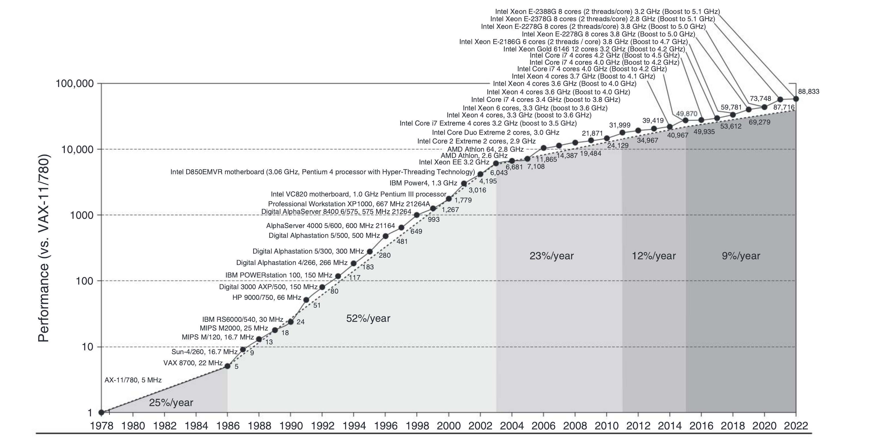

# 《计算机体系结构：量化研究方法》第 7 版翻译协作手册

英文底本：*Computer Architecture: A Quantitative Approach*, 7th Edition，Hennessy、Patterson、Kozyrakis，Morgan Kaufmann / Elsevier。纸本 ISBN 9780443154065，电子版 ISBN 9780443154072。

目标：重译原书，让中文读起来像《计算机体系结构基础》（胡伟武等，下称 Archbase，本地在 `../archbase`）那样，是中国老师在讲课，而不是在转述一本外文书。**意思不变，表达放开**：事实、数据、条件、结论一项不改，句子怎么组织、话怎么说，按中文教材的习惯来。成品是和 Archbase 网页版同样的 Bookdown 书。本手册给各窗口共用。

## 〇、定稿速查（以本节为准，与后文冲突时听这里的）

**语体**：规范、平实的书面教材语言，参照胡伟武《计算机体系结构基础》和王道 408 复习书。不口语化，也不翻译腔。

**一条原则**：意思不变，表达放开。

- 必须守住的是「信息」：事实、数字、单位、条件、限定词（约、通常、几乎、大多数）、例外、因果、例子、图表号、公式、代码、习题和题号、引用。
- 可以放开的是「英文的说法」：句子边界、语序、从句结构、过渡套话。

**做法**：读懂一整段英文，合上原文，像写教材一样用中文写出这段的意思，再回头核对信息有没有漏、有没有错。

**可以做**

- 段内重组：先总后分、先结论后原因；并句、拆句。
- 并列和枚举改成「一是……二是……」或项目列表；定义写成「……称为……」「所谓……，就是……」。
- 删掉没有信息的套话（As we will see、Clearly、Of course、Indeed）。
- 名词化长主语改成「谁做了什么」；被动改主动；三层以上的「的」拆开。
- 段首加粗体引导语（如「**写策略。**」）点明主题。
- 因果用「因此」「于是」「从而」「随之」连起来；可用常见书面比喻（搭上快车、抬高标杆）和教材惯用语（对程序员是透明的、已经不再成立、可以忽略不计）。

**不可以做**

- 增加原书没有的事实、例子、观点、比喻、反问。
- 丢掉任何数字、条件、限定词、例外；把估算写成定论。
- 新增标题，或改变章节、小标题、图表、公式、习题的编号和结构。
- 用口头说法：涨、出局、不灵了、划算、用不着、拿来用、一靠……二靠……。
- 加「考点」「注意」「总结」之类原书没有的栏目。

**用户亲定的五句标准写法**

- 这样快的进步来自两个方面：一是计算机制造工艺在进步，二是计算机设计在创新。
- 微处理器能够搭上集成电路工艺进步的快车，于是性能提高得更快。
- 让一种新的体系结构比以往任何时候都更容易取得商业成功。
- ILP 由编译器和硬件配合，以隐式的方式利用，对程序员是透明的。
- 这一预测维持了大约 50 年，但现在已经不再成立。

**标尺文件**：`01-fundamentals-01.Rmd`（1.1 节）和 `02-memory-01.Rmd`（2.1 节第二轮重写稿）。

**最常用的术语**（完整表见第二节第 5 小节）

- Cache、TLB 用英文；Intel 不译。
- tag 每章首次写「tag（标签）」，之后直接写 tag。
- LLC 每章首次写「末级 Cache（LLC，Last-Level Cache）」。
- branch 译「转移」，miss 译「失效」，failure 译「故障」。
- invalidate 译「作废」；coherence 译「Cache 一致性」，consistency 译「存储一致性」。
- die 译「晶片」，chip 译「芯片」，chiplet 译「芯粒」。
- 倍数写「是……的 N 倍」「提高到原来的 N 倍」「降为原来的 1/N」，不写「快 N 倍」「提高了 N 倍」。

**格式**

- 一节或半节一个 `.Rmd` 文件，按 `_bookdown.yml` 顺序拼接。
- 节标题 `## 标题 {#sec-N-M}`；原书无编号的小标题 `### 标题 {-}`。
- 图号全部手写，和原书一致：插图写 `{#fig-N-M}`；表格类图先写一行 `[图 N.M　图名]{#fig-N-M .caption}`，再排 Markdown 表格。
- 表格里的美元符号写 `\$`。
- 引用写 `[图 N.M](#fig-N-M)`、`[N.M 节](#sec-N-M)`。

**原书疑点**：照原文译，记入 `校对记录/`，正文不留问号和译注，统稿时统一处理。

## 一、底本

正文第 1–7 章已下载到 [底本](底本/)（ch01.pdf–ch07.pdf，已核对页数）。用 `pdftotext -raw -f 起页 -l 止页 底本/ch0N.pdf -` 抽文字；抽出的文本里破折号常变成字母 `d`（如 `improvementdroughly`），连字和断行也会出错，公式、图表以 PDF 原图为准。

[中英对照站](https://caaqa.bmukou.org/) 的中文只用于定位，不作译文参考，免得被带回翻译腔。下表页码是整份 PDF 的位置，与书上印的页码不同。

| 章 | 对照网页 | 英文 PDF | PDF 页段 |
|---|---|---|---|
| 第 1 章 定量设计与分析基础 | [网页](https://caaqa.bmukou.org/) | [PDF](https://caaqa.bmukou.org/assets/pdf/ch01.pdf) | 18–109 |
| 第 2 章 存储层次设计 | [网页](https://caaqa.bmukou.org/ch02.html) | [PDF](https://caaqa.bmukou.org/assets/pdf/ch02.pdf) | 110–191 |
| 第 3 章 指令级并行 | [网页](https://caaqa.bmukou.org/ch03.html) | [PDF](https://caaqa.bmukou.org/assets/pdf/ch03.pdf) | 192–303 |
| 第 4 章 数据级并行 | [网页](https://caaqa.bmukou.org/ch04.html) | [PDF](https://caaqa.bmukou.org/assets/pdf/ch04.pdf) | 304–395 |
| 第 5 章 线程级并行 | [网页](https://caaqa.bmukou.org/ch05.html) | [PDF](https://caaqa.bmukou.org/assets/pdf/ch05.pdf) | 396–485 |
| 第 6 章 仓库级计算机 | [网页](https://caaqa.bmukou.org/ch06.html) | [PDF](https://caaqa.bmukou.org/assets/pdf/ch06.pdf) | 486–601 |
| 第 7 章 领域专用体系结构 | [网页](https://caaqa.bmukou.org/ch07.html) | [PDF](https://caaqa.bmukou.org/assets/pdf/ch07.pdf) | 602–667 |

附录 A–M 的 PDF 在同站 `assets/pdf/appendix-a.pdf` 至 `appendix-m.pdf`。附录译稿已收入，文件名为 `09-app-<字母>-NN.Rmd`。

## 二、译风：照着 Archbase 说话

Archbase 好读，不是因为用词花哨，而是因为它像老师上课：一句只讲一件事，先给结论再讲原因，因果关系用「因为……所以」「由于……因此」明明白白地连起来，数字后面马上跟上它意味着什么。翻译腔正好相反：一个英文长句译成一个中文长句，主语前面压着三层「的」，动词被换成「进行……的提高」，读者要读两遍才知道谁做了什么。

### 1. Archbase 的八个习惯

下面每条都摘了 Archbase 原文，译稿照着这个感觉写。

**（1）一句一事，句子短。** 英文一个长句，中文常常要拆成两三句。

> 引入时钟是因为更新PC触发器、写通用寄存器以及store类访存指令写数据存储器时都需要时钟。而引入复位信号是为了确保处理器每次上电后都是从相同位置取回第一条指令。（第 9 章）

**（2）先说结论，再说为什么。** 英文常把结论放在从句后面，中文把它提到前面。

> 摩尔定律不是一个客观规律，是一个主观规律。……所以摩尔定律是主观努力的结果，是投入很多钱才做到的。（第 1 章）

**（3）因果、转折用词明说。** 英文靠 which、thus、leading to 暗连的地方，中文用「因为」「所以」「于是」「但是」「这样」点出来。

> 漏电流大小随温度升高呈指数增加，因此温度是集成电路的第一杀手。（第 1 章）

**（4）主语是人或部件，动词是实在的动作。** 少用「被」，少用「进行」「实现」「做出」去撑名词。

> 根据PC从指令存储器中取出指令，然后是译码部件解析出相关控制信号，并读取通用寄存器堆。（第 9 章）

**（5）并列和分点用中文的套路。** 「一方面……另一方面」「首先……其次」「一是……二是……三是」，比照搬英文的 First、Second 更顺。

> 一是蚀刻等问题越来越难处理，可制造性问题突出；二是片内漂移的问题非常突出……三是栅氧……厚度难以继续降低。（第 1 章）

**（6）数字落地。** 给出数字后，马上交代比的是什么、意味着什么。

> 频率降低10%，动态功耗可以降低30%左右（功耗和电压的平方成正比，和频率成正比）。（第 1 章）

**（7）术语中文在前，英文全称和缩写放括号里，只在首次出现时给。** 业内习惯说英文的（Cache、TLB、load/store、Setup 时间）直接用英文。

> 指令系统结构（Instruction Set Architecture，简称ISA）成为计算机体系结构的研究重点。（第 1 章）

**（8）讲道理时带着读者推。** 「推算到这里就会发现」「可以看出」「这就是说」把逻辑链说出来。原文是 we 的，译成「我们」。

> 推算到这里就会发现，此时离控制逻辑的生成（第2个时钟周期）已经隔了一个时钟周期了，怎么保证这时候控制逻辑还没有发生变化呢？（第 9 章）

### 2. 边界：口语化到哪一步

Archbase 有些地方很口语，比如用宿舍电热棒解释兆瓦、说摩尔定律「被判了死刑」。那是作者自己的话，**译者不能加**。我们能学的是句法和语气，不能学它的举例和发挥。具体来说：

- 可以：拆句、并句、调语序、把名词化的动作还原成动词、补出原文隐含的「因此」「但是」、把 we 译成「我们」。
- 可以：**段内重排**。一段里先说结论、再说原因；条件和结果按中文习惯的先后排，不必跟英文句序走。三四个并列项可以归成「一是……二是……」。
- 语体是规范的书面教材语言，不是口语。用「于是」「因此」「从而」「随之」连接句子；可以用常见的书面比喻（搭上快车、抬高标杆），不用口头说法（涨、出局、不灵了、划算）。专业表述照教材习惯写，如「对程序员是透明的」「已经不再成立」「可以忽略不计」。
- 可以：括号里的英文全称能省就省，常见缩写（RISC、ILP、WSC、IoT）首次出现给中文名加缩写即可；不常见的术语才保留英文原词。
- 原文说 incredible、dramatic，可以用「惊人」「突飞猛进」这类中文常用说法；原文语气轻松的地方（如 Fallacy/Pitfall、历史回顾）可以活泼一些，但仍是书面语。
- 不可以：加原文没有的例子、比喻、评论、反问；删限定词（about、roughly、typically、in most cases）；把估算写成定论。
- 拿不准的地方，宁可平实，不要花哨。

### 2.5 改写的尺度（第二轮，用户定）

第一轮各章仍有翻译腔，根源是逐句对译：英文一句对应中文一句，语序、从句结构都跟着英文走。现在的要求是：**先读懂一整段英文，合上原文，再像写教材一样用中文把这段的意思写出来，最后回头对一遍信息有没有漏、有没有错。**

可以做的：

- 一段之内自由重组：先总后分、先结论后原因；几个短句并成一句，一个长句拆成几句。
- 英文行文里的并列、枚举（First… Second…、A, B, and C 各有说明）改成中文教材常用的「一是……二是……」或项目列表；定义写成「……称为……」「所谓……，就是……」。
- 英文的修辞套话、过渡语（As we will see、It is worth noting that、Indeed、Of course、Clearly）没有实际信息的可以省掉，有信息的换成中文说法。
- 名词化的长主语改成「谁做了什么」；被动句改主动句；三层以上的「的」拆掉。
- 段落内可以用粗体引导语（如「**写策略。**」）点明这一段讲什么，但不新增原书没有的标题。

不可以做的：增加原书没有的事实、例子、观点、比喻；丢掉任何数字、条件、限定词、例外；改变原书的章节、小标题、图表、公式和习题编号。

标尺：`02-memory-01.Rmd`（2.1 节，第二轮重写稿）。第一轮稿备份在 `/tmp/hp/draft-v1/02-memory-01.Rmd`，两相对照就能看出差别。

### 3. 对照样例（1.1 节开头）

> **现行尺度以 `01-fundamentals-01.Rmd` 为准**：规范、平实的书面教材语体。曾试过更口语的一版（「一靠……二靠……」「涨得更快」「不灵了」），用户认为过了头。下面五句是用户亲自定的标准写法：
>
> - 这样快的进步来自两个方面：一是计算机制造工艺在进步，二是计算机设计在创新。
> - 微处理器能够搭上集成电路工艺进步的快车，于是性能提高得更快。
> - 让一种新的体系结构比以往任何时候都更容易取得商业成功。
> - ILP 由编译器和硬件配合，以隐式的方式利用，对程序员是透明的。
> - 这一预测维持了大约 50 年，但现在已经不再成立。
>
> 要点：句子结构要顺中文（拆长定语、名词化还原成动词、因果连起来），措辞保持书面、准确；不追求口语化。
>
> 语体参照：国内考研复习书（如王道 408 系列）那样的教材语言，简洁、术语准确、条理清楚。只学它的语体，不学它的版式：不加「考点」「注意」「总结」之类原书没有的内容。

**英文：** Computer technology has made incredible progress in the roughly 75 years since the first general-purpose electronic computer was created. Today, $800 will purchase a cell phone that has as much performance as the world's fastest computer bought in 2000 for more than $100 million.

- 翻译腔：自从第一台通用电子计算机被创造出来以来的大约 75 年中，计算机技术已经取得了令人难以置信的进步。如今，800 美元就能购买一部与 2000 年以超过 1 亿美元购买的世界上最快的计算机具有同样性能的手机。
- 目标：第一台通用电子计算机问世至今大约 75 年，计算机技术取得了惊人的进步。2000 年，世界上最快的计算机售价超过 1 亿美元；今天，一部 800 美元的手机就具有同样的性能。

要点：主语前的长定语拆掉；两台机器分成两句对比，价格和年份各归各的；「被创造出来」换成「问世」。

**英文：** First, the virtual elimination of assembly language programming reduced the need for object-code compatibility. Second, the creation of standardized, vendor-independent operating systems, such as UNIX and its clone, Linux, lowered the cost and risk of bringing out a new architecture.

- 翻译腔：首先，汇编语言编程的实际上的消除降低了对目标代码兼容性的需求。其次，标准化的、独立于厂商的操作系统（如 UNIX 及其克隆 Linux）的创建，降低了推出新体系结构的成本和风险。
- 目标：一是汇编语言编程几乎消失，对目标代码兼容的要求随之降低；二是出现了 UNIX 及其克隆 Linux 这样标准化的、不依赖于特定厂商的操作系统，推出新体系结构的成本和风险因此降低。

要点：「……的消除」「……的创建」这类名词化主语还原成「谁做了什么」；virtual 译成「几乎」，不丢。

**英文：** The Digital Equipment Vax could not, and so it was replaced by a RISC architecture. Intel rose to the challenge, primarily by translating 80x86 instructions into RISC-like instructions internally, allowing it to adopt many of the innovations first pioneered in the RISC designs.

- 翻译腔：DEC 公司的 VAX 未能做到，因此它被一种 RISC 体系结构所取代。英特尔迎接了挑战，主要是通过在内部将 80x86 指令转换为类 RISC 指令，使其能够采用许多首先在 RISC 设计中开创的创新。
- 目标：DEC 的 VAX 没能跟上，最终被一种 RISC 体系结构取代。Intel 接受了挑战，主要办法是在处理器内部把 80x86 指令转换成类似 RISC 的指令，从而能够采用 RISC 设计中首先出现的许多创新。

要点：「主要是通过……使其能够……」改成「主要办法是……，从而……」，因果显出来。

### 4. 翻译腔自查表

交稿前在译稿里搜一遍这些词，逐个判断能不能改：

| 常见写法 | 通常改成 |
|---|---|
| 被……所取代 / 被认为 | 由……取代 / 一般认为，或换主动句 |
| 进行优化 / 实现提高 / 做出贡献 | 优化 / 提高 / 贡献 |
| 对于……来说，…… | 直接把对象做主语 |
| 随着……的……的增加 | 拆出一个短句：……增加了，于是…… |
| 三层以上「的」的定语 | 拆句或把定语后置成说明 |
| 其、该、此（指代不清时） | 重复名词 |
| 使得……成为可能 | 让……能够 / 于是可以 |
| 一个……的方法 / 一种……的方式 | 删去量词或直接说方法名 |
| 显著地、有效地、极大地 堆在一起 | 留一个，或用数字说话 |

### 5. 术语

默认跟 Archbase 的用法（括号内是 Archbase 里出现的次数，说明它确实这么用）：

| 英文 | 译法 | 备注 |
|---|---|---|
| cache | Cache | 不译「高速缓存」（496 : 33） |
| ISA / instruction set architecture | 指令系统结构（ISA）、指令系统 | 「指令集」也可用于 instruction set 本身 |
| microarchitecture | 微结构 | 不用「微体系结构」 |
| branch | 转移；branch prediction 译「转移预测」 | Archbase 转移、分支混用，本书统一「转移」，有异议再议 |
| miss / hit | 失效 / 命中 | miss rate 译「失效率」 |
| memory access | 访存 | |
| memory | 内存；main memory 译「主存」 | |
| throughput | 吞吐率 | |
| latency | 延迟 | 不用「时延」 |
| die / chip | 晶片 / 芯片 | 1.6 节起统一，die 一律「晶片」 |
| chiplet | 芯粒 | |
| yield | 成品率 | |
| dependability | 可信性 | reliability 是「可靠性」，不混 |
| failure rate | 故障率 | 与 miss rate「失效率」区分 |
| speedup | 加速比 | |
| benchmark | 基准测试程序 | |
| Intel / AMD / Apple / Google | Intel、AMD、苹果、谷歌 | Intel 不译「英特尔」 |
| fault / failure | 故障 / 失效 | single point of failure 译「单点故障」 |
| MTTF | 平均无故障时间（MTTF） | |
| socket | 插座 | 用来指一个 CPU |
| architecture / organization 对举 | 体系结构 / 组成 | |
| Putting It All Together | 融会贯通 | 节标题 |
| block / line | Cache 块 / Cache 行 | 原文混用时照原文 |
| hit time / miss penalty | 命中时间 / 失效开销 | |
| average memory access time | 平均访存时间 | |
| compulsory / capacity / conflict miss | 强制失效 / 容量失效 / 冲突失效 | |
| direct-mapped / set associative / fully associative | 直接映射 / 组相联 / 全相联 | n-way 译「n 路」 |
| write-through / write-back | 写直达 / 写回 | |
| write buffer | 写缓冲 | |
| replacement policy | 替换策略 | LRU 保留缩写 |
| nonblocking cache | 非阻塞 Cache | |
| prefetching | 预取 | |
| bank | 存储体（bank） | 首次出现注英文 |
| tag | tag | 每章首次出现写「tag（标签）」，此后直接用 tag，不译 |
| LLC | 末级 Cache（LLC，Last-Level Cache） | 每章首次出现写全，此后用 LLC 或「末级 Cache」 |
| critical word first / early restart | 关键字优先 / 提前重启 | |
| way prediction / victim cache | 路预测 / 牺牲 Cache | |
| write merging | 写合并；merging write buffer 译「合并写缓冲」 | |
| MPKI | 每千条指令失效数（MPKI） | |
| coherence / consistency | Cache 一致性 / 存储一致性 | |
| side-channel attack | 旁路攻击 | 不用「侧信道攻击」 |
| rank / memory channel | rank（不译）/ 存储通道 | |
| scratchpad memory | 便笺存储器 | |
| Cross-Cutting Issues | 交叉问题 | 节标题 |
| invalidate | 作废；write invalidate protocol 译「写作废协议」 | 不用「使无效」 |
| convoy / chime | 护航指令组 / 钟鸣（chime） | |
| UMA / NUMA / NUCA | 均匀存储访问 / 非均匀存储访问 / 非均匀 Cache 访问 | 不用「一致」，避免与 coherence 混淆 |
| hypervisor | 虚拟机监控器（VMM），之后用 VMM | |
| PUE | 电能使用效率（PUE） | |
| energy proportionality | 能耗正比性 | |
| barrier | 栅障（同步原语）；屏障（其他场合） | |
| row buffer / refresh | 行缓冲 / 刷新 | |
| virtual memory / page / page table | 虚拟存储 / 页 / 页表 | |
| virtual / physical address | 虚拟地址 / 物理地址 | |
| address translation | 地址转换 | TLB 保留英文 |
| virtual machine / hypervisor (VMM) | 虚拟机 / 虚拟机监控器（VMM） | |
| locality（temporal / spatial） | 局部性（时间局部性 / 空间局部性） | |
|倍数 | 「是……的 N 倍」「提高到原来的 N 倍」「降为原来的 1/N」 | 不写「快 N 倍」「提高了 N 倍」，避免歧义 |
| technology（指半导体） | 工艺 | |
| power / energy | 功耗 / 能耗 | 原书严格区分，译文不能混 |
| issue / out-of-order / renaming | 发射 / 乱序 / 重命名 | |
| warehouse-scale computer | 仓库级计算机（WSC） | |
| domain-specific architecture | 领域专用体系结构（DSA） | |
| Fallacy / Pitfall | 谬误 / 陷阱 | |

新术语先记进本章校对记录，整章统一后再用。

人名：常见的用中文（史蒂夫·乔布斯），技术文献里的人名保留英文（Robert Dennard、Gordon Moore、Amdahl 定律）。美元：正文写「800 美元」；表格里保留 `$`，但必须写成 `\$800`，否则 Pandoc 会当成公式。

## 三、规则

1. **意思不变，表达放开。** 要守住的是「信息」：事实、数字、单位、条件、限定词、因果关系、例子、图表编号、公式、习题、引用。不必守住的是「英文的说法」：句子边界、语序、从句结构、修辞性套话都可以重组。用户明确说过：「允许在原意不变的情况下换成中文教材的表达风格」，不要被「忠于原文」误导成逐句对译。
2. **编号跟原书。** 章节号、图号（原书表格也叫 Figure，一律译「图 1.x」）、公式号、习题号保持原样。
3. **人称跟原书。** 原文 we 译「我们」；原文是客观陈述的不加「我们」。
4. **数字和单位。** 阿拉伯数字，单位按原书（ns、GHz、W、$）。美元金额可写「800 美元」，表格内保留 `$800`。
5. **交稿前看两遍。** 第一遍对英文：谁做了什么、先后、范围、例外、数字、单位、图表引用。第二遍只读中文：用自查表扫一遍，出声读得顺才算过。
6. **拿不准就记下来。** 原书页码、英文词组、你的疑问，写进本章校对记录，正文不留问号和译注（原书本身的脚注照译）。
7. **分工。** 一个窗口一章，按小节顺序译，只动自己那章的文件。
8. **版权。** 原书仍受版权保护。译稿和截图只供个人学习；公开发布前须取得授权。

## 四、文件格式：照 Archbase 的 Bookdown 结构

### 目录结构

```
量化研究第7版/
├── index.Rmd              # 书名、作者、YAML 头，作为封面页
├── _bookdown.yml          # 章节顺序、中文「图」「表」「第 N 章」标签
├── _output.yml            # gitbook（网页）、pdf、epub 输出设置
├── Makefile               # make html / make pdf
├── css/style.css
├── 01-fundamentals.Rmd    # 第 1 章，一章一个文件
├── 02-memory.Rmd
├── 03-ilp.Rmd
├── 04-dlp.Rmd
├── 05-tlp.Rmd
├── 06-wsc.Rmd
├── 07-dsa.Rmd
├── images/ch01/ …         # 从 PDF 截的图，按章分目录
├── 校对记录/ch01.md        # 每章的待确认术语、缺页、疑问，不进书
└── 底本/
```

一章一个 `.Rmd`，跟 Archbase 一样。多人同时译一章时，可先按节写成 `01-fundamentals-01.Rmd`、`01-fundamentals-02.Rmd`，Bookdown 按文件名顺序拼接，效果相同。

### 正文写法

章和节用 Markdown 标题，Bookdown 自动编号成「第 1 章」「1.1」，和原书一致：

```markdown
# 定量设计与分析基础 {#ch-fundamentals}

## 引言 {#sec-1-1}

第一台通用电子计算机问世至今大约 75 年，计算机技术的进步惊人。……

### 计算机的类型 {-}
```

原书没有编号的小标题，后面加 `{-}`。

**图和表。** 原书的表格也编作 Figure，和插图共用一套号。Bookdown 的自动编号会把图、表分开数，对不上原书，所以本书一律手写图号，不用 Archbase 的 `fig.cap` 自动编号。

插图从 PDF 截图放进 `images/ch01/`，文件名用图号：

```markdown
{#fig-1-1 width=90%}
```

数据不多的表改成 Markdown 表格，复杂的截图。表格版本在表前写一行带锚点的图名：

```markdown
[图 1.2　五类主流计算设备及其系统特点]{#fig-1-2 .caption}

| 特点 | 物联网/嵌入式 | 个人移动设备 | … |
|---|---|---|---|
```

正文引用写 `[图 1.1](#fig-1-1)`，网页里可以点击跳转。图名和图注照译；图内的英文标注暂不改图，必要时在图注里补一句译文。

**公式** 用 LaTeX，写法与 Archbase 相同，公式里的中文用 `\text{}`：

```markdown
$$
\text{CPU 时间} = \text{指令数} \times \text{CPI} \times \text{时钟周期}
$$
```

**例题。** 原书的 Example / Answer 写成：

```markdown
**例题**　……

**解答**　……
```

**脚注** 用 `^[脚注内容]`。**交叉引用章节** 写 `第\@ref(ch-fundamentals)章`、`\@ref(sec-1-1)节`；还没译到的章节先写纯文本「1.4 节」，合并时统一替换。**习题** 保持原书格式，如 `1.1　[10] <1.4> ……`。

### 构建

需要 R、bookdown 和 pandoc（本机目前未安装）。装好后在本目录执行 `make html`，输出到 `_book/`，打开 `_book/index.html` 即是和 Archbase 网页版同样的 gitbook 页面。配置文件照搬 `../archbase` 的 `_bookdown.yml`、`_output.yml`、`Makefile`，把书名和章节列表改掉即可。

## 五、开新窗口时发的话

「读 `量化研究第7版/量化研究第7版-翻译协作手册.md`。这个窗口负责第 N 章，按手册的译风、规则和文件格式做，只处理本章。底本缺页或公式看不清就记进 `校对记录/chN.md`。」
